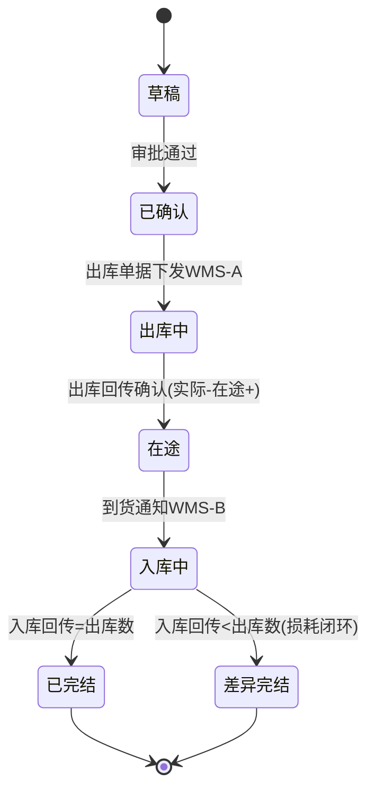
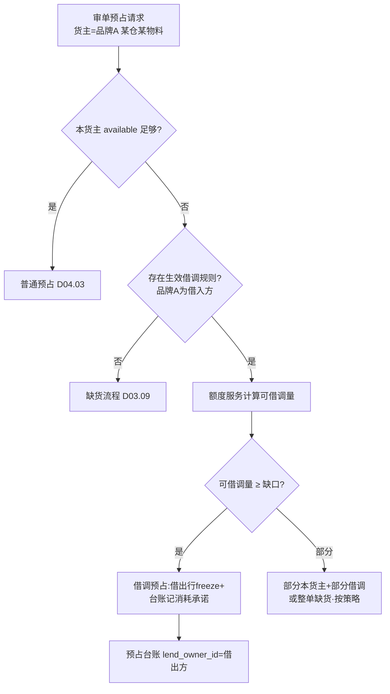

# SRS-D04.05 仓间调拨与货主借调模块 需求规格说明书

> 文档编号：SRS-D04.05 · 版本 V1.0 · 2026-10-23 · 编写：小凯 · 状态：待审阅（批次①）
> 所属域：D04 库存域 · 分期：仓间调拨 **P0（M1）** · 货主借调 **P1（M2-M3）**
> 上游依据：SRS-D04.02/03/04 契约 · 逆向文档 03 §调拨 · 商派 taoguanallocate 参考实现 · 需求决策 Q2（隔离+可借调）

---

## 1. 模块概述

### 1.1 定位

管理两类库存移动：**仓间调拨**（同货主，货从 A 仓到 B 仓，物理移动）与**货主借调**（跨货主，货不动或动，售卖权临时让渡——凯淳特色能力，商派无此模型）。两者都通过 D04.04 出入库单据执行实物移动、通过 D04.02 记账，本模块负责单据编排、在途管理与借调额度台账。

### 1.2 职责边界

**做**：调拨单全生命周期（申请→审批→出库→在途→入库→完结）、借调规则配置（货主对×物料范围×额度×期间）、借调台账（借出/借入/占用/归还）、借调结算数据供给（D08）。
**不做**：记账与流水（D04.02）、单据执行（D04.04）、借调触发的预占执行（D04.03）、调拨成本结转规则定义（D04.07）。

### 1.3 与其他模块关系

| 模块 | 关系 |
|---|---|
| D04.02/03/04 | 调拨出库单+入库单配对；在途口径管理；借调预占额度校验 |
| D03.06 配货分仓 | 分仓时可读借调可用量（借入货主视角） |
| D09 WMS | 调拨出/入库指令下发与回传（跨 WMS 调拨=两套指令） |
| D10.05 审批 | 调拨/借调超阈值推 OA |
| D08 财务 | 借调结算数据（借入方销售了借出方的货 → 内部交易记录） |
| D04.10 | 调拨建议（仓间库存不平衡预警） |

---

## 2. 业务场景

**SC-D04.05-01 仓间调拨（同货主）**
品牌 A 的 SKU 华东仓积压 500 件、华南仓缺货。库存专员发起调拨单（华东→华南，200 件）。审批通过后：华东仓出库单据（调拨出库，实际-200、在途+200 记华南行）→ WMS 发运 → 华南仓入库回传（实际+200、在途-200）。在途期间该 200 件不可售（默认）或按配置可售（在途可售开关，适用于确定性高的班线调拨）。

**SC-D04.05-02 货主借调（货不动）**
凯淳买断的「包材礼盒」（货主=凯淳，华东仓 1000 件）可借给品牌 A（代销）的订单使用。借调规则：凯淳→品牌A，物料范围=包材类，额度 300 件/月，期间 2026-11~12。品牌 A 订单审单时若自身货主无货，D04.03 按借调规则生成借调预占（台账：借出=凯淳行 freeze+1，借入归属=品牌A 订单）。月末结算：品牌 A 实际消耗借调 180 件 → D08 生成内部交易记录（品牌 A 应付凯淳货款/或凯淳冲减成本，按财务规则）。

**SC-D04.05-03 货主借调（货动 = 借调+调拨组合）**
借出的货需要从凯淳仓移到品牌 A 指定仓：先按 SC-02 建立借调关系，再走仓间调拨单据（出库行货主=凯淳，入库行货主=凯淳但打借调标记存放于品牌 A 区域库位——物理仓位由 WMS 管理，OMS 记账行货主不变，借调台账记录存放位置）。**货权不随物理移动转移**，归还在台账层完成。

**SC-D04.05-04 借调归还与额度恢复**
活动结束，品牌 A 未消耗完的借调额度自动失效（期间到期）；已预占未发货的部分释放；台账关闭，额度恢复。若有实物借调（SC-03），发起反向调拨归还。

**SC-D04.05-05 货权转移（购销，P1 后置）**
凯淳把买断货整体转给品牌 A（货权变更）：不是借调，是**购销**——生成销售出库（货主=凯淳）+采购入库（货主=品牌A）配对单据 + 财务购销记录。因 D04.01 规定基础物料货主建档后不可改，货权转移=新物料档案（品牌A 货主）+ same_code_group 关联。**本功能 P1 提供界面化流程，MVP 期走人工双单据操作。**

---

## 3. 功能需求

### FR-D04.05-01 仓间调拨
- FR-01a 调拨单：出库仓/入库仓（可跨 WMS）、货主（单一，不允许一单多货主）、明细（物料+数量）、调拨原因（平衡/归集/退仓前置/其他）。
- FR-01b 生命周期：草稿→（审批）→已确认→出库中→在途→入库中→已完结/差异完结；出库确认即记账（出库仓实际-，入库仓在途+）；入库回传记账（在途-，实际+）。
- FR-01c 差异处理：入库数<出库数（运输损耗）→ 差异登记（损耗类型+责任），差额走出库仓盘亏单据闭环；差异超阈值告警。
- FR-01d 在途可售开关：按调拨单配置（默认关）。
- FR-01e 跨 WMS 调拨：出库指令发 WMS-A、入库通知发 WMS-B（D09.01 路由），状态机统一管理两段。

### FR-D04.05-02 借调规则
- FR-02a 规则要素：借出货主→借入货主（有向）、物料范围（分类/品牌/指定物料清单）、额度（总量/月量）、期间（起止）、借调性质（货不动/货动）、结算方式（内部购销价/成本价/免费额度——供 D08 取数）。
- FR-02b 规则审批：新建/变更走 OA 审批（涉及货主间利益）；品牌方门户可见本货主相关规则（只读）。
- FR-02c 优先级：多规则命中时按（指定物料 > 分类 > 品牌）× 创建时间排序取先。

### FR-D04.05-03 借调台账
- FR-03a 台账记录：规则 ID、借出/借入货主、物料、仓、借调量、已消耗量（预占核销累计）、已释放量、状态（生效/耗尽/到期/关闭）。
- FR-03b 额度服务：`可借调量 = min(额度余量, 借出方available−保留底线)` 实时计算（D04.03 §5.3 调用）。
- FR-03c 到期处理：调度任务到期自动关闭台账、释放未消耗预占（联动 D04.03 过期回收）。
- FR-03d 结算供给：月度按台账消耗量生成内部交易明细 → D08.02。

### FR-D04.05-04 货权转移（购销，P1）
- FR-04a 转移单：源货主→目标货主、物料明细、转移价格（购销价）；生成配对出入库单据 + 新物料档案建议（same_code_group 关联）+ 财务购销记录。
- FR-04b 强制审批（OA）+ 双方货主确认（品牌方门户确认动作，P1）。

---

## 4. 业务流程

### 4.1 仓间调拨状态机

### 4.2 借调预占决策流（审单时）

---

## 5. 处理逻辑

### 5.1 借调的记账本质（关键设计）
- **借调不改变记账行货主**：货是凯淳的，freeze/扣减都发生在凯淳的三元行上；
- 借调台账是**业务归属的第二本账**：记录「这次扣减实际服务于品牌 A 的订单」；
- 订单/发货单/应收记录借调标记（lend_flag+台账ID），D08 结算时按台账聚合内部交易；
- 好处：库存账不混乱（货主恒定），业务归属可追溯，结算有据。

### 5.2 消耗确认时点
台账「已消耗量」以**出库转扣减成功**为准（非预占时点）；预占只占用额度（额度余量=额度−已承诺预占），释放则额度恢复。

### 5.3 调拨在途的行归属
调拨中货权行不变（同货主），但记账行从出库仓行迁移到入库仓行：出库确认时出库仓行 实际-，**入库仓行 在途+**（两行独立，同三元键不同 branch）；入库确认时入库仓行 在途-实际+。运输损耗差额停留在出库仓侧走盘亏闭环（§FR-01c）。

### 5.4 并发控制
借调额度扣减用 Redis 原子操作（额度键 `lend:{rule_id}` 的 HINCRBY + 上限校验 Lua，复用 D04.02 脚本模式）；台账 DB 记录异步落库。

---

## 6. 数据字段（业务字段描述）

### 6.1 调拨单（transfer_order / transfer_item）

| 字段 | 业务含义 | 取值/校验 |
|---|---|---|
| transfer_bn | 调拨单号 | 唯一 |
| out_branch_id / in_branch_id | 出库仓/入库仓 | 不同仓；可跨 WMS |
| owner_id | 货主 | 单一，全单一致 |
| reason | 调拨原因 | 平衡/归集/退仓前置/借调移位/其他 |
| status | 状态 | §4.1 状态机 |
| arrival_sellable | 在途可售开关 | 默认否 |
| out_bill_bn / in_bill_bn | 配对出入库单据号 | D04.04 关联 |
| diff_num / diff_type / diff_duty | 差异量/类型/责任 | 差异完结必填 |
| approval_status | OA 审批 | 超阈值必填 |
| 行：bm_id / issued_num / returned_num / batch_no | 明细 | 效期物料带批次（FIFO 建议 → D04.09） |

### 6.2 借调规则（lend_rule）

| 字段 | 业务含义 | 取值/校验 |
|---|---|---|
| rule_id / rule_name | 规则标识 | |
| lend_owner_id / borrow_owner_id | 借出/借入货主 | 有向；不可相同 |
| scope_type / scope_ref | 物料范围 | 指定清单/分类/品牌 |
| quota_total / quota_monthly | 总量/月量额度 | 至少一项 |
| reserve_floor | 借出方保留底线 | 可借调量计算用（§5.1） |
| period_start / period_end | 期间 | 到期自动关闭 |
| settle_price_type | 结算方式 | 内部购销价/成本价/免费（D08 取数） |
| move_type | 借调性质 | 货不动/货动 |
| status / approval_status | 生效状态/OA 审批 | |

### 6.3 借调台账（lend_ledger）

| 字段 | 业务含义 |
|---|---|
| rule_id / lend_owner_id / borrow_owner_id | 规则与双方货主 |
| branch_id / bm_id | 仓与物料 |
| lend_num（额度占用） / committed_num（预占承诺） / consumed_num（已消耗=转扣减累计） / released_num | 数量族 |
| status | 生效/耗尽/到期/关闭 |
| order_refs | 关联订单集（追溯） |
| settle_month / settle_status | 结算月份与状态（D08 回写） |

---

## 7. 接口

### 7.1 内部接口

| 编号 | 接口 | 消费方 | 说明 |
|---|---|---|---|
| IF-D04.05-01 | `TransferService::create/confirm/dispatch` | 库存专员界面/D04.10 建议转单 | 调拨单编排 |
| IF-D04.05-02 | `LendQuotaService::available(ruleMatch)` | D04.03 借调预占 | 可借调量实时计算（Redis） |
| IF-D04.05-03 | `LendQuotaService::commit/release/consume(台账ID, num)` | D04.03 | 额度承诺/释放/消耗确认 |
| IF-D04.05-04 | `LendLedgerService::query(owner, period)` | D08.02/D10.04 门户 | 借调台账（结算供给/品牌方只读） |
| IF-D04.05-05 | 事件 `transfer.completed` / `lend.expired` | D04.08/D11 | 库存重算与监控 |

### 7.2 外部接口

| 编号 | 接口 | 方向 | 说明 |
|---|---|---|---|
| EF-D04.05-01 | WMS 调拨出/入库指令（经 D09） | 双向 | 跨 WMS 时两套适配 |
| EF-D04.05-02 | OA 审批（经 D10.05） | 双向 | 调拨超阈值/借调规则/货权转移 |

---

## 8. 非功能需求

| 项 | 要求 |
|---|---|
| 性能 | 额度查询（审单热路径）P99 ≤5ms（Redis）；调拨单据操作 ≤200ms |
| 一致性 | 额度承诺与预占台账最终一致（对账任务）；调拨两段单据状态机强校验（不可跳态） |
| 审计 | 借调规则变更/额度消耗/差异责任全留痕；品牌方可见本方台账 |
| 边界 | 借调仅 P1 启用；P0 期规则表与台账表结构先行建好（预留），审单链路不含借调分支 |

---

## 9. 验收标准

| 编号 | 验收条件 |
|---|---|
| AC-01 | 同货主仓间调拨全流程：出库仓实际-200、在途期入库仓在途+200、入库后在途-200 实际+200，全程流水与单据配对可溯 |
| AC-02 | 跨 WMS 调拨（通天晓→其他 WMS）两段指令独立下发回传，状态机统一管理 |
| AC-03 | 运输损耗 5 件：差异完结，损耗走盘亏单据闭环，责任登记完整，超阈值告警 |
| AC-04 | 在途可售开关开启时，在途量参与可售计算（D04.08 联动）；关闭时不参与 |
| AC-05 | 借调预占：本货主不足→规则命中→额度内成功，台账 committed+；额度不足按缺货处理 |
| AC-06 | 借调消耗确认时点=出库转扣减；预占释放则额度恢复；到期未消耗自动关闭并释放 |
| AC-07 | 并发借调额度竞争（额度 10，20 并发）：恰好 10 成功，无超额 |
| AC-08 | 月末结算数据：台账消耗量按货主对聚合生成内部交易明细，与订单借调标记一一对应 |
| AC-09 | 借调不改变记账行货主：品牌 A 订单消耗借调货后，凯淳行的流水完整、品牌 A 行无该物料记账 |
| AC-10 | 货权转移（P1）：转移单生成配对单据+新档案建议+财务记录，审批与双方确认留痕 |

---

## 变更记录

| 日期 | 版本 | 变更 | 原因 |
|---|---|---|---|
| 2026-10-23 | V1.0 | 首版 | — |

---

*参考实现溯源：商派 taoguanallocate（调拨单 2 表）+ ome_branch_stock_queue（仓库库存队列）。商派无货主借调模型——本模块 §3.2/3.3 借调规则与台账为凯淳新增设计（Q2 决策「隔离+可借调」的落地），记账本质（§5.1 货主行恒定+台账第二本账）是本 SRS 的关键原创设计，请 Jason 重点审阅。*
