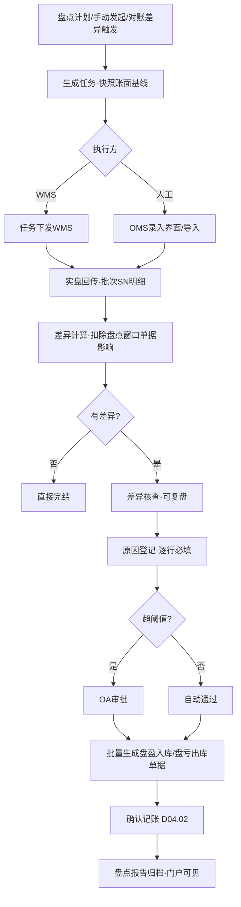

# SRS-D04.06 盘点模块 需求规格说明书

> 文档编号：SRS-D04.06 · 版本 V1.0 · 2026-10-23 · 编写：小凯 · 状态：待审阅（批次①）
> 所属域：D04 库存域 · 分期：**P1（M2 后段，基础盘点随 M1 库存域联调提供简版）**
> 上游依据：SRS-D04.02/04 契约 · 逆向文档 03 §盘点 · 商派 taoguaninventory 参考实现

---

## 1. 模块概述

### 1.1 定位

盘点管理「账面 vs 实物」的周期性核对：发起盘点任务 → WMS/人工执行清点 → 回传实盘数 → 差异生成盘盈盘亏 → 审批后走出入库单据调整记账。同时承担 **OMS-WMS 日常对账**（快照比对）的差异闭环入口。

### 1.2 职责边界

**做**：盘点计划与任务、盘点范围圈定（仓/货主/分类/物料）、盲盘/明盘模式、实盘录入与回传、差异计算与复盘、盘盈盘亏单据生成（联动 D04.04）、WMS 快照对账差异清单。
**不做**：记账（D04.02）、单据执行（D04.04）、仓内盘点作业本身（WMS 职责，OMS 只做任务下发与结果管理）。

### 1.3 与其他模块关系

| 模块 | 关系 |
|---|---|
| D04.02 | 对账快照比对触发盘点；盘盈盘亏记账 |
| D04.04 | 盘盈入库/盘亏出库单据 |
| D09 WMS | 盘点任务下发（WMS 有盘点能力时）与结果回传；无盘点接口的 WMS 走 OMS 侧人工录入 |
| D10.05 | 差异超阈值审批 |
| D04.09 | 效期/批次物料按批次盘点 |
| D11.03 | 盘点执行监控 |

---

## 2. 业务场景

**SC-D04.06-01 月度大盘（WMS 执行）**
每月 1 日对通天晓华东仓发起全量盘点。OMS 生成盘点任务（快照账面数冻结为盘点对账基线）下发 WMS；仓库 PDA 清点回传实盘数；OMS 计算差异清单（盘盈 12 行/盘亏 8 行）；库存专员核查差异原因（录入差异说明），超阈值行走 OA 审批；审批通过后批量生成盘盈入库/盘亏出库单据记账；盘点报告归档（品牌方门户可见本货主盘点结果）。

**SC-D04.06-02 动碰盘点（周期循环）**
配置规则：每日对「近 7 天有出入库动作」的物料抽盘。调度自动生成小任务下发，差异当日闭环。降低大盘频率压力。

**SC-D04.06-03 盲盘**
高价值物料（序列号管理）采用盲盘：下发任务不含账面数，清点人只报实盘；OMS 侧比对差异。防止「照账凑数」。

**SC-D04.06-04 对账差异转盘点**
D04.02 每日 WMS 快照对账发现某行 OMS 账面 100 / WMS 实报 97，差异清单自动生成「待核查」盘点任务（范围=该三元行），走复盘流程定位（可能是回传丢失/单据未闭环），确认后走盘亏闭环或数据纠错（D04.02 调整单，非盘点单据——区分账错与货错）。

---

## 3. 功能需求

### FR-D04.06-01 盘点计划与任务
- FR-01a 计划：周期（月/周/日）、范围模板（仓×货主×分类/物料清单/动碰规则）、盘点模式（明盘/盲盘）、执行方（WMS/人工）。
- FR-01b 任务生成：手动发起或调度自动生成；任务快照账面五口径（对账基线）；任务号下发 WMS。
- FR-01c 任务状态机：待下发→执行中→已回传→差异核查→审批中→已完结（无差异直接完结）。

### FR-D04.06-02 实盘结果管理
- FR-02a WMS 回传接收（批次/序列号维度明细，效期物料按批次行）。
- FR-02b 人工录入界面（无盘点接口的 WMS/门店仓）：PDA 网页版或 PC 录入，支持导入。
- FR-02c 复盘：差异行可发起二次清点（复盘结果覆盖初盘，留痕）。

### FR-D04.06-03 差异处理
- FR-03a 差异计算：实盘-账面（按口径：实际库存为准，冻结/在途不参与实盘比对——盘点期间预占照常，差异计算需扣除盘点窗口内已确认单据的影响，见 §5.2）。
- FR-03b 差异原因字典：货损/货差/单据未闭环/回传丢失/串货（货主间）/其他；每差异行必填原因。
- FR-03c 审批路由：|差异|≤阈值（按货主/物料价值配置）自动通过；超阈值 OA 审批。
- FR-03d 单据生成：审批通过后按差异方向批量生成盘盈入库/盘亏出库单据（D04.04，类型=盘盈/盘亏，源单=盘点任务）。

### FR-D04.06-04 盘点报告与门户
- FR-04a 报告：任务汇总（行数/差异率/差异金额/原因分布）、明细清单、审批链；归档只读。
- FR-04b 品牌方门户：本货主盘点报告只读视图（Q8 多租户）。

### FR-D04.06-05 对账差异联动
- FR-05a 接收 D04.02 对账差异清单 → 自动生成待核查盘点任务。
- FR-05b 区分「账错」（OMS 侧数据纠错，走 D04.02 调整单）与「货错」（实物差异，走盘盈盘亏）双路径。

---

## 4. 业务流程



---

## 5. 处理逻辑

### 5.1 盘点模式差异
- 明盘：任务含账面数（WMS/人工可见）——效率优先；
- 盲盘：不含账面数——高价值/SN 物料强制（配置项）；
- 抽盘范围算法（动碰）：`近 N 天有 iostock 流水 OR 有预占变动 OR 上次盘点距今 > M 天` 的三元行。

### 5.2 盘点窗口的一致性处理（关键）
盘点期间业务不停摆（电商仓无法停业盘点），差异计算必须消除窗口噪音：
```
差异 = 实盘数 − (任务基线账面
              + 窗口内已确认入库单据量
              − 窗口内已确认出库单据量)
```
- 窗口=任务下发至回传截止；窗口内单据以**确认时间**计；
- 预占（freeze）不影响实盘比对（货还在仓内）；
- WMS 侧建议「盘点库位隔离」（正在清点的库位暂停拣货），OMS 记录 WMS 回传的库位维度以支持局部复盘。

### 5.3 串货识别（货主间）
同货号（same_code_group）不同货主的行同时出现「一盈一亏且数量相近」→ 标记疑似串货（WMS 混放），提示按货主间调整处理（货权转移或借调补录，D04.05 §FR-04），不直接盘盈盘亏（否则两货主账都失真）。

---

## 6. 数据字段（业务字段描述）

### 6.1 盘点任务（stocktake_task）

| 字段 | 业务含义 | 取值/校验 |
|---|---|---|
| task_bn / plan_id | 任务号/来源计划 | |
| branch_id / owner_id / scope | 仓/货主/范围描述 | 单仓单货主（多货主盘点拆多任务） |
| mode | 明盘/盲盘 | SN 物料强制盲盘 |
| executor | WMS/人工 | |
| status | 状态机 | §FR-01c |
| snapshot_time / window_end | 基线快照时间/回传截止 | 窗口一致性计算用 |
| diff_rows / diff_rate / diff_amount | 差异汇总 | 报告用 |

### 6.2 盘点明细行（stocktake_item）

| 字段 | 业务含义 |
|---|---|
| bm_id / owner_id / batch_no / serial_no | 物料/货主/批次/SN（维度按物料开关） |
| book_num | 账面数（基线+窗口修正后） |
| actual_num | 实盘数（初盘/复盘值分列） |
| diff_num / diff_reason / duty | 差异量/原因（字典）/责任 |
| recount_flag / recount_num | 复盘标记与结果 |
| adjust_bill_bn | 生成的盘盈盘亏单据号 |
| suspect_mixup | 疑似串货标记（§5.3） |

---

## 7. 接口

| 编号 | 接口 | 方向/消费方 | 说明 |
|---|---|---|---|
| IF-D04.06-01 | `StocktakeService::createTask(scope, mode)` | 界面/调度/D04.02 对账 | 任务生成（含基线快照） |
| IF-D04.06-02 | `StocktakeService::receiveResult(taskBn, items[])` | D09 WMS 回传 | 实盘接收（幂等） |
| IF-D04.06-03 | `StocktakeService::closeDiff(taskBn)` | 审批回调 | 差异闭环（批量生成单据） |
| EF-D04.06-01 | WMS 盘点任务下发/结果回传 | 双向（经 D09） | 通天晓盘点接口【待确认：接口形态】 |
| EF-D04.06-02 | OA 审批 | 双向（经 D10.05） | 超阈值差异 |

---

## 8. 非功能需求

| 项 | 要求 |
|---|---|
| 性能 | 全量任务（5 万行）生成与差异计算 ≤5 分钟（批处理） |
| 一致性 | 窗口修正算法保证业务不停摆下的差异准确性；基线快照不可变 |
| 审计 | 盲盘不可见账面（权限控制）；复盘覆盖留痕；报告归档只读 |
| 分期 | 简版（明盘+WMS 回传+手动差异闭环）随 M1 联调；完整版（盲盘/动碰/串货识别/门户报告）P1 |

---

## 9. 验收标准

| 编号 | 验收条件 |
|---|---|
| AC-01 | 月度大盘全流程：任务→WMS 回传→差异→审批→单据记账→报告归档，账面与实盘一致收口 |
| AC-02 | 盘点窗口内发生的入库/出库单据被窗口修正算法正确扣除，不产生假差异 |
| AC-03 | 盲盘任务下发报文中不含账面数（报文级验证）；权限控制录入界面不可见 |
| AC-04 | 动碰抽盘规则命中「近 7 天有动作」的行，自动生成日任务 |
| AC-05 | 差异超阈值走 OA、阈值内自动通过；每差异行无原因不可提交 |
| AC-06 | 同货号两货主一盈一亏相近数量被标记疑似串货，不直接生成盘盈盘亏单据 |
| AC-07 | 对账差异清单自动生成待核查任务；账错路径走调整单、货错路径走盘点单据，双路径不混淆 |
| AC-08 | 品牌方门户仅见本货主盘点报告 |

---

## 变更记录

| 日期 | 版本 | 变更 | 原因 |
|---|---|---|---|
| 2026-10-23 | V1.0 | 首版 | — |

---

*参考实现溯源：商派 taoguaninventory（盘点单 5 表）。关键差异：① 盘点窗口一致性修正算法（电商仓不停摆盘点）；② 串货识别（多货主场景特有）；③ 账错/货错双路径分流；④ 品牌方门户报告。*
