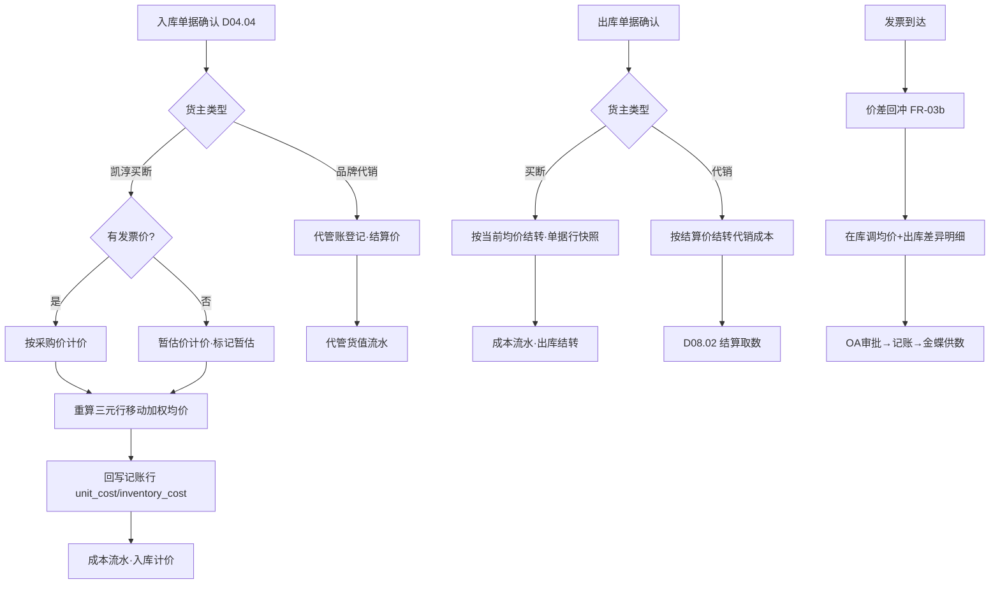
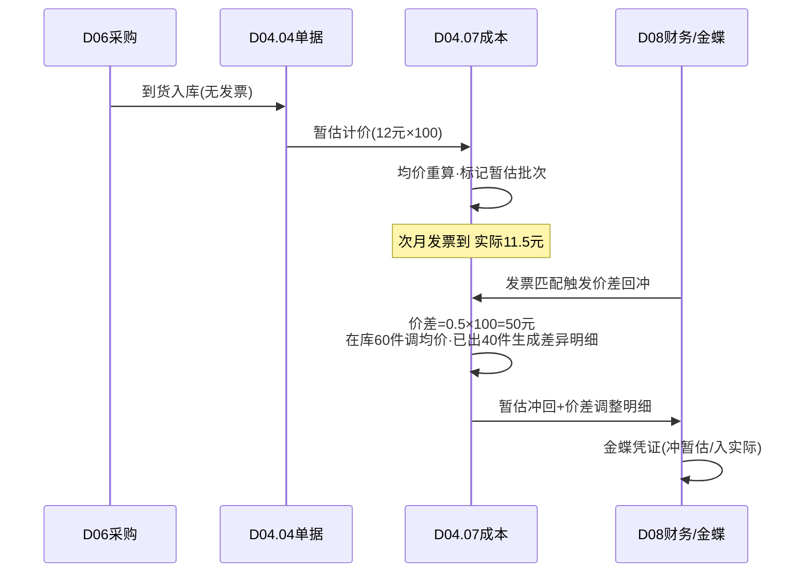

# SRS-D04.07 库存成本核算模块 需求规格说明书

> 文档编号：SRS-D04.07 · 版本 V1.0 · 2026-10-23 · 编写：小凯 · 状态：待审阅（批次①）
> 所属域：D04 库存域 · 分期：**P1（M3，与采购/财务同批）**；P0 期字段与快照先行（出库单据携带成本快照位）
> 上游依据：逆向文档 03 §成本核算 · 商派 tgstockcost/ome_iostock 成本字段族 · 需求决策（金蝶记账，OMS 出明细）

---

## 1. 模块概述

### 1.1 定位

按**货主分账**核算库存成本：买断货主（凯淳）走完整的移动加权平均成本核算（入库计价→出库结转→存货余额），供采购对账、销售毛利、金蝶存货核算取数；代销货主走**代管口径**（不形成凯淳存货，只记录货值备查与结算基数）。

> 财务边界（Q5 决策）：存货总账/凭证在金蝶。OMS 成本模块产出**业务口径的成本明细与余额**，通过 D08.06 供给金蝶；两边口径差异走 D08.06 排查工具核对。

### 1.2 职责边界

**做**：入库计价（采购价/暂估/退货冲减）、移动加权平均单价维护、出库成本结转快照、按货主的存货余额与货值报表、成本调整（暂估转正/价差回冲）、代销代管货值备查账。
**不做**：数量记账（D04.02，成本模块只写 unit_cost/inventory_cost 字段）、应付/应收（D08）、金蝶凭证（D08.06）。

### 1.3 与其他模块关系

| 模块 | 关系 |
|---|---|
| D04.02 | 回写记账行 unit_cost/inventory_cost |
| D04.04 | 入库单据带价（采购价/暂估价）触发计价；出库单据携带成本快照 |
| D06 采购 | 采购价来源；暂估转正（发票到）价差回冲 |
| D05 售后 | 退货入库按原出库成本冲回（不按当前均价，防成本扭曲） |
| D08 财务 | 出库成本→营业成本明细；存货余额→金蝶对账；代销结算基数 |
| D04.05 | 调拨按成本价平移；货权转移（购销）按转移价重新计价 |

---

## 2. 业务场景

**SC-D04.07-01 移动加权平均（买断货）**
凯淳买断物料 M：期初 100 件@10 元（货值 1000）。采购入库 100 件@12 元 → 新均价=(1000+1200)/200=11 元。销售出库 50 件 → 结转成本 50×11=550，余 150 件@11（货值 1650）。每次入库重算均价，出库按当前均价快照结转。

**SC-D04.07-02 暂估入库与价差回冲**
货到票未到：入库单按暂估价 12 元计价。次月发票到（实际 11.5 元）：生成价差调整（-0.5×在库量+已出库量分摊），均价回冲至真实成本，调整明细供金蝶同步（暂估冲回凭证在金蝶侧生成，OMS 供数）。

**SC-D04.07-03 退货成本冲回**
订单出库 2 件@均价 11（结转 22）。客户退货入库（良品）：按**原出库成本 11** 冲回（不是当前均价），保证该笔销售毛利核算准确；冲回后均价按 (余货值+22)/(余量+2) 重算。

**SC-D04.07-04 代销货代管口径**
品牌 A 代售货：入库按品牌 A 结算价（供货价）记「代管货值」备查账，不参与凯淳存货均价；品牌 A 订单出库时按结算价结转「代销成本」（对凯淳是结算支出而非存货成本）；月度按货主出代管货值余额表（品牌方门户可见本货主）。

**SC-D04.07-05 成本异常排查**
财务发现某物料 OMS 存货货值与金蝶差异 5000 元。通过 D08.06 排查工具：拉出该三元行的成本流水（每笔入库计价/出库结转/调整），定位到一笔暂估未回冲 → 补价差调整闭环。

---

## 3. 功能需求

### FR-D04.07-01 入库计价
- FR-01a 采购入库：按采购单含税/不含税价（配置口径，与金蝶一致——【待确认】凯淳成本口径含税否）计价；无价入库（赠品/样品）按最近均价或手工价。
- FR-01b 暂估机制：无发票入库标记暂估，发票到达触发价差回冲（FR-03b）。
- FR-01c 退货入库：良品按原出库成本冲回（关联原出库单据行取快照价）；找不到原单（超期/迁移单）按当前均价+人工确认。
- FR-01d 调拨入库：按出库方成本价平移（同货主）；货权转移按转移价（购销价）重新计价。
- FR-01e 盘盈入库：按当前均价（无均价则最近采购价/人工价）。

### FR-D04.07-02 移动加权平均与出库结转
- FR-02a 均价公式：`新均价 = (原货值 + 本笔入库金额) / (原数量 + 本笔入库数量)`；按**三元行**（仓×物料×货主）独立核算；跨仓不平价（各仓独立均价，与金蝶分仓核算口径对齐——【待确认】金蝶是否分仓核算）。
- FR-02b 出库结转：销售出库/调拨出库/报损出库按当前均价×数量结转，快照写入单据行（unit_cost/amount）；结转后均价不变（加权平均特性），货值减少。
- FR-02c 负库存成本处理：负卖行出库时均价照常结转（货值可为负）；回补入库按入库价重算——负库存期间结转差异记「成本待摊」标记，对账提示。
- FR-02d 计算时点：入库确认时同步重算均价（D04.04 confirm 事务内）；出库结转取当时均价快照（异步成本流水落库）。

### FR-D04.07-03 成本调整
- FR-03a 调整类型：暂估转正价差/盘点价差（金额）/手工纠错/迁移期初；调整走审批（OA）。
- FR-03b 价差回冲算法：`价差总额 = (暂估价-实际价) × 暂估批次数量`；分摊：在库部分调均价、已出库部分生成「出库成本差异」明细（供财务调整当期成本）。
- FR-03c 全部调整生成成本流水（不可改删，红冲机制同 D04.04）。

### FR-D04.07-04 代销代管口径
- FR-04a 代管账：按代销货主×仓记录代管货值（结算价×数量），入库+/出库-，不入凯淳存货汇总。
- FR-04b 代销成本结转：品牌订单出库按结算价结转「代销结算成本」→ D08.02 结算单取数。
- FR-04c 品牌方门户：本货主代管货值余额与流水（只读）。

### FR-D04.07-05 成本报表与金蝶供给
- FR-05a 报表：存货余额表（按货主/仓/分类，数量×均价=货值）、出入库成本汇总表（按月/货主）、销售成本明细（订单行级）、毛利基础数据（收入 D08.01 - 成本）。
- FR-05b 日终成本快照（配合 D04.02 日终库存快照，形成「量价双快照」）。
- FR-05c 金蝶供给：存货余额/出入库成本明细按金蝶接口格式输出（经 D08.06，P1）。

---

## 4. 业务流程

### 4.1 成本核算主流程（入库计价→均价→出库结转）



### 4.2 暂估转正时序



---

## 5. 处理逻辑

### 5.1 移动加权平均的并发与顺序
- 均价重算必须**串行按三元行**（入库确认事务内行锁）；并发入库按单据确认顺序重算（成本流水序号=重算顺序，可回放）；
- 出库结转不加锁（读当时均价快照）——出库高频，允许快照与重算间的毫秒级窗口（误差在下一笔入库重算中吸收，月结对账兜底）。

### 5.2 退货冲回的原单追溯
```
return_cost(退货行) = 原出库单据行.unit_cost(快照)
追溯链: 售后单→原订单→原发货单→原出库单据行(成本快照)
超期/迁移单无快照 → 取当期均价 + 人工确认标记(cost_estimated=true)
```

### 5.3 成本口径统一约定（与金蝶对齐的前提）
- 含税/不含税口径：全局配置一项（【待确认】凯淳现行金蝶口径）；
- 运费/关税是否计入成本：采购入库支持「价外费用分摊」字段（按数量/金额分摊入单价），首期手工录入分摊额，P2 对接采购费用自动化；
- 口径变更（如含税转不含税）只做**未来生效**，历史不重算（审计要求）。

---

## 6. 数据字段（业务字段描述）

### 6.1 成本流水（cost_change_log）

| 字段 | 业务含义 | 取值/校验 |
|---|---|---|
| 三元键（branch/bm/owner） | 核算行 | 必填 |
| change_type | 流水类型 | 入库计价/出库结转/退货冲回/暂估回冲/调整/期初 |
| bill_type / bill_bn / bill_item_id | 来源单据 | 幂等键成分 |
| num / price / amount | 数量/单价/金额 | 方向± |
| before_unit_cost / after_unit_cost | 均价前后值 | 快照，可回放 |
| before_value / after_value | 货值前后 | |
| estimate_flag | 暂估标记 | 暂估批次追踪 |
| operator / create_time | 经手/时间 | |

### 6.2 暂估批次（estimate_batch）

| 字段 | 业务含义 |
|---|---|
| 三元键 + in_bill_bn | 暂估入库来源 |
| estimate_price / actual_price | 暂估价/实际价（发票到回填） |
| remain_num / settled_num | 在库未结转量/已出库量（价差分摊基数） |
| status | 暂估中/已转正/部分转正 |
| invoice_ref | 关联发票（D08.05） |

### 6.3 代管货值账（consignment_value，代销货主）

| 字段 | 业务含义 |
|---|---|
| owner_id（代销货主）/ branch_id / bm_id | 维度 |
| settle_price / num / value | 结算价/数量/代管货值 |
| 流水同 cost_change_log（type=代管入/代管出） | |

### 6.4 记账行成本字段（回写 D04.02 stock_ledger）
unit_cost（当前移动加权均价）/ inventory_cost（当前货值=均价×实际数量）——定义见 SRS-D04.02 §6.1，本模块为唯一写入方。

---

## 7. 接口

| 编号 | 接口 | 方向/消费方 | 说明 |
|---|---|---|---|
| IF-D04.07-01 | `CostService::priceIn(billItem)` | D04.04 确认事务 | 入库计价+均价重算（同步） |
| IF-D04.07-02 | `CostService::carryOut(billItem)` | D04.04 确认事务 | 出库结转（均价快照写单据行） |
| IF-D04.07-03 | `CostService::reverseEstimate(invoiceRef)` | D08.05 发票匹配 | 暂估转正价差回冲 |
| IF-D04.07-04 | `CostService::getUnitCost(三元键)` | D03/D08/D11 | 当前均价查询 |
| IF-D04.07-05 | 事件 `cost.adjusted` | D08/D11 | 成本调整联动 |
| EF-D04.07-01 | 金蝶存货核算供数（经 D08.06） | 出 | 存货余额/出入库成本明细（P1） |

---

## 8. 非功能需求

| 项 | 要求 |
|---|---|
| 性能 | 入库计价（含重算）≤100ms/行；出库结转快照读 ≤5ms（缓存均价）；月结批量重放（5 万行×30 天）≤30 分钟 |
| 一致性 | 均价重算串行化+流水可回放；量价双快照日终对账（数量账 D04.02 × 均价 = 货值账） |
| 精度 | 单价 4 位小数、金额 2 位小数（与金蝶一致【待确认】）；尾差入「成本尾差」科目月度清理 |
| 审计 | 成本流水不可改删；调整走审批；口径变更只未来生效 |

---

## 9. 验收标准

| 编号 | 验收条件 |
|---|---|
| AC-01 | SC-01 移动加权场景数字全对：均价 11、结转 550、余货值 1650，流水可回放 |
| AC-02 | 暂估 12→发票 11.5：价差 50 元正确分摊（在库调均价+已出差异明细），金蝶供数含冲回与调整明细 |
| AC-03 | 退货按原出库成本 11 冲回（非当前均价）；无原单场景走均价+人工确认标记 |
| AC-04 | 代销货主订单出库不改变凯淳存货货值；代管账与结算取数一致 |
| AC-05 | 买断/代销同货号（same_code_group）两行成本完全隔离，报表可合并视角 |
| AC-06 | 并发入库 10 笔+出库 20 笔：均价重算顺序与流水序号一致，回放结果=在线结果 |
| AC-07 | 负卖期间出库结转正确记录成本待摊标记，回补后对账提示清理 |
| AC-08 | 日终量价双快照：数量（D04.02）×均价 = 货值（本模块），连续 7 天一致 |
| AC-09 | 月结存货余额表与金蝶存货科目差异可通过排查工具定位到流水级（SC-05 场景演练） |
| AC-10 | 价外费用（运费）分摊入单价后，出库结转含分摊成本 |

---

## 变更记录

| 日期 | 版本 | 变更 | 原因 |
|---|---|---|---|
| 2026-10-23 | V1.0 | 首版 | — |

---

*参考实现溯源：商派 tgstockcost（移动加权，2 表）+ ome_iostock 成本字段族（unit_cost/inventory_cost/now_*/entity_* 总仓口径）。关键差异：① 按货主分账核算（买断完整核算 vs 代销代管口径——商派无货主概念）；② 退货按原单成本冲回（商派按均价）；③ 暂估批次台账化；④ 量价双快照对账。待确认项：成本含税口径、金蝶是否分仓核算、金额精度。*
