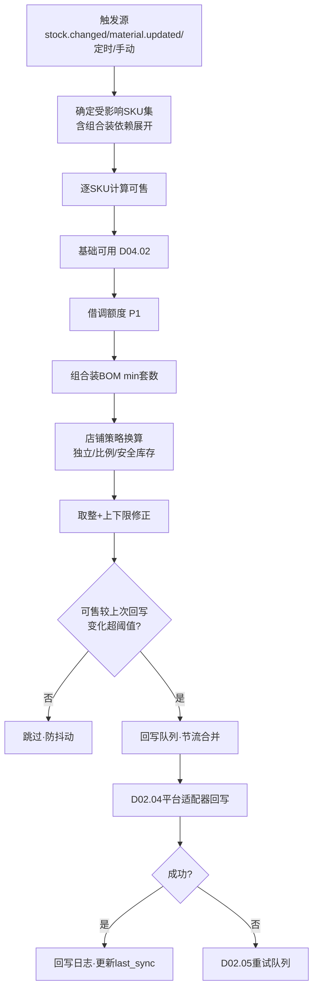
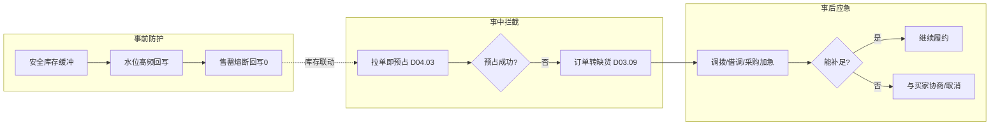
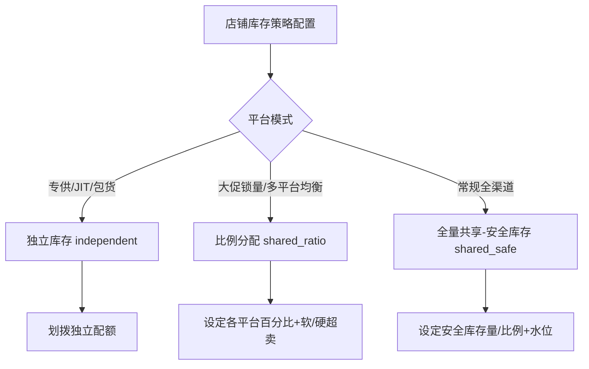

# SRS-D04.08 可售计算与平台同步模块 需求规格说明书

> 文档编号：SRS-D04.08 · 版本 V1.2 · 2026-10-24 · 编写：小凯 · 状态：待审阅（批次①，V1.2 友商对标增补活动锁定库存）
> 所属域：D04 库存域 · 分期：**P0（M1 单平台，M2 全平台）**
> 上游依据：SRS-D04.02（五口径契约）· 逆向文档 03 §库存同步 · 商派 inventorydepth 参考实现 · 需求决策 Q22（按店铺可配置同步策略）

---

## 1. 模块概述

### 1.1 定位

可售计算与平台同步是库存域对外的「出口」：把 OMS 内部的多仓多货主库存，按店铺配置的同步策略换算成各平台可见的「可售数量」，并实时/准实时回写到电商平台。核心矛盾是**既要卖得动（利用率）又不能超卖（履约确定性）**，靠策略链 + 水位机制 + 超卖防护三者平衡。

### 1.2 职责边界

**做**：可售数量计算（策略链）、平台库存回写（经 D02.04）、多平台超卖防护（水位扣减）、同步任务与水位管理、同步失败重试与对账、库存预警联动。
**不做**：五口径余额（D04.02 契约）、预占（D04.03）、回写通道本身（D02 gateway，本模块是调用方）。

### 1.3 与其他模块关系

| 模块 | 关系 |
|---|---|
| D04.02 | 读五口径（available 派生值）；订阅 stock.changed 触发重算 |
| D04.01 | BOM 展开（组合装可售=各成员最小可售套数）；物料档案变更触发重算 |
| D04.05 | 借调额度纳入可售（借入货主视角，P1） |
| D02.04 | 库存回写通道（平台适配器） |
| D03 订单 | 平台下单占用 → 拉单预占（防超卖闭环的另一半） |
| D04.10 | 低水位预警联动 |
| D09 WMS | WMS 实物库存作为对账参照 |

---

## 2. 业务场景

**SC-D04.08-01 全量共享 - 安全库存（利用率优先）**
品牌 A 的 SKU 在华东仓可用 100。天猫旗舰店配置「全量共享-安全库存预留 10」→ 天猫可售=90。京东配置同策略→ 京东可售也=90（共享同一池）。任一平台卖出，可用池实时减少，两平台可售同步下调。安全库存 10 作为缓冲防超卖。

**SC-D04.08-02 按比例分配（多平台均衡）**
抖音店配置「共享池比例分配 30%」→ 抖音可售=（可用-安全库存）×30%。天猫 60%、京东 10%。各平台在自己配额内售卖，互不挤占；某平台配额售罄不影响其他平台。适合大促前给重点平台锁量。

**SC-D04.08-03 分平台独立库存（强隔离）**
唯品会 JIT 模式配置「独立库存」：单独划拨 200 件给唯品会（独立记账行或独立配额），与共享池完全隔离。唯品会售罄不影响天猫，反之亦然。适合专供/定制/平台包货场景。

**SC-D04.08-04 组合装可售**
礼盒（销售物料）=面霜×1+精华×1+化妆包×1。面霜可用 50、精华 30、化妆包 100 → 礼盒可售=min(50,30,100)=30 套。任一成员变动触发礼盒可售重算。

**SC-D04.08-05 超卖防护（大促洪峰）**
大促期间天猫瞬时涌入 200 单抢最后 100 件。防护机制：① 平台侧安全库存缓冲；② OMS 拉单即预占（D04.03），预占失败的订单转缺货（不超卖履约）；③ 可售回写采用「水位下调优先」（库存紧张时提高回写频率，售罄即刻回写 0）；④ 平台超卖（平台已成交但 OMS 无货）走缺货应急流程（D03.09：调拨/借调/采购加急/与买家协商）。

**SC-D04.08-06 同步失败与对账**
某平台 API 限流导致回写失败 → 进重试队列（D02.05 机制），指数退避重试；连续失败告警。每日定时对账：拉取平台侧当前库存 vs OMS 计算的可售，差异超阈值触发强制回写+告警。

---

## 3. 功能需求

### FR-D04.08-01 同步策略配置（按店铺，Q22 决策）
- FR-01a 策略类型：
  - `independent` 分平台独立库存（独立配额/独立记账）
  - `shared_ratio` 共享池按比例分配（百分比，各平台合计可>100%=允许软超卖，或≤100%=硬分配，配置项）
  - `shared_safe` 全量共享-安全库存预留（可售=available-safe）
  - `activity_lock` 活动锁定（V1.2 友商对标 G3）：为大促/直播专场/平台活动圈占专属库存池，带生效窗口与动态释放规则（详见 FR-01e）；与前三策略**正交叠加**（活动锁定从共享池/独立配额中先行扣减，余量再按店铺基础策略分配）
- FR-01b 配置维度：店铺级（默认）；可下探到店铺×分类/品牌级覆盖（如某店铺唯品会分类走独立，其余走共享）。
- FR-01c 参数：安全库存量/比例、分配比例、水位阈值（触发高频回写的库存线）、回写模式（实时/准实时批量）。
- FR-01d 策略变更即时生效并触发全量重算回写。
- FR-01e 活动锁定库存池（V1.2，对标百秋「活动锁定库存」/商派 store_freeze_log）：
  - 活动库存池实体：活动ID（大促/直播/平台活动）×仓×SKU×货主，锁定量、生效窗口（起止）、绑定销售渠道（仅指定店铺/平台可售该池）。
  - 动态释放规则：① 预热期占用（活动开始前锁定，不计入常规可售）；② 支付失败/取消订单即时回池；③ 活动结束未售出量自动释放回共享池；④ 紧急释放（运营手动，走审批 D10.05，如锁货挤压日销）。
  - 与 D04.03 预占的区别：活动锁定是**渠道级预留**（圈定这批货只给某活动卖），预占是**订单级占用**（具体订单锁具体量）；活动池内的货被该渠道订单预占时双扣（池量-、available-）。
  - 多活动优先级：同一 SKU 被多活动锁定时按活动优先级分配，总量不得超过 available（超配预警）。

### FR-D04.08-02 可售数量计算（策略链）
- FR-02a 计算链（管道）：`基础可用(D04.02 available) → 减活动锁定池占用(V1.2, 非本渠道活动锁定量) → 借调额度(P1) → 组合装BOM展开(min套数) → 策略换算(独立/比例/安全库存) → 取整与上下限修正 → 最终可售`。注：activity_lock 策略下，本渠道活动池的锁定量作为该渠道专属可售加回。
- FR-02b 组合装：可售=min(各成员可售/需求数量)，向下取整；成员变动级联触发组合装重算（依赖图）。
- FR-02c 多仓聚合：店铺关联多个发货仓时，可售=Σ各仓可用（按分仓规则 D03.06 可指定仓）。
- FR-02d 计算结果缓存（Redis），stock.changed/material.updated 事件驱动失效重算。

### FR-D04.08-03 平台库存回写
- FR-03a 回写触发：① 事件驱动（库存变动→可售变化超阈值即回写）；② 水位触发（低于水位线高频回写/售罄立即回写 0）；③ 定时全量（兜底，如每 30 分钟）；④ 手动（界面/批量）。
- FR-03b 回写节流：同 SKU 短时间多次变动合并回写（防平台限流）；回写队列削峰。
- FR-03c 回写通道：调 D02.04（平台适配器），携带店铺+平台 SKU 编码+可售数量；失败进 D02.05 重试。
- FR-03d 回写日志：每次回写记录（店铺/SKU/计算值/回写值/平台响应/时间），可追溯。

### FR-D04.08-04 超卖防护
- FR-04a 水位机制：库存低于水位线时，回写频率提升+安全库存比例动态上调（可配置策略）。
- FR-04b 售罄熔断：available≤0 立即回写 0 并暂停该 SKU 回写（防抖动），补货后恢复。
- FR-04c 平台超卖应急：拉单预占失败（D04.03）→ 订单转缺货（D03.09）→ 应急策略（调拨 D04.05/借调/采购加急 D04.10/协商）；超卖订单标记与看板（D11.03）。

### FR-D04.08-05 同步对账
- FR-05a 定时对账：拉平台库存 vs OMS 可售，差异超阈值→强制回写+告警。
- FR-05b 对账报告：按店铺/SKU 的差异清单，日终归档。

### FR-D04.08-06 库存深度与预警联动
- FR-06a 库存深度指标：可售天数=可售/日均销量（联动 D11 报表）。
- FR-06b 低水位/售罄预警 → D04.10 补货建议。

---

## 4. 业务流程

### 4.1 可售计算与回写主流程



### 4.2 超卖防护双闭环



### 4.3 同步策略决策（配置时）



---

## 5. 处理逻辑

### 5.1 可售计算策略链（伪代码）

```
calcSellable(shop, sm):
    # 1. BOM 展开
    boms = MaterialService.bomExpand(sm)          # [(bm, num, owner)]
    if len(boms) > 1 or boms[0].num > 1:          # 组合装
        member_sellable = [calcSingle(shop, bm, owner)/num for bm,num,owner in boms]
        base = floor(min(member_sellable))        # 最小套数
    else:
        base = calcSingle(shop, boms[0].bm, boms[0].owner)

    # 2. 店铺策略换算
    strategy = getStrategy(shop, sm.category)
    if strategy.type == 'independent':
        sellable = getQuota(shop, sm)             # 独立配额
    elif strategy.type == 'shared_ratio':
        pool = base - strategy.safe
        sellable = floor(pool * strategy.ratio)
    else:  # shared_safe
        sellable = base - strategy.safe

    # 3. 上下限修正
    return clamp(sellable, strategy.min, strategy.max)

calcSingle(shop, bm, owner):
    branches = shop.warehouses                     # 店铺关联发货仓
    return Σ StockLedger.queryAvailable(branch, bm, owner) for branch in branches
    # + 借调额度(P1): + LendQuota.available(owner, bm)
```

### 5.2 组合装依赖图与级联重算
- 维护「基础物料 → 依赖它的组合装销售物料」反向索引；
- 成员 stock.changed → 查反向索引 → 批量重算所有受影响组合装；
- 防止级联风暴：重算任务合并去重（同 SKU 一轮只算一次），MQ 批处理。

### 5.3 回写节流与防抖
- 同 (shop, platform_sku) 回写在 N 秒窗口内合并（取窗口末计算值）；
- 变化阈值：|新可售-上次回写| ≥ max(1, 上次回写×变化率) 才回写（防 1 件抖动频繁调 API）；
- 售罄/恢复（跨越 0 线）强制立即回写（不受阈值限制）。

### 5.4 水位与动态安全库存
```
水位线 water_level = 可配置(绝对值 or 日均销量×天数)
当 available < water_level:
    回写频率 → 实时(每变必回)
    动态安全库存 = base_safe × (1 + 紧张系数)   # 库存越紧缓冲越大
当 available ≤ 0:
    熔断 → 回写0 + 暂停该SKU回写(防抖) + 告警
```

### 5.5 软超卖 vs 硬分配（比例策略）
- 硬分配：各平台比例合计≤100%，配额独立不回收（保守，防超卖）；
- 软超卖：合计可>100%（如天猫70%+京东70%=140%），赌不同平台不同时售罄（激进，提利用率），需配合更强水位防护与拉单预占兜底。配置项由运营按品类风险选择。

---

## 6. 数据字段（业务字段描述）

### 6.1 同步策略（sync_strategy）

| 字段 | 业务含义 | 取值/校验 |
|---|---|---|
| shop_id | 店铺 | 必填 |
| scope_type / scope_ref | 覆盖范围 | 全店/分类/品牌/指定物料（下探覆盖优先级） |
| strategy_type | 策略类型 | independent/shared_ratio/shared_safe/activity_lock（V1.2） |
| safe_num / safe_ratio | 安全库存量/比例 | shared_safe 用 |
| alloc_ratio | 分配比例 | shared_ratio 用（%） |
| oversell_mode | 软超卖/硬分配 | shared_ratio 用 |
| quota_num | 独立配额 | independent 用 |
| water_level / water_level_type | 水位线/类型 | 绝对值/销量天数 |
| min_sellable / max_sellable | 可售上下限 | 修正用 |
| writeback_mode | 回写模式 | 实时/准实时批量/定时 |
| change_threshold | 变化阈值 | 防抖 |
| status | 启用状态 | |

### 6.2 可售快照与回写日志（sellable_snapshot / sync_log）

| 字段 | 业务含义 |
|---|---|
| shop_id / platform_sku / sm_id | 店铺×平台SKU |
| calc_sellable / last_writeback | 计算值/上次回写值 |
| branch_detail | 多仓明细（JSON：各仓贡献） |
| bom_detail | 组合装成员明细（JSON：min套数计算过程） |
| sync_status / sync_time / platform_response | 回写状态/时间/平台响应 |
| retry_count | 重试次数（联动 D02.05） |

### 6.3 独立配额（independent_quota，independent 策略）

| 字段 | 业务含义 |
|---|---|
| shop_id / sm_id / owner_id | 维度 |
| quota_total / quota_sold / quota_remain | 配额总量/已售/余量 |

### 6.4 活动锁定库存池（activity_lock_pool，V1.2 activity_lock 策略）

| 字段 | 业务含义 | 取值/校验 |
|---|---|---|
| activity_id / activity_name | 活动标识（大促/直播专场/平台活动） | 必填 |
| branch_id / bm_id / owner_id | 三元键 | 锁定到仓×SKU×货主 |
| lock_num / sold_num / remain_num | 锁定量/已售/余量 | remain=lock-sold，原子扣减 |
| channel_scope | 绑定销售渠道 | 仅指定店铺/平台可售该池（JSON） |
| start_time / end_time | 生效窗口 | 预热占用→活动结束释放 |
| priority | 多活动优先级 | 同 SKU 多活动锁定分配序 |
| release_rule | 释放规则 | 支付失败回池/结束自动释放/紧急释放(审批) |
| status | 状态 | 预热中/生效中/已结束/已释放 |
| tenant_id | 租户 | 必填 |

---

## 7. 接口

| 编号 | 接口 | 方向/消费方 | 说明 |
|---|---|---|---|
| IF-D04.08-01 | `SellableService::calc(shop, sm)` | D03.06/D11/门户 | 可售计算（读缓存或实时） |
| IF-D04.08-02 | `SellableService::triggerRecalc(scope)` | 事件驱动/手动 | 触发重算回写 |
| IF-D04.08-03 | 订阅 `stock.changed`/`material.updated`/`material.bind_completed` | D04.02/01 | 重算触发源 |
| IF-D04.08-04 | `SellableService::getSyncStatus(shop, skus[])` | D11.03 监控 | 同步状态查询 |
| EF-D04.08-01 | 平台库存回写（经 D02.04） | 出 | 6 平台适配器 |
| EF-D04.08-02 | 平台库存查询（经 D02） | 出 | 对账用 |

---

## 8. 非功能需求

| 项 | 要求 |
|---|---|
| 性能 | 可售计算（缓存命中）P99 ≤10ms；库存变动→平台回写延迟 ≤10 秒（Q37 大促可扛级）；单店铺 5 万 SKU 全量回写 ≤10 分钟（节流批处理） |
| 一致性 | 可售快照与 D04.02 余额最终一致（事件驱动+定时兜底）；回写幂等（平台侧以最新值覆盖） |
| 防超卖 | 三重防护（安全库存+拉单预占+水位熔断）；软超卖模式风险显式告知运营 |
| 限流 | 回写节流合并，遵守各平台 API 频控；失败退避重试 |
| 可观测 | 回写成功率/延迟/差异率监控（D11.03）；对账日报 |
| 容量 | 可售快照=店铺×SKU（50万级），回写日志按月分表 |

---

## 9. 验收标准

| 编号 | 验收条件 |
|---|---|
| AC-01 | 三种策略（独立/比例/安全库存）分别配置后，可售计算结果符合 SC-01/02/03 预期数字 |
| AC-02 | 组合装可售=成员最小套数（SC-04：min(50,30,100)=30）；任一成员变动触发组合装重算 |
| AC-03 | 库存变动到平台回写延迟 ≤10 秒（压测验证） |
| AC-04 | 全量共享下任一平台售出，其他平台可售同步下调（共享池联动） |
| AC-05 | 售罄熔断：available=0 立即回写 0 并暂停抖动回写，补货后恢复 |
| AC-06 | 超卖防护演练（SC-05）：200 单抢 100 件，预占拦截 100 单成功，其余转缺货，无超卖履约 |
| AC-07 | 回写节流：同 SKU 5 秒内变动 10 次，合并为 1-2 次回写（防平台限流） |
| AC-08 | 回写失败进重试队列，指数退避；连续失败告警；每日对账差异强制回写 |
| AC-09 | 多仓聚合：店铺关联 2 仓，可售=两仓可用之和 |
| AC-10 | 策略变更即时触发全量重算回写；软/硬超卖模式行为符合配置 |
| AC-11 | （V1.2）活动锁定池：大促活动锁定 100 件后，常规渠道可售相应减少；仅绑定渠道可购买池内库存；活动结束未售量自动释放回共享池 |
| AC-12 | （V1.2）活动池动态释放：支付失败订单即时回池；紧急释放走 OA 审批；同 SKU 多活动锁定超 available 总量触发超配预警 |

---

## 变更记录

| 日期 | 版本 | 变更 | 原因 |
|---|---|---|---|
| 2026-10-23 | V1.0 | 首版 | — |
| 2026-10-24 | V1.2 | 补第四种同步策略 activity_lock 活动锁定库存池（FR-01e）+ 计算链纳入活动扣减 + §6.4 活动池数据字段 + AC-11/12 | 友商对标 G3（Jason 决策A：补，P1；对标百秋活动锁定/商派 store_freeze_log） |

---

*参考实现溯源：商派 inventorydepth（库存深度管理 11 表 + 平台库存回写 storeNeedUpdateSku）+ ome_sync_task（同步任务）。关键差异：① 同步策略按店铺可配置三选一（Q22 决策，商派偏全量共享）；② 组合装级联重算依赖图显式化；③ 软/硬超卖模式化；④ 水位熔断+动态安全库存；⑤ 借调额度纳入可售（P1）。*
