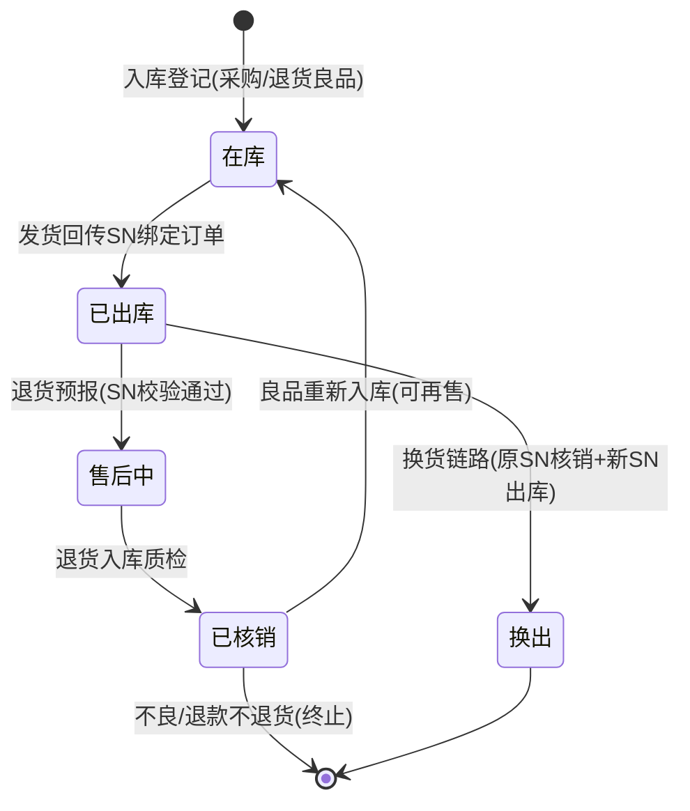
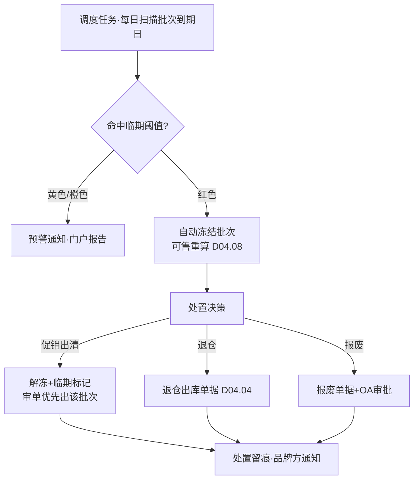
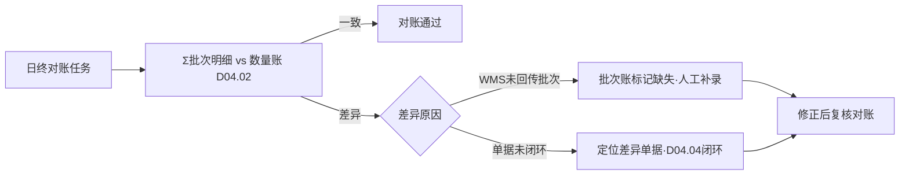

# SRS-D04.09 批次效期与序列号管理模块 需求规格说明书

> 文档编号：SRS-D04.09 · 版本 V1.0 · 2026-10-23 · 编写：小凯 · 状态：待审阅（批次①）
> 所属域：D04 库存域 · 分期：**P1（M2-M3）**；P0 期出入库单据预留批次/SN 字段（见 SRS-D04.04 §6.2）
> 上游依据：需求决策 Q24（保质期/效期 + 序列号全选）· 商派 basic_material_storage_life / product_serial 系列表参考实现

---

## 1. 模块概述

### 1.1 定位

在「数量账」（D04.02）之上叠加**批次/效期维度**与**序列号维度**的精细管理：化妆品/保健品的效期先进先出与临期管控、高值商品的序列号全生命周期追溯（出库绑定订单、售后按 SN 核销）。

### 1.2 职责边界

**做**：批次档案（批次号/生产日期/到期日期/入库时间）、批次库存明细（三元键×批次）、FIFO/FEFO 出库批次指派建议、临期预警与临期处置（冻结/促销标记/退仓）、序列号档案（SN↔物料↔货主）、SN 状态机（在库/已出库/售后中/已核销/换出）、SN 出入库登记与售后核销校验。
**不做**：数量记账（D04.02，批次/SN 明细之和必须=数量账，本模块保证对账）；出库批次的强制执行（WMS 侧作业，OMS 给建议与校验回传）；物料档案的效期/SN 开关（D04.01）。

### 1.3 与其他模块关系

| 模块 | 关系 |
|---|---|
| D04.01 | 物料的 storage_life_flag/serial_number 开关决定本模块是否介入 |
| D04.02 | 批次明细/SN 明细与数量账三方对账（Σ批次=Σ SN=数量账） |
| D04.04 | 出入库单据行携带批次/SN 明细（入库登记、出库校验） |
| D09 WMS | 批次/SN 由 WMS 回传（有能力的 WMS）；无能力时 OMS 侧人工登记 |
| D03.07 发货 | 出库 SN 与订单行绑定（发货确认时登记） |
| D05 售后 | 退货 SN 核销校验（防调包：退回 SN 必须是该订单出库 SN）；换货 SN 登记 |
| D04.07 | 批次成本（暂估批次与实物批次关联，P2） |
| D10.04 门户 | 品牌方可见本货主效期结构（临期占比是品牌方核心关注） |

---

## 2. 业务场景

**SC-D04.09-01 效期入库登记**
品牌 A 面霜（效期管理开启）采购/代销入库 500 件，WMS 回传批次明细：批次 L20260801（生产 2026-08-01，到期 2029-07-31）300 件、批次 L20260915 200 件。OMS 登记批次库存明细行（三元键×批次），数量账同步 +500（D04.04 确认时），两账一致。

**SC-D04.09-02 FEFO 出库指派**
订单审单通过后推仓，出库单据携带 OMS 批次建议：按 FEFO（先到期先出）指派 L20260801 批次。WMS 实际按仓内作业拣货，回传实际出库批次。OMS 以**回传实际批次**登记（建议与实际的差异记录，用于考核 WMS 批次执行率）。

**SC-D04.09-03 临期预警与处置**
配置临期规则：到期前 180 天黄色预警、90 天橙色、30 天红色+自动冻结（不再参与可售计算，D04.08 联动扣减）。红色预警触发处置流程：通知品牌方门户（代销货）/采购与运营（买断货），处置选项=促销出清（解除冻结+促销标记）/退仓（还品牌方，D04.04 退仓出库）/报废（调整单）。处置全程留痕。

**SC-D04.09-04 序列号出库绑定**
美容仪（SN 管理开启）出库：WMS 回传 SN 明细（IMEI001、IMEI002），OMS 登记 SN 与订单行绑定（SN 状态=已出库，记录订单/发货单/收货人脱敏引用）。

**SC-D04.09-05 售后 SN 核销（防调包）**
客户退美容仪，退货预报含 SN=IMEI001。入库质检时扫码校验：IMEI001 确属该订单出库记录 → 核销通过（SN 状态=已核销，库存回批次/数量账）；扫码发现 IMEI999 非本订单出库 → 校验失败，售后异常流程（D05 拒收/协商），杜绝调包退货。

**SC-D04.09-06 换货 SN 链路**
换货补发新 SN=IMEI003（状态=已出库，绑定换货单）；原 IMEI001 核销后按良品重新入库（状态重置=在库，可再次销售；SN 履历累计全链路）。

---

## 3. 功能需求

### FR-D04.09-01 批次档案与批次库存
- FR-01a 批次档案：批次号（WMS/厂商原文）、生产日期、到期日期、入库日期、来源单据；批次号同物料内唯一（跨货主隔离：同批次号不同货主视为不同批次行）。
- FR-01b 批次库存明细：三元键×批次 的数量行（实际/锁定/次品口径与数量账同构）；入库+、出库-。
- FR-01c 三方对账：Σ批次明细 = 数量账（D04.02）按日对账，差异告警（WMS 不回传批次时的降级：只记数量账，批次账标记「未启用」）。

### FR-D04.09-02 出库批次指派（FEFO/FIFO）
- FR-02a 指派策略配置：FEFO（先到期先出，默认）/FIFO（先入先出）/指定批次（人工）；按货主×物料分类可配。
- FR-02b 指派建议随出库单据下发 WMS（报文含批次建议，通天晓支持性【待确认】）；WMS 回传实际批次，差异记录（批次执行率指标 → D11）。
- FR-02c 锁定批次不参与指派（冻结/临期红色批次）。

### FR-D04.09-03 临期管理
- FR-03a 临期规则：多级阈值（黄/橙/红，天数或剩余效期比例），按物料分类/品牌/货主配置。
- FR-03b 红色自动冻结：批次冻结（可售计算扣除，D04.08 联动重算）；冻结量记批次行 locked 口径。
- FR-03c 处置流程：促销出清（解冻+临期促销标记，可联动 D03 审单优先出临期批次）/退仓/报废（走 D04.04 单据）；处置需审批（超阈值 OA）。
- FR-03d 临期看板与品牌方门户报告（本货主临期结构：30/90/180 天分布与货值）。

### FR-D04.09-04 序列号管理
- FR-04a SN 档案：SN 码（物料内唯一）、货主、当前状态、当前仓、履历链（全部出入库/售后事件时间线）。
- FR-04b SN 状态机：在库→已出库→（售后中→已核销→在库[良品重入] / 已核销[退款不退货则终止]）；换出（换货链路）。
- FR-04c 出库登记：发货回传含 SN 明细时自动登记绑定订单行；WMS 不回传 SN 时支持 OMS 侧人工补录（导入/扫码页）。
- FR-04d 售后核销校验：退货预报/入库质检时 SN 校验（属单校验+状态校验），失败走售后异常。
- FR-04e SN 履历查询：任一 SN 全生命周期时间线（客服/售后/品牌方门户高频查询）。

### FR-D04.09-05 批次/SN 查询与导出
- FR-05a 多维查询：按物料/仓/货主/批次/效期区间/SN/状态。
- FR-05b 导出（D01.06）：批次库存表、临期清单、SN 履历。

---

## 4. 业务流程

### 4.1 SN 状态机



### 4.2 临期处置流程



### 4.3 批次账与数量账对账



---

## 5. 处理逻辑

### 5.1 FEFO 指派算法

```
assignBatch(三元键, num, strategy=FEFO):
    candidates = 批次行 where 可用>0 and 未冻结
                 order by (expire_date ASC, in_date ASC)   # FEFO；FIFO 则 in_date ASC
    result = []; remain = num
    for b in candidates:
        take = min(b.可用, remain)
        result.append((b.batch_no, take)); remain -= take
        if remain == 0: break
    if remain > 0: return 部分指派 + 缺口标记（缺货流程）
    return result   # 建议性质，最终以 WMS 回传实际批次为准
```

### 5.2 SN 属单校验（售后防调包）

```
validateSN(order_id, sn):
    rec = SN档案 where sn=sn and 物料=订单行物料
    if not rec: return 失败(无此SN档案)
    if rec.状态 != 已出库: return 失败(状态异常)
    if rec.绑定订单 != order_id: return 失败(非本订单出库·疑似调包)
    return 通过 → 状态置售后中
```

### 5.3 批次冻结与可售联动
红色临期冻结时：批次行 locked+num → 数量账（D04.02）不直接变动（货还在），但 D04.08 可售计算增加「临期冻结扣除项」（策略链插入点，见 SRS-D04.08 §5.1）；解冻反向恢复。

### 5.4 降级模式
WMS 无批次/SN 回传能力时：数量账正常运转，批次/SN 账标记「未启用」，相关校验（FEFO/属单校验）自动跳过并记录降级日志——**批次/SN 是增强能力，不阻塞主链路**（P0/P1 分期原则）。

---

## 6. 数据字段（业务字段描述）

### 6.1 批次档案（batch）

| 字段 | 业务含义 | 取值/校验 |
|---|---|---|
| bm_id / owner_id | 物料/货主 | 批次归属 |
| batch_no | 批次号 | 物料×货主内唯一 |
| produce_date / expire_date | 生产/到期日期 | 效期物料必填；expire>produce |
| in_date / source_bill_bn | 入库日期/来源单据 | |
| shelf_life_days | 保质期天数 | 冗余（到期-生产），报表用 |
| status | 正常/冻结（临期红）/清空 | |

### 6.2 批次库存明细（batch_stock）

| 字段 | 业务含义 |
|---|---|
| branch_id / bm_id / owner_id / batch_id | 三元键×批次（四元行） |
| store / locked / defective | 与数量账同构口径（无 freeze 预占——预占不到批次粒度，出库指派时才落批次） |
| near_expire_level | 临期级别（黄/橙/红，调度刷新） |

### 6.3 序列号档案（serial_no）

| 字段 | 业务含义 | 取值/校验 |
|---|---|---|
| sn_code | SN 码 | 物料×货主内唯一 |
| bm_id / owner_id / branch_id | 归属与当前仓 | |
| status | SN 状态机 | §4.1 |
| order_ref / delivery_ref | 绑定订单/发货单 | 已出库后必填 |
| aftersale_ref | 售后单引用 | 售后中/核销后 |
| history | 履历链 | JSON 时间线（事件/单据/时间/仓），只增 |

---

## 7. 接口

| 编号 | 接口 | 方向/消费方 | 说明 |
|---|---|---|---|
| IF-D04.09-01 | `BatchService::registerIn(billItem, batchDetails[])` | D04.04 入库确认 | 批次登记 |
| IF-D04.09-02 | `BatchService::assign(三元键, num)` | D03.07/D09.02 推仓 | FEFO 批次建议 |
| IF-D04.09-03 | `BatchService::registerOut(billItem, actualBatches[])` | D09.02 回传 | 实际批次登记+执行率记录 |
| IF-D04.09-04 | `SerialService::bindOut(deliveryItem, sns[])` | D09.02 回传/人工补录 | SN 出库绑定 |
| IF-D04.09-05 | `SerialService::validateReturn(orderId, sn)` | D05.01/02 | 售后属单校验 |
| IF-D04.09-06 | `SerialService::getHistory(sn)` | D05/门户/客服 | SN 履历 |
| IF-D04.09-07 | 事件 `batch.frozen` / `batch.unfrozen` | D04.08 | 临期冻结联动可售重算 |

---

## 8. 非功能需求

| 项 | 要求 |
|---|---|
| 性能 | FEFO 指派 ≤20ms（批次行缓存）；SN 校验 ≤10ms（唯一索引）；临期扫描 10 万批次 ≤5 分钟（日批） |
| 一致性 | 批次账/SN 账与数量账日终三方对账；对不上必须有差异清单（不允许静默） |
| 降级 | WMS 无回传能力时全链路可降级（§5.4），不阻塞发货主流程 |
| 审计 | 临期处置/SN 状态变迁/批次修正全留痕 |
| 容量 | 批次行≈活跃 SKU×平均批次数(≤5)；SN 档案按启用 SN 物料量（预估 ≤10 万/年增量） |

---

## 9. 验收标准

| 编号 | 验收条件 |
|---|---|
| AC-01 | 双批次入库登记后，Σ批次=数量账；出库按 FEFO 建议指派先到期批次 |
| AC-02 | WMS 实际出库批次与建议不一致时，以回传为准登记且执行率指标记录差异 |
| AC-03 | 临期红色批次自动冻结：可售计算扣除该批次量并触发平台回写；解冻后恢复 |
| AC-04 | 临期处置三路径（促销/退仓/报废）单据与审批留痕完整；品牌方门户可见本货主临期报告 |
| AC-05 | SN 出库绑定订单；非本订单 SN 退货校验失败并走售后异常（防调包验证） |
| AC-06 | 换货链路：原 SN 核销+良品重入（状态回在库），新 SN 出库绑定换货单，履历链完整 |
| AC-07 | SN 履历查询展示全生命周期时间线（入库→出库→售后→核销→重入） |
| AC-08 | WMS 不回传批次的仓：数量账正常，批次账标记未启用，FEFO/校验自动降级跳过 |
| AC-09 | 日终三方对账（数量/批次/SN）连续 7 天一致；人为制造差异能在对账清单中定位 |
| AC-10 | 10 万批次临期扫描日批 ≤5 分钟完成且预警通知触达 |

---

## 变更记录

| 日期 | 版本 | 变更 | 原因 |
|---|---|---|---|
| 2026-10-23 | V1.0 | 首版 | — |

---

*参考实现溯源：商派 material_basic_material_storage_life（保质期明细 20 列）+ storage_life_bills（效期流水单据）+ ome_product_serial/serial_history/serial_log（SN 三表）+ delivery_items_serial/reship_items_serial（发货/售后 SN 关联）。关键差异：① 批次行带货主（四元明细）；② SN 属单校验产品化（防调包，商派仅登记）；③ 临期多级阈值+自动冻结联动可售；④ 批次执行率考核指标；⑤ 降级模式显式化。待确认：通天晓批次/SN 回传能力。*
