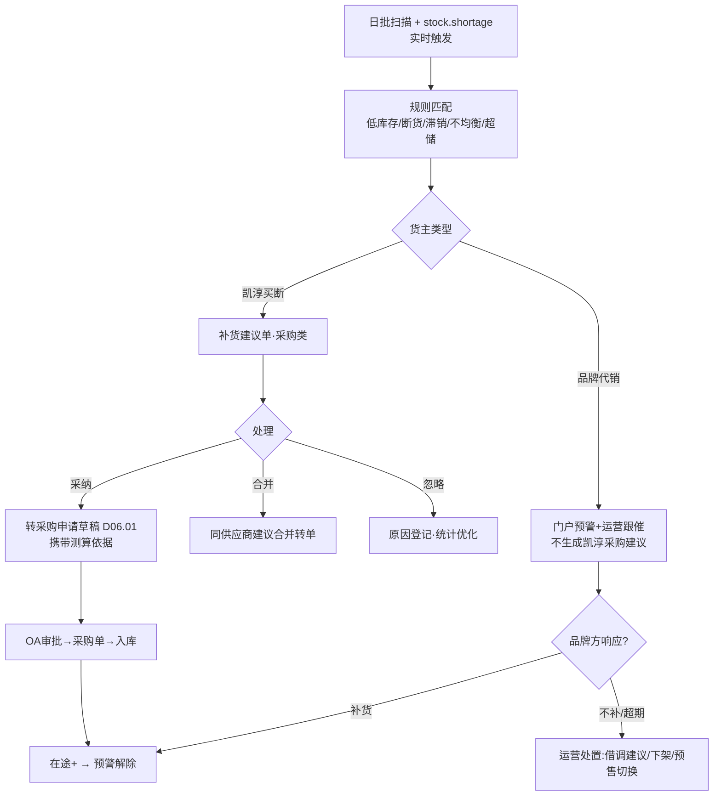

# SRS-D04.10 库存预警与补货建议模块 需求规格说明书

> 文档编号：SRS-D04.10 · 版本 V1.2 · 2026-10-24 · 编写：小凯 · 状态：待审阅（批次①，V1.2 友商对标增补AI销量预测）
> 所属域：D04 库存域 · 分期：**P1（M3）**；P0 期仅保留 stock.shortage 事件的缺货告警（SRS-D04.02 §IF-05）
> 上游依据：逆向文档 03 §库存预警 · 商派补货公式（安全库存+冻结-现货-在途）· 需求决策 Q22/Q37

---

## 1. 模块概述

### 1.1 定位

库存的「前瞻性」能力：基于水位规则与销售预测，对低库存/滞销/临期（联动 D04.09）/仓间不均衡（联动 D04.05）产生预警与补货建议，建议可一键转采购申请（D06.01）或调拨单（D04.05），形成「预警→建议→执行」闭环。

### 1.2 职责边界

**做**：预警规则配置与扫描、补货点/补货量计算、补货建议单管理（生成/采纳/忽略/转单）、缺货风险预测（按日均销量与在途推算断货日）、滞销识别、预警通知分发。
**不做**：采购流程（D06）、调拨执行（D04.05）、临期规则本体（D04.09，本模块只做联动展示）、销量统计口径（D11 报表供数）。

### 1.3 与其他模块关系

| 模块 | 关系 |
|---|---|
| D04.02 | 五口径余额读取；stock.shortage 事件（实时缺货）区别于本模块（前瞻预警） |
| D04.08 | 可售量口径联动（预警基于可售而非实际） |
| D06.01 | 补货建议 → 采购申请（买断货主） |
| D04.05 | 仓间不均衡 → 调拨建议；借调建议（货主间） |
| D04.09 | 临期库存纳入「不可补/需处置」标记 |
| D11 | 日均销量/销售趋势供数；预警看板 |
| D10.04 | 品牌方门户：本货主缺货风险与补货建议可见（代销货补货责任在品牌方，门户通知是协作关键） |
| D01.07 | 通知分发（企微/门户） |

---

## 2. 业务场景

**SC-D04.10-01 补货点预警（买断货）**
凯淳买断物料 M（华东仓）：安全库存 100、日均销量 20、采购提前期 7 天。补货点 = 日均×提前期 + 安全库存 = 240。当「可售+在途」跌破 240 时触发补货建议：建议量 = 目标库存（补货点+周期量）-（可售+在途-已占用）。采购专员采纳建议 → 一键生成采购申请（带建议量与断货日测算依据）→ OA 审批 → 采购单。

**SC-D04.10-02 断货风险预测（大促前）**
大促前 14 天，系统按「近 7 天日均×大促系数（可配）」预测：品牌 A 某爆款预计 5 天后断货（可售 800，预测日销 160）。生成红色预警推送品牌方门户+企微通知运营，附建议（加急补货/调拨/借调/预售切换）。

**SC-D04.10-03 代销货缺货协作**
品牌 A 代售货断货风险：补货责任在品牌方。预警只推送品牌方门户（本货主数据）+ 凯淳运营（提醒跟催），不生成凯淳采购建议（货权非凯淳）。运营可发起借调建议（凯淳买断同货号有货时，联动 D04.05）。

**SC-D04.10-04 仓间不均衡调拨建议**
同款 SKU：华东仓可售 500（60 天销量）、华南仓可售 30（3 天断货）。系统生成调拨建议（华东→华南 200 件），库存专员采纳 → 一键生成调拨单（D04.05）。

**SC-D04.10-05 滞销识别**
物料 90 天无出库且库存 >0 → 滞销标记与清单（按货主/仓/金额排序），推送运营与品牌方门户；联动处置建议（促销/退仓/清仓渠道），滞销不触发补货建议（互斥规则）。

---

## 3. 功能需求

### FR-D04.10-01 预警规则配置
- FR-01a 规则类型：低库存（补货点）/断货风险（预测断货日≤N 天）/滞销（M 天无动销）/仓间不均衡（仓间可售天数差≥N）/超储（可售天数≥N 上限）。
- FR-01b 规则维度：全局默认 + 货主/品牌/分类/指定物料覆盖（优先级：物料>分类>品牌>货主>全局）。
- FR-01c 参数：安全库存（可复用 D04.02 记账行 safe_store 或规则独立配置，冲突时规则优先并提示）、日均销量口径（近 7/30 天，含/不含大促日）、预测系数、提前期（按供应商/物料，取自采购档案或手工）。
- FR-01d 扫描频率：日批（默认凌晨）+ 实时触发（stock.shortage 事件升级为风险预警）。

### FR-D04.10-02 补货建议计算
- FR-02a 补货点：`ROP = 日均销量 × 采购提前期 + 安全库存`；触发条件 `可售 + 在途 < ROP`。
- FR-02b 建议量：`目标库存（ROP +  review周期量）−（可售 + 在途 − 借调承诺）`，向上取整到订货倍数（箱规，采购档案）；受供应商起订量（MOQ）修正。
- FR-02c 断货日测算：`断货日 = 今天 + (可售+在途−已占用) / 预测日销`；随建议展示测算依据（透明可解释）。
- FR-02d 排除规则：滞销物料/临期红色冻结物料/已停用物料/人工排除清单不生成补货建议。

### FR-D04.10-03 建议单管理
- FR-03a 建议单：类型（采购/调拨/借调/处置）、对象（三元键）、建议量、测算依据快照、状态（待处理/已采纳/已忽略/已转单/已过期）。
- FR-03b 采纳转单：采购建议→采购申请草稿（D06.01，带依据）；调拨建议→调拨单草稿（D04.05）；借调建议→提示人工发起（P1 借调启用后）。
- FR-03c 忽略需原因（字典：品牌方不补/清仓中/数据存疑/其他）；忽略原因统计供规则优化。
- FR-03d 合并：同供应商/同仓的多条采购建议可合并为一张采购申请。

### FR-D04.10-04 预警通知与看板
- FR-04a 通知路由：按货主类型——买断货→凯淳采购/运营（企微）；代销货→品牌方门户+凯淳运营跟催提醒（SC-03 协作规则）。
- FR-04b 预警分级：红（断货≤3 天/已缺货）/橙（≤7 天）/黄（补货点触发）；分级推送策略（红=即时企微+门户，黄橙=日报汇总）。
- FR-04c 看板：缺货风险 TOP、补货建议待处理清单、滞销金额、仓间不均衡热力（D11.03 集成）。

### FR-D04.10-05 AI 销量预测（V1.2 友商对标 G7，Jason 决策B：首期就要）
- FR-05a 定位：在统计式日均销量（§5.1）之上叠加**机器学习销量预测**，提升补货建议与断货预测准确度（对标宝尊「深度学习库存分配建议」）。首期（M3）落地，预测服务经 K-AIDE Agent 通道或独立算法服务提供（Q41 已预留 Agent 接口）。
- FR-05b 预测输入特征：历史销量时序（多粒度：日/周）、季节性、趋势、大促日历、节假日、天气（可选）、平台活动排期、价格变动、商品生命周期阶段、同类目关联。
- FR-05c 预测输出：未来 N 天（可配 7/14/30）分 SKU×仓×货主的销量预测值 + 置信区间；供 §5.1 日均销量口径以「预测值」替代或加权「历史均值」（可配置采用策略：纯历史/纯预测/加权融合，冷启动新品用预测兜底）。
- FR-05d 预测与补货联动：断货日测算（§FR-02c）用预测销量而非历史均值；补货建议量随预测动态调整；预测准确度回测（预测 vs 实际，MAPE 指标）持续迭代。
- FR-05e 可解释性与降级：预测结果附主要驱动因子（可解释性，采购信任前提）；算法服务不可用时自动降级统计式（§5.1），不阻塞补货建议生成。
- FR-05f 预测模型管理：模型版本化、灰度上线、A/B 对比（预测 vs 统计式的采纳率与断货率对照）；训练数据来自 D11 销售快照与 ord_routing_decision_log 等埋点。
- ⚠️ **资源提示**：AI 预测首期落地需算法能力（自建模型或采购预测服务），与 4-6 人团队存在资源张力，建议评估：① 复用 K-AIDE 平台算法能力 ② 采购第三方销量预测服务 ③ 首期先上统计式+简单时序模型（如 Prophet），深度学习二期。具体方案待管理层资源确认（见交付说明）。

---

## 4. 业务流程

### 4.1 预警-建议-执行闭环



### 4.2 仓间不均衡处理


---

## 5. 处理逻辑

### 5.1 日均销量口径
```
日均销量 = Σ(近N天出库量·销售出库类型) / N
- N 默认 30，可配 7/14/30（新品用 7，稳定品用 30）
- 剔除大促日（大促日历配置）或乘以大促系数（预测期在大促窗口内时）
- 无销量新品：按同类目均值兜底 + 人工设定
```

### 5.2 已占用量的口径
建议量公式中的「已占用」= freeze（预占）+ 借调承诺（D04.05 committed）——避免把已承诺量当作可补基数重复补货。

### 5.3 预警去重与升级
- 同一三元键同一规则 24h 内不重复生成建议单（更新原单状态与测算值）；
- 级别升级（黄→橙→红）即时推送；降级不通知（看板可见）；
- 建议单过期：条件恢复（在途到货/销量下降）自动关闭标记「已解除」。

### 5.4 测算依据快照
建议单生成时固化全部输入（日均销量、可售、在途、安全库存、提前期、公式版本）——采购质疑建议量时可完整解释（可解释性是采纳率的关键）。

---

## 6. 数据字段（业务字段描述）

### 6.1 预警规则（alert_rule）

| 字段 | 业务含义 | 取值/校验 |
|---|---|---|
| rule_type | 规则类型 | 低库存/断货风险/滞销/不均衡/超储 |
| scope_type / scope_ref | 适用范围 | 全局/货主/品牌/分类/物料（覆盖优先级 §FR-01b） |
| params | 参数集 | JSON：安全库存/N天/系数/提前期/阈值 |
| sales_caliber | 销量口径 | 近7/14/30天，大促剔除或系数 |
| scan_freq | 扫描频率 | 日批/实时 |
| notify_route | 通知路由 | 按货主类型模板（§FR-04a） |
| status | 启用状态 | |

### 6.2 补货/处置建议单（replenish_suggestion）

| 字段 | 业务含义 |
|---|---|
| suggest_bn / suggest_type | 单号/类型（采购/调拨/借调/处置） |
| branch_id / bm_id / owner_id | 三元键 |
| alert_level | 预警级别（红/橙/黄） |
| suggest_num / calc_snapshot | 建议量/测算依据快照（JSON §5.4） |
| stockout_date | 预测断货日 |
| status | 待处理/已采纳/已忽略/已转单/已解除/已过期 |
| target_bill_bn | 转单后目标单据号（采购申请/调拨单） |
| ignore_reason | 忽略原因（字典） |
| supplier_id | 建议供应商（默认供货关系，采购档案） |

---

## 7. 接口

| 编号 | 接口 | 方向/消费方 | 说明 |
|---|---|---|---|
| IF-D04.10-01 | `ReplenishService::scan(scope)` | 调度/手动 | 预警扫描（日批入口） |
| IF-D04.10-02 | `ReplenishService::adopt(suggestBn, merge?)` | 采购/库存专员界面 | 采纳转单（采购申请/调拨单草稿） |
| IF-D04.10-03 | 订阅 `stock.shortage` / `stock.changed` | D04.02 | 实时触发与解除判断 |
| IF-D04.10-04 | `ReplenishService::getSuggestions(owner, status)` | D10.04 门户 | 品牌方本货主建议清单（只读） |
| EF-D04.10-01 | 企微通知（经 D01.07） | 出 | 红色即时/黄橙日报 |

---

## 8. 非功能需求

| 项 | 要求 |
|---|---|
| 性能 | 日批扫描（5 万活跃三元行 × 5 规则）≤15 分钟；实时触发处理 ≤5s |
| 可解释 | 每条建议附完整测算快照（§5.4），公式版本化 |
| 数据权限 | 建议与预警按货主行隔离；品牌方门户只见本货主 |
| 闭环统计 | 建议采纳率/忽略原因分布/预警准确率（断货日预测 vs 实际）月报，供规则调优 |

---

## 9. 验收标准

| 编号 | 验收条件 |
|---|---|
| AC-01 | SC-01 数字验证：ROP=240，可售+在途跌破时生成建议，建议量含 MOQ/箱规修正，测算依据完整可解释 |
| AC-02 | 采纳转单：采购建议一键生成采购申请草稿（带依据快照）；同供应商多条建议可合并 |
| AC-03 | 代销货主预警只推门户+运营跟催，不生成凯淳采购建议（货权边界验证） |
| AC-04 | 断货日预测在大促窗口自动应用大促系数；红色预警即时企微触达 |
| AC-05 | 仓间不均衡建议采纳后生成调拨单草稿；调拨完成后下轮扫描预警解除 |
| AC-06 | 滞销物料不生成补货建议（互斥规则）；滞销清单按货主/金额排序正确 |
| AC-07 | 同三元键同规则 24h 去重；级别升级即时推送、条件恢复自动解除 |
| AC-08 | 忽略原因登记与月度统计报表输出（采纳率/原因分布） |
| AC-09 | 品牌方门户仅见本货主预警与建议（行级隔离验证） |
| AC-10 | 5 万行×5 规则日批 ≤15 分钟完成 |

---

## 变更记录

| 日期 | 版本 | 变更 | 原因 |
|---|---|---|---|
| 2026-10-23 | V1.0 | 首版 | — |
| 2026-10-24 | V1.2 | 新增 FR-05 AI 销量预测（首期 M3，ML预测叠加统计式，经 K-AIDE/算法服务，含降级与可解释性） | 友商对标 G7（Jason 决策B：首期就要，对标宝尊深度学习库存分配）；⚠️算法资源张力已标注待管理层确认 |

---

*参考实现溯源：商派补货提醒公式（安全库存+冻结-现货-在途，逆向文档 03/04）+ inventorydepth 库存深度。关键差异：① 货主类型分流（买断补货 vs 代销门户协作——商派无货主概念）；② 借调承诺纳入已占用口径；③ 测算依据快照与公式版本化（可解释性）；④ 建议合并转单与采纳率闭环统计。*

---

# 批次① 完 —— D04 库存域 10 模块全部交付，待 Jason 审阅
