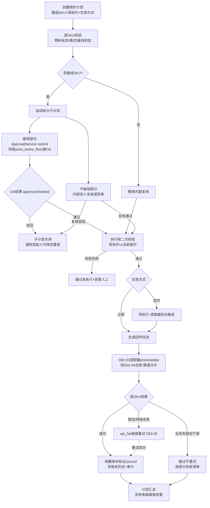
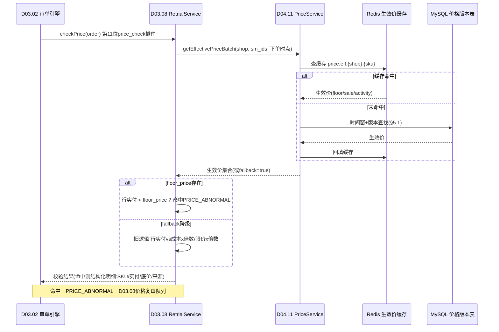
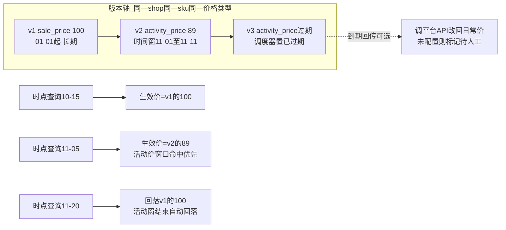

# SRS-D04.11 价格管理模块 需求规格说明书

> 文档编号：SRS-D04.11 · 版本 V1.0 · 2026-10-24 · 编写：小凯 · 状态：待审阅（V1.5 价格管理修正增补）
> 所属域：D04 库存域 · 分期：**P1（M3）**；P0 期预留价格档案表与审单基准接口（降级兼容，见 §8）
> 上游依据：**Jason S4 决策修正（B 档 + A 审批）**——推翻早期「价格归平台侧（边界外）」决策，正式修正为 OMS 管价格 · SRS-00 §1.4 九章模板 · SRS-D03.02（price_check 插件）· SRS-D03.08（checkPrice 价格复审）· SRS-D04.01（销售物料）· SRS-D02.02（适配器能力扩展）· SRS-D02.04（回传中心）· SRS-D10.05（审批流）· SRS-D04.07（成本口径）· 商派 dealer.goods_price / pos.productprice 参考实现

---

## 1. 模块概述

### 1.1 定位

价格管理是 OMS 侧**价格数据的唯一权威源**，承担三重角色：

1. **价格台账（档案）**：以 货主×店铺×SKU（销售物料）为维度，维护吊牌价 / 日常销售价 / 活动价 / 底价红线四类价格，带生效时间窗与版本历史，全程可追溯；
2. **审单校验基准供给**：为 D03.02 审单引擎第 11 位 price_check 插件与 D03.08 `RetrialService::checkPrice` 提供「下单时点生效价」精确基准（floor_price/sale_price），**替换现有「成本/限价倍数」粗校验**；
3. **批量改价回传平台**：调价计划（选 SKU 集合 + 目标价 + 立即/定时生效）→ 审批分流（破线走泛微 OA，不破线内部复核可配免审）→ 调平台价格 API 批量回传 → 结果处理与失败重试。

深度 = **B 档**（台账 + 校验基准 + 批量回传）；改价审批 = **A 档**（破线改价强制走泛微 OA）。

### 1.2 职责边界

**做**：价格档案 CRUD 与批量导入；四类价格与生效时间窗管理；价格版本历史；底价红线与字段级权限；调价计划（批量 + 定时）；破线 OA 审批联动（D10.05 新场景 price_below_floor）；改价回传执行与失败重试；审单基准供给接口；价格变更全留痕审计。

**不做**：
- 商品刊登 / 详情页 / 素材管理（**PIM 边界外**，README §8——本模块只管「价格」这一个属性域，不碰商品内容）；
- 智能调价 / 竞品比价算法（**C 档后置**，P2 预留位，见 FR-10）；
- 订单级个例改价（那是 D03.08 改单类型 price 的职责——本模块管**档案级/批量级**价格，D03.08 管**单张订单**的价格修改；两者联动点：D03.08 改价校验基准可从本模块取）；
- 批发价 / 经销价体系（→ D07.03，P2）；
- 平台报文翻译与调用出口（→ D02.02/D02.01，本模块是调用方）；
- 成本核算（→ D04.07，本模块只读其成本做「售价低于成本」告警联动）。

### 1.3 与其他模块关系

| 模块 | 关系 |
|---|---|
| D04.01 商品物料 | 价格档案挂靠**销售物料**（sm_id，店铺×SKU 维度，见 D04.01 §6.1）；物料建档/停用事件联动档案状态 |
| D03.02 审单引擎 | price_check 插件（第 11 位）经 `RetrialService::checkPrice` 间接消费本模块 `PriceService::getEffectivePrice`；**本模块是其底价红线基准的权威数据源** |
| D03.08 订单修改与复审 | 分工：**D04.11 供基准数据，D03.08 执行校验判定**（checkPrice 的基准价来源由 `CostService::getBasePrice` 扩展为本模块生效价，floor_price 缺失时降级回成本倍数，见 §5.5） |
| D02.02 平台适配器 | **新增第六类能力「价格写回」**（priceUpdate），扩展 PlatformAdapter 接口与能力矩阵（见 §7 EF-01） |
| D02.04 回传中心 | 复用其 sync_task 台账 + D02.05 api_fail 重试机制，新增 sync_type=price（见 §5.4 判断说明） |
| D10.05 审批流 | 新增审批场景 **price_below_floor（破线改价）**，登记入 D10.05 §3 FR-02 场景清单（31 → 32 个） |
| D04.07 库存成本核算 | 读 `CostService::getUnitCost`（IF-D04.07-04）做「售价低于成本」告警（不拦截，只提示） |
| D10.03 数据权限 | 价格档案按店铺/货主行级过滤；**floor_price 字段级权限**（仅价格主管/运营总监可见） |
| D10.06 操作审计 | 价格变更全留痕（谁/何时/从多少改到多少/审批链） |

---

## 2. 业务场景

**SC-D04.11-01 新品牌接手批量导入价格档案**
凯淳新接手品牌 B（代销货主），天猫+抖音两店共 3000 个 SKU。价格专员下载导入模板（店铺/平台SKU编码/吊牌价/日常销售价/底价红线/生效时间），Excel 批量导入。系统按 (shop_id, sm_id) 匹配销售物料：匹配成功即建档生效；未匹配的进「待处理清单」（提示先在 D04.01 完成物料绑定）。导入完成生成 v1 版本快照，全程写审计。floor_price 列导入后仅价格主管以上角色可见。

**SC-D04.11-02 大促前批量调价（定时生效 + OA 审批）**
双 11 预热，运营对天猫店 500 个 SKU 建调价计划：目标价=活动价（含时间窗 11-01 00:00 ~ 11-11 23:59），生效方式=定时。系统逐 SKU 破线判定：其中 12 个 SKU 目标价 < floor_price → 计划拆分，破线部分强制推泛微 OA（场景 price_below_floor，要素含 SKU/当前价/目标价/底价/破线幅度/调价理由）；不破线 488 个走内部双人复核（录入人≠复核人，可配置免审）。OA 通过后计划进入待执行，到达定时点批量调平台价格 API 回传，活动价时间窗写入档案。

**SC-D04.11-03 审单发现成交价低于底价拦截**
买家下单某 SKU，行实付 89 元。D03.02 审单第 11 位 price_check 插件调 D03.08 `RetrialService::checkPrice`，后者经 `PriceService::getEffectivePrice(shop, sku, 下单时点)` 取到该时点生效 floor_price=95 元 → 实付 < 底价 → 返回 PRICE_ABNORMAL 命中明细（SKU/实付/底价/来源=价格档案）→ 订单转 D03.08 价格复审队列，复审员核实（是否叠加了未登记的店铺券）后放行或取消。**替换旧逻辑**：此前按「行实付 vs 成本×倍数/限价×倍数」粗校验，现以档案底价精确判定。

**SC-D04.11-04 改价回传平台部分失败重试**
调价计划执行 500 SKU：淘系 item.price.update（sku 级）批量回传，其中 470 成功、22 个触发平台限流（RATE_LIMITED）、8 个业务失败（「商品已下架」）。处理：成功条目台账记 succ 并更新档案「平台已同步」标记；限流条目按 D02.05 指数退避自动重试；业务失败条目标记跳过不重试，进「部分失败清单」提醒运营核对商品状态。计划维度汇总回传结果，失败率超阈值（默认 5%）触发企微告警（D01.07）。

**SC-D04.11-05 活动价时间窗到期自动回落日常价**
SC-02 的活动价时间窗 11-11 23:59 到期。统一调度器（D01.02）分钟级扫描到期版本：活动价版本置「已过期」，生效价自动回落至 sale_price（日常销售价）。若调价计划配置了「到期回传」，则同步调平台价格 API 把平台侧价格改回日常价；未配置则只改档案并提示运营平台侧价格需人工处理（防档案与平台价不一致的静默漂移）。

**SC-D04.11-06 价格变更审计追溯**
三个月后品牌方质疑某 SKU 大促价是谁定的。审计员在价格版本历史检索该 (shop, sku)：v3 版本显示 2026-10-30 由专员张三经调价计划 AP20261030001 创建，目标价 89 元 < 底价 95 元，关联 OA 审批单（审批人李四/王五，通过，意见「大促战略亏损许可」），回传平台成功时间 2026-10-31 22:00。字段级审计（D10.06）+ 版本快照 + 审批链三者闭环，全程可解释。

---

## 3. 功能需求

### FR-D04.11-01 价格档案 CRUD 与导入
- FR-01a 档案维度：**货主×店铺×SKU**（owner_id + shop_id + sm_id，挂靠 D04.01 销售物料）；唯一键 (shop_id, sm_id)（一个销售物料已含店铺×SKU 语义，owner 冗余自查）。
- FR-01b 单条维护：新增/编辑/停用；编辑即产生新版本（FR-03），不允许原地覆盖。
- FR-01c 批量导入：经 D01.06 导入导出中心，模板列=店铺/平台SKU编码/四类价格/生效时间窗/币种；按 (shop_id, platform_sku_code) 解析到 sm_id；未匹配行进待处理清单可下载；导入结果报告（成功/失败/失败原因）。
- FR-01d 批量导出：按权限导出（floor_price 列按字段级权限裁剪，无权限者导出文件不含该列）。
- FR-01e 多币种预留：档案含 currency 字段，默认 CNY；跨境多币种（P2，D03.12 联动）本期只落字段不做汇率换算。

### FR-D04.11-02 四类价格与生效时间窗
- FR-02a 价格类型：
  - `tag_price` 吊牌价（划线价，参考属性，无时间窗）；
  - `sale_price` 日常销售价（长期生效的基准售价）；
  - `activity_price` 活动价（**必带时间窗** start_time/end_time，窗口内优先级最高）；
  - `floor_price` 底价红线（审单拦截/改价审批基准；可带时间窗，如大促期临时下调底价）。
- FR-02b 生效时间窗：sale_price/activity_price/floor_price 均支持生效窗口；同一类型同一 SKU 的多个版本时间窗**不允许重叠**（保存时校验，冲突拒绝并提示重叠版本）。
- FR-02c 优先级：查询某时点生效价时，activity_price（窗口命中）> sale_price > tag_price；floor_price 独立查询（不与售价互斥）。
- FR-02d 价格约束校验：录入时 activity_price/sale_price < floor_price 给出**软提示**（可保存，但档案标记「破线状态」供治理）；tag_price ≥ sale_price 为软校验（部分品类允许倒挂）。
- FR-02e 成本联动告警：sale_price/activity_price < `CostService::getUnitCost`（IF-D04.07-04，买断货主）时软提示「低于存货成本」（不拦截——代销货主无存货成本，口径不同）。

### FR-D04.11-03 版本历史（价格可追溯）
- FR-03a 每次价格变更（人工编辑/导入/调价计划执行/活动价回落）生成一条版本记录：版本号、价格类型、旧值、新值、时间窗、变更来源（manual/import/plan/schedule）、操作人、关联单据（计划号/审批单号/导入批次号）。
- FR-03b 版本链按 (shop_id, sm_id, price_type) 有序；任一历史时点可重建当时生效价（审单用「下单时点生效价」，见 §5.1）。
- FR-03c 版本不可修改不可删除（审计红线）；纠错走「新版本覆盖 + 备注冲正原因」。

### FR-D04.11-04 底价红线与字段级权限
- FR-04a floor_price 为敏感字段：默认仅**价格主管/运营总监**角色可见（D10.03 字段级权限，防泄露给普通客服——客服只见售价区间话术，不见底价）。
- FR-04b 无权限用户在列表/详情/导出/接口返回中一律看不到 floor_price 值（显示 `***`）；权限点 `d04.price.floor.view` 独立授权。
- FR-04c floor_price 变更本身全量写审计（含旧值新值密文存储，D10.06）；floor_price 下调（放宽红线）需内部复核（可配置升级 OA）。

### FR-D04.11-05 调价计划（批量 + 定时）
- FR-05a 计划创建：选择 SKU 集合（按店铺/分类/品牌/手工勾选/Excel 导入圈选）+ 逐 SKU 或按规则（统一折扣率/统一加减价）设定目标价 + 目标价格类型（sale_price/activity_price）+ 生效方式（立即/定时 start_time）+ 可选「到期回传」配置（活动价场景）。
- FR-05b 创建即校验：破线判定（§5.3）逐 SKU 执行，输出破线清单与不破线清单；校验目标价格式/币种/物料状态（停用物料拒绝入计划）。
- FR-05c 计划状态机：`草稿 → 待复核/待审批（OA） → 已通过 → 待执行（定时中） → 执行中 → 已完成/部分失败/已取消`；审批中计划冻结不可编辑；到达定时点自动转执行。
- FR-05d 计划拆分：含破线 SKU 的计划自动拆为「OA 审批子计划」+「内部复核子计划」，两部分独立流转互不阻塞（SC-02）；也可创建时人工预先分离。
- FR-05e 取消与撤回：待执行前可取消（OA 在途走 `ApprovalService::withdraw`）；执行中不可取消（已发出的平台调用不可逆），未发出条目可终止。

### FR-D04.11-06 破线 OA 审批联动（A 档决策）
- FR-06a 判定规则：计划内任一 SKU 目标价 < 该 SKU 下单时点将生效的 floor_price → 该 SKU **强制推泛微 OA**，场景编码 **price_below_floor**（登记入 D10.05 §3 FR-02 场景清单，成为第 32 个场景）。
- FR-06b 发起：调 `ApprovalService::submit(scene=price_below_floor, biz_type=price_adjust_plan, biz_bn=计划号, 要素)`；要素含 SKU 明细快照（编码/名称/当前价/目标价/底价/破线幅度%/调价理由/生效方式），审批人看快照非实时值（D10.05 FR-02b）。
- FR-06c 订阅 `approval.finished` 事件：通过 → 子计划转「已通过」进执行队列；驳回 → 子计划关闭并通知发起人（可修改后重新发起，新计划号）。
- FR-06d 不破线改价 = 内部双人复核：录入人 ≠ 复核人（系统校验账户不同）；店铺级可配置「免审」（免审也落复核记录，status=通过·免审，继承 D10.05 FR-05d「免审也要有记录」红线）。
- FR-06e 执行前二次校验（D10.05 FR-04d 联动）：OA 通过回调后、实际回传平台前，重验目标价 vs **当前** floor_price（防审批期间底价被上调导致「批的时候不破线、执行的时候破线」）；重验失败 → 计划标记「通过未执行」+ 告警人工。

### FR-D04.11-07 改价回传执行与重试
- FR-07a 执行通道：计划到达生效点 → 生成回传任务 → 经 D02.02 适配器**第六类能力「价格写回」priceUpdate**（淘系 item.price.update sku 级 / 京东 price 更新 / 拼多多 / 抖音等，见 §7 EF-01）→ 平台价格 API。
- FR-07b 台账与重试：**复用 D02.04 回传中心** sync_task 台账（sync_type 新增 `price`，幂等键 (price, plan_id#sku, update)）与 D02.05 api_fail 分级重试（RATE_LIMITED 退避 / RETRYABLE 自动 / MANUAL 人工 / FATAL 死信），不另建独立通道（判断依据见 §5.4）。
- FR-07c 限速执行：按平台 API 频控配置节流（QPS 上限/批量分片大小，店铺级可配）；万级 SKU 计划分片排队执行（§5.4）。
- FR-07d 结果处理：逐 SKU 记录成功/失败/跳过（业务失败如「商品已下架」跳过不重试）；计划维度汇总（成功数/失败数/失败率）；失败率超阈值告警（D01.07 企微）；「部分失败清单」可下载、可一键重试（仅重试可重试类条目）。
- FR-07e 档案与平台一致性：回传成功 → 档案版本标记 `synced`；回传失败终态 → 档案标记 `sync_failed`（生效价以 OMS 档案为准，平台价不一致进对账清单，人工处理）。

### FR-D04.11-08 审单基准供给接口（本模块核心输出）
- FR-08a `PriceService::getEffectivePrice(shop_id, sm_id, at_time, type[])`：返回指定时点各类型生效价（§5.1 算法）；供 D03.02 price_check 插件链路与 D03.08 `RetrialService::checkPrice` 消费。
- FR-08b 批量版 `getEffectivePriceBatch(shop_id, sm_ids[], at_time)`：审单单据多行一次取齐（热路径性能，§8）。
- FR-08c 降级兼容：档案无 floor_price（品牌未导入/历史订单）→ 返回 `fallback=true`，D03.08 checkPrice 按现有「成本/限价倍数」粗校验执行（**P0 期全量走此降级路径**，向后兼容不断链，见 §5.5）。
- FR-08d Redis 缓存生效价（审单热路径 ≤5ms，§8）；版本变更事件驱动缓存失效。

### FR-D04.11-09 价格变更全留痕
- FR-09a 审计事件：档案创建/编辑/导入/计划执行/审批结果/回落调度全部投递 D10.06 字段级审计（谁/何时/从多少改到多少/审批链引用）。
- FR-09b 价格变更时间线视图：按 (shop, sku) 聚合展示全部版本 + 关联计划 + 关联审批单（SC-06 追溯入口）。
- FR-09c 敏感字段（floor_price）审计值密文存储、界面按权限脱敏（继承 D03.08 §8 安全口径）。

### FR-D04.11-10 智能调价预留位（C 档后置，P2）
- FR-10a 本期只预留：① 档案表 price_source 字段（manual/import/plan/**algo** 预留）；② 调价计划的 source_type 预留 `algorithm`（竞品比价/毛利目标自动出价产出的计划走同一审批与回传通道——**算法可以建议价格，破线审批红线不豁免**）；③ 事件 `price.archive.changed` 可供未来算法订阅行情。不实现任何算法逻辑。

---

## 4. 业务流程

### 4.1 批量调价计划全流程（录入→校验→审批分流→执行回传→结果处理）



### 4.2 审单价格校验数据流（D04.11 供基准，D03.08 执行判定）



### 4.3 价格版本时间窗生效机制



---

## 5. 处理逻辑

### 5.1 下单时点生效价查找算法（时间窗 + 版本）

```
getEffectivePrice(shop_id, sm_id, at_time, types=[sale, activity, floor]):
    # 缓存优先（Redis Hash: price:eff:{shop}:{sm}，变更事件失效）
    cached = Redis.hget(key)
    if cached and cached.valid_until > at_time: return cached

    result = {}
    for type in types:
        # 版本表按 (shop, sm, price_type) 索引，取 at_time 命中的窗口版本
        v = SELECT * FROM inv_price_version
            WHERE shop_id=? AND sm_id=? AND price_type=?
              AND status='active'
              AND start_time <= at_time
              AND (end_time IS NULL OR end_time > at_time)   # NULL=长期
            ORDER BY start_time DESC, version_no DESC LIMIT 1
        result[type] = v
    # 优先级归并：活动价窗口命中 > 日常销售价（供审单展示成交价参照）
    result.effective_sale = result.activity ?? result.sale
    result.fallback = (result.floor IS NULL)   # 无底价档案→checkPrice降级
    return result
```
- 时间窗不重叠约束（FR-02b）保证 LIMIT 1 无歧义；
- 审单传入的 at_time = 订单**平台下单时间**（非审单时间——大促跨窗口边界的订单按下单时点定价校验，这是版本化的核心价值）；
- 缓存失效：`price.archive.changed` 事件 → 删对应 key（不做值更新，删了下次读源，简单可靠）。

### 5.2 破线判定

```
checkBelowFloor(plan_item):
    floor = getEffectivePrice(shop, sm, 计划生效时点, [floor]).floor
    if floor IS NULL: return NOT_BELOW (无底价档案不判定破线, 记提示)
    return plan_item.target_price < floor.price

# 计划级分流
below_items  = [i for i in plan.items if checkBelowFloor(i)]
normal_items = plan.items - below_items
below_items 非空 → 拆 OA 子计划(scene=price_below_floor)
normal_items    → 内部复核子计划(录入≠复核; 店铺配置免审则auto)
```
- 判定时点 = **计划生效时点**（定时计划按 start_time 查届时生效的 floor 版本——floor 本身可带时间窗，如大促期临时底价）；
- 执行前二次校验（FR-06e）用**执行时点当前** floor 重判，防审批期间底价上调。

### 5.3 批量回传的限速与失败重试（平台 API 频控）

```
executePlan(plan):
    shards = chunk(plan.items, platform_batch_size[shop.platform])  # 淘系sku级逐条/京东批量
    for shard in rate_limit_queue(shards, qps_limit[shop.platform]):
        for item in shard:
            resp = AdapterFactory::get(platform).priceUpdate(shop_auth, item)
            # 经 D02.04 台账: sync_task(sync_type=price, biz_ref=plan_bn#sm_id, action=update)
            if resp.ok:  mark_succ(item); archive_version.markSynced()
            elif resp.err_level in (RATE_LIMITED, RETRYABLE):
                register_api_fail(item)   # D02.05 指数退避重试, 复用原台账记retry_count
            elif resp.err_code in BIZ_SKIP_CODES:   # 商品已下架/删除等
                mark_skip(item, reason)   # 不重试, 进部分失败清单
            else: mark_manual(item)       # 人工工作台
    summarize(plan)   # 成功/失败/跳过计数; 失败率>5% → D01.07告警
```
- QPS 限流走 D02.01 框架限流器（平台级令牌桶），价格回传队列优先级 = **低**（低于发货/库存回传——改价慢几分钟无履约风险，不抢主链路配额）；
- 幂等：平台价格 update 天然幂等（重复调用同值无副作用），台账幂等键防计划重复执行即可。

### 5.4 回传通道判断：复用 D02.04 而非独立通道

**结论：复用。** 理由：① D02.04 sync_task 台账模型（类型/单据引用/指令快照/状态/失败分级/api_fail 关联）完全覆盖价格回传诉求，仅扩 sync_type 枚举 `price`；② 重试/对账/告警/监控指标（D02.05、D11.03）零重复建设；③ 与 flag 回传（V1.4 先例，同为低频低优先级写回）路径一致。差异点：价格回传需携带**版本快照**（回传的目标价与档案版本号绑定，重试时用原快照值而非实时档案值——防重试期间档案又被改，回传了未审批的价格）。

### 5.5 与 D03.08 的分工细节（基准替换的兼容路径）

| 环节 | D04.11（本模块） | D03.08 |
|---|---|---|
| 基准数据 | 维护四类价格档案，输出 `getEffectivePrice`（下单时点生效 floor/sale） | 消费基准，不存储价格档案 |
| 校验判定 | 不做订单校验 | `RetrialService::checkPrice`（IF-D03.08-04）执行：行实付 < floor_price → 命中 PRICE_ABNORMAL |
| 降级路径 | floor 缺失返回 fallback=true | fallback 时按现有 §5.3 算法：基准价=`CostService::getBasePrice`(买断存货成本/代销最低限价)×倍数（retrial_monitor_config 的 cost_multiple/limit_multiple）——**P0 期全量走此路径，P1 档案就绪后自动切换精确基准** |
| 命中后 | 无动作 | 生成复审单（type=audit）、hit_detail 结构化记录（新增 source=price_archive/fallback 字段区分基准来源） |
| 阈值配置 | floor_price 档案值 | 倍数/开关仍在 retrial_monitor_config（货主级）；两者并存：有档案用档案，无档案用倍数 |

切换开关：店铺级配置 `price_check_source = archive_first / legacy_only`（灰度期按店铺逐个切换，出问题一键回退）。

### 5.6 活动价回落调度

- 统一调度器（D01.02）分钟级任务：扫描 end_time 已过的 activity_price 版本 → 置 `expired` → 发 `price.archive.changed`（缓存失效，生效价自动回落 sale_price，§5.1 查询逻辑天然支持）；
- 若版本关联的调价计划配置「到期回传」→ 自动生成回传任务（目标价=回落后的 sale_price，走 §5.3 同通道）；未配置 → 档案标记 `platform_price_drift_risk` 并进对账清单提醒人工；
- 回落不产生新版本（是旧版本状态流转），但写调度审计日志。

---

## 6. 数据字段（业务字段描述，DDL 归数据字典 DB-D04）

### 6.1 价格档案（inv_price_archive）

| 字段 | 业务含义 | 取值/校验 |
|---|---|---|
| shop_id / sm_id | 店铺×销售物料（挂靠 D04.01） | 联合唯一 |
| owner_id / tenant_id | 货主/租户 | 必填，全域口径 |
| platform_sku_code | 平台 SKU 编码（冗余，回传用） | |
| tag_price | 吊牌价 | decimal(20,3)≥0 |
| sale_price | 日常销售价（当前生效值冗余，权威在版本表） | |
| floor_price | 底价红线 | **字段级权限 d04.price.floor.view**；密文存储 |
| currency | 币种 | 默认 CNY，多币种 P2 预留 |
| below_floor_flag | 当前售价破线标记 | FR-02d 软提示产物，治理清单用 |
| sync_status | 平台同步状态 | synced / sync_failed / not_required（纯档案不回传） |
| price_source | 价格来源 | manual / import / plan / algo（P2 预留） |
| status | 档案状态 | 启用/停用（随销售物料状态联动） |

### 6.2 价格版本历史（inv_price_version）

| 字段 | 业务含义 | 取值/校验 |
|---|---|---|
| archive_id / shop_id / sm_id | 归属档案 | |
| price_type | 价格类型 | tag/sale/activity/floor |
| version_no | 版本号 | (archive, price_type) 内递增 |
| old_price / new_price | 旧值/新值 | 新值必填；floor 密文 |
| start_time / end_time | 生效时间窗 | end_time NULL=长期；同类型窗口不重叠（唯一性校验） |
| status | 版本状态 | pending（未到生效）/ active / expired / cancelled |
| change_source | 变更来源 | manual/import/plan/schedule（回落到期）/algo 预留 |
| ref_plan_bn / ref_approval_bn / ref_import_batch | 关联单据 | 调价计划号/OA 审批单号/导入批次号 |
| sync_flag / sync_time | 该版本是否已回传平台 | 回传绑定版本快照（§5.4） |
| operator / operated_at / tenant_id | 操作人/时间/租户 | 审计要素 |

### 6.3 调价计划（inv_price_adjust_plan）

| 字段 | 业务含义 | 取值/校验 |
|---|---|---|
| plan_bn | 计划号 | 唯一 |
| shop_id / owner_id / tenant_id | 维度 | |
| target_price_type | 目标价格类型 | sale/activity |
| effect_mode / effect_time | 生效方式：立即/定时 | 定时必填 effect_time |
| expire_writeback | 到期是否自动回传回落 | activity 场景用（SC-05） |
| source_type | 计划来源 | manual / import / algorithm（P2 预留） |
| sku_count / below_floor_count | 总 SKU 数/破线数 | 校验产出 |
| review_mode | 复核方式 | 双人复核/免审（店铺级配置快照） |
| reviewer / reviewed_at | 复核人/时间 | 复核人≠创建人 |
| approval_bn / oa_instance_id | OA 审批引用 | 破线子计划必填（price_below_floor） |
| status | 状态机 | 草稿/待复核/待审批/已通过/待执行/执行中/已完成/部分失败/已取消/通过未执行 |
| reason | 调价理由 | 破线推 OA 时必填 |
| result_summary | 执行汇总 JSON | 成功/失败/跳过计数、失败率 |

### 6.4 调价计划明细（inv_price_adjust_item）

| 字段 | 业务含义 | 取值/校验 |
|---|---|---|
| plan_id / sm_id / platform_sku_code | 归属/物料 | |
| current_price_snapshot | 创建时点生效价快照 | 审批要素（快照非实时） |
| floor_snapshot | 创建时点底价快照 | 密文；破线判定依据 |
| target_price | 目标价 | >0 |
| below_floor | 是否破线 | 决定审批分流 |
| activity_start / activity_end | 活动时间窗 | target=sale 时可空 |
| exec_status | 执行状态 | 待执行/成功/重试中/跳过/失败终态/未发出已终止 |
| version_id | 执行成功后生成的档案版本 | 关联追溯 |
| sync_task_ref | D02.04 台账引用 | sync_type=price |
| fail_reason / retry_count | 失败原因/重试次数 | |

### 6.5 价格回传任务（inv_price_sync_task）

> 复用 D02.04 sync_task 台账（sync_type=price），本表为**计划维度的执行批次视图**（一个计划一次执行=一个批次，SKU 级明细在 6.4 与 D02.04 台账）：

| 字段 | 业务含义 |
|---|---|
| batch_bn / plan_id | 批次号/计划 |
| shop_id / platform | 目标店铺与平台 |
| total / succ / fail / skip | 计数汇总 |
| qps_limit / shard_size | 本批次限速参数快照 |
| status | 执行中/已完成/部分失败 |
| alert_flag | 失败率超阈值告警标记 |
| tenant_id | 租户 |

---

## 7. 接口

### 7.1 内部接口

| 编号 | 接口 | 方向/消费方 | 说明 |
|---|---|---|---|
| IF-D04.11-01 | `PriceService::getEffectivePrice(shop_id, sm_id, at_time, types[])` | **D03.02 price_check 链路 / D03.08 `RetrialService::checkPrice`** | 下单时点生效价查询（§5.1）；floor 缺失返回 fallback=true（D03.08 降级成本倍数校验） |
| IF-D04.11-02 | `PriceService::getEffectivePriceBatch(shop_id, sm_ids[], at_time)` | 同上 | 批量版（审单热路径，一次取齐订单行） |
| IF-D04.11-03 | `PriceAdjustPlanService::create/submit/cancel(plan)` | 前端/开放接口（P2） | 调价计划管理（创建校验/提交分流审批/取消） |
| IF-D04.11-04 | `PriceAdjustPlanService::getExecResult(plan_bn)` | 前端/D11.03 | 执行结果与部分失败清单 |
| IF-D04.11-05 | `PriceArchiveService::importBatch(file, template)` | D01.06 导入中心回调 | 批量导入（SC-01） |
| IF-D04.11-06 | 事件 `price.archive.changed`（shop/sm/price_type/新版本/生效窗） | 自身缓存失效、D11 报表、P2 算法订阅位 | 档案与版本变更广播 |
| IF-D04.11-07 | 事件 `price.adjust.executed`（plan_bn/汇总/失败清单） | D11.03 监控、D10.06 审计、通知 | 计划执行完成广播 |
| IF-D04.11-08 | 订阅 `approval.finished`（scene=price_below_floor） | D10.05 | 审批结果驱动计划状态机 |
| IF-D04.11-09 | 订阅 `material.updated`（销售物料停用/换绑） | D04.01 | 档案状态联动 |
| IF-D04.11-D1 | 依赖 `ApprovalService::submit/withdraw`、`ThresholdService::needApproval` | D10.05 | 破线审批发起/撤回/免审判定 |
| IF-D04.11-D2 | 依赖 `CostService::getUnitCost(三元键)`（IF-D04.07-04） | D04.07 | 售价低于成本软告警（FR-02e） |
| IF-D04.11-D3 | 依赖 `AdapterFactory::get(platform)`（IF-D02.02-01） | D02.02 | 获取适配器执行 priceUpdate |

### 7.2 外部接口

| 编号 | 接口 | 方向 | 说明 |
|---|---|---|---|
| EF-D04.11-01 | 平台价格写回（经 D02.02 新能力 `PlatformAdapter::priceUpdate(shop_auth, sku_prices[])`） | 出 | **适配器第六类能力**，扩展 D02.02 FR-01a 能力组与 FR-02b 能力矩阵：淘系 item.price.update（sku 级）/ 京东商品价格更新 / 拼多多 goods.price / 抖音 product sku price 编辑；不支持的平台声明 CAPABILITY_NOT_SUPPORTED（该店铺改价退化为「只改档案 + 提示人工平台侧操作」）；**平台资质依赖**：淘系商品写接口等需向平台申请权限包（见 §8 风险） |
| EF-D04.11-02 | 泛微 OA 审批（经 D10.05 统一通道） | 出/入 | 场景 price_below_floor：OMS 不直连 OA，走 `ApprovalService` 发起 + `approval.finished` 回调 |
| EF-D04.11-03 | 平台价格查询（经 D02.02 `productGet`，已有能力复用） | 出 | 对账用：拉平台侧当前价 vs 档案生效价，差异进对账清单（P1 末期） |

---

## 8. 非功能需求

| 项 | 要求 |
|---|---|
| 性能·审单热路径 | `getEffectivePrice` 缓存命中 P99 **≤5ms**、批量 50 行 ≤10ms；缓存未命中回源 ≤30ms；超 50ms 熔断降级 fallback=true（宁走粗校验不阻塞审单） |
| 性能·批量执行 | 万级 SKU 调价计划：校验+审批分流 ≤2 分钟；回传执行按平台频控限速，1 万 SKU 淘系（sku 级逐条，QPS≈10）≤30 分钟完成（可接受——改价非实时履约链路）；执行进度可查 |
| 一致性 | 档案生效价与版本表强一致（同事务写入）；Redis 缓存与 DB 最终一致（事件失效+TTL 1h 兜底）；回传重试绑定版本快照，不回传未审批的实时值（§5.4） |
| 告警 | 回传失败率 >5%（计划级）→ 企微告警；`sync_failed` 档案数日环比突增 → 告警；OA「通过未执行」即时告警人工 |
| 审计完整性 | 价格变更 100% 留痕（版本表不可改删 + D10.06 字段级审计 + 审批链引用三者互证）；floor_price 值密文存储、按权限脱敏展示 |
| 安全/权限 | 档案查询按店铺/货主行级过滤（D10.03 注入）；floor_price 字段级权限独立授权点；导入文件中的底价列传输加密、导入完成即删临时文件 |
| 降级兼容（P0 预留） | **P0 期只建 inv_price_archive/inv_price_version 表结构与 `getEffectivePrice` 接口（返回 fallback=true）**，D03.08 checkPrice 继续走成本倍数粗校验，行为与 P0 完全一致；P1 档案灌数后按店铺灰度切换 price_check_source，可一键回退 |
| 容量 | 档案=店铺×SKU（50 万级，对齐 D04.01 销售物料容量）；版本历史年增约 300 万条（按月分区）；回传明细随计划归档 3 年后转历史库 |
| 外部依赖与风险 | ① **平台资质**：淘系商品写接口（item.price.update）需应用权限包申请、部分平台改价 API 有类目/资质限制——M3 启动前完成六平台价格写能力资质盘点（资质项 DEP-01 §1 T5/J3/P3/DY4/X3，申请节奏见 DEP-01 §3 第四批），未获批平台的店铺回传能力降级为档案模式（EF-01）；② 平台改价频率限制可能导致大促前集中调价排队——建议大促调价计划提前 24h 提交；③ OA 通道故障时破线计划阻塞（不放行是红线）——D10.05 熔断告警 + 人工线下审批应急预案 |

---

## 9. 验收标准

| 编号 | 验收条件 |
|---|---|
| AC-01 | 导入 3000 SKU 价格档案：匹配销售物料的成功建档生成 v1 版本；未匹配行进待处理清单可下载；重复导入同文件幂等（不产生重复版本）（SC-01） |
| AC-02 | 四类价格录入与时间窗校验：同类型时间窗重叠的版本保存被拒绝并提示冲突版本；活动价不带时间窗保存被拒绝 |
| AC-03 | 生效价查找：构造 v1 日常价 100（长期）+ v2 活动价 89（11-01~11-11），查询 10-15/11-05/11-20 三个时点分别返回 100/89/100（SC-05 回落逻辑，§4.3） |
| AC-04 | 破线分流：500 SKU 计划含 12 个目标价<底价 → 自动拆两个子计划，破线部分生成 OA 审批单（scene=price_below_floor，要素含破线幅度与快照），不破线部分进内部复核且复核人=录入人时被拒绝（SC-02） |
| AC-05 | OA 驳回后子计划关闭、不回传平台、发起人收到通知；修改后重新发起生成新计划号，原审批单不复用 |
| AC-06 | 执行前二次校验：OA 审批通过后、执行前把 floor_price 上调至高于目标价 → 计划置「通过未执行」+ 告警，不调平台 API（FR-06e） |
| AC-07 | 回传结果处理：500 SKU 执行后 470 succ/22 限流重试/8 业务失败跳过——台账状态逐条正确；限流条目经 D02.05 退避重试最终成功；跳过条目出现在部分失败清单且不重试；失败率>5% 触发企微告警（SC-04） |
| AC-08 | 审单联动：档案含 floor_price=95 的 SKU，构造行实付 89 的订单 → price_check 命中 PRICE_ABNORMAL，hit_detail 含 source=price_archive 与底价 95；同订单在无档案店铺走 fallback → hit_detail 含 source=fallback 按成本倍数判定（SC-03，§5.5 双路径） |
| AC-09 | 审单热路径性能：缓存命中 `getEffectivePriceBatch`（50 行）P99 ≤10ms（压测）；Redis 故障时熔断降级 fallback，审单不阻塞、不报错 |
| AC-10 | 字段级权限：普通客服角色在列表/详情/导出文件中均看不到 floor_price（显示 ***）；价格主管可见；无权限者调用返回档案的接口响应中不含 floor 字段值 |
| AC-11 | 审计追溯：任一历史版本可查到 操作人/时间/旧值新值/来源计划号/OA 审批单号/回传成功时间 完整链条；尝试直接 UPDATE 版本表被应用层拒绝（版本不可改删）（SC-06） |
| AC-12 | 活动价到期：时间窗结束后 5 分钟内版本置 expired、缓存失效、生效价回落；配置了到期回传的计划自动生成回传任务把平台价改回日常价；未配置的进对账清单标记 drift_risk（SC-05） |
| AC-13 | P0 降级兼容：清空档案数据后，D03.08 checkPrice 行为与 P0 版本完全一致（成本/限价倍数校验），审单链路无感知、无报错 |
| AC-14 | 平台不支持 priceUpdate 的店铺（能力白名单外）：改价计划执行退化为「只更新档案 + 提示人工平台侧操作」，不产生失败告警风暴 |

---

## 参考实现溯源

**商派机制参考**（逆向文档 01 数据库实体字典 + `_research/schema.json`）：
- `dealer.goods_price`（经销基础物料价格管理）：bs_id×bm_id 维度 + price + **start_time/end_time 生效时间窗** —— 本模块「时间窗生效」机制的直接参考，但商派仅经销商采购价单一类型、无版本链；
- `pos.productprice`（门店价格关联表）：store_id×bm_id + price + **sync_status/sync_msg/msg_id 平台同步状态字段** —— 本模块档案 sync_status 与回传状态绑定的参考；商派已有「价格改了要同步出去」的意识，但无审批分流、无失败清单治理；
- `purchase.order_sku_price`：单据级价格快照（含税/不含税结算价）—— 佐证「价格随单据存快照」思想，本模块体现为计划明细的 current_price_snapshot/floor_snapshot 与回传版本快照绑定；
- 商派 ome 主模块**无店铺×SKU 销售价格档案表**（价格以平台订单报文为准，monitor 只有成本/限价倍数配置）——即商派同样缺「档案级精确底价」，本模块为凯淳新建能力而非平移。

**与商派的关键差异**：
1. **底价红线 + OA 审批**：商派改价无破线概念、无外部审批联动；本模块 floor_price 强制破线走泛微 OA（price_below_floor 场景）+ 字段级权限防泄露 + 执行前二次校验；
2. **版本化生效价**：商派 goods_price 只有单一时间窗记录、改价即覆盖；本模块完整版本链（不可改删）+ 时点重建能力，审单校验用「下单时点生效价」而非当前价；
3. **审单精确基准替换粗校验**：D03.08 checkPrice 从「成本/限价倍数」升级为价格档案精确底价，fallback 降级保证向后兼容与灰度切换；
4. **PIM 界限显式化**：只管价格属性域，商品刊登/详情页/素材明确边界外（商派 product 表价格与商品内容混管）；
5. **智能调价预留不实现**：C 档算法后置，仅留 price_source=algo 与计划 source_type=algorithm 接口位，且算法建议价同样不破审批红线。

---

## 变更记录

| 日期 | 版本 | 变更 | 原因 |
|---|---|---|---|
| 2026-10-24 | V1.0 | 首版：九章全量（B 档深度 + A 档破线 OA 审批）；新增 D02.02 第六类能力 priceUpdate、D10.05 第 32 个场景 price_below_floor、D02.04 sync_type=price；D03.08 checkPrice 基准切换与 fallback 降级设计 | Jason S4 决策修正：推翻「价格归平台侧（边界外）」，OMS 正式接管价格管理（V1.5 价格管理修正增补） |
