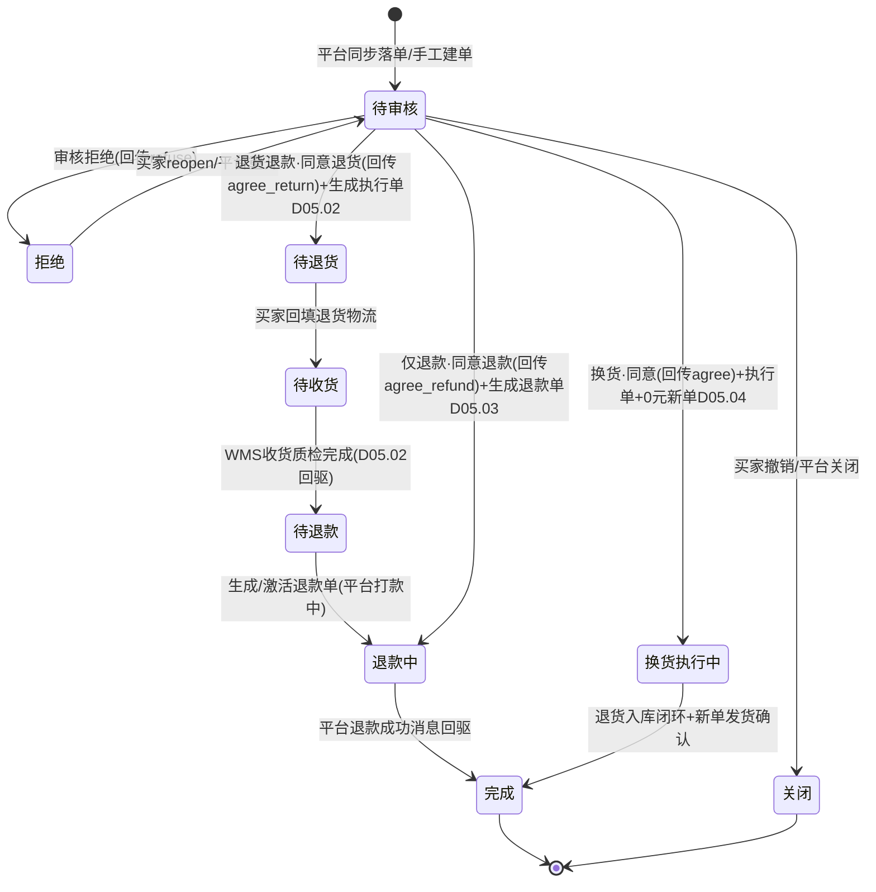
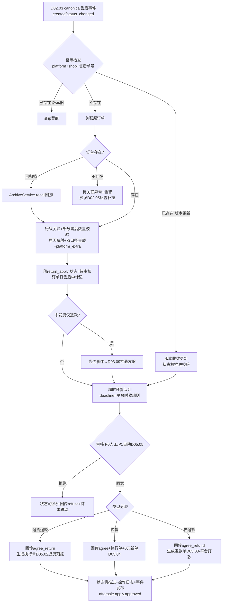
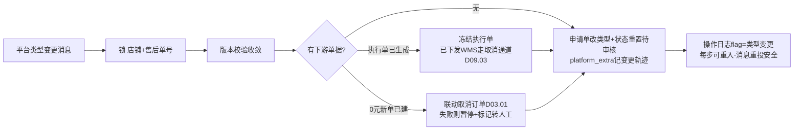

# SRS-D05.01 售后申请单模块 需求规格说明书

> 文档编号：SRS-D05.01 · 版本 V1.4 · 2026-10-24 · 编写：小凯 · 状态：待审阅（批次③，V1.4 业务仿真增补）
> 所属域：D05 售后域（三段式：申请单 return_apply / 执行单 reship / 退款单 refund）· 分期：**P0（M2）** · schema：oms_aftersale
> 上游依据：SRS-D02.03（IF-D02.03-03 售后事件投递 `platform.aftersale.*`、单拉补偿 IF-D02.03-01）· SRS-D02.04（IF-D02.04-03 `SyncService::submitAftersaleAction` 售后回传）· SRS-D03.01（IF-D03.01-02 `OrderStatusService::transit`、IF-D03.01-05 `OrderAmountService::getDualAmount`）· SRS-D03.13（IF-D03.13-02 `ArchiveService::recall` 售后回捞、售后保护期 FR-01b）· SRS-D05.02（执行单下游）· SRS-D05.03（退款单下游）· 逆向文档 05 §6（售后三链路/return_product 状态机/换转退幂等收敛/15 镜像表模式）
>
> **全局决策（本模块承载）**：① 三段式售后——申请归申请（本模块 return_apply）、仓内作业归作业（D05.02 reship）、钱归钱（D05.03 refund），三者分离、单据引用串联；② 退款执行形态=**平台执行，OMS 只记录**（代运营资金在平台，OMS 不碰钱、不主动调平台打款 API）；③ 平台差异吸收=**platform_extra JSON 扩展列**（不建商派 15 张 return_product_taobao/tmall/pdd 镜像表）；④ 全单据 owner_id + tenant_id；⑤ PIPL：退货收件人与买家标识加密存储。

---

## 1. 模块概述

### 1.1 定位

售后申请单是逆向链路的**统一入口与审批中枢**：所有平台的退款/退货/换货申请（消息推送+轮询+单拉，经 D02.03 canonical 转换）与线下手工建单，全部收敛为一张平台无关的 `return_apply` 申请单；本模块负责申请单的创建幂等、类型判定（仅退款/退货退款/换货）、状态机流转、审核（自动 D05.05/人工）、与原订单的行级关联（支持部分售后）、平台动作回传编排（同意/拒绝经 D02.04）、售后与订单状态联动、售后超时预警（平台退款时效约束）。审核通过后按类型分流：退货类 → 生成执行单（D05.02）；涉钱类 → 生成退款单（D05.03）。

商派对应机制：return_product（申请与审批，平台语义）+ refund_apply（钱要不要退的审批单）两级审批模型；凯淳收敛为**申请单一级**（refund_apply 的审批语义并入 return_apply 审核 + refund 单据状态，见 D05.03），链路更短、口径唯一。

### 1.2 职责边界

**做**：平台售后单自动同步落库（canonical 售后模型 → return_apply）、幂等防重（平台+店铺+平台售后单号唯一）、统一申请单模型与状态机、售后类型判定与类型变更（换转退/退转换）、手工建单（线下客诉）、申请单与原订单/订单行的关联与部分售后（按行/按数量）、申请原因映射（平台原因码→OMS 原因字典）、双口径申请金额、平台特有信息入 platform_extra、售后审核（自动/人工入口与分流）、平台售后动作回传编排（提交 D02.04）、售后与订单状态联动（pay_status 退款中、售后保护期供数 D03.13）、售后超时预警与超时自动同意风险管理、归档单售后回捞联动（D03.13）。

**不做**：退货预报/入库质检/良不良分流等仓内作业（→ D05.02）；退款单模型/退款台账/退款金额分摊回冲（→ D05.03）；换货 0 元新单创建与补发（→ D05.04）；自动审核规则引擎实现（→ D05.05，本模块提供审核入口与结果落单）；平台报文翻译与消息接收（→ D02.02/D02.03）；回传执行与失败重试（→ D02.04/D02.05）；订单状态写入（→ D03.01 IF-02 唯一入口）。

### 1.3 与其他模块关系

| 模块 | 关系 |
|---|---|
| D02.03 拉单与消息接收 | 订阅 `platform.aftersale.created/status_changed/logistics_updated` 事件（IF-D02.03-03）；单拉补偿 `PullService::pullSingle`（售后详情核实） |
| D02.04 回传中心 | 提交售后回传指令 `SyncService::submitAftersaleAction`（agree_refund/refuse_refund/agree_return/confirm_receive…）；消费 `gateway.sync.*` 结果事件闭环回传状态 |
| D03.01 订单接入 | `OrderStatusService::transit`（pay_status→退款中/部分退款/全额退款，IF-D03.01-02）；`OrderAmountService::getDualAmount` 取原单双口径金额与行级分摊（IF-D03.01-05）；未发货仅退款联动 `OrderCancelService::cancel`（IF-D03.01-04） |
| D03.07/D03.09 | 未发货仅退款/拦截：D03.09 订阅高优事件拦截发货、`DeliveryCommandService::recall` 叫回（IF-D03.07-02） |
| D03.13 归档 | 归档单售后：`ArchiveService::isArchived` 判定 + `recall` 回捞（IF-D03.13-02/03）；本模块提供「未闭环售后」查询供归档资格判定（其 FR-01b 条件②③） |
| D04.03 预占 | 未发货仅退款审核通过 → `FreezeService::release` 释放预占（经 D03.01 取消编排，IF-D04.03-03） |
| D05.02 退货退款执行 | 审核通过的退货退款/换货申请 → 生成执行单（reship）驱动退货链路 |
| D05.03 仅退款与退款单 | 涉钱申请 → 生成退款单（refund）；退款结果事件回驱申请单状态 |
| D05.05 自动审核（P1） | 本模块提供审核入口 `ReturnApplyService::audit`；规则引擎判定自动同意/拒绝/转人工 |
| D08.01 应收 | 售后完成事件供财务冲减应收（退款分摊回冲明细归 D05.03 供数） |
| D10.04 门户/D11 | 品牌方门户本货主售后单只读；售后率报表供数 |

---

## 2. 业务场景

**SC-D05.01-01 平台退货退款申请自动同步（主流程）**
买家在天猫对订单 O2026001（已发货已签收）中 1 行商品发起退货退款，平台生成售后单 refund_id=TB8899。淘系 TMC 推送退款创建消息 → D02.03 验签落缓冲、以消息为触发器单拉售后详情 → canonical 售后事件 `platform.aftersale.created` 投递本模块 → 幂等落 return_apply（类型=退货退款，状态=待审核，关联订单+订单行 oid、申请数量 1、双口径申请金额、平台原因码映射 OMS 原因字典「七天无理由」，淘系特有字段 refund_id/退款版本号/货物状态入 platform_extra）→ 原订单标记「售后中」→ 进入审核（P0 人工，P1 D05.05 规则自动）。审核同意 → 提交 D02.04 回传平台同意退货（agree_return）→ 生成执行单（D05.02）与退货预报，状态推进「待退货」。

**SC-D05.01-02 未发货仅退款（拦截链路）**
订单 O2026002 已审单预占、发货单已推仓未出库，买家在平台申请整单仅退款。D02.03 识别未发货仅退款，高优事件 `platform.aftersale.refund.created` 5 秒内送达 D03.09 拦截（暂停发货单、叫回推仓指令）；同时本模块落 return_apply（类型=仅退款，状态=待审核）。审核同意 → 提交回传平台同意退款（agree_refund）→ 生成退款单（D05.03，平台执行打款）→ 订单取消编排（D03.01 cancel：释放预占、pay_status→退款中）。平台打款成功消息回驱 → 退款单已退款 → 申请单完成、pay_status→全额退款。

**SC-D05.01-03 手工建单（线下客诉）**
客服电话接到消费者投诉（私域订单/平台单已过售后期）：客服在售后工作台按原订单号建单——系统校验订单存在（含归档单：isArchived 判定后触发 recall 回捞）、选择售后类型/原因/行与数量、录入协商金额。手工单申请单号前缀区分（MA 单），source=manual，无平台售后单号（幂等键退化为防连击锁+操作人确认）；后续审核/执行/退款链路与平台单一致。手工仅退款单**不回传平台**（无平台单可回传），退款走线下登记（D05.03 线下退款台账路径）。

**SC-D05.01-04 售后类型变更（换转退）**
买家在平台先申请换货（return_apply 类型=换货，已审核同意、执行单已生成待退货），后在平台改为退货退款。平台推送类型变更消息（canonical `aftersale.status_changed` 携带新类型）→ 本模块执行**幂等收敛编排**：① 冻结执行单（D05.02 停止退货预报，已下发 WMS 的走取消通道）→ ② 若已产生下游单据（换货 0 元单）则联动取消 → ③ 申请单类型改「退货退款」、状态按新类型状态机重置到「待审核」、platform_extra 记变更轨迹 → ④ 全程留痕（操作日志 flag=类型变更）。每步可重入（消息重复投递安全）。

**SC-D05.01-05 部分售后（按行/按数量）**
订单 3 行商品，买家对第 1 行全退、第 2 行 5 件中退 2 件：平台售后单按子单（oid）维度到达，落 return_apply_item 两行（行引用 order_item + oid + 申请数量）。校验：行申请数量 ≤ 行购买数量 − 该行历史已售后数量（含处理中申请）；同一行多次售后（先退 2 件再退 1 件）允许多张申请单并存，累计不超购。审核同意后执行单/退款单只覆盖本次申请行与数量，原订单其余行履约不受影响。

**SC-D05.01-06 平台状态变更收敛（乱序防护）**
平台先推「买家已退货」（待收货）后推「申请创建」补达（乱序）：本模块以 canonical 事件的 platform_modified 时间戳做版本收敛——本地状态机只接受「事件版本 > 本地版本」的推进；旧版本事件记录后跳过（不驱动状态回退）；状态机不允许的跳转（如 完成→待审核）拒绝并告警人工核对（单拉详情核实）。

**SC-D05.01-07 售后超时预警（平台时效约束）**
拼多多售后单平台要求卖家 48 小时内处理，超时平台自动同意退款。申请单落库即按「平台×售后类型」时效规则计算处理截止时间（deadline），进入超时预警队列：截止前 24h 黄色预警（工作台置顶+企微提醒售后专员）、截止前 4h 红色预警（升级售后主管）；超时未处理 → 平台自动同意后推送状态变更消息，本模块被动收敛（状态→待退款/退款中，标记「超时自动同意」，供 D11 售后时效考核与风险复盘）。

---

## 3. 功能需求

### FR-D05.01-01 平台售后单自动同步

- FR-01a 事件订阅：消费 `platform.aftersale.created`（新建）、`platform.aftersale.status_changed`（状态/类型/金额变更）、`platform.aftersale.logistics_updated`（买家回填退货物流，透传 D05.02）三类 canonical 售后事件（IF-D02.03-03）；事件体只作触发器+快照，关键决策（审核/回传）前可调 `PullService::pullSingle` 语义的售后详情单拉核实（以平台最新详情为准，防消息体不全/滞后——商派单拉补偿同款）。
- FR-01b 落库幂等：唯一键 `(platform, shop_id, platform_aftersale_bn)`；重复事件按版本收敛（FR-01c），不产生重复申请单。
- FR-01c 版本收敛与乱序防护：以 canonical 售后事件的 platform_modified（或平台售后版本号，淘系退款版本号入 platform_extra）比对本地版本：`不存在→create`；`更新→update+状态机推进`；`相等或更旧→skip 留痕`。同一售后单并发事件按 `(shop_id, platform_aftersale_bn)` 分布式锁串行化（同 D02.03 §5.3 口径）。
- FR-01d 类型判定：按 canonical 售后模型的类型语义映射三链路——`仅退款`（refund_only，不动货）/`退货退款`（return_refund）/`换货`（exchange，含平台换货单、京东 ASC 服务单、补寄）；平台「不退货仅退款（已发货）」归入仅退款并标记 `goods_received_flag`（已发货仅退款，库存损失登记联动 D05.03）。**补发类型（reshipment，V1.4 业务仿真 S3-A）**：不退货不退款只补货——①平台补寄单（淘系/拼多多「补寄」售后类型）同步落入 type=补发；②OMS 手工建单（客服安抚场景：漏发/破损少件/发错货补正）；执行链路复用 D05.04 换货的 0 元补发新单（无退货腿）：审核通过→生成 0 元补发订单（D03.01 create，createway=售后补发，关联原订单与原申请单）→正向履约发货；**补发原因与责任方结构化留痕**（reship_reason：漏发/破损/少件/错发/客诉安抚；responsibility：仓责/物流责/品牌责/客服责——供 D11 客诉率与仓责考核报表）；补发数量校验 ≤ 原行购买数量（防超额补发薅羊毛，超出走 OA 审批）；补发单同样预占库存（D04.03）、计成本（D04.07 买断货主补发成本入凯淳损益、代销按责任方归属）。
- FR-01e 原单关联与准入：按平台单号+oid 关联本地订单与订单行；订单不存在 → 申请单落「待关联」异常态+告警（可能拉单漏单，触发 D02.05 对账反查补拉）；订单已归档 → 自动回捞（IF-D03.13-02 `ArchiveService::recall`，reason=售后建单）后关联。
- FR-01f 原因映射：平台原因码 → OMS 售后原因字典（`MappingService::mapEnum(platform, aftersale_reason, nativeValue)`，IF-D02.02-04）；字典未命中 → 落「其他-待归类」+ 映射维护提醒（不阻塞落单）；原始原因码与文案保留 platform_extra。
- FR-01g 未发货仅退款拦截联动：识别「未发货+仅退款+整单」场景，发布高优事件 `aftersale.refundonly.unshipped`（D03.09 订阅执行发货拦截/叫回；D02.03 FR-06b 已在接入侧同步发布，本模块在落单确认后补发业务级事件携申请单引用）。

### FR-D05.01-02 统一申请单模型与状态机

- FR-02a 申请单头：申请单号（`RA{YYYYMMDD}{6位序列}`，手工单 MA 前缀）、类型、状态、来源（platform/manual）、平台/店铺/平台售后单号、订单引用、货主 owner_id、租户 tenant_id、双口径申请金额、原因（字典码+原文）、买家诉求描述与凭证（图片 URL 列表，PIPL 授权访问）、处理截止时间 deadline、platform_extra。
- FR-02b 状态机（三链路合一，见 §4.1）：`待审核 → 待退货 →（待收货 →）待退款 → 退款中 → 完成`；分支：`拒绝`（审核拒绝，可 reopen 回待审核）、`关闭`（买家撤销/平台关闭/超时关闭）。类型裁剪：仅退款无「待退货/待收货」；换货无「待退款/退款中」（换货完成=执行单闭环+新单发货，D05.04）。
- FR-02c 状态推进唯一入口：`ReturnApplyService::transit(apply_id, 目标状态, 触发源, 操作者)`，校验流转表合法性（§5.1），非法流转拒绝+告警；每次变迁写操作日志（谁/何时/从什么到什么/依据事件）。
- FR-02d 平台动作回传编排：状态变迁需要平台侧动作时（同意退款/拒绝退款/同意退货/确认收货），组装指令提交 `SyncService::submitAftersaleAction`（IF-D02.04-03，action=agree_refund/refuse_refund/agree_return/confirm_receive/exchange_consign/refill_logistics）；消费回传结果事件更新本地 `sync_status`（未回传/回传中/成功/失败待重试/人工）；**回传失败不阻塞本地状态机**（本地为准），失败经 D02.05 重试，重试耗尽转人工工作台。手工单（无平台单）跳过回传。
- FR-02e 审核：人工审核（同意/拒绝+拒绝原因码，拒绝原因经回传同步平台）；自动审核入口（D05.05 P1 调用 `ReturnApplyService::audit(apply_id, 决策, 规则引用)`）；审核动作原子编排=状态推进+回传提交+下游单据生成（退货类→D05.02 `ReshipService::createFromApply`；涉钱类→D05.03 `RefundService::createFromApply`）——本地事务+下游 MQ 最终一致（下游生成失败进补偿队列重试，不回滚审核结果）。
- FR-02f 部分售后：申请行 return_apply_item（订单行引用+oid+申请数量+行级申请金额双口径）；数量校验 `Σ(本单+历史处理中+历史完成) ≤ 行购买数量`（赠品随主品联动校验，福袋/组合装按 BOM 展开校验，D04.01）；支持行级部分同意（审核可按行调整同意数量，调整留痕）。

### FR-D05.01-03 手工建单

- FR-03a 客服工作台建单：按订单号检索（含归档回捞）→ 选类型/原因/行与数量 → 录入协商金额（默认=行级可退余额）→ 提交生成 MA 单（source=manual，operator 必填）；校验规则与平台单一致（数量上限/金额上限=双口径可退余额）。
- FR-03b 线下客诉（无平台单）：允许私域/线下订单建单；退款走 D05.03 线下退款登记路径（台账标记 offline，不经平台回传）；凭证附件必传（客诉记录/聊天截图）。
- FR-03c 手工单权限与审计：建单/审核分权（建单人≠审核人，金额超阈值走 OA 审批 D10.05）；全操作 D10.06 审计。

### FR-D05.01-04 平台差异吸收（platform_extra）

- FR-04a platform_extra JSON 列承载平台特有字段（替代商派 15 张镜像表）：淘系（refund_id/退款版本号/分账信息/货物状态/客服介入状态/先行垫付标记）、京东（ASC 服务单号/换新订单号/售后服务类型/平台处理环节）、拼多多（售后类型细分/凭证体系/极速退款标记）、抖音（售后凭证/平台介入状态）、小红书/唯品会（退供单关联）。
- FR-04b 关键字段生成列索引：`platform_refund_id`、`cs_intervene_flag`（客服介入）、`platform_aftersale_type_raw` 三个高频查询字段建 MySQL8 生成列+索引；其余字段 JSON 内查询（低频）。
- FR-04c 平台原始状态保真：platform_status_raw 字段原样保留平台状态串（对账回放依据，商派 return_product.platform_status 同款）；canonical 状态与原始状态双轨存储。
- FR-04d 业务代码零平台分支约束：审核/状态机/下游生成逻辑只依赖 canonical 字段；平台差异只允许出现在「回传指令组装的附加参数」与「展示层」，代码评审检查项。

### FR-D05.01-05 售后与订单状态联动

- FR-05a 售后中订单标记：申请单落库即经 `OrderStatusService::transit`（IF-D03.01-02）为订单打「售后中」业务标记（订单列表可按售后中筛选）；全部申请单闭环（完成/关闭/拒绝终态）后清除标记。
- FR-05b pay_status 联动：退款单受理 → pay_status=退款中；退款成功 → 按金额派生 部分退款/全额退款（D03.01 §5.1 流转表，触发方=D05.03 经本模块订单联动统一出口）。
- FR-05c 归档保护供数：向 D03.13 提供 `ReturnApplyQuery::hasOpenAftersale(order_id)`（未闭环售后判定，其 FR-01b 条件②）；售后保护期（默认 90 天，货主级配置）供归档资格判定（条件③）。
- FR-05d 拦截联动闭环：未发货仅退款 → D03.09 拦截/叫回结果事件回驱申请单（拦截成功→继续退款流程；拦截失败已出库→转「退货退款」引导或按已发货仅退款处理，人工决策留痕）。

### FR-D05.01-06 售后超时预警与时效管理

- FR-06a 时效规则配置：按「平台×售后类型×店铺覆写」配置处理时限（如淘系退货申请 5 天、拼多多 48h、抖音 72h——以平台规则为准，运营可维护）；落单即计算 deadline。
- FR-06b 预警分级：调度扫描（D01.02，每 10 分钟）——黄色（剩余≤24h）工作台置顶+企微提醒；红色（剩余≤4h）升级主管；已超时且平台自动同意 → 被动收敛+「超时自动同意」标记+资损复盘记录（金额入 D05.03 退款台账标记）。
- FR-06c 时效考核供数：申请→审核时长、审核→回传时长、超时率按店铺/专员维度供 D11 报表。

### FR-D05.01-07 查询与工作台

- FR-07a 售后工作台：待审核队列（按店铺/货主/时效紧迫度排序）、处理中队列、异常队列（待关联/回传失败/超时）；批量审核（同类型同店铺）。
- FR-07b 多维查询：订单号/平台售后单号/买家（脱敏）/店铺/货主/类型/状态/时间；单据详情聚合展示三段式全景（申请单+执行单+退款单+回传轨迹+操作日志时间线）。
- FR-07c 品牌方门户（D10.04）：本货主售后单只读视图（行级过滤+脱敏）。
- FR-07d 导出（D01.06）：售后台账/超时清单。

---

## 4. 业务流程

### 4.1 售后申请单状态机（三链路合一视图）



> 说明：三链路合一视图——退货退款走「待退货→待收货→待退款→退款中→完成」；仅退款走「待审核→退款中→完成」（无待退货/待收货）；换货走「待审核→换货执行中→完成」（无退款单）。状态推进唯一入口 FR-02c，非法流转拒绝。

### 4.2 平台售后同步流程（消息触发→落单→审核→分流）



### 4.3 售后类型变更（换转退）收敛流程



---

## 5. 处理逻辑

### 5.1 状态流转表（合法迁移权威，FR-02c 校验依据）

| 当前状态 | 目标状态 | 触发 | 附带动作 |
|---|---|---|---|
| — | 待审核 | 平台同步/手工建单 | 订单售后中标记、deadline 计算 |
| 待审核 | 待退货 | 审核同意（退货退款/换货） | 回传 agree_return、生成执行单 |
| 待审核 | 退款中 | 审核同意（仅退款） | 回传 agree_refund、生成退款单、订单 pay_status→退款中 |
| 待审核 | 拒绝 | 审核拒绝 | 回传 refuse_refund（拒绝原因码） |
| 待审核 | 关闭 | 买家撤销/平台关闭消息 | 清除订单售后中标记（无其他在途单时） |
| 拒绝 | 待审核 | 买家 reopen/平台重开消息 | 重算 deadline |
| 待退货 | 待收货 | 买家回填退货物流（logistics_updated） | 物流信息透传 D05.02 |
| 待收货 | 待退款 | 执行单收货质检完成（D05.02 事件回驱） | 生成/激活退款单 |
| 待退款/退款中 | 完成 | 退款单已退款（D05.03 事件回驱） | pay_status 派生联动、订单标记清理 |
| 换货执行中 | 完成 | 执行单闭环+换货新单发货确认（D05.04） | 订单标记清理 |
| 非终态 | 关闭 | 平台关闭/超时关闭消息 | 下游单据联动取消（执行单/退款单） |

### 5.2 幂等与并发

```
落单幂等键 = (platform, shop_id, platform_aftersale_bn) 唯一索引
手工单幂等 = 防连击锁(操作人+订单, 5s) + 提交确认
并发串行化 = Redis 分布式锁(shop_id + platform_aftersale_bn)
版本收敛   = platform_modified / 平台退款版本号 单调递增判定
审核幂等   = transit 前置状态校验(CAS: WHERE status=期望旧状态)，重复审核返回首次结果
下游生成   = 事件驱动+补偿队列，生成幂等键=(apply_id, 单据类型)，重复消费安全
```

### 5.3 双口径申请金额计算

```
行级可退余额(客户实付口径) = 行customer_paid − Σ历史已退/处理中(客户实付)
行级可退余额(平台承担口径) = 行platform_bear+merchant_bear分摊 − Σ历史(同口径)
申请金额默认 = 平台售后单申请金额(买家填写)；校验 ≤ Σ行级可退余额
审核可调整同意金额(部分同意)：调整值 ≤ 申请值，留痕+超阈值OA审批
质检扣减(退货少件/破损补差)由 D05.02 差异回驱调整，退款单以最终同意金额为准
（双口径取数权威 = D03.01 IF-D03.01-05 getDualAmount，本模块只算售后余额）
```

### 5.4 超时预警与「超时自动同意」风险管理

- deadline = 落单时间 + 时效规则（平台×类型，店铺可覆写）；调度每 10 分钟扫描分级预警（FR-06b）；
- 平台自动同意后的被动收敛：消息到达 → 版本收敛直接推进状态（跳过本地审核），标记 `auto_agreed_by_platform=true`；该标记单进入资损复盘清单（金额/店铺/原因），高频店铺触发时效规则复审；
- 已超时但平台未动作（部分平台不自动同意）：红色预警持续+主管介入，不允许静默。

### 5.5 平台原因码映射维护

映射表 `(platform, native_reason_code) → oms_reason_code`（D02.02 映射服务承载，本模块消费）；未命中落「其他-待归类」并生成映射维护任务；映射新增后存量「待归类」单批量重刷（调度任务，留痕）。

---

## 6. 数据字段（业务字段描述，schema：oms_aftersale）

### 6.1 售后申请单（return_apply）

| 字段 | 业务含义 | 取值/校验 |
|---|---|---|
| apply_id / apply_bn | 申请单 ID/单号 | RA/MA 前缀，全局唯一 |
| source | 来源 | platform/manual |
| platform / shop_id / platform_aftersale_bn | 平台/店铺/平台售后单号 | 三元唯一键（平台单必填，手工单空） |
| aftersale_type | 售后类型 | 仅退款/退货退款/换货（FR-01d） |
| status | 申请单状态 | §4.1 状态机 |
| order_id / order_bn | 关联订单 | 必填（待关联异常态可暂空） |
| owner_id / tenant_id | 货主/租户 | 必填（SRS-00 契约） |
| apply_amount_customer / apply_amount_platform_bear | 双口径申请金额 | ≥0，≤行级可退余额（§5.3） |
| approved_amount_customer / approved_amount_platform_bear | 审核同意金额（双口径） | ≤申请金额 |
| reason_code / reason_raw | OMS 原因字典码/平台原因原文 | 字典未命中=其他-待归类 |
| buyer_claim / evidence_urls | 买家诉求/凭证 | 凭证 PIPL 授权访问 |
| goods_status | 货物状态 | 未发货/已发货未收/已收货（canonical） |
| deadline / warn_level | 处理截止/预警级别 | FR-06 |
| platform_status_raw | 平台原始状态串 | 保真对账（FR-04c） |
| platform_extra | 平台特有字段 JSON | FR-04a；生成列索引 FR-04b |
| platform_modified_version | 版本收敛依据 | 单调递增 |
| sync_status | 回传状态 | 未回传/回传中/成功/失败待重试/人工 |
| auto_agreed_by_platform | 超时自动同意标记 | FR-06b 资损复盘 |
| is_archived_order | 归档回捞标记 | 关联归档单时置位 |
| operator / auditor / audit_time | 建单人/审核人/审核时间 | 建单≠审核（FR-03c） |
| create_time / last_modified | 时间戳 | |

### 6.2 申请单明细行（return_apply_item）

| 字段 | 业务含义 | 取值/校验 |
|---|---|---|
| apply_id / item_id | 主表/行 ID | |
| order_item_id / oid | 订单行引用/平台子单号 | oid=平台售后对账键 |
| bm_id / sku_name / sku_spec | 物料与规格快照 | 快照冗余（展示不回查） |
| apply_num / approved_num | 申请数量/同意数量 | ≤行可退余额（§5.3） |
| apply_amount_customer_line / platform_bear_line | 行级双口径金额 | 分摊自订单行 |
| gift_flag / combo_ref | 赠品标记/组合装引用 | BOM 展开校验（D04.01） |
| platform_extra | 行级平台字段 | 如淘系 oid 级退款状态 |

### 6.3 售后操作日志（return_apply_log）

| 字段 | 业务含义 |
|---|---|
| apply_id / seq | 归属/时序 |
| action | 动作（落单/审核/状态变迁/回传/类型变更/预警/人工干预） |
| from_status / to_status | 状态变迁（可空） |
| operator_type / operator | 系统/人工 + 标识 |
| detail_json | 依据事件 ID/回传指令 ID/变更快照 |
| create_time | 时间 |

---

## 7. 接口

### 7.1 内部接口（本模块提供）

| 编号 | 接口 | 消费方 | 说明 |
|---|---|---|---|
| IF-D05.01-01 | `ReturnApplyService::createFromPlatform(canonicalAftersale, 事件引用)` | D02.03 事件消费器 | 平台售后落单（幂等+版本收敛），返回 apply_id |
| IF-D05.01-02 | `ReturnApplyService::createManual(草稿, operator)` | 客服工作台 | 手工建单（FR-03），返回 apply_id |
| IF-D05.01-03 | `ReturnApplyService::audit(apply_id, 决策, 行级调整?, 操作者/规则引用)` | 工作台/D05.05 | 审核统一入口（原子编排 FR-02e），幂等 |
| IF-D05.01-04 | `ReturnApplyService::transit(apply_id, 目标状态, 触发源)` | D05.02/03/04 回驱、平台事件 | 状态推进唯一入口（§5.1 校验） |
| IF-D05.01-05 | `ReturnApplyQuery::get/list/trace(条件)` / `hasOpenAftersale(order_id)` | 工作台/D03.13/D10.04/D11 | 查询与未闭环判定（归档保护供数） |
| IF-D05.01-06 | 事件 `aftersale.apply.created` / `approved` / `rejected` / `closed` / `completed` / `type_changed` | D05.02/03/04、D03、D08、D11 | 申请单生命周期广播 |
| IF-D05.01-07 | 事件 `aftersale.refundonly.unshipped`（高优） | D03.09 | 未发货仅退款拦截（业务级补充，携申请单引用） |

### 7.2 依赖接口（本模块消费）

| 编号 | 接口 | 提供方 | 说明 |
|---|---|---|---|
| IF-D05.01-D1 | 事件 `platform.aftersale.*` 订阅 | D02.03（IF-D02.03-03） | 售后事件入口 |
| IF-D05.01-D2 | `SyncService::submitAftersaleAction(指令)` | D02.04（IF-D02.04-03） | 平台售后动作回传 |
| IF-D05.01-D3 | `OrderStatusService::transit` / `OrderAmountService::getDualAmount` / `OrderCancelService::cancel` | D03.01（IF-D03.01-02/05/04） | 订单状态联动与取数 |
| IF-D05.01-D4 | `ArchiveService::isArchived/recall` | D03.13（IF-D03.13-03/02） | 归档判定与售后回捞 |
| IF-D05.01-D5 | `MappingService::mapEnum(platform, aftersale_reason, code)` | D02.02（IF-D02.02-04） | 原因码映射 |
| IF-D05.01-D6 | `ReshipService::createFromApply(apply_id)` | D05.02 | 审核同意生成执行单 |
| IF-D05.01-D7 | `RefundService::createFromApply(apply_id)` | D05.03 | 涉钱申请生成退款单 |
| IF-D05.01-D8 | 调度注册/企微告警/OA 审批/审计 | D01.02/D01.07/D10.05/D10.06 | 底座能力 |

### 7.3 外部接口

| 编号 | 接口 | 方向 | 说明 |
|---|---|---|---|
| EF-D05.01-01 | 平台售后动作 API（同意/拒绝退款、同意退货、确认收货、换货同意） | 出（经 D02.04→D02.02→D02.01） | 本模块只组装 canonical 指令，不直连平台 |
| EF-D05.01-02 | 平台售后详情查询（单拉核实） | 出（经 D02.03 pullSingle 语义） | 审核前核实/对账反查 |

---

## 8. 非功能需求

| 项 | 要求 |
|---|---|
| 性能 | 事件消费落单 P99 ≤500ms；工作台查询 P95 ≤300ms；大促售后洪峰 200 单/分钟落单无积压 |
| 幂等 | 消息重投/版本乱序/重复审核/下游重复生成全路径幂等（§5.2） |
| 一致性 | 审核原子编排=本地事务+下游 MQ 最终一致（补偿队列重试，失败告警不静默）；状态机流转表强校验 |
| 时效 | 未发货仅退款拦截事件端到端 ≤10s；超时预警扫描周期 ≤10 分钟 |
| 安全/PIPL | 买家标识/收件人/凭证加密存储（D01.05）、展示脱敏；凭证访问授权留痕；手工单建审分权+超额 OA 审批 |
| 审计 | 状态变迁/审核/类型变更/人工干预全留痕（return_apply_log 只增不改） |
| 数据治理 | 申请单随订单归档策略（D03.13 单元含售后单）；platform_extra 原始报文引用保留 3 年 |

---

## 9. 验收标准

| 编号 | 验收条件 |
|---|---|
| AC-01 | 6 平台沙箱各发起一笔退货退款：消息到达→落 return_apply P99 ≤60s（含 D02.03 链路），类型/行关联/双口径金额/原因映射正确，平台特有字段（淘系 refund_id、京东 ASC 单号）完整入 platform_extra |
| AC-02 | 同一平台售后单消息重复投递 10 次+轮询并发命中：仅一张申请单；乱序消息（先到状态变更后到创建）版本收敛正确，状态不回退 |
| AC-03 | 未发货仅退款：高优拦截事件 ≤10s 送达 D03.09，发货单暂停/叫回；审核同意后订单取消、预占释放（FreezeService 台账=已释放）、pay_status→退款中 |
| AC-04 | 部分售后：3 行订单对行 1 全退+行 2 退 2/5，数量校验通过；再对行 2 申请退 4 件被拒（累计超购）；行 2 二次退 3 件成功，两张申请单并存且执行/退款只覆盖各自数量 |
| AC-05 | 审核同意退货退款：回传指令提交 D02.04（agree_return）台账 succ、执行单生成（D05.02）、状态=待退货；回传失败（模拟网络错误）本地状态不回滚，api_fail 重试成功后 sync_status 闭环 |
| AC-06 | 审核拒绝：状态=拒绝+回传 refuse_refund 携拒绝原因码；买家平台重开后 reopen 回待审核且 deadline 重算 |
| AC-07 | 换转退类型变更（SC-04）：执行单冻结、已下发 WMS 预报走取消通道、申请单类型/状态重置正确；变更消息重投 5 次无重复副作用（每步可重入） |
| AC-08 | 手工建单：归档订单建单自动回捞（ArchiveService.recall）后关联成功；建单人审核自己单被权限拒绝；超阈值金额触发 OA 审批 |
| AC-09 | 超时预警：配置 48h 时效的售后单，24h 黄色预警（工作台置顶+企微）、44h 红色升级；模拟平台自动同意消息到达→被动收敛+auto_agreed_by_platform 标记+资损复盘清单可查 |
| AC-10 | 订单不存在（漏单场景）：申请单落待关联异常+告警，D02.05 反查补拉订单后自动完成关联转正 |
| AC-11 | 状态机强校验：构造非法流转（完成→待审核）被拒绝并告警；全部合法流转（§5.1 表）逐条验证通过且操作日志完整 |
| AC-12 | PIPL：申请单买家手机/收件信息密文存储、界面脱敏；凭证图片访问留痕；品牌方门户只见本货主售后单 |

---

## 变更记录

| 日期 | 版本 | 变更 | 原因 |
|---|---|---|---|
| 2026-10-24 | V1.0 | 首版 | — |
| 2026-10-24 | V1.4 | FR-01d 售后类型 +补发（reshipment）：平台补寄单同步+手工建单，复用 D05.04 0元补发链路（无退货腿），补发原因/责任方结构化留痕（供 D11 仓责考核），数量防超额校验+预占+成本归属 | 业务完整性仿真 S3（Jason 决策A） |

---

*参考实现溯源：商派 return_product（申请单主表：status 1 申请中→2 审核中→3 接受申请→6 买家已退货→7 已质检→4 完成，分支 5 拒绝/8 补差价；return_type return/change/refund/jdchange；kinds 四分类；is_receive/is_check/platform_status/is_fail/source-sub_source）+ refund_apply（status 0 未审核→1 审核中→2 已接受→5 退款中→4 已退款，cs_status 客服介入/abnormal_status/协商状态）+ 15 张平台镜像表（return_product_{taobao,tmall,360buy,kaola,pinduoduo,huawei,yihaodian,bbc,youzan,luban} + refund_apply_{taobao,tmall,pinduoduo,youzan,luban}，复合主键 shop_id+return_id）+ ome_return::add 落单入口 + processReturn/processChange 换转退/退转换（释放冻结→取消换出订单→改类型→记 flag，逆向文档 05 §6.5）+ 售后消息族（matrix_message refund_created.notify/aftersalev2.add/status_update/logistics_update）+ 平台动作接口族（store.refund.agree4no.good.return/store.refund.good.return.agree/refuse、store.exchange.agree 等）。关键差异：① **15 张镜像表 → platform_extra JSON 扩展列+3 个生成列索引**（主表平台无关思想继承，垂直扩展改为 JSON 水平扩展，加平台零 DDL）；② return_product+refund_apply 两级审批 → **return_apply 一级申请单**（退款审批语义并入 D05.03 refund 单据状态，链路收敛）；③ **退款执行=平台执行 OMS 只记录**（商派 refund_request 主动调支付网关打款，凯淳代运营钱在平台，OMS 只同步状态+台账）；④ 状态机显式流转表+CAS 推进（商派 status 魔法数字散落业务代码，逆向文档 05 §6.7 教训）；⑤ 换转退建模为显式收敛编排（商派 processReturn 就地修改多表调试困难，本设计每步可重入+全程留痕）；⑥ 超时预警/自动同意资损复盘产品化（商派 confirmreship 定时器只做自动确认无风险管理）；⑦ 全单据 owner_id+tenant_id+归档回捞联动。*
