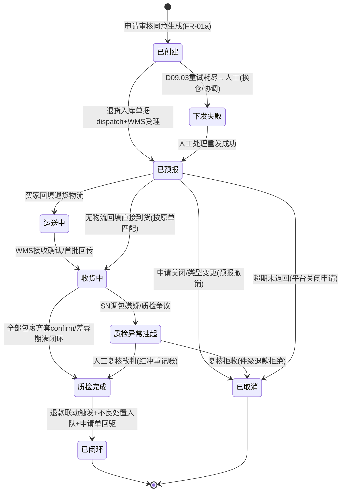
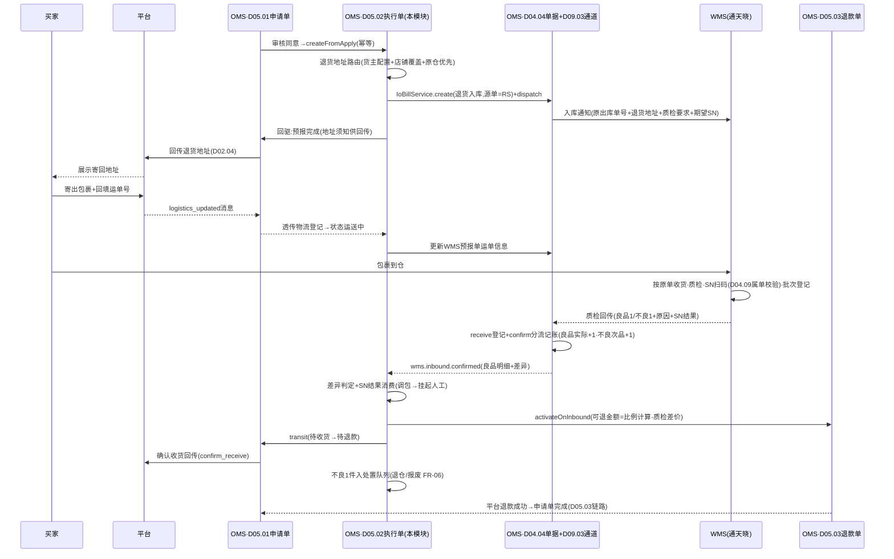
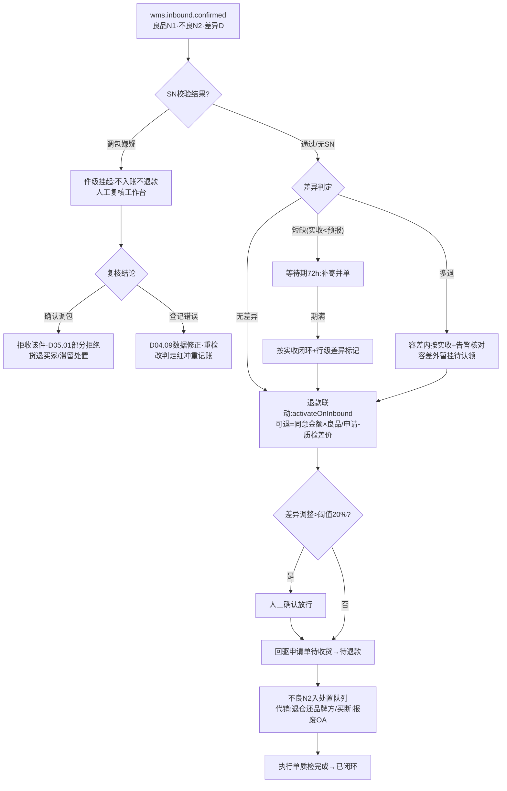

# SRS-D05.02 退货退款执行模块 需求规格说明书

> 文档编号：SRS-D05.02 · 版本 V1.0 · 2026-10-24 · 编写：小凯 · 状态：待审阅（批次③）
> 所属域：D05 售后域（三段式之**执行单 reship**：仓内退货入库/换货作业）· 分期：**P0（M2）** · schema：oms_aftersale
> 上游依据：SRS-D05.01（IF-D05.01-D6 `ReshipService::createFromApply` 生成执行单、IF-D05.01-04 `transit` 状态回驱、`aftersale.apply.*` 事件）· SRS-D04.04（**IoBillService::create/dispatch/receive/confirm 契约**，退货入库-良品/不良双类型，IF-D04.04-01~04）· SRS-D09.03（入库指令通道：退货预报下发、质检分流回传 `wms.inbound.callback/confirmed/diff` 事件，IF-D09.03-01~05）· SRS-D04.09（IF-D04.09-05 `SerialService::validateReturn` SN 属单校验防调包、批次退回登记 IF-D04.09-01）· SRS-D04.02（次品口径记账）· SRS-D05.03（入库触发退款 `RefundService::activateOnInbound`）· 逆向文档 05 §6.3（reship 执行单/finish_aftersale 收货质检完结/实退金额幂等公式/WMS_RETURNORDER_CREATE 退货预报族）
>
> **全局决策（本模块承载）**：① 执行单只管**货的进出**（仓库语义），申请审批归 D05.01、钱归 D05.03；② 退货地址路由=**按货主配置+店铺覆盖**（品牌代销=品牌方指定仓或凯淳代收仓；买断货=凯淳仓）；③ 退货入库**良/不良质检分仓**（良品入实际库存、不良入次品口径，联动 D04.04/D04.02）；④ 入库触发退款（良品入库确认→通知 D05.03 退款单可退）；⑤ SN 属单校验防调包、批次退回（联动 D04.09）。

---

## 1. 模块概述

### 1.1 定位

退货退款执行模块承载三段式售后的**执行单（reship）**：申请单审核同意退货后，本模块生成退货预报单（确定退货仓与退货地址→推 WMS 入库通知，经 D04.04 单据+D09.03 通道）、跟踪买家退货物流、接收 WMS 收货质检回传并驱动良/不良分流记账、SN 属单校验防调包、批次退回登记、退货差异处理（申请 3 实退 2）、入库确认后触发退款联动（D05.03）、不良品处置（退仓还品牌方/报废）、换货入库特殊编排（退货入库+0 元新单，联动 D05.04）。执行单是 OMS 与仓库之间关于「退回来的货」的唯一作业单据。

商派对应机制：reship/reship_items/reship_items_serial/reship_package（按包裹收货）+ `finish_aftersale`（收货质检完结：并发保护→reship succ→订单明细退货处理→实退金额公式→create_refund_apply_record）+ `WMS_RETURNORDER_CREATE/CANCEL/UPDATE_LOGISTICS/ADDRESS` 退货指令族。凯淳在新栈把「下发/回传通道」剥离给 D09.03、「单据记账」剥离给 D04.04，本模块专注**退货业务编排**。

### 1.2 职责边界

**做**：执行单生成与生命周期（从申请单/换货单）、退货仓与退货地址路由（货主配置+店铺覆盖）、退货预报单生成与下发编排（调 D04.04 create+dispatch）、买家退货物流登记与跟踪（轨迹订阅 P1）、WMS 质检回传消费与良/不良分流编排、SN 属单校验联动（D04.09）、批次退回登记联动、退货差异处理（少退/多退/破损补差）、入库触发退款联动（D05.03）、部分退货（一单多行/分批退回按包裹维度）、不良品处置编排（退仓出库/报废，走 D04.04 单据）、换货入库特殊编排（D05.04 联动）、执行单状态回驱申请单（D05.01 transit）。

**不做**：申请审核与平台回传（→ D05.01）；退款单与钱的台账（→ D05.03）；换货 0 元新单创建与正向履约（→ D05.04/D03.01）；出入库单据生命周期与记账规则（→ D04.04 权威）；WMS 下发通道与回传接收（→ D09.03）；SN/批次档案（→ D04.09）；库存口径记账（→ D04.02）。

### 1.3 与其他模块关系

| 模块 | 关系 |
|---|---|
| D05.01 申请单 | 上游：审核同意生成执行单（IF-D05.01-D6）；下游回驱：收货质检完成/差异 → `ReturnApplyService::transit`（待收货→待退款等） |
| D04.04 单据中心 | **核心契约方**：退货预报 → `IoBillService::create`（类型=退货入库，源单=执行单）→ `dispatch` 下发；回传经 D09.03 调 `receive/confirm` 分流记账；不良处置 → create（退仓出库/报损出库） |
| D09.03 入库通道 | 下发执行与回传接收方：订阅 `wms.inbound.callback`（收货/质检明细）、`wms.inbound.confirmed`（记账闭环→触发退款）、`wms.inbound.diff`（差异透传）；取消走 `InboundCommandService::cancel` |
| D04.09 批次/SN | `SerialService::validateReturn(orderId, sn)` 属单校验（预报登记+质检扫码两次校验）；良品重入 `registerIn` 批次登记；SN 状态机联动（售后中→已核销→在库） |
| D04.02/D04.08 | 良品入实际→可用恢复→可售重算平台同步（自动链路，本模块不干预）；不良入次品不影响可用 |
| D05.03 退款单 | 良品入库确认事件 → `RefundService::activateOnInbound(reship_id, 良品明细, 差异调整)` 通知退款单可退 |
| D05.04 换货补发（P1） | 换货执行单=退货入库+0 元新单双编排；新单经 D03.01 `OrderCreateService::create`（createway=exchange） |
| D02.03/D02.04 | 买家回填退货物流消息（`platform.aftersale.logistics_updated` 经 D05.01 透传）；确认收货回传（confirm_receive 指令由 D05.01 提交） |
| D10.04 门户 | 品牌方可见本货主退货执行/不良品处置（退仓决策参与方） |

---

## 2. 业务场景

**SC-D05.02-01 退货预报与地址路由（主流程）**
申请单 RA2026001（品牌 A 代销，退货退款，行 2 件）审核同意。本模块生成执行单 RS2026001：按退货地址路由规则——品牌 A 货主配置「退货地址=凯淳华东代收仓」（品牌方指定仓场景则路由品牌方仓）；该店铺无覆盖配置。生成退货预报单 → `IoBillService::create`（类型=退货入库，源单=RS2026001，行含物料/预报数量 2/质检分流要求）→ `dispatch` → D09.03 下发通天晓（报文携原出库单号+退货地址+质检要求）。退货地址与退货须知（地址/收件人/注意事项）经 D05.01 回传通道同步平台（refill_logistics 语义的地址回填），买家在平台看到寄回地址。

**SC-D05.02-02 买家回填物流与跟踪**
买家寄出包裹，在平台回填退货运单号（顺丰 SF123）。平台消息 `logistics_updated` → D05.01 透传本模块：执行单登记退回物流（公司+运单号），状态推进「运送中」，回驱申请单 待退货→待收货；`IoBillService` 侧同步 D09.03 `UPDATE_LOGISTICS` 语义更新 WMS 预报单运单信息（仓端按运单收货）。P1 物流轨迹订阅：对接物流轨迹服务，「已签收」轨迹自动提醒仓端收货+超时未签收预警（预报后 15 天无回传，D09.03 FR-03f 反查兜底）。

**SC-D05.02-03 收货质检与良/不良分流（核心）**
包裹到仓，WMS 收货质检回传（经 D09.03 `wms.inbound.callback`）：预报 2 件，实收 2 件——良品 1、不良 1（不良原因=包装破损）。本模块消费回传：① SN 物料执行属单核销（D04.09 已在质检扫码时校验，本模块消费校验结果）；② 分流编排确认——D09.03 已调 D04.04 `receive`（良品行 returned_num=1、不良行 defect_num=1）+`confirm` 按退货模板记账：良品实际+1（可用恢复，可售联动 D04.08）、不良次品+1；③ 消费 `wms.inbound.confirmed` → 触发退款联动：调 D05.03 `activateOnInbound`（按良品 1 件比例计算可退金额，差异 1 件不良按策略调整——破损属买家责任的按质检差价扣减，见 §5.3）；④ 回驱申请单 待收货→待退款；⑤ 不良品 1 件进处置队列（SC-06）。

**SC-D05.02-04 SN 属单校验防调包**
美容仪订单（SN 管理开启）退货：预报登记时买家未填 SN，质检扫码 SN=IMEI999 → D04.09 `validateReturn` 校验失败（该订单出库记录为 IMEI001，IMEI999 非本订单出库）→ 本模块消费校验失败结果：执行单置「质检异常-疑似调包」，**不入账不退款**，差异挂起（D09.03 FR-04c 同款人工复核工作台）→ 售后专员处理：联系买家核实/拒绝该件退款（回驱 D05.01 部分拒绝）/确认是仓库出库登记错误则走 D04.09 数据修正后重检。校验通过场景：IMEI001 属单 → SN 状态 售后中→已核销，良品重入时 SN 状态回「在库」可再次销售（履历链完整）。

**SC-D05.02-05 退货差异（申请 3 实退 2 / 多包裹分批）**
申请退 3 件，WMS 实收 2 件（买家少寄）：D09.03 差异透传（`wms.inbound.diff`，diff_type=短缺）→ 本模块差异处理：等待期策略（默认 72h 内买家补寄则并单处理；期满按实收 2 件闭环）→ 按实收触发退款（D05.03 可退金额=2/3 比例+差异留痕），申请单行级差异标记，剩余 1 件可退余额保留（买家可再次申请）。多包裹分批退回：执行单下按包裹维度登记（reship_package 语义），每包裹独立回传→`receive` 累积（D04.04 部分回传），全部包裹齐套或差异期满才 confirm 闭环。

**SC-D05.02-06 不良品处置（退仓/报废）**
质检不良的 1 件（品牌 A 代销货）进处置队列，按货主处置策略：代销货默认「退仓还品牌方」——生成退仓出库单据（`IoBillService::create` 类型=退仓出库，次品-1，P1 联动品牌方门户确认）；买断货低值品可配「报废」（类型=报损出库+OA 审批 D10.05）；处置前不良品停留在次品口径（不参与可售），处置单据 confirm 后次品-1 闭环。处置决策全留痕，超期未处置（默认 30 天）预警。

**SC-D05.02-07 换货入库特殊编排（联动 D05.04，P1 预留）**
换货申请审核同意：执行单类型=换货（return_type=exchange）——退货侧流程同 SC-01~03（预报/收货/质检），差异点：① 良品入库确认后**不触发退款**，改为触发换货出库编排（通知 D05.04 生成 0 元新单 `OrderCreateService::create(createway=exchange)`，复用正向履约发货）；② 换货可异仓发出（新单分仓不受退货仓约束）；③ SN 联动：原 IMEI001 核销良品重入，新出库 SN 绑定换货新单（D04.09 SC-06 链路）；④ 换货类型变更（换转退）时执行单冻结/取消编排由 D05.01 SC-04 驱动，本模块执行 `InboundCommandService::cancel` 撤销预报。

---

## 3. 功能需求

### FR-D05.02-01 执行单生成与生命周期

- FR-01a 生成入口：`ReshipService::createFromApply(apply_id)`（D05.01 审核同意原子编排调用）；幂等键=(apply_id)，重复调用返回首次执行单；换货单同入口（类型=换货）。执行单号 `RS{YYYYMMDD}{6位序列}`。
- FR-01b 执行单状态机（§4.1）：`已创建→已预报（下发成功）→运送中（买家回填物流）→收货中（WMS 接收/分批回传）→质检完成→已闭环`；分支：`预报失败重试/下发失败`、`已取消`（申请关闭/类型变更）、`质检异常挂起`（调包嫌疑/争议/差异待决）、`差异处理中`。
- FR-01c 执行单明细：从申请单行复制（物料/申请数量），增加作业字段：预报数量、实收数量（良品/不良分列）、包裹关联、批次/SN 明细引用、差异数量与原因。
- FR-01d 状态回驱申请单：关键节点（已预报/运送中/质检完成/闭环/取消）经 `ReturnApplyService::transit`（IF-D05.01-04）推进申请单状态；回驱事件丢失补偿：每日对账任务核对执行单与申请单状态一致性（漂移告警）。

### FR-D05.02-02 退货地址路由（货主配置+店铺覆盖）

- FR-02a 路由规则：优先级 `店铺覆盖配置 > 货主默认配置 > 全局兜底（凯淳总仓）`；配置维度=货主×（可选店铺）×（可选品牌），配置项：退货仓 branch_id、退货收件地址（仓库地址或品牌方指定地址）、收件人/电话、退货须知文案。
- FR-02b 货主类型语义：品牌代销货主——退货地址=品牌方指定仓（直退品牌方）或凯淳代收仓（凯淳代质检后再退品牌方，处置走 FR-06）；凯淳买断货主——退货地址=凯淳仓（默认原发货仓，可配置集中退货仓）。
- FR-02c 原仓优先策略：无显式配置时默认路由**原发货仓**（原出库单据溯源 branch_id，WMS 按原单收货效率最高）；原仓已撤/不支持退货入库（D09.01 能力矩阵「质检分流=不支持」）→ 按货主配置改路由+告警配置缺失。
- FR-02d 地址同步：路由结果（退货地址+须知）随预报下发 WMS，并经 D05.01→D02.04 回传平台（买家侧展示寄回地址）；地址变更（配置调整发生在预报后）→ 更新 WMS 预报单地址（D09.03 取消重发或 update 语义）+平台地址回填重传。

### FR-D05.02-03 退货预报与下发

- FR-03a 预报单生成：执行单创建即调 `IoBillService::create(类型=退货入库, 源单=执行单, lines[物料/预报数量/质检要求/原出库单号])`（IF-D04.04-01）→ `dispatch(billBn)`（IF-D04.04-02）触发 D09.03 下发（`InboundCommandService::push`）。
- FR-03b 下发失败处理：D09.03 分级重试耗尽（`wms.inbound.push.failed`）→ 执行单置「下发失败」+告警人工（换仓重发/线下协调仓端收货）；不允许无预报直接到货（无预报到货走 D04.04 无头件流程，事后关联执行单转正）。
- FR-03c 预报撤销：申请关闭/类型变更/审核撤回 → `IoBillService` 撤销+`InboundCommandService::cancel`（IF-D09.03-02）；WMS 已收货拒绝取消 → 照单收货路径（货入良/不良分流，退款按申请单实际状态人工决策）。
- FR-03d SN/批次预报携带：SN 物料预报单携带期望 SN 清单（原订单出库 SN，D04.09 取数）供仓端扫码比对；批次物料携带原出库批次建议（退回批次优先原批次，无法识别时仓端登记实际批次）。

### FR-D05.02-04 退货物流登记与跟踪

- FR-04a 买家回填物流：消费 D05.01 透传的 `logistics_updated`（平台回填）+ 客服代录入口；登记退回物流公司/运单号（多包裹多运单），执行单→运送中；同步 D09.03 更新 WMS 预报单物流信息（仓端按运单匹配收货）。
- FR-04b 运单校验：物流公司编码合法性（D09.04 档案）+运单号格式校验；无效运单标记异常（不影响状态推进，仓端实收为准）。
- FR-04c 物流轨迹订阅（**P1**）：对接轨迹服务订阅退货运单；「已签收」→ 提醒仓端收货（超时未质检预警）；「拒收/退回」→ 异常预警人工介入。P0 期以 WMS 回传+D09.03 超时反查（15 天）兜底。
- FR-04d 预报超期未退回：预报后 N 天（默认 15 天，货主级可配）无物流回填 → 预警；N+7 天仍无 → 提示 D05.01 按平台规则关闭申请（买家未退货超时），执行单联动取消。

### FR-D05.02-05 收货质检与良/不良分流

- FR-05a 回传消费：订阅 `wms.inbound.callback`（收货/质检明细：实收量、良品数、不良数+不良原因字典、批次、SN 校验结果）与 `wms.inbound.confirmed`（D04.04 分流记账完成：良品实际+、不良次品+）；本模块**零记账逻辑**（记账权威=D04.04 退货模板，分流数据完整性由 D09.03 FR-04a 保证）。
- FR-05b SN 属单校验联动：质检回传含 SN 校验结果（D04.09 `validateReturn`，属单+状态双校验）；校验失败 → 执行单该件置「质检异常-疑似调包」，不入账（D04.04 receive 拒绝该件/D09.03 差异挂起）、不触发退款，转人工复核工作台（复核改判走 D04.04 红冲机制，原始回传不可改）；校验通过 → SN 核销（售后中→已核销），良品重入时状态回「在库」（D04.09 联动）。
- FR-05c 批次退回登记：批次物料质检回传实际批次 → D04.09 `registerIn` 批次登记（良品批次入批次库存明细，效期字段随行）；原批次可识别优先原批次（FEFO 账连续性）；批次账与数量账对账归 D04.09。
- FR-05d 质检结果确认编排：`wms.inbound.confirmed` 到达 → ① 差异判定（FR-05e）→ ② 触发退款联动（FR-05f）→ ③ 回驱申请单（待收货→待退款）→ ④ 不良品入处置队列（FR-06）→ ⑤ 执行单→质检完成/已闭环（无差异且无待决项）。
- FR-05e 退货差异处理：消费 `wms.inbound.diff`——短缺（申请 3 实退 2）：等待期策略（默认 72h 可配）内补寄并单，期满按实收闭环+行级差异标记；多退（实收>预报，买家多寄）：容差内按实收（差异退货入库类型，D04.04）+告警核对，容差外暂挂待认领（无头件路径）；破损/串货：不良分流+差异留痕（WMS 凭证引用）。
- FR-05f 入库触发退款：良品入库确认 → `RefundService::activateOnInbound(reship_id, 良品明细[], 差异调整)`（IF-D05.03 契约）——可退金额=同意金额×(良品实收/申请数量)−质检差价（§5.3 公式）；差异调整值超阈值（默认同意金额 20%）需人工确认后放行（防质检数据错误导致错退）。
- FR-05g 质检争议复核：WMS 质检结果与买家申诉/客服判定不一致 → 差异挂起+人工复核工作台（照片凭证调阅）；改判（不良→良品）走 D04.04 红冲+重记账，退款联动补触发。

### FR-D05.02-06 不良品处置

- FR-06a 处置策略配置：按货主×物料类别配置默认处置路径——代销货：退仓还品牌方（默认）/凯淳代报废（需品牌方门户确认，D10.04）；买断货：报废（OA 审批）/促销出清（转良品需质检复判）/退供应商（采购退货联动 D06，P2）。
- FR-06b 退仓编排：生成退仓出库单据（`IoBillService::create` 类型=退仓出库，次品-1，源单=执行单）→ 下发 WMS 出库（D09.02 通道）→ 回传确认闭环；退仓物流单号登记供品牌方对账（D08 结算关联，P1）。
- FR-06c 报废编排：报损出库单据+OA 审批（超阈值）→ 确认后次品-1；报废凭证（照片/单据）留痕。
- FR-06d 处置队列管理：不良品明细队列（按货主/仓/不良原因/账龄）；超期未处置（默认 30 天）预警升级；品牌方门户可见本货主待处置清单（代销货处置参与）。

### FR-D05.02-07 部分退货与分批退回

- FR-07a 行级部分退：一单多行部分申请（D05.01 行级模型），执行单只覆盖申请行；行级独立质检/差异/退款联动（行级闭环互不阻塞）。
- FR-07b 分批退回（多包裹）：执行单下包裹登记（reship_package 语义：包裹号/运单/到仓时间/明细）；每包裹独立回传累积（D04.04 部分回传），齐套判定=Σ包裹实收 ≥ 预报或差异期满；分批 confirm 时机按 D09.03 §5.3（退货入库默认一次回传即确认，多包裹场景切换分批确认配置）。
- FR-07c 二次售后衔接：差异闭环后剩余可退余额保留（D05.01 §5.3 行级余额），买家再次申请新执行单独立处理。

### FR-D05.02-08 换货入库特殊编排（P1，联动 D05.04）

- FR-08a 换货执行单：类型=exchange，退货侧复用 FR-01~05（预报/物流/质检分流全同）；差异：良品入库确认后触发**换货出库编排**而非退款——通知 D05.04 生成 0 元新单（`OrderCreateService::create(createway=exchange)`，IF-D03.01-01），新单与原执行单双向关联。
- FR-08b 异仓换货：换货新单发货仓不受退货仓约束（D03.06 正常分仓）；执行单记录「退货仓/换出仓」双仓字段。
- FR-08c 换转退联动：D05.01 类型变更编排驱动——执行单冻结（未下发直接取消；已下发走 FR-03c 撤销；已收货则按退货退款续走，退款联动补触发）；已生成 0 元新单联动取消（D05.04/D03.01 cancel）。
- FR-08d SN 换货链路：原 SN 核销良品重入（状态回在库）+新单出库 SN 绑定换货单（D04.09 SC-06）。

---

## 4. 业务流程

### 4.1 执行单状态机



### 4.2 退货执行全流程泳道（买家/OMS/WMS/平台）



### 4.3 质检分流与差异处理流程



---

## 5. 处理逻辑

### 5.1 退货地址路由算法

```
routeReturnAddress(执行单):
    cfg = 配置查询(店铺覆盖) or 配置查询(货主默认)     # FR-02a 优先级
    if cfg: return cfg.(branch_id, 地址, 收件人, 须知)
    # 无显式配置 → 原仓优先
    branch = 原发货单.branch_id(出库单据溯源)
    if branch.能力矩阵.质检分流 == 支持: return (branch, 仓地址, ...)
    return 全局兜底(凯淳总仓) + 告警"货主退货配置缺失"
校验: 目标仓必须支持退货入库+质检分流(D09.01 能力矩阵, D09.03 FR-01d 前置阻断同款)
```

### 5.2 执行单与下游单据的幂等编排

```
createFromApply(apply_id):                     # 幂等键=apply_id
  执行单落库(状态=已创建)
  → IoBillService.create(退货入库, 源单=执行单)   # 幂等=(bill_type, 源单, 行)
  → dispatch → D09.03 push                      # 幂等=(bill_bn+轮次)
每步失败: 本地事务回滚当前步 or 补偿队列重试(不回滚已完成步骤)
取消编排(可重入): 撤销单据(幂等) → cancel通道(幂等) → 执行单已取消 → 回驱申请单
```

### 5.3 可退金额与质检差价公式（继承商派幂等公式，重写口径）

```
可退金额(客户实付口径) =
    同意金额 × (良品实收数 / 申请数量)          # 部分退货按比例
  + 质检差价调整(diff_money, 可为负)            # 破损缺件补差:买家责任扣减/卖家责任不扣
  − 历史已退(had_refund, 同申请单多次触发防重)
责任判定: 不良原因字典 → 责任方映射(买家责任:使用痕迹/少配件→扣减;
          物流责任:运输破损→不扣减+物流索赔登记; 质量责任:不扣减)
双口径同构计算(平台承担口径按行级分摊比例); 最终值交 D05.03 落退款单
幂等: activateOnInbound 按(reship_id, 包裹/批次)防重, had_refund 收敛
```

### 5.4 分批退回齐套判定

```
齐套 = Σ(各包裹实收良品+不良) ≥ 预报数量        # 正常齐套
     or 差异等待期(72h)届满                     # 短缺闭环
     or 人工强制闭环(留痕+差异标记)
齐套前: D04.04 部分回传累积(receive), 不触发退款联动
齐套时: confirm(分批确认配置时按批) → 退款联动按累计良品一次计算(had_refund 防重)
```

### 5.5 降级与兜底

- WMS 无质检分流能力：退货地址路由前置阻断该仓（FR-02c）；已配置的走人工质检路径（仓端收货后 OMS 侧人工登记良/不良，`receive` 人工通道，留痕）；
- WMS 无 SN/批次回传能力：D04.09 §5.4 降级口径——SN 校验跳过+降级日志（高值物料告警提示人工抽检），批次以 OMS 登记为准；
- 无预报到货（买家未走平台直接寄回）：D04.04 无头件流程暂挂 → 人工关联执行单转正（按运单号/买家信息匹配）。

---

## 6. 数据字段（业务字段描述，schema：oms_aftersale）

### 6.1 退货执行单（reship）

| 字段 | 业务含义 | 取值/校验 |
|---|---|---|
| reship_id / reship_bn | 执行单 ID/单号 | RS 前缀唯一 |
| apply_id | 申请单引用 | 必填，幂等键 |
| reship_type | 执行类型 | 退货入库/换货（FR-08） |
| status | 执行单状态 | §4.1 状态机 |
| order_id / delivery_id | 原订单/原发货单 | 溯源（原仓路由依据） |
| return_branch_id / exchange_branch_id | 退货仓/换出仓 | 路由结果（FR-02）；换货双仓 |
| return_address_snapshot | 退货地址快照 | JSON（地址/收件人/须知，下发时固化） |
| io_bill_bn | 退货入库单据号 | D04.04 关联（双向追溯） |
| owner_id / tenant_id / shop_id | 归属 | 必填 |
| expect_num / received_good_num / received_defect_num / diff_num | 预报/良品实收/不良实收/差异 | 累计口径 |
| logistics_company / tracking_nos | 退回物流公司/运单号集 | 多包裹多运单（JSON） |
| sn_check_result | SN 校验结果汇总 | 通过/失败明细引用（FR-05b） |
| diff_status / diff_expire_time | 差异状态/等待期截止 | FR-05e |
| close_type | 闭环类型 | 正常/差异闭环/强制闭环/取消 |
| create_time / receive_time / close_time | 时间戳 | 时效考核供数 |

### 6.2 执行单明细行（reship_item）

| 字段 | 业务含义 | 取值/校验 |
|---|---|---|
| reship_id / item_id / apply_item_id | 主表/行/申请行引用 | 追溯链 |
| bm_id / owner_id | 物料/货主 | 行级货主（退仓混货主预留） |
| expect_num / good_num / defect_num / diff_num | 行级预报/良品/不良/差异 | Σ包裹累计 |
| defect_reasons | 不良原因明细 | JSON（原因字典码+数量+责任方，§5.3） |
| batch_details / serial_nos | 批次/SN 明细 | D04.09 联动登记引用 |
| refund_trigger_status | 退款联动状态 | 未触发/已触发/人工确认中（FR-05f） |

### 6.3 退回包裹（reship_package）

| 字段 | 业务含义 |
|---|---|
| reship_id / package_no | 归属/包裹序号 |
| tracking_no / logistics_company | 运单/公司 |
| arrive_time / items_json | 到仓时间/包裹明细（物料×数量×良不良） |
| callback_batch_ref | WMS 回传批次引用（幂等关联） |

### 6.4 不良品处置单（defect_disposal）

| 字段 | 业务含义 | 取值/校验 |
|---|---|---|
| disposal_bn / reship_id / item_id | 单号/来源 | |
| disposal_type | 处置类型 | 退仓还品牌方/报废/促销出清（复判）/退供应商（P2） |
| bm_id / owner_id / branch_id / num | 处置对象 | 次品口径 |
| io_bill_bn | 处置出库单据号 | D04.04（退仓出库/报损出库） |
| approval_status | OA/品牌方确认状态 | 报废超阈值 OA；代销报废需门户确认 |
| status / deadline | 待处置/处置中/已闭环 + 超期预警 | 默认 30 天（FR-06d） |
| evidence_refs | 凭证 | 照片/单据引用 |

---

## 7. 接口

### 7.1 内部接口（本模块提供）

| 编号 | 接口 | 消费方 | 说明 |
|---|---|---|---|
| IF-D05.02-01 | `ReshipService::createFromApply(apply_id)` | D05.01（IF-D05.01-D6） | 生成执行单+预报编排（幂等） |
| IF-D05.02-02 | `ReshipService::registerLogistics(apply_id/reship_id, 公司, 运单)` | D05.01 透传/客服代录 | 退货物流登记（多包裹追加） |
| IF-D05.02-03 | `ReshipService::cancel(reship_id, 原因)` | D05.01（关闭/类型变更） | 预报撤销编排（可重入，FR-03c） |
| IF-D05.02-04 | `ReshipService::confirmDisposal(disposal_bn, 决策, 操作者)` | 处置工作台/品牌方门户 | 不良品处置执行 |
| IF-D05.02-05 | `ReshipQuery::get/list/trace(reship_bn/apply_id/运单号)` | 工作台/D10.04/D11 | 执行单查询与追溯（申请单→执行单→单据→流水→WMS 报文） |
| IF-D05.02-06 | 事件 `aftersale.reship.created/forecasted/in_transit/qc_completed/closed/cancelled` | D05.01/D05.03/D11 | 执行单生命周期广播 |
| IF-D05.02-07 | 事件 `aftersale.defect.pending`（不良品待处置） | D10.04 门户/D01.07 | 处置队列通知 |

### 7.2 依赖接口（本模块消费）

| 编号 | 接口 | 提供方 | 说明 |
|---|---|---|---|
| IF-D05.02-D1 | `IoBillService::create/dispatch` + 事件 `iobill.confirmed` | D04.04（IF-D04.04-01/02/07） | 退货预报单据/下发/记账回执；不良处置单据同通道 |
| IF-D05.02-D2 | 事件 `wms.inbound.callback` / `wms.inbound.confirmed` / `wms.inbound.diff`；`InboundCommandService::cancel` | D09.03（IF-D09.03-03/04/05/02） | 收货质检回传消费、差异透传、预报取消 |
| IF-D05.02-D3 | `SerialService::validateReturn` 结果消费 / `registerIn` / `getHistory` | D04.09（IF-D04.09-05/01/06） | SN 属单校验（防调包）、良品重入批次/SN 登记 |
| IF-D05.02-D4 | `ReturnApplyService::transit` | D05.01（IF-D05.01-04） | 状态回驱 |
| IF-D05.02-D5 | `RefundService::activateOnInbound(reship_id, 良品明细, 差异调整)` | D05.03 | 入库触发退款（IF-D05.03-02 契约） |
| IF-D05.02-D6 | `OrderCreateService::create(createway=exchange)` | D03.01（IF-D03.01-01） | 换货 0 元新单（P1，经 D05.04 编排） |
| IF-D05.02-D7 | 仓库能力矩阵查询 `queryCapability` | D09.01 | 退货仓质检分流能力校验（FR-02c） |
| IF-D05.02-D8 | 调度/告警/OA 审批/审计 | D01.02/D01.07/D10.05/D10.06 | 超期扫描、报废审批、处置留痕 |

### 7.3 外部接口

| 编号 | 接口 | 方向 | 说明 |
|---|---|---|---|
| EF-D05.02-01 | WMS 退货预报/取消/物流更新（经 D04.04+D09.03） | 出 | 本模块不直连 WMS |
| EF-D05.02-02 | 物流轨迹订阅服务（P1） | 入 | 退货运单轨迹（签收/拒收事件） |

---

## 8. 非功能需求

| 项 | 要求 |
|---|---|
| 性能 | 执行单生成+预报下发 P95 ≤3s（异步受理）；质检回传消费→退款联动触发 P99 ≤5s；大促退货洪峰（日均 5000 执行单）无积压 |
| 幂等 | createFromApply/物流登记（同运单重复回填）/回传消费/activateOnInbound/取消编排全幂等；MQ 重投安全 |
| 一致性 | 执行单 vs 申请单 vs 单据（D04.04）vs WMS 四方状态每日对账（漂移告警）；退款联动失败进补偿队列不丢单 |
| 可靠性 | 预报失败/质检异常/差异挂起全部有人工闭环出口，不静默；无预报到货转无头件不丢弃 |
| 安全/PIPL | 退货地址含买家收件信息回传时经平台密文通道（oaid 语义）；WMS 报文买家信息脱敏（D09.03 §8 口径）；处置凭证访问授权留痕 |
| 审计 | 质检改判（红冲）/差异强制闭环/处置决策/SN 校验失败处理全留痕（D10.06） |
| 时效 | 差异等待期/预报超期/处置超期三类定时扫描（D01.02），预警触达率 100% |

---

## 9. 验收标准

| 编号 | 验收条件 |
|---|---|
| AC-01 | 主流程（SC-01~03）：审核同意→执行单生成→地址路由正确（货主配置>店铺覆盖>原仓优先三级验证）→预报下发 WMS 受理→买家回填物流（状态运送中+WMS 预报单运单更新）→质检回传良品 1 不良 1→良品实际+1 可用恢复、不良次品+1 不影响可用→退款联动按 1/2 比例触发→申请单推进待退款；全链路单据追溯（申请单→执行单→io_bill→流水→WMS 报文）完整 |
| AC-02 | SN 防调包（SC-04）：非本订单 SN 退货→质检异常挂起、不入账不退款、人工复核工作台生成；复核确认调包→件级拒绝+申请单部分拒绝联动；登记错误改判→D04.09 修正+红冲重记账+退款补触发，原始回传记录不可改 |
| AC-03 | SN 正常链路：属单校验通过→SN 售后中→已核销；良品重入→状态回在库可再售；履历链时间线完整（出库→退货→核销→重入） |
| AC-04 | 批次退回：批次物料退货按原批次登记（可识别时）；批次账与数量账对账一致；不可识别批次仓端登记实际批次+差异留痕 |
| AC-05 | 退货差异（SC-05）：申请 3 实退 2→等待期内补寄 1 件并单齐套闭环按 3 件退款；期满未补→按实收 2 件比例退款+行级差异标记+剩余 1 件可退余额保留（再次申请可退） |
| AC-06 | 多包裹分批：2 包裹先后到仓，receive 累积正确，齐套后一次退款联动（金额=两包裹良品合计比例）；activateOnInbound 重复触发（MQ 重投）金额不重复计算（had_refund 收敛） |
| AC-07 | 不良品处置（SC-06）：代销不良默认退仓——退仓出库单据次品-1、WMS 出库回传闭环、退仓运单登记；买断报废走 OA 审批后次品-1；30 天未处置预警升级；品牌方门户可见本货主待处置清单 |
| AC-08 | 预报撤销：申请关闭→单据撤销+WMS 取消通道→执行单已取消；WMS 已收货拒绝取消→照单收货路径走通（分流记账+人工决策退款），不丢货不丢账 |
| AC-09 | 无预报到货：未匹配预报的退货包裹→D04.04 无头件暂挂→人工关联执行单转正→正常分流闭环 |
| AC-10 | 质检争议改判：不良改良品经红冲+重记账（次品-1 实际+1），退款联动补触发，可售库存联动恢复（D04.08 重算） |
| AC-11 | 差异调整超阈值：质检差价调整>同意金额 20% 时退款联动转人工确认，确认后放行、拒绝后挂起，双向留痕 |
| AC-12 | 换货编排（P1 场景预演）：换货执行单良品入库后不触发退款、触发 0 元新单创建（createway=exchange 双向关联）；换转退时执行单冻结→撤销/续走分支正确、0 元新单联动取消 |
| AC-13 | 降级模式：无质检分流能力的仓被路由前置阻断；无 SN 回传能力仓降级跳过校验+降级日志+高值物料人工抽检提醒 |

---

## 变更记录

| 日期 | 版本 | 变更 | 原因 |
|---|---|---|---|
| 2026-10-24 | V1.0 | 首版 | — |

---

*参考实现溯源：商派 reship（status ready→progress→succ，is_check 审核态）+ reship_items（良/不良数量分列、换货仓库 ID 异仓换出、申请数量 vs 实收数量、WMS 入库类型、福袋组合 ID）+ reship_items_serial（SN 回收）/reship_items_storagelife（保质期批次）+ reship_package/reship_package_items（按包裹维度分批收货）+ reship_pda_return_info（PDA 扫码）+ `ome_mdl_reship::create_treship`（从售后申请/发货单创建，退货仓 branch_id）+ `finish_aftersale`（并发保护 status|noequal=>succ 条件更新→订单明细退货回补库存→实退金额幂等公式 money=tmoney+diff_money+bcmoney−bmoney−had_refund→create_refund_apply_record）+ return_product_problem/_type（问题件登记驱动 status=8 补差价+diff_money）+ return_freight（邮费承担方）+ WMS_RETURNORDER_CREATE/CANCEL/UPDATE_LOGISTICS/ADDRESS 退货指令族 + confirmreship 自动确认定时器 + processReturn 换转退释放冻结/取消换出订单（逆向文档 05 §6.3/§6.5/§6.7）。关键差异：① 通道剥离——预报下发/回传接收归 D09.03、单据记账归 D04.04，本模块纯业务编排（商派 reship 模型内嵌 WMS 调用与库存回补，职责混杂）；② 实退金额公式继承但**责任方判定结构化**（不良原因字典→责任映射→差价调整+超阈值人工放行，商派 diff_money 人工填写无规则）；③ SN 属单校验防调包产品化（商派 reship_items_serial 仅登记回收无属单校验）；④ 退货地址路由=货主配置+店铺覆盖+原仓优先三级（商派按仓 branch_id 手工指定，无货主维度——凯淳代销/买断双货主形态必需）；⑤ 不良品处置独立单据化（退仓还品牌方/报废审批/品牌方门户参与，商派次品滞留无处置闭环）；⑥ 退款联动从「完结生成 refund_apply」改为「事件驱动 activateOnInbound+had_refund 幂等」（分批/改判补触发安全）；⑦ 差异等待期/预报超期/处置超期三类时效产品化。*
