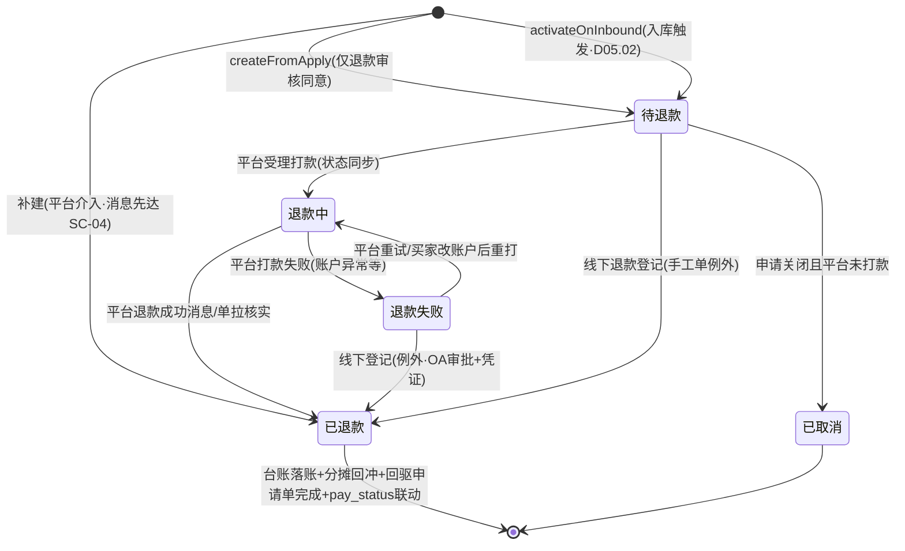
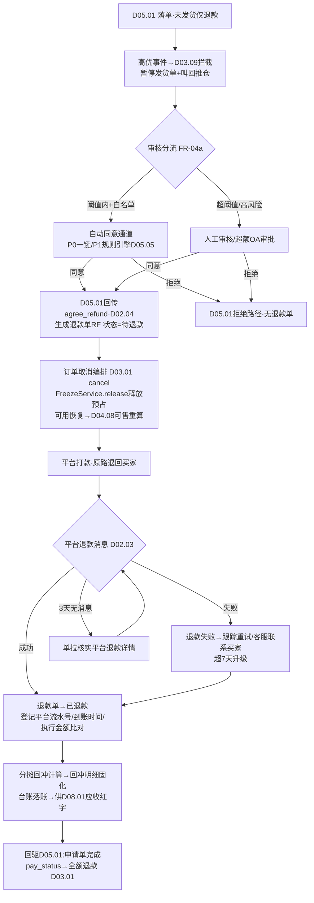
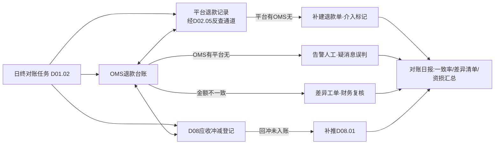

# SRS-D05.03 仅退款与退款单模块 需求规格说明书

> 文档编号：SRS-D05.03 · 版本 V1.0 · 2026-10-24 · 编写：小凯 · 状态：待审阅（批次③）
> 所属域：D05 售后域（三段式之**退款单 refund**：钱）· 分期：**P0（M2）** · schema：oms_aftersale
> 上游依据：SRS-D05.01（IF-D05.01-D7 `RefundService::createFromApply` 生成退款单、`aftersale.apply.*` 事件、pay_status 联动出口）· SRS-D05.02（IF-D05.02-D5 `RefundService::activateOnInbound` 入库触发退款）· SRS-D02.03（IF-D02.03-03 `platform.aftersale.status_changed` 平台退款状态消息）· SRS-D02.04（IF-D02.04-03 售后回传 agree_refund）· SRS-D04.03（IF-D04.03-03 `FreezeService::release` 未发货释放预占）· SRS-D03.01（IF-D03.01-05 `OrderAmountService::getDualAmount` 双口径与行级分摊、IF-D03.01-02 pay_status 流转）· SRS-D08.01（应收冲减取数，批次④契约以本文档 §7 为准）· 逆向文档 05 §6.2（仅退款链路 refund_apply→refunds）/§6.7（refunds 单据字段+单号类型码惯例+实退幂等公式）
>
> **全局决策（本模块承载，红线）**：① **退款执行形态=平台执行，OMS 只记录**——买家在平台发起退款、平台打款（原路退回），OMS 不碰钱、不主动调平台退款/打款 API（代运营资金在平台账户）；本模块职责=退款单状态同步+退款台账（对账用）；② 双口径退款金额（客户实付 vs 平台承担）贯穿台账，供 D08 财务冲减应收；③ 退款金额分摊回冲=原订单优惠分摊的逆向运算；④ 手工线下退款（无平台单）为唯一「非平台执行」例外，只登记台账不调支付。

---

## 1. 模块概述

### 1.1 定位

退款单（refund）是三段式售后中「钱」的唯一单据：承接两类来源——仅退款申请（不动货：未发货退款、已发货不退货退款、平台介入退款）经 D05.01 审核同意生成，退货退款经 D05.02 良品入库触发激活。本模块管理退款单生命周期（待退款/退款中/已退款/退款失败）、**同步平台退款执行结果**（经 D02.03 拉取平台退款状态消息+单拉核实）、维护退款台账（金额双口径/渠道/时间/平台流水号，供 D08 财务对账）、退款金额分摊回冲（原订单优惠分摊逆向，供财务冲减应收）、退款与库存联动（未发货释放预占/已发货记损失）、退款审核规则入口（阈值内自动同意→D05.05、超额转人工）、退款对账（OMS 台账 vs 平台退款记录）。

商派对应机制：refund_apply（退款审批）+ refunds（打款单据，`refund_request` 广播支付网关服务点主动打款）。凯淳关键差异：**商派 OMS 主动打款，凯淳 OMS 只记录平台打款**——refund_apply 审批语义并入 D05.01 申请单审核，refunds 收敛为「同步态退款单+台账」。

### 1.2 职责边界

**做**：退款单生成（申请审核同意/入库触发激活两来源）、退款单状态机（同步平台执行结果）、双口径退款金额与分摊回冲计算、退款台账（对账权威数据源，供 D08）、退款审核规则入口与阈值分流（自动 D05.05/人工/OA）、未发货仅退款的库存联动编排（释放预占+订单取消联动）、已发货不退货仅退款的损失登记、退款失败处理与重试跟踪、退款对账（台账 vs 平台记录 vs 财务口径三方）、线下退款台账登记（手工单例外路径）。

**不做**：售后申请审批与平台同意/拒绝回传（→ D05.01，本模块消费其审核结果）；质检差价/可退金额业务计算（→ D05.02 §5.3 供数，本模块落单）；实际打款/资金操作（**平台执行，OMS 无任何资金 API 调用**）；应收冲减记账与结算（→ D08.01/D08.03，本模块供数）；订单 pay_status 写入（→ D03.01 IF-02，经 D05.01 联动出口）；平台消息接收（→ D02.03）。

### 1.3 与其他模块关系

| 模块 | 关系 |
|---|---|
| D05.01 申请单 | 上游：仅退款审核同意 → `RefundService::createFromApply`；退款结果回驱申请单状态（退款中/完成）与 pay_status 联动（经 D05.01 统一出口 transit D03.01） |
| D05.02 执行单 | 上游：良品入库确认 → `RefundService::activateOnInbound`（可退金额=比例+质检差价，其 §5.3 公式）激活退款单 |
| D02.03 拉单 | 平台退款状态消息（`platform.aftersale.status_changed` 携退款成功/失败语义）；单拉核实（退款详情反查） |
| D02.04 回传 | 平台侧需要确认的动作（如确认收货后放款类平台的 confirm_receive）由 D05.01 提交，本模块不直接回传；仅退款同意回传（agree_refund）同归 D05.01 |
| D04.03 预占 | 未发货仅退款 → 订单取消编排中 `FreezeService::release`（经 D03.01 cancel，本模块触发联动） |
| D03.01 订单 | `getDualAmount` 取双口径分摊（回冲计算输入）；整单未发货仅退款 → `OrderCancelService::cancel` 联动；pay_status 流转（退款中/部分退款/全额退款） |
| D03.13 归档 | 归档单退款：申请回捞后正常处理；台账不随归档（财务对账需在线） |
| D08.01/03 财务 | 退款台账+分摊回冲明细供应收冲减/核销差异（结算单扣减、金蝶数据供给 D08.06） |
| D05.05 自动审核（P1） | 阈值内自动同意的执行入口（本模块提供 `audit` 接口与规则参数） |
| D10.05 OA | 超额退款人工审批链 |
| D11 报表 | 退款时效/退款率/资损（超时自动同意、已发货仅退款损失）指标供数 |

---

## 2. 业务场景

**SC-D05.03-01 未发货仅退款（主流程）**
订单 O2026002（已审单预占、发货单已推仓未出库）整单仅退款，D05.01 落单并高优拦截（D03.09 暂停发货单+叫回）。客服审核同意（金额 ≤ 阈值，P1 走 D05.05 自动同意）→ D05.01 回传平台 agree_refund + 生成退款单 RF2026001（状态=待退款，金额=双口径全额）→ 平台执行打款（原路退回买家）→ 平台退款成功消息（D02.03）→ 本模块同步：退款单→已退款（登记平台退款流水号/到账时间）→ 触发库存联动：订单取消编排（D03.01 cancel：`FreezeService::release` 释放预占，可用恢复）→ 回驱申请单完成、pay_status→全额退款 → 台账落账（D08 冲减应收）。

**SC-D05.03-02 退货退款入库触发激活**
执行单 RS2026001 质检完成（申请 2 良品 1，D05.02 SC-03）：`activateOnInbound` 携可退金额（同意金额×1/2−质检差价 0）→ 本模块生成/激活退款单（状态=待退款→平台侧买家已申请故通常直接进退款中）→ 平台打款成功消息 → 已退款 → 台账+分摊回冲（按行 1 件比例回冲优惠分摊）→ 申请单完成。**可退金额是 D05.02 供数，本模块只校验上限（≤申请单同意金额余额）不重算业务规则**。

**SC-D05.03-03 已发货不退货仅退款（记损失）**
低价商品（<30 元）已签收，买家申请仅退款不退货，平台倾向仅退款极速处理。审核同意（运营策略：货值低于退回运费，弃货退款）→ 退款单正常流转 → **库存不动**（货在买家手中，不回仓）→ 损失登记：台账标记 `loss_type=goods_abandoned`（货值按出库成本快照 D04.07 计入损失科目，供 D08 财务与 D11 资损报表）；该类退款不回冲库存、不影响五口径。

**SC-D05.03-04 平台介入退款（强制退款）**
买家申请客服介入，平台判定卖家责任直接打款（未经 OMS 审核同意）。平台退款成功消息到达 → 本模块被动落单：无本地退款单则按消息**补建退款单**（状态直接=已退款，标记 `platform_intervened=true` 平台介入）→ 回驱 D05.01 申请单被动收敛（待审核→退款中→完成，版本收敛跳过本地审核）→ 台账+资损复盘清单（平台介入单 100% 进入复盘：责任归因/话术改进，供 D11）。库存联动按货物状态判定（未发货→释放预占；已发货→损失登记或引导退货）。

**SC-D05.03-05 退款失败与重试跟踪**
平台打款失败（买家账户异常/银行卡注销，平台退款状态消息=失败）→ 退款单→退款失败+失败原因码（平台原文入 platform_extra）→ 处理路径：① 平台侧自动重试的（多数平台）→ 本模块跟踪状态直至成功；② 需买家改账户的 → 客服联系买家（工作台任务）→ 平台重新打款 → 消息同步闭环；③ 长期失败（>7 天）→ 升级预警；**OMS 不代打款、不换渠道打款**（资金红线）。线下退款例外（手工单）：财务线下转账后人工登记台账（状态=已退款-线下，凭证必传，OA 审批）。

**SC-D05.03-06 退款金额分摊回冲（财务口径）**
订单 2 行：行 1 原价 100（客户实付 80+平台承担 20，店铺券 20 按行分摊）、行 2 原价 50 全额实付。行 1 整行退款 80（客户实付口径）：回冲计算——客户实付冲减 80、平台承担冲减 20（券由平台承担部分随退款退回平台）、商家承担券 0；行级分摊比例快照固化在退款单行（refund_item.allocation_snapshot），生成回冲明细（冲减应收 80+冲减平台补贴应收 20）供 D08.01 应收流水红字登记与结算单扣减。部分数量退款按数量比例二次分摊（尾差入最后一行，保证 Σ回冲=退款总额）。

**SC-D05.03-07 退款对账（三方核对）**
日终对账任务：① OMS 退款台账 vs 平台退款记录（经 D02.05 对账反查通道拉平台退款流水/账单）——平台有退款 OMS 无台账 → 补建（SC-04 路径）；OMS 已退款平台无记录 → 告警人工（可能消息误判）；金额不一致 → 差异工单；② 台账 vs D08 应收冲减登记——回冲明细未入账 → 补推；③ 对账结果日报（一致率/差异清单）供财务。

---

## 3. 功能需求

### FR-D05.03-01 退款单生成与来源

- FR-01a 生成入口一：`RefundService::createFromApply(apply_id)`（D05.01 审核同意原子编排调用，仅退款类型）；幂等键=(apply_id)；金额=申请单同意金额（双口径），状态=待退款。
- FR-01b 生成入口二：`RefundService::activateOnInbound(reship_id, 良品明细[], 差异调整)`（D05.02 入库触发）；幂等键=(reship_id, 回传批次)；金额=D05.02 §5.3 公式供数，本模块校验：可退 ≤ 申请单同意金额 − 历史已退（had_refund 收敛，商派幂等公式继承）；超限拒绝+告警（防错退）。
- FR-01c 补建入口三：平台退款成功消息到达但本地无退款单（平台介入/消息先于审核）→ 按消息补建（状态=已退款，`platform_intervened` 标记）+回驱 D05.01 被动收敛（SC-04）。
- FR-01d 退款单号 `RF{YYYYMMDD}{6位序列}`（单号类型码惯例继承商派 gen_id 思想）；一申请单可多退款单（多次部分退款：分批入库触发/二次售后）。
- FR-01e 线下退款例外（手工单无平台单）：生成线下退款单（channel=offline），财务线下转账后人工登记（凭证+OA 审批 D10.05），状态直接 待退款→已退款-线下；**不走平台同步与回传**。

### FR-D05.03-02 退款单状态机（平台执行，OMS 同步）

- FR-02a 状态枚举：`待退款 → 退款中 → 已退款`；分支：`退款失败 →（平台重试/买家改账户）→ 退款中`、`已取消`（申请关闭且未打款）；线下路径 `待退款 → 已退款-线下`。
- FR-02b **平台执行红线**：待退款→退款中的推进由平台侧动作驱动（买家平台申请已存在故审核同意即通常同步为退款中）；OMS 不调用任何平台打款/退款执行 API；本模块对平台的唯一写动作=经 D05.01→D02.04 的 agree_refund（同意语义，非打款语义）。
- FR-02c 状态同步：消费 `platform.aftersale.status_changed`（退款成功/失败语义）→ 登记平台退款流水号、到账时间、实际退款金额（平台执行金额，与 OMS 期望金额比对，差异告警）；消息未达兜底：退款中状态超 N 天（默认 3 天）→ 单拉核实（D02.03 pullSingle 语义查平台退款详情）。
- FR-02d 状态推进唯一入口 `RefundService::transit`（CAS+流转表校验），每次变迁写退款日志（依据消息/操作者）。
- FR-02e 结果回驱：已退款 → 回驱 D05.01（申请单→完成）+ pay_status 联动（经 D05.01 统一出口 → D03.01 transit：按累计退款额派生部分退款/全额退款）+ 发布 `aftersale.refund.succeeded` 事件（D08/D11 订阅）。

### FR-D05.03-03 双口径金额与分摊回冲

- FR-03a 退款金额双口径：refund_customer（客户实付退回）+ refund_platform_bear（平台承担部分退回，如平台券/补贴随退款退回平台）；Σ双口径=平台执行退款总额的商家视角拆分（平台账单口径核对，D08.01）。
- FR-03b 分摊回冲计算：输入=原订单行级分摊快照（`getDualAmount`，IF-D03.01-05）+本次退款行与数量；算法=按行分摊比例回冲（§5.2），部分数量按数量比例二次分摊，尾差入最后一行；输出=回冲明细（行级：冲减客户实付应收/冲减平台补贴应收/损失登记）。
- FR-03c 回冲明细固化：allocation_snapshot 落退款单行（可解释可审计，财务争议时回放当时分摊）；回冲明细供 D08.01 应收红字/结算扣减取数（台账接口 IF-05）。
- FR-03d 损失登记（不动货场景）：已发货不退货仅退款/平台介入已发货——货值按出库成本快照（D04.04 单据 unit_cost×数量）登记损失（loss_type 字典：弃货退款/平台介入资损/超时自动同意资损），不回冲库存。

### FR-D05.03-04 退款审核规则入口

- FR-04a 审核分流（D05.01 审核同意前置校验，本模块提供规则参数与入口）：金额 ≤ 店铺/货主阈值（默认 200 元，可配）且原因白名单（七天无理由/未发货退款）且非高风险标记（黑名单客户/高频退款买家 D03.09 名单服务）→ 自动同意通道（P0 人工一键批量，P1 D05.05 规则引擎全自动）；超阈值/异常 → 人工审核；超人工权限（默认 2000 元）→ OA 审批（D10.05）。
- FR-04b 高风险拦截：同买家 30 天退款 ≥N 次（默认 5）/退款率异常店铺 → 强制人工+风险标记入台账（D11 风控报表）。
- FR-04c 审核留痕：自动/人工/OA 三通道决策全留痕（决策依据快照：当时阈值配置+名单命中结果）。

### FR-D05.03-05 退款台账与对账

- FR-05a 退款台账（refund_ledger 视图，台账=退款单+回冲明细+平台流水聚合）：字段含双口径金额/渠道（platform 原路退回/offline 线下）/平台退款流水号/到账时间/损失标记/介入标记/回冲状态（未入账/已推 D08/差异）；财务取数接口（IF-06）。
- FR-05b 三方对账（SC-07）：日终任务——OMS 台账 vs 平台退款记录（经 D02.05 反查通道）vs D08 应收冲减登记；差异分类处置（补建/补推/差异工单）；对账日报（一致率/差异清单/资损汇总）。
- FR-05c 台账不可改：金额修正走红冲语义（负向调整记录+新记录，原记录保留），审计可溯（D04.04 红冲思想同款）。
- FR-05d 退款失败跟踪：失败原因码字典（平台原文保真 platform_extra）、处理任务分派（客服联系买家/等待平台重试）、超期升级（>7 天红色）。

### FR-D05.03-06 库存联动

- FR-06a 未发货仅退款：审核同意 → 触发 D03.01 `OrderCancelService::cancel`（整单）联动——预占释放（`FreezeService::release`）+发货单叫回（D03.07 recall，经 D03.09 编排）；部分行仅退款未发货 → 行级预占释放+发货单行调整（D03.08 改单语义，P1；P0 整单拦截为主）。
- FR-06b 已发货仅退款：不退货 → 库存不动+损失登记（FR-03d）；退货 → 走 D05.02 链路（良品入库恢复可用，本模块不重复联动）。
- FR-06c 拦截失败兜底：叫回失败已出库 → 回驱 D05.01 转「退货退款」引导或按已发货仅退款人工决策（D03.09 RECALL_FAILED 异常任务同款路径）。

### FR-D05.03-07 查询与工作台

- FR-07a 退款工作台：待处理（审核分流后人工队列）、退款中跟踪（超时置顶）、失败处理、平台介入复盘清单；批量审核（阈值内一键）。
- FR-07b 台账查询：订单/申请单/平台流水号/店铺/货主/状态/时间/损失类型多维检索；详情聚合（申请单+执行单+退款单三段式全景+回冲明细+对账状态）。
- FR-07c 品牌方门户（D10.04）：本货主退款台账只读（脱敏买家信息）。
- FR-07d 导出（D01.06）：退款台账/损失清单/对账日报。

---

## 4. 业务流程

### 4.1 仅退款与退款单状态流转



### 4.2 未发货仅退款全链路（含库存联动）



### 4.3 退款对账三方核对



---

## 5. 处理逻辑

### 5.1 退款单金额校验（上限防线）

```
校验(生成/激活/调整时):
  本次退款(客户实付口径) ≤ 申请单同意金额_customer − Σ历史退款单(同申请单,非取消态)
  本次退款(平台承担口径) ≤ 同意金额_platform_bear − Σ历史(同口径)
  整单累计 ≤ 订单实付总额(getDualAmount 权威)
超限 → 拒绝生成+告警(防错退红线); activateOnInbound 重复触发按幂等键返回首次结果
平台执行金额 vs OMS 期望金额不一致 → 以平台为准落台账+差异告警(金额差异工单)
```

### 5.2 分摊回冲算法（原订单优惠分摊的逆向）

```
输入: 退款行集{(order_item, num)}, 原订单行级分摊快照(getDualAmount)
for 每个退款行:
    行退比例 = num / 行购买数量
    冲减客户实付 = 行customer_paid × 行退比例          # 分摊后实付
    冲减平台承担 = 行platform_bear × 行退比例          # 平台券/补贴随退
    冲减商家承担券 = 行merchant_bear × 行退比例        # 商家优惠不产生现金退回,只冲应收
    尾差处理: 最后一行 = 退款总额 − Σ前行(保证 Σ回冲=平台执行退款额)
输出: refund_item.allocation_snapshot(固化) + 回冲明细(推D08.01红字)
损失登记(不动货): loss_amount = 出库成本快照unit_cost × num (D04.04单据取数)
```

### 5.3 幂等与并发

```
生成幂等: createFromApply=(apply_id); activateOnInbound=(reship_id,回传批次)
补建幂等: (platform, shop_id, 平台退款流水号) 唯一
状态推进: transit CAS(WHERE status=期望旧态); 消息乱序以平台退款状态终态优先
          (已退款为吸收态:任何后达的非终态消息不回退状态,留痕跳过)
并发: 同申请单退款操作分布式锁(apply_id); MQ重投全路径安全
```

### 5.4 审核阈值与风控参数（默认值，全部可配）

| 参数 | 默认 | 维度 |
|---|---|---|
| 自动同意金额阈值 | 200 元 | 货主级→店铺级覆盖 |
| 人工权限上限（超则 OA） | 2000 元 | 角色级（D10.02） |
| 原因白名单 | 七天无理由/未发货退款/平台规则强制 | 全局+货主覆写 |
| 高频退款买家拦截 | 30 天 ≥5 次 | 全局（名单服务 D03.09 IF-06） |
| 退款中超时核实 | 3 天 | 平台级 |
| 失败升级 | 7 天 | 全局 |

### 5.5 平台差异处理

平台退款语义差异全部经 canonical 事件吸收（D02.03 转换）：淘系退款版本号/先行垫付标记、拼多多极速退款（平台先垫付后追偿——台账记垫付标记供 D08 与平台账单核对）、京东 ASC 退款唯一标识、抖音平台介入判定——原文保真 platform_extra，本模块业务逻辑零平台分支（同 D05.01 FR-04d 约束）。

---

## 6. 数据字段（业务字段描述，schema：oms_aftersale）

### 6.1 退款单（refund）

| 字段 | 业务含义 | 取值/校验 |
|---|---|---|
| refund_id / refund_bn | 退款单 ID/单号 | RF 前缀唯一 |
| apply_id / reship_id | 申请单/执行单引用 | 至少其一（补建单可暂空后关联） |
| order_id / order_bn | 原订单 | 必填 |
| source | 生成来源 | apply_audit/inbound_trigger/platform_supplement/manual_offline |
| status | 退款单状态 | §4.1 状态机 |
| channel | 退款渠道 | platform（原路退回，平台执行）/offline（线下登记例外） |
| refund_customer / refund_platform_bear | 双口径退款金额 | §5.1 上限校验 |
| platform_executed_amount | 平台实际执行金额 | 同步登记，与期望比对（差异告警） |
| platform_refund_no | 平台退款流水号 | 补建幂等键成分；对账主键 |
| refund_time / arrive_time | 平台受理/到账时间 | 消息同步 |
| fail_reason_code / fail_reason_raw | 失败原因码/平台原文 | 退款失败必填 |
| platform_intervened | 平台介入标记 | SC-04，资损复盘清单入口 |
| loss_type / loss_amount | 损失类型/货值损失 | FR-03d（弃货/介入资损/超时资损） |
| audit_channel / auditor / approval_ref | 审核通道（自动/人工/OA）/审核人/OA 单引用 | FR-04c 留痕 |
| risk_flag | 高风险标记 | FR-04b |
| ledger_status | 台账回冲状态 | 未入账/已推 D08/差异 |
| platform_extra | 平台特有字段 JSON | 垫付标记/退款版本号等（§5.5） |
| owner_id / tenant_id / shop_id | 归属 | 必填 |
| create_time / last_modified | 时间戳 | |

### 6.2 退款单明细行（refund_item）

| 字段 | 业务含义 | 取值/校验 |
|---|---|---|
| refund_id / item_id / apply_item_id | 主表/行/申请行引用 | 追溯链 |
| order_item_id / oid / bm_id | 订单行/平台子单/物料 | |
| refund_num | 退款数量 | ≤行申请数量 |
| refund_customer_line / platform_bear_line / merchant_bear_line | 行级三口径回冲额 | §5.2 算法输出 |
| allocation_snapshot | 分摊快照 | JSON 固化（可解释审计） |
| loss_line | 行级损失（不动货） | 成本快照×数量 |

### 6.3 退款日志（refund_log）

| 字段 | 业务含义 |
|---|---|
| refund_id / seq / action | 归属/时序/动作（生成/审核/状态变迁/同步/对账差异/人工干预） |
| from_status / to_status /依据 | 变迁与依据（消息 ID/OA 单/对账批次） |
| operator_type / operator / create_time | 系统/人工+标识+时间 |

---

## 7. 接口

### 7.1 内部接口（本模块提供）

| 编号 | 接口 | 消费方 | 说明 |
|---|---|---|---|
| IF-D05.03-01 | `RefundService::createFromApply(apply_id)` | D05.01（IF-D05.01-D7） | 仅退款审核同意生成退款单（幂等） |
| IF-D05.03-02 | `RefundService::activateOnInbound(reship_id, 良品明细[], 差异调整)` | D05.02（IF-D05.02-D5） | 入库触发退款激活（幂等+上限校验 §5.1） |
| IF-D05.03-03 | `RefundService::syncFromPlatform(canonical退款状态事件)` | D02.03 事件消费器 | 平台退款结果同步（含补建，SC-04） |
| IF-D05.03-04 | `RefundService::transit(refund_id, 目标状态, 触发源)` | 内部/人工工作台 | 状态推进唯一入口（CAS+流转表） |
| IF-D05.03-05 | `RefundLedgerQuery::get/list(条件)` / `getWriteOffDetails(refund_bn)` | D08.01/D08.03/D10.04/D11 | 退款台账与分摊回冲明细取数（财务冲减应收权威供数） |
| IF-D05.03-06 | 事件 `aftersale.refund.created/succeeded/failed/cancelled` | D05.01（回驱）/D08/D11 | 退款单生命周期广播 |
| IF-D05.03-07 | `RefundAuditService::checkAutoApprove(apply_id)` → 分流决策 | D05.01 审核/D05.05 | 阈值/白名单/风控分流（FR-04，P1 供 D05.05 规则引擎） |
| IF-D05.03-08 | `RefundService::registerOffline(refund_bn, 凭证, OA单号)` | 财务工作台 | 线下退款登记（例外路径，FR-01e） |

### 7.2 依赖接口（本模块消费）

| 编号 | 接口 | 提供方 | 说明 |
|---|---|---|---|
| IF-D05.03-D1 | 事件 `platform.aftersale.status_changed`（退款语义）订阅 | D02.03（IF-D02.03-03） | 平台退款结果消息入口 |
| IF-D05.03-D2 | `OrderAmountService::getDualAmount(order_id)` | D03.01（IF-D03.01-05） | 双口径行级分摊快照（回冲输入） |
| IF-D05.03-D3 | `OrderCancelService::cancel(order_id, 原因码)` | D03.01（IF-D03.01-04） | 未发货整单仅退款取消编排（内含 FreezeService.release 预占释放） |
| IF-D05.03-D4 | `ReturnApplyService::transit` | D05.01（IF-D05.01-04） | 退款结果回驱申请单+pay_status 联动统一出口 |
| IF-D05.03-D5 | `RiskListService::check(维度, 值)` | D03.09（IF-D03.09-06） | 高频退款买家风控拦截 |
| IF-D05.03-D6 | 对账反查通道（平台退款流水/账单拉取） | D02.05 | 三方对账平台侧数据（FR-05b） |
| IF-D05.03-D7 | OA 审批/调度/告警/审计/导出 | D10.05/D01.02/D01.07/D10.06/D01.06 | 底座能力 |

### 7.3 外部接口

| 编号 | 接口 | 方向 | 说明 |
|---|---|---|---|
| EF-D05.03-01 | 平台退款状态查询/退款流水对账 API | 出（经 D02.01/D02.02/D02.05） | 只读查询与对账；**无任何打款/退款执行类 API 调用（资金红线）** |

---

## 8. 非功能需求

| 项 | 要求 |
|---|---|
| 性能 | 退款单生成 P95 ≤200ms；平台消息同步处理 P99 ≤500ms；日终对账（10 万台账）≤30 分钟 |
| 幂等 | 生成/激活/补建/状态同步全路径幂等（§5.3）；已退款为吸收态不回退 |
| 一致性 | 退款单 vs 申请单 vs 台账 vs D08 登记四方对账；金额校验上限防线不可绕过（§5.1）；补偿队列不丢单 |
| 资金安全 | OMS 零资金操作（红线）；金额修正红冲语义不可改台账；线下登记双人复核（登记≠审批）+OA+凭证 |
| 时效 | 平台退款消息→台账落账 ≤5 分钟；退款中超时核实 3 天兜底 |
| 安全/PIPL | 买家收款账户信息不落 OMS（平台原路退回，OMS 无需账户——商派 refunds.account/bank 字段在凯淳模型**删除**）；台账展示脱敏 |
| 审计 | 审核决策依据快照固化；状态变迁/对账差异/人工干预全留痕 |

---

## 9. 验收标准

| 编号 | 验收条件 |
|---|---|
| AC-01 | 未发货仅退款全链路（SC-01）：拦截→审核同意→退款单生成→平台打款成功消息→已退款（平台流水号/到账时间登记）→预占释放可用恢复→pay_status 全额退款→台账落账+回冲明细推 D08；全链路 ≤5 分钟（消息到达后） |
| AC-02 | 入库触发激活（SC-02）：activateOnInbound 按 D05.02 供数生成退款单；金额超上限（构造可退>同意金额余额）被拒绝+告警；重复触发（MQ 重投 5 次）金额不重复 |
| AC-03 | 平台执行红线验证：全代码路径无任何平台打款/退款执行 API 调用（EF-01 只读）；OMS 侧无买家收款账户字段落库 |
| AC-04 | 平台介入补建（SC-04）：无本地退款单时退款成功消息→补建（状态=已退款+介入标记）→申请单被动收敛→资损复盘清单可查；补建消息重投幂等 |
| AC-05 | 分摊回冲（SC-06）：双行订单行 1 整行退，回冲明细三口径正确（客户 80/平台 20/商家 0），Σ回冲=平台执行退款额；部分数量退（3 退 1）按数量比例二次分摊且尾差入最后一行；allocation_snapshot 固化可回放 |
| AC-06 | 已发货不退货仅退款（SC-03）：库存五口径零变动、损失登记（货值=出库成本快照）、loss_type=弃货退款入资损报表 |
| AC-07 | 退款失败（SC-05）：失败消息→退款失败+原因码保真→处理任务分派；平台重试成功消息→闭环已退款；模拟 7 天未决→升级预警；线下登记路径凭证+OA 缺一不可 |
| AC-08 | 状态同步兜底：退款中 3 天无消息→自动单拉核实平台退款详情并收敛；乱序消息（成功后又到受理中）状态不回退、留痕跳过 |
| AC-09 | 审核分流（FR-04）：199 元白名单原因走自动通道、201 元转人工、2001 元触发 OA；高频退款买家（30 天 5 次）强制人工+risk_flag；决策依据快照可查 |
| AC-10 | 三方对账（SC-07）：人为制造 4 类差异（平台有 OMS 无/OMS 有平台无/金额不一致/回冲未入账）→日终对账全部检出并正确处置（补建/告警/工单/补推），对账日报一致率准确 |
| AC-11 | 台账不可改：金额修正走红冲语义（负向+新记录），原记录保留；导出台账与门户只读视图脱敏正确 |

---

## 变更记录

| 日期 | 版本 | 变更 | 原因 |
|---|---|---|---|
| 2026-10-24 | V1.0 | 首版 | — |

---

*参考实现溯源：商派 refund_apply（status 0 未审核→1 审核中→2 已接受→5 退款中→4 已退款，分支 3 拒绝/6 退款失败/10 卖家拒绝；cs_status 客服介入、买家实退、平台优惠退回金额、运费字段——双口径雏形）+ refunds（refund_bn 单号类型码 14、money/account/bank/pay_account/pay_type online-offline-deposit、status succ/failed/progress/timeout、t_ready/t_sent/t_received 三时间、return_id 关联、is_archive 归档）+ `ome_mdl_refunds::refund_request`（广播 service.refund 服务点各支付网关打款→pay_status=7 退款中→refund_apply=5）+ 实退幂等公式 had_refund 收敛 + 拦截接口族（store.rp.refund.intercept/store.ag.sendgoods.cancel）+ 赔付单/预约退款消息（逆向文档 05 §6.2/§6.7）。关键差异：① **退款执行形态反转**——商派 OMS 主动调支付网关打款（refund_request），凯淳=平台执行 OMS 只记录（代运营资金在平台，删除 account/bank/pay_account 账户字段族与全部打款 API，资金红线 EF-01 只读）；② refund_apply 审批单取消，审批语义并入 D05.01 申请单审核，refunds 收敛为同步态退款单+台账；③ 双口径显式化（商派「买家实退/平台优惠退回」散列字段 → refund_customer/refund_platform_bear 结构化+行级 allocation_snapshot 分摊回冲固化，供 D08 冲减应收）；④ 平台介入/超时自动同意补建+资损复盘产品化（商派被动落单无风险管理）；⑤ 损失登记（弃货退款货值成本快照入损）与三方对账（台账 vs 平台 vs 财务）显式闭环；⑥ 审核分流规则参数化（阈值/白名单/风控名单，P1 接 D05.05 规则引擎）。*
