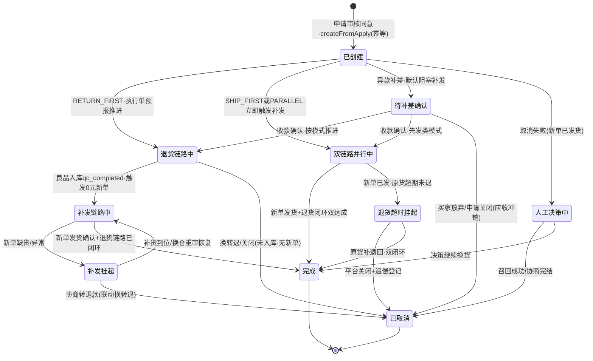
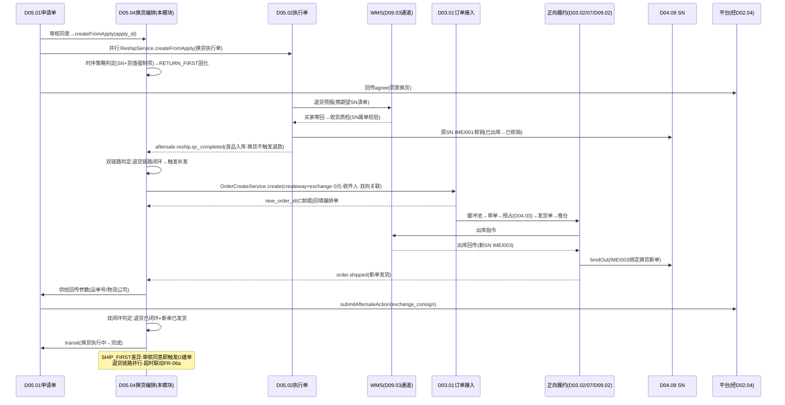
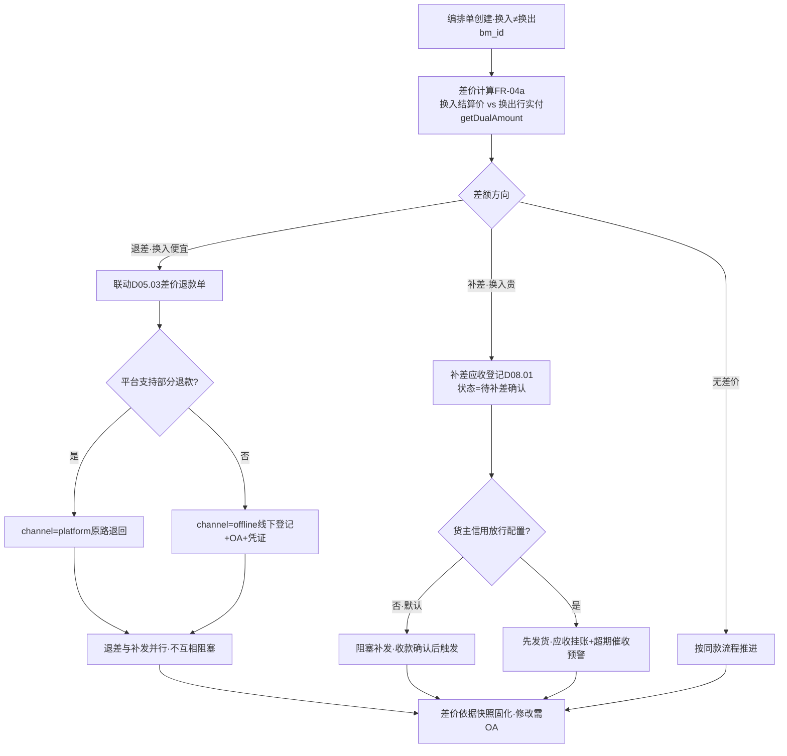

# SRS-D05.04 换货补发模块 需求规格说明书

> 文档编号：SRS-D05.04 · 版本 V1.0 · 2026-10-24 · 编写：小凯 · 状态：待审阅（批次③）
> 所属域：D05 售后域（三段式之**换货编排**：退货链路 + 0 元新订单复用正向履约）· 分期：**P1（M3）** · schema：oms_aftersale
> 上游依据：SRS-D05.01（IF-D05.01-03 `ReturnApplyService::audit`、IF-D05.01-04 `transit`、状态「换货执行中」、SC-04 换转退收敛编排、事件 `aftersale.apply.approved/type_changed/closed`）· SRS-D05.02（IF-D05.02-01 `ReshipService::createFromApply` 换货执行单、FR-08 换货入库特殊编排、事件 `aftersale.reship.qc_completed/closed/cancelled`）· SRS-D03.01（IF-D03.01-01 `OrderCreateService::create(createway=exchange)` 0 元单、SC-06/FR-01d、IF-D03.01-04 `OrderCancelService::cancel`、事件 `order.shipped/completed`）· SRS-D04.03（IF-D04.03-01 `FreezeService::reserve` obj_type=售后换货、新单预占经 D03.02 执行器）· SRS-D04.09（IF-D04.09-04/05/06 SN 换出链路：原 SN 核销+新 SN 出库绑定、SC-06）· SRS-D05.03（退差联动 `RefundService::createFromApply`）· 逆向文档 05 §6.4（reship.create_order+create_delivery 换货 0 元新订单复用正向履约、store.exchange.* 接口族、return_exchange_receiver、return_reshipping 补寄单）
>
> **全局决策（本模块承载，红线）**：① **换货 = 退货链路 + 0 元新订单复用正向履约**——不单独造换货履约体系（商派验证的最佳实践，逆向文档 05 §8 结论）：退货侧复用 D05.02（预报/质检/良不良分流），补发侧复用 D03/D04/D09 正向全链路（建单/审单/预占/发货单/推仓/回传）；本模块只做**双链路编排与关联追溯**；② 换货时序（先退后发/先发后退/同时）按货主或金额策略配置，**高值商品强制先退后发防欺诈**；③ 换货无退款单（D05.01 FR-02b 类型裁剪），异款换货差价例外联动 D05.03/D08；④ SN 换出链路=原 SN 核销（已出库→换出）+新 SN 出库绑定换货新单（D04.09 §4.1 状态机）；⑤ 全单据 owner_id + tenant_id；PIPL 换货收件人加密。

---

## 1. 模块概述

### 1.1 定位

换货补发模块承载三段式售后中「换货」类型的**双链路编排中枢**：申请单（type=换货，D05.01）审核同意后，本模块创建换货编排单（exchange_order），一条链路驱动**退货侧**（原货退回→D05.02 执行单质检入库→原 SN 核销 D04.09），另一条链路驱动**补发侧**（生成 0 元新订单→D03.01 复用正向履约→审单预占 D04.03→推仓发货→新 SN 出库绑定）；两条链路按货主/金额策略配置的时序模式（先退后发/先发后退/同时）编排推进，双链路全部闭环后换货完成。异款换货（换其他 SKU）的差价按「多退少补」联动 D05.03 退款单与 D08 应收登记。本模块同时管理换货失败处理（原货超时未退回、补发缺货）、换转退联动取消（D05.01 SC-04 编排的下游执行方）、多方单据关联追溯（原订单↔申请单↔执行单↔换货新单↔新发货单）。

商派对应机制：`ome_mdl_reship::create_order + create_delivery`（换货生成关联 0 元新订单与新发货单，复用正向履约）+ return_exchange_receiver（换货收件人）+ change_order_id/change_status（换出订单追踪）+ return_reshipping 补寄单（纯补发无退货）+ processReturn 换转退（释放冻结→取消换出订单）。凯淳在新栈把换货编排独立成模块：商派逻辑散落在 reship 模型内（create_order 内嵌建单+发货），本设计以**编排单 + 事件驱动**显式建模双链路时序，换转退每步可重入。

### 1.2 职责边界

**做**：换货编排单创建与生命周期（状态机）、换货时序策略配置与判定（先退后发/先发后退/同时，货主级+金额阈值覆盖）、补发链路编排（0 元新单创建参数组装与调用 D03.01、新单履约进度跟踪、发货回传消费）、退货链路联动（消费 D05.02 执行单事件驱动时序推进）、同款/异款换货判定与差价处理编排（退差联动 D05.03、补差应收登记联动 D08.01）、换货收件人管理（默认复制原单/买家改址，PIPL 加密）、SN 换出链路编排（原 SN 核销确认+新 SN 绑定换货单，D04.09 联动）、多方单据关联追溯（五单串联视图）、换货失败处理（原货超时/补发缺货/新单异常的挂起与决策）、换转退/关闭联动取消（执行 D05.01 收敛编排的换货侧动作）、平台换货动作回传参数供给（exchange_consign 经 D05.01→D02.04）。

**不做**：换货申请审核与状态机（→ D05.01，本模块消费其审核结果）；退货预报/质检/良不良分流（→ D05.02 执行单，换货类型执行单归其管理）；0 元新订单的落库/审单/拆单/发货单/推仓（→ D03.01/D03.02/D03.07/D09，本模块只创建与跟踪，不干预正向履约内部逻辑）；预占记账（→ D04.03，经新单审单执行器触发）；SN 档案与状态机（→ D04.09）；退款单模型与台账（→ D05.03）；应收记账（→ D08.01）；平台报文与回传执行（→ D02.02/D02.04）。

### 1.3 与其他模块关系

| 模块 | 关系 |
|---|---|
| D05.01 申请单 | 上游：换货申请审核同意（IF-D05.01-03 audit 原子编排）→ 本模块 `ExchangeService::createFromApply`；下游回驱：换货完成/取消 → `ReturnApplyService::transit`（换货执行中→完成，IF-D05.01-04）；换转退收敛编排（SC-04）驱动本模块联动取消；消费事件 `aftersale.apply.approved/type_changed/closed` |
| D05.02 执行单 | 退货链路执行方：换货执行单（reship_type=exchange，FR-08）由其管理；本模块消费 `aftersale.reship.qc_completed/closed/cancelled` 事件驱动时序推进；良品入库确认（换货不触发退款）= 先退后发模式的补发触发点 |
| D03.01 订单接入 | 补发链路入口：`OrderCreateService::create(canonicalOrder, source=exchange)`（IF-D03.01-01，createway=exchange、金额全 0、C 前缀订单号、售后单号双向关联、免支付校验）；取消联动 `OrderCancelService::cancel`（IF-D03.01-04，换转退/换货关闭） |
| D03.02/D03.07/D09.02 | 新单复用正向履约：审单（0 元单正常投审）→ 预占（D04.03 obj_type=售后换货）→ 发货单 → 推仓 → 出库回传；本模块订阅 `order.shipped`（新单发货）驱动换货完成判定与平台 exchange_consign 回传参数供给 |
| D04.03 预占 | 换货新单预占经 D03.02 执行器 `FreezeService::reserveBatch`（obj=订单，新单）；先发后退模式下的风险预占（可选配置：审核同意即为换货物料预占，obj_type=售后换货，IF-D04.03-01） |
| D04.09 批次/SN | SN 换出链路：原 SN 核销（已出库→换出终态）+良品重入判定；新单出库 SN `SerialService::bindOut` 绑定换货新单（IF-D04.09-04）；履历链 `getHistory` 供追溯（IF-D04.09-06） |
| D05.03 退款单 | 异款换货退差（换入<换出）：联动生成差价退款单（`RefundService::createFromApply` 语义的差价子单，channel=platform 或 offline） |
| D08.01 应收 | 异款换货补差（换入>换出）：应收登记（补差收款核销，P1 线下登记为主）；换货 0 元单不产生应收（金额恒 0，仅换出物料成本结转供 D08 口径核对） |
| D02.04 回传 | 平台换货动作（agree/exchange_consign 换货发货回传）由 D05.01 统一提交，本模块供给参数（新单运单号/物流公司） |
| D10.04 门户/D11 | 品牌方可见本货主换货单；换货时效/换货率报表供数 |

---

## 2. 业务场景

**SC-D05.04-01 同款换货·先退后发（主流程，高值商品默认）**
买家对订单 O2026001 中美容仪 1 件（SN=IMEI001，货值 2000 元）申请换货（质量问题换新，同款同 SKU）。D05.01 审核同意（P1 经 D05.05 自动或人工）→ 本模块创建换货编排单 EX2026001：时序策略判定——货主配置「货值 ≥1000 元强制先退后发」→ 模式=先退后发。退货链路先行：D05.02 换货执行单（reship_type=exchange）预报/买家寄回/质检（SN 属单校验通过，IMEI001 核销）→ 良品入库确认事件 `aftersale.reship.qc_completed` 到达 → 本模块触发补发链路：组装 0 元新单（createway=exchange，行=同款物料 1 件，收货人复制原单，双向关联 EX/RA/原订单）→ `OrderCreateService::create` → 新单正常审单/预占/发货单/推仓 → 出库回传（新 SN=IMEI003 `bindOut` 绑定新单）→ `order.shipped` 事件 → 本模块供给回传参数（运单号）经 D05.01 提交平台 exchange_consign → 双链路闭环判定（退货链路已闭环+新单已发货）→ 换货编排单完成 → 回驱申请单「换货执行中→完成」。

**SC-D05.04-02 同款换货·先发后退（低值快消，体验优先）**
服饰店铺买家申请尺码换货（S→M，货值 89 元）。货主配置「货值 <200 元且非 SN 管理物料 → 先发后退」：审核同意后补发链路**立即**启动（0 元新单创建/审单/发货），退货链路并行推进（执行单预报+买家寄回）。风险控制：先发后退模式下买家超时未退回（默认 15 天，D05.02 FR-04d）→ 本模块挂起预警+按策略处理（提示 D05.01 按平台规则关闭/转仅退款追偿登记）；新单发货不等待退货入库（库存独立预占，不与退回良品挂钩）。

**SC-D05.04-03 异款换货·退差（换入 < 换出）**
买家原购 500 元外套，协商换 300 元裤子（异款换货，手工建单或与买家协商后客服代录）。本模块判定换入物料 ≠ 换出物料 → 异款换货：差价 = 换出 500 − 换入 300 = 200 元**退差** → 联动 D05.03 生成差价退款单（200 元，channel 按平台能力：平台支持部分退款则走平台原路退回，否则线下登记 offline）；0 元新单行=换入物料（裤子），金额恒 0（差价经退款单独立处理，不入新单金额——保持「换货新单=0 元」的履约纯粹性）。退差失败不阻塞补发链路（并行，退款侧独立跟踪）。

**SC-D05.04-04 异款换货·补差（换入 > 换出）**
买家原购 300 元商品，换 500 元商品：差价 200 元**补差** → 本模块生成补差应收登记（D08.01，收款方式：平台补差链接（平台支持时）/线下转账登记/货到付款差额（D09 物流代收，P2））；补差收款确认前换货编排单置「待补差确认」子状态（可配置是否阻塞补发：默认阻塞——未收款不发货，防资损；货主可配置信用放行）。收款确认后补发链路启动，其余同 SC-01。

**SC-D05.04-05 换转退联动取消（D05.01 SC-04 的换货侧执行）**
换货执行中（先退后发，退货已预报未入库），买家在平台改为退货退款。D05.01 类型变更收敛编排驱动本模块：① 补发链路未启动 → 无新单，直接置编排单「已取消-换转退」；② 若新单已创建未发货 → `OrderCancelService::cancel`（释放预占）；③ 若新单已发货 → 取消失败，编排单挂起转人工（决策：召回新单物流/与买家协商补款/按错发处理），**不静默**；④ 退货侧执行单按 D05.02 FR-08c 续走退货退款（良品入库后触发退款联动补发）。每步可重入（变更消息重投安全），全程留痕。

**SC-D05.04-06 补发缺货处理**
先退后发模式，原货已质检入库（良品），触发补发时新单审单发现换入物料缺货（D03.02 STOCK_SHORTAGE → D03.09 缺货挂起）。本模块消费新单缺货状态：编排单置「补发挂起-缺货」，策略分支（货主级配置）：① 等补货（D04.10 补货建议联动，超 N 天预警升级）；② 换仓重试（D03.09 换仓重审）；③ 与买家协商转退款（提示 D05.01 换转退，原货已入库则退款联动正常触发）。原货良品已入库存（可用恢复），不产生账实差异。

**SC-D05.04-07 换货收件人变更**
买家换货时搬家的场景。审核同意前平台换货单携带新收件地址（平台换货消息 canonical 收件人字段）→ 本模块换货收件人=平台新地址；无新地址则复制原订单收货人（密文单沿用密文，D03.01 FR-04f 口径）。0 元新单创建后买家联系改址 → 走 D03.08 正常改单通道（新单是标准订单，天然复用改单能力——0 元单复用正向履约的直接收益）；改址生效前已推仓的按 D03.08 拦截规则处理。

---

## 3. 功能需求

### FR-D05.04-01 换货编排单创建与模型

- FR-01a 创建入口：`ExchangeService::createFromApply(apply_id)`（D05.01 审核同意原子编排调用，与 D05.02 `ReshipService::createFromApply` 并行触发）；幂等键=(apply_id)，重复调用返回首次编排单。编排单号 `EX{YYYYMMDD}{6位序列}`。
- FR-01b 编排单模型：换出物料（原订单行引用+原 SN/批次引用，退货链路核销对象）+ 换入物料（目标 SKU+数量，补发链路出库对象）；同款判定=换入 bm_id 与换出 bm_id 一致（同款不同规格视为异款，规格差异入 remark）；关联五元组（原订单 order_id/申请单 apply_id/退货执行单 reship_id/换货新单 new_order_id/新发货单 delivery_id 集）随链路推进逐步填充。
- FR-01c 换货收件人：默认复制原订单收货人（密文标识沿用）；平台换货消息携带新地址则采用新地址；客服代改入口（留痕）；收件人 PIPL 加密存储（D01.05），0 元新单创建时传递。
- FR-01d 编排单状态机（§4.1）：`已创建 → 退货链路中 →（补发触发）→ 补发链路中 → 完成`；先发后退/同时模式下两链路状态并行（`双链路并行中`）；分支：`待补差确认`（异款补差）、`补发挂起`（缺货/异常）、`已取消`（换转退/申请关闭）、`人工决策中`（取消失败等异常）。
- FR-01e 状态推进唯一入口 `ExchangeService::transit`（CAS+流转表校验，同 D05.01 FR-02c 模式），每次变迁写编排日志（触发事件/操作者/依据）。

### FR-D05.04-02 换货时序策略（先退后发/先发后退/同时）

- FR-02a 策略配置：维度=货主默认 × 金额阈值覆盖 × 店铺覆盖 × SN 物料强制项；取值：`RETURN_FIRST`（先退后发，默认）/`SHIP_FIRST`（先发后退）/`PARALLEL`（同时：审核同意即双链路并行启动，语义=先发后退但不设退货超时联动发货的依赖）。
- FR-02b 强制规则（不可被配置绕过）：SN 管理物料且单件货值 ≥ 高值阈值（默认 1000 元，货主可配只可上调）→ 强制 RETURN_FIRST（防欺诈红线：高值商品必须收到原货验真后才补发）；风控标记买家（D03.09 RiskListService 命中）→ 强制 RETURN_FIRST。
- FR-02c 模式判定落地：编排单创建时一次性判定并固化 `sequence_mode`（此后配置变更不影响在途单，防状态漂移）；判定依据快照留痕（命中哪条配置）。
- FR-02d RETURN_FIRST：补发触发点=消费 `aftersale.reship.qc_completed`（良品入库确认，换货类型执行单）；质检不良/差异按 D05.02 §5.3 责任判定——买家责任不良（调包/人为损坏）→ 补发挂起转人工（是否继续换货人工决策）；质量责任不良 → 正常触发补发（换货本来就是换新，不良品走 D05.02 处置队列）。
- FR-02e SHIP_FIRST/PARALLEL：补发触发点=编排单创建即触发（审核同意）；退货超时联动（FR-06a）；可选风险预占（FR-02f）。
- FR-02f 风险预占（可选配置，默认关）：SHIP_FIRST 模式创建编排单时即为换入物料预占（`FreezeService::reserve` obj_type=售后换货，obj_bn=EX 单号），锁定库存至新单审单预占成功后释放（避免审核到新单创建间隙被抢）；预占有效期=默认 72h（D04.03 §5.4），过期自动回收。

### FR-D05.04-03 补发链路编排（0 元新订单）

- FR-03a 新单参数组装：canonical 订单模型——shop_id=原单店铺、createway=exchange、order_type=换货、金额组全 0（FR-D03.01-01d 免支付校验/免价格监控）、商品行=换入物料（BOM 展开由 D03.01 正常执行）、收货人=换货收件人（FR-01c）、owner_id=换入物料货主（异款换货可能跨货主：换入物料货主 ≠ 原货主时以换入物料归属为准，行级 owner_id 承载）、external_ref=EX 单号+apply_id（双向关联必填）、备注=「换货补发单·原订单 {order_bn}」。
- FR-03b 创建与跟踪：调 `OrderCreateService::create`（IF-D03.01-01，同步返回 order_id+重复标记）→ 编排单回填 new_order_id → 新单进入正向履约（缓冲池/审单/预占/发货单/推仓，全程零特殊逻辑——0 元单在 D03 是标准订单）；本模块订阅新单事件（`order.audit.passed/order.shipped/order.cancelled`）刷新编排单链路进度。
- FR-03c 平台换货发货回传：新单发货（`order.shipped`）→ 本模块供给回传参数（新单运单号/物流公司/发货时间）→ 经 D05.01 提交 `SyncService::submitAftersaleAction(action=exchange_consign)`（IF-D02.04-03 语义）；回传失败不阻塞编排（D05.01 FR-02d 口径，D02.05 重试）。
- FR-03d 新单异常联动：新单审单不通过转人工（D03.03）→ 编排单标记「补发受阻」提示售后专员跟进（不自动干预审单决策）；新单被取消（异常/人为）→ 编排单补发链路重置（可重新触发创建，幂等键=EX 单号+轮次）。
- FR-03e 补寄单型（无退货纯补发）：平台补寄类售后（漏发/破损补寄，D05.01 FR-01d 归入换货大类标记 `reship_only=true`）→ 编排单只有补发链路（跳过退货链路，创建即触发新单）；退货运费/责任按平台补寄语义（原文入申请单 platform_extra，本模块不重复建模）。

### FR-D05.04-04 异款换货差价处理

- FR-04a 差价判定：换入物料结算价（货主供货价口径，D04.07 成本或货主协议价，配置取数源）与换出物料原行实付（`getDualAmount` 行级客户实付口径，IF-D03.01-05）比较；差额 >0（换入贵）=补差、<0=退差、=0 无差价；差价金额双口径记录（客户实付差额为主口径）。
- FR-04b 退差编排：联动 D05.03 生成差价退款单（source=apply_audit 语义的差价子单，金额=差额，apply_id 关联原申请单）；渠道判定：平台换货单支持部分退款 → channel=platform（原路退回）；不支持 → channel=offline 线下登记（D05.03 FR-01e 路径，凭证+OA）；退差与补发链路并行不互相阻塞。
- FR-04c 补差编排：生成补差应收登记（推 D08.01，收款状态跟踪）；默认**阻塞补发**（待补差确认状态，收款确认后触发补发链路）；货主可配置信用放行（先发货后收款，应收挂账跟踪+超期催收预警）；收款方式字典：平台补差链接/线下转账/货到付款差额（P2 预留）。
- FR-04d 平台异款换货约束：多数平台线上换货仅支持同款（同 SPU 不同规格），异款换货以手工单/协商单为主（source=manual 路径，D05.01 FR-03）；平台侧无法承载的差价动作走线下（FR-04b/04c 渠道判定），全程留痕供对账。
- FR-04e 差价审计：差价计算依据快照固化（换出实付/换入结算价/取数时间/取数源），金额修改需备注+超阈值 OA 审批（D10.05）。

### FR-D05.04-05 SN 换出链路编排（D04.09 联动）

- FR-05a 原 SN 核销确认：退货链路质检完成（`aftersale.reship.qc_completed` 携 SN 校验结果）→ 本模块确认原 SN 状态推进（已出库→售后中→已核销，D04.09 §4.1 由其自治，本模块只消费结果）；SN 校验失败（调包嫌疑，D05.02 FR-05b 挂起）→ 编排单同步挂起（补发不触发，RETURN_FIRST 模式天然阻断）。
- FR-05b 良品重入与 SN 终态：换货退回良品 SN 重入后状态判定——货主策略「可再售」（默认）：SN 回「在库」参与后续销售；「换出终止」：SN 置「换出」终态（高值/贴身分品类可配，防止问题机再售）；配置维度=货主×物料分类。
- FR-05c 新 SN 绑定：新单出库回传（D09.02 → D04.09 `bindOut`）自动绑定换货新单；编排单回填新 SN 清单（追溯视图展示新旧 SN 对照）。
- FR-05d 批次物料：换出批次登记（D05.02 FR-05c 退货侧）+新单出库批次 FEFO 指派（D04.09 FR-02，正向链路自动，本模块零干预）；效期物料换货建议同批次优先（仓端作业建议随预报下发，D05.02 FR-03d 通道）。
- FR-05e 降级：WMS 无 SN 回传能力（D04.09 §5.4）→ SN 链路降级跳过+高值物料人工抽检提醒（编排单标记降级，不阻塞双链路）。

### FR-D05.04-06 换货失败与超时处理

- FR-06a 原货超时未退回（SHIP_FIRST/PARALLEL 模式核心风险）：新单已发货但退货链路超期（D05.02 FR-04d：预报后 15 天无物流回填预警，N+7 天升级）→ 编排单「退货超时挂起」+策略动作（货主级配置）：① 提示 D05.01 按平台规则关闭申请+追偿登记（应收挂账 D08.01，货值=换出物料成本）；② 持续催收（客服任务，D01.07 通知）；③ 转仅退款追偿（引导买家平台侧处理）。RETURN_FIRST 模式原货超时=补发未触发，仅执行单侧超期闭环（D05.02 自治），编排单随申请关闭取消。
- FR-06b 补发缺货：SC-06 三分支策略（等补货/换仓/协商转退款）；挂起超 N 天（默认 7 天）升级预警（售后主管）；原货已入库场景转退款时联动 D05.02 补触发退款（`activateOnInbound` 语义，D05.02 FR-08c 已收货续走路径）。
- FR-06c 新单履约异常：推仓失败/物流异常等正向履约异常由 D03.07/D09.02 指令状态机自理（本模块不重复处理），编排单只读展示异常状态+超时提示（新单创建后 N 天未发货，默认 7 天，预警售后专员协调仓端）。
- FR-06d 换货整单超时兜底：编排单创建后超最长时限（默认 30 天，货主可配）未闭环 → 红色预警升级+人工决策工作台（继续/取消/转退款），不允许静默长尾。

### FR-D05.04-07 联动取消（换转退/申请关闭）

- FR-07a 触发源：D05.01 类型变更收敛编排（SC-04，`aftersale.apply.type_changed`）/申请关闭（`aftersale.apply.closed`）/人工取消（工作台，理由必填）。
- FR-07b 取消动作序列（可重入，每步幂等）：① 补发链路按进度分支——未创建新单：直接取消；新单已创建未发货：`OrderCancelService::cancel`（IF-D03.01-04，内含预占释放）；新单已发货：取消调用返回失败 → 编排单「人工决策中」+告警（决策项：物流召回 D03.07 recall/协商补款/按错发登记），**禁止强制静默取消**；② 风险预占释放（FR-02f 若启用，`FreezeService::release`）；③ 差价单据联动——退差退款单未打款则取消（D05.03 已取消路径）、补差应收未收款则冲销（D08 红字）；④ 编排单置「已取消」+取消原因结构化落库；⑤ 退货侧执行单续走/撤销由 D05.02 FR-08c 按其编排执行（本模块不越权）。
- FR-07c 换转退续走衔接：换转退后原货已入库的，退款联动由 D05.02 补触发（其 FR-08c），编排单取消前将「退货侧已入库明细」快照传递给 D05.01（供退款金额计算引用），链路数据不断档。

### FR-D05.04-08 关联追溯与查询

- FR-08a 五单串联视图：原订单 ↔ 申请单 ↔ 退货执行单（含质检/包裹/SN 明细）↔ 换货编排单 ↔ 换货新单（含发货单/运单/新 SN）——任一单据入口可跳转全景时间线（`ExchangeQuery::trace(ex_bn/apply_id/order_id/new_order_id/运单号)` 多键检索）。
- FR-08b SN 对照追溯：新旧 SN 履历链对照展示（D04.09 `getHistory` 聚合），客服/品牌方门户高频查询。
- FR-08c 换货工作台：待补差确认/补发挂起/退货超时/人工决策四类异常队列+处理中/已完成队列；按店铺/货主/模式筛选；批量催办。
- FR-08d 品牌方门户（D10.04）：本货主换货单只读（含差价明细，脱敏买家信息）。
- FR-08e 导出（D01.06）：换货台账（含时效指标：申请→补发发出/申请→双闭环）。

---

## 4. 业务流程

### 4.1 换货编排单状态机



### 4.2 换货双链路编排时序图（RETURN_FIRST 主链路）



### 4.3 异款换货差价处理流程



---

## 5. 处理逻辑

### 5.1 时序策略判定算法

```
decideSequenceMode(编排单上下文):
    # 强制项优先(不可配置绕过, FR-02b)
    if 换出物料.SN管理开启 and 单件货值 ≥ 高值阈值(货主级,默认1000,只可上调):
        return RETURN_FIRST + 依据"高值SN强制"
    if RiskListService.check(买家) 命中:                       # D03.09 IF-06
        return RETURN_FIRST + 依据"风控名单强制"
    # 配置项: 店铺覆盖 > 金额阈值覆盖 > 货主默认 > 全局默认
    cfg = 配置查询(店铺) or 配置查询(货主, 金额区间) or 全局默认(RETURN_FIRST)
    return cfg.mode + 依据快照
判定一次固化(sequence_mode 落库), 在途单不随配置变更漂移(FR-02c)
```

### 5.2 双链路闭环判定（完成条件）

```
完成 = 退货链路闭环 AND 补发链路闭环 AND 差价结清
退货链路闭环:
    RETURN_FIRST/SHIP_FIRST/PARALLEL = 执行单已闭环(aftersale.reship.closed)
    补寄单型(reship_only) = 恒真(无退货链路)
补发链路闭环 = 新单 order.shipped(发货确认)      # 不等买家签收(平台换货以卖家发货为履约完成口径)
差价结清 = 无差价 OR 退差退款单终态(已退款/已取消) OR 补差收款确认/信用放行
任一未达成 → 编排单保持推进态; 判定事件驱动(消费各链路事件重算), 幂等可重入
超时兜底: FR-06d 30天红色预警人工决策(继续/取消/转退款)
```

### 5.3 幂等与并发

```
编排单创建幂等: 唯一键=(apply_id); 重复调用返回首次 EX 单
新单创建幂等: D03.01 external_ref=(EX单号+轮次) 防重(取消重建轮次+1)
事件消费幂等: (编排单, 事件类型, 事件ID) 消费台账, MQ重投安全
状态推进: transit CAS(WHERE status=期望旧态); 并发事件按 ex_bn 分布式锁串行化
取消编排可重入: 每步(新单取消/预占释放/差价冲销)独立幂等, 失败进补偿队列重试
双链路事件乱序: 闭环判定按当前快照重算(§5.2), 不依赖事件到达顺序
```

### 5.4 差价计算与取数口径

```
换出价值 = 原订单行客户实付口径(getDualAmount 行级 paid_amount, IF-D03.01-05)
           × (换货数量 / 行购买数量)                    # 部分数量换货按比例
换入价值 = 换入物料结算价 × 换入数量
           结算价取数源(货主级配置): 货主协议供货价(默认) / D04.07 移动加权成本
差额 = 换入价值 − 换出价值 (>0 补差, <0 退差)
双口径: 差价以客户实付口径为准(买家侧收退); 平台承担口径差价仅登记(平台券部分不产生现金差价)
快照固化: 取数值+取数时间+取数源 落编排单差价明细(FR-04e 审计)
```

### 5.5 先发后退模式的资损防线

| 防线 | 机制 |
|---|---|
| 准入防线 | 高值 SN/风控名单强制 RETURN_FIRST（FR-02b），先发后退仅开放给低值非 SN 物料 |
| 额度防线 | 货主级「先发后退在途敞口」上限（未收回原货货值合计，默认 5000 元可配），超限新单自动降级 RETURN_FIRST |
| 超时防线 | 退货超期三级预警（D05.02 FR-04d）+编排单挂起+追偿登记（FR-06a） |
| 复盘防线 | 先发后退坏账（追偿未收回）入 D11 资损报表，按货主/店铺月度复盘驱动策略调整 |

---

## 6. 数据字段（业务字段描述，schema：oms_aftersale）

### 6.1 换货编排单（exchange_order）

| 字段 | 业务含义 | 取值/校验 |
|---|---|---|
| exchange_id / exchange_bn | 编排单 ID/单号 | EX 前缀唯一 |
| apply_id | 申请单引用 | 必填，幂等键（唯一） |
| order_id / order_bn | 原订单 | 必填 |
| reship_id | 退货执行单引用 | D05.02 创建后回填 |
| new_order_id / new_order_bn | 换货新单 | 补发触发后回填；重建轮次 rebuild_round 累计 |
| delivery_ids | 新发货单集 | JSON（一单多发货单可能） |
| exchange_type | 同款/异款 | bm_id 比对判定（FR-01b） |
| reship_only | 补寄单型标记 | true=无退货链路（FR-03e） |
| sequence_mode / mode_reason_snapshot | 时序模式/判定依据快照 | RETURN_FIRST/SHIP_FIRST/PARALLEL；创建时固化（FR-02c） |
| status | 编排单状态 | §4.1 状态机 |
| diff_type / diff_amount / diff_status | 差价方向/金额/结清状态 | 退差/补差/无；FR-04 |
| diff_refund_id / diff_receivable_id | 差价退款单/应收登记引用 | D05.03/D08.01 关联 |
| receiver_snapshot | 换货收件人快照 | JSON 加密引用（FR-01c，PIPL） |
| old_serial_nos / new_serial_nos | 新旧 SN 清单 | JSON（FR-05c 对照追溯） |
| sn_reentry_policy | 良品 SN 重入策略 | 可再售/换出终止（FR-05b） |
| risk_freeze_id | 风险预占台账引用 | FR-02f 启用时 |
| hold_reason / hold_expire | 挂起原因/升级时限 | 补发挂起/退货超时/人工决策 |
| cancel_reason_code | 取消原因 | 结构化字典（换转退/关闭/人工/超时） |
| owner_id / tenant_id / shop_id | 归属 | 必填（换入物料货主，跨货主时行级承载） |
| create_time / reship_close_time / new_ship_time / complete_time | 时间戳 | 时效考核供数（D11） |

### 6.2 换货明细行（exchange_item）

| 字段 | 业务含义 | 取值/校验 |
|---|---|---|
| exchange_id / item_id / apply_item_id | 主表/行/申请行引用 | 追溯链 |
| out_bm_id / out_num / out_paid_line | 换出物料/数量/行实付 | getDualAmount 取数 |
| in_bm_id / in_num / in_settle_price / in_amount | 换入物料/数量/结算价/价值 | 取数源快照（§5.4） |
| out_owner_id / in_owner_id | 换出/换入货主 | 异款跨货主场景 |
| diff_line | 行级差价 | Σ行差价=单级差价 |
| batch_ref / serial_ref | 批次/SN 明细引用 | D04.09 联动 |

### 6.3 换货编排日志（exchange_log）

| 字段 | 业务含义 |
|---|---|
| exchange_id / seq / action | 归属/时序/动作（创建/模式判定/补发触发/新单事件/差价动作/挂起/取消/完成/人工决策） |
| from_status / to_status / trigger_event | 状态变迁与触发事件 ID |
| operator_type / operator / detail_json | 系统/人工+标识+依据快照 |
| create_time | 时间 |

---

## 7. 接口

### 7.1 内部接口（本模块提供）

| 编号 | 接口 | 消费方 | 说明 |
|---|---|---|---|
| IF-D05.04-01 | `ExchangeService::createFromApply(apply_id)` | D05.01 审核原子编排（IF-D05.01-03 内） | 创建换货编排单+时序判定（幂等=apply_id） |
| IF-D05.04-02 | `ExchangeService::onReshipQcCompleted(reship_id, 质检结果)` | D05.02 事件消费器（`aftersale.reship.qc_completed`） | RETURN_FIRST 补发触发/不良挂起判定（幂等） |
| IF-D05.04-03 | `ExchangeService::cancel(exchange_id, 原因码, 操作者)` | D05.01 类型变更/关闭编排、人工工作台 | 联动取消（FR-07b 可重入序列；新单已发货返回失败转人工） |
| IF-D05.04-04 | `ExchangeService::confirmDiffPayment(exchange_id, 收款凭证)` | 财务工作台/OA 回调 | 补差收款确认→解除阻塞触发补发 |
| IF-D05.04-05 | `ExchangeService::transit(exchange_id, 目标状态, 触发源)` | 内部事件编排 | 状态推进唯一入口（CAS+流转表） |
| IF-D05.04-06 | `ExchangeQuery::get/list/trace(ex_bn/apply_id/order_id/new_order_id/运单号)` | 工作台/D10.04/D11 | 五单串联追溯（FR-08a）多键检索 |
| IF-D05.04-07 | 事件 `aftersale.exchange.created/reship_triggered/shipped/completed/cancelled/hold` | D05.01（回驱）/D08/D11 | 编排单生命周期广播 |
| IF-D05.04-08 | `ExchangeService::getConsignInfo(exchange_id)` → 运单号/物流公司/发货时间 | D05.01（exchange_consign 回传参数） | 平台换货发货回传供数 |

### 7.2 依赖接口（本模块消费）

| 编号 | 接口 | 提供方 | 说明 |
|---|---|---|---|
| IF-D05.04-D1 | `ReturnApplyService::transit` + 事件 `aftersale.apply.approved/type_changed/closed` | D05.01（IF-D05.01-04/06） | 完成回驱/收敛编排触发 |
| IF-D05.04-D2 | `ReshipService::createFromApply` 产物 + 事件 `aftersale.reship.qc_completed/closed/cancelled` | D05.02（IF-D05.02-01/06） | 退货链路执行与事件驱动 |
| IF-D05.04-D3 | `OrderCreateService::create(canonicalOrder, source=exchange)` / `OrderCancelService::cancel` | D03.01（IF-D03.01-01/04） | 0 元新单创建（FR-03a 参数契约）/联动取消 |
| IF-D05.04-D4 | 事件 `order.audit.passed/order.shipped/order.cancelled` | D03.01（IF-D03.01-07） | 新单履约进度跟踪 |
| IF-D05.04-D5 | `FreezeService::reserve/release`（obj_type=售后换货） | D04.03（IF-D04.03-01/03） | 风险预占（FR-02f，可选） |
| IF-D05.04-D6 | `SerialService::bindOut/getHistory` + SN 校验结果消费 | D04.09（IF-D04.09-04/06） | 新 SN 绑定/履历对照（核销由 D05.02 侧联动） |
| IF-D05.04-D7 | `RefundService::createFromApply`（差价子单语义） | D05.03（IF-D05.03-01） | 退差退款单（FR-04b） |
| IF-D05.04-D8 | `OrderAmountService::getDualAmount` | D03.01（IF-D03.01-05） | 换出行实付取数（差价计算） |
| IF-D05.04-D9 | `RiskListService::check` | D03.09（IF-D03.09-06） | 时序强制项风控判定（FR-02b） |
| IF-D05.04-D10 | 应收登记/调度/通知/OA/审计/导出 | D08.01/D01.02/D01.07/D10.05/D10.06/D01.06 | 补差应收、超时扫描、催办、审批、留痕 |

### 7.3 外部接口

| 编号 | 接口 | 方向 | 说明 |
|---|---|---|---|
| EF-D05.04-01 | 平台换货发货回传（store.exchange.consigngoods 语义） | 出（参数供给 D05.01→D02.04→D02.02） | 本模块不直连平台 |
| EF-D05.04-02 | 平台补寄单状态同步 | 入（经 D02.03 canonical 事件） | return_reshipping 语义补寄链路（FR-03e） |

---

## 8. 非功能需求

| 项 | 要求 |
|---|---|
| 性能 | 编排单创建+时序判定 P95 ≤300ms；0 元新单创建（含 D03.01 落库）P95 ≤500ms；qc_completed→补发触发端到端 ≤10s |
| 幂等 | 创建/事件消费/取消编排/差价动作全路径幂等（§5.3）；新单重建轮次防重复建单 |
| 一致性 | 编排单 vs 申请单 vs 执行单 vs 新单四方状态每日对账（漂移告警，D05.02 §8 同款）；取消编排补偿队列不丢单 |
| 资损防线 | 先发后退四道防线（§5.5）；高值 SN 强制 RETURN_FIRST 不可配置绕过；补差默认阻塞补发 |
| 安全/PIPL | 换货收件人加密存储/脱敏展示（D01.05）；差价金额修改 OA+留痕；新单收货人传递走密文通道 |
| 审计 | 模式判定依据/差价快照/取消决策/人工干预全留痕（exchange_log 只增不改，D10.06） |
| 时效 | 退货超时/补发挂起/整单超时三类调度扫描（D01.02），预警触达率 100% |
| 降级 | SN 能力缺失降级不阻塞（FR-05e）；D05.05 未启用期换货审核全人工（编排链路不变） |

---

## 9. 验收标准

| 编号 | 验收条件 |
|---|---|
| AC-01 | 主流程（SC-01，RETURN_FIRST）：换货审核同意→编排单创建（模式判定依据快照固化）→退货质检良品入库（原 SN 核销）→10s 内触发 0 元新单（C 前缀/金额全 0/双向关联/收件人正确）→新单正向履约发货（新 SN bindOut 绑定）→exchange_consign 回传参数供给→双闭环判定→编排单完成→申请单「换货执行中→完成」；五单串联追溯视图完整（原订单↔申请单↔执行单↔编排单↔新单） |
| AC-02 | 时序强制项：SN 物料货值 2000 元的货主即使配置 SHIP_FIRST 也被强制 RETURN_FIRST（依据=高值 SN 强制）；风控名单买家同样强制；普通低值物料按配置 SHIP_FIRST 正确执行（审核同意即建单发货，退货并行） |
| AC-03 | 同款/异款判定：同 bm_id 判同款无差价；异款退差（SC-03）差价退款单生成、金额=换出行实付−换入结算价、与补发并行不阻塞；异款补差（SC-04）默认阻塞——待补差确认状态不触发建单，confirmDiffPayment 后触发；信用放行配置下先发货+应收挂账 |
| AC-04 | 差价计算：部分数量换货（行购 3 换 1）按比例取行实付；快照固化（取数源/时间/值）可回放；差价金额修改触发 OA 审批且原快照保留 |
| AC-05 | 换转退联动（SC-05）三分支：新单未创建→直接取消；新单未发货→cancel 成功预占释放、编排单已取消；新单已发货→取消失败转「人工决策中」+告警，决策召回后闭环；type_changed 消息重投 5 次每步可重入无重复副作用 |
| AC-06 | 补发缺货（SC-06）：新单审单缺货→编排单「补发挂起」；补货到位换仓重审后新单发货恢复推进；协商转退款分支——换转退后原货已入库的退款联动补触发（D05.02 路径），编排单取消且数据快照传递完整 |
| AC-07 | 退货超时（SHIP_FIRST 模式）：新单已发货、预报后 15 天无物流回填→预警；N+7 天→编排单「退货超时挂起」+追偿登记（应收挂账货值=换出成本）；原货补退回→双闭环完成 |
| AC-08 | SN 换出链路：原 IMEI001 履历链完整（出库→售后中→已核销→重入在库）；新 IMEI003 绑定换货新单；新旧 SN 对照视图可查；「换出终止」策略配置的物料原 SN 不回在库；WMS 无 SN 能力仓降级跳过+高值人工抽检提醒 |
| AC-09 | 补寄单型（reship_only）：无退货链路，创建即触发新单，退货闭环判定恒真，新单发货后编排单直接完成 |
| AC-10 | 幂等与并发：createFromApply 重复调用 10 次仅一张编排单；qc_completed 事件重投不重复建单；补发链路取消后重建（轮次+1）external_ref 防重验证；双链路事件乱序到达（order.shipped 先于 reship.closed）闭环判定按快照重算正确 |
| AC-11 | 整单超时兜底：编排单 30 天未闭环→红色预警+人工决策工作台；决策「继续」重算时限、「转退款」走换转退联动，无静默长尾 |
| AC-12 | 先发后退敞口防线：货主在途敞口达上限（5000 元）后新换货单自动降级 RETURN_FIRST（判定依据=敞口超限）；坏账入 D11 资损报表 |

---

## 变更记录

| 日期 | 版本 | 变更 | 原因 |
|---|---|---|---|
| 2026-10-24 | V1.0 | 首版 | — |

---

*参考实现溯源：商派换货/补发链路（逆向文档 05 §6.4）——`ome_mdl_reship::create_order`（reship.php:1033）+`create_delivery`（reship.php:991）：换货确认收货后生成**关联 0 元新订单与新发货单**复用正向履约（推仓/打单/发货）；reship_items 换货仓库 ID（异仓换出）；change_order_id/change_status（换出订单追踪）；return_exchange_receiver（换货收件人独立表）；return_reshipping 补寄单（status 0 补寄待处理→1 等待卖家发货→2 等待买家收货→3 补寄成功，关联补发订单 ID，refund_phase 售中/售后）；平台接口族 store.exchange.agree/refuse/consigngoods/confirm.consign、store.reshipping.*、store.waybill.reshipping.get（补寄平台管控面单）；京东 jdchange+return_process 换新订单号跟踪；processReturn 换转退（释放换货冻结→取消/暂停换出订单→改类型记 flag）；逆向文档 05 §8 结论「换货=退货链路+0 元新订单复用正向履约，不要单独造换货履约」为商派验证的最佳实践。关键差异：① 商派换货建单逻辑内嵌 reship 模型（create_order 与收货质检耦合，换转退就地改多表调试困难）→ 凯淳独立**换货编排单（exchange_order）+事件驱动双链路**，时序策略（先退后发/先发后退/同时）显式配置化，取消编排每步可重入；② 商派无时序策略概念（固定确认收货后才换货发货=只有先退后发）→ 凯淳按货主/金额/SN/风控四维判定+高值 SN 强制先退后发防欺诈+先发后退四道资损防线（§5.5）；③ 异款换货差价产品化（退差联动 D05.03 退款单/补差联动 D08.01 应收+默认阻塞补发，商派 diff_money 仅质检补差价语义且人工填写）；④ SN 换出链路完整编排（原 SN 核销+良品重入策略可配+新 SN 绑定+新旧对照追溯，商派 reship_items_serial 仅登记回收）；⑤ 五单串联追溯视图（原订单↔申请单↔执行单↔编排单↔新单，商派靠 change_order_id 单字段弱关联）；⑥ 补寄单型收敛进换货编排（reship_only 标记，不再单独建 return_reshipping 镜像模型）；⑦ 0 元新单是 D03 标准订单——改址走 D03.08、缺货走 D03.09、审单走 D03.02，零换货特殊逻辑（商派换出订单需 pauseChangeOrder 等特殊分支）。*
