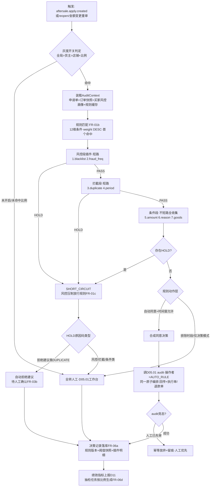
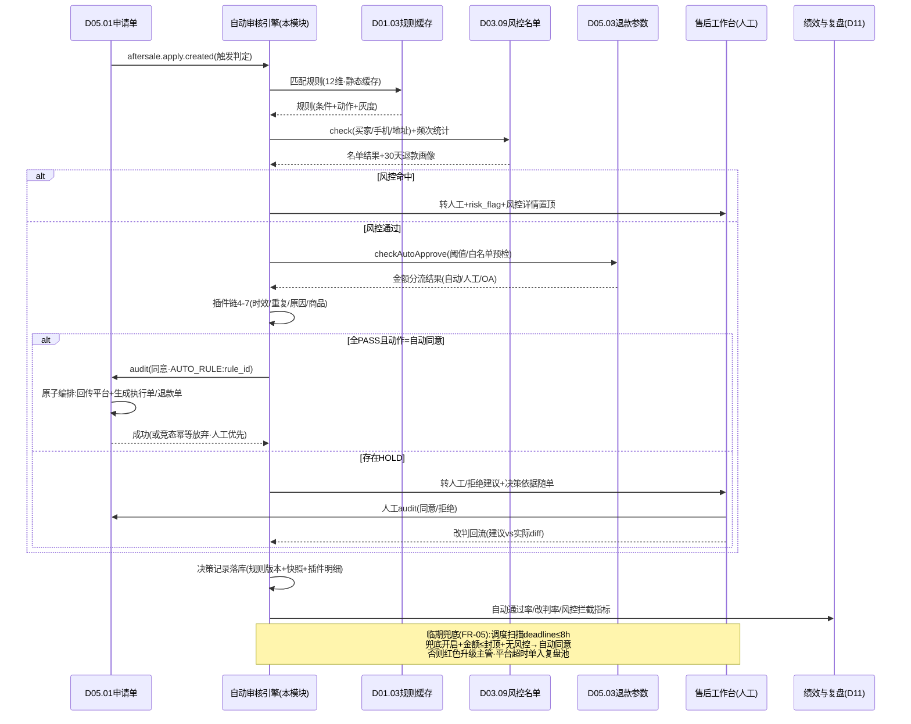

# SRS-D05.05 售后自动审核模块 需求规格说明书

> 文档编号：SRS-D05.05 · 版本 V1.3 · 2026-10-24 · 编写：小凯 · 状态：待审阅（批次③，V1.3 行业适配增补高额分级+跨店铺画像）
> 所属域：D05 售后域（申请单审核的**自动化决策层**）· 分期：**P1（M3）**；首期人工审核兜底（D05.01 FR-02e 人工通道），规则引擎逐步开启 · schema：oms_aftersale
> 上游依据：SRS-D05.01（IF-D05.01-03 `ReturnApplyService::audit(apply_id, 决策, 行级调整?, 操作者/规则引用)` 审核统一入口、FR-02e 自动审核入口、状态机 §4.1、deadline 时效 FR-06）· SRS-D05.03（IF-D05.03-07 `RefundAuditService::checkAutoApprove` 阈值/白名单/风控分流参数、FR-04 审核规则入口、§5.4 风控参数表）· SRS-D03.02（审单插件链模式：五段编排/结构化原因 order_audit_reason/规则三层模型/静态缓存/试算 dryRun——本模块同构复刻到售后审核域）· SRS-D01.03（规则引擎基础框架：插件注册表/条件表达式求值/「条件→动作」规则模型/枚举字典/缓存机制）· SRS-D03.09（IF-D03.09-06 `RiskListService::check` 风控名单）· 逆向文档 05 §6.7（confirmreship 自动确认定时器、lanjiereshipapprove 拦截件售后审批）+ 02 §6（审单规则引擎三层模型参考）
>
> **全局决策（本模块承载）**：① 售后自动审核规则引擎**承载于 D01.03 规则框架**（同审单插件链模式：条件→动作，D03.02 是正向域首个承载方，本模块是售后域承载方）；② 规则动作四值：**自动同意退款 / 自动同意退货 / 自动拒绝 / 转人工**——自动同意即调 D05.01 `audit` 入口进入执行链路（回传平台+生成执行单/退款单），与人工审核同源同链路；③ 决策全留痕（结构化决策记录 aftersale_audit_reason，同 order_audit_reason 模式）；④ 风控前置：防薅羊毛规则（高频退款/退款率异常/黑名单）**优先于**放行类规则命中，异常一律转人工不自动拒绝（拒绝权留给人工，防规则误杀）；⑤ 平台售后时效约束下的超时风险管理——**不做无脑超时自动同意**，临期未审按规则化「时效兜底策略」处置（自动同意需显式配置+金额封顶+资损复盘）。

---

## 1. 模块概述

### 1.1 定位

售后自动审核是 D05.01 申请单「待审核」状态的**自动化决策层**：申请单落库后（或人工触发重审时），本模块以规则引擎对申请单执行「条件→动作」判定——命中放行规则（小额仅退款/白名单原因无理由退货/优质客户）自动同意，命中拦截规则（黑名单/超售后期/重复申请）给出拒绝建议或转人工，命中风控规则（高频退款/金额异常/退款率异常店铺）强制转人工；决策结果经 D05.01 `audit` 统一入口落地（自动同意=直接进执行链路：回传平台+生成 D05.02 执行单/D05.03 退款单；转人工=进 D05 售后审核工作台带决策依据），全过程写结构化决策记录（命中规则/条件快照/动作/依据数据），供绩效分析（自动通过率/人工改判率）与规则调优（dry-run 试算回放）。

商派对应机制：售后审核以人工为主 + `confirmreship` 定时器（超时自动确认收货）+ `lanjiereshipapprove`（拦截件审批定时器）——无规则化自动审核体系（正向审单有 omeauto 插件链，售后域未复用）。凯淳把正向审单验证过的**规则引擎三件套（规则模型/插件链/结构化原因）平移到售后审核域**，是本模块的核心设计：同一套 D01.03 框架、同一种配置心智、同一类决策留痕。

### 1.2 职责边界

**做**：售后审核规则配置模型（条件层+动作层，D01.03 承载）与命中逻辑、审核判定插件链（风控/时效/重复/金额/原因/客户/商品七类插件）的注册与编排、四类决策动作（自动同意退款/自动同意退货/自动拒绝建议/转人工）的产出与落地编排（调 D05.01 audit）、结构化决策记录（aftersale_audit_reason）与检索统计、风控防薅羊毛判定（高频退款/退款率/名单联动 D03.09）、临期时效兜底策略（平台超时自动同意风险的规则化管控）、人工审核协同（转人工队列带决策依据、人工改判回流规则调优）、审核绩效指标（自动通过率/准确率/时效）、规则试算器（dry-run 历史单回放）、灰度开启控制（店铺/货主级自动审核开关与比例）。

**不做**：审核结果的状态机落地与平台回传（→ D05.01 audit 原子编排，本模块只是调用方之一）；退款阈值参数与退款单生成（→ D05.03，本模块消费其 checkAutoApprove 供数）；执行单生成（→ D05.02）；风控名单维护（→ D03.09 名单服务，本模块只查）；规则引擎框架机制（→ D01.03）；人工审核工作台界面（→ D05.01 FR-07 售后工作台承载，本模块供决策依据数据）；订单正向审单（→ D03.02）。

### 1.3 与其他模块关系

| 模块 | 关系 |
|---|---|
| D05.01 申请单 | 触发方+落地方：申请单落库（`aftersale.apply.created`）/reopen 触发本模块判定；决策经 `ReturnApplyService::audit(apply_id, 决策, 规则引用)`（IF-D05.01-03）落地——自动同意与人工审核**同一入口同一原子编排**（状态推进+回传+下游生成）；转人工进其售后工作台待审队列 |
| D01.03 规则框架 | 承载框架：规则模型（条件 JSON+动作+weight+时间窗）、条件表达式求值、插件注册表、规则静态缓存与失效重载、枚举字典（原因码/决策码登记） |
| D05.03 退款单 | 参数供数：`RefundAuditService::checkAutoApprove(apply_id)`（IF-D05.03-07）返回阈值/白名单/风控预检结果，本模块金额插件消费；超额审批链（OA D10.05）由其 FR-04a 定义，本模块动作=转人工/转 OA 路由 |
| D03.09 名单服务 | `RiskListService::check(维度, 值)`（IF-D03.09-06）：黑名单买家/高频退款名单/异常店铺风控判定 |
| D03.02 审单引擎 | 模式参照方：插件链五段编排/短路规则/结构化原因/规则三层模型/静态缓存/dry-run 试算——本模块同构复刻（插件集与段序不同） |
| D05.02/D05.04 | 自动同意退货/换货后的执行链路（audit 编排内生成，本模块不直连） |
| D02.03 | 平台售后时效数据（deadline 由 D05.01 FR-06a 计算，本模块消费做临期兜底判定） |
| D10.02/D10.06 | 规则配置权限（售后主管角色）；配置变更与决策审计 |
| D11 报表 | 自动通过率/人工改判率/审核时效/风控拦截量指标供数；规则命中分布分析 |

---

## 2. 业务场景

**SC-D05.05-01 小额仅退款自动同意（主流程）**
买家对 29.9 元手机壳申请未发货仅退款（原因=拍错/多拍）。申请单落库事件触发本模块：装载上下文（申请单+订单快照+买家风控画像）→ 规则匹配（命中「全店铺-小额仅退款自动同意」规则：条件=售后类型∈{仅退款} AND 申请金额≤200 AND 原因∈白名单{拍错,未发货退款,七天无理由} AND 货物状态=未发货）→ 插件链执行：风控插件 PASS（买家 30 天退款 1 次未命中高频）→ 时效插件 PASS（未超售后期）→ 重复插件 PASS（该行无在途/已完成售后）→ 金额插件 PASS（29.9≤阈值 200，消费 D05.03 checkAutoApprove）→ 决策=自动同意退款 → 调 D05.01 `audit(apply_id, 同意, 规则引用 R102)`：回传 agree_refund+生成退款单+订单取消联动——从消息落单到平台收到同意回传全程 ≤30s 无人工。决策记录落库（命中规则/各插件结果/金额阈值快照）。

**SC-D05.05-02 无理由退货自动同意（时效内+原因白名单）**
买家对已签收 3 天的服饰订单申请退货退款（原因=七天无理由，订单签收 3 天 < 7 天时效）。命中「服饰-无理由自动同意退货」规则（条件含商品分类=服饰 AND 签收天数≤7 AND 原因∈无理由白名单）→ 插件链全 PASS → 决策=自动同意退货 → audit 落地：回传 agree_return+生成 D05.02 执行单+退货预报。若签收已 9 天（超无理由时效）→ 时效插件 HOLD（code=AUDIT_PERIOD_EXPIRED）→ 按规则动作=转人工（**不自动拒绝**：超期申请平台可能仍受理，拒绝权留给人工结合平台规则判断）。

**SC-D05.05-03 高频退款风控转人工（防薅羊毛）**
买家 30 天内第 6 次申请仅退款（前 5 次均小额自动同意）。本单 45 元虽在金额阈值内，风控插件命中「高频退款」（RiskListService 名单+本地频次统计 30 天≥5 次）→ SHORT_CIRCUIT 短路（后续金额/原因插件不再跑）→ 决策=转人工+风险标记（risk_flag 入台账）→ 工作台置顶展示风控详情（历史退款清单/累计金额/频次曲线）。人工判定恶意 → 拒绝+买家加入黑名单（D03.09 名单服务）→ 后续申请黑名单插件直接命中转人工；人工判定正常 → 同意（改判记录回流规则调优样本）。

**SC-D05.05-04 已退款重复申请拦截**
买家对订单行 A（已全额退款完成）再次发起仅退款申请。重复插件校验：行级可退余额=0（D05.01 §5.3 口径：Σ历史已退=行实付）→ HOLD（code=DUPLICATE_APPLY，明细=历史退款单 RF 号）→ 规则动作=自动拒绝建议+转人工确认（拒绝类动作强制人工复核，防余额计算边界误杀——如运费差、二次协商补退）→ 人工确认后经 audit 拒绝路径回传 refuse_refund。

**SC-D05.05-05 平台临期兜底（超时自动同意的规则化管控）**
拼多多售后单平台时效 48h（超时平台自动同意退款），单已挂 40h 未审（大促人工积压）。本模块临期扫描（每 10 分钟）：剩余 ≤8h → 触发「临期兜底策略」判定（货主级配置）：① 兜底自动同意开启（该货主已显式配置+金额封顶 500 元+原因不在拒绝建议清单）→ 自动同意（标记 `deadline_rescue=true`，入资损复盘清单）；② 兜底未开启或超封顶 → 红色预警升级售后主管（D01.07 企微+工作台置顶），**宁可平台超时自动同意也不无规则放行**——平台自动同意后 D05.01 FR-06b 被动收敛+auto_agreed_by_platform 标记，本模块月度输出「平台超时 vs 本地兜底」对比报表驱动策略调整。

**SC-D05.05-06 规则灰度开启（新店接入）**
新店铺接入 OMS，售后主管配置自动审核规则但**先不放量**：店铺级灰度开关=关（全部转人工）→ 运行 2 周积累人工决策样本 → 用试算器 dry-run 回放该店 2 周历史单（展示「若当时开启规则」的决策 vs 人工实际决策 diff，命中一致率 96%）→ 调整阈值后灰度开 50%（按申请单尾号分流）→ 一致率稳定后全量。灰度比例/开关店铺级+货主级双层配置，随时可一键回退全人工。

**SC-D05.05-07 人工改判回流与规则调优**
月度复盘：规则 R102（小额自动同意）命中单中人工复核抽检发现 3% 改判为拒绝（集中在某店铺「已发货仅退款」场景——货已发出仍自动同意造成钱货两失）。分析路径：决策记录按规则聚合→改判样本下钻（原因=已发货仅退款未纳入条件）→ 修正规则条件（增加 货物状态=未发货 OR 已发货仅退款金额≤50）→ 试算器回放验证→变更上线（审计留痕）。改判率指标（D11）按规则/店铺/货主维度持续监控，超阈值（默认 5%）自动告警规则 Owner。

---

## 3. 功能需求

### FR-D05.05-01 售后审核规则配置模型（D01.03 承载）

- FR-01a 规则两层结构（条件层+动作层，同 D03.02 FR-03 三层模型裁掉插件参数层——售后审核插件集固定小，参数并入条件层配置）：
  - **条件层**（12 维，AND 组合，同维度多值 OR）：售后类型（仅退款/退货退款/换货）/申请金额区间/原因码（OMS 字典）/客户等级（会员画像，P2 预留）/商品分类/店铺/货主/平台/货物状态（未发货/已发货未收/已签收）/签收天数区间/买家标签（风控名单命中标记）/来源（platform/manual）；
  - **动作层**：决策动作（自动同意退款/自动同意退货/自动拒绝建议+转人工确认/转人工）/生效时段+排除时段（大促停自动审核，D03.02 SC-07 同款）/灰度比例（0-100%，按 apply_id 尾号分流）/临期兜底标记（该规则是否参与 deadline 兜底，FR-05）。
- FR-01b 优先级与命中：规则按 weight DESC 排序，申请单匹配**第一个全条件命中**的规则；末尾系统内置缺省规则兜底（动作=转人工，不可删）；一单一规则（首个命中即裁决，不叠加）。
- FR-01c 风控前置约束（不可配置绕过）：风控类插件（FR-02b 黑名单/高频/异常店铺）SHORT_CIRCUIT 优先于任何放行规则——即使规则动作=自动同意，风控 HOLD 一律降级转人工（决策记录标注「风控压制规则 Rxxx」）。
- FR-01d 规则管理：CRUD+启停+复制+变更审计（D10.06，变更前后快照）；变更事件驱动静态缓存失效重载（D01.03 机制，同 D03.02 FR-06b）；配置权限=售后主管角色（D10.02）。
- FR-01e 规则试算器：`dryRun(apply_id, ruleSet?)` 以当前或指定规则集对历史申请单快照重跑判定，输出决策 diff（规则命中/插件明细/与人工实际决策对比），**零副作用**（不落决策记录不调 audit）；批量回放（按店铺+时间段）输出一致率报告（灰度开启依据，SC-06）。

### FR-D05.05-02 审核判定插件链（九插件，D01.03 注册表承载）

- FR-02a 插件统一接口 `AftersaleAuditPluginInterface { name(); order(); process(AuditContext): PluginResult }`；PluginResult = PASS / HOLD(原因码集) / SHORT_CIRCUIT(原因码集)；执行序固定（风控类在前短路，放行条件类在后）：

| # | 插件名 | 类型 | 职责 | HOLD 原因码 → 默认动作 |
|---|---|---|---|---|
| 1 | blacklist_check | 风控·短路 | 黑名单买家/收货手机/地址匹配（RiskListService） | BLACKLIST → 转人工（拒绝建议） |
| 2 | fraud_freq_check | 风控·短路 | 高频退款（30 天 ≥N 次，默认 5）/同订单多申请/退款率异常店铺 | FRAUD_FREQ / SHOP_REFUND_ABNORMAL → 转人工+risk_flag |
| 2a | **buyer_profile_check**（V1.3） | 风控·短路 | 跨店铺退货画像风险分（FR-04g）：风险分 ≥ 降级阈值（默认 60）→ 自动同意类规则整体失效 | PROFILE_HIGH_RISK → 转人工+画像摘要随单 |
| 3 | duplicate_check | 拦截·短路 | 行级可退余额=0 重复申请/在途申请并存 | DUPLICATE_APPLY → 自动拒绝建议+人工确认 |
| 4 | period_check | 拦截 | 售后期校验（签收后 N 天，平台×类目配置）/平台售后单有效性 | AUDIT_PERIOD_EXPIRED → 转人工 |
| 5 | amount_check | 条件 | 金额阈值判定（消费 D05.03 checkAutoApprove：≤自动阈值 PASS；>自动阈值且≤人工权限 WARN 随单；>人工权限 HOLD→OA 路由） | AMOUNT_OVER_AUTO / AMOUNT_OVER_MANUAL → 转人工/转 OA |
| 6 | reason_check | 条件 | 原因白名单（七天无理由/未发货退款/拍错等字典）+货物状态匹配（无理由须时效内） | REASON_NOT_ALLOWED → 转人工 |
| 7 | goods_check | 条件 | 商品分类准入（高值/SN 管理/定制品/贴身衣物类目强制人工）+换货类物料有效性（换入 SKU 存在且可履约） | GOODS_FORCE_MANUAL → 转人工 |
| 8 | **high_value_check**（V1.3） | 裁决·短路 | 高额分级（FR-04f）：金额 ≥ 货主级高额阈值 → 短路所有自动同意，强制人工+验货强制项清单 | HIGH_VALUE_TIER → 强制转人工（不可配置绕过） |

- FR-02b 短路规则：1-3 风控/拦截段任一 HOLD 即 SHORT_CIRCUIT（后续条件插件无意义）；4-7 条件段**不短路**（跑完收集全部 HOLD 原因，转人工一次带全问题清单——D03.02 CHECK 段不短路同款体验设计）；**8 高额裁决段在条件段之后执行**（收集完全部原因后最终裁决，任何自动同意决策被 HIGH_VALUE_TIER 否决；风控 HOLD 与高额 HOLD 可叠加随单展示）。
- FR-02c 决策合成：无 HOLD 且规则动作=自动同意 → 产出同意决策；存在 HOLD → 按规则动作层路由（转人工/拒绝建议）；风控 HOLD 压制放行（FR-01c）；决策=「动作层意图 ∩ 插件链裁决」，合成逻辑固定不可配（防配置出自动放行风控单）。
- FR-02d 插件异常容错：插件抛异常按严格模式处理=整单转人工（售后审核不做宽松跳过——放行类决策宁可漏自动化不可错放，与 D03.02 FR-01f 双模式差异点）；异常留痕+告警。
- FR-02e 插件耗时记录：plugin_perf 日志（apply_id/plugin/耗时/结果），单插件 P99>200ms 告警（售后判定链路比审单短，SLA 更严）。

### FR-D05.05-03 决策落地与人工协同

- FR-03a 自动同意落地：调 `ReturnApplyService::audit(apply_id, 同意, 行级调整=null, 操作者=AUTO_RULE:{rule_id})`（IF-D05.01-03）——与人工审核**同一入口同一原子编排**（状态推进+平台回传+执行单/退款单生成，D05.01 FR-02e）；audit 失败（状态已变迁/并发人工先审）→ 幂等放弃+留痕（人工决策优先于自动决策，竞态让路）。
- FR-03b 自动拒绝建议：拒绝类决策**不直接落地**——产出拒绝建议（原因码+依据）置申请单「待人工确认」标签进工作台高优队列；人工确认后经 audit 拒绝路径落地（FR-02a #3 设计理由：拒绝影响买家体验且平台规则复杂，机器只给建议）。
- FR-03c 转人工：申请单保持待审核+决策依据（命中规则/全部 HOLD 原因/风控详情/建议动作）随单推送 D05.01 售后工作台（置顶排序：临期>风控>金额大>普通）；人工审核界面展示自动决策参考（同意建议可一键采纳）。
- FR-03d 人工改判回流：人工决策与自动建议不一致 → 改判记录（规则 ID/自动建议/人工决策/改判原因码）落决策表+按规则聚合统计（FR-06b 改判率）；改判率超阈值（默认 5%）告警规则 Owner+进月度调优清单（SC-07）。
- FR-03e 重审触发：申请单 reopen（拒绝后买家重开）/金额变更/类型变更 → 重新跑判定（旧决策记录归档，D05.01 FR-02b reopen 语义衔接）；人工已终审的单不再自动判定（人工终态优先）。

### FR-D05.05-04 风控防薅羊毛（专项规则）

- FR-04a 频次风控：同买家 30 天退款次数 ≥N（默认 5，全局可配）/同买家 30 天退款金额累计 ≥M（默认 2000 元）→ 强制转人工+risk_flag；统计口径=已完成+处理中申请单（含仅退款/退货退款），按买家标识（open_id 维度，跨店铺合并——防跨店薅）。
- FR-04b 模式风控：同订单行数拆多次小额申请（化整为零规避阈值：同订单 7 天内 ≥3 笔申请）/同收货地址多买家集中退款（地址维度聚合异常）→ 转人工+风险详情。
- FR-04c 店铺退款率监控：店铺 30 天退款率（退款单数/订单数）超均值 2 倍标准差 → 该店铺自动同意规则整体降级转人工（防止店铺级系统性风险：质量问题批量退款期不应自动放行）+告警运营。
- FR-04d 名单联动：人工判定恶意 → 一键加黑名单（D03.09 名单服务，含失效期）；黑名单买家申请永久转人工（不自动拒绝——拒绝仍由人工执行，保留申诉空间）。
- FR-04e 风控数据供数：风控命中明细入 D11 风控报表（按货主/店铺/买家维度）；风控参数（N/M/倍数）全局配置+变更审计。
- **FR-04f 高额分级审核（V1.3 行业适配 H4）**：申请金额分级强制人工，阈值**货主级配置**（奢品箱包珠宝货主默认 5000 元、美妆家清默认 500 元、消电默认 3000 元，均可调）：
  - 金额 ≥ 高额阈值 → 无论规则命中与否**强制转人工**（高额分级插件位于插件链最末位裁决段，短路所有"自动同意"类决策；自动拒绝建议不受限——拒绝本就人工确认）；
  - 高额单人工审核工作台强制项：开箱验货记录（退货入库质检影像/照片必传，联动 D05.02 质检回传附件）、SN/防伪扣核验结果（有 SN 物料必核，联动 D04.09 validateReturn）、鉴定预留位（`appraisal_required` 标记字段预留，奢品鉴定能力启动后驱动挂起——见 DESIGN-IND-01 §2）；
  - 分级留痕：决策记录写 `HIGH_VALUE_TIER` 原因码+当时阈值快照；高额单时效独立 SLA（默认 4h，超时升级主管，不走 FR-05 临期兜底自动同意——兜底封顶远低于高额阈值，天然互斥，显式声明防配置冲突）。
- **FR-04g 跨店铺退货画像（V1.3 行业适配 H4，代运营独有数据优势）**：以买家维度键（platform + open_id/手机号哈希，跨店铺跨货主合并）沉淀**持久画像**（区别于 FR-04a 的 30 天滚动频次）：
  - 画像指标：累计退货次数/退货率（退货单数÷购买单数，90天/365天双窗口）、拒收次数、售后原因分布（质量/无理由/物流破损占比）、**调包嫌疑标记**（质检发现少件/非本单 SN/防伪扣异常次数）、金额加权风险分（0-100，规则式计算：各项指标加权，公式全局可配+版本化）；
  - 画像消费：① 售后自动审核规则条件层新增「买家风险分区间」维度（如风险分 ≥60 → 自动同意规则整体降级转人工）；② 正向审单联动（D03.02 黑名单插件读取画像高危名单，下单即预警提示）；③ 品牌方门户（D10.04）本货主维度脱敏画像查询（只展示风险等级不展示明细，PIPL 合规）；
  - 画像更新：售后单终态事件异步驱动增量更新（MQ，订阅已登记契约事件 `aftersale.apply.completed` / `aftersale.apply.closed`）；新买家冷启动=无画像不拦截；画像数据保留 365 天滚动+人工申诉清除通道（买家申诉误标 → 客服提交 → 主管审批清除，全程审计）；
  - **PIPL 边界**：画像键=平台 open_id/手机号哈希（不落明文），风险分与标记为统计衍生数据；画像明细仅风控/售后主管角色可见（D10.03 字段级权限），导出禁止。

### FR-D05.05-05 平台时效约束下的临期兜底

- FR-05a 临期扫描：调度（D01.02，每 10 分钟）扫描待审核且 deadline 临近（剩余≤兜底窗口，默认 8h）的申请单 → 触发兜底判定。
- FR-05b 兜底策略（货主级显式配置，默认关）：`deadline_rescue=开启` 且 申请金额 ≤ 兜底封顶（默认 500 元）且 无风控 HOLD 且 原因不在拒绝建议清单 → 自动同意（决策标记 `deadline_rescue=true`）；否则升级人工（红色预警 D01.07 企微+主管，D05.01 FR-06b 分级衔接）。
- FR-05c 资损复盘：兜底自动同意单 100% 入资损复盘清单（与 D05.01 auto_agreed_by_platform 平台超时单同池管理）；月度对比报表「本地兜底 vs 平台超时自动同意」的量/金额/原因分布——兜底策略的价值=把平台无差别超时同意变为**有规则有封顶有复盘**的可控同意。
- FR-05d 大促模式：排除时段配置（大促高峰停自动审核全转人工，D03.02 SC-07 同款）+临期兜底窗口临时调宽（配置热更）。

### FR-D05.05-06 决策留痕与审核绩效

- FR-06a 结构化决策记录（aftersale_audit_reason，同 order_audit_reason 模式）：每次判定写 1 条决策主记录+0..N 条原因明细（插件/原因码/级别/数据快照/建议动作）；决策依据快照固化（当时规则版本/阈值配置/风控统计值）——可解释可回放（审计与争议场景「为什么当时自动同意了」）；重审先归档旧记录。
- FR-06b 绩效指标（D11 供数）：自动通过率（自动同意/总申请）/自动拒绝建议采纳率/人工改判率（按规则/店铺/货主维度）/判定耗时 P95/临期兜底触发量/风控拦截量与拦截金额；指标看板+月度报告。
- FR-06c 决策检索：按规则 ID/原因码/决策类型/时间聚合查询与下钻（「本周 FRAUD_FREQ 命中 TOP 店铺」类运营分析）；单笔申请详情展示完整决策时间线。
- FR-06d 抽检机制：自动同意单按比例（默认 5%，货主可配）生成人工抽检任务（事后复核，发现错放驱动规则调优+资损登记）；抽检改判计入改判率。

### FR-D05.05-07 灰度与回退

- FR-07a 灰度开关三层：全局总开关（一键停全部自动审核）> 货主级开关 > 店铺级开关+比例（0-100%，apply_id 尾号分流，稳定命中——同店同买家体验一致）；任一层关闭即全转人工。
- FR-07b 回退安全：自动审核停用不影响在途单（已决策单继续走执行链路）；重新开启后仅对新触发单生效。
- FR-07c 首期兜底（分期口径）：P1 上线初期全局开关默认关（人工审核兜底，D05.01 P0 通道），按 SC-06 灰度路径逐店开启；系统内置「保守规则模板包」（小额仅退款+无理由退货两条低风险规则）供快速启用。

---

## 4. 业务流程

### 4.1 售后自动审核规则引擎流程



### 4.2 决策路由与人工协同时序



---

## 5. 处理逻辑

### 5.1 引擎主循环（伪代码，同构 D03.02 §5.1）

```
judge(apply_id, trigger):                     # 触发: created/reopen/重审
    lock = redis_lock(apply_id)               # 与人工审核竞态串行化
    apply = load(apply_id)
    if apply.status != 待审核 or 人工已终审: return skip(留痕)
    if not grayHit(apply): return routeManual(apply, "灰度未开启")
    ctx = AuditContext.load(apply)            # 申请单+订单+买家画像+行级余额
    rule = RuleCache.match(ctx)               # 12维·weight DESC·首个命中·缺省=转人工
    if rule.timeWindow.excluded(now): return routeManual(apply, "排除时段")
    reasons = []
    for p in [blacklist, fraud_freq, duplicate, period, amount, reason, goods]:
        r = p.process(ctx)                    # PASS/HOLD/SHORT_CIRCUIT
        perf_log(p, r)
        if r.hold():
            reasons += r.reasons
            if p.stage in (风控, 拦截): break  # 短路; 条件段不短路(FR-02b)
    decision = synthesize(rule, reasons)      # FR-02c 固定合成: 风控HOLD压制放行
    persist(decision, rule.version_snapshot, reasons)   # FR-06a 决策记录
    if decision == 自动同意:
        ReturnApplyService.audit(apply_id, 同意, operator=AUTO_RULE:rule.id)
        # audit内部原子编排(回传+下游生成); 竞态失败幂等放弃(FR-03a)
    elif decision == 拒绝建议:
        markPendingConfirm(apply, reasons)     # 工作台高优队列(FR-03b)
    else:
        routeManual(apply, reasons)            # 决策依据随单(FR-03c)
    reportMetrics(decision)
```

### 5.2 决策合成矩阵（FR-02c 固定逻辑）

| 插件链结果 | 规则动作=自动同意 | 规则动作=转人工 |
|---|---|---|
| 全 PASS | **自动同意落地** | 转人工（规则保守配置） |
| 风控段 HOLD（1/2） | **转人工+risk_flag**（风控压制，不可配置绕过） | 转人工+risk_flag |
| 拦截段 HOLD（3 重复） | 拒绝建议+人工确认 | 拒绝建议+人工确认 |
| 拦截段 HOLD（4 超期） | 转人工 | 转人工 |
| 条件段 HOLD（5/6/7 任一） | 转人工（带全部 HOLD 原因） | 转人工 |

> 金额插件三档细分：≤自动阈值 PASS；>自动阈值且≤人工权限 WARN（随单提示，不阻塞规则动作）；>人工权限 HOLD（AMOUNT_OVER_MANUAL→转人工，人工超权限再走 OA，D05.03 FR-04a 链路衔接）。

### 5.3 风控频次统计口径（FR-04a/b）

```
买家维度键 = platform + open_id(跨店铺合并, 防跨店薅)
频次统计   = COUNT(申请单 WHERE 买家键 AND create_time ≥ now-30d
                  AND status NOT IN (关闭, 拒绝))          # 处理中+完成都计入
金额累计   = Σ approved_amount_customer(同窗口)
拆单模式   = COUNT(申请单 WHERE order_id AND 7天内) ≥ 3 → 模式风控
地址聚合   = COUNT(DISTINCT 买家键 WHERE 收货地址hash AND 30天退款≥N) → 异常地址
统计实现   = Redis 计数器(实时判定用) + DB 日终校准(对账防漂移)
店铺退款率 = 店铺30天退款单数/订单数; 异常判定 = > μ+2σ(全店铺分布, 周批刷新基线)
```

### 5.4 临期兜底判定（FR-05b）

```
deadlineRescue(apply):                        # 调度每10分钟, 剩余≤兜底窗口(默认8h)
    cfg = 货主级兜底配置
    if not cfg.enabled: return 升级人工(红色预警)
    if apply.amount > cfg.cap(默认500): return 升级人工
    if 风控插件HOLD(实时重跑): return 升级人工   # 兜底不豁免风控
    if apply.reason ∈ cfg.拒绝建议清单: return 升级人工
    audit(同意, operator=DEADLINE_RESCUE:rule) + 标记deadline_rescue
    入资损复盘清单(FR-05c)
```

### 5.5 幂等与并发

```
判定幂等: (apply_id, trigger_event_id) 消费台账; 重复触发返回首次决策
竞态处理: apply级分布式锁 + audit前置状态校验(CAS)——人工先审则自动决策幂等放弃(人工优先)
决策记录: 重审先归档旧记录(按apply_id+轮次), 决策链完整保留
规则缓存: 静态缓存+变更事件失效重载(D01.03); 缓存故障降级实时查库+限流(D03.02 §8同款)
灰度分流: apply_id尾号hash稳定分流(同单重审判定结果一致)
```

---

## 6. 数据字段（业务字段描述，schema：oms_aftersale）

### 6.1 售后审核规则（aftersale_audit_rule）

| 字段 | 业务含义 | 取值/校验 |
|---|---|---|
| rule_id / rule_name | 规则标识 | 名称租户内唯一 |
| conditions | 条件层 | JSON：12 维数组（维度/操作符/值集），AND 组合（FR-01a） |
| weight | 优先级 | DESC 排序，首个命中生效 |
| action_type | 决策动作 | 自动同意退款/自动同意退货/拒绝建议/转人工 |
| gray_ratio | 灰度比例 | 0-100，apply_id 尾号分流 |
| effective_window / exclude_window | 生效/排除时段 | 大促停审（FR-05d） |
| rescue_flag | 临期兜底参与标记 | FR-05 |
| status / defaulted | 启停/缺省标记 | 系统缺省规则（转人工）不可删 |
| owner_account | 规则 Owner | 改判率告警接收人（FR-06b） |
| owner_id / tenant_id / shop_scope | 归属与适用范围 | 货主隔离；shop_scope=店铺集或全部 |

### 6.2 决策记录（aftersale_audit_decision）

| 字段 | 业务含义 | 取值/校验 |
|---|---|---|
| decision_id / apply_id / round | 归属申请单与判定轮次 | 重审归档不覆盖（FR-06a） |
| trigger_type | 触发源 | created/reopen/amount_changed/deadline_rescue/rejudge |
| rule_id / rule_version_snapshot | 命中规则与版本快照 | 可解释回放依据 |
| decision | 决策结果 | 自动同意/拒绝建议/转人工/灰度未开/竞态放弃 |
| operator_ref | 落地标识 | AUTO_RULE:{rule_id} / DEADLINE_RESCUE:{rule_id} |
| risk_flag / deadline_rescue | 风控标记/兜底标记 | FR-04/FR-05 |
| manual_final_decision / manual_operator / overturn_flag | 人工终审决策/人/改判标记 | 拒绝建议与转人工单回填（FR-03d） |
| overturn_reason_code | 改判原因码 | 字典（规则调优样本） |
| cost_ms / create_time | 判定耗时/时间 | 绩效供数 |

### 6.3 决策原因明细（aftersale_audit_reason，同 order_audit_reason 模式）

| 字段 | 业务含义 | 取值/校验 |
|---|---|---|
| reason_id / decision_id | 归属决策 | |
| plugin_name / reason_code | 插件/原因码 | 码属 D01.03 枚举字典（BLACKLIST/FRAUD_FREQ/PROFILE_HIGH_RISK/DUPLICATE_APPLY/AUDIT_PERIOD_EXPIRED/AMOUNT_OVER_AUTO/AMOUNT_OVER_MANUAL/REASON_NOT_ALLOWED/GOODS_FORCE_MANUAL/SHOP_REFUND_ABNORMAL/HIGH_VALUE_TIER） |
| level | 级别 | BLOCK（转人工/压制）/ WARN（随单提示） |
| description / detail | 人读描述/数据快照 | JSON：频次统计值/余额计算/阈值配置/名单命中详情 |
| suggest_action | 建议动作 | 同意/拒绝/联系买家/加黑名单/等人工 |

### 6.4 风控统计（buyer_risk_stat，Redis 实时+DB 日终校准）

| 字段 | 业务含义 |
|---|---|
| platform / buyer_key | 买家维度键（open_id，跨店铺合并） |
| refund_cnt_30d / refund_amt_30d | 30 天退款次数/累计金额（FR-04a） |
| same_order_cnt_7d / addr_hash | 拆单模式/地址聚合因子（FR-04b） |
| blacklist_flag / blacklist_expire | 黑名单标记与失效期（D03.09 同步） |
| stat_date /校准状态 | 日终校准（Redis-DB 对账防漂移） |

### 6.5 跨店铺退货画像（aft_buyer_profile，V1.3 新增，FR-04g）

| 字段 | 业务含义 | 取值/校验 |
|---|---|---|
| profile_id / tenant_id | 画像主键/租户 | 画像为**跨货主全局数据**（代运营数据优势），owner_id 不设——单货主视角查询经 D10.03 过滤聚合 |
| buyer_key_hash | 买家维度键哈希（platform+open_id/手机号哈希，不落明文） | UNIQUE；PIPL：仅存哈希，明文秘钥隔离（D01.05） |
| return_cnt_90d / return_cnt_365d | 退货次数（90天/365天双窗口） | 售后终态事件驱动增量更新 |
| return_rate_90d / return_rate_365d | 退货率（退货单数÷购买单数） | DECIMAL(5,4)；购买单数同窗口统计 |
| reject_cnt_365d | 拒收次数 | |
| reason_dist | 售后原因分布 | JSON：{质量:n, 无理由:n, 破损:n, …} |
| swap_suspect_cnt | 调包嫌疑次数 | 质检发现少件/非本单SN/防伪扣异常（D05.02/D04.09 回传标记） |
| risk_score / score_version | 风险分（0-100）/计算公式版本 | 规则式加权，公式全局配置版本化；重算触发：公式变更全量重跑 |
| appeal_status / appeal_clear_time | 申诉状态/清除时间 | 人工申诉清除通道（FR-04g），清除=指标清零重算+审计留痕 |
| update_time / expire_time | 更新/过期 | 365 天滚动：无活动买家画像到期归档删除（PIPL 最小留存） |

**高额分级配置**（并入 aft_audit_rule_set 货主级参数，不新建表）：`high_value_threshold`（高额阈值，货主级默认值见 FR-04f）、`profile_downgrade_score`（画像降级阈值，默认 60）、`high_value_sla_hours`（高额单人工 SLA，默认 4h）。

---

## 7. 接口

### 7.1 内部接口（本模块提供）

| 编号 | 接口 | 消费方 | 说明 |
|---|---|---|---|
| IF-D05.05-01 | `AftersaleAuditEngine::judge(apply_id, trigger)` | D05.01 事件消费器（apply.created/reopen）、工作台手动重审 | 判定入口（幂等，§5.5）；返回决策+decision_id |
| IF-D05.05-02 | `AftersaleAuditRuleService::match(apply)` / `dryRun(apply_id, ruleSet?)` / `batchReplay(店铺, 时间段)` | 规则管理界面/灰度评估 | 规则命中查询与试算回放（零副作用，FR-01e） |
| IF-D05.05-03 | `AuditDecisionQuery::get(apply_id)` / `stat(filter)` / `listByRule(rule_id)` | D05.01 工作台（决策依据展示）/D11/审计 | 决策记录与原因明细检索、按规则聚合统计 |
| IF-D05.05-04 | `AftersaleAuditEngine::feedbackManualDecision(apply_id, 人工决策, 改判原因码)` | D05.01 人工 audit 后置钩子 | 人工改判回流（FR-03d，改判率统计源） |
| IF-D05.05-05 | 事件 `aftersale.autoaudit.decided`（决策类型/规则/风控标记） | D05.01/D11/D01.07 | 决策广播（临期兜底/风控命中触发通知） |
| IF-D05.05-06 | `AftersaleAuditPluginRegistry::register(plugin)` | 插件扩展方 | 插件注册入口（D01.03 框架） |
| IF-D05.05-07 | `GrayConfigService::setSwitch(层级, 范围, 开关/比例)` | 售后主管工作台 | 灰度三层开关与回退（FR-07） |

### 7.2 依赖接口（本模块消费）

| 编号 | 接口 | 提供方 | 说明 |
|---|---|---|---|
| IF-D05.05-D1 | `ReturnApplyService::audit(apply_id, 决策, 行级调整?, 操作者/规则引用)` | D05.01（IF-D05.01-03） | 决策落地唯一通道（自动/人工同源原子编排） |
| IF-D05.05-D2 | 事件 `aftersale.apply.created/approved/rejected/closed` 订阅 + 申请单/行级余额读取 `ReturnApplyQuery` | D05.01（IF-D05.01-05/06） | 触发源与上下文装载 |
| IF-D05.05-D3 | `RefundAuditService::checkAutoApprove(apply_id)` | D05.03（IF-D05.03-07） | 金额阈值/原因白名单/风控预检参数 |
| IF-D05.05-D4 | `RiskListService::check(维度, 值)` | D03.09（IF-D03.09-06） | 黑名单/高频名单判定 |
| IF-D05.05-D5 | `OrderAmountService::getDualAmount` / `OrderQueryService::get` | D03.01（IF-D03.01-05/03） | 订单快照与双口径金额（上下文装载） |
| IF-D05.05-D6 | 规则引擎框架（注册表/条件求值/静态缓存/枚举字典/变更事件） | D01.03 | 承载框架（售后域第二个承载方，首个=D03.02） |
| IF-D05.05-D7 | 调度/通知/OA/审计 | D01.02/D01.07/D10.05/D10.06 | 临期扫描、预警升级、超额审批路由、配置与决策审计 |

### 7.3 外部接口

本模块无直接外部接口（平台回传经 D05.01→D02.04，风控数据内部闭环）。

---

## 8. 非功能需求

| 项 | 要求 |
|---|---|
| 性能 | 单笔判定 P95 ≤300ms（含风控统计与规则匹配）；落单→自动同意→回传提交端到端 ≤30s；大促售后洪峰 200 单/分钟判定无积压；临期扫描单轮 ≤5 分钟 |
| 幂等 | 判定/决策落地/改判回流全路径幂等（§5.5）；MQ 重投与人工竞态安全（人工优先） |
| 一致性 | 决策记录与 D05.01 审核结果每日对账（自动同意单状态漂移告警）；风控 Redis 计数与 DB 日终校准 |
| 资损防线 | 风控压制不可配置绕过（FR-01c）；拒绝类决策强制人工确认（FR-03b）；插件异常一律严格转人工（FR-02d）；临期兜底默认关+金额封顶+100% 复盘（FR-05） |
| 可解释 | 每笔决策可回放（规则版本快照+条件快照+插件明细）；dry-run 零副作用 |
| 安全/PIPL | 买家风控画像脱敏展示；决策记录含买家标识走加密引用（D01.05）；规则配置变更审计（D10.06）；配置权限售后主管角色隔离 |
| 可观测 | 自动通过率/改判率/风控拦截量/判定耗时四组指标上报 D11；改判率超 5% 告警规则 Owner；灰度开关状态看板 |
| 降级 | 规则缓存故障降级实时查库+限流；风控统计 Redis 故障降级 DB 查询（吞吐下降不放行——查询失败按 HOLD 处理转人工） |

---

## 9. 验收标准

| 编号 | 验收条件 |
|---|---|
| AC-01 | 小额仅退款自动同意（SC-01）：29.9 元白名单原因未发货仅退款，落单→判定→audit 同意→回传 agree_refund 提交→退款单生成，端到端 ≤30s 无人工；决策记录含规则版本/阈值快照/七插件明细 |
| AC-02 | 无理由退货自动同意（SC-02）：服饰签收 3 天七天无理由→自动同意退货+执行单生成；签收 9 天超时效→period_check HOLD 转人工（不自动拒绝），决策原因含超期天数明细 |
| AC-03 | 风控压制验证：构造「规则动作=自动同意+买家命中高频名单」的申请单→决策=转人工+risk_flag，决策记录标注「风控压制规则 Rxxx」；修改规则配置无法绕过（FR-01c 红线）；风控段 HOLD 后条件段插件零执行（短路） |
| AC-04 | 重复申请拦截（SC-04）：行级可退余额=0 的二次申请→duplicate_check HOLD→拒绝建议进工作台高优队列；人工确认后经 audit 拒绝落地回传 refuse；人工否决建议（同意）则改判记录回流 |
| AC-05 | 条件段不短路：构造同时命中 amount+reason+goods 三个 HOLD 的申请单→转人工时工作台一次展示全部 3 条原因与建议（不逐条冒） |
| AC-06 | 人工竞态：自动判定执行中人工先审（并发）→ audit CAS 失败→自动决策幂等放弃+留痕「人工优先」；申请单状态以人工决策为准，无双重回传 |
| AC-07 | 临期兜底（SC-05）：48h 时效单剩余 8h——兜底开启货主+金额 300≤封顶 500+无风控→自动同意+deadline_rescue 标记+入资损复盘清单；金额 600>封顶→红色升级主管不自动放行；兜底关闭货主→直接升级；平台超时自动同意单与本地兜底单同池月度对比报表可查 |
| AC-08 | 灰度与回退（SC-06）：店铺灰度 50% 时同店申请按 apply_id 尾号稳定分流（同尾号单判定路径一致）；全局开关一键关闭后新单全转人工、在途已决策单执行不受影响；重新开启仅对新触发单生效 |
| AC-09 | 试算器：dryRun 历史单输出决策 diff 且零副作用（无决策记录/无 audit 调用/无状态变更验证）；batchReplay 2 周店铺历史单输出一致率报告（与人工决策对比） |
| AC-10 | 改判回流与绩效（SC-07）：人工改判记录（自动建议/人工决策/改判原因码）落库；按规则聚合改判率超 5% 自动告警规则 Owner；D11 指标（自动通过率/改判率/风控拦截量/判定耗时 P95）数据准确 |
| AC-11 | 风控口径：同买家跨店铺 30 天第 5 次申请（前 4 次分属不同店铺）命中高频转人工（open_id 跨店合并验证）；同订单 7 天第 3 笔申请命中拆单模式风控；店铺退款率超 μ+2σ 后该店自动同意整体降级转人工+告警 |
| AC-12 | 插件异常严格模式：模拟 amount_check 抛异常→整单转人工+系统异常原因留痕+告警（不跳过不放行）；风控 Redis 故障→降级 DB 查询，查询仍失败按 HOLD 转人工（故障不放行验证） |
| AC-13 | 抽检机制：自动同意单按 5% 比例生成抽检任务；抽检改判计入改判率并驱动规则调优清单；重审场景（reopen）旧决策归档、新轮次决策链完整 |
| AC-14 | 高额分级（V1.3）：奢品货主阈值 5000 元——申请 5001 元即使命中自动同意规则仍强制转人工（HIGH_VALUE_TIER 短路验证），工作台展示验货强制项清单（质检影像必传/SN核验）；高额单超 4h SLA 升级主管；临期兜底对高额单不生效（互斥验证）；阈值改配即时生效+变更审计 |
| AC-15 | 跨店铺画像（V1.3）：同一 open_id 在 A/B 两店铺各退货 2 次+1 次调包嫌疑→画像风险分 ≥60，其在 C 店铺新申请命中 PROFILE_HIGH_RISK 降级转人工；售后终态事件驱动画像增量更新（MQ 消费幂等）；申诉清除走主管审批+指标清零+审计留痕；画像明细仅风控角色可见（字段级权限验证）、365 天无活动自动归档 |

---

## 变更记录

| 日期 | 版本 | 变更 | 原因 |
|---|---|---|---|
| 2026-10-24 | V1.0 | 首版 | — |
| 2026-10-24 | V1.3 | 插件链 7→9（buyer_profile_check 风控段 + high_value_check 裁决段）；新增 FR-04f 高额分级审核（货主级阈值强制人工+验货强制项+独立SLA）、FR-04g 跨店铺退货画像（风险分/调包嫌疑/申诉清除/PIPL边界）；§6.5 aft_buyer_profile 表；原因码 +PROFILE_HIGH_RISK/HIGH_VALUE_TIER | 行业适配校验 H4（Jason 决策A：高额分级+跨店铺画像，奢品/美妆高值退货风控刚需） |

---

*参考实现溯源：商派售后自动化仅有点状定时器——taskmgr `confirmreship`（超时自动确认收货，5 线程）+ `lanjiereshipapprove`（拦截件售后审批定时器）+ `retryreshipcancel`（重试取消），**无规则化自动审核体系**（正向审单 omeauto 插件链未平移到售后域，售后审核全靠人工+refund_apply.status 0 未审核→1 审核中→2 已接受人工流转，逆向文档 05 §6.2/§6.7）；退款金额阈值分流参数散落在 D05.03 溯源的商派 refunds 人工审核流程。凯淳参照系=自家 D03.02 审单引擎（商派 omeauto 的新栈重写）：规则三层模型（18 维条件→插件参数→动作）/插件链短路规则/结构化原因 order_audit_reason/规则静态缓存/dry-run 试算/时间窗压制。关键差异：① **把正向审单的规则引擎三件套平移到售后审核域**（同一 D01.03 框架第二个承载方，商派售后域自动化空白补齐）；② 决策动作四值化（自动同意退款/自动同意退货/拒绝建议/转人工）且**拒绝类强制人工确认**（商派无自动拒绝，凯淳也只做建议——拒绝影响买家体验与平台规则复杂度高）；③ 风控压制不可配置绕过+插件异常一律严格转人工（放行类决策宁可漏自动化不可错放，与 D03.02 宽松/严格双模式差异）；④ 临期兜底产品化（商派 confirmreship 无差别超时自动确认无风险管理→凯淳=显式配置+金额封顶+风控不豁免+100% 资损复盘+与平台超时单同池对比，把平台「超时自动同意」风险变为可控同意）；⑤ 防薅羊毛专项（跨店 open_id 合并频次/拆单模式/地址聚合/店铺退款率 μ+2σ 基线降级，商派缺失）；⑥ 灰度三层开关+尾号稳定分流+batchReplay 一致率评估的渐进上线路径（首期人工兜底的全局决策落地）；⑦ 人工改判回流闭环（改判率按规则聚合告警 Owner+dry-run 调优验证，规则可运营而非一次性配置）。*
