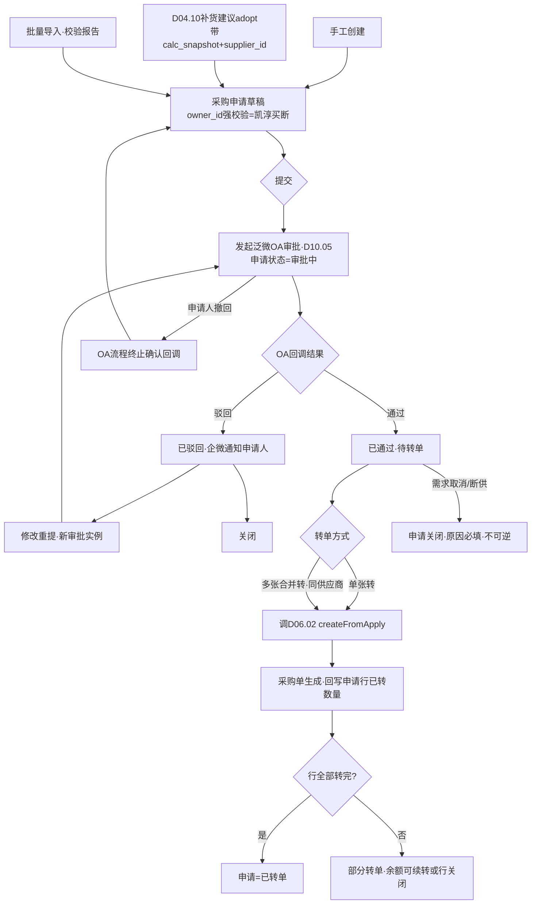
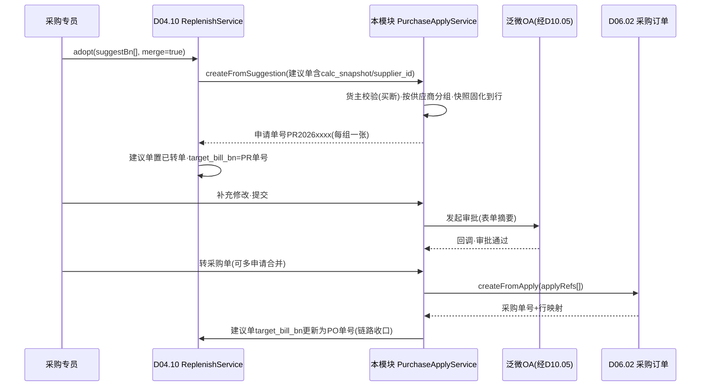

# SRS-D06.01 采购申请与补货计划模块 需求规格说明书

> 文档编号：SRS-D06.01 · 版本 V1.0 · 2026-10-24 · 编写：小凯 · 状态：待审阅（批次④）
> 所属域：D06 采购域 · 分期：**P0（M3）** · 独立 schema：`oms_purchase`
> 上游依据：SRS-D04.10（**补货建议 adopt 契约：IF-D04.10-02 `ReplenishService::adopt(suggestBn, merge?)`，携带测算依据快照 calc_snapshot 与建议供应商 supplier_id**）· SRS-D04.01（物料档案 IF-D04.01-04 `MaterialService::getProfile`）· SRS-D10.05（审批流集成，批次⑤——**全局决策：采购审批全量走泛微 OA，OMS 只发起与接收结果回调**）· SRS-00 §4.4 契约（全单据 owner_id+tenant_id）· 逆向文档 04 §2（商派无独立采购申请实体，补货提醒 need 直接生成采购单——本 SRS 显式补建申请层）
>
> **全局决策（本模块承载）**：① 采购申请/采购单审批全量在泛微 OA 完成，OMS 侧不建审批流引擎，只发起审批请求与消费回调结果（经 D10.05）；② **只有凯淳买断货主才产生采购**——采购申请必填 owner_id 且校验货主类型=凯淳买断（D10.01 货主类型枚举）；品牌代销货补货责任在品牌方，OMS 只发预警给门户（SRS-D04.10 SC-03 协作规则），不进采购链路；③ 供应商主数据以金蝶/OA 为准（Q28 混合归属决策），OMS 本地只存映射+采购视角扩展属性。

---

## 1. 模块概述

### 1.1 定位

采购域的需求入口层：将三类采购需求（手工申请、补货建议转单、批量导入）统一为**采购申请单**，维护供应商与供货关系档案（采购视角），经泛微 OA 审批后转采购单（D06.02）。商派模型中无独立申请实体（补货提醒直接生成采购单，逆向文档 04 §2.1），本 SRS 显式补建申请层，原因：① 凯淳采购审批全量走 OA，需要一个「审批中但未成单」的单据形态承载；② 补货建议采纳（D04.10 adopt）产出的草稿需要落点；③ 多申请合并转单（同供应商归并）需要申请-采购单的多对多追溯。

### 1.2 职责边界

**做**：采购申请单全生命周期（创建/导入/审批发起/回调处理/转单/关闭/撤回）、申请明细管理、供应商本地映射档案与供货关系（提前期/MOQ/箱规/默认供货价）、补货建议转单消费（含测算依据快照留存）、申请转采购单的合并规则、申请台账与统计。

**不做**：补货建议的计算与建议单管理（→ D04.10，本模块只消费其 adopt 产物）；采购单本体与 5 状态模型（→ D06.02）；供应商主数据的权威维护（→ 金蝶/OA，本模块只同步映射与本地扩展）；审批流程编排与 OA 通道机制（→ D10.05）；到货入库（→ D06.03）；应付与对账（→ D06.04）。

### 1.3 与其他模块关系

| 模块 | 关系 |
|---|---|
| D04.10 补货建议 | 消费 `ReplenishService::adopt(suggestBn, merge?)`（IF-D04.10-02）：采购类建议→本模块申请草稿，携带 calc_snapshot（测算依据）与 supplier_id |
| D06.02 采购订单 | 申请审批通过→转采购单（同供应商合并）；申请行与采购单行多对多追溯 |
| D10.05 审批集成 | 申请提交→发起 OA 审批（全量，无阈值豁免）；回调驱动申请状态（通过/驳回/撤回） |
| D10.01 组织货主 | owner_id 校验：仅凯淳买断货主可发起采购申请 |
| D04.01 物料 | 申请明细按基础物料（bm_id）；`MaterialService::getProfile` 校验物料归属货主一致性 |
| D04.02 记账 | 只读：申请时展示在途（arrive_store）辅助决策，不做任何记账 |
| D01.06 导入导出 | 批量导入申请明细（Excel 模板，异步任务） |
| D01.07 通知 | 审批结果/驳回通知采购专员（企微） |
| 金蝶/OA（经 D08.06/D10.05） | 供应商主数据同步（编码映射） |

---

## 2. 业务场景

**SC-D06.01-01 补货建议转采购申请（主流程）**
凯淳买断物料 M（华东仓）触发补货建议（D04.10：ROP=240，建议量 500，箱规 50→取整 500，MOQ 200 满足，测算快照含日均销量 20/可售 180/在途 40/断货日 2026-11-02）。采购专员在建议工作台点「采纳」→ 调 `ReplenishService::adopt`，本模块生成采购申请草稿：明细行自动带出建议量 500、建议供应商 S1（默认供货关系）、期望到货日（今天+提前期 7 天=2026-10-31）、**测算依据快照原样固化到申请行**（可解释性，D04.10 §5.4 契约）。专员补充/修改后提交 → 发起 OA 审批 → 审批通过回调 → 转采购单（D06.02）。建议单状态由 D04.10 置「已转单」并回填 target_bill_bn=申请单号。

**SC-D06.01-02 手工创建采购申请**
新品首采：采购专员手工建申请，选择凯淳买断货主（**选代销货主时前端阻断+提示「代销货补货责任在品牌方，仅发门户预警」，后端二次校验**）、目标仓、逐行添加物料/数量/期望到货日；供应商可从供货关系档案带出（该物料的历史供货供应商列表+默认供货价），也可留空（转单前必须补齐）。提交走 OA 审批同上。

**SC-D06.01-03 多建议合并转单**
大促备货：同供应商 S1 的 8 条补货建议一次性采纳（`adopt(suggestBn[], merge=true)`），生成一张采购申请（8 行明细，每行保留各自的 calc_snapshot）；也支持跨建议单的多张申请在转单环节按供应商合并为一张采购单（§5.3 合并规则）。

**SC-D06.01-04 批量导入申请**
季度备货计划：采购专员下载导入模板（货主/仓库/物料编码/数量/期望到货日/供应商编码/备注），Excel 批量导入（经 D01.06 异步任务）：逐行校验（物料存在性/货主类型=买断/供应商映射有效/MOQ 与箱规提示不阻断），生成校验报告（成功行入草稿、失败行带原因回传），整单确认后提交审批。

**SC-D06.01-05 审批驳回与撤回**
申请提交 OA 后审批人驳回（意见：建议量过大，砍至 300）：回调驱动申请状态=已驳回，申请人收到企微通知（含驳回意见），可修改后重新提交（生成新审批实例，历史留痕）。申请人也可在审批完成前主动撤回（调 D10.05 撤回通道），撤回后申请回草稿态可改可废。

**SC-D06.01-06 申请关闭**
供应商断供/需求消失：审批通过但尚未转单的申请，申请人（或采购主管）发起关闭，需填关闭原因（字典：需求取消/供应商断供/价格谈崩/转由调拨解决/其他）；已部分转单的申请只能关闭未转部分（行级关闭标记）。关闭不可逆，留痕可查。

---

## 3. 功能需求

### FR-D06.01-01 采购申请单管理
- FR-01a 创建通道三类：手工创建（表单）、补货建议转单（FR-03）、批量导入（FR-04）；申请单号规则 `PR{YYYYMMDD}{5位序列}`，全局唯一。
- FR-01b 单据状态机：草稿→审批中→已通过→部分转单→已转单/已关闭；驳回分支：审批中→已驳回→（修改重提→审批中 | 关闭）；撤回分支：审批中→草稿。
- FR-01c 头字段：申请单号、货主 owner_id（**必填，仅凯淳买断，后端强校验**）、目标仓 branch_id、申请人/申请部门、期望到货日（头级默认，行可覆盖）、备注、附件、tenant_id。
- FR-01d 行字段：基础物料 bm_id（经 `MaterialService::getProfile` 校验货主归属一致）、申请数量（>0，箱规倍数软提示）、期望到货日、建议供应商 supplier_id（可空，转单前必填）、参考供货价（默认供货价带出，可改）、来源类型（手工/建议转单/导入）、来源引用（suggest_bn / 导入批次号）、**测算依据快照 calc_snapshot（建议转单行必存，JSON 原样固化）**、行状态（待转单/已转单/已关闭）。
- FR-01e 草稿可改可删；提交审批后头行锁定（驳回/撤回后解锁）；已通过申请的行数量只可减不可增（增需新申请，防止审批口径被架空）。

### FR-D06.01-02 OA 审批集成（全量走泛微 OA）
- FR-02a 提交即发起：申请提交调 D10.05 审批发起接口（审批类型=采购申请），推送表单摘要（货主/仓/总金额/行数/明细附件）至泛微 OA；申请状态=审批中，记录 OA 流程实例号。
- FR-02b 回调消费：接收 D10.05 审批结果回调（通过/驳回+意见/撤回确认），驱动申请状态流转；回调幂等（流程实例号+结果版本去重）；通知申请人（D01.07 企微）。
- FR-02c 审批超期提醒：审批中超过 N 天（默认 3，可配）未出结果，提醒申请人跟催（不自动升级，升级规则在 OA 侧配置）。
- FR-02d OMS 侧不存审批节点明细（审批过程数据权威在 OA），只存最终结果+意见+OA 单据链接（跳转 OA 查看全程）。

### FR-D06.01-03 补货建议转单消费
- FR-03a 消费接口：D04.10 `ReplenishService::adopt(suggestBn, merge?)`（IF-D04.10-02）内部调用本模块 `PurchaseApplyService::createFromSuggestion(suggestions[])`：单条采纳→单申请；merge=true 多条采纳→按建议供应商分组，每供应商一张申请（SC-03）。
- FR-03b 数据搬运契约：建议量→申请数量；supplier_id→建议供应商；calc_snapshot→申请行快照字段（**只读固化，申请修改数量不回写快照**——快照永远反映「系统当时建议的依据」，人工调整量另记 adjust_reason）；stockout_date→期望到货日默认值（断货日前到达，与提前期校核取早者）。
- FR-03c 回执：创建成功返回申请单号，D04.10 置建议单「已转单」+target_bill_bn；创建失败（如货主校验不过——理论上不发生，建议生成侧已按货主分流）返回原因，建议单保持「待处理」。
- FR-03d 重复采纳防护：同一 suggest_bn 已转单后再次 adopt 拒绝（幂等），提示已生成的申请单号。

### FR-D06.01-04 批量导入
- FR-04a 模板管理（D01.06）：标准模板列=货主编码/仓库编码/物料编码/申请数量/期望到货日/供应商编码/备注；模板版本化。
- FR-04b 异步校验与报告：逐行校验（枚举：物料不存在/货主非买断/供应商映射无效/数量非法/日期过期），成功行生成申请草稿（默认按「货主+目标仓」分组建单，组数在报告中列明）、失败行输出失败原因 Excel；万行级 ≤5 分钟。
- FR-04c 导入批次留痕：批次号/操作人/文件名/成功失败统计，可追溯每行来源。

### FR-D06.01-05 供应商档案（本地映射+采购视角扩展）
- FR-05a **主数据归属（Q28 决策）**：供应商权威档案在金蝶/OA；OMS 本地表只存：金蝶供应商编码（映射键）、名称/简称（同步冗余）、状态（启用/停用/冻结，随主数据同步+本地可加严）、本地联系人扩展（采购员对接人/电话——采购作业视角，不回写主数据）。
- FR-05b 同步机制：每日定时全量比对+变更事件增量（经 D08.06 金蝶通道/D10.05 OA 通道，接口能力以两模块定稿为准，本模块预留 `SupplierSyncService::sync(kdCodes[])`）；映射缺失时申请/采购单选不到该供应商（前置阻断+主数据补录指引）。
- FR-05c 采购视角扩展属性（OMS 本地权威，金蝶不管理）：付款方式（现购/赊购+账期天数）、结算方式（票到付款/货到付款/月结）、默认收货仓、信用等级（镜像商派 supplier.credit_lv，本地评估）、合作状态备注。

### FR-D06.01-06 供货关系档案
- FR-06a 供货关系=供应商×基础物料：默认供货价（含税口径标记，与 D04.07 §5.3 全局配置一致）、采购提前期（天）、MOQ（最小起订量）、订货倍数（箱规）、是否默认供应商（同物料多供应商时唯一默认）。
- FR-06b 维护通道：手工维护+采购入库自动建立/更新（D06.03 入库回写最近供货价与供货关系，镜像商派 supplier_goods 自动关联机制，逆向文档 04 §2.4）；价格历史留痕（每次变更记版本：生效时间/操作人/旧价新价）。
- FR-06c 消费方：D04.10 建议量 MOQ/箱规修正与 supplier_id 带出（其 FR-01c/02b 提前期与订货倍数取自本档案）；本模块申请行默认值带出；D06.02 采购价参考。

### FR-D06.01-07 申请转采购单
- FR-07a 转单入口：单张申请「转采购单」按钮/多张申请批量转单（限同货主+同供应商）；转单调 D06.02 `PurchaseOrderService::createFromApply(applyRefs[])`（其 IF 契约，见 SRS-D06.02 §7）。
- FR-07b 合并规则（§5.3）：同货主+同供应商+同币种的多张申请（或申请行）合并为一张采购单；目标仓不同不合并（一单一仓，入库指令按仓下发 D09.03 约束）。
- FR-07c 转单校验：申请状态=已通过；行状态=待转单；供应商必填且映射有效；行数量>0。支持**部分转单**（行级转单数量≤申请数量，余额留待后续转单或行关闭）。
- FR-07d 追溯回写：转单成功回写申请行（已转数量、采购单号+行 ID）；申请头状态按行汇总（全部转完=已转单，部分=部分转单）；建议转单来源的申请同步 D04.10 建议单 target_bill_bn 更新为采购单号（追溯链：建议→申请→采购单）。

### FR-D06.01-08 申请关闭与撤回
- FR-08a 关闭：草稿直接作废；审批中先撤回再作废；已通过未转单可整单/行级关闭（原因必填，字典见 SC-06）；已部分转单只能关未转部分；关闭不可逆。
- FR-08b 撤回：审批中申请可撤回（调 D10.05 撤回通道，OA 流程终止确认后才置回草稿——**以 OA 回调为准，不做乐观撤回**，防止 OMS 草稿态与 OA 在途流程并存）。
- FR-08c 全部关闭/撤回操作留痕（操作人/时间/原因，D10.06 审计）。

### FR-D06.01-09 申请台账与查询
- FR-09a 多维查询：按货主/仓/供应商/状态/申请人/日期区间/来源类型；数据权限过滤（D10.03 货主行级隔离）。
- FR-09b 统计看板：待审批数、已通过待转单数、本周申请金额、建议转单采纳率（联动 D04.10 闭环统计）。
- FR-09c 导出（D01.06）：申请台账 Excel 导出。

---

## 4. 业务流程

### 4.1 申请-审批-转单主流程



### 4.2 补货建议转单时序（消费 D04.10 契约）



---

## 5. 处理逻辑

### 5.1 货主类型校验（采购入口守卫）

```
validateOwner(owner_id):
    owner = D10.01 货主档案(owner_id)
    if owner.type != 凯淳买断:
        拒绝(错误码 OWNER_NOT_BUYOUT,
             提示"代销货主补货责任在品牌方,请走门户预警协作(D04.10 SC-03)")
    校验点: 手工创建保存时/导入逐行/adopt入口(防御性,建议生成侧已分流)
```

### 5.2 期望到货日推导

```
期望到货日 = min(建议断货日 stockout_date - 1, 今天 + 采购提前期)
- 建议转单行: 两者取早(断货日前必须到;提前期是物理约束,早于今天+提前期则标黄提示"不可达,建议加急或调拨")
- 手工/导入行: 人工填写,早于今天+提前期时软提示不阻断
- 提前期取供货关系档案(FR-06a);无供货关系时默认 7 天+提示补档案
```

### 5.3 转单合并规则

```
mergeKey = (owner_id, supplier_id, currency)
- 同 mergeKey 的申请行合并为一张采购单;branch_id 不同则不合并(一单一仓,D09.03 入库指令按仓下发约束)
- 同物料多行合并为采购单一行: 数量求和,期望到货日取最早,calc_snapshot 保留为数组(逐来源可溯)
- 部分转单: 行级 transferred_num 累计,余额 = apply_num - transferred_num - closed_num
```

### 5.4 供货价参考与快照

- 申请行参考供货价取供货关系默认价（FR-06a），带出时记录**价格版本引用**（price_version_id）——转采购单时 D06.02 重新取当时有效价并可调整，申请参考价仅作预算口径；
- 供货价变更不影响已提交申请（快照隔离），审批人以申请单展示金额为准。

### 5.5 OA 回调幂等与状态防护

```
onApprovalCallback(流程实例号, 结果, 版本):
    幂等键 = (instance_id, result_version) 已处理则直接应答成功
    状态防护: 申请非"审批中"收到结果回调 → 记录异常+告警人工(不静默丢弃)
    撤回竞态: 撤回请求发出后收到"通过"回调 → 以 OA 终态为准(通过生效),撤回请求作废+提示申请人
```

---

## 6. 数据字段（业务字段描述）

### 6.1 采购申请单（purchase_apply）

| 字段 | 业务含义 | 取值/校验 |
|---|---|---|
| apply_bn | 申请单号 | `PR{YYYYMMDD}{5位序列}` 唯一 |
| owner_id | 货主 | 必填，仅凯淳买断（§5.1） |
| branch_id | 目标仓 | 必填（一单一仓） |
| apply_type | 来源类型 | 手工/建议转单/导入（头级=混合时取主导来源，行级为准） |
| status | 单据状态 | 草稿/审批中/已通过/已驳回/部分转单/已转单/已关闭/已作废 |
| oa_instance_id / oa_link | OA 流程实例号/跳转链接 | FR-02a/02d |
| approval_result / approval_opinion / approval_time | 审批结果/意见/时间 | 回调回写 |
| expect_arrive_date | 期望到货日（头默认） | 行可覆盖 |
| total_amount | 申请总金额（参考价×数量汇总） | 预算口径 |
| applicant / apply_dept / create_time | 申请人/部门/创建时间 | |
| close_reason / close_time | 关闭原因/时间 | 关闭必填 |
| memo / attachment | 备注/附件 | |
| tenant_id | 租户 | 必填 |

### 6.2 采购申请明细（purchase_apply_item）

| 字段 | 业务含义 | 取值/校验 |
|---|---|---|
| apply_id / item_id | 主表/行 ID | |
| bm_id | 基础物料 | 必填；货主归属与头一致（getProfile 校验） |
| apply_num | 申请数量 | >0；箱规倍数软提示 |
| transferred_num / closed_num | 已转单数量/已关闭数量 | 累计 ≤ apply_num |
| expect_arrive_date | 期望到货日（行） | 空则取头 |
| supplier_id | 建议供应商 | 转单前必填；本地映射有效 |
| ref_price / price_version_id | 参考供货价/价格版本 | §5.4 |
| source_type / source_ref | 行来源（手工/建议/导入）/引用号 | suggest_bn/导入批次 |
| calc_snapshot | 测算依据快照 | 建议转单行必存 JSON（D04.10 §5.4 契约，只读固化） |
| adjust_reason | 人工调量原因 | 修改建议量时必填 |
| item_status | 行状态 | 待转单/部分转单/已转单/已关闭 |

### 6.3 供应商本地映射（supplier）

| 字段 | 业务含义 | 取值/校验 |
|---|---|---|
| supplier_id / kd_supplier_code | 本地 ID/金蝶供应商编码 | 映射键唯一（Q28：主数据在金蝶/OA） |
| name / short_name | 名称/简称 | 同步冗余 |
| status | 状态 | 启用/停用/冻结（随主数据同步+本地可加严） |
| pay_type | 付款方式 | 现购 cash/赊购 credit（+账期天数 credit_days）——采购视角扩展 |
| settle_type | 结算方式 | 票到付款/货到付款/月结 |
| credit_lv | 信用等级 | 本地评估（镜像商派 supplier.credit_lv） |
| default_branch_id | 默认收货仓 | |
| contact_ext | 本地联系人扩展 | JSON（对接人/电话，不回写主数据） |
| sync_time / sync_source | 最近同步时间/来源 | |
| tenant_id | 租户 | 必填 |

### 6.4 供货关系（supplier_goods）

| 字段 | 业务含义 | 取值/校验 |
|---|---|---|
| supplier_id / bm_id | 供应商×基础物料 | 联合唯一 |
| default_price / tax_flag | 默认供货价/含税标记 | 口径与 D04.07 §5.3 全局配置一致 |
| price_version_id | 当前价格版本 | 指向价格历史 |
| lead_time | 采购提前期（天） | D04.10 补货公式消费 |
| moq / pack_qty | 最小起订量/订货倍数（箱规） | D04.10 建议量修正消费 |
| is_default | 是否默认供应商 | 同物料多供应商时唯一 |
| last_purchase_time / last_purchase_price | 最近采购时间/价格 | D06.03 入库回写 |
| status / tenant_id | 状态/租户 | |

### 6.5 供货价历史（supplier_price_history）

| 字段 | 业务含义 |
|---|---|
| price_version_id / supplier_id / bm_id | 版本键 |
| price / tax_flag | 价格/含税口径 |
| effective_time / expire_time | 生效/失效时间（版本化，镜像商派 dealer.goods_price 有效期设计） |
| operator / change_reason | 操作人/变更原因 |

---

## 7. 接口

### 7.1 内部接口（本模块提供）

| 编号 | 接口 | 消费方 | 说明 |
|---|---|---|---|
| IF-D06.01-01 | `PurchaseApplyService::createFromSuggestion(suggestions[])` | D04.10 adopt 链路 | 建议转申请草稿（快照固化+供应商分组），返回申请单号 |
| IF-D06.01-02 | `PurchaseApplyService::getApply(applyBn)` / `queryApplies(filters)` | D06.02/工作台 | 申请详情与台账查询 |
| IF-D06.01-03 | `SupplierService::getSupplier(supplierId)` / `getSupplyRelation(bmId)` | D06.02/D06.03/D06.04/D04.10 | 供应商映射与供货关系（提前期/MOQ/箱规/默认价） |
| IF-D06.01-04 | `SupplierService::updatePriceHistory(supplierId, bmId, price, 来源)` | D06.03 入库回写 | 供货价历史与最近采购价更新 |
| IF-D06.01-05 | 事件 `purchase.apply.approved`（apply_bn/owner/supplier/金额） | D06.02/D11 | 审批通过→待转单提醒与统计 |
| IF-D06.01-06 | 事件 `purchase.apply.closed`（apply_bn/原因） | D04.10/D11 | 建议来源申请关闭→建议单状态联动提示 |

### 7.2 依赖接口（本模块消费）

| 编号 | 接口 | 提供方 | 说明 |
|---|---|---|---|
| IF-D06.01-D1 | `ReplenishService::adopt(suggestBn, merge?)` 触发链 | D04.10（IF-D04.10-02） | 建议采纳入口（其内部调本模块 IF-01） |
| IF-D06.01-D2 | `PurchaseOrderService::createFromApply(applyRefs[])` | D06.02（IF-D06.02-02） | 申请转采购单 |
| IF-D06.01-D3 | OA 审批发起/撤回/回调（审批类型=采购申请） | D10.05 | 全量审批通道（批次⑤定稿，本模块按契约预留） |
| IF-D06.01-D4 | `MaterialService::getProfile(bmId)` | D04.01（IF-D04.01-04） | 物料档案与货主归属校验 |
| IF-D06.01-D5 | `StockLedgerService::getBalance(三元键)` | D04.02（IF-D04.02-02） | 申请时在途/可用只读展示 |
| IF-D06.01-D6 | 导入导出任务/模板 | D01.06 | 批量导入（FR-04） |
| IF-D06.01-D7 | 企微通知 | D01.07 | 驳回/超期/转单提醒 |
| IF-D06.01-D8 | 货主档案与类型 | D10.01 | §5.1 校验 |

### 7.3 外部接口

| 编号 | 接口 | 方向 | 说明 |
|---|---|---|---|
| EF-D06.01-01 | 泛微 OA 审批（经 D10.05） | 双向 | 采购申请审批全量；OMS 只发起与接收回调 |
| EF-D06.01-02 | 金蝶供应商主数据同步（经 D08.06 通道） | 入 | 编码映射+基础信息（P1 前人工映射兜底） |

---

## 8. 非功能需求

| 项 | 要求 |
|---|---|
| 性能 | 申请创建/提交 ≤200ms；adopt 转单（50 条建议合并）≤2s；导入 1 万行校验 ≤5 分钟（异步，D01.06 口径） |
| 幂等 | adopt 重复调用拒绝（FR-03d）；OA 回调幂等（§5.5）；转单重复提交防重（乐观锁） |
| 一致性 | 申请行余额（apply_num-transferred_num-closed_num）与采购单行累计对账一致；建议单 target_bill_bn 双向可溯 |
| 安全/权限 | 货主行级隔离（D10.03）；供货价为敏感数据（角色级可见控制+D10.06 字段审计）；无消费者 PII |
| 审计 | 关闭/撤回/改量（adjust_reason）全留痕；快照只读不可改 |

---

## 9. 验收标准

| 编号 | 验收条件 |
|---|---|
| AC-01 | SC-01 主流程跑通：adopt→申请草稿（数量=建议量 500、供应商=S1、calc_snapshot 完整固化、期望到货日=断货日前一天与提前期校核）→OA 审批→通过→转采购单；建议单 target_bill_bn 先=申请号后更新=采购单号，三级链路可溯 |
| AC-02 | 货主守卫：选品牌代销货主创建申请被前端阻断+后端拒绝（错误码 OWNER_NOT_BUYOUT），提示走门户预警协作 |
| AC-03 | 审批全量走 OA：OMS 无本地审批操作入口；提交后状态=审批中且记录 OA 实例号；通过/驳回回调正确驱动状态并企微通知 |
| AC-04 | 驳回修改重提生成新审批实例，历史驳回意见留痕可查；审批中撤回以 OA 终止回调为准才回草稿（竞态场景 §5.5：撤回后收到通过回调，以通过生效） |
| AC-05 | OA 回调重复投递（同实例号+结果版本）只生效一次 |
| AC-06 | 合并转单（SC-03）：同供应商 8 条建议 merge 采纳按供应商分组建申请；同物料多行转单合并后 calc_snapshot 数组逐来源可溯；不同目标仓的申请不合并 |
| AC-07 | 批量导入（SC-04）：混合合法/非法行导入，合法行按货主+仓分组建草稿，失败行报告含逐行原因；重复导入同批次防重 |
| AC-08 | 部分转单：申请行 100 转 60，余额 40 可续转或行关闭；已转数量累计与采购单行一致；已通过申请的行数量不可增加（改增被拒） |
| AC-09 | 申请关闭：原因必填；已部分转单申请只能关闭未转部分；关闭后不可再转单（转单入口置灰+接口拒绝） |
| AC-10 | 供货关系联动：D04.10 建议量 MOQ/箱规修正读取本档案（改 MOQ=300 后新建议量随之变化）；供货价变更后已提交申请金额不变（快照隔离） |
| AC-11 | 供应商映射缺失（金蝶未同步）时申请行选不到该供应商，导入行校验失败并给出补录指引 |
| AC-12 | 权限隔离：品牌方门户租户不可见任何采购申请数据（货主行级过滤验证） |

---

## 变更记录

| 日期 | 版本 | 变更 | 原因 |
|---|---|---|---|
| 2026-10-24 | V1.0 | 首版 | — |

---

*参考实现溯源：商派 purchase 域 38 表（逆向文档 04 §2/§3）——商派**无独立采购申请实体**（purchase_need 继承 po 表复用查询，补货提醒公式 `need = safe_store + store_freeze - store - arrive_store` 直接生成采购单）；supplier 表（到货天数/银行账号/采购员/信用等级 credit_lv）+ supplier_goods 自动关联（入库时建立）+ dealer.goods_price 价格有效期版本化设计。关键差异：① 显式补建采购申请层（承载 OA 审批中形态、建议转单落点、合并转单追溯——商派审批为 OMS 内 check_status 人工审核）；② 审批全量外置泛微 OA（Q 最新决策，商派 do_check 内置审核+在途累加一体，本 SRS 拆为 OA 回调驱动）；③ 货主守卫：仅凯淳买断可采购（商派无货主概念）；④ 供应商主数据外置金蝶/OA+本地映射与采购扩展分离（Q28，商派 supplier 为本地权威全量档案）；⑤ 补货建议测算依据快照固化到申请行（可解释性链路 D04.10→D06.01→D06.02，商派无快照）；⑥ 供货价版本化+含税口径标记与 D04.07 对齐（商派 branch_product_batch 入库后记价，无事前版本管理）。*
