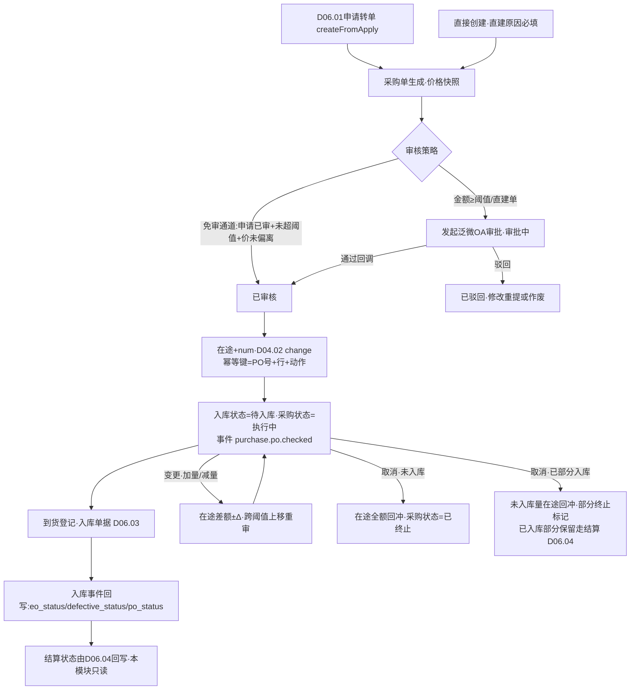
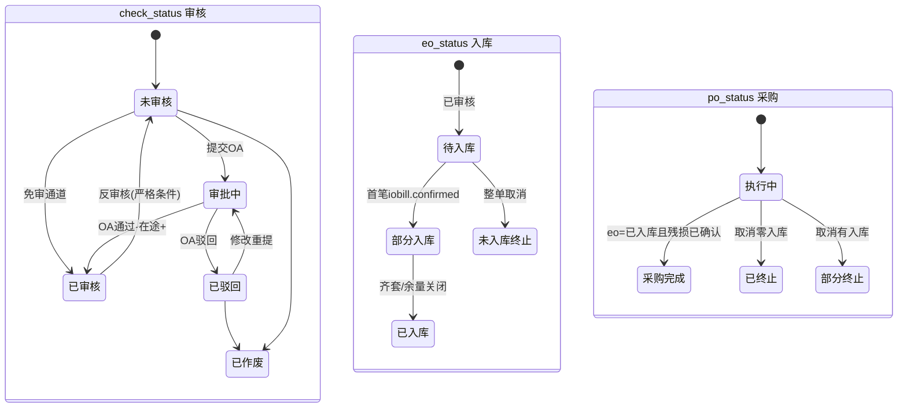
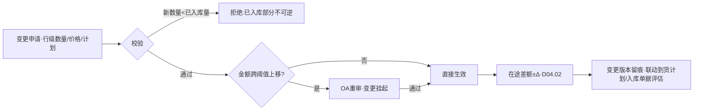

# SRS-D06.02 采购订单管理模块 需求规格说明书

> 文档编号：SRS-D06.02 · 版本 V1.0 · 2026-10-24 · 编写：小凯 · 状态：待审阅（批次④）
> 所属域：D06 采购域 · 分期：**P0（M3）** · 独立 schema：`oms_purchase`
> 上游依据：SRS-D06.01（申请转单契约 IF-D06.01-D2 → 本模块 `PurchaseOrderService::createFromApply`）· SRS-D04.02（**在途口径契约：采购审核+arrive_store、入库确认-arrive_store，FR-02b 表；记账入口 IF-D04.02-01 `StockLedgerService::change`**）· SRS-D04.07（**含税口径 §5.3 全局配置、价外费用分摊字段约定**）· SRS-D04.04（采购入库单据类型、结算状态字段 settle_status/settle_bn）· SRS-D10.05（OA 审批集成）· 逆向文档 04 §2.2（**商派采购单 5 组状态字段：check_status/eo_status/po_status/statement/defective_status + sync_status**）
>
> **全局决策（本模块承载）**：① 采购单审批在泛微 OA 完成（超金额阈值必审；阈值配置见 FR-02），OMS 消费回调驱动审核状态——**审核通过即在途 +**（D04.02 契约时点）；② **5 状态分离设计保留**（商派验证过的易扩展模型）：审核状态/入库状态/采购状态/结算状态/残损状态各自独立字段；**WMS 同步状态独立到集成层字段**（sync_status 不属业务状态机，由 D09.03 指令状态投影回写）；③ 采购价含税口径与 D04.07 §5.3 全局配置一致（一处配置全域生效）。

---

## 1. 模块概述

### 1.1 定位

采购域的执行单据中心：采购单（PO）是与供应商的采购契约在 OMS 内的唯一载体，承载「审核→在途→到货→入库→结算」全链路状态，向上承接采购申请（D06.01），向下驱动到货登记与入库单据（D06.03 → D04.04 → D09.03），横向供给应付挂账与对账（D06.04）、入库计价（D04.07）。核心设计=**5 状态分离模型**（§4.2）：五个独立状态字段各管一段生命周期，替代单一大状态机——商派 38 表 purchase 域验证过的设计（逆向文档 04 §2.2），易扩展、易排查、各状态消费方解耦。

### 1.2 职责边界

**做**：采购单生成（申请转/直接创建）、5 状态模型定义与流转编排、审核联动（在途记账触发、付款策略标记）、采购单变更（加量/减量/取消）、采购价管理（含税口径/价外费用分摊字段/价格快照）、到货计划（分批到货登记入口）、采购单打印与导出、OA 审批发起与回调消费（超阈值）、供应商协同通知（P2 预留）。

**不做**：采购申请与供应商/供货关系档案（→ D06.01，本模块消费其供货关系取价）；到货登记作业与入库单据执行（→ D06.03）；出入库单据生命周期与记账模板（→ D04.04）；WMS 通道与指令状态（→ D09.03，本模块只消费其事件回写 sync 投影）；应付挂账/台账/发票（→ D06.04）；入库计价与暂估（→ D04.07）；OA 通道机制（→ D10.05）。

### 1.3 与其他模块关系

| 模块 | 关系 |
|---|---|
| D06.01 采购申请 | `createFromApply(applyRefs[])` 转单入口（合并规则其 §5.3）；供货关系取默认价/提前期；行级追溯回写 |
| D04.02 记账 | **审核通过→在途 +（采购数量）**；变更/取消→在途差额调整；均经 `StockLedgerService::change(三元键, arrive_store, ±N, 单据引用)`，幂等键=采购单号+行+动作 |
| D06.03 到货入库 | 采购单→到货登记→入库单据（D04.04 类型=采购入库）；入库事件回写 eo_status/defective_status/po_status |
| D04.04 单据中心 | 采购入库单据源单=采购单；单据 settle_status 与本模块结算状态（statement）联动（D06.04 回写） |
| D04.07 成本 | 采购价（含税口径 §5.3）为入库计价 priceIn 的价源；价外费用分摊字段随入库单据行传递 |
| D06.04 对账 | 现购/赊购标记（po_type）决定应付挂账策略；采购单结算状态由其回写 |
| D09.03 入库指令 | 事件 `wms.inbound.confirmed`/`push.failed` 回写 sync 投影字段 |
| D10.05 审批 | 采购单超阈值审批（发起/回调，同 D06.01 FR-02 机制） |
| D10.06 审计 | 变更/取消/价格修改字段级留痕 |

---

## 2. 业务场景

**SC-D06.02-01 申请转采购单（主流程）**
采购申请 PR20261024001（已通过 OA 审批）转单：本模块生成采购单 PO20261024001（货主=凯淳买断、供应商 S1、华东仓、bm_1002×500@含税价 12 元、价外运费预估 200 元分摊标记=按金额）。金额 6000+200=6200 ≤ 阈值（如 5 万）→ 免二次审批直接生效？——**否**：采购单审批策略配置为「申请已审批的转单免审」（FR-02c 免审通道），审核状态直接=已审核：触发在途 +500（D04.02），入库状态=待入库，采购状态=执行中。后续到货入库联动（D06.03）。

**SC-D06.02-02 直接创建采购单（超阈值 OA 审批）**
紧急补采：采购主管直接建单（不经申请，来源=直接创建，需填直建原因），bm_1005×2000@30 元=6 万 > 阈值 5 万 → 提交发起泛微 OA 审批（审批类型=采购单，表单含金额/供应商/比价说明附件）；审批中采购单锁定、**不记在途**；OA 通过回调→审核状态=已审核→在途 +2000。驳回→审核状态=已驳回，可改后重提或作废。

**SC-D06.02-03 采购单变更（加量/减量）**
供应商产能受限通知只能供 400（原 500）：采购员发起减量变更 500→400。校验：已入库 0 → 允许；在途差额调整 -100（D04.02 change 反向）；变更留痕（旧值/新值/原因/操作人）；变更后金额若跨过审批阈值上移→需重新走 OA 审批（下移不重审）。若已入库 300：减量目标不得低于已入库量（300），减量至 350 允许（在途-150），减至 250 拒绝（已入库部分不可逆）。加量同理：在途+差额，跨阈值上移重审。

**SC-D06.02-04 采购单取消**
需求消失取消整单：未入库→全部在途释放（在途-500）、采购状态=已终止；已部分入库 200→取消仅对未入库 300 生效（在途-300），已入库部分保留继续走结算（**已入库部分不可逆**），采购状态=部分终止（po_status 保留执行痕迹，终止标记独立字段）。若入库单据已下发 WMS（D09.03）→取消联动下发取消报文（其 SC-07 通道），WMS 已收货拒绝取消→照单收货路径，采购单恢复执行。

**SC-D06.02-05 分批到货计划**
PO 500 件约定分两批（300+200，间隔一周）：到货计划行登记批次安排（计划到货日/计划数量），D06.03 到货登记按计划批次核销采购单行（其分批核销逻辑）；计划可调整（供应商延期→改计划到货日，留痕）；计划全部核销或人工关闭余量后采购单入库状态收口。

**SC-D06.02-06 价外费用分摊**
采购运费 200 元、装卸费 50 元录入采购单价外费用区：分摊方式=按金额占比（多行物料按行金额比例摊入单价，尾差入最后一行）；分摊结果在入库确认时随单据行传 D04.07 priceIn 计入存货成本（其 §5.3 契约：价外费用分摊入单价）；费用修改在入库前允许（重摊），已入库行锁定。

**SC-D06.02-07 采购单打印与供应商通知（P2 预留协同）**
采购单确认后打印 PDF（模板：公司抬头/供应商/明细/价格/交货条款/签章位）导出发送供应商；P2 预留：供应商门户（在线确认接单/回传发货计划）与邮件自动通知（D01.07 通道），本期人工线下传递，单据状态不依赖供应商回执（接单确认标记为可选人工字段）。

---

## 3. 功能需求

### FR-D06.02-01 采购单生成
- FR-01a 生成通道：① 申请转单 `PurchaseOrderService::createFromApply(applyRefs[])`（D06.01 IF-07 契约，合并规则其 §5.3，行级追溯回写）；② 直接创建（表单，直建原因必填，权限=采购主管及以上）；③ 复制创建（历史单复制，价格按当前供货关系刷新提示）。
- FR-01b 单号规则：`PO{YYYYMMDD}{5位序列}` 全局唯一；变更不产生新单号（变更版本留痕）。
- FR-01c 头字段：供应商（映射有效校验）、货主 owner_id（必填，继承申请或直建时校验=凯淳买断，D06.01 §5.1 同款守卫）、收货仓 branch_id（一单一仓）、币种（默认 CNY，多币种预留）、po_type（**现购 cash/赊购 credit**，取供应商档案默认，决定 D06.04 挂账策略）、紧急标记、直建原因/关联申请号。
- FR-01d 行字段：bm_id、采购数量 num、含税单价 price（口径=D04.07 §5.3 全局配置）、税率 tax_rate、行金额 amount、价外费用分摊额 extra_fee_share（FR-06）、期望到货日、已入库数 in_num/已退货数 out_num（D06.03 回写）、行状态。
- FR-01e 价格带出：默认取供货关系当前有效价（D06.01 IF-03，含 price_version_id 引用），可人工调整（调价原因必填，偏离默认价 ±N% 超阈值提示+需附件比价说明）；价格快照固化到行（后续供货价变更不影响本单）。

### FR-D06.02-02 审核与 OA 审批
- FR-02a 审核状态流转由 OA 回调驱动（同 D06.01 FR-02 机制，幂等口径其 §5.5）：提交→审批中→已审核/已驳回。
- FR-02b 审批阈值策略（可配置，按货主/供应商/单据类型）：金额 ≥ 阈值（默认 5 万）必审；直建单不论金额必审（无申请审批背书）。
- FR-02c 免审通道：来源=申请转单且申请已过 OA 审批、金额未超采购单独立阈值、价格未偏离申请参考价 → 自动置已审核（策略开关，默认开；关闭则全部走 OA）。
- FR-02d **审核通过动作（原子事务）**：① 审核状态=已审核（记 check_time/check_operator=OA 终审人或系统）；② 逐行调 `StockLedgerService::change(三元键, arrive_store, +num, {bill_type:采购单, bill_bn:PO号, item_id}, action=采购审核)`——在途记账（D04.02 FR-02b 契约时点），幂等键防重；③ 入库状态=待入库、采购状态=执行中；④ 发布事件 `purchase.po.checked`。
- FR-02e 反审核：已审核未入库未下发的采购单允许反审核（在途全额回冲、审核状态回退、OA 重审）；已有任何入库/下发记录禁止反审核（走变更/取消通道）。反审核需超阈值审批（D10.05）+双人复核。

### FR-D06.02-03 5 状态分离模型（本模块=模型唯一定义源）
- FR-03a 五个独立业务状态字段+WMS 同步投影字段，枚举与流转详见 §4.2/§4.3；任何消费方只读所需状态字段，禁止组合推导「隐式大状态」。
- FR-03b 状态回写权归属：审核状态=本模块（OA 回调）；入库状态/残损状态=本模块消费 D04.04 `iobill.confirmed`/D09.03 `wms.inbound.diff` 事件编排回写；采购状态=本模块（终态编排）；结算状态=D06.04 回写（本模块只读展示）；sync_status=D09.03 指令事件投影（集成层字段，不入业务状态机）。
- FR-03c 状态变更全部留痕（字段/旧值/新值/触发来源/时间，D10.06 字段级审计）。

### FR-D06.02-04 采购单变更
- FR-04a 变更类型：加量/减量（行级数量）、价格调整（入库前）、到货计划调整、头信息修改（收货仓不可改——改仓=取消重建）。
- FR-04b 数量变更校验：`新数量 ≥ in_num + out_num调整量`（**已入库部分不可逆**，减量不得低于已入库+已退供在途占用）；差额在途调整（加 +Δ/减 -Δ，同 FR-02d 幂等口径，action=采购变更）。
- FR-04c 变更审批：变更后金额跨阈值**上移**→重新 OA 审批（审批中变更挂起）；下移/阈值内→免审直接生效（策略可配全审）；全部变更留痕（变更单版本链：旧值/新值/原因/操作人）。
- FR-04d 变更联动：已下发未收货的入库单据（D04.04 状态=已下发）→数量下调时联动 D09.03 取消/改量通道评估（WMS 已收货则拒绝下调，人工协调）；到货计划同步调整提示。

### FR-D06.02-05 采购单取消与终止
- FR-05a 整单取消：未入库→在途全额回冲（action=采购取消）、采购状态=已终止、入库状态=未入库（终态）；取消原因必填（字典：需求取消/供应商违约/价格谈崩/重复下单/其他）。
- FR-05b 部分终止：已部分入库→取消仅对未入库量生效（在途-未入库量），已入库部分保留走结算；终止标记=部分终止（po_status 不回退，独立 terminate_flag 记录）。
- FR-05c 取消审批：已审核单取消需 OA 审批（审批类型=采购取消）；草稿/已驳回直接作废。
- FR-05d WMS 联动：入库单据已下发→经 D04.04 撤销/D09.03 取消通道（其 SC-07）；取消被拒（WMS 已收货）→采购单恢复执行+人工差异处理（照单收货入库）。

### FR-D06.02-06 采购价与价外费用管理
- FR-06a 含税口径：全局配置一项（D04.07 §5.3 权威，本模块只消费展示）；行存 price（按口径）+tax_rate+不含税价派生（price_net=price/(1+tax_rate)，4 位小数）。
- FR-06b 价外费用区（头级）：费用行（类型字典：运费/装卸费/保险费/关税/其他，可扩展）、金额、分摊方式（按金额占比/按数量占比）；分摊结果行级 extra_fee_share 字段（尾差入最后一行，2 位小数）；入库确认时随 D04.04 单据行传递，计入 D04.07 priceIn 存货成本（其 §5.3/AC-10 契约）。
- FR-06c 费用修改窗口：任一行入库前可改（自动重摊+留痕）；有入库行后费用区锁定（新费用走 D06.04 对账差异，不改采购单）。
- FR-06d 价格历史联动：入库确认后回写供货关系最近采购价（D06.01 IF-04 `SupplierService::updatePriceHistory`）。

### FR-D06.02-07 到货计划（分批到货）
- FR-07a 计划行：批次序号/计划到货日/计划数量（Σ计划数量 ≤ 采购数量，允许余量不排计划=一次性到货默认）；供应商延期改计划留痕。
- FR-07b 核销：D06.03 到货登记按计划批次核销（先到先核或指定批次）；实际到货偏离计划（提前/延后/量差）记偏离标记，供供应商履约统计（准时率/足量率，D11 报表供数）。
- FR-07c 计划收口：全部入库或人工关闭余量（关闭原因）后计划终态；关闭余量同步触发在途差额释放（等同减量变更路径）。

### FR-D06.02-08 打印与导出
- FR-08a 采购单打印模板（PDF）：公司抬头/供应商信息/明细（物料/数量/单价/金额）/价外费用/交货条款/签章位；模板可配置（D01.04 元数据）。
- FR-08b 台账导出（D01.06）：多维筛选导出 Excel（含 5 状态列）。

### FR-D06.02-09 供应商协同（P2 预留）
- FR-09a 本期：打印/导出人工传递；接单确认=可选人工标记字段（供应商线下回签后人工勾选，不阻塞任何流程）。
- FR-09b P2 预留：供应商门户（在线接单确认/发货计划回传/对账单确认——D06.04 同源预留）+ 邮件/短信自动通知（D01.07）；数据模型预留协同状态字段与门户租户接入位（D10.02 外部租户），本期不实现。

---

## 4. 业务流程

### 4.1 采购单主流程



### 4.2 5 状态分离模型（枚举与流转定义——本模块为唯一定义源）

**① check_status 审核状态**（本模块写，OA 回调驱动）

| 枚举 | 含义 | 进入条件 | 离开条件 |
|---|---|---|---|
| 1 未审核（草稿） | 建单/转单初始态 | createFromApply/直接创建 | 提交审批或免审通过 |
| 2 审批中 | OA 流程在途 | 提交（超阈值/直建/免审关闭） | 回调通过/驳回/撤回 |
| 3 已审核 | 生效，在途已记 | 免审通道/OA 通过回调 | 反审核（严格条件 FR-02e） |
| 4 已驳回 | OA 驳回 | 驳回回调 | 修改重提→2 / 作废 |
| 5 已作废 | 终态 | 草稿作废/驳回后作废 | — |

**② eo_status 入库状态**（本模块消费 D04.04/D09.03 事件编排回写）

| 枚举 | 含义 | 进入条件 |
|---|---|---|
| 0 不适用 | 未审核单初始 | 建单默认 |
| 1 待入库 | 已审核未收货 | check_status=3 |
| 2 部分入库 | Σin_num < num（含分批在收） | 首笔 iobill.confirmed 后行汇总 |
| 3 已入库 | Σin_num(+短缺核销量) ≥ num | 末笔入库确认/余量人工关闭 |
| 4 未入库（终止） | 取消且零入库 | FR-05a 取消 |

**③ po_status 采购状态**（本模块终态编排，业务生命周期）

| 枚举 | 含义 | 进入条件 |
|---|---|---|
| 1 执行中 | 已审核进行中 | check_status=3 |
| 2 采购完成 | 全部入库且残损已确认 | eo_status=3 且 defective_status∈{0,2} |
| 3 已终止 | 整单取消零入库 | FR-05a |
| 4 部分终止 | 取消时已部分入库（terminate_flag 伴生） | FR-05b |
| 5 采购退货 | 入库后发生退供且全退（D06.03 退供联动，P1） | 退供单全量核销 |

**④ statement 结算状态**（D06.04 回写，本模块只读；枚举与 D04.04 settle_status 对齐映射）

| 枚举 | 含义 | 回写方 |
|---|---|---|
| 1 未结算 | 默认 | 建单初始 |
| 2 部分结算 | 部分挂账/付款核销 | D06.04（现购付款核销/赊购逐入库挂账进度） |
| 3 已结算 | 挂账与付款全闭环 | D06.04 |
| 4 拒绝结算 | 差异冻结（对账争议） | D06.04 差异流程 |

**⑤ defective_status 残损状态**（D06.03 残损处理回写，见其残损分流定义）

| 枚举 | 含义 |
|---|---|
| 0 无需确认 | 无残损 |
| 1 待确认 | 入库回传有残损，待残损处理决策（拒收/让步/索赔） |
| 2 已确认 | 残损处理闭环 |

**⑥ sync_status WMS 同步状态**（集成层投影字段，非业务状态机——全局决策②）

| 枚举 | 含义 | 回写源 |
|---|---|---|
| 1 无需同步 | 未下发（未审核/本地仓免推配置） | 默认 |
| 2 已下发 | 入库单据 dispatch 成功 | D09.03 指令事件 |
| 3 推送失败 | 下发终态失败 | `wms.inbound.push.failed` |
| 4 已取消同步 | 取消报文闭环 | `wms.inbound.cancel.succ` |



> 5 状态关系：check 是总闸（未审核其余无意义）；eo 由入库事件驱动；po 是 eo+defective 的终态编排（但不做隐式推导，独立字段显式置位）；statement 独立于货流（钱的状态，D06.04 权威）；defective 独立于 eo（残损是入库的旁路分支）；sync 独立投影（WMS 通道健康度不污染业务状态）。

### 4.3 变更流程



---

## 5. 处理逻辑

### 5.1 在途记账联动（D04.02 契约实现）

```
审核通过/变更/取消 → StockLedgerService::change(
    三元键 = (branch_id, bm_id, owner_id),   # 采购单行取货主=头owner
    口径 = arrive_store,
    数量 = +num(审核) / ±Δ(变更) / -未入库量(取消),
    单据引用 = {bill_type: 采购单, bill_bn: po_bn, bill_item_id: item_id},
    action = 采购审核/采购变更/采购取消 )
幂等键 = (bill_type, bill_item_id, action+变更版本号)  # D04.02 §6.2 契约
失败处理: 记账失败→审核动作整体回滚(同事务)+告警;不允许"已审核但无在途"中间态
入库确认时: 在途- 由 D04.04 confirm 模板执行(实际+/在途-,其 §5.1),本模块只消费事件回写 eo_status
```

### 5.2 eo_status/po_status 汇总算法（事件驱动）

```
onEvent(iobill.confirmed | wms.inbound.diff | 残损处理闭环):
    行级: in_num = Σ该采购行关联入库单据行 confirmed_num(良品+让步接收量)
          短缺核销量 = 差异登记闭环为"短缺不补"的量(D06.03)
    头级: if Σ(in_num+短缺核销量) ≥ Σnum → eo_status=3 已入库
          elif Σin_num > 0 → eo_status=2 部分入库
    终态: if eo_status=3 and defective_status ∈ {0,2} → po_status=2 采购完成
    全程幂等: 事件重放重算汇总(以单据行累计为准,不增量累加)
```

### 5.3 价格与金额计算

```
行金额 amount = price × num                        # price 口径=D04.07 §5.3 全局配置(含税/不含税一处定义)
不含税派生 price_net = price / (1 + tax_rate)        # 4位小数
价外分摊 extra_fee_share(行) = 费用总额 × (行金额/Σ行金额)   # 按金额占比;按数量占比同理;尾差入最后一行
行入库成本价 = price + extra_fee_share/num           # 传 D04.07 priceIn(其 §5.3 价外费用分摊入单价契约)
头总额 = Σamount + Σ价外费用
审批阈值比对基数 = 头总额
```

### 5.4 免审通道判定（FR-02c）

```
autoCheck = 来源=申请转单
         && 申请审批结果=通过(OA回调已消费)
         && 头总额 < 采购单独立阈值
         && |行price - 申请ref_price| / ref_price ≤ 偏离容忍度(默认0%)
         && 免审策略开关=开
任一不满足 → 走OA审批(审批中);判定过程留痕(免审依据快照)
```

### 5.5 变更版本与重审判定

```
变更生效前比对: 原头总额 vs 变更后头总额
- 原<阈值 且 新≥阈值 → 重审(OA,审批中变更挂起,在途差额待审批通过后记账)
- 原≥阈值 且 新<阈值 → 不重审(已背书更高金额)
- 同侧 → 按策略(默认免审)
变更版本链: po_change_log(版本号/字段/旧值/新值/原因/操作人/审批引用)
```

---

## 6. 数据字段（业务字段描述）

### 6.1 采购单主表（purchase_order）

| 字段 | 业务含义 | 取值/校验 |
|---|---|---|
| po_bn | 采购单号 | `PO{YYYYMMDD}{5位}` 唯一 |
| supplier_id | 供应商 | 必填，映射有效（D06.01） |
| owner_id | 货主 | 必填=凯淳买断（守卫同 D06.01 §5.1） |
| branch_id | 收货仓 | 必填，一单一仓 |
| source_type / apply_bn | 来源（申请转/直建/复制）/关联申请 | 直建需直建原因 |
| po_type | 付款类型 | cash 现购/credit 赊购（D06.04 挂账策略依据） |
| currency | 币种 | 默认 CNY（多币种 P2 预留） |
| check_status | 审核状态 | §4.2① |
| eo_status | 入库状态 | §4.2② |
| po_status | 采购状态 | §4.2③ |
| statement | 结算状态 | §4.2④（D06.04 回写，本模块只读） |
| defective_status | 残损状态 | §4.2⑤（D06.03 回写） |
| sync_status | WMS 同步状态 | §4.2⑥（集成投影，D09.03 回写） |
| terminate_flag | 部分终止标记 | FR-05b |
| total_amount / total_extra_fee | 商品总额/价外费用总额 | §5.3 |
| check_time / check_operator | 审核时间/审核人 | OA 终审人或「系统免审」 |
| oa_instance_id / oa_link | OA 流程实例/链接 | 审批场景 |
| emergency / supplier_confirm_flag | 紧急标记/供应商接单确认（人工可选） | FR-09a |
| buyer / create_time / memo / attachment | 采购员/创建/备注/附件 | |
| tenant_id | 租户 | 必填 |

### 6.2 采购单明细（purchase_order_item）

| 字段 | 业务含义 | 取值/校验 |
|---|---|---|
| po_id / item_id | 主表/行 ID | |
| bm_id | 基础物料 | 货主归属一致校验 |
| num | 采购数量 | >0；变更后=最新有效数量 |
| price / tax_rate / price_net | 含税单价（口径 D04.07 §5.3）/税率/不含税派生 | 价格快照+price_version_id 引用 |
| amount | 行金额 | §5.3 |
| extra_fee_share | 价外费用分摊额 | FR-06b |
| in_num / out_num | 已入库数/已退供数 | D06.03 回写（事件重算，§5.2） |
| shortage_num | 短缺核销量 | 差异闭环「短缺不补」量（D06.03） |
| expect_arrive_date | 期望到货日 | |
| apply_item_id | 来源申请行 | 追溯链（申请转单行必填） |
| item_status | 行状态 | 待入库/部分入库/完成入库/已关闭 |

### 6.3 价外费用（purchase_order_fee）

| 字段 | 业务含义 |
|---|---|
| po_id / fee_type / fee_amount | 费用类型（运费/装卸/保险/关税/其他）/金额 |
| alloc_type | 分摊方式（按金额占比/按数量占比） |
| alloc_snapshot | 分摊结果快照（行级份额 JSON，重摊覆盖留版本） |

### 6.4 到货计划（purchase_arrival_plan）

| 字段 | 业务含义 |
|---|---|
| po_id / item_id / batch_seq | 计划归属与批次序号 |
| plan_date / plan_num | 计划到货日/计划数量（Σ≤行数量） |
| arrived_num / deviation_flag | 已核销数量/偏离标记（D06.03 回写） |
| status | 待到货/部分核销/已核销/已关闭 |

### 6.5 变更日志（po_change_log）

| 字段 | 业务含义 |
|---|---|
| po_id / change_version | 变更版本号（递增） |
| change_type / field / old_value / new_value | 变更类型（数量/价格/费用/计划/头信息）与字段级旧新值 |
| reason / operator / oa_instance_id | 原因（必填）/操作人/重审引用 |
| arrive_adjust_num | 在途差额调整量（±Δ，记账幂等键成分） |

---

## 7. 接口

### 7.1 内部接口（本模块提供）

| 编号 | 接口 | 消费方 | 说明 |
|---|---|---|---|
| IF-D06.02-01 | `PurchaseOrderService::create(data)` | 工作台/复制 | 直接创建（守卫+校验） |
| IF-D06.02-02 | `PurchaseOrderService::createFromApply(applyRefs[])` | D06.01（其 IF-D06.01-D2） | 申请转采购单（合并规则 D06.01 §5.3），返回单号+行映射 |
| IF-D06.02-03 | `PurchaseOrderService::getOrder(poBn)` / `queryOrders(filters)` | D06.03/D06.04/工作台 | 详情（含 5 状态）与台账查询 |
| IF-D06.02-04 | `PurchaseOrderService::change(poBn, changes[], reason)` | 工作台 | 变更（校验+在途差额+重审判定 §5.5） |
| IF-D06.02-05 | `PurchaseOrderService::cancel(poBn, reason, scope)` | 工作台/D06.03 | 取消/部分终止（在途回冲+WMS 取消联动） |
| IF-D06.02-06 | `PurchaseOrderService::writeBackStatus(poBn, 状态字段, 值, 来源)` | D06.03（eo/defective）/D06.04（statement）/D09.03（sync） | 状态回写唯一入口（归属校验 FR-03b+留痕） |
| IF-D06.02-07 | 事件 `purchase.po.checked`（po_bn/owner/supplier/行摘要/在途记账回执） | D06.03/D04.10（在途解除预警）/D11 | 审核生效广播 |
| IF-D06.02-08 | 事件 `purchase.po.cancelled` / `purchase.po.completed` | D06.03/D06.04/D11 | 终止与完成广播 |

### 7.2 依赖接口（本模块消费）

| 编号 | 接口 | 提供方 | 说明 |
|---|---|---|---|
| IF-D06.02-D1 | `StockLedgerService::change(三元键, arrive_store, ±N, 引用, action)` | D04.02（IF-D04.02-01） | 在途记账（审核+/变更±/取消-），幂等键 §5.1 |
| IF-D06.02-D2 | `SupplierService::getSupplier` / `getSupplyRelation` / `updatePriceHistory` | D06.01（IF-D06.01-03/04） | 供应商映射/供货价带出/入库后价格回写 |
| IF-D06.02-D3 | 事件 `iobill.confirmed` 订阅 | D04.04（IF-D04.04-07） | 入库确认→eo_status/po_status 汇总（§5.2） |
| IF-D06.02-D4 | 事件 `wms.inbound.confirmed` / `wms.inbound.diff` / `wms.inbound.push.failed` / `wms.inbound.cancel.succ` 订阅 | D09.03（IF-D09.03-04/05） | sync 投影+差异数据 |
| IF-D06.02-D5 | OA 审批发起/回调（审批类型=采购单/采购取消/反审核） | D10.05 | 超阈值审批（机制同 D06.01 FR-02） |
| IF-D06.02-D6 | `MaterialService::getProfile(bmId)` | D04.01（IF-D04.01-04） | 物料校验 |
| IF-D06.02-D7 | 导出任务 | D01.06 | 台账导出 |
| IF-D06.02-D8 | 字段级审计 | D10.06 | 状态/变更留痕 |

### 7.3 外部接口

| 编号 | 接口 | 方向 | 说明 |
|---|---|---|---|
| EF-D06.02-01 | 泛微 OA 审批（经 D10.05） | 双向 | 采购单/取消/反审核审批 |
| EF-D06.02-02 | 供应商门户/邮件通知（经 D01.07） | 出 | **P2 预留**（FR-09b），本期打印/导出人工传递 |

---

## 8. 非功能需求

| 项 | 要求 |
|---|---|
| 性能 | 建单/转单 ≤300ms（50 行）；审核事务（含逐行在途记账）≤1s（100 行）；台账查询 P95 ≤500ms |
| 幂等/一致性 | 在途记账幂等键防重（§5.1）；审核动作与记账同事务，不允许「已审核无在途」中间态；状态回写事件重放安全（汇总重算式 §5.2） |
| 并发 | 同一采购单变更/取消/入库回写并发时行级乐观锁+状态防护（非法态迁移拒绝并告警） |
| 安全/权限 | 供货价/总额角色级可见（采购/财务/主管）；货主行级隔离（D10.03）；直建/反审核/取消高权限动作+D10.06 审计 |
| 容量 | 采购单日均 ≤200 张、行 ≤2000，3 年在线无分表压力；变更日志随单归档 |

---

## 9. 验收标准

| 编号 | 验收条件 |
|---|---|
| AC-01 | SC-01 申请转单：createFromApply 生成采购单（价格快照+行级 apply_item_id 追溯），免审通道判定正确（申请已审+未超阈值+价未偏离→自动已审核），在途 +500 记账流水可查（幂等键=PO号+行+采购审核） |
| AC-02 | SC-02 超阈值直建单走 OA：审批中不记在途、单据锁定；通过回调→已审核+在途 +2000；驳回→可改重提（新实例留痕） |
| AC-03 | 审核事务原子性：模拟在途记账失败（如三元行停用），审核整体回滚，采购单停留审批通过前状态+告警，无「已审核无在途」中间态 |
| AC-04 | SC-03 变更：减量 500→400 在途 -100 流水正确；已入库 300 时减至 250 被拒绝（已入库部分不可逆）；变更后金额跨阈值上移触发 OA 重审、下移不重审（§5.5 三分支全覆盖） |
| AC-05 | SC-04 取消：未入库整单取消在途全额回冲+po_status=已终止；已入库 200 取消→仅未入库 300 回冲+terminate_flag=部分终止，已入库部分结算链路不受影响 |
| AC-06 | 取消 WMS 联动：入库单据已下发时取消触发 D09.03 取消通道；WMS 拒绝取消（已收货）→采购单恢复执行+人工差异工单 |
| AC-07 | 5 状态独立性：入库事件只改 eo/defective、结算回写只改 statement、sync 投影只随 D09.03 事件变化——任一状态变更不污染其他字段；全部变更留痕（旧值/新值/来源） |
| AC-08 | 状态汇总幂等：同一 iobill.confirmed 事件重复投递，eo_status/po_status 汇总重算结果一致（重算式非增量式验证） |
| AC-09 | SC-06 价外费用：运费 200+装卸 50 按金额占比分摊，尾差入最后一行（分摊合计=费用总额，分级校验）；入库前修改费用自动重摊留版本；有入库行后费用区锁定 |
| AC-10 | 价格口径：行 price 含税口径与 D04.07 §5.3 全局配置一致；行入库成本价=price+分摊/num 随单据行传 priceIn；入库确认后供货关系最近采购价回写（D06.01 IF-04） |
| AC-11 | SC-05 分批到货计划：300+200 两批计划核销正确；实际偏离记 deviation_flag；计划余量人工关闭同步释放在途 |
| AC-12 | 反审核严格条件：已下发/已入库单反审核被拒；允许场景反审核在途全额回冲+OA 重审+双人复核留痕 |
| AC-13 | 货主守卫：直建单选代销货主被拒（OWNER_NOT_BUYOUT）；采购单打印 PDF 模板字段完整可下载 |
| AC-14 | po_status=采购完成 判定：全部入库**且残损已确认**（defective_status=2）才置完成——有残损待确认（=1）时停留执行中（§4.2③ 条件验证） |

---

## 变更记录

| 日期 | 版本 | 变更 | 原因 |
|---|---|---|---|
| 2026-10-24 | V1.0 | 首版 | — |

---

*参考实现溯源：商派 purchase.po（5 组状态字段 check_status/eo_status/po_status/statement/defective_status + sync_status，逆向文档 04 §2.2）+ po_items（num/in_num/out_num/purchasing_price/defective_num）+ do_check 审核四动作（在途累加 updateBranchProductArriveStore/按 po_type 生成付款单/状态更新/独立工作队列）+ po_type cash/credit 分叉 + po_species（正常/补货单）+ deposit 预付款字段族 + uncheck 空实现（未完成功能）。关键差异：① 5 状态分离模型**保留**并显式定义为唯一定义源（各状态回写权归属+禁止隐式推导——商派散落各 lib 回写）；② WMS 同步状态独立为集成层投影字段（商派 sync_status 混在业务表，全局决策）；③ 审批外置泛微 OA+免审通道策略（商派 do_check 内置人工审核）；④ 反审核从空实现补全为严格条件通道（在途回冲+重审+双人复核）；⑤ 变更管理产品化（版本链+跨阈值重审判定+已入库不可逆校验——商派无变更单概念靠改单）；⑥ 价外费用分摊字段化并与 D04.07 成本口径闭环（商派 delivery_cost 只入应付不入存货成本分摊）；⑦ 货主维度必填守卫（商派无货主）；⑧ 预付款 deposit 迁移至 D06.04 付款核销域（本单不承载资金字段）；⑨ 供应商协同 P2 预留（商派无门户）。*
