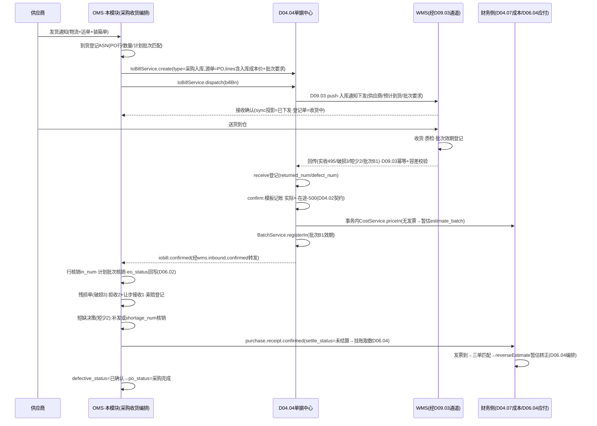
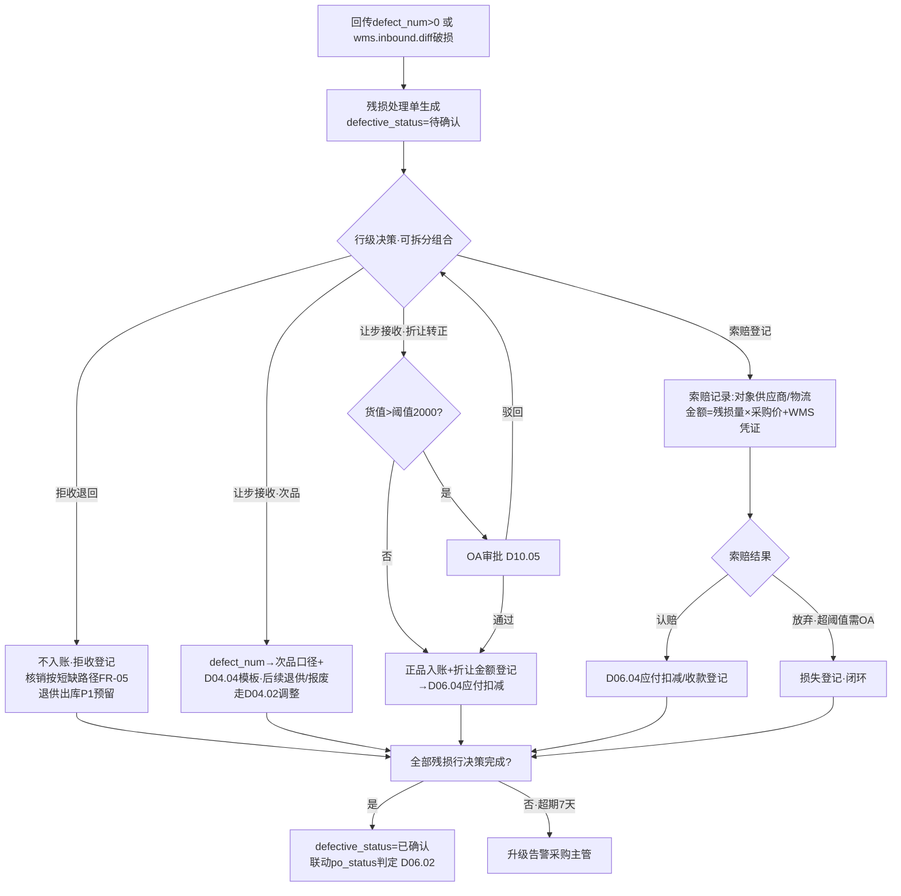

# SRS-D06.03 到货与入库模块 需求规格说明书

> 文档编号：SRS-D06.03 · 版本 V1.0 · 2026-10-24 · 编写：小凯 · 状态：待审阅（批次④）
> 所属域：D06 采购域 · 分期：**P0（M3）** · 独立 schema：`oms_purchase`
> 上游依据：SRS-D04.04（**核心契约：`IoBillService::create(type, 源单引用, lines[])`（IF-D04.04-01，类型=采购入库）/ `dispatch(billBn)`（IF-D04.04-02）/ `receive(billBn, wmsBatch, lines[])`（IF-D04.04-03）/ `confirm(billBn)`（IF-D04.04-04）/ 事件 `iobill.confirmed`（IF-D04.04-07）；结算字段 settle_status/settle_bn；容差权威=其 §5.1 类型级配置**）· SRS-D04.02（**在途口径契约：采购审核 +arrive_store、入库确认 -arrive_store+store，FR-02b 表**）· SRS-D04.07（**入库计价 `CostService::priceIn(billItem)`（IF-D04.07-01）；无发票=暂估标记 estimate_flag/estimate_batch，发票到=`reverseEstimate(invoiceRef)`（IF-D04.07-03）**）· SRS-D09.03（**采购入库下发 WMS 与回传：`InboundCommandService::push`（IF-D09.03-01）、事件 `wms.inbound.callback/confirmed/diff/cancel.succ`（IF-D09.03-03/04/05）、confirm 触发时机类型级可配（其 §5.3：采购入库默认齐套确认，可配分批确认）**）· SRS-D04.09（批次登记 `BatchService::registerIn(billItem, batchDetails[])`（IF-D04.09-01））· SRS-D06.02（5 状态模型 §4.2、状态回写 `PurchaseOrderService::writeBackStatus`（IF-D06.02-06）、到货计划 FR-07）· 逆向文档 04 §2.4（商派 save_eo：入库单 eo+eo_items、在途扣减、po_items.in_num 累加、供应商价格历史 branch_product_batch、残损 defective_num）
>
> **全局决策（本模块承载）**：① 入库记账**不自建**——统一走 D04.04 单据中心（create→dispatch→receive→confirm），本模块是采购业务规则的编排方与残损/差异的决策方；② 在途转实际的口径时点以 D04.02 契约为准：审核 +（D06.02 执行）、入库确认 -+实际（D04.04 confirm 模板执行），本模块只消费事件回写采购单状态；③ 残损数量三分流（拒收退回/让步接收/索赔登记）为采购域专属业务规则，记账动作仍映射到 D04.04 模板字段（defect_num/confirmed_num）。

---

## 1. 模块概述

### 1.1 定位

采购执行的「收货段」：从供应商送货到货开始，编排「到货登记→入库单据生成（D04.04）→推 WMS（D09.03）→回传处理（实收/质检/批次效期）→在途转实际→残损与差异决策→采购单行核销」全链路，是采购单 5 状态中 eo_status/defective_status 的事实来源，也是入库计价（D04.07 priceIn/暂估）与批次登记（D04.09）的业务触发方。商派对应机制：purchase.eo（save_eo 一体化：入库单+扣在途+加库存+价格历史+supplier_goods 自动关联，逆向文档 04 §2.4）——本 SRS 将其拆解为「业务编排（本模块）+单据执行（D04.04）+记账（D04.02）+通道（D09.03）」四层，各层契约化。

### 1.2 职责边界

**做**：到货预约/到货通知登记、入库单据生成编排（调 IoBillService::create，组装采购入库行）、下发触发（dispatch）、回传事件消费与采购单状态回写、**残损处理决策**（拒收退回/让步接收/索赔登记三分流与闭环跟踪）、短缺与超收差异的采购侧处理（索赔/补发/短缺核销决策）、入库计价触发编排（价源传递/暂估标记）、批次效期数据供给（D04.09）、分批到货与采购单行核销、退供出库预留（P1）。

**不做**：出入库单据生命周期/记账模板/容差规则本体/红冲（→ D04.04 权威）；库存口径记账执行（→ D04.02）；WMS 下发通道/报文组装/回传幂等/超时反查（→ D09.03）；成本计算与均价重算（→ D04.07，本模块只传价与触发）；批次台账本体（→ D04.09）；应付挂账（→ D06.04，本模块供给入库确认数据）；采购单状态模型定义（→ D06.02）。

### 1.3 与其他模块关系

| 模块 | 关系 |
|---|---|
| D04.04 单据中心 | **核心契约方**：create（类型=采购入库，源单=PO）→dispatch→receive（D09.03 执行登记）→confirm（模板记账：实际+/在途-）；`iobill.confirmed` 事件回驱本模块 |
| D09.03 入库指令 | 下发与回传通道：`InboundCommandService::push`（dispatch 触发）；订阅 `wms.inbound.callback/confirmed/diff`；差异数据（超收/短缺/破损）透传本模块决策 |
| D04.02 记账 | 在途口径：审核 +（D06.02）、confirm 时 -在途 +实际（D04.04 模板执行）；本模块零直接记账 |
| D04.07 成本 | confirm 事务内 `CostService::priceIn(billItem)`：价源=采购单行 price+extra_fee_share/num（D06.02 §5.3）；无发票→暂估（estimate_flag），发票到→D06.04 触发 `reverseEstimate` |
| D04.09 批次效期 | 回传批次/效期/SN → `BatchService::registerIn` 登记（入库是批次主要产生点） |
| D06.02 采购订单 | 消费到货计划核销；`writeBackStatus` 回写 eo_status/defective_status/sync 投影数据；供货价历史回写触发 |
| D06.04 对账 | 入库确认事件（settle_status=未结算）供赊购按入库挂账取数；差异/索赔结果供对账 |
| D06.01 供货关系 | 入库回写最近采购价/供货关系（IF-D06.01-04） |
| D10.05/D10.06 | 残损让步接收/索赔放弃超阈值审批；决策留痕审计 |

---

## 2. 业务场景

**SC-D06.03-01 到货登记与入库单据生成（主流程）**
PO20261024001（bm_1002×500，华东仓，含税价 12 元，发票未到）供应商 S1 发货后，采购员在 OMS 做到货登记（预计到货日 2026-10-28、承运物流+运单号、装箱清单附件；或供应商邮件/电话通知代录）。到货登记确认→本模块调 `IoBillService::create(type=采购入库, 源单={采购单, PO20261024001}, lines=[{bm_1002, issued_num=500, unit_cost=12+分摊}])` 生成入库单据（草稿）→`IoBillService::dispatch(billBn)` 触发 D09.03 `push` 下发通天晓华东仓（报文含供应商/预计到货时间/批次效期要求）。采购单 sync_status=已下发（投影）。

**SC-D06.03-02 入库回传处理与在途转实际**
WMS 收货质检回传（批次 B1：实收 495、破损 3、短少 2）：D09.03 通道完成幂等/容差校验后调 `receive` 登记（returned_num=495+3 拆分见 SC-04、defect_num=3），齐套判定（495+3+2=500，短缺 2 走差异决策）→`confirm`：D04.04 模板记账（**实际 +（良品确认量）、在途 -500**，D04.02 契约）；confirm 事务内触发 `CostService::priceIn`（无发票→暂估计价，estimate_batch 落暂估批次，D04.07 FR-01b）与 `BatchService::registerIn`（批次 B1 效期登记）。`iobill.confirmed` 事件→本模块回写采购单：eo_status=已入库（汇总 §5.2）、行 in_num 核销、到货计划批次核销、供货价历史回写；结算状态=未结算（单据 settle_status，供 D06.04 月结/挂账取数）。

**SC-D06.03-03 分批到货与行核销**
PO 500 件按到货计划分两批（300+200）：首批到货登记生成第一张入库单据（issued=300）→回传实收 300→confirm（实际+300、在途-300，**分批确认模式**：D09.03 §5.3 采购入库可配分批确认，在途分段释放）→eo_status=部分入库、行 in_num=300；次批 200 同链路→in_num=500→eo_status=已入库。每张入库单据独立对应一次到货登记（一批一单，单据-计划批次-采购行三级核销链）。

**SC-D06.03-04 残损处理三分流**
回传破损 3 件（质检不良原因=运输破损，WMS 凭证照片）：本模块生成残损处理单，采购员决策三分流——① **拒收退回** 2 件：不入账（confirmed_num 不含），生成拒收登记（供应商带回/物流退回，退供出库单据 P1 预留，本期人工线下+登记闭环），采购行核销量按拒收处理（等同短缺决策路径）；② **让步接收** 1 件：轻微瑕疵可售卖→按次品口径入账（defect_num=1→D04.04 模板次品+1），或经审批降级为正品接收（价格折让→登记折让金额，供 D06.04 对账扣款）；③ **索赔登记**：对拒收/让步损失生成索赔记录（索赔对象=供应商/物流，金额=残损量×采购价，关联 WMS 凭证），索赔结果（供应商认赔/物流赔付/放弃）回写并联动 D06.04 应付扣减。让步接收与索赔放弃超阈值（默认货值 2000 元）走 OA 审批（D10.05）。残损全闭环后 defective_status=已确认（D06.02 §4.2⑤）。

**SC-D06.03-05 短缺与超收容差处理**
短缺：实收 495+破损 3=498<500，短少 2。差异决策（字典）：a) 供应商补发→保持 eo_status=部分入库，等补发到货登记（新入库单据，同 PO 行核销）；b) 短缺核销→不再补发，人工核销 shortage_num=2（D06.02 行字段），在途差额随 confirm 模板处理（在途-500 实际+498，差 2 释放在途，D04.04 §5.1 模板决定），采购行视为完成（in_num+shortage_num=num）。超收：容差内（D04.04 类型配置 +5%）实收 510→按实收记账+超收差异登记→采购侧决策：追认（补采购单行/变更加量 D06.02 FR-04）或拒收超出部分；容差外由 D09.03 拒绝超限+差异挂起，本模块消费 `wms.inbound.diff` 走人工决策（同拒收路径）。

**SC-D06.03-06 无单到货（无头件衔接）**
供应商未通知直送到仓，WMS 上报无单到货：D09.03 无主回传队列→转 D04.04 无头件入库流程（暂挂待认领）；本模块提供认领工作台：按供应商+物料匹配在途采购单（模糊匹配候选列表），人工认领→关联 PO 生成正式入库单据（无头件单据红冲/转正按 D04.04 FR-03c 机制）；超期（7 天）未认领升级告警采购主管。

**SC-D06.03-07 到货取消与改期**
供应商通知延期：到货登记改期（计划到货日调整，留痕）；入库单据已下发→经 D09.03 取消通道撤回指令，改期后重新下发（新轮次）；PO 取消场景由 D06.02 FR-05d 联动本模块执行取消编排。

---

## 3. 功能需求

### FR-D06.03-01 到货登记
- FR-01a 登记通道：采购员手工登记（选 PO/行+预计到货日+数量）、供应商发货通知代录（邮件/电话，附件留存）、导入（批量到货，D01.06）；供应商门户在线预约 P2 预留（D06.02 FR-09b 同源）。
- FR-01b 登记单字段：到货登记号（`ASN{YYYYMMDD}{5位}`）、PO 引用（单/多行）、本次到货数量（≤行余额：num-in_num-shortage_num-在途登记量）、预计到货日、承运物流+运单号、装箱清单附件、到货计划批次关联（D06.02 FR-07，自动匹配或人工指定）。
- FR-01c 登记状态机：已登记→已生成入库单据→已下发→收货中（WMS 接收确认）→已回传→已确认（confirm 闭环）/已取消；一登记单一入库单据（1:1），改期/取消走 D09.03 取消通道后可重新登记（新单）。
- FR-01d 超量登记防护：本次到货数量超行余额拒绝（提示走 D06.02 变更加量）；同 PO 行多登记单并存时分批确认模式下在途分段释放（SC-03）。

### FR-D06.03-02 入库单据生成与下发编排
- FR-02a 生成：调 `IoBillService::create(type=采购入库, 源单={bill_type:采购单, bill_bn:po_bn}, lines[])`（IF-D04.04-01）；行组装：bm_id、issued_num=本次到货量、unit_cost=采购行 price+extra_fee_share/num（D06.02 §5.3 入库成本价）、source_item_id=采购行 ID、批次/效期要求（物料档案效期开关=是时必带，D04.01 getProfile）、owner_id/branch_id 继承 PO。
- FR-02b 下发：`IoBillService::dispatch(billBn)`（IF-D04.04-02）触发 D09.03 `push`；下发结果消费 D09.03 事件回写（已下发/推送失败告警人工）。
- FR-02c 撤销：PO 取消/登记取消→经 D04.04 撤销/D09.03 `InboundCommandService::cancel`（IF-D09.03-02）；WMS 已收货拒绝取消→照单收货路径（登记单恢复+人工备注，D09.03 SC-07 口径）。
- FR-02d 编排幂等：登记单→入库单据 1:1 绑定（bill_bn 回填登记单），重复触发防重；create 失败（如物料映射缺失）登记单置异常+告警。

### FR-D06.03-03 入库回传消费与采购单核销
- FR-03a 订阅 `wms.inbound.callback`（收货/质检明细）与 `wms.inbound.confirmed`（记账闭环，转发 iobill.confirmed 载荷）；`receive`/`confirm` 的执行归 D09.03/D04.04，本模块零记账零登记，只做业务核销编排。
- FR-03b 核销回写（消费 confirmed 事件，重算式幂等 D06.02 §5.2）：① 采购行 in_num=Σ良品确认量（confirmed_num-defect_num 中拒收部分另计）；② 到货计划批次核销（arrived_num+deviation_flag）；③ `writeBackStatus` 回写 eo_status（待入库/部分入库/已入库）；④ 全部入库且残损已确认→po_status=采购完成（D06.02 判定）；⑤ 供货价历史回写（D06.01 IF-04：最近采购价/时间）；⑥ 发布 `purchase.receipt.confirmed` 事件（D06.04 挂账取数/D04.10 在途解除预警联动）。
- FR-03c 批次效期供给：回传批次明细→`BatchService::registerIn(billItem, batchDetails[])`（IF-D04.09-01）由 D04.04 confirm 事务编排触发（本模块保证采购行批次要求随 create 传递，登记执行归 D04.04/D04.09 链路）；WMS 不支持批次的降级场景（D09.03 FR-01d）人工补录批次。
- FR-03d 暂估联动：入库单据行携带暂估标记（发票未到，价源=采购价）→confirm 时 D04.07 priceIn 落 estimate_batch（其 FR-01b/§6.2）；发票到达由 D06.04 三单匹配触发 `reverseEstimate(invoiceRef)`（IF-D04.07-03），本模块不介入发票流程。

### FR-D06.03-04 残损处理（三分流）
- FR-04a 残损单生成：回传 defect_num>0 或 `wms.inbound.diff`（破损类型）自动生成残损处理单（残损号/PO 行/入库单据行/残损数量/不良原因字典/WMS 凭证引用）；采购单 defective_status=待确认（D06.02 §4.2⑤）。
- FR-04b 三分流决策（行级可拆分组合）：

| 分流 | 记账映射（D04.04 模板字段） | 采购侧动作 |
|---|---|---|
| 拒收退回 | 不入账（confirmed_num 不含拒收量）；核销按短缺路径（FR-05） | 拒收登记（退回方式/物流），退供出库单据 P1 预留 |
| 让步接收-次品 | defect_num→次品口径+（D04.04 采购入库模板） | 次品后续处置联动 D04.02 次品口径（退供/报废走人工调整） |
| 让步接收-折让转正 | 按正品 confirmed_num 入账 | 折让金额登记（协议价扣减），供 D06.04 应付扣减；超阈值 OA 审批 |
| 索赔登记 | 不影响记账（与分流并行） | 索赔记录（对象=供应商/物流，金额=残损量×采购价，凭证），结果回写联动 D06.04 |

- FR-04c 闭环与状态：全部残损行决策完成+索赔结果登记（或明确放弃）→defective_status=已确认（writeBackStatus）；残损单超期（7 天）未决升级告警；决策全留痕（D10.06）。
- FR-04d 审批：让步接收（货值>阈值）与索赔放弃必走 OA（D10.05，审批类型=采购残损处理）；阈值默认 2000 元可配。

### FR-D06.03-05 短缺与超收处理（采购侧决策）
- FR-05a 短缺决策（消费 `wms.inbound.diff` 短缺类型/confirm 后差额）：补发（保持部分入库，等补发登记）/短缺核销（shortage_num 回写 D06.02 行，视同完成）/索赔（与残损索赔同单机制）；核销需原因+超阈值审批。
- FR-05b 在途差额口径：短缺核销后在途差额处理以 D04.04 §5.1 模板为准（在途-下发量、实际+实收量，差额随模板释放），本模块不自定记账。
- FR-05c 超收决策：容差内超收（D04.04 类型配置）→追认路径（D06.02 变更加量补单，事后审批）或拒收超出（同残损拒收）；容差外由 D09.03 拒绝+差异挂起，本模块人工决策工作台处理（拒收/补单）。
- FR-05d 差异闭环跟踪：差异决策结果回写 D09.03 差异登记（其 FR-05c handle_status 闭环）；差异台账（按供应商统计短缺率/破损率/超收率，供 D06.04 对账与供应商评估）。

### FR-D06.03-06 无单到货认领
- FR-06a 消费 D09.03 无主回传（无单到货）→认领工作台：按供应商+物料+数量模糊匹配候选在途 PO 行（评分排序），人工确认认领。
- FR-06b 认领后：关联 PO 行走 FR-02 正式链路（D04.04 无头件单据转正机制，其 FR-03c）；认领失败（确无采购单）→退回供应商或按 D04.04 无头件规则处理（货主规则）。
- FR-06c 超期升级：7 天未认领告警采购主管（D01.07）。

### FR-D06.03-07 到货看板与统计
- FR-07a 在途到货看板：按 PO/供应商/仓的在途量与预计到货日（D04.02 getBalance 在途只读+到货计划），逾期未到预警（预计到货日+N 天无登记→跟催提醒）。
- FR-07b 供应商履约统计：准时率（实际 vs 计划到货日）/足量率（实收/应收）/破损率/超收率（差异台账聚合），月度报表供 D11 与供应商评估（D06.01 信用等级参考）。

---

## 4. 业务流程

### 4.1 到货入库泳道图（供应商/OMS/WMS/财务）



### 4.2 残损三分流决策流



### 4.3 分批到货核销链

```mermaid
flowchart LR
    A[PO行 num=500] --> B[到货计划批次1:300 批次2:200]
    B --> C[登记单ASN-1 → 入库单据BILL-1 issued=300]
    C --> D[回传实收300 → confirm 实际+300 在途-300]
    D --> E[行in_num=300·计划批次1核销·eo_status=部分入库]
    E --> F[登记单ASN-2 → 入库单据BILL-2 issued=200]
    F --> G[回传实收198短2 → 短缺决策:核销shortage_num=2]
    G --> H[in_num=498+shortage=2=num → eo_status=已入库]
    H --> I[残损确认闭环 → po_status=采购完成]
```



---

## 5. 处理逻辑

### 5.1 入库单据行组装（create 调用契约实现）

```
buildInboundLines(登记单, PO行):
    lines[] = {
        bm_id, owner_id=PO.owner, 
        issued_num = 本次到货量(≤行余额),
        unit_cost = PO行.price + PO行.extra_fee_share/PO行.num,   # D06.02 §5.3 入库成本价(价外分摊入单价,D04.07 §5.3契约)
        estimate_flag = (发票未到 ? true : false),                  # D04.07 暂估标记输入
        batch_required = 物料档案.效期开关(D04.01 getProfile),
        source_item_id = PO行.item_id                               # 追溯链(D04.04 §6.2)
    }
    IoBillService::create(采购入库, {bill_type:采购单, bill_bn:po_bn}, lines)
    → bill_bn 回填登记单(1:1绑定,幂等防重)
```

### 5.2 行核销重算（事件驱动，重算式幂等）

```
onConfirmed(po_bn):    # wms.inbound.confirmed / iobill.confirmed
    for PO行:
        in_num      = Σ关联入库单据行.confirmed_num(正品+让步转正量)     # 以D04.04单据为准重算,非增量
        defect_in   = Σ次品入账量(让步接收-次品)
        shortage    = Σ差异闭环为"短缺核销"的量(FR-05a人工决策回写)
        行余额       = num - in_num - shortage
    eo_status: 行余额全≤0 → 已入库; Σin_num>0 → 部分入库
    计划核销: 登记单关联计划批次.arrived_num += 本次量; 偏离(日期/量)→deviation_flag
    po_status判定移交D06.02(eo=已入库 且 defective∈{0,2} → 采购完成)
```

### 5.3 残损量记账映射（决策→D04.04 模板字段）

```
残损量 R = 回传 defect_num(或diff破损量)
决策拆分: R = 拒收r1 + 让步次品r2 + 让步转正r3   (r1+r2+r3=R,行级校验)
记账映射(经差异登记回写D09.03/D04.04,不改原始回传):
    拒收r1  → confirmed_num不含r1·核销走短缺路径(补发保留余额/核销shortage)
    次品r2  → defect_num=r2 → D04.04模板次品+r2(D04.02 defective口径)
    转正r3  → confirmed_num含r3·折让金额登记→D06.04应付扣减
索赔(并行): 索赔额 = (r1+r2+r3按责任归属) × PO行price·结果→D06.04
改判纠错: 决策后发现错误 → 走D04.04红冲机制(禁止直改单据/回传原始记录)
```

### 5.4 到货登记与在途的口径澄清

- 在途 + 的唯一时点=采购单审核（D06.02 FR-02d，D04.02 契约「采购审核+」）；到货登记/下发/回传均**不再加在途**（防止双计）；
- 在途 - 的唯一时点=入库单据 confirm（D04.04 模板「实际+/在途-」）；分批确认模式下按批分段释放（D09.03 §5.3 可配）；
- 取消/短缺核销的在途释放分别走 D06.02 FR-05 与 D04.04 模板差额路径——三处之外无任何在途变动入口。

### 5.5 逾期到货跟催

```
日批扫描: 到货计划.plan_date + N天(默认2) < 今天 且 无关联登记单(状态≥已登记)
    → 跟催提醒(采购员企微 D01.07) + 看板逾期标记
    → 连续逾期升级: +7天 → 采购主管 + 供应商履约统计记偏差(D06.01信用等级参考)
```

---

## 6. 数据字段（业务字段描述）

### 6.1 到货登记单（purchase_asn）

| 字段 | 业务含义 | 取值/校验 |
|---|---|---|
| asn_bn | 到货登记号 | `ASN{YYYYMMDD}{5位}` 唯一 |
| po_bn / po_item_ids | 采购单/行引用 | 必填；一登记单一 PO（多行可） |
| plan_batch_id | 到货计划批次 | D06.02 FR-07 关联（可空=计划外到货，标记） |
| arrive_num | 本次到货数量（行级明细 JSON） | ≤行余额（FR-01d） |
| expect_arrive_date | 预计到货日 | |
| carrier / tracking_no | 承运物流/运单号 | |
| packing_list_ref | 装箱清单附件 | |
| bill_bn | 入库单据号（D04.04） | 1:1 回填（幂等键） |
| status | 登记状态 | 已登记/已生成单据/已下发/收货中/已回传/已确认/已取消/异常 |
| source_type | 登记来源 | 手工/供应商通知代录/导入/无单认领（FR-06） |
| operator / create_time / tenant_id | 经手/时间/租户 | |

### 6.2 残损处理单（purchase_defect）

| 字段 | 业务含义 | 取值/校验 |
|---|---|---|
| defect_bn | 残损单号 | 唯一 |
| po_bn / po_item_id / bill_bn / bill_item_id | 追溯链（采购行+入库单据行） | 必填 |
| defect_num | 残损数量 | =回传 defect_num（原始值不可改） |
| defect_reason / wms_evidence_ref | 不良原因字典/WMS 凭证 | D09.03 diff 透传 |
| decision_json | 分流决策明细 | [{数量, 分流(拒收/次品/折让转正), 折让金额, 审批引用}]，Σ=defect_num |
| claim_bn / claim_status | 索赔记录引用/状态 | 索赔中/认赔/放弃/关闭 |
| status | 残损单状态 | 待决策/审批中/已决策/已闭环 |
| oa_instance_id | 让步/放弃审批引用 | 超阈值必填（D10.05） |
| handler / decide_time / tenant_id | 决策人/时间/租户 | |

### 6.3 索赔记录（purchase_claim）

| 字段 | 业务含义 |
|---|---|
| claim_bn / source_type / source_bn | 索赔号/来源（残损/短缺/超收拒收）/来源单号 |
| claim_object | 索赔对象（供应商 supplier_id/物流承运商） |
| claim_num / claim_amount | 索赔数量/金额（=量×PO 行 price） |
| evidence_refs | 凭证（WMS 照片/差异登记/物流签收） |
| result / result_amount / settle_ref | 结果（认赔/部分认赔/放弃）/认定金额/D06.04 扣减引用 |
| status / operator / tenant_id | 状态/经手/租户 |

### 6.4 差异决策登记（purchase_diff_decision）

| 字段 | 业务含义 |
|---|---|
| diff_ref（D09.03 fulfill_inbound_diff）| 差异登记引用（双向闭环，其 FR-05c） |
| diff_type | 短缺/超收（容差内）/超收（容差外挂起） |
| decision | 短缺：补发/核销/索赔；超收：追认变更/拒收 |
| shortage_num_writeback | 核销量回写 D06.02 行 shortage_num |
| approval_ref / reason | 核销/放弃审批引用与原因 |
| status / operator / tenant_id | 待决策/已决策/已闭环 |

---

## 7. 接口

### 7.1 内部接口（本模块提供）

| 编号 | 接口 | 消费方 | 说明 |
|---|---|---|---|
| IF-D06.03-01 | `PurchaseReceiptService::registerArrival(poBn, lines[], 物流信息)` | 工作台/导入 | 到货登记（FR-01），返回 asn_bn |
| IF-D06.03-02 | `PurchaseReceiptService::createInboundBill(asnBn)` | 登记确认/自动编排 | 组装并调 IoBillService::create+dispatch（FR-02） |
| IF-D06.03-03 | `PurchaseReceiptService::decideDefect(defectBn, decisions[])` | 工作台 | 残损三分流决策（校验 Σ=defect_num+审批路由） |
| IF-D06.03-04 | `PurchaseReceiptService::decideDiff(diffRef, decision)` | 工作台 | 短缺/超收决策（FR-05，回写 D09.03 差异闭环+D06.02 shortage_num） |
| IF-D06.03-05 | `PurchaseReceiptService::claimHeadless(headlessRef, poItemRef)` | 认领工作台 | 无单到货认领（FR-06） |
| IF-D06.03-06 | 事件 `purchase.receipt.confirmed`（po_bn/行核销摘要/入库单据/暂估标记/结算=未结算） | D06.04（挂账取数）/D04.10（预警解除）/D11 | 收货闭环广播 |
| IF-D06.03-07 | 事件 `purchase.defect.closed`（残损/索赔结果摘要） | D06.04（应付扣减）/D11 | 残损闭环广播 |

### 7.2 依赖接口（本模块消费）

| 编号 | 接口 | 提供方 | 说明 |
|---|---|---|---|
| IF-D06.03-D1 | `IoBillService::create / dispatch`（IF-D04.04-01/02） | D04.04 | 入库单据生成与下发（类型=采购入库） |
| IF-D06.03-D2 | 事件 `iobill.confirmed` 订阅（IF-D04.04-07） | D04.04 | 记账闭环→核销编排 |
| IF-D06.03-D3 | 事件 `wms.inbound.callback / confirmed / diff / cancel.succ/failed` 订阅（IF-D09.03-03/04/05） | D09.03 | 回传明细/差异数据/取消结果 |
| IF-D06.03-D4 | `InboundCommandService::cancel(billBn, 业务引用)`（IF-D09.03-02） | D09.03 | 取消/改期撤回指令 |
| IF-D06.03-D5 | `PurchaseOrderService::getOrder / writeBackStatus`（IF-D06.02-03/06） | D06.02 | PO 读取与 eo/defective/sync 状态回写 |
| IF-D06.03-D6 | `SupplierService::updatePriceHistory`（IF-D06.01-04） | D06.01 | 入库后供货价历史回写 |
| IF-D06.03-D7 | `MaterialService::getProfile(bmId)`（IF-D04.01-04） | D04.01 | 效期/SN 开关（批次要求组装） |
| IF-D06.03-D8 | OA 审批（残损让步/索赔放弃/短缺核销超阈值） | D10.05 | 决策审批 |
| IF-D06.03-D9 | 企微通知/审计 | D01.07/D10.06 | 告警与留痕 |

> 说明：`CostService::priceIn`（IF-D04.07-01）与 `BatchService::registerIn`（IF-D04.09-01）由 D04.04 confirm 事务统一编排调用，本模块职责是保证 create 行携带正确价源（unit_cost/estimate_flag）与批次要求——契约见 D04.04 §5.1/D04.07 §4.1。

### 7.3 外部接口

| 编号 | 接口 | 方向 | 说明 |
|---|---|---|---|
| EF-D06.03-01 | WMS 入库通知/回传（经 D09.03/D04.04 通道） | 双向 | 本模块不直连 WMS |
| EF-D06.03-02 | 供应商到货预约门户 | 入 | **P2 预留**（FR-01a），本期人工代录 |
| EF-D06.03-03 | 泛微 OA 审批（经 D10.05） | 双向 | 残损/核销超阈值决策 |

---

## 8. 非功能需求

| 项 | 要求 |
|---|---|
| 性能 | 登记+create+dispatch 编排 ≤1s；confirmed 事件核销处理 ≤500ms/单；日 500 张入库单据无积压 |
| 幂等/一致性 | 登记-单据 1:1 绑定防重；核销为重算式（§5.2），事件重放安全；决策 Σ 校验（残损分流量=残损量）强约束 |
| 时序容忍 | 回传事件乱序/迟到（D09.03 通道已排序，本模块按单据终态重算不依赖事件顺序）；confirm 与残损决策可并行（残损不阻塞记账，次品口径已含在模板） |
| 安全/权限 | 采购价/折让/索赔金额角色级可见；货主行级隔离（D10.03）；决策/改判全留痕不可删（纠错走红冲） |
| 容量 | 登记/残损/索赔/差异单随采购单量级（日均 ≤500），3 年在线 |

---

## 9. 验收标准

| 编号 | 验收条件 |
|---|---|
| AC-01 | SC-01/02 主流程：到货登记→create（类型=采购入库、unit_cost=price+分摊/num、批次要求随物料档案）→dispatch→回传（实收 495/破损 3/短少 2）→confirm 记账（实际+确认量、**在途-500** 一次性释放，D04.02 口径）→eo_status=已入库、行 in_num 核销、供货价历史回写、`purchase.receipt.confirmed` 事件含结算=未结算 |
| AC-02 | 暂估联动：发票未到时 confirm 触发 priceIn 落 estimate_batch（暂估价=采购价）；后续 D06.04 发票匹配触发 reverseEstimate 价差回冲（D04.07 AC-02 场景采购侧串通验证） |
| AC-03 | SC-03 分批到货：300+200 两批各自「登记-单据-回传-confirm」，分批确认模式下在途分段释放（-300/-200）；行 in_num 累计正确；每批独立批次号登记（D04.09 registerIn） |
| AC-04 | SC-04 残损三分流：破损 3=拒收 2+让步次品 1——拒收量不入账、次品 1 入 defective 口径（可用不增加）、索赔记录生成（金额=3×采购价）；决策 Σ 校验（分流量合计≠残损量被拒）；defective_status 闭环后 po_status 才判采购完成 |
| AC-05 | 让步接收折让转正：货值>2000 元强制 OA 审批，通过才入账+折让金额供 D06.04 扣减；阈值内直接生效；驳回回决策态 |
| AC-06 | SC-05 短缺决策：短少 2 选「补发」→eo_status 停留部分入库、行余额 2 保留，补发登记后核销闭环；选「短缺核销」→shortage_num=2 回写 D06.02、行视同完成、在途差额按 D04.04 模板释放（不残留 2 件在途） |
| AC-07 | 超收处理：容差内（+5%）实收 510 按实收记账+追认路径（D06.02 变更加量事后补审）或拒收超出；容差外差异挂起不自动 confirm，人工决策后闭环（D09.03 AC-06 采购侧衔接验证） |
| AC-08 | SC-06 无单到货：无主回传进认领工作台，候选匹配（供应商+物料）评分排序正确；认领后正式链路走通、无头件单据转正（D04.04 FR-03c）；7 天未认领升级告警 |
| AC-09 | 取消/改期：登记改期留痕+入库指令撤回重发（新轮次）；PO 取消联动 D09.03 取消通道；WMS 已收货拒绝取消→照单收货路径登记单恢复可确认 |
| AC-10 | 核销幂等：confirmed 事件重复投递/乱序到达，in_num/eo_status 重算结果一致；重复登记同批到货被 1:1 绑定拒绝 |
| AC-11 | 在途口径唯一性：登记/下发/回传环节均不产生在途变动流水（仅审核+与 confirm-两时点，§5.4 三处之外零入口验证） |
| AC-12 | 逾期跟催：计划到货日+2 天无登记→企微跟催；+7 天升级主管并记供应商履约偏差；履约统计（准时率/足量率/破损率）月报数字与明细一致 |
| AC-13 | 残损改判纠错：决策闭环后发现错误，只能走 D04.04 红冲+重新决策，原始回传与已闭环残损单不可改（审计链完整） |

---

## 变更记录

| 日期 | 版本 | 变更 | 原因 |
|---|---|---|---|
| 2026-10-24 | V1.0 | 首版 | — |

---

*参考实现溯源：商派 purchase.eo/eo_items（save_eo 一体化：入库单生成+updateBranchProductArriveStore 在途扣减+po_items.in_num SQL 累加+明细状态重算 num vs in_num+out_num+eo_status/po_status 回写+branch_product_batch 采购价历史+supplier_goods 自动关联，逆向文档 04 §2.4）+ eo_items.defective_num 不良品字段 + eo 状态（已入库/部分退货/已退货）+ returned_purchase 退货单（rp_type: po 入库取消/eo 采购退货/iso 直接出入库）+ 无头件（siso.iostock_type oms_headless）。关键差异：① 四层解耦（业务编排/单据执行/记账/通道——商派 save_eo 单方法一体化）；② 到货登记（ASN）显式建单并与入库单据 1:1（商派直接录入实收生成 eo，无预约/通知层）；③ 残损三分流产品化（拒收/让步次品/折让转正+索赔台账——商派 defective_num 单字段+defective_status 布尔式确认）；④ 短缺/超收决策字典化+差异台账供供应商履约统计（商派无容差体系）；⑤ 在途口径时点收敛为「审核+/confirm-」两唯一入口（商派审核+入库-同口径但散落 updateBranchProductArriveStore 调用点）；⑥ 暂估标记随单据行传递由 D04.07 统一落 estimate_batch（商派无暂估机制，入库即最终价）；⑦ 退供出库 P1 预留（商派 returned_purchase 三类型本期只承接拒收登记，退供单据化后置）；⑧ 无单到货与 D04.04 无头件流程显式衔接+认领工作台（商派人工建单）；⑨ 货主维度贯穿全部单据（商派无货主）。*
