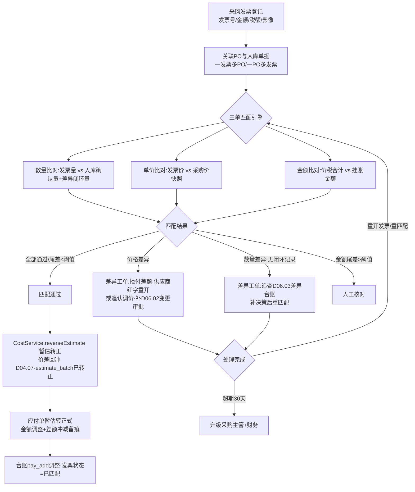
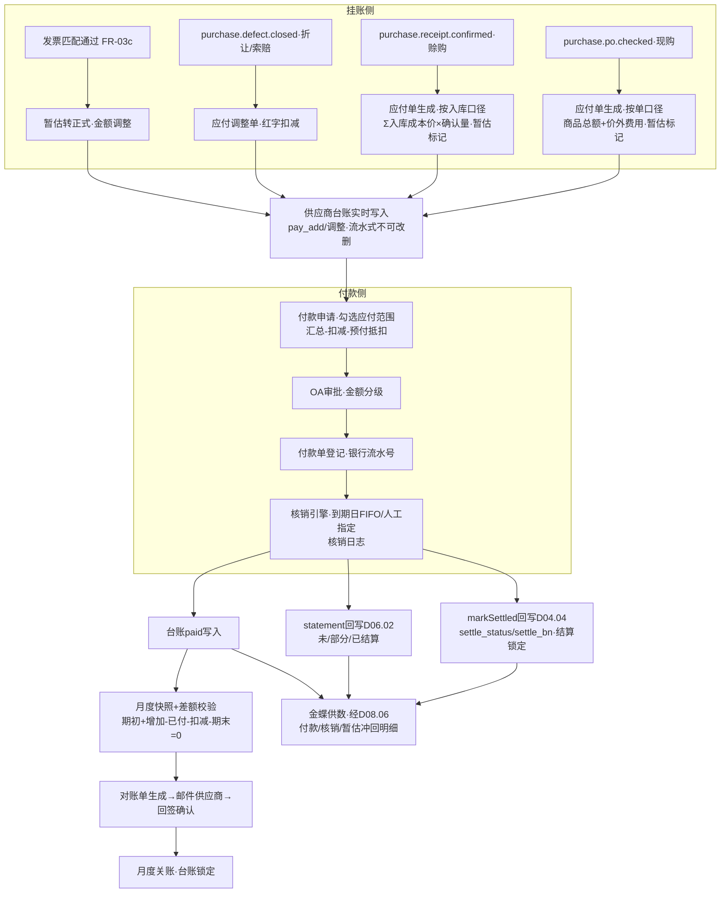

# SRS-D06.04 采购对账与供应商台账模块 需求规格说明书

> 文档编号：SRS-D06.04 · 版本 V1.0 · 2026-10-24 · 编写：小凯 · 状态：待审阅（批次④）
> 所属域：D06 采购域 · 分期：**P1（M3 后段，与 D08 财务域同批上线）** · 独立 schema：`oms_purchase`
> 上游依据：SRS-D04.04（**结算状态契约：settle_status/settle_bn/settle_num/settle_money 字段族（§6.1）、回写接口 `IoBillService::markSettled(billBns[], settleBn)`（IF-D04.04-06）、结算锁定（FR-05b：已结算单据禁止红冲）**）· SRS-D04.07（**暂估转正：`CostService::reverseEstimate(invoiceRef)`（IF-D04.07-03）、estimate_batch 台账（§6.2）**）· SRS-D06.02（**po_type cash 现购/credit 赊购、结算状态 statement 回写权归本模块（IF-D06.02-06）、折让/索赔金额来源**）· SRS-D06.03（事件 `purchase.receipt.confirmed`（IF-D06.03-06，挂账取数）/`purchase.defect.closed`（IF-D06.03-07，应付扣减））· SRS-D08.06（金蝶集成：付款数据推金蝶经其可插拔适配层，批次④同批定稿）· SRS-D08.05（发票管理——采购发票为本模块采购视角台账，发票本体能力与其协同）· 逆向文档 04 §2.6（**商派应付三单据+一台账：purchase_payments 付款单/credit_sheet 赊账单/purchase_refunds 退款单/statement 结算单——期初 initial_pay/增加 pay_add/已付 paid/期末 final_pay 八列结构 + 差额 difference；现购审核挂账 payable=product_cost+delivery_cost、赊购入库挂账 payable=入库金额+物流费用；预付款 deposit_balance 抵扣**）
>
> **全局决策（本模块承载）**：① 应付挂账策略抽象为「应付单生成策略」配置：**现购按单挂账（采购单审核时点）、赊购按入库挂账（入库确认时点）**——商派 payments/credit_sheet 分叉的显式化（逆向文档 04 §2.4/§2.6）；② 记账在金蝶、OMS 做对账/核销/供给（SRS-00 D08 定位）：本模块产出应付业务台账与核销明细，付款凭证与总账经 D08.06 供数金蝶；③ 供应商台账镜像商派 statement 八列结构（期初/本期增加/本期已付/期末+差额校验），并补货主维度与差额自动校验。

---

## 1. 模块概述

### 1.1 定位

采购域的「资金段」：将货流事实（采购单审核、入库确认、残损索赔、退货）转化为应付挂账，管理采购发票（三单匹配：采购单-入库单-发票）与暂估转正联动，编排付款申请→核销→供应商台账闭环，产出供应商对账单并供给金蝶。与 D08 财务对账域的分工：D08 管应收侧（平台/客户）与金蝶通道，本模块管应付侧（供应商）业务台账——付款数据推金蝶经 D08.06 适配层，凭证生成在金蝶。

### 1.2 职责边界

**做**：应付单生成（挂账策略引擎）、应付核销（付款单→应付单核销）、供应商台账（期初/增加/已付/期末+差额校验）、采购发票登记与三单匹配、暂估转正触发（调 D04.07 reverseEstimate）、付款申请与付款单管理（含预付款）、对账单生成与供应商确认流转、价格/数量差异登记与索赔联动（消费 D06.03）、结算状态回写（D04.04 markSettled/D06.02 statement）。

**不做**：库存计价与均价（→ D04.07，本模块只触发 reverseEstimate）；入库单据结算字段本体（→ D04.04，本模块经 markSettled 回写）；残损/短缺决策（→ D06.03，本模块消费其结果做应付调整）；金蝶凭证/总账（→ 金蝶，经 D08.06 供数）；销项发票（→ D08.05）；付款资金通道（银行支付线下执行，OMS 只登记付款事实）。

### 1.3 与其他模块关系

| 模块 | 关系 |
|---|---|
| D06.02 采购订单 | po_type（cash/credit）=挂账策略依据；消费 `purchase.po.checked` 事件（现购挂账时点）；statement 结算状态回写（IF-D06.02-06） |
| D06.03 到货入库 | 消费 `purchase.receipt.confirmed`（赊购挂账时点+金额口径=入库成本价×确认量）与 `purchase.defect.closed`（索赔/折让→应付扣减） |
| D04.04 单据中心 | `IoBillService::markSettled(billBns[], settleBn)` 回写入库单据 settle_status/settle_bn；结算锁定（已结算禁红冲） |
| D04.07 成本 | 发票匹配完成→`CostService::reverseEstimate(invoiceRef)` 暂估转正价差回冲；estimate_batch 状态联动（暂估中→已转正） |
| D08.06 金蝶集成 | 应付台账/付款单/发票/暂估冲回明细供数金蝶（可插拔适配层）；差异排查工具复用 |
| D08.05 发票管理 | 采购发票（进项）与销项发票分域管理；电子发票渠道能力可复用其适配层（P2） |
| D06.01 供应商档案 | 付款方式/账期天数/结算方式（票到付款/货到付款/月结）=挂账与付款策略输入 |
| D10.05 审批 | 付款申请/差异强制核销/坏账放弃超阈值走 OA |
| D10.04 门户（P2） | 供应商门户对账单在线确认预留（同品牌方门户机制，外部租户） |

---

## 2. 业务场景

**SC-D06.04-01 赊购按入库挂账（主流程）**
PO20261024001（赊购 credit，账期 30 天，票到付款）：入库确认事件 `purchase.receipt.confirmed`（实收确认量 496=正品 495+折让转正 1、入库成本价 12.004、暂估标记）→挂账策略引擎生成应付单 AP2026xxxx：挂账金额=Σ(入库成本价×确认量)=5954.0 元（价外分摊已含单价，D06.02 §5.3 口径）、挂账时点=confirm 时间、关联入库单据 bill_bn、到期日=发票登记日+30 天（票到付款：发票未到不出到期日，挂账为暂估应付）。同时回写：入库单据 settle_status=未结算→部分结算（markSettled）、采购单 statement=部分结算。

**SC-D06.04-02 现购按单挂账**
PO20261025002（现购 cash，货到付款）：审核通过事件 `purchase.po.checked`（商品总额 8000+价外运费 300）→生成应付单：挂账金额=8300（**按单口径=商品总额+价外费用**，镜像商派 payable=product_cost+delivery_cost）、挂账时点=审核时间；后续入库确认不再挂账（防止双挂），只做入库进度与应付的行级关联核销对照（多退少补差异走 SC-06）。

**SC-D06.04-03 发票登记与三单匹配（暂估转正）**
供应商 S1 开具发票 5900 元（税率 13%，对应 PO20261024001）：财务/采购登记采购发票（发票号/代码/金额/税额/开票日/影像附件）→三单匹配：采购单（订单金额 6000+200 费）×入库单（确认量金额 5954）×发票（5900）——量差 54 元定位为短缺 2 件+拒收 2 件（D06.03 已核销，有差异闭环记录）→匹配通过（容差规则 §5.3）→触发 `CostService::reverseEstimate(invoiceRef)`：暂估 12→实际 11.8 价差回冲（在库调均价+已出库差异明细，D04.07 FR-03b）；estimate_batch 置已转正；应付单暂估转正式（金额调整为发票口径 5900，差额 -54 冲减应付并留痕）。

**SC-D06.04-04 付款申请与核销台账**
月结：财务发起付款申请（供应商 S1，本期应付汇总 25000，扣减索赔认定 800、折让 120 →申请付款 24080）→OA 审批（付款审批，金额阈值分级）→审批通过+银行付款完成→登记付款单（付款日期/银行流水号/账户）→核销：付款单 24080 按到期日 FIFO 核销应付单明细（逐单核销金额+核销后余额，核销日志留痕）→供应商台账写入（本期已付 paid +24080）→回写各应付单/入库单据 settle_status=已结算（markSettled，触发 D04.04 结算锁定）+采购单 statement=已结算。预付款场景：PO 带预付款（deposit）→审核时生成预付付款单→入库挂账后核销时预付款余额自动抵扣（镜像商派 deposit_balance 抵扣逻辑 §5.4）。

**SC-D06.04-05 供应商台账与对账单确认**
月末生成供应商 S1 台账（月结快照）：期初应付 12000 + 本期增加 25000（赊购挂账 24000+现购挂账 1000）- 本期已付 24080 - 本期扣减（索赔 800+折让 120）= 期末应付 12000；**差额校验**：期初+增加-已付-扣减-期末=0（不平即阻断关账+差异定位工单）。生成对账单（八列结构 PDF/Excel）→邮件发送供应商（D01.07）→供应商回签确认（线下盖章回传登记/P2 门户在线确认）→确认一致即月度关账（关账后台账锁定，追溯调整走次期）；供应商提出异议→差异处理（SC-06）。

**SC-D06.04-06 差异处理（价格差异/数量差异）**
对账差异两类：① 价格差异——发票单价 12.5 vs 采购单价 12（供应商涨价未走变更）：登记价格差异（差异额=0.5×数量），处理路径：拒付差额（应付按采购价，供应商红字重开）/追认调价（补 D06.02 价格变更审批+差额补付）；② 数量差异——发票量 500 vs 入库确认 496 且无差异闭环记录：登记数量差异工单，追查 D06.03 差异台账（缺失即补决策）后重匹配。差异超期未决（30 天）升级采购主管；强制核销（差异挂账强行闭环）需 OA 审批+差异原因映射借贷科目说明（供金蝶调整，审计可解释——镜像 D08.03 三档核销设计）。

---

## 3. 功能需求

### FR-D06.04-01 应付挂账策略引擎
- FR-01a 策略配置（供应商级默认+单据级覆盖）：

| po_type | 挂账时点 | 挂账金额口径 | 触发事件 |
|---|---|---|---|
| cash 现购 | **采购单审核**（按单挂账） | 商品总额+价外费用（头级） | `purchase.po.checked` |
| credit 赊购 | **入库确认**（按入库挂账，逐单） | Σ(入库成本价×确认量)（行级，含价外分摊入单价） | `purchase.receipt.confirmed` |

- FR-01b 应付单（payable）生成：应付单号 `AP{YYYYMMDD}{5位}`；字段含挂账时点/金额口径快照/关联单据（PO 或入库单据 bill_bn）/暂估标记（发票未到）/到期日规则（票到付款=发票日+账期；货到付款=入库日+账期；月结=账期月末汇总，取 D06.01 供应商档案 settle_type+credit_days）。
- FR-01c 防双挂校验：现购单入库事件不再生成应付（只关联对照）；赊购单审核事件不挂账；同事件重复投递幂等（事件 ID+源单唯一约束）。
- FR-01d 应付调整单：折让（D06.03 让步转正）/索赔认定（`purchase.defect.closed`）/短缺核销金额→生成负向应付调整（红字），关联原应付单与原决策留痕；调整需超阈值审批（默认 1000 元）。

### FR-D06.04-02 供应商台账（statement 结构镜像）
- FR-02a 台账行八列结构（商派 statement 镜像+扩展）：object_type（赊购入库挂账/现购挂账/付款/退货退款/调整扣减）、期初应付 initial_pay、本期增加 pay_add、本期已付 paid、期末应付 final_pay、应收方向四列（initial_receive/receive_add/received/final_receive——退款/索赔应收供应商场景）、差额 difference、货主 owner_id（**扩展：按货主分账，凯淳买断货主即凯淳本体，预留经销采购分账**）。
- FR-02b 台账写入时点：每笔资金/挂账动作实时写台账行（流水式，不可改删，红冲纠错）；月度快照（月结关账生成期末定格行）。
- FR-02c **差额校验**：`期初 + 本期增加 - 本期已付 - 本期扣减 - 期末 = 0` 逐供应商逐月校验；不平→阻断关账+差异定位工单（按台账行逐笔回放定位）；校验结果留痕。
- FR-02d 台账查询：按供应商/货主/月份/单据类型多维查询与导出（D01.06）；权限=财务+采购主管（价格敏感）。

### FR-D06.04-03 采购发票管理
- FR-03a 发票登记：发票号/代码/开票日期/不含税金额/税率/税额/价税合计/影像附件/开票方（供应商映射校验）；一发票可关联多 PO（合并开票）、一 PO 可多发票（分批开票）——关联关系表维护。
- FR-03b **三单匹配**（采购单-入库单-发票）：匹配维度=供应商+PO（+入库单据）；比对项：数量（发票量 vs 入库确认量+差异闭环量）、单价（发票价 vs 采购价快照）、金额（价税合计 vs 挂账金额）；匹配容差规则（§5.3）；匹配结果：通过/价格差异/数量差异/金额尾差（尾差≤配置阈值自动通过记尾差科目）。
- FR-03c 暂估转正联动：匹配通过→调 `CostService::reverseEstimate(invoiceRef)`（IF-D04.07-03）触发价差回冲（在库调均价+已出库差异明细，计算归 D04.07）；estimate_batch 状态回写（暂估中→已转正/部分转正，按发票覆盖量）；应付单暂估转正式（金额调整+差额冲减留痕）。
- FR-03d 发票异常：作废/红冲发票登记（关联原发票，应付与暂估反向联动）；发票超期未到（入库后 N 天，默认 60）预警清单（暂估长期挂账风险，财务口径）。

### FR-D06.04-04 付款申请与核销
- FR-04a 付款申请：按供应商发起（可勾选应付单范围/全量到期应付），自动汇总：应付合计-调整扣减（索赔/折让）-预付款余额抵扣=申请付款额；付款申请走 OA 审批（金额分级阈值，D10.05）。
- FR-04b 付款单登记：审批通过+银行付款事实登记（付款日期/银行流水号/付款账户——账户信息取供应商档案，银行账户权威在金蝶）；付款单号 `PP{YYYYMMDD}{5位}`。
- FR-04c 核销引擎：付款单→应付单核销（默认到期日 FIFO，支持人工指定核销关系）；核销日志（verification 语义：核销金额/前后余额/操作人）；支持部分核销（应付单余额保留）与核销撤销（反向日志，已推金蝶的需同步冲销供数）。
- FR-04d 预付款：PO 带预付款（deposit>0，D06.02 头字段）→审核时生成预付付款单（挂账为预付资产科目方向）→应付核销时预付余额自动抵扣（镜像商派 deposit_balance：预付≥结算额则抵扣后余款退供应商挂应收方向；预付<结算额则抵扣清零差额付款）。
- FR-04e 结算回写：核销完成→`IoBillService::markSettled(billBns[], settleBn)`（IF-D04.04-06）回写入库单据 settle_status/settle_bn/settle_num/settle_money（触发 D04.04 结算锁定：已结算禁红冲）；采购单 statement 回写（未/部分/已结算，IF-D06.02-06）；退款/索赔收讫回写应收方向。
- FR-04f 金蝶供数：付款单/核销明细/应付台账按金蝶接口格式输出（经 D08.06 适配层）；凭证在金蝶生成，OMS 供数口径与金蝶差异走 D08.06 排查工具。

### FR-D06.04-05 对账单生成与供应商确认
- FR-05a 对账单生成：按供应商+账期（月）生成，内容=台账八列汇总+明细清单（挂账/付款/调整/发票逐笔）；格式 PDF（盖章位）+Excel；一键导出与邮件发送（D01.07 通道，供应商联系人取档案）。
- FR-05b 确认流转：待发送→已发送→已确认（回签影像登记）/有异议（转差异处理 FR-06）；确认截止（对账单发送后 N 天默认 10，逾期未回视同确认策略可配——**默认不视同，升级人工跟进**）。
- FR-05c 月度关账：对账单确认+差额校验通过→关账（台账快照锁定，关账后调整走次期台账+调整留痕）；关账状态机：未关账→关账中（校验）→已关账；反关账需财务主管审批（OA）+全留痕。
- FR-05d 供应商门户 P2 预留：在线查看台账/对账单确认/发票进度（外部租户接入位，D10.02/D10.04 机制同源）；本期邮件+回签登记。

### FR-D06.04-06 差异处理
- FR-06a 差异类型字典：价格差异（发票价≠采购价）/数量差异（发票量≠确认量且无闭环记录）/金额尾差（容差内自动）/对账异议（供应商提出）/暂估超期。
- FR-06b 差异登记与工单：差异额/定位依据（三单数据快照）/处理路径（拒付/追认/补决策/重开发票）/责任人；处理留痕闭环。
- FR-06c 强制核销：差异长期未决需强行闭环→OA 审批+差异原因映射借贷科目说明（供金蝶调整分录参考，审计可解释——D08.03 三档核销思想：正常/差异/强制）；强制核销记录进差异台账月报。
- FR-06d 升级机制：差异超期 30 天升级采购主管+财务；差异率（差异单数/应付单数）进供应商履约统计（D06.03 FR-07b 同源报表）。

---

## 4. 业务流程

### 4.1 三单匹配流程（Mermaid）



### 4.2 挂账-付款-核销-台账主流程



---

## 5. 处理逻辑

### 5.1 挂账策略引擎（事件→应付单）

```
onEvent(purchase.po.checked):        # 现购按单挂账
    if po.po_type == cash:
        生成应付单(挂账时点=审核时间, 金额=po.total_amount+total_extra_fee,
                  关联=po_bn, 暂估=发票未到, 到期日=按settle_type规则)
    else: 跳过(赊购不按单挂)
onEvent(purchase.receipt.confirmed): # 赊购按入库挂账
    if po.po_type == credit:
        生成应付单(挂账时点=confirm时间, 金额=Σ(行入库成本价×确认量),
                  关联=bill_bn+po_bn行映射, 暂估=行estimate_flag)
        markSettled预登记: settle_status=未结算(等付款核销回写)
    else: 入库-应付行级对照关联(现购不重复挂账,只挂核对关系)
幂等键 = (event_id, source_bill) 唯一约束·重复投递返回首次结果
```

### 5.2 台账写入与差额校验算法

```
台账行(流水式): 每笔动作 append 一行
    {object_type, 方向(应付/应收), 金额, 关联单据, owner_id, 时间}
月度快照(关账时生成):
    initial_pay  = 上月 final_pay(首期=期初导入值)
    pay_add      = Σ本期应付方向挂账(含暂估转正调整±)
    paid         = Σ本期核销付款
    扣减          = Σ本期红字调整(索赔/折让/拒付差额)
    final_pay    = initial_pay + pay_add - paid - 扣减
差额校验: difference = initial_pay + pay_add - paid - 扣减 - final_pay
    = 0 → 通过; ≠ 0 → 阻断关账+逐笔回放定位工单
应收方向(退款/索赔应收)四列同构;汇总时 object_type=退款 做减法(商派 statement.php 口径)
```

### 5.3 三单匹配容差规则

```
数量容差: |发票量 - (入库确认量 + 差异闭环量shortage/拒收)| ≤ 0 → 严格一致才通过
    (采购侧数量差异必须有 D06.03 差异闭环记录背书,无记录=数量差异工单)
单价容差: |发票价 - 采购价快照| ≤ 0.01元/件(尾差) → 通过;否则价格差异
金额容差: |价税合计 - Σ(发票行匹配金额)| ≤ 1元 → 自动尾差(记尾差科目,月报汇总)
部分匹配: 一发票多PO→按PO拆行匹配;一PO多发票→累计匹配量≤挂账量
匹配状态机: 未匹配→部分匹配→已匹配/差异挂起
```

### 5.4 预付款抵扣（商派 deposit_balance 逻辑镜像）

```
核销时: 预付余额 B, 本次应付结算额 S
if B ≥ S: 抵扣 S, 预付余额 = B - S, 差额(B-S)挂应收方向(退供应商或留抵下期,策略配置)
else:     抵扣 B, 预付余额 = 0, 差额(S-B)进付款申请实付
预付付款单: po.deposit > 0 且审核通过时生成(D06.02 审核事件联动)
```

### 5.5 核销顺序与撤销

```
核销分配: 默认到期日FIFO(先到期先核销),同期按挂账时点;人工可指定(留痕+原因)
部分核销: 应付单余额=挂账额-累计核销-调整扣减;余额>0 → settle_status=部分结算
核销撤销: 反向核销日志(不可删原日志);已推金蝶的核销 → 冲销供数同步D08.06(补偿任务)
结算锁定联动: settle_status=已结算的入库单据禁止红冲(D04.04 FR-05b)——撤销核销需先解锁(财务侧操作,双审批)
```

---

## 6. 数据字段（业务字段描述）

### 6.1 应付单（purchase_payable）

| 字段 | 业务含义 | 取值/校验 |
|---|---|---|
| ap_bn | 应付单号 | `AP{YYYYMMDD}{5位}` 唯一 |
| supplier_id / owner_id | 供应商/货主 | 必填（货主分账，预留经销采购） |
| po_type / accrual_basis | 现购赊购/挂账策略 | cash=按单（审核时点）/credit=按入库（confirm 时点） |
| accrual_time / accrual_amount | 挂账时点/金额 | 口径快照（§5.1） |
| source_po_bn / source_bill_bns | 关联采购单/入库单据（可多） | 追溯链 |
| estimate_flag | 暂估标记 | 发票未到=true；转正后 false+调整留痕 |
| adjust_amount / adjusted_amount | 调整扣减累计/调整后余额 | 折让/索赔/拒付红字 |
| settled_amount / balance | 已核销金额/余额 | balance=accrual+adjust-settled |
| due_date | 到期日 | 按 settle_type+credit_days 规则（票到付款需发票日） |
| settle_status / settle_bn | 结算状态/核销单号 | 未/部分/已结算（与 D04.04 settle_status 同枚举语义） |
| status | 单据状态 | 生效/差异挂起/已关闭 |
| tenant_id | 租户 | 必填 |

### 6.2 供应商台账行（supplier_statement）

| 字段 | 业务含义 | 取值/校验 |
|---|---|---|
| supplier_id / owner_id / period | 供应商/货主/账期（月） | 快照行 period 必填 |
| object_type / object_bn | 业务类型（赊购入库挂账/现购挂账/付款/退款/调整扣减/月度快照）/关联单号 | 流水行必填 |
| initial_pay / pay_add / paid / final_pay | 应付方向四列 | 快照行填列，流水行填单笔金额到对应列 |
| initial_receive / receive_add / received / final_receive | 应收方向四列（退款/索赔应收） | 商派 statement 八列镜像 |
| difference | 差额 | §5.2 校验=0 |
| direction / amount | 流水方向与金额 | 流水行 |
| close_status / close_time | 关账状态/时间 | 已关账锁定 |
| operator / create_time / tenant_id | 经手/时间/租户 | 流水不可改删 |

### 6.3 采购发票（purchase_invoice）

| 字段 | 业务含义 |
|---|---|
| invoice_no / invoice_code / invoice_date | 发票号/代码/开票日（供应商内唯一防重） |
| supplier_id / owner_id | 开票方（映射校验）/货主 |
| amount_net / tax_rate / tax_amount / amount_total | 不含税/税率/税额/价税合计 |
| match_status / match_detail_json | 匹配状态（未/部分/已匹配/差异挂起）/三单比对快照（可解释） |
| estimate_reversed | 暂估转正触发标记（reverseEstimate 回执） |
| status | 正常/作废/红冲（关联原发票号） |
| attachment_ref / registrant / register_time / tenant_id | 影像/登记人/时间/租户 |

### 6.4 发票-单据关联（purchase_invoice_link）

| 字段 | 业务含义 |
|---|---|
| invoice_id / po_bn / bill_bn / ap_bn | 发票×采购单×入库单据×应付单关联（多对多） |
| match_num / match_amount | 本关联行匹配数量/金额（部分匹配累计） |

### 6.5 付款单与核销日志（purchase_payment / payment_verification）

| 字段 | 业务含义 |
|---|---|
| pp_bn / supplier_id / owner_id | 付款单号 `PP{YYYYMMDD}{5位}`/供应商/货主 |
| pay_type | 付款类型：预付/货款/退款收回抵扣 |
| pay_amount / pay_date / bank_serial_no / bank_account | 金额/日期/银行流水/付款账户（账户权威在金蝶） |
| apply_bn / oa_instance_id | 付款申请号/OA 审批引用 |
| ——核销日志—— | |
| verification_bn / pp_bn / ap_bn | 核销流水/付款单/应付单 |
| verify_amount / balance_after | 核销金额/核销后应付余额 |
| deposit_offset | 预付款抵扣额（§5.4） |
| direction / operator / verify_time | 正向核销/反向撤销、操作人、时间（不可删） |

### 6.6 差异工单（purchase_diff_ticket）

| 字段 | 业务含义 |
|---|---|
| ticket_bn / diff_type | 工单号/类型（价格/数量/尾差/对账异议/暂估超期） |
| snapshot_json | 三单数据快照（定位依据，可解释） |
| diff_amount / handle_path / handle_result | 差异额/处理路径（拒付/追认/补决策/重开）/结果 |
| force_verify_flag / oa_instance_id | 强制核销标记/审批引用（FR-06c） |
| subject_mapping | 借贷科目说明（金蝶调整参考） |
| status / owner_operator / deadline / tenant_id | 待处理/处理中/已闭环、责任人、超期升级 |

---

## 7. 接口

### 7.1 内部接口（本模块提供）

| 编号 | 接口 | 消费方 | 说明 |
|---|---|---|---|
| IF-D06.04-01 | `PayableService::registerInvoice(invoiceData, poRefs[])` | 工作台/导入 | 发票登记+三单匹配触发 |
| IF-D06.04-02 | `PayableService::getPayables(supplierId, filters)` / `getLedger(supplierId, period)` | 工作台/D11/门户（P2） | 应付与台账查询 |
| IF-D06.04-03 | `PaymentService::createApply(supplierId, apBns[])` / `registerPayment(ppData)` | 财务工作台 | 付款申请与付款单登记 |
| IF-D06.04-04 | `PaymentService::verify(ppBn, allocations[])` / `cancelVerify(verificationBn)` | 财务工作台 | 核销与撤销（§5.5） |
| IF-D06.04-05 | `StatementService::closeMonth(supplierId, period)` / `reopen(period, 审批引用)` | 财务主管 | 月度关账（差额校验前置）与反关账 |
| IF-D06.04-06 | `StatementService::genStatementDoc(supplierId, period)` | 对账工作台 | 对账单生成（PDF/Excel）+邮件发送（D01.07） |
| IF-D06.04-07 | 事件 `purchase.payable.settled`（ap_bn/pp_bn/核销摘要） | D04.04（联动 markSettled 确认）/D11 | 核销闭环广播 |
| IF-D06.04-08 | 事件 `purchase.invoice.matched`（invoiceRef/价差摘要） | D04.07/D11 | 暂估转正完成广播 |

### 7.2 依赖接口（本模块消费）

| 编号 | 接口 | 提供方 | 说明 |
|---|---|---|---|
| IF-D06.04-D1 | 事件 `purchase.po.checked` 订阅 | D06.02（IF-D06.02-07） | 现购按单挂账触发 |
| IF-D06.04-D2 | 事件 `purchase.receipt.confirmed` 订阅 | D06.03（IF-D06.03-06） | 赊购按入库挂账触发（金额口径=入库成本价×确认量） |
| IF-D06.04-D3 | 事件 `purchase.defect.closed` 订阅 | D06.03（IF-D06.03-07） | 折让/索赔→应付调整红字 |
| IF-D06.04-D4 | `IoBillService::markSettled(billBns[], settleBn)`（IF-D04.04-06） | D04.04 | 入库单据结算回写+结算锁定 |
| IF-D06.04-D5 | `CostService::reverseEstimate(invoiceRef)`（IF-D04.07-03） | D04.07 | 发票匹配通过→暂估转正价差回冲 |
| IF-D06.04-D6 | `PurchaseOrderService::writeBackStatus(po_bn, statement, 值, 来源)`（IF-D06.02-06） | D06.02 | 采购单结算状态回写（本模块=其回写权归属方） |
| IF-D06.04-D7 | `SupplierService::getSupplier(supplierId)`（IF-D06.01-03） | D06.01 | 付款方式/账期/结算方式策略输入 |
| IF-D06.04-D8 | OA 审批（付款/调整/强制核销/反关账） | D10.05 | 超阈值审批 |
| IF-D06.04-D9 | 金蝶供数适配层+排查工具 | D08.06 | 应付台账/付款/核销/暂估冲回明细供数 |
| IF-D06.04-D10 | 邮件/企微通知、导出、审计 | D01.07/D01.06/D10.06 | 对账单发送/台账导出/操作留痕 |

### 7.3 外部接口

| 编号 | 接口 | 方向 | 说明 |
|---|---|---|---|
| EF-D06.04-01 | 金蝶应付/付款供数（经 D08.06） | 出 | 凭证在金蝶生成，OMS 供业务明细（P1） |
| EF-D06.04-02 | 供应商对账单邮件（经 D01.07） | 出 | 对账单 PDF/Excel 发送与回签登记 |
| EF-D06.04-03 | 供应商门户在线对账 | 双向 | **P2 预留**（FR-05d，外部租户机制 D10.02） |
| EF-D06.04-04 | 泛微 OA 审批（经 D10.05） | 双向 | 付款/调整/强制核销/反关账 |

---

## 8. 非功能需求

| 项 | 要求 |
|---|---|
| 性能 | 挂账事件处理 ≤500ms/单；三单匹配（单发票 50 PO 行）≤3s；月结批量（500 供应商×台账快照+差额校验）≤30 分钟 |
| 幂等/一致性 | 挂账幂等键（事件+源单）防双挂（§5.1）；台账流水不可改删（红冲纠错）；核销与 settle 回写同事务（markSettled 失败补偿队列重试）；金蝶供数与 OMS 台账最终一致（D08.06 排查工具兜底） |
| 精度 | 金额 2 位小数、单价 4 位（D04.07 §8 同口径）；尾差入尾差科目月报清理 |
| 安全/权限 | 应付/台账/发票金额=财务+采购主管角色可见（D10.03）；银行账户信息脱敏展示；货主行级隔离；全操作 D10.06 审计 |
| 关账刚性 | 差额校验不过强制阻断关账；已关账期间禁止补录（走反关账审批通道） |

---

## 9. 验收标准

| 编号 | 验收条件 |
|---|---|
| AC-01 | SC-01 赊购按入库挂账：`purchase.receipt.confirmed` 事件生成应付单（金额=Σ入库成本价×确认量=5954.0、暂估标记、关联 bill_bn）；事件重复投递不双挂（幂等键验证） |
| AC-02 | SC-02 现购按单挂账：`purchase.po.checked` 生成应付（金额=商品总额+价外费用=8300、挂账时点=审核时间）；后续入库确认事件不再生成应付（防双挂），只建立行级对照关联 |
| AC-03 | SC-03 三单匹配：数量比对含差异闭环量（shortage/拒收有 D06.03 记录背书即通过；无记录生成数量差异工单）；价格差异（发票 12.5 vs 采购 12）生成工单走拒付/追认两路径；尾差 ≤1 元自动通过记尾差科目 |
| AC-04 | 暂估转正：匹配通过触发 `reverseEstimate(invoiceRef)`，estimate_batch 置已转正、价差回冲明细生成（D04.07 AC-02 联动）；应付单暂估转正式金额调整+差额冲减留痕；`purchase.invoice.matched` 事件发布 |
| AC-05 | SC-04 付款核销：付款申请汇总=应付-索赔扣减-折让-预付抵扣；OA 审批通过+付款登记→FIFO 核销日志正确（逐单核销额+余额）；核销完成 `markSettled` 回写入库单据 settle_status=已结算+settle_bn，且该单据红冲被阻止（D04.04 FR-05b 联动） |
| AC-06 | 采购单 statement 回写：部分核销=部分结算、全额核销=已结算（IF-D06.02-06 通道，回写权归属验证——其他模块调用被拒） |
| AC-07 | 预付款抵扣（§5.4）：预付 2000≥结算 1500 场景抵扣后余额 500 挂应收方向；预付 1000<结算 1500 场景抵扣清零+实付 500，两分支台账数字全对 |
| AC-08 | SC-05 台账差额校验：期初 12000+增加 25000-已付 24080-扣减 920=期末 12000，difference=0 通过；人为篡改一笔流水后校验≠0→关账阻断+回放定位工单指出差异行 |
| AC-09 | 对账单闭环：八列汇总+明细生成 PDF/Excel、邮件发送、回签登记→关账锁定；关账后补录被拒；反关账走 OA 审批+留痕后可调整 |
| AC-10 | SC-06 差异处理：价格差异拒付路径（应付按采购价，供应商红字发票登记后重匹配通过）；强制核销需 OA 审批+借贷科目说明落库；差异超期 30 天升级告警 |
| AC-11 | 应付调整红字：折让 120/索赔 800（`purchase.defect.closed`）自动生成负向调整单关联原应付与原决策；调整超 1000 元触发 OA 审批 |
| AC-12 | 核销撤销：反向日志生成、原日志保留；已推金蝶的核销触发冲销供数（D08.06 补偿任务）；撤销后应付余额与 settle_status 正确回退 |
| AC-13 | 发票异常：作废/红冲发票登记后关联应付与暂估反向联动（已转正的暂估回退为暂估中+价差反冲）；入库后 60 天发票未到进暂估超期预警清单 |
| AC-14 | 权限与精度：非财务/采购主管角色不可见应付金额列；全链路金额 2 位/单价 4 位精度一致，月结汇总无分位漂移 |

---

## 变更记录

| 日期 | 版本 | 变更 | 原因 |
|---|---|---|---|
| 2026-10-24 | V1.0 | 首版 | — |

---

*参考实现溯源：商派 purchase 财务链路 5 表（逆向文档 04 §2.6/§3.2）——purchase_payments 付款单（现购审核时生成 payable=product_cost+delivery_cost/赊购预付款 payable=deposit）+ credit_sheet 赊账单（每次入库生成 payable=入库金额+物流费用，eo_id 关联）+ purchase_refunds 退款单（退货应收，statementDo 差额=应收-结算金额为负）+ statement 结算单（object_type: 1 赊购入库/2 现款结算/3 采购退货；八列 initial_pay/pay_add/paid/final_pay + initial_receive/receive_add/received/final_receive + difference；GetClearingTables 采购结算统计表=供应商对账单）+ branch_product_batch 进价历史；预付款抵扣逻辑（credit/sheet.php:42 statementDo：difference=payable-paid-deposit_balance，预付≥结算额抵扣后余款退供应商）；三类资金单据 statement_status 统一枚举（1 未结算/2 已结算/3 拒绝结算/4 部分结算）。关键差异：① 挂账策略显式抽象为配置化策略引擎（商派 cash/credit 分叉硬编码在 do_check 与 eo/import.php 两处）；② 三单匹配产品化（采购单-入库单-发票+容差规则+差异工单——商派无发票匹配层，发票域只管销项）；③ 暂估机制补全（商派无暂估：入库即最终价；本 SRS 与 D04.07 estimate_batch/reverseEstimate 闭环）；④ 台账补货主维度与差额校验强制阻断关账（商派 difference 仅展示字段，object_type=3 汇总做减法口径保留）；⑤ 核销日志化+撤销反向日志+金蝶冲销补偿（商派核销即状态字段回写无日志表）；⑥ 结算回写经 D04.04 markSettled 契约统一入口+结算锁定联动（商派 statement 回写 po.statement 散落）；⑦ 对账单确认流转与月度关账状态机（商派仅报表导出无确认/关账）；⑧ 付款凭证与总账外置金蝶（经 D08.06 供数，商派 OMS 内自闭环）；⑨ 供应商门户在线对账 P2 预留。*

---

# 批次④ D06 采购域完 —— 4 模块（D06.01/02/03 P0·M3，D06.04 P1·M3 后段）全部交付，待 Jason 审阅（与 D08 财务对账域同批）
