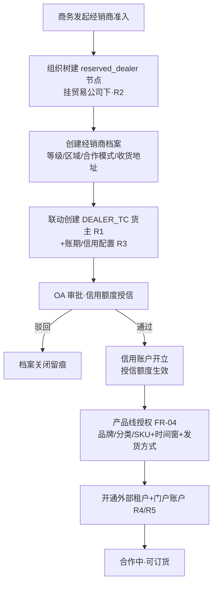
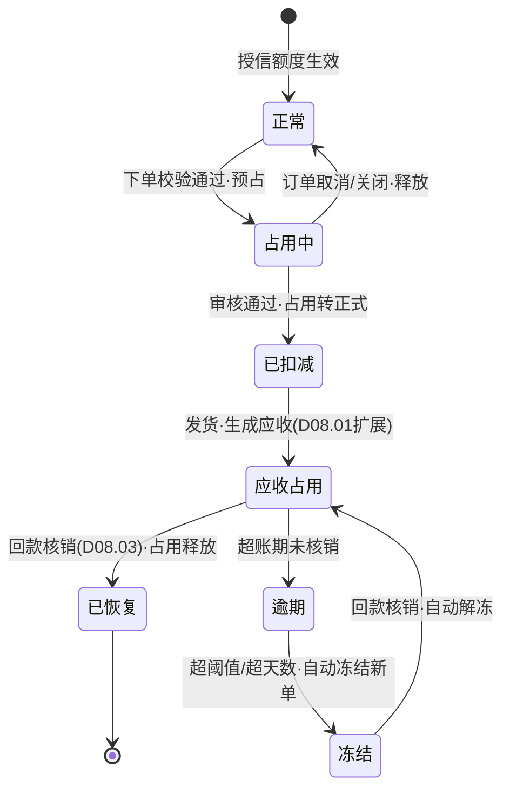

# SRS-D07.01 经销商管理模块 需求规格说明书

> 文档编号：SRS-D07.01 · 版本 V1.0 · 2026-10-24 · 编写：小凯 · 状态：待审阅（批次⑥）
> 所属域：D07 经销分销域 · 分期：**P2（M4 之后启动）**
> **P2 后置 · 本文档为需求占位，P0 期预留位见 §1.4**——业务模型与功能需求按未来启动可直接细化开发的深度编写，处理逻辑写到规则级，不展开到 P0 实现深度。
> 上游依据：SRS-00 §3 D07 清单与 P0 预留要求注记（Q25 决策：经销 B2B 暂不做）· SRS-D10.01（货主类型枚举 DEALER_TC 预留、org_type=reserved_dealer 层级预留、SC-D10.01-06）· 逆向文档 04 §4（dealer 21 表：BU→贸易公司→经销商→店铺四级组织、产品线授权到店）与 §12-2（缺账期信用需自建启示）
> ⚠️ 业务假设声明：经销业务的合作模式（买断转售 / 代发 / 混合）、经销商数量级与区域结构待 P2 启动前业务确认，本文按 B2B 分销行业通用模型编写。

---

## 1. 模块概述

### 1.1 定位

经销商管理是 D07 经销分销域的**主数据地基**：定义经销商是谁（档案与组织层级）、能卖什么（产品线授权）、能赊多少（账期与信用额度）、怎么协作（经销商门户）。凯淳当前为「电商代运营」单业务形态，经销业务（向下游经销商批发分销）整域 P2 后置；本模块把商派 dealer 域（21 表）验证过的**组织与授权模型**继承下来，并补齐商派**完全缺失的账期与信用额度**（逆向文档 04 §4.1 明确「dealer 域无信用等级/账期字段」，§12-2 启示「可参考 supplier.credit_lv + statement 台账组合出经销商信用账户」）。

### 1.2 职责边界

**做**：经销商档案全生命周期（等级/区域/合作状态）、四级经销组织挂接（复用 D10.01 组织树与货主类型预留位）、**信用账户（额度-已占-逾期三口径）**、账期天数配置与逾期预警、超额下单管控（拦截或 OA 审批放行）、产品线授权（品牌/分类/SKU 级授权到店、时间窗、自发/代发模式）、经销商门户接入（复用 D10.04 门户外壳+D10.02 外部租户类型扩展）。
**不做**：B2B 销售订单与转履约（→ D07.02）；批发价格定义与取价（→ D07.03，本模块只维护经销商等级/区域等取价维度属性）；转单与货权拆分执行（→ D07.04）；应收对账与核销（→ D08.01/D08.03 扩展，本模块只提供信用占用/恢复的触发事件）；组织树机制本体（→ D10.01，本模块只使用其预留节点类型）。

### 1.3 与其他模块关系

| 模块 | 关系 |
|---|---|
| D10.01 组织货主 | 经销商=货主类型第三枚举 `DEALER_TC`（P0 预留位）；组织树 `reserved_dealer` 节点类型（P0 预留位）；层级：集团→销售团队→贸易公司→经销商→经销店铺 |
| D10.02 租户账户 | 经销商门户账户=外部租户（tenant_type 扩展 `dealer`，复用 P0 预留的外部租户机制） |
| D10.04 门户 | 经销商门户复用门户外壳（独立域名/硬隔离/视图组装层架构不变），功能菜单按租户类型切换 |
| D07.02 B2B 销售订单 | 信用校验时点消费方：下单占用、审核扣减、回款恢复（本模块提供 `CreditService`） |
| D07.03 批发价格 | 经销商等级/区域=价格维度输入；产品线授权=价格表适用范围校验 |
| D07.04 转单货权拆分 | 代发模式授权是本模块维护、D07.04 消费（决定经销商订单走自发还是转单直发） |
| D08.01/D08.03 | 经销商应收走 D08.01 扩展 ar_type；逾期应收账款数据供本模块逾期口径计算 |
| D10.05 审批 | 信用额度调整、超额下单放行、经销商暂停/终止走 OA |
| D10.06 审计 | 档案/信用/授权全部变更字段级审计 |

### 1.4 P0 期预留位与 P2 接入点（关键清单）

| # | 预留位（P0 已落地） | 所在文档与字段 | P2 接入点 |
|---|---|---|---|
| R1 | 货主类型枚举第三值 | SRS-D10.01 FR-03a：`DEALER_TC 经销商贸易公司（P2 预留，本期置灰不可选）` | 启用枚举，经销商建档即建 DEALER_TC 货主，全域单据 owner_id 契约自动贯通 |
| R2 | 组织树经销层级节点 | SRS-D10.01 FR-01a：`reserved_dealer 经销商（P2 预留）`；§5.1 层级约束矩阵「owner_co → shop / reserved_dealer(P2)」；SC-D10.01-06 | 在集团下扩展 销售团队→贸易公司→经销商→经销店铺 层级，复用 org_path/权限继承机制，不新建第二棵树 |
| R3 | 货主结算配置载体 | SRS-D10.01 FR-05：settle_config 扩展组（结算周期/账期天数/宽限期） | 经销商账期天数直接落此配置位（D10.01 FR-05c 收付款账期天数），不另建配置体系 |
| R4 | 外部租户机制 | SRS-D10.02 FR-01a：`external 外部租户（P2 预留供应商门户租户——D06.04 FR-05d 同源机制）`；tenant_type 字段 | 新增 `dealer` 租户类型枚举值；经销商门户账户挂外部租户，行隔离复用 D10.03 FR-06 硬隔离 |
| R5 | 门户外壳 | SRS-D10.04 FR-01c/FR-01d：独立部署、路由前缀 `/portal-api/*`、菜单按租户开关、主题按租户可配 | 经销商门户=同壳不同菜单（订货/信用/对账中心），无需新前端应用 |
| R6 | 基础物料货主归属 | SRS-D04.01 §6.2：owner_id 枚举预留经销商；货主建档后不可改 | 买断转售模式下经销商不买货主（货主仍是凯淳），仅代发货权方场景启用 DEALER_TC 物料归属 |
| R7 | 客户分类拆单策略 | SRS-D03.04 FR-02 策略 #5 `customer_classify`（注明 D07 预留） | 经销 B2B 客户分类履约策略差异化的策略位 |

> 以上 R1-R7 均已在 P0 期文档定稿并落数据模型（枚举值/字段位/节点类型），P2 启动**不需要改动 P0 已建核心表结构**。

---

## 2. 业务场景

**SC-D07.01-01 经销商准入建档（主场景）**
凯淳与华东经销商甲公司签约批发合作：商务在组织树「凯淳贸易主体」下建经销层级节点 → 创建经销商档案（等级=A级、区域=华东、合作模式=买断转售、账期 30 天、信用额度 50 万）→ 同步创建 DEALER_TC 货主档案（复用 R1）与外部租户（复用 R4）→ 授权产品线（品牌X 全分类，时间窗 1 年）→ 开通门户账户。此后甲公司可门户自助订货（D07.02），订单自动携带 owner_id 与经销商维度。

**SC-D07.01-02 信用额度占用与恢复**
甲公司信用额度 50 万、已占用 42 万（在途未回款订单）。新订货 10 万：可用额度=50−42=8 万 < 10 万 → 超额。按经销商配置走「OA 审批放行」路径：商务发起超额申请（附历史回款记录）→ 审批通过 → 临时额度+2 万（有效期 30 天，到期自动回收）→ 订单放行占用。发货后应收挂账（D08.01 扩展），30 天账期到期前回款 → 核销（D08.03）→ 信用占用恢复（released 事件驱动）。

**SC-D07.01-03 逾期预警与冻结**
乙公司账期 30 天，一笔 15 万应收逾期 3 天未回款：逾期预警（到期前 7/3/1 天三级提醒推送商务+经销商门户）→ 逾期发生即预警升级（企微通知财务+商务负责人）→ 逾期金额>阈值（配置，默认额度 10%）或逾期天数>15 天 → 自动冻结新订单（下单拦截，存量在途订单继续履约）→ 回款核销后自动解冻。冻结/解冻全程审计。

**SC-D07.01-04 产品线授权与自发/代发切换**
丙公司经营品牌X 与品牌Y：授权品牌X 全分类到其两家店铺（时间窗 2026-2027）；品牌Y 仅授权指定 SKU 清单（20 个 SKU，代发模式）。品牌Y 合作深化后切换为自发（丙自提/凯淳发至丙仓再转售）：修改授权记录的发货方式并设置切换时间窗（继承商派 series_endorse_products 注释语义「自发改成代发需要设置时间范围」），切换日前订单仍按旧模式履约。未授权 SKU 出现在订货单 → 下单校验拦截。

**SC-D07.01-05 经销商生命周期终止**
丁公司合作终止：状态 合作中→暂停（新单停止、门户降级只读）→ 终止前置校验（信用占用清零=无未回款应收、无在途订单、无未闭环售后、无未决对账单）→ OA 审批 → 终止（货主/租户/档案三处联动只读禁用，复用 D10.01 FR-06 货主生命周期机制）。历史数据保留可查。

---

## 3. 功能需求

### FR-D07.01-01 经销商档案

- FR-01a 档案字段：经销商编码（唯一）、名称、统一社会信用代码、**等级**（枚举：战略/A/B/C，等级驱动 D07.03 取价）、**区域**（区域树：大区→省→市，区域驱动取价与串货管控）、合作模式（买断转售/代发/混合）、联系人/收货地址（可多个）、发票信息、状态（合作中/暂停/终止）。
- FR-01b 经销商与货主一对一：建档联动创建 DEALER_TC 类型货主（R1），owner_id 回填档案；此后经销业务全单据（订单/发货/应收/台账）自动携带该 owner_id（SRS-00 契约）。
- FR-01c 生命周期复用 D10.01 FR-06 货主状态机（合作中→暂停→终止+前置校验+OA 审批），本模块扩展经销专属校验项：信用占用=0、无在途 B2B 订单。
- FR-01d 等级/区域变更走 OA 审批（影响取价），变更只对未来订单生效（历史订单价格快照不变，同 D07.03 版本化规则）。

### FR-D07.01-02 四级组织挂接（复用 D10.01 预留位）

- FR-02a 组织层级：集团 → 销售团队（dept 或 brand 节点复用）→ 贸易公司（owner_co 节点，凯淳贸易主体或多主体）→ 经销商（reserved_dealer 节点，R2）→ 经销店铺（shop 节点挂经销商下）。
- FR-02b 一个贸易公司下多经销商；一个经销商可绑定多店铺（自有线上店/线下门店）；树结构、org_path、权限继承全部复用 D10.01 机制，禁止另建树。
- FR-02c 内部业务员挂组织（销售员归属销售团队节点），B2B 订单携带业务员维度（业绩归属，D11 报表供数）。

### FR-D07.01-03 账期与信用额度（商派缺失，本模块自建核心）

- FR-03a **信用账户三口径**：`可用额度 = 授信额度 − 已占用 − 逾期额`；授信额度（静态，OA 审批调整）；已占用（动态：下单占用、发货转应收后仍占用直至回款核销）；逾期额（应收超过账期未核销部分，从 D08 应收台账取数）。
- FR-03b **账期天数**：落 D10.01 FR-05c 货主结算配置位（R3），经销商级可谈判差异化；起算日=发货日或结算单归档日（可配）；到期日=起算日+账期天数。
- FR-03c **占用-扣减-恢复时序**：下单校验并占用（预占语义，订单取消/关闭释放）→ 订单审核通过占用转正式（扣减确认）→ 发货生成应收（占用额不变，性质从「订单占用」转「应收占用」）→ 回款核销（D08.03）→ 占用恢复。全程信用流水（append-only，镜像 D04.03 预占流水表设计思想：独立流水+余额派生，不落主字段）。
- FR-03d **超额管控策略**（经销商级配置）：`拦截`（默认，下单直接拒绝）/ `OA 审批放行`（超额单挂起推审批，通过后放行）；临时额度（审批产物：金额+有效期，到期自动回收，回收前占用校验计入）。
- FR-03e **逾期预警与冻结**：到期前 7/3/1 天三级预警（D01.07 通道，推商务+门户）；逾期发生升级通知（财务+商务负责人）；自动冻结规则（逾期额>阈值或逾期天数>N，参数经销商级可配）→ 冻结新下单，回款核销后自动解冻；冻结/解冻事件广播+审计。
- FR-03f 信用额度调整（提额/降额/临时）一律 OA 审批（资金红线，同 D08.02 结算配置变更口径）；调整历史版本化留档。

### FR-D07.01-04 产品线授权（继承商派 dealer 授权模型）

- FR-04a 授权粒度三级：品牌级 / 分类级（D04.01 分类树节点）/ SKU 级（基础物料清单）；授权对象=经销商（可细化到其名下指定店铺，继承商派 series_endorse「一个经销店铺只能选一个经销商」约束）。
- FR-04b **时间窗**：每条授权记录带 生效开始/结束时间；到期自动失效（订货校验拦截），续期=新记录（历史版本留档）。
- FR-04c **发货方式**：`自发`（凯淳发货至经销商，买断转售）/ `代发`（经销商店铺产生消费者订单，凯淳直发消费者——D07.04 转单场景）；模式切换带时间窗（切换日分界，前单旧模式后单新模式，继承商派 series_endorse_products 时间范围语义）。
- FR-04d 授权校验服务：订货单行逐行校验（SKU∈授权集 且 时间窗内 且 店铺匹配），未授权 → 拦截并给结构化原因（供 D07.02 下单校验消费）。
- FR-04e 产品线（series）作为授权的聚合载体（一组 SKU 打包授权，继承商派 series/series_products 结构）：产品线归属贸易公司（货权主体），P2 启动时按业务需要决定保留产品线层或直接 SKU 清单授权。

### FR-D07.01-05 经销商门户（复用 D10.04 外壳）

- FR-05a 租户与账户：经销商=外部租户（tenant_type 扩展 `dealer`，R4）；账户体系复用 D10.02 外部通道（手机号+验证码、管理员派生子账户、自助管理）。
- FR-05b 门户功能（同壳不同菜单，R5）：**订货中心**（D07.02 自助下单入口）、**信用中心**（可用额度/占用明细/账期与到期提醒/信用流水只读）、**订单中心**（本经销商 B2B 订单与发货跟踪）、**对账中心**（应收对账单确认，镜像 D10.04 结算确认交互）、**授权查看**（本经销商产品线与时间窗，只读）。
- FR-05c 数据隔离：只见本经销商数据（D10.03 FR-06 硬隔离复用）；成本/其他经销商存在性永不暴露。

### FR-D07.01-06 经销商主数据查询服务

- FR-06a `DealerService::get/list/assertValid`：供 D07.02（下单校验）、D07.03（取价维度）、D07.04（授权模式判定）消费。
- FR-06b `CreditService::check/occupy/confirm/release/freeze/unfreeze`：信用校验与占用族接口（P2 实现，接口签名本期占位定义）。

---

## 4. 业务流程

### 4.1 经销商准入建档流程



### 4.2 信用额度状态流（占用-扣减-恢复）



---

## 5. 处理逻辑（规则级）

### 5.1 信用校验规则

```
下单时点 check(dealer_id, order_amount):
    可用 = 授信额度 + 有效临时额度 − 已占用 − 逾期额
    可用 ≥ order_amount → 通过并 occupy(流水: 类型=下单预占, 关联订单号)
    可用 < order_amount → 按经销商超额策略:
        拦截      → 拒绝, 结构化原因(可用额/本单额/缺口)
        OA 审批   → 订单挂起, 推审批(附信用快照), 通过后 occupy(含临时额度)
校验为同步热路径: 信用余额 Redis 缓存(流水驱动失效), 占用操作 Lua 原子(对齐 D04.03 预占模式)
```

### 5.2 占用生命周期规则

| 触发事件 | 信用动作 | 流水类型 |
|---|---|---|
| 下单校验通过 | 占用 +订单额 | 下单预占 |
| 订单取消/关闭 | 占用 −订单额 | 释放 |
| 订单审核通过 | 预占转正式（额度语义不变） | 审核扣减 |
| 发货生成应收 | 占用性质标记转应收（金额不变） | 转应收 |
| 回款核销（D08.03 事件） | 占用 −核销额 | 回款恢复 |
| 应收逾期（日终扫描） | 逾期额 +（可用额联动下降） | 逾期登记 |

守恒校验（日终）：`授信额度 − Σ占用流水余额 − 逾期额 = 可用额度缓存值`，不平告警重建（对齐 D04.03 定时对账兜底思想）。

### 5.3 授权校验规则

```
订货行校验 = SKU ∈ 授权集(品牌级展开/分类级展开/SKU级直查)
           ∧ now ∈ [授权开始, 授权结束]
           ∧ 店铺匹配(细化到店时)
           ∧ 发货方式与订单模式一致(自发单≠代发授权 → 拦截)
未授权 → 结构化原因码(AUTH_SKU/AUTH_TIME/AUTH_SHOP/AUTH_MODE), 下单侧拦截
```

---

## 6. 数据字段（业务字段描述，P2 建表）

### 6.1 经销商档案（dealer）

| 字段 | 业务含义 | 取值/校验 |
|---|---|---|
| dealer_id / dealer_code | 主键/编码 | 编码全局唯一 |
| dealer_name / tax_no | 名称/统一社会信用代码 | 格式校验 |
| level / region_id | 等级/区域 | 战略/A/B/C；区域树节点（D07.03 取价维度） |
| coop_mode | 合作模式 | 买断转售/代发/混合 |
| owner_id | 联动货主（DEALER_TC） | R1，一对一，建档联动创建 |
| org_node_id | 组织节点 | reserved_dealer 类型（R2） |
| tenant_id_portal | 门户外部租户 | R4，dealer 类型 |
| salesman_id / org_id | 归属业务员/销售团队 | 业绩维度（D11 供数） |
| status | 生命周期 | 合作中/暂停/终止（复用 D10.01 FR-06 状态机） |
| tenant_id | 租户 | 全域契约必填 |

### 6.2 信用账户与流水（dealer_credit / dealer_credit_log）

| 字段 | 业务含义 | 取值/校验 |
|---|---|---|
| credit_limit / temp_limit / temp_expire | 授信额度/临时额度/临时有效期 | 调整走 OA，版本化留档 |
| occupied / overdue / available | 已占用/逾期额/可用额 | available 为派生缓存，流水对账兜底（§5.2） |
| credit_days / start_anchor | 账期天数/起算日锚点 | 落 D10.01 settle_config 位（R3） |
| over_policy | 超额策略 | 拦截 / OA 审批放行 |
| freeze_threshold / freeze_days | 冻结阈值（额度占比）/冻结逾期天数 | 经销商级可配 |
| status | 账户状态 | 正常/冻结（冻结禁新单） |
| ——流水—— | | |
| log_type / amount / direction | 流水类型（§5.2 六种）/金额/方向 | append-only 不可改删，红冲纠错 |
| ref_order_bn / ref_ar_bn / operator | 关联订单/应收/操作人 | 全链路可追溯 |

### 6.3 产品线授权（dealer_series / dealer_endorse）

| 字段 | 业务含义 | 取值/校验 |
|---|---|---|
| series_id / series_name / betc_org_id | 产品线/归属贸易公司 | 继承商派 series 语义（FR-04e） |
| dealer_id / shop_id | 授权经销商/细化店铺 | 一店铺只归一经销商（商派约束继承） |
| auth_level / auth_ref | 授权粒度（品牌/分类/SKU）/授权对象集 | 三级粒度（FR-04a） |
| delivery_mode | 发货方式 | 自发/代发（FR-04c） |
| start_time / end_time | 时间窗 | 到期自动失效；切换模式须带时间窗 |
| status / version | 状态/版本 | 续期=新版本，历史留档 |

---

## 7. 接口（P2 实现，本期占位定义）

### 7.1 内部接口

| 编号 | 接口 | 消费方 | 说明 |
|---|---|---|---|
| IF-D07.01-01 | `DealerService::get/list/assertValid(dealerId)` | D07.02/D07.03/D07.04/门户 | 经销商主数据查询与合法性校验 |
| IF-D07.01-02 | `CreditService::check(dealerId, amount)` | D07.02 下单/审核 | 信用校验（返回可用额/拦截原因，§5.1） |
| IF-D07.01-03 | `CreditService::occupy/confirm/release(dealerId, orderBn, amount)` | D07.02 订单状态机 | 占用-扣减-释放（幂等，订单号+动作唯一键） |
| IF-D07.01-04 | `CreditService::onReceivableSettled(arBn, amount)` | D08.03 核销事件订阅 | 回款恢复占用 |
| IF-D07.01-05 | `EndorseService::checkAuth(dealerId, shopId, skuIds[], mode)` | D07.02 下单校验/D07.04 | 授权批量校验（§5.3 结构化原因码） |
| IF-D07.01-06 | 事件 `dealer.credit.frozen/unfrozen`、`dealer.status_changed`、`dealer.endorse.expired` | D07.02（下单拦截）/D10.02（租户禁用）/D01.07（通知） | 生命周期广播（DB-00 事件字典登记） |

### 7.2 外部接口

| 编号 | 接口 | 方向 | 说明 |
|---|---|---|---|
| EF-D07.01-01 | OA 审批（经 D10.05） | 双向 | 授信/调额/超额放行/冻结解除/暂停终止 |
| EF-D07.01-02 | 企微/短信/邮件预警（经 D01.07） | 出 | 账期到期三级预警、逾期升级、冻结通知 |

---

## 8. 非功能需求

| 项 | 要求 |
|---|---|
| 性能 | `CreditService::check/occupy` 为下单热路径：缓存命中 P99 ≤5ms；授权批量校验（100 SKU）≤50ms |
| 一致性 | 信用流水 append-only+余额派生+日终守恒对账（§5.2）；占用/释放幂等（订单号+动作类型唯一键）；冻结判定与解冻由事件驱动，禁止人工直改余额（调整走 OA+流水） |
| 安全/权限 | 信用额度/占用数据=财务+商务主管可见（D10.03）；经销商门户只见本商信用流水；全变更字段级审计（D10.06） |
| 资金红线 | 额度调整、超额放行、冻结解除强制 OA；OMS 不做资金操作（收款登记在 D08.03，本模块只消费核销事件） |
| 容量 | 经销商 ≤500、授权记录 ≤5 万、信用流水随订单量增长按年分区——单表无分表需求 |

---

## 9. 验收标准（P2 启动时生效）

| 编号 | 验收条件 |
|---|---|
| AC-01 | 准入建档联动：创建经销商自动生成 DEALER_TC 货主+reserved_dealer 组织节点+外部租户，三处 ID 互相关联；未经 OA 授信审批的经销商无法下单 |
| AC-02 | 信用占用时序（SC-02）：下单占用→审核扣减→发货转应收→回款恢复全链路流水正确；订单取消占用释放；同一订单重复回调幂等 |
| AC-03 | 超额管控两策略：拦截模式下超额单被拒且返回可用额/缺口；OA 模式下订单挂起、审批通过后放行、临时额度到期自动回收 |
| AC-04 | 逾期冻结（SC-03）：逾期额超阈值自动冻结新下单、存量在途订单不受影响；回款核销后自动解冻；三级预警按 7/3/1 天触达 |
| AC-05 | 授权校验：未授权 SKU/超时间窗/店铺不匹配/模式不符四类拦截各自返回正确原因码；授权到期次日订货被拦截 |
| AC-06 | 自发/代发切换：切换时间窗生效日前后订单分别按旧/新模式履约；切换记录版本留档 |
| AC-07 | 终止前置校验：信用占用>0 或有在途订单时终止被阻断并展示未决清单；终止后门户禁登、货主只读（D10.01 FR-06 联动） |
| AC-08 | 日终守恒对账：人为篡改可用额缓存后对账任务发现不平、告警并按流水重建正确余额 |

---

## 变更记录

| 日期 | 版本 | 变更 | 原因 |
|---|---|---|---|
| 2026-10-24 | V1.0 | 首版（P2 需求占位 + P0 预留位清单） | — |

---

*参考实现溯源：商派 dealer 域 21 表（逆向文档 04 §4）——bbu 品牌BU / betc 贸易公司 / business(bs) 经销商（bs_bn、customer_code、salesoffice_code、division_code、salesgroup_code、deal_cost 订单处理费公式）三级组织 + saveCos 双写 organization.cos 树 + business_branch 经销商仓库 + goods/goods_price 经销货品与价格（带生效/过期时间版本化）+ series/series_products/series_endorse/series_endorse_products 产品线授权到店（SKU 级、开始/结束时间、自发/代发切换）。关键差异：① **账期与信用额度全部自建**——商派 dealer 域无信用等级/账期建模（§4.1 明确记载，代发先款后货模式所致），本模块按 §12-2 启示「supplier.credit_lv + statement 台账组合出经销商信用账户」设计三口径信用账户+append-only 流水（镜像 D04.03 预占流水模式）；② **复用既有域不另建体系**——组织树复用 D10.01 预留节点类型（规避商派 dealer 与 cos 双写脆弱性）、租户/门户复用 D10.02/D10.04 外壳、生命周期复用 D10.01 FR-06 货主状态机；③ 经销商上升为货主（DEALER_TC 枚举，SRS-00 契约贯通全单据 owner_id）——商派经销商仅业务实体无货权语义；④ deal_cost 订单处理费公式不在本模块继承（服务费口径归 D07.03/D08.02 体系化定义）。*
