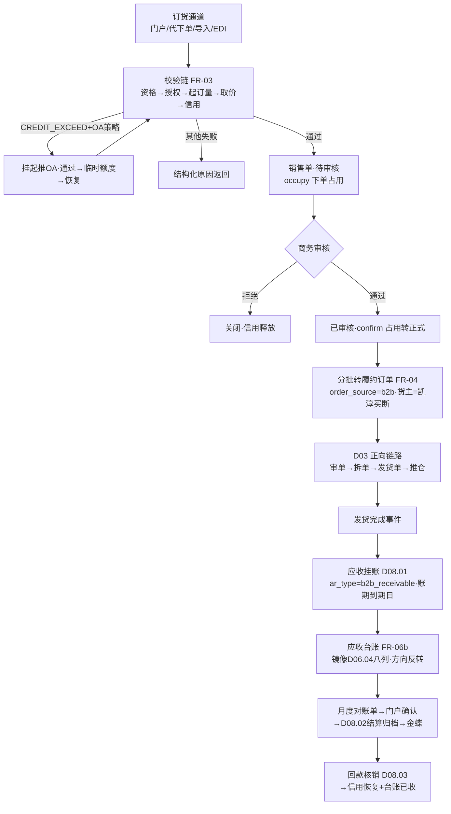
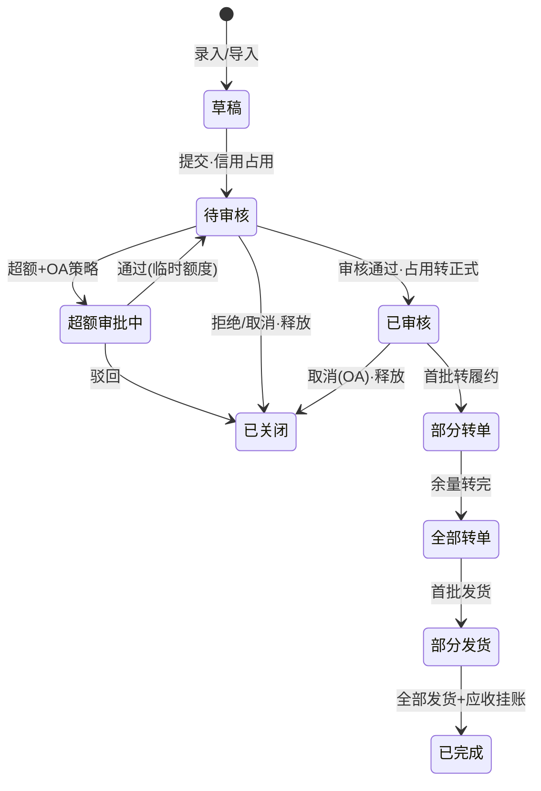

# SRS-D07.02 B2B销售订单模块 需求规格说明书

> 文档编号：SRS-D07.02 · 版本 V1.0 · 2026-10-24 · 编写：小凯 · 状态：待审阅（批次⑥）
> 所属域：D07 经销分销域 · 分期：**P2（M4 之后启动）**
> **P2 后置 · 本文档为需求占位，P0 期预留位见 §1.4**——业务模型与功能需求按未来启动可直接细化开发的深度编写，处理逻辑写到规则级，不展开到 P0 实现深度。
> 上游依据：SRS-00 §3 D07 清单（Q25：经销 B2B 暂不做）· SRS-D03.01（订单接入含「B2B 销售单转入」通道，P0 已定契约）· SRS-D07.01（经销商档案/信用/授权服务）· SRS-D07.03（批发取价）· SRS-D06.04（供应商台账八列结构镜像为应收台账）· SRS-D08.01/D08.02（应收与结算扩展位）· 逆向文档 04 §5（ome.sales 销售单模型、order_type='sale' 与平台订单共用管道）
> ⚠️ 业务假设声明：B2B 订单的支付模式（先款后货/账期赊销/预存款抵扣）与是否开通线上支付待 P2 启动前业务确认；本文默认「账期赊销为主（联动 D07.01 信用）+ 先款后货可选」。

---

## 1. 模块概述

### 1.1 定位

B2B 销售订单是经销分销域的**交易主链路**：承接经销商订货需求（门户自助/业务员代下/导入/EDI），生成 B2B 销售单（批发价格、账期结算语义，区别于 C 端平台订单），经信用与授权校验后**转入 OMS 正向履约链路**（复用 D03 审单→拆单→发货单→推仓全套机制），发货后生成应收（D08.01 扩展单据类型）并按期对账结算。

商派参考语义（逆向文档 04 §5）：`order_type='sale'` 的 B2B 销售单与平台订单**共用 ome.orders 主表与同一条「审核→发货单→出库→销售单」管道**——「一套订单引擎多业务形态」。凯淳继承该设计思想：B2B 销售单不落第二套订单引擎，转为标准 OMS 订单（携带 B2B 标记与经销维度）走 D03 既有链路；销售单本体作为**订货协议单据**（价格/账期/信用占用的载体）独立管理，与履约订单一对多关联（一张销售单可分批转多张履约订单）。

### 1.2 职责边界

**做**：订货通道（门户自助/业务员代下/批量导入/EDI 预留）、B2B 销售单模型与状态机、下单校验编排（授权→信用→库存可售参考）、销售单转履约订单（批发价/0 元内部价两种口径）、信用占用时点编排（下单占用/审核扣减）、发货后应收挂账触发、经销商应收对账单（镜像 D06.04 台账结构）、销售单变更与关闭。
**不做**：批发价格定义与取价计算（→ D07.03，本模块消费其取价服务）；信用账户与额度管理（→ D07.01，本模块调用其 CreditService）；履约执行（审单/拆单/发货单/推仓 → D03 全套，本模块只负责转入）；应收单本体与核销（→ D08.01/D08.03，本模块供数触发）；结算单生成（→ D08.02 扩展单据类型，经销应收走既有结算体系**不另建**）；代发转单场景（→ D07.04，本模块识别订单模式后分流）。

### 1.3 与其他模块关系

| 模块 | 关系 |
|---|---|
| D07.01 经销商管理 | 消费 `DealerService::assertValid`（下单资格）、`CreditService::check/occupy/confirm/release`（信用时点）、`EndorseService::checkAuth`（授权校验） |
| D07.03 批发价格 | 消费 `PriceService::quote`（订单行取价，优先级规则见其 §5）；订单行价格快照固化（版本追溯） |
| D07.04 转单货权拆分 | 代发模式订单分流至转单链路；自发订单留在本模块标准履约 |
| D03.01 订单接入 | 销售单转履约订单走其「B2B 销售单转入」通道（P0 已定契约，order_source=b2b） |
| D03.02-D03.09 | 转入后完全复用正向链路：审单（含信用扣减插件位）/拆单/发货单/推仓/异常 |
| D04.02/D04.08 | 库存可售参考（订货时展示可用量，不做承诺）；发货扣减按货主=凯淳买断三元行 |
| D08.01 应收 | 发货完成事件触发应收挂账（ar_type 扩展 `b2b_receivable`，走既有单据类型体系） |
| D08.02 结算单 | 经销 B2B 应收按货主（DEALER_TC）+周期生成结算单——**复用既有结算引擎，不另建体系** |
| D08.03 核销 | 回款核销 → 核销事件驱动 D07.01 信用恢复 |
| D10.04/D10.02 | 经销商门户订货/订单/对账中心（门户外壳复用） |
| D01.06 导入导出 | 批量订货导入模板与异步任务 |

### 1.4 P0 期预留位与 P2 接入点（关键清单）

| # | 预留位（P0 已落地） | 所在文档与字段 | P2 接入点 |
|---|---|---|---|
| R1 | 订单接入 B2B 转入通道 | SRS-D03.01 模块定位「B2B 销售单转入」（SRS-00 §3 D03.01 行） | 销售单转履约订单直接走该通道，order_source=b2b、order_type 语义对齐商派 `sale` |
| R2 | 货主类型 DEALER_TC | SRS-D10.01 FR-03a（P2 预留枚举） | 履约订单货主=凯淳买断（自发）；应收/结算往来对象=经销商货主 |
| R3 | 按货主/客户分类拆单策略 | SRS-D03.04 FR-02 #2 `owner`+FR-05f、#5 `customer_classify`（均注明 D07 预留） | 混合货权订单拆单基础（业务参数定义在 D07.04）；B2B 客户履约策略差异化 |
| R4 | 应收单据类型体系 | SRS-D08.01 FR-01d：ar_type 枚举 | 扩展枚举值 `b2b_receivable`（经销应收），复用应收单头/台账/账龄全套机制 |
| R5 | 货主级结算周期配置 | SRS-D10.01 FR-05 + SRS-D08.02 FR-01a | 经销商结算周期落既有配置位，D08.02 按 DEALER_TC 货主正常生成结算单（确认流分支=经销商门户，同品牌方门户机制） |
| R6 | 供应商台账八列结构 | SRS-D06.04 FR-02a（statement 镜像：期初/增加/已付/期末+差额校验，注明「预留经销采购分账」） | 经销商**应收台账**镜像同结构（方向反转：期初应收/本期增加/本期已收/期末应收+差额校验） |
| R7 | 门户外壳与外部租户 | SRS-D10.04 FR-01c/01d + SRS-D10.02 FR-01a | 订货中心=门户新增写操作菜单（突破「只读+确认」白名单须按 D10.04 FR-01a 升版本，P2 启动时执行） |

---

## 2. 业务场景

**SC-D07.02-01 经销商门户自助订货（主场景）**
甲公司采购员登录经销商门户订货中心：浏览授权产品线（D07.01 授权过滤，只见已授权 SKU）→ 加入购物车（展示批发价=D07.03 按其等级 A 级+华东区域取价、库存可售参考量）→ 提交订货单 → 系统编排校验：授权校验（SKU/时间窗/店铺）→ 信用校验（可用额度 ≥ 订单额，占用）→ 生成 B2B 销售单（状态=待审核）→ 凯淳商务审核（价格/数量/交付期复核）→ 审核通过（信用占用转正式扣减）→ 转履约订单走 D03 链路 → 发货 → 应收挂账（ar_type=b2b_receivable，账期 30 天）。

**SC-D07.02-02 业务员代下单**
华东业务员拜访乙公司，现场收集订货需求：在 OMS 后台 B2B 工作台代客下单（选经销商→录明细→系统取价→附客户确认凭证附件）→ 校验链同 SC-01（信用/授权）→ 销售单生成，业务员维度自动携带（业绩归属 D11）。代下单为独立授权点，操作全程审计。

**SC-D07.02-03 批量导入与 EDI**
丙公司每周固定订货 200+ SKU：使用标准 Excel 模板（经销商编码/SKU/数量）导入（D01.06 异步任务）→ 逐行校验（授权/价格重算核对/信用汇总校验）→ 错误行输出错误报告不阻塞正确行 → 正确行合并生成销售单。大型经销商（有自有 ERP）走 EDI/OpenAPI 直连（经 D02.07 网关，P2 内预留占位，报文格式启动时与对方约定）。

**SC-D07.02-04 超额订单 OA 放行**
丁公司订货 60 万，可用额度 45 万：信用校验超额 → 丁配置=OA 审批放行 → 销售单挂起（状态=超额审批中）推 OA（附信用快照+历史回款记录）→ 商务总监+财务审批通过 → 临时额度 15 万生效（30 天）→ 销售单恢复流转占用。驳回 → 销售单退回，通知经销商修改（减量或先回款）。

**SC-D07.02-05 分批转履约与发货**
戊公司销售单 3 万件（多 SKU）：现货 2 万件 → 首批转履约订单发货；余量 1 万件待采购到货 → 到货后二批转单。一张销售单对应多张履约订单（分批关系表维护），每批独立发货、独立应收挂账；销售单进度=Σ已转量/总量，全部转完+发货完成 → 销售单闭环。

**SC-D07.02-06 月度对账与回款**
月末生成甲公司应收对账单（镜像 D06.04 八列结构，方向为应收侧）：期初应收 12 万 + 本期发货挂账 25 万 − 本期已收 24 万 = 期末应收 13 万，差额校验=0 → 门户推送对账单 → 经销商在线确认/异议（复用 D10.04 确认交互机制）→ 确认后进入 D08.02 结算归档 → 推金蝶（应收凭证经 D08.06）。回款登记与核销在 D08.03，核销事件驱动信用恢复（D07.01）。

**SC-D07.02-07 销售单取消与信用释放**
己公司下单后取消（未审核）：销售单关闭 → 信用占用释放 → 流水留痕。已审核未发货取消：需商务确认+OA（涉及备货）→ 关闭+释放；已发货部分不可取消（走售后退货冲减应收，D05 机制扩展 B2B 退货类型）。

---

## 3. 功能需求

### FR-D07.02-01 订货通道

- FR-01a **门户自助下单**（主通道）：授权产品目录浏览（含批发价/可售参考量/起订量）、购物车、提交订货；门户写操作（突破 D10.04 只读白名单，按其 FR-01a 规则升版本，R7）。
- FR-01b **业务员代下单**：OMS 后台 B2B 工作台，代客录入+客户确认凭证附件；独立授权点；业务员/经销商双维度留痕。
- FR-01c **批量导入**：标准模板（D01.06），逐行校验+错误报告；导入取价一律系统重算（模板价格列仅参考核对，**不采信外部价格**——防篡改红线）。
- FR-01d **EDI/OpenAPI 直连**（P2 内预留占位）：经 D02.07 对外网关（鉴权/限流/审计），报文格式启动时定义；幂等键=经销商侧单号。

### FR-D07.02-02 B2B 销售单模型（引用商派 sales 模块语义）

- FR-02a 销售单=订货协议单据：单号 `BS{YYYYMMDD}{5位}`、经销商、收货地址、明细行（SKU/数量/**批发价快照**（D07.03 取价结果+价格版本引用）/行金额）、头金额、支付模式（账期赊销/先款后货/预存款抵扣——预存款复用 D06.04 §5.4 预付款抵扣逻辑镜像为收款侧）、交付要求（期望发货日/分批许可）、业务员、状态。
- FR-02b 状态机：`草稿 → 待审核 → 超额审批中(可选挂起) → 已审核 → 部分转单 → 全部转单 → 部分发货 → 已完成 / 已关闭`；关闭区分：经销商取消/凯淳拒绝/超时未审核自动关闭（信用释放联动）。
- FR-02c 商派语义对照：销售单与履约订单分离（商派 order_type='sale' 是共表混型；凯淳显式分两层——**销售单管商务协议（价格/账期/信用），履约订单管物流执行**，一对多分批关联），继承其「一套订单引擎」思想但不共表（避免 B2B 语义污染 C 端订单主表）。
- FR-02d 变更管控：已审核后数量/价格变更走变更单（新版本+差异留痕，超阈值 OA）；已转单部分不可变更。

### FR-D07.02-03 下单校验编排

- FR-03a 校验链顺序（同步）：经销商资格（assertValid：状态=合作中且未冻结）→ 授权校验（EndorseService.checkAuth，逐行）→ 起订量/包装规格校验（SKU 级配置：起订量、整箱倍数）→ 取价（PriceService.quote，含价格有效期校验）→ 信用校验（CreditService.check，占用）。
- FR-03b 校验失败结构化返回（原因码族：DEALER_INVALID/AUTH_*/MOQ_*/PRICE_EXPIRED/CREDIT_EXCEED），门户与工作台同源展示。
- FR-03c 库存可售参考（非承诺）：订货页展示货主=凯淳买断的可用量（D04.02 查询），**下单不预占实物库存**（库存承诺在转履约后由 D03 审单预占，对齐 D03.04 §5.3「决策与执行分离」）；缺货风险行提示期望发货日不可达。

### FR-D07.02-04 销售单转履约（转 OMS 正向链路）

- FR-04a 转入通道：走 D03.01「B2B 销售单转入」（R1）生成标准履约订单：order_source=b2b、货主=凯淳买断（自发模式，货权在凯淳）、金额口径=批发价（应收口径）；订单行携带销售单行映射（追溯链）。
- FR-04b **0 元/批发价双口径**：转出的履约订单支持两种金额口径配置——`批发价口径`（默认：订单金额=批发价，直接驱动应收）/ `0 元内部口径`（订单 0 元走履约、应收按销售单批发价独立挂账——订单金额与应收金额解耦，适用于内部考核口径不含 B2B 销售额的场景）；口径为系统级配置，选定后全局一致（防双挂：应收只能来自其一）。
- FR-04c 分批转单（SC-05）：按现货/到货节奏分批转出，销售单-履约订单一对多关系表（每批数量/单号/时间）；转出量累计 ≤ 销售单量（守恒校验，对齐 D03.04 §5.4 思想）。
- FR-04d 转入后履约完全复用 D03：审单（B2B 订单审单规则组：跳过平台类校验、增加信用扣减确认插件位）/拆单（含 D07.04 货权拆分场景分流）/发货单/推仓/物流；B2B 订单默认整单不合并 C 端订单（合单指纹隔离）。
- FR-04e 发货回告：履约订单发货事件回写销售单进度；B2B 发货支持整单出库与分包裹（物流信息同步门户订单中心）。

### FR-D07.02-05 信用校验时点编排

- FR-05a **下单占用**：销售单提交成功即 `CreditService::occupy`（草稿不占用；提交=占用时点）；关闭/取消 → release。
- FR-05b **审核扣减**：销售单审核通过 → `confirm`（预占转正式）；超额审批中状态不重复占用（挂起时已按含临时额度预占）。
- FR-05c **发货不追加占用**：发货生成应收后占用性质转应收（金额不变，D07.01 §5.2），杜绝「发货二次占用」双计。
- FR-05d 时点幂等：销售单号+动作为幂等键；信用服务不可用时下单挂起（不允许降级放行——资金红线，区别于 D03.12 额度接口降级策略）。

### FR-D07.02-06 应收挂账与对账单（镜像 D06.04 台账结构做应收侧）

- FR-06a 应收触发：履约订单发货完成事件 → D08.01 生成应收单（ar_type 扩展 `b2b_receivable`，R4）：金额=发货量×批发价快照（0 元口径场景按销售单价重算）、往来对象=经销商、账期到期日=发货日+账期天数（D07.01 配置）。
- FR-06b **经销商应收台账**（镜像 D06.04 supplier_statement 八列，方向反转）：期初应收/本期增加（发货挂账）/本期已收（核销回写）/期末应收 + 差额校验（期初+增加−已收−调整−期末=0，不平阻断关账）+ 调整扣减（退货冲减/折让红字）；月度快照+关账锁定，复用 D06.04 §5.2 算法。
- FR-06c 对账单生成与确认：按经销商+月度生成（PDF/Excel），门户在线确认/异议（复用 D10.04/D08.02 FR-05c 确认交互：电子签核留痕、异议行级引用、超期不视同确认红线）；确认后进 D08.02 结算归档、推金蝶（D08.06）。
- FR-06d **与 D08 结算的关系（红线）**：经销 B2B 应收**走 D08.01 扩展单据类型 + D08.02 既有结算引擎（按 DEALER_TC 货主生成结算单，确认流分支=经销商门户），不另建应收/结算体系**；本模块只负责触发供数与对账单展示层。

### FR-D07.02-07 B2B 退货冲减（P2 内简化）

- FR-07a 已发货退货：走 D05 售后机制扩展 B2B 退货类型（退货入库良/不良分仓复用 D05.02）；入库确认 → 负向应收（冲减，ar_type=退款冲减语义复用）→ 台账调整扣减行 → 信用占用联动恢复。
- FR-07b 换货=退货+新销售单行（不走 C 端 0 元换货单模式，B2B 换货有价格语义）。

---

## 4. 业务流程

### 4.1 订货-转单-履约-应收主流程

### 4.2 销售单状态机

---

## 5. 处理逻辑（规则级）

### 5.1 转履约订单生成规则

- 守恒校验：Σ历史已转量+本批量 ≤ 销售单行量（逐行），违反拒绝；幂等键=(sales_order_id, 批次号)。
- 生成履约订单：order_source=b2b、货主=凯淳买断（自发）、shop_id=经销商虚拟店铺或 B2B 专属店铺（建档口径 P2 启动时定）；行级映射关联表（分批追溯）。
- 金额口径：批发价口径→订单金额=Σ(量×价格快照)；0 元口径→订单金额=0（应收独立挂账，FR-04b 防双挂配置校验）。
- 转入后走 D03.01 既有创建逻辑（状态初始化/单号生成），B2B 审单规则组（D03.02 配置，跳过平台校验类插件）。

### 5.2 应收挂账与台账联动规则

- 触发：订阅 `order.delivery.shipped`（order_source=b2b）→ 金额=Σ(发货行数量×销售单批发价快照)（价格快照恒定、发货量可变分批）→ D08.01 生成应收（ar_type=b2b_receivable、往来=经销商、到期日=发货日+credit_days）→ 台账行（object_type=发货挂账，receive_add +金额，镜像 D06.04 §5.2 算法）→ 信用占用性质转应收（金额不变，FR-05c）；
- 幂等：(delivery_id, ar_type) 唯一，事件重投返回首次结果；
- 退货入库确认 → 负向应收（冲减）+台账调整扣减行+信用恢复；月度：台账快照+差额校验=0 才许关账 → 对账单 → 门户确认 → D08.02 归档。

### 5.3 校验失败与降级矩阵

| 失败码 | 场景 | 处置 |
|---|---|---|
| DEALER_INVALID | 暂停/终止/信用冻结 | 拒单，提示联系商务 |
| AUTH_SKU/TIME/SHOP/MODE | 授权校验四类 | 行级拦截，可剔除行重提 |
| MOQ_INVALID | 低于起订量/非整箱倍数 | 行级拦截提示 |
| PRICE_EXPIRED | 取价无有效价格版本 | 整单拦截，提示商务维护价格表（D07.03） |
| CREDIT_EXCEED | 可用额度不足 | 按 over_policy：拦截 / OA 挂起 |
| CREDIT_SVC_DOWN | 信用服务不可用 | 下单挂起重试（**禁止降级放行**，FR-05d 资金红线） |

---

## 6. 数据字段（业务字段描述，P2 建表）

### 6.1 B2B 销售单（b2b_sales_order / _item）

| 字段 | 业务含义 | 取值/校验 |
|---|---|---|
| so_bn / dealer_id | 销售单号/经销商 | `BS{YYYYMMDD}{5位}` 唯一 |
| pay_mode | 支付模式 | 账期赊销/先款后货/预存款抵扣 |
| total_amount / currency | 头金额 | =Σ行金额，2 位小数 |
| salesman_id / org_id | 业务员/销售团队 | 业绩维度 |
| expect_delivery_date / allow_split | 期望发货日/分批许可 | 交付要求 |
| status / close_reason | 状态/关闭原因 | §4.2 状态机 |
| oa_instance_id | 超额审批引用 | 挂起场景 |
| ——明细行—— | | |
| bm_id / qty / price / price_version_id | 物料/数量/批发价快照/价格版本引用 | D07.03 取价结果固化 |
| moq_check / endorse_ref | 起订量校验结果/授权记录引用 | 校验留痕 |
| converted_qty / amount | 已转履约量/行金额 | 守恒校验依据（§5.1） |
| owner_id / tenant_id | 归属 | 全域契约必填 |

### 6.2 销售单-履约订单关联（b2b_so_convert）

so_bn/batch_no/order_id（(so_bn, batch_no) 幂等键）+ convert_items_json（本批行明细 SKU/量/价追溯快照）+ convert_time/operator（审计）。

### 6.3 经销商应收台账（dealer_receivable_statement）

镜像 D06.04 §6.2 结构方向反转：dealer_id/owner_id/period（快照行必填）+ object_type/object_bn（发货挂账/退货冲减/收款核销/调整/月度快照）+ 应收四列 initial_receive/receive_add/received/final_receive（期初+增加−已收−调整=期末）+ difference/close_status（差额=0 才许关账，关账锁定）+ confirm_status/confirm_trace（对账单确认，复用 D08.02 FR-05c 机制）+ tenant_id 必填。

---

## 7. 接口（P2 实现，本期占位定义）

### 7.1 内部接口

| 编号 | 接口 | 消费方 | 说明 |
|---|---|---|---|
| IF-D07.02-01 | `B2bOrderService::submit/audit/close(soBn, 动作)` | 门户/工作台/OA 回调 | 销售单生命周期唯一入口（CAS 幂等） |
| IF-D07.02-02 | `B2bOrderService::convert(soBn, batchItems[])` | 工作台/自动转单任务 | 转履约订单（§5.1，走 D03.01 通道） |
| IF-D07.02-03 | `B2bOrderService::quotePreview(dealerId, items[])` | 门户购物车 | 试算（取价+信用预检，不落单） |
| IF-D07.02-04 | `DealerStmtService::getLedger/genStatement/confirm(dealerId, period)` | 对账工作台/门户 | 应收台账与对账单（§5.2） |
| IF-D07.02-05 | 事件 `b2b.so.submitted/audited/closed`、`b2b.receivable.posted` | D07.01（信用联动）/D08.01/D11 | 生命周期广播（DB-00 事件字典登记） |

### 7.2 依赖接口（本模块消费）

| 编号 | 接口 | 提供方 | 说明 |
|---|---|---|---|
| IF-D07.02-D1 | `DealerService/CreditService/EndorseService` 族 | D07.01 | 资格/信用/授权（IF-D07.01-01~05） |
| IF-D07.02-D2 | `PriceService::quote(dealerId, items[], time)` | D07.03 | 取价（含版本引用） |
| IF-D07.02-D3 | B2B 销售单转入通道 | D03.01 | 履约订单创建（R1） |
| IF-D07.02-D4 | `order.delivery.shipped` 事件订阅 | D03.07/D09.02 | 应收挂账触发 |
| IF-D07.02-D5 | 应收单创建/核销事件 | D08.01/D08.03 | ar_type 扩展+核销联动信用恢复 |
| IF-D07.02-D6 | 导入/导出/通知/审计/调度 | D01.06/D01.07/D10.06/D01.02 | 底座能力 |

### 7.3 外部接口

| 编号 | 接口 | 方向 | 说明 |
|---|---|---|---|
| EF-D07.02-01 | EDI/OpenAPI 订货直连（经 D02.07） | 入 | P2 内预留占位，报文格式启动时定义 |
| EF-D07.02-02 | OA 审批（经 D10.05） | 双向 | 超额放行/销售单变更/取消 |
| EF-D07.02-03 | 金蝶应收供数（经 D08.06） | 出 | 复用 D08 既有通道，本模块不直连 |

---

## 8. 非功能需求

| 项 | 要求 |
|---|---|
| 性能 | 下单校验链（含取价+信用）P99 ≤500ms；批量导入 5000 行 ≤10 分钟（异步）；转履约订单生成 ≤1s/批 |
| 幂等/一致性 | 提交/审核/转单/挂账全路径幂等（§5.1/§5.2 唯一键）；信用占用与销售单状态同事务边界（占用失败销售单不落库）；台账差额校验强制阻断关账（D06.04 同规则） |
| 资金红线 | 信用服务不可用禁止降级放行；导入不采信外部价格；应收防双挂（FR-04b 口径配置唯一）；OMS 零资金操作（收款登记在 D08.03） |
| 安全/权限 | 代下单独立授权点；批发价对 C 端渠道永不暴露（D10.03 字段级权限）；门户只见本经销商单据；全操作审计（D10.06） |
| 容量 | 经销商 500×月均 20 单×3 年 ≈ 3.6 万销售单+台账流水百万级——按年分区即可 |

---

## 9. 验收标准（P2 启动时生效）

| 编号 | 验收条件 |
|---|---|
| AC-01 | SC-01 门户自助订货全链路：授权目录过滤正确→取价=等级×区域价格版本→提交占用→审核扣减→转履约→发货→应收挂账（金额=发货量×价格快照、到期日=发货日+账期），各环节单据关联可追溯 |
| AC-02 | 校验链五类失败码各自返回正确结构化原因；行级拦截（授权/起订量）可剔行重提；信用服务宕机时下单挂起不放行 |
| AC-03 | SC-04 超额 OA：挂起→审批通过临时额度生效→恢复占用；驳回→关闭+释放+通知 |
| AC-04 | SC-05 分批转单：3 万件分两批转出，关系表/进度/守恒校验正确；超量转出被拒 |
| AC-05 | 双金额口径：批发价口径订单金额驱动应收；0 元口径订单 0 元但应收按销售单价独立挂账；两口径互斥配置校验生效，无双挂 |
| AC-06 | SC-06 对账单：八列结构数字全对（期初 12+增加 25−已收 24=期末 13）、差额=0 关账；篡改流水后差额≠0 阻断关账+定位工单 |
| AC-07 | 结算不另建体系验证：DEALER_TC 货主结算单由 D08.02 既有引擎生成，确认流走经销商门户分支；金蝶供数经 D08.06 既有通道 |
| AC-08 | SC-07 取消释放：待审核取消即时释放；已审核取消走 OA；已发货部分转退货冲减（负向应收+台账调整行+信用恢复联动） |

---

## 变更记录

| 日期 | 版本 | 变更 | 原因 |
|---|---|---|---|
| 2026-10-24 | V1.0 | 首版（P2 需求占位 + P0 预留位清单） | — |

---

*参考实现溯源：商派 sales/ome 模块（逆向文档 04 §5）——sdb_ome_sales 销售单（订单出库后销售账务快照：单据关联/13 类金额字段/支付状态/审核人时间/org_id/cos_id 隔离字段）+ order_type='sale' B2B 销售单与平台订单共用 ome.orders 主表同管道（「一套订单引擎多业务形态」）+ sales_delivery_order/item 发货结算明细宽表（客户实付/平台承担等结算口径字段行级固化）+ dealer.platform_orders 转单状态枚举（unconvert/converted/needless/splitting/fail）与 confirmOrder 转单主流程（按贸易公司分组 batchCreateErpOrders）。关键差异：① **销售单与履约订单显式两层分离**（商派共表混型靠 order_type 区分——凯淳销售单管商务协议、履约订单管物流执行，一对多分批关联，B2B 语义不污染 C 端主表）；② 转单语义收敛：商派 dealer 转单=按贸易公司分组创建 ERP 订单（代发货权分离），凯淳自发场景直接走 D03.01 B2B 转入通道，代发货权拆分独立为 D07.04（复用 D03.04 按货主拆单预留位）；③ **信用占用时点显式编排**（下单占用/审核扣减/发货不双计——商派 dealer 无信用模型）；④ 应收侧台账镜像 D06.04 供应商八列结构（逆向文档 04 §12-1「statement 台账结构可镜像复制一份做经销商应收台账」启示落地）；⑤ 经销应收/结算复用 D08 既有体系扩展单据类型，不另建（商派 finance_ar 与 dealer 域割裂无经销应收闭环）。*
