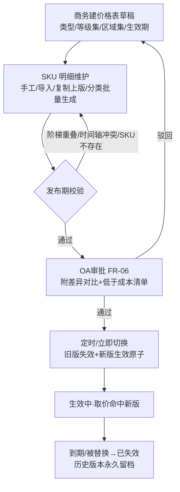
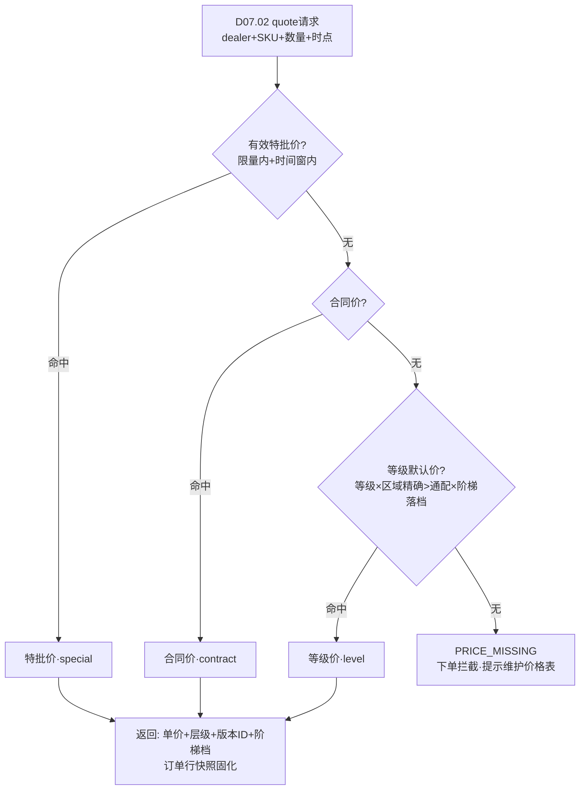

# SRS-D07.03 批发价格体系模块 需求规格说明书

> 文档编号：SRS-D07.03 · 版本 V1.0 · 2026-10-24 · 编写：小凯 · 状态：待审阅（批次⑥）
> 所属域：D07 经销分销域 · 分期：**P2（M4 之后启动）**
> **P2 后置 · 本文档为需求占位，P0 期预留位见 §1.4**——业务模型与功能需求按未来启动可直接细化开发的深度编写，处理逻辑写到规则级，不展开到 P0 实现深度。
> 上游依据：SRS-00 §3 D07 清单（Q25）· SRS-D04.01 §1.2（「批发价 → D07 P2」边界声明，P0 已定口径）· SRS-D07.01（经销商等级/区域=价格维度）· SRS-D07.02（订单取价消费方、价格快照固化）· SRS-D08.01/D08.02（应收金额口径衔接）· 逆向文档 04 §4.1（dealer.goods_price：经销商编码+基础物料编码+采购价+生效/过期时间——价格带有效期版本化）
> ⚠️ 业务假设声明：价格审批链层级（是否全部走 OA）与是否引入「经销商专属合同价」维度待 P2 启动前业务确认；本文按「等级默认价+合同价+特批价」三层编写。

---

## 1. 模块概述

### 1.1 定位

批发价格体系是经销 B2B 交易的**定价中枢**：定义价格类型（经销价/批发价/特批价）、管理多维价格表（等级×区域×时间窗×数量阶梯）及其生效版本，为 B2B 订货提供唯一取价服务（`PriceService::quote`），管控价格变更审批（OA），并保证订单价格快照→应收→结算→金蝶全链路**金额口径一致**。

商派对应机制仅一张 `dealer.goods_price`（经销商×基础物料×采购价×生效/过期时间，逆向文档 04 §4.1）——单维度、无等级/区域/阶梯、无审批与版本治理。凯淳按 B2B 分销行业惯例重建为**多维价格表+版本化生效+优先级取价**体系，是经销域内自建程度最高的模块之一。

### 1.2 职责边界

**做**：价格类型定义、多维价格表管理（等级/区域/时间窗/数量阶梯四维）、价格表版本与生效管理（草稿→审批→生效→失效）、订单取价服务（优先级规则）、特批价管理（单商单单 SKU 临时价+有效期）、价格变更审批编排（OA）、价格快照与追溯（订单行价格版本引用）、与 D08 应收/结算金额口径衔接声明。
**不做**：C 端零售价与平台价格（→ 平台侧，OMS 订单以平台成交价为准，D04.01 §1.2 既有边界）；成本价与存货计价（→ D04.07）；采购价（→ D06.02）；代销结算价（→ D04.07 settle_price/D08.02 服务费体系）；应收单金额生成本体（→ D08.01，本模块只保证口径供数一致）；经销商等级/区域主数据（→ D07.01，本模块引用为维度）。

### 1.3 与其他模块关系

| 模块 | 关系 |
|---|---|
| D07.01 经销商管理 | 等级/区域=取价维度输入；产品线授权=价格表适用范围前置校验（未授权 SKU 无价格） |
| D07.02 B2B 销售订单 | 唯一取价消费方：`quote` 返回价格+版本引用，订单行快照固化；价格过期结构化拦截（PRICE_EXPIRED） |
| D08.01 应收 | 应收金额=发货量×销售单批发价快照（D07.02 §5.2）——本模块价格即应收源头口径 |
| D08.02 结算单 | 经销结算按批发价口径归集；价格版本快照保证结算可回放 |
| D10.05 审批 | 价格表发布/变更/特批价一律 OA（资金条款红线，同 D10.01 FR-05e 口径） |
| D10.06 审计 | 价格全变更字段级审计；历史版本永久留档 |
| D11 报表 | 价格执行分析（成交价 vs 价格表偏差、特批价占比）供数 |

### 1.4 P0 期预留位与 P2 接入点（关键清单）

| # | 预留位（P0 已落地） | 所在文档与字段 | P2 接入点 |
|---|---|---|---|
| R1 | 批发价边界声明 | SRS-D04.01 §1.2「商品价格体系（订单价格以平台成交价为准；批发价 → D07 P2）」 | 商品主数据不存批发价字段（P0 未建即无需迁移）；本模块独立建价格表，经 bm_id 关联 D04.01 基础物料 |
| R2 | 经销商等级/区域维度 | SRS-D07.01 FR-01a（等级枚举/区域树，批次⑥同批占位） | 价格表维度键直接引用 dealer.level/region_id，无重复主数据 |
| R3 | 订单价格快照机制 | SRS-D04.01 §5.3（订单行固化档案快照思想）+ SRS-D03.08（价格异常复审机制） | 销售单行 price/price_version_id 固化（D07.02 §6.1）；履约订单转单携带价格快照，改价复审复用 D03.08 机制 |
| R4 | 双口径金额契约 | SRS-00 §4.4/§5「双口径金额」+ SRS-D08.01 | B2B 无平台承担口径——批发价快照即唯一应收口径，D08.01 扩展 ar_type=b2b_receivable 时口径字段按批发价填充 |
| R5 | OA 审批通道 + 配置版本化思想 | SRS-D10.05（「改价」审批类型）+ SRS-D10.01 FR-05e/SRS-D08.02 FR-01c | 价格表发布/特批价复用「改价」审批类型；价格版本治理复用「变更只对未来生效+版本快照」模式（历史订单不重算） |

---

## 2. 业务场景

**SC-D07.03-01 等级价目表发布（主场景）**
商务制定 2027 年度品牌X 批发价目表：按等级四档（战略/A/B/C）× 区域三档（华东/华北/通用）建价格表，SKU 级定价（部分 SKU 带数量阶梯：≥100 件 95 折、≥500 件 92 折），生效期 2027-01-01 起。价格表草稿 → 批量导入（D01.06）→ OA 审批（附成本参考与毛利测算）→ 审批通过按生效日自动切换版本 → 此后订货取新价，2026 年在途销售单仍按旧版本快照（不重算）。

**SC-D07.03-02 订单取价（优先级规则）**
A 级华东经销商甲订货 SKU-100 共 200 件：取价引擎按优先级——① 查有效特批价（甲×SKU-100，本月特批 88 元/件，有效期内）→ 命中，取 88 元；若无特批 → ② 查合同价（甲年度合同约定 SKU-100 90 元）→ 命中取 90；若无合同 → ③ 等级默认价（A 级×华东×200 件落阶梯档 95 折=91.2 元）。返回价格+命中层级+版本引用，销售单行快照固化。

**SC-D07.03-03 特批价申请**
乙公司（B 级）竞标大客户项目需 SKU-200 特价 85 元（低于 B 级默认价 95 元）：业务员发起特批价申请（经销商/SKU/特价/数量上限/有效期/理由+项目附件）→ OA 审批（销售总监+财务，低于成本价强制财务总监加签）→ 通过后特批价生效（限量限量期）→ 乙订货时优先级最高命中；超数量上限部分回落合同/等级价；到期自动失效。

**SC-D07.03-04 价格变更与在途单保护**
3 月 15 日等级价目表调价（SKU-300 A 级 100→105 元）：新版本审批通过即刻生效（或按指定生效日）；3 月 14 日已提交未发货的销售单价格快照=100 元不变（FR-05 版本化规则）；3 月 16 日新订货取 105 元。价格执行分析报表可查每单命中版本。

**SC-D07.03-05 无有效价格拦截**
丙公司订货含新上架 SKU-400（价格表未维护）：取价无命中 → 返回 PRICE_EXPIRED/PRICE_MISSING 结构化原因 → 下单拦截，提示商务维护价格表；商务补价（走 OA 快速通道）后经销商重新提交。

---

## 3. 功能需求

### FR-D07.03-01 价格类型体系

- FR-01a 三类价格：`经销价`（dealer_price：面向买断转售经销商的出货价，本体系主类型）/ `批发价`（wholesale_price：面向一般批发客户的通用价，等级价目表默认承载）/ `特批价`（special_price：单经销商单 SKU 临时特价，FR-04）。三类共用价格表结构与取价引擎，类型作为表属性（适用客户群配置），不做引擎分支。
- FR-01b 价格属性：不含税价/含税价（税率引用 D04.01 物料开票属性）、币种（默认 CNY，多币种 P2 内预留字段不实现）、计量单位（件/箱，箱规换算引用物料档案）。

### FR-D07.03-02 价格维度（四维模型）

- FR-02a 维度键：`等级`（D07.01 level 枚举，支持「通用」通配档）×`区域`（region 树节点，支持「全国」通配档）×`时间窗`（生效起止，多版本时间轴）×`数量阶梯`（区间下限/上限/单价或折扣率，同 SKU 内阶梯不重叠不留缝校验）。
- FR-02b 维度粒度：SKU 级为最小粒度；支持分类级/品牌级**批量生成** SKU 价（生成后落 SKU 行，取价只查 SKU 级——避免运行期层级回溯的性能与歧义问题）。
- FR-02c 通配优先级：同维命中多条时，精确 > 通配（等级精确>通用；区域精确>全国），并列时取版本新者；歧义仍在 → 配置冲突校验在发布期拦截（不允许运行期歧义）。

### FR-D07.03-03 价格表管理与生效版本

- FR-03a 价格表实体：表头（名称/价格类型/适用等级集/适用区域集/生效起止/状态）+ 明细行（bm_id/阶梯区间/单价或折扣）；一表多行，表为审批与生效的原子单位。
- FR-03b 版本生命周期：`草稿 → 审批中 → 待生效 → 生效中 → 已失效`；同一维度键组合任意时刻至多一份生效中（时间轴不重叠校验，发布期强制）；历史版本永久留档（不可改删，纠错=新版本）。
- FR-03c 批量维护：Excel 导入（D01.06，模板含维度键+阶梯列；导入校验：SKU 存在性/阶梯重叠/低于成本价标红）；复制上一版本调整（年度调价常用）；导出。
- FR-03d 生效切换：定时任务按生效日自动切换（旧版本失效+新版本生效，原子操作）；紧急调价可审批后立即生效。

### FR-D07.03-04 特批价管理

- FR-04a 特批价实体：经销商×SKU×特价×数量上限×有效期×申请理由+附件；一商一 SKU 同期至多一份有效特批。
- FR-04b 审批：一律 OA（复用 R5「改价」审批类型）；**低于成本价（D04.07 参考口径）强制财务总监加签**；审批通过即生效（或按指定日）。
- FR-04c 限量管控：累计成交达数量上限后自动失效（超额部分回落下一优先级）；到期自动失效；失效不追溯已成交订单（快照保护）。

### FR-D07.03-05 订单取价规则（唯一取价服务）

- FR-05a 取价优先级（高→低）：`特批价（有效+限量内）> 合同价（经销商年度合同约定价）> 等级默认价（等级×区域×阶梯）`；无命中 → PRICE_MISSING 拦截（禁止「无价下单后补价」——资金红线）。
- FR-05b 合同价载体：经销商合同（D10.01 FR-04 owner_contract 关联）附价格附件表（合同级 SKU 价清单，随合同生效期）；合同价本质=限定到单经销商的特批价常态化形态，共用价格表结构（维度键 dealer_id 精确匹配）。
- FR-05c 取价返回：单价+命中层级（special/contract/level）+价格表版本 ID+阶梯档——`quote` 结果被 D07.02 订单行快照固化（价格版本引用随单永久可追溯，回放能力对齐 D08.02 FR-04c 计算轨迹思想）。
- FR-05d 数量阶梯按**订单行数量**落档（单行累计，不跨行/跨单合并；合并计价需求 P2 启动时按业务确认决定是否引入）。
- FR-05e 变更保护：价格版本切换只影响**未来取价**；已提交销售单/已生成应收一律按快照，不重算（R5 治理模式）。

### FR-D07.03-06 价格变更审批（OA）

- FR-06a 审批范围：价格表发布/变更/提前失效、特批价申请、合同价录入——全量 OA（资金条款红线）；审批单携带差异对比（新版本 vs 现行版本：调价 SKU 数/平均涨跌幅/低于成本清单）。
- FR-06b 审批分级：常规调价=销售总监；低于成本价/涨跌幅超阈值（配置，默认 ±15%）=财务总监加签；战略经销商合同价=总经理。
- FR-06c 审批回调驱动版本状态迁移（幂等，OA 实例号防重）。

### FR-D07.03-07 与 D08 应收的金额口径衔接

- FR-07a 口径唯一：B2B 应收金额=发货量×销售单批发价快照（D07.02 §5.2）——价格快照是应收、结算、金蝶供数的**唯一金额源头**；全链路禁止二次取价（发货时/结算时重查价格表=口径漂移，明令禁止）。
- FR-07b 含税口径：应收按含税价挂账（税率快照随价格版本），价税分离供金蝶（D08.06 既有通道）；不含税价为毛利分析口径（D11 报表）。
- FR-07c 价格折让/补差：成交后商务折让不在本模块改价，走 D07.02 应收调整（红字冲减）——价格快照不可变原则的配套通道。

---

## 4. 业务流程

### 4.1 价格表发布与生效流程

### 4.2 订单取价优先级流程

---

## 5. 处理逻辑（规则级）

### 5.1 取价引擎规则

1. 特批价：`dealer_id+bm_id` 精确键，时间窗内且累计成交<上限；
2. 合同价：经销商生效合同的价格附件行（dealer_id 精确键）；
3. 等级价：`(level=商等级 OR 通用) ∧ (region∈商区域路径 OR 全国) ∧ time∈生效窗`，精确>通配排序取首，按 qty 落阶梯档；
4. 命中返回 `(price, hit_level, version_id, ladder_band)`，未命中 PRICE_MISSING；阶梯区间左闭右开，落档取该档单价或基准价×折扣率；
5. 性能：价格表 Redis 缓存（维度键 Hash），版本切换事务后失效重建，quote P99 ≤10ms（下单热路径）。

### 5.2 版本时间轴治理规则

- **不重叠**：同维度键（类型×等级×区域×SKU×阶梯结构）时间轴任意时刻至多一版本生效，发布期校验强制；
- **不留缝（软）**：断档允许存在但发布页提示（断档期取价=PRICE_MISSING 拦截）；
- **不可变**：生效中/已失效版本禁止修改（纠错=新版本+OA），草稿可改；
- **快照引用**：订单行固化 version_id，历史订单价格可精确回放（审计与结算争议依据）。

### 5.3 口径衔接一致性规则

销售单行 price（快照）→ 转履约订单行价格快照 → 发货后应收金额=发货量×快照价 → 结算归集（D08.02）按同快照；全链路无二次取价点，折让/补差走应收红字调整（D07.02 FR-07）不改快照；价税：含税价挂应收，税率快照随版本，价税分离供金蝶（D08.06）。

---

## 6. 数据字段（业务字段描述，P2 建表）

### 6.1 价格表（b2b_price_list / _item）

| 字段 | 业务含义 | 取值/校验 |
|---|---|---|
| list_id / list_name / price_type | 表标识/名称/价格类型 | 经销价/批发价/特批价（FR-01a） |
| level_scope / region_scope | 适用等级集/区域集 | 含通配档（通用/全国） |
| effect_from / effect_to | 生效时间窗 | 不重叠校验（§5.2） |
| status / version_no / oa_instance_id | 状态/版本/审批引用 | §FR-03b 生命周期 |
| ——明细行—— | | |
| bm_id / dealer_id | 物料/特批经销商（等级价为空） | 特批与合同价精确键 |
| ladder_json | 数量阶梯 | [{下限,上限,单价|折扣率}]，区间校验 |
| price_tax / price_net / tax_rate | 含税价/不含税价/税率 | 税率引用物料开票属性快照 |
| cost_ref / below_cost_flag | 成本参考价/低于成本标记 | 审批加签依据（FR-06b） |
| qty_limit / sold_qty | 特批数量上限/累计成交 | 限量管控（FR-04c） |
| tenant_id | 租户 | 必填 |

### 6.2 价格版本轨迹（b2b_price_version_log）

list_id/version_no/action（发布/变更/提前失效/切换）+ diff_snapshot_json（差异对比快照：调价 SKU 数/涨跌幅/低于成本清单，审批附件同源）+ oa_instance_id/operator/action_time（append-only 不可改删）。

---

## 7. 接口（P2 实现，本期占位定义）

### 7.1 内部接口

| 编号 | 接口 | 消费方 | 说明 |
|---|---|---|---|
| IF-D07.03-01 | `PriceService::quote(dealerId, items[{bmId, qty}], time)` | D07.02 下单/试算 | 唯一取价入口（§5.1，返回价+层级+版本引用） |
| IF-D07.03-02 | `PriceListService::save/import/submit/publish(listId)` | 价格工作台/OA 回调 | 价格表管理与版本切换（幂等） |
| IF-D07.03-03 | `SpecialPriceService::apply/approve/consume(特批单)` | 工作台/OA 回调/D07.02 成交回写 | 特批价申请与限量累计 |
| IF-D07.03-04 | `PriceQueryService::getVersion/list/dealerPriceView(dealerId)` | 门户（本商价格查看）/D11 | 版本查询与经销商价格视图 |
| IF-D07.03-05 | 事件 `b2b.price.published/expired`、`b2b.special.consumed_out` | D07.02（价格缺失提示）/门户通知/D11 | 版本广播（DB-00 事件字典登记） |

### 7.2 外部接口

| 编号 | 接口 | 方向 | 说明 |
|---|---|---|---|
| EF-D07.03-01 | OA 审批（经 D10.05） | 双向 | 价格表发布/变更、特批价、合同价（复用「改价」审批类型，R5） |

---

## 8. 非功能需求

| 项 | 要求 |
|---|---|
| 性能 | `quote` 为下单热路径：缓存命中 P99 ≤10ms；批量试算（200 行购物车）≤200ms；版本切换（10 万行价格表）≤30s |
| 一致性 | 版本切换原子（旧失效+新生效同事务）；缓存事务后失效重建；特批限量累计与成交回写最终一致（日终对账兜底）；发布期冲突校验强制（运行期零歧义） |
| 审计/安全 | 价格全变更字段级审计+版本永久留档；批发价与成本价为最高敏感字段（D10.03 字段级权限：仅商务/财务角色；经销商门户只见本商成交价，永不见成本与他人价格）；OA 审批不可绕过（直接改库无生效路径） |
| 资金红线 | 无价禁止下单（PRICE_MISSING 硬拦截）；生效版本不可变；全链路禁二次取价（FR-07a） |
| 容量 | SKU 10 万×等级 4×区域 3 全展开约百万行/版本——明细行按 list_id 分区，仅生效版本进缓存 |

---

## 9. 验收标准（P2 启动时生效）

| 编号 | 验收条件 |
|---|---|
| AC-01 | SC-02 取价优先级：构造特批/合同/等级三层同时存在，命中特批价且返回层级=special+版本引用；逐层移除后依次回落合同价、等级价；全无命中返回 PRICE_MISSING 且下单被拦截 |
| AC-02 | 数量阶梯：199/200/500 件分别落正确档位（左闭右开边界）；阶梯重叠配置发布期被拒 |
| AC-03 | 维度通配优先级：等级精确>通用、区域精确>全国；发布期构造同键双生效版本被拒（时间轴不重叠校验） |
| AC-04 | SC-04 版本切换保护：调价生效后新订单取新价、已提交销售单快照价不变、应收按快照金额挂账；历史订单可按 version_id 精确回放当时价格 |
| AC-05 | 特批限量与到期：累计成交达上限后新订单回落下一优先级；到期自动失效不追溯已成交单 |
| AC-06 | OA 审批：低于成本价特批触发财务总监加签；未经审批的价格修改无生效路径；审批回调重复投递幂等 |
| AC-07 | 口径衔接（FR-07）：同一销售单从价格快照→履约订单→应收→结算金额全链路一致（零漂移）；折让走红字调整后快照不变 |
| AC-08 | 权限与敏感数据：经销商门户只见本商成交价；成本价列对非授权角色不可见；价格导出走水印与审计 |

---

## 变更记录

| 日期 | 版本 | 变更 | 原因 |
|---|---|---|---|
| 2026-10-24 | V1.0 | 首版（P2 需求占位 + P0 预留位清单） | — |

---

*参考实现溯源：商派 dealer.goods_price（经销商编码+基础物料编码+采购价+价格单位+生效时间/过期时间——价格带有效期版本化，逆向文档 04 §4.1）+ goods 经销商货品成本价 + series 产品线作为价格载体。关键差异：① 商派仅「经销商×SKU」单维价，凯淳扩展为**等级×区域×时间窗×数量阶梯四维+特批/合同/等级三层优先级取价引擎**（商派无取价服务概念，价格直接录在订单）；② 版本治理产品化（时间轴不重叠校验/生效版本不可变/订单行版本引用可回放——商派仅生效/过期时间两字段无冲突治理）；③ 价格变更全量 OA 审批+低于成本加签（商派无审批）；④ **复用既有域不另建体系**——审批复用 D10.05「改价」类型、版本化治理模式复用 D10.01 FR-05e/D08.02 FR-01c、快照固化思想复用 D04.01 §5.3、计算轨迹回放对齐 D08.02 服务费引擎；⑤ 应收口径单一化（价格快照为唯一源头，全链路禁二次取价——商派 sales 结算宽表多口径字段并存易漂移的教训）。*
