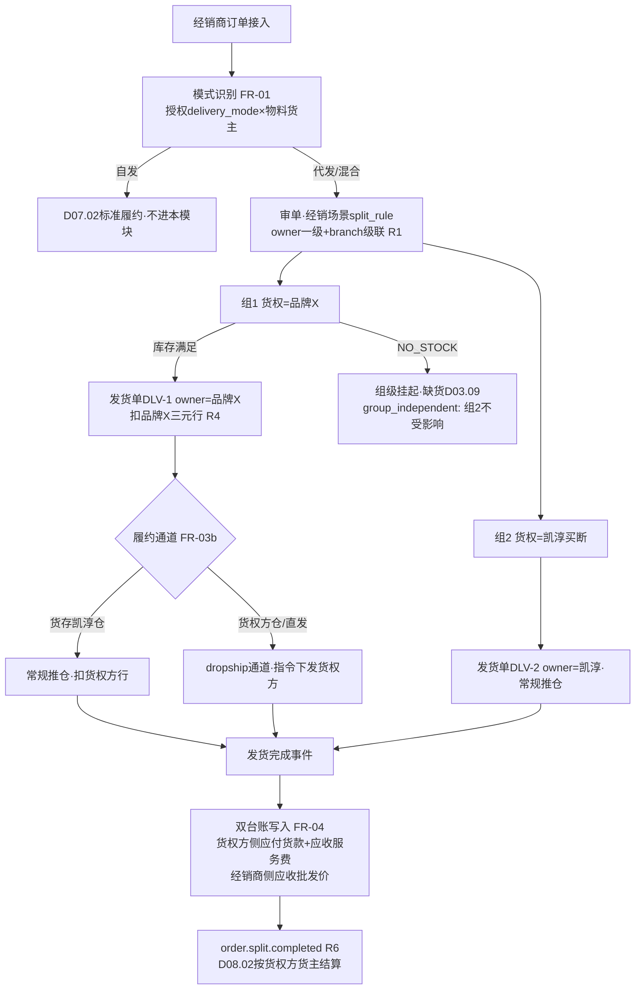

# SRS-D07.04 转单与货权拆分模块 需求规格说明书

> 文档编号：SRS-D07.04 · 版本 V1.0 · 2026-10-24 · 编写：小凯 · 状态：待审阅（批次⑥）
> 所属域：D07 经销分销域 · 分期：**P2（M4 之后启动）**
> **P2 后置 · 本文档为需求占位，P0 期预留位见 §1.4**——业务模型与功能需求按未来启动可直接细化开发的深度编写，处理逻辑写到规则级，不展开到 P0 实现深度。
> 上游依据：SRS-00 §3 D07 清单（D07.04「按货权主体分组拆单（机制在 D03.04 P0 预留，业务界面 P2）」）· SRS-D03.04（FR-02 #2 `owner` 按货主拆单策略 + FR-05f「经销扩展预留（P2）：D07.04 转单货权拆分复用本策略，机制 P0 预留、业务界面 P2」）· SRS-D04.05 FR-04（货权转移购销：配对出入库单据+财务购销记录）· SRS-D08.02（货主级结算）· 逆向文档 04 §4.4（dealer.platform_orders 转单：按贸易公司 betc 分组 batchCreateErpOrders——货权分离在订单层的落地）与 §12-2（转单按货权主体分组拆单是货权分离关键机制，必须保留）
> ⚠️ 业务假设声明：代发业务中货权方（品牌方/其他贸易主体）与凯淳的结算模式（凯淳购断转售 / 佣金代理）待 P2 启动前业务确认，本文两种模式均建模。

---

## 1. 模块概述

### 1.1 定位

转单与货权拆分处理经销分销域的**代发货权场景**：经销商店铺的消费者订单（或经销商 B2B 订单中约定直发的部分），货不在凯淳买断货主名下，而由品牌方/其他贸易主体直接履约（代发）。本模块定义：① 转单业务模型（经销商订单→按货权主体分组→各货权方履约单）；② 经销场景的拆单策略参数（**复用 D03.04 按货主拆单策略——机制 P0 已预留，本模块只定义业务参数与编排，不新建拆单引擎**）；③ 代发双向结算台账（货权方应收凯淳 / 凯淳应收经销商）；④ 货权转移场景衔接（D04.05 FR-04 购销转移）。

商派验证的核心机制（逆向文档 04 §4.4/§12-2）：dealer.platform_orders 转单按贸易公司（betc，货权主体）分组生成多张 OMS 订单——「转单按货权主体分组拆单是货权分离的关键机制，必须保留」。凯淳继承该机制，但落地方式不同：商派转单是**独立代码路径**（dealer 域内 batchCreateErpOrders 自建订单），凯淳转单=**D03.04 owner 策略的业务化应用**（同一拆单引擎、同一守恒校验、同一发货单落库通道），机制不重复建设。

### 1.2 职责边界

**做**：转单业务定义与订单模式识别（自发/代发/混合）、经销场景拆单策略参数定义（owner 策略在经销链路的 split_config 与级联编排）、转单单据管理（经销商源单→货权方履约单映射与状态跟踪）、代发双向台账（货权方应付/经销商应收两本账+轧差）、货权转移衔接（代发转买断、店铺换货主场景调用 D04.05 FR-04）、代发结算联动（D08.02 双向结算数据供给）。
**不做**：拆单引擎与策略执行（→ D03.04，本模块只注册经销场景规则参数）；履约执行（→ D03/D09 既有链路）；经销商订单本体（→ D07.02，本模块消费其订单模式分流）；授权与发货方式主数据（→ D07.01 FR-04c 自发/代发授权）；购销转移单据本体（→ D04.05 FR-04，本模块只做场景编排调用）；结算单生成（→ D08.02，本模块供数）。

### 1.3 与其他模块关系

| 模块 | 关系 |
|---|---|
| D03.04 拆单策略中心 | **核心复用**：owner 策略（FR-02 #2）+ FR-05f 经销扩展预留位；本模块定义经销场景 split_rule（货主分组作级联第一层，FR-05e 优先级规则直接继承） |
| D07.01 经销商管理 | 消费授权发货方式（delivery_mode=代发的 SKU/店铺范围）判定订单模式 |
| D07.02 B2B 销售订单 | 消费其订单模式标记分流：自发订单不进本模块；代发/混合订单转本模块编排 |
| D03.01 订单接入 | 代发履约单创建（货主=货权方 DEALER_TC/BRAND_CONSIGN 视货权归属）走既有转入通道 |
| D04.02/D04.03 | 代发场景库存记账：货权方三元行（货主=品牌方/贸易公司）预占与扣减，凯淳买断行不动 |
| D04.05 仓间调拨 | FR-04 货权转移（购销）：代发转买断、经销商换货主场景的配对单据来源 |
| D08.01/D08.02 | 双向台账供数：货权方侧（凯淳应付货款/应收服务费）走 D08.02 既有货主结算；经销商侧应收走 D07.02 FR-06 台账 |
| D10.01 组织货主 | 货权方=货主档案（BRAND_CONSIGN 或 DEALER_TC 贸易公司）；组织树贸易公司层级（R2 of D07.01） |
| D02.03/D02.04 | 代发消费者订单场景：经销商店铺若接入 OMS 拉单（D02.06 店铺授权挂经销层级节点），发货回传复用既有回传中心 |

### 1.4 P0 期预留位与 P2 接入点（关键清单）

| # | 预留位（P0 已落地） | 所在文档与字段 | P2 接入点 |
|---|---|---|---|
| R1 | 按货主拆单策略（owner） | SRS-D03.04 FR-02 #2：触发场景明示「或 D07 经销货权拆分（P2 预留）」；§5.2 分组算法（按明细行物料 owner_id 分组，组属性携带 owner_id→发货单必填） | **零引擎改动**：经销转单=注册经销场景 split_rule（owner 一级+仓/重量级联），策略代码 P0 已实现 |
| R2 | 经销扩展预留条款 | SRS-D03.04 FR-05f：「D07.04 转单货权拆分复用本策略（货主类型=经销商/贸易公司），机制 P0 预留、业务界面 P2」 | 本模块=该条款的兑现文档；混货主拦截（FR-05e CONFIG_INVALID）在经销链路同样生效 |
| R3 | 货主类型枚举 | SRS-D10.01 FR-03a：DEALER_TC（经销商贸易公司）P0 预留 | 货权方主体建档：其他贸易公司=DEALER_TC 货主；品牌方直发=既有 BRAND_CONSIGN 货主，三元记账自动分账 |
| R4 | 三元记账键 | SRS-00 §4.4 契约 + SRS-D04.02：(branch_id, sku_id, owner_id) | 代发库存按货权方 owner 行记账与扣减，货权分离在库存账天然成立 |
| R5 | 货权转移（购销） | SRS-D04.05 FR-04（P1）：转移单→配对出入库单据+新物料档案建议（same_code_group）+财务购销记录 | 代发转买断/店铺换货主场景直接调用其界面化流程，本模块只做触发编排 |
| R6 | 按货主拆单=结算分账依据 | SRS-D03.04 FR-05c/IF-D03.04-05（`order.split.completed` 事件含 owner_id 组属性，D08 分账消费） | 代发双向结算的单据粒度=货主维度发货单，D08.02 按货权方货主正常生成结算单 |
| R7 | 渠道拆单 dropship 标记 | SRS-D03.04 FR-02 #14 `channel` 策略：供应商直发组打 `dropship` 标记 | 代发发货单标记复用（推仓通道分流：货权方指定仓/供应商直发通道） |
| R8 | 借调台账模式 | SRS-D04.05 FR-02（借调规则+settle_price_type 结算取数）+ SRS-D08.02 FR-02c 第 4 要素（借调内部交易入结算） | 货权方货物临时放凯淳仓代发场景（货动代发）参照借调台账双向勾稽模式建代发台账 |

---

## 2. 业务场景

**SC-D07.04-01 代发订单转单（主场景）**
经销商甲的抖音店铺产生消费者订单 3 行：SKU-A×1（货权=品牌X 代销）、SKU-B×1（货权=品牌X 代销）、SKU-C×1（货权=凯淳买断）。授权判定（D07.01：SKU-A/B 代发、SKU-C 自发）→ 订单标记混合模式 → 审单时经销场景 split_rule 生效：owner 策略一级分组 → 组1{SKU-A,B}（owner=品牌X）+ 组2{SKU-C}（owner=凯淳）→ 2 张发货单：组1 推品牌X 指定仓/直发通道（dropship 标记），扣品牌X 三元行；组2 推凯淳常规仓，扣凯淳买断行。经销商视角一张订单两个包裹；结算视角两本账天然分离（R6）。

**SC-D07.04-02 B2B 订单约定直发（代发批发）**
经销商乙 B2B 销售单中 500 件约定由品牌Y 贸易主体直发乙仓（凯淳不经手货物）：D07.02 订单行标记代发+货权方=品牌Y → 本模块生成货权方履约单（货主=品牌Y）→ 品牌Y 仓出库回传 → 双台账联动：货权方侧凯淳应付品牌Y 货款 500×供货价（D08.02 品牌Y 货主结算单 E 项语义扩展）；经销商侧乙应付凯淳 500×批发价快照（D07.02 FR-06 应收台账）。凯淳赚差价，货不动凯淳账（无凯淳三元行流水——货权全程在品牌Y，出库即品牌Y 行扣减）。

**SC-D07.04-03 代发转买断（货权转移衔接）**
品牌Z 的代发 SKU 销量稳定，凯淳决定买断转自营：发起货权转移（调用 D04.05 FR-04 购销流程，R5）：转移单（源货主=品牌Z，目标=凯淳买断）→ OA 审批 → 配对单据：品牌Z 销售出库+凯淳采购入库 → 新物料档案建议（same_code_group 关联，D04.01 货主建档后不可改规则的配套机制）→ 财务购销记录供金蝶。转移完成后该 SKU 授权模式由代发切自发（D07.01 FR-04c 时间窗切换），后续订单走凯淳买断履约。

**SC-D07.04-04 货权方代发台账对账**
月末与品牌X 对账代发业务：代发台账（镜像借调台账双向勾稽模式，R8）——本月代发出库 1.2 万件×结算价（settle_price_type=内部购销价，D04.05 同款配置）=凯淳应付品牌X 货款 36 万；轧差：品牌X 应付凯淳代发服务费（合同约定 2 元/件=2.4 万）→ 净额凯淳应付 33.6 万 → 数据供 D08.02 品牌X 货主结算单（既有五要素结构，代发货款入销售应收/应付侧对应要素）→ 门户确认闭环。台账行与发货单（货主=品牌X）逐单勾稽，差额校验=0 才许关账。

**SC-D07.04-05 转单失败与人工介入**
混合订单审单时货权方品牌X 无可用库存（三元行不足）：owner 策略分组正常但 stock_depth 级联层返回 NO_STOCK（组1）→ 引擎整体规则：组1 不落库进缺货流程（D03.09），组2（凯淳货）正常履约——**经销场景允许组级部分成功**（区别于 D03.04 FR-04c 级联内任一层失败整体失败：那是单次策略内语义，组间独立履约是本模块的业务参数，经 split_rule 配置 `group_independent=true` 表达）。组1 后续到货续拆（D03.04 FR-06c 机制复用）或协商退款（联动 D07.02 行级冲减）。

---

## 3. 功能需求

### FR-D07.04-01 转单业务定义与订单模式识别

- FR-01a 模式枚举（订单/行两级）：`自发`（货主=凯淳买断，D07.02 标准履约）/ `代发`（货权方直发，货主=货权方）/ `混合`（一单多货权，走拆分）；判定依据=D07.01 授权记录 delivery_mode（SKU×店铺×时间窗）+ 物料货主归属（D04.01 owner_id）。
- FR-01b 识别时点：B2B 销售单审核时（D07.02 转履约前）预判定并标记；消费者代发订单（经销商店铺接入拉单场景）在订单接入时判定（D03.01 订单行扩展 `dropship_mode`/`cargo_owner_id` 字段位）。
- FR-01c 转单单据（convert_order）：经销商源单（B2B 销售单/店铺平台单）→ 货权方履约单（1:N，按货权主体分组）映射关系与状态跟踪（未转/部分转/已转/转失败——继承商派 platform_orders.convert_status 枚举语义，unconvert/converted/needless/splitting/fail）；映射行级溯源（源单行→履约单行，对齐 D03.04 split_trace 思想）。
- FR-01d 商派语义差异声明：商派转单=dealer 域自建 ERP 订单（独立代码路径）；凯淳转单=owner 策略分组+D03.01 标准转入通道（**同一订单引擎**），转单单据只做映射与跟踪层，不落第二套订单。

### FR-D07.04-02 经销场景拆单策略参数（复用 D03.04，零引擎改动）

- FR-02a 经销转单 split_rule 注册：一级 `owner`（货权分组，硬约束——FR-05e 混货主拦截自动生效）+ 级联二级 `branch`（各货权组内按仓）/`weight`（可选）；`group_independent=true`（组间独立履约，SC-05 部分成功语义）；规则生效范围=经销 B2B 订单分组/代发店铺（D03.02 订单分组规则匹配，机制既有）。
- FR-02b 组属性扩展：代发组携带 `cargo_owner_id`（货权方）+`dropship` 标记（R7，推仓通道分流依据）+ 授权记录引用（endorse_ref，结算与追溯）。
- FR-02c 守恒与进度：完全复用 D03.04 §5.4 守恒校验与 FR-06 拆单进度（split_num/splited_num）；组级部分成功时未成功组余量进待续拆状态（FR-06c 复用）。
- FR-02d 本模块交付物=策略参数配置模板+经销审单规则组建议（文档级），**不新增策略代码**；若 P2 启动发现「货权方指定仓」需独立策略，按 D03.04 FR-01b 注册机制扩展（注册即生效，不改引擎）。

### FR-D07.04-03 代发履约编排

- FR-03a 货权方履约单：货主=货权方 owner_id（品牌X 代销/贸易公司 DEALER_TC）；库存预占与扣减按货权方三元行（R4）；凯淳买断行零流水（货不动凯淳账场景，SC-02）。
- FR-03b 履约通道分流：货权方货物存凯淳仓（货动代发）→ 常规推仓（通天晓），出库扣货权方三元行；货权方自有仓/供应商直发（货不动）→ dropship 通道（发货指令下发货权方，物流回传对接——经 D09 适配层扩展，P2 实现）。
- FR-03c 发货回传：代发消费者订单的平台回传复用 D02.04 回传中心（店铺=经销商店铺，授权挂经销组织层级节点）。
### FR-D07.04-04 代发双向结算台账

- FR-04a **双本账**：① 货权方侧（凯淳↔货权方）：代发出库量×结算价=凯淳应付货款；代发服务费（合同费率/件）=货权方应付凯淳；双向轧差净额（镜像 D08.02 FR-03a 净额语义）→ 数据供 D08.02 该货权方货主结算单（既有五要素结构，不新建单据类型）。② 经销商侧（凯淳↔经销商）：代发量×批发价快照=经销商应付凯淳 → 走 D07.02 FR-06 应收台账。
- FR-04b 台账结构：镜像 D04.05 借调台账（lend_ledger）模式（R8）——append-only 流水+settle_month/settle_status 回写位+周期消耗汇总（`LendLedgerService::query` 同款查询语义，D08.02 FR-02c 第 4 要素取数通道直接扩展 dropship 类型）；**双向勾稽**：凯淳侧台账行与货权方侧结算单明细金额相等方向相反（D08.02 §5.2 镜像勾稽校验复用）。
- FR-04c 结算价类型：内部购销价/成本价/免费（D04.05 settle_price_type 枚举复用）；代发服务费条款落货权方合同配置（D08.02 FR-04 服务费引擎复用，基数=代发出库量或货值可配）。
- FR-04d 差额校验与关账：台账月度快照+差额=0 校验（D06.04 §5.2 同款算法）；不平阻断关账+定位工单。

### FR-D07.04-05 货权转移场景衔接（D04.05 §FR-04 购销转移）

- FR-05a 触发场景：代发转买断（SC-03）、经销商终止时存货处置、店铺换货主涉及经销存货（D10.01 SC-03 资产转移联动）。
- FR-05b 编排规则：本模块发起转移申请（源货主/目标货主/物料明细/转移价）→ **调用 D04.05 FR-04 既有界面化流程**（配对出入库单据+新物料档案建议 same_code_group+财务购销记录+OA 审批），不重复建单据模型。
- FR-05c 转移完成联动：授权模式切换建议（D07.01 FR-04c 时间窗）、价格表适用性检查（D07.03：买断后批发价维度变化提示）、在途订单处置清单（未发货行按新货权重审/已发货不动）。

### FR-D07.04-06 转单跟踪工作台与查询

- FR-06a 工作台：转单队列（未转/转失败）、失败原因结构化（继承 D03.04 错误码族+NO_STOCK 组级挂起视图）、人工介入（改货权方/改仓/协商退款联动）。
- FR-06b 查询：源单→履约单→发货单→台账行全链路追溯（单号任一点进入正反向查询）；代发业务量报表（按货权方/经销商/SKU，D11 供数）。

---

## 4. 业务流程

### 4.1 代发转单主流程（SC-01 混合订单）

### 4.2 代发转买断（货权转移）流程

商务发起（SKU 清单+转移价）→ 本模块编排 FR-05 调用 D04.05 FR-04 购销流程（R5）→ OA 审批（驳回关闭留痕）→ 通过后生成配对单据（货权方销售出库+凯淳采购入库+same_code_group 档案建议+财务购销记录→金蝶 D08.06）→ 联动：授权代发→自发切换建议（D07.01）+价格表适用检查（D07.03）+在途订单处置清单。

---

## 5. 处理逻辑（规则级）

### 5.1 订单模式判定规则

- 逐行取授权：`EndorseService.getAuth(dealer, shop, sku, time)` → delivery_mode=代发时行货权方=授权产品线归属主体（贸易公司/品牌）；自发时行货权方=物料 owner_id（凯淳买断）；
- 汇总判定：全部行货权方=凯淳 → 自发（不进本模块）；单一非凯淳货权方 → 整单代发；多货权方 → 混合（必走 owner 拆分，混货主拦截 D03.04 FR-05e 自动兜底）；
- 无授权记录 → AUTH_MISSING 拦截（禁止无授权代发）。

### 5.2 组级独立履约参数（对 D03.04 的业务化配置）

- 一级 `owner`（货权分组硬约束，D03.04 FR-05e 优先级继承）+ 二级 `branch`（或 stock_depth，组内按仓/可用量）；
- `group_independent=true`：组间独立，一组 NO_STOCK 不阻断其他组落库（SC-05；失败组进缺货+续拆，D03.04 FR-06c 复用）；
- 守恒口径=组内守恒：成功组行 split_num 写满，挂起组余量保留待续拆（守恒校验按「分配+挂起=余量」扩展口径，登记于 split_trace）。

### 5.3 双向台账勾稽规则

- 代发发货完成（货权方组）写入双侧流水：货权方侧 {代发出库：应付货款=num×结算价；代发服务费：应收=num×合同费率或货值×费率}；经销商侧 {代发应收=num×批发价快照}（入 D07.02 FR-06 台账）；
- 镜像勾稽（D08.02 §5.2 复用）：凯淳应付货权方行 ↔ 货权方结算单应收行金额相等方向相反；净额=Σ应付货款−Σ应收服务费 → D08.02 该货权方结算单（既有要素结构，双向呈现）；
- 月度：快照+差额校验=0 关账；settle_month/settle_status 回写（R8 借调台账同款位）。

---

## 6. 数据字段（业务字段描述，P2 建表）

### 6.1 转单单据（dropship_convert / _item）

| 字段 | 业务含义 | 取值/校验 |
|---|---|---|
| convert_bn / source_type / source_bn | 转单号/源单类型（B2B 销售单/平台单）/源单号 | 幂等键=(source_bn, 货权方, 批次) |
| dealer_id / cargo_owner_id | 经销商/货权方货主 | 必填；货权方=BRAND_CONSIGN 或 DEALER_TC |
| convert_status | 转单状态 | 未转/部分转/已转/转失败/无需转（商派 convert_status 枚举语义继承） |
| fulfill_order_ids | 货权方履约单集合 | 1:N 映射（关系表行级溯源） |
| fail_code / fail_detail | 失败原因 | D03.04 错误码族复用 |
| ——明细行—— | source_item_ref/bm_id/qty/endorse_ref | 源单行引用/物料/数量/授权记录引用（授权缺失拦截 §5.1） |
| dropship_flag / channel_type | 直发标记/通道（凯淳仓代发/货权方仓/供应商直发） | R7 |
| owner_id / tenant_id | 归属 | 全域契约必填 |

### 6.2 代发台账（dropship_ledger）

维度键 cargo_owner_id/dealer_id/period（双向维度）+ 流水字段 object_type（代发出库/服务费/调整）/direction（凯淳应付/应收，append-only 红冲纠错）/num/settle_price_type（内部购销价/成本价/免费，D04.05 枚举复用）/unit_price/amount + 关联 ref_delivery_id/ref_convert_bn（逐单勾稽依据）+ 结算位 settle_month/settle_status（R8，D08.02 归档回写）+ 月度 snapshot_json/difference/close_status（差额=0 才许关账，D06.04 §5.2 算法）+ tenant_id 必填。

---

## 7. 接口（P2 实现，本期占位定义）

### 7.1 内部接口

| 编号 | 接口 | 消费方 | 说明 |
|---|---|---|---|
| IF-D07.04-01 | `DropshipService::judgeMode(dealerId, shopId, items[])` | D07.02 审核/D03.01 接入 | 订单模式判定（§5.1） |
| IF-D07.04-02 | `DropshipService::getConvertRule(dealerId, shopId)` | D03.02 审单引擎 | 经销场景 split_rule 引用（FR-02a 参数模板） |
| IF-D07.04-03 | `DropshipLedgerService::query(cargoOwnerId, period)` / `genSnapshot/closeMonth` | D08.02 取数/对账工作台 | 代发台账查询与关账（`LendLedgerService::query` 同款语义扩展） |
| IF-D07.04-04 | `CargoTransferService::apply(源货主, 目标货主, items, 价)` | 转单工作台 | 货权转移编排（转调 D04.05 FR-04，不重复建单据） |
| IF-D07.04-05 | 事件 `dropship.convert.completed/failed`、`dropship.ledger.posted` | D07.02（进度回写）/D08.02/D11 | 转单与台账广播（DB-00 事件字典登记） |

### 7.2 依赖接口（本模块消费）

| 编号 | 接口 | 提供方 | 说明 |
|---|---|---|---|
| IF-D07.04-D1 | `SplitService::split`（owner 策略+级联） | D03.04（IF-D03.04-01） | 拆单执行（R1/R2 预留位兑现） |
| IF-D07.04-D2 | `order.split.completed` 事件 | D03.04（IF-D03.04-05） | 分账依据（组属性含 owner_id，R6） |
| IF-D07.04-D3 | `EndorseService::getAuth` | D07.01（IF-D07.01-05） | 授权与发货方式判定 |
| IF-D07.04-D4 | 货权转移购销流程 | D04.05 FR-04 | 配对单据+档案建议+财务记录（R5） |
| IF-D07.04-D5 | `SettleQueryService/ServiceFeeService` | D08.02 | 货权方结算与服务费引擎复用（FR-04c） |
| IF-D07.04-D6 | 三元记账预占/扣减 | D04.02/D04.03 | 货权方行记账（R4） |

### 7.3 外部接口

| 编号 | 接口 | 方向 | 说明 |
|---|---|---|---|
| EF-D07.04-01 | 货权方直发指令下发与物流回传（经 D09 适配层扩展） | 双向 | dropship 通道（货权方自有仓/供应商直发），P2 实现 |
| EF-D07.04-02 | OA 审批（经 D10.05） | 双向 | 货权转移/转单人工改货权 |

---

## 8. 非功能需求

| 项 | 要求 |
|---|---|
| 性能 | 模式判定（100 行订单含授权查询）≤100ms；拆单复用 D03.04 性能契约（P99 ≤100ms）；台账流水写入异步化（发货事件驱动，不阻塞履约） |
| 一致性 | 转单幂等（源单+货权方+批次唯一键）；台账与发货单逐单勾稽+月度差额校验强制关账（D06.04 同规则）；镜像双向勾稽校验（凯淳侧↔货权方结算单，D08.02 §5.2 复用）；组级部分成功的守恒口径显式登记 split_trace（防丢行） |
| 幂等 | 发货事件重复投递台账不双写；货权转移编排以转移单号 CAS；OA 回调按实例号幂等 |
| 安全/权限 | 结算价/服务费率=财务+商务主管可见（D10.03）；经销商门户只见本商代发订单与应收，不见货权方结算价（三方价格隔离）；货权转移全程审计（D10.06） |
| 容量 | 代发台账随发货量增长（月 10 万行级）按年分区；转单单据随订单归档（D03.13 机制复用） |

---

## 9. 验收标准（P2 启动时生效）

| 编号 | 验收条件 |
|---|---|
| AC-01 | SC-01 混合订单转单：3 行两货权产出 2 张发货单（owner_id 各自唯一），组1 扣品牌X 三元行、组2 扣凯淳行；`order.split.completed` 事件组属性含 cargo_owner+dropship 标记；全程零拆单引擎代码改动（复用验证，R1/R2） |
| AC-02 | 模式判定：代发/自发/混合三态判定正确；无授权记录 SKU 被 AUTH_MISSING 拦截；授权时间窗外订单按判定规则拦截或回落自发（按 D07.01 授权语义） |
| AC-03 | SC-05 组级独立：组1 NO_STOCK 挂起进缺货流程时组2 正常落库发货；挂起组余量保留、到货后续拆成功；split_trace 登记「分配+挂起=余量」守恒口径 |
| AC-04 | SC-02 货不动凯淳账：品牌Y 直发场景凯淳买断三元行零流水；货权方行正确扣减；经销商侧应收=批发价快照、货权方侧应付=结算价，两本账金额独立正确 |
| AC-05 | 双向勾稽：凯淳侧代发台账应付行与货权方 D08.02 结算单对应明细金额相等方向相反；构造差异后镜像勾稽校验失败阻断结算归档 |
| AC-06 | 台账关账：月度快照差额=0 关账成功；篡改流水后差额≠0 阻断+定位工单；settle_month/settle_status 由 D08.02 归档正确回写 |
| AC-07 | SC-03 货权转移：转移调用 D04.05 FR-04 生成配对单据+same_code_group 档案建议+财务购销记录；OA 通过才执行；完成后授权切换建议与在途订单处置清单生成；转移期间新单按原货权履约不中断 |
| AC-08 | 全链路追溯：从转单号可正反向查询源单行→履约单→发货单→台账行→结算单明细，任一环单号进入均可完整回溯 |

---

## 变更记录

| 日期 | 版本 | 变更 | 原因 |
|---|---|---|---|
| 2026-10-24 | V1.0 | 首版（P2 需求占位 + P0 预留位清单） | — |

---

*参考实现溯源：商派 dealer 域转单机制（逆向文档 04 §4.4）——platform_orders.convert_status 转单状态枚举（unconvert/converted/needless/splitting/fail）+ confirmOrder 转单主流程（checkConfirmOrder 状态校验 → getConfirmObjects **按贸易公司 betc 分组**代发商品 → formatResponseOrders 按贸易公司维度组装 → batchCreateErpOrders 一平台单拆多张 OMS 单 → updateOrderRelevanceInfo 回写关联 → unOrderFreeze 释放经销商预占 → requestSmart 取价）+ 明细行带贸易公司ID/处理状态/OMS订单ID 映射 + §12-2「转单按货权主体分组拆单是货权分离关键机制必须保留」。关键差异：① **转单不建第二套订单引擎**——商派 dealer 域内自建 ERP 订单（独立代码路径），凯淳转单=D03.04 owner 策略业务化应用+D03.01 标准转入通道，转单单据仅映射跟踪层（复用既有域不另建体系）；② 货权主体由 betc 贸易公司隐含表达升级为**显式货主档案**（DEALER_TC/BRAND_CONSIGN 枚举，三元记账键直接分账——商派无 owner 模型）；③ 组级独立履约参数化（group_independent，商派转单失败整单 fail 无部分成功语义）；④ 双向代发台账镜像 D04.05 借调台账+D08.02 双向勾稽（商派代发无结算台账，货款靠 smart 接口取价散落）；⑤ 货权转移衔接 D04.05 FR-04 购销配对单据（商派无货权转移模型）；⑥ convert_status 枚举语义保留但落转单映射层而非订单主表（状态收敛原则，对齐 D03.12 declare_status 独立字段设计）。*
