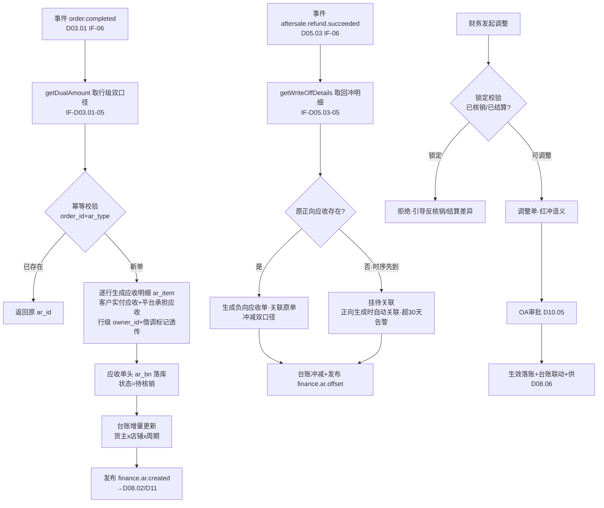
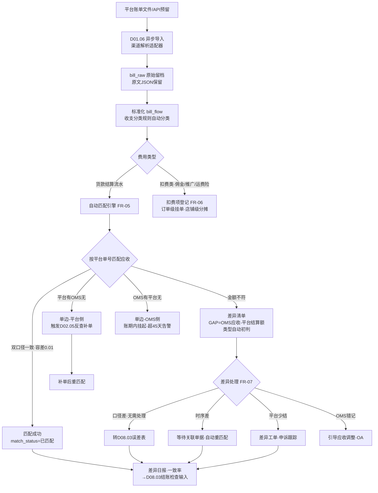

# SRS-D08.01 应收与账单流水模块 需求规格说明书

> 文档编号：SRS-D08.01 · 版本 V1.1 · 2026-10-24 · 编写：小凯 · 状态：待审阅（批次④，V1.1 增补淘客佣金归因）
> 所属域：D08 财务对账域 · 分期：**P1（M3）** · schema：**oms_finance**（D08 独立 schema，全单据 tenant_id）
> 上游依据：SRS-00 §4.4 契约「货主维度」「双口径金额」（术语表）· SRS-D03.01（IF-D03.01-05 `OrderAmountService::getDualAmount` 双口径与行级分摊、IF-D03.01-06 事件 `order.completed`、§5.2 分摊算法）· SRS-D05.03（IF-D05.03-05 `RefundLedgerQuery::getWriteOffDetails` 退款台账与分摊回冲明细、IF-D05.03-06 事件 `aftersale.refund.succeeded`、§5.2 回冲算法）· SRS-D04.07（FR-05a 毛利基础数据「收入 D08.01 − 成本」）· 逆向文档 04 §6（finance_ar 应收应退单 / financebase 平台账单流水 / 双口径字段族 actually_money+platform_amount / 月结 GAP 列结构）
>
> **全局决策（本模块承载，红线）**：① **金蝶记账，OMS 出统计+明细+排查工具**（Q5）——本模块不做总账/凭证/记账，产出**应收明细、平台账单流水、匹配差异清单、应收台账**四类业务对账数据，经 D08.06 供给金蝶（首期文件交换+API 适配层预留，本模块只在接口处引用不展开）；② **所有财务单据必须携带货主维度 owner_id**（SRS-00 §4.4 契约，补齐商派 finance_ar 只有 channel_id 无货主分账的最大缺口，逆向文档 04 §10.4-短板5）——应收按货主分账是代运营多品牌结算的根基；③ **双口径金额贯穿**：客户实付（买家真金白银）vs 平台承担（平台优惠补贴），应收确认、平台账单核对、退款冲减全部双口径。

---

## 1. 模块概述

### 1.1 定位

应收与账单流水是财务对账域的**数据地基**：正向消费订单完成事件（`order.completed`，D03.01 IF-D03.01-06）按订单行级生成应收明细（双口径+分摊后优惠），逆向消费退款台账（D05.03 IF-D05.03-05）生成负向应收冲减（按原分摊比例回冲）；同时归集各平台月度结算账单（支付宝/京东钱包/抖音支付/拼多多货款等，文件导入解析+API 拉取预留），将账单明细与 OMS 应收明细**按平台单号自动匹配**，产出匹配差异清单（金额不符/单边账）与平台扣费项登记（佣金/技术服务费/推广费/运费险）；在此之上维护应收台账（货主×店铺×周期：应收/已收/待收/差异）与账龄分析，供 D08.02 结算取数、D08.03 核销匹配、D08.06 金蝶供给与 D11 报表。

商派对应机制：finance_ar（应收应退单，ar_type 0应收/1应退，actually_money/platform_amount 双口径）+ financebase_bill（平台账单流水快速表，匹配/拆分/核对状态）+ order_settle（平台佣金明细）。凯淳关键差异：**AR 全单据带 owner_id 货主分账 + 应收生成锚定订单完成事件（而非出库/销售单）+ 扣费项按订单/店铺/货主三级归集**。

### 1.2 职责边界

**做**：应收明细生成（订单完成事件驱动，订单行级，双口径）；退款冲减应收（负向应收，D05.03 回冲明细入账）；应收人工调整（红冲语义+OA 审批）；平台账单导入与解析（文件格式标准化）；账单-应收自动匹配与差异清单；平台扣费项登记与归集；应收台账（货主×店铺×周期）；账龄分析；应收数据供给（D08.02 结算/D08.03 核销/D08.06 金蝶/D11 报表/品牌方门户）。

**不做**：总账/凭证/记账（**金蝶**，本模块经 D08.06 供数）；核销与收款匹配执行（→ D08.03，本模块供应收明细与差异清单）；结算单与服务费计算（→ D08.02）；运费对账（→ D08.04）；发票（→ D08.05）；退款台账生成与回冲计算（→ D05.03，本模块只消费其回冲明细入账）；订单双口径金额与分摊（→ D03.01 §5.2 定义源，本模块取数不重算）；平台账单文件下载通道（→ D02.05 对账反查通道/D02.01 平台接入框架）。

### 1.3 与其他模块关系

| 模块 | 关系 |
|---|---|
| D03.01 订单 | 事件 `order.completed`（确认收货/发货后超时 N 天自动完成，其 FR-05e）触发应收生成；`getDualAmount`（IF-D03.01-05）取行级双口径分摊快照 |
| D05.03 退款 | 事件 `aftersale.refund.succeeded` + `getWriteOffDetails(refund_bn)`（IF-D05.03-05）取回冲明细 → 负向应收；台账不可改，冲减走红冲语义（其 FR-05c） |
| D02.05 对账反查 | 平台账单流水/退款记录拉取通道（EF 侧数据来源之一） |
| D02.06 店铺授权 | 店铺-货主-租户关联（账单归集按店铺挂货主） |
| D04.07 成本 | 毛利基础数据：收入（本模块应收）− 成本（其销售成本明细），D11 取数 |
| D08.02 结算 | 下游：应收明细+扣费项按周期聚合 → 结算单取数（IF-D08.01-04） |
| D08.03 核销 | 下游：应收明细供核销匹配；核销结果回写应收 settle/核销状态 |
| D08.06 金蝶集成 | 下游：应收明细/账单流水/差异清单按金蝶格式输出（首期文件交换，API 适配层预留） |
| D10.03 数据权限 | 应收台账/明细查询注入租户/货主/店铺/品牌行级过滤 |
| D10.04 品牌方门户 | 本货主应收明细与台账只读（脱敏买家信息） |
| D10.05 OA | 应收人工调整、差异强制处理审批链 |
| D10.06 审计 | 调整/差异处理操作字段级留痕 |
| D01.02/01.06 | 调度（账龄日算/差异日报）；导入导出（账单文件导入/台账导出） |
| D11 报表 | 应收汇总/账龄/GAP 差异指标供数 |

---

## 2. 业务场景

**SC-D08.01-01 订单完成触发应收生成（主流程）**
天猫订单 O（3 行，客户实付 250 + 平台承担 30，D03.01 SC-08 场景）发货后买家确认收货（或发货超 15 天自动完成），D03.01 fulfill→完成、发布 `order.completed`。本模块消费事件：调 `getDualAmount` 取行级双口径分摊快照 → 逐行生成应收明细（ar_item：行实付=客户实付口径应收、行平台补贴=平台承担口径应收，携带 order_id/item_id/owner_id/shop_id/bm_id/数量）→ 生成应收单头（ar_bn，聚合订单行）→ 落应收台账（货主×店铺×当期）→ 发布 `finance.ar.created`（D08.02/D11 订阅）。幂等键=(order_id, ar_type=销售)；重复消费直接返回已存在 ar_id。

**SC-D08.01-02 退款冲减应收（负向应收）**
上述订单行 1（实付 80+平台承担 20）整行退款成功（D05.03 SC-06）。消费 `aftersale.refund.succeeded` → 调 `getWriteOffDetails(refund_bn)` 取回冲明细（冲减客户实付 80+冲减平台补贴 20，allocation_snapshot 固化）→ 生成**负向应收单**（ar_type=应退冲减，金额 −80/−20，关联原应收单与原订单行）→ 台账冲减 → 发布 `finance.ar.offset`。若原应收已进结算单（D08.02 已确认），冲减落**下期结算吸收**（结算单不追溯修改，其差异处理机制）。

**SC-D08.01-03 平台月度账单归集与自动匹配**
每月上旬财务导入支付宝月度结算账单（CSV/Excel，D01.06 异步任务）：解析→标准化落账单原始表（bill_raw，原文保留）→按平台单号+店铺自动匹配 OMS 应收明细：金额一致（双口径分别比对，容差 0.01 元）→ 匹配成功；金额不符 → 差异清单（GAP=OMS 应收−平台结算额，含差异类型初判：优惠口径差/退款时序差/平台扣费未拆）；平台有 OMS 无 → 单边账-平台侧（可能漏单，联动 D02.05 反查补单）；OMS 有平台无 → 单边账-OMS 侧（可能平台未结算/账期未到，挂起跟踪）。京东钱包/抖音支付账单同构（渠道适配器模式，格式解析插件化）。

**SC-D08.01-04 平台扣费项登记**
支付宝账单中解析出佣金 12.50、运费险 0.80（订单级扣费，携带平台单号）；京东精准通账单为店铺级推广费 3000（无订单号）。订单级扣费 → 扣费明细挂订单+店铺+货主；店铺级扣费 → 挂店铺+货主（按店铺-货主关联，多货主店铺按配置比例/销售额占比分摊——分摊规则货主级配置）。扣费项按费用字典分类（佣金/技术服务费/推广费/运费险/仓储费/其他），供 D08.02 结算扣减与 D11 费用分析。

**SC-D08.01-05 应收人工调整（OA 审批）**
财务发现某订单应收金额错误（历史迁移单，双口径落库有误）：发起应收调整单（调整类型=纠错，红冲语义：负向调整记录+新记录，原记录保留）→ OA 审批（D10.05）→ 通过后调整生效、台账联动 → 调整明细供 D08.06 金蝶同步。已核销（D08.03）或已进已确认结算单的应收**禁止调整**（须先反核销/走结算差异流程）。

**SC-D08.01-06 应收台账与账龄**
财务查看品牌 A（货主）9 月台账：期初应收 12 万 + 本期新增应收 45 万 − 本期冲减 3 万 − 本期已收（D08.03 核销回写）38 万 = 期末待收 16 万，差异（GAP 未决）0.8 万。账龄分析：未收余额按应收生成日分档（0-30/31-60/61-90/>90 天），>90 天红色预警推 D01.07 告警（货主级阈值可配）。品牌方门户（D10.04）只见本货主台账。

**SC-D08.01-07 差异清单排查闭环（金蝶对账前置）**
月结前财务处理差异清单：按差异类型分流——优惠口径差（平台承担部分平台不结算给商家，属正常口径差，标记「口径差异-无需处理」入误差表 D08.03）；退款时序差（平台已扣退款 OMS 冲减未到，等 D05.03 台账闭环后自动消除）；真实差异（平台少结）→ 差异工单（向平台申诉，处理结果登记）；单边账 → 补单/挂起。差异清单日报（一致率/未决差异金额）推财务负责人；全部差异闭环是 D08.03 月末结账检查的输入。

---

## 3. 功能需求

### FR-D08.01-01 应收生成（订单完成事件驱动）

- FR-01a 触发：消费事件 `order.completed`（D03.01 IF-D03.01-06；完成条件=ship 已发货且无未闭环售后且确认收货/超时，其 FR-05e）；MQ 异步消费，失败进 D01.01 重试与死信。
- FR-01b 取数：调 `OrderAmountService::getDualAmount(order_id)`（IF-D03.01-05）取订单头+行级双口径（list_amount/shop_discount/platform_subsidy/paid_amount/freight）与 order_pmt 分摊明细；**只取数不重算**（分摊算法定义源=D03.01 §5.2）。
- FR-01c 生成粒度：**订单行级**应收明细（ar_item），行字段：客户实付应收（paid 口径，含行分摊运费——运费随实付口径整单行分摊，D03.01 FR-06a 运费不分摊则挂单头行）、平台承担应收（platform_subsidy 口径）、商家优惠（shop_discount，不入应收只留档备查，冲减应收基数）、数量/bm_id/owner_id（行级货主，多货主订单按行归属分账）。
- FR-01d 应收单头（ar）：一订单一单（聚合行），ar_bn 规则 `AR{YYYYMMDD}{6位序列}`；幂等键=(order_id, ar_type)；ar_type 枚举：销售应收/退款冲减（负向）/人工调整（正负）。
- FR-01e 借调标记透传：订单行含借调标记（lend_flag+台账 ID，D04.05 §5.1）的，应收明细透传该标记——货款应收归**借出货主**（货是借出方的），销售服务费口径归借入货主订单（D08.02 内部交易取数依据）。
- FR-01f COD/线下单：货到付款订单完成时同步生成应收（收款确认走 D08.03 收款登记）；手工/导入线下单按订单 pay_status 已支付生成应收+已收标记（线下已收款，D08.03 登记核销）。
- FR-01g 0 元单（换货/赠品）：不生成应收（金额恒 0），只登记备查明细（结算单件数统计需要）。

### FR-D08.01-02 退款冲减（负向应收）

- FR-02a 触发：消费事件 `aftersale.refund.succeeded`（D05.03 IF-D05.03-06）；调 `RefundLedgerQuery::getWriteOffDetails(refund_bn)`（IF-D05.03-05）取回冲明细（行级三口径：refund_customer_line/platform_bear_line/merchant_bear_line + allocation_snapshot）。
- FR-02b 生成负向应收单（ar_type=退款冲减，金额取负）：冲减客户实付应收=refund_customer_line、冲减平台承担应收=platform_bear_line；商家承担优惠回冲（merchant_bear_line）只冲应收基数备查不产生资金语义（D05.03 §5.2 口径）。
- FR-02c 幂等键=(refund_bn)；平台介入补建退款单（D05.03 SC-04）同样走本通道，冲减单标记 `platform_intervened` 透传（资损分析）。
- FR-02d 损失登记联动：退款单含 loss_type/loss_amount（弃货退款/介入资损，D05.03 FR-03d）的，同步登记资损明细（不入应收，独立资损台账供 D11 与结算单扣减项参考）。
- FR-02e 时序保护：退款成功事件先于订单完成事件到达（未发货整单退款→订单取消，不会完成；已发货部分退款→完成事件后到）——冲减单允许先于正向应收存在（挂「待关联」），正向应收生成时自动关联；长期（>30 天）未关联的冲减单告警人工。
- FR-02f 冲减不可改：金额修正走红冲语义（D05.03 FR-05c 同款）；已进已确认结算单的冲减落**下期结算吸收**（标记 settle_carry_next，D08.02 取数）。

### FR-D08.01-03 应收人工调整

- FR-03a 调整类型：纠错（金额/口径错误）/迁移期初（历史数据导入）/坏账核销准备（转 D08.03 处理）/其他（备注必填）；调整单=红冲语义（负向记录冲原单+新记录，原记录保留，D04.04 红冲思想同款）。
- FR-03b 审批：全部调整走 OA（D10.05）；调整金额超阈值（默认 5000 元，货主级可配）升级审批链；审批通过才生效落账。
- FR-03c 锁定校验：已核销（D08.03 writeoff 状态）或已进已确认结算单的应收禁止调整，返回锁定提示（引导反核销/结算差异流程）。
- FR-03d 调整明细全量供 D08.06（金蝶同步调整凭证数据源）。

### FR-D08.01-04 平台账单归集（导入+API 预留）

- FR-04a 账单来源：平台月度/周期结算账单——支付宝结算单（淘系）、京东钱包/京东结算（jdwallet/jdbill）、抖音支付结算单、拼多多货款结算单、小红书/唯品会结算单；渠道适配器插件化（每平台一个解析器，格式差异隔离在适配层，业务层统一 canonical 账单模型——D02.02 适配器思想在财务侧复用）。
- FR-04b 导入通道：文件导入（CSV/Excel，D01.06 异步任务，单批 ≤10 万行）；API 拉取预留（接口签名 P1 占位，经 D02.01 平台接入框架调用，首期文件交换为准）。
- FR-04c 落库两层：账单原始表（bill_raw：店铺+渠道+单据唯一值+**原始数据 JSON 原文保留**，商派 bill_base 机制）→ 标准化账单流水表（bill_flow：平台单号/平台流水号/账单时间/店铺/货主/收支方向/结算金额/双口径拆分（平台账单可拆时）/费用类型/匹配状态）。
- FR-04d 导入幂等：批次内去重（渠道+平台流水号唯一）+跨批次防重（重复行标记跳过出报告）；同店铺同账期重复导入 → 新批次覆盖旧批次（旧批次作废留档，红冲语义）。
- FR-04e 账单收支分类规则（bill_category_rules）：按费用描述关键词/费用代码自动分类（货款收入/佣金/技术服务费/推广费/运费险/退款支出/其他），规则可配置，未命中转人工分类队列。

### FR-D08.01-05 账单-应收自动匹配

- FR-05a 匹配主键：**平台单号**（platform_order_bn，bill_flow ↔ ar 经订单关联）；辅助键=店铺+金额+账单周期（无平台单号的汇总账单走 D08.03 收款匹配，不在本模块）。
- FR-05b 匹配判定（§5.2 算法）：双口径分别比对——平台结算额 vs（客户实付应收+平台承担应收−平台扣费）；容差 0.01 元内 → 匹配成功（match_status=已匹配）；超差 → 差异清单（match_status=金额不符，GAP=OMS 应收−平台结算额，正负号保留借贷方向语义）。
- FR-05c 单边账：平台有 OMS 无（bill 无对应 ar）→ 挂「单边-平台侧」，自动触发 D02.05 对账反查通道核实（可能漏单，补单后重匹配）；OMS 有平台无（ar 在账期内无 bill）→ 挂「单边-OMS 侧」，账期未到正常挂起，超账期（平台级配置，默认 45 天）告警。
- FR-05d 匹配时序：账单导入即触发增量匹配（该批次流水）；应收/冲减新生成时反向补匹配（该订单未匹配流水）；日终全量对账任务兜底（近 60 天未匹配集合重跑）。
- FR-05e 匹配结果不可手工篡改；人工可做的动作=差异处理（FR-07）与强制匹配登记（OA 审批，留痕依据）。

### FR-D08.01-06 平台扣费项登记

- FR-06a 扣费明细来源：账单流水解析（FR-04e 分类=佣金/技术服务费/推广费/运费险/仓储费/其他）；订单级扣费（带平台单号）挂订单+店铺+货主；店铺级扣费（推广费等无单号）挂店铺+货主。
- FR-06b 店铺级扣费分摊：多货主共用店铺时按货主级配置分摊（销售额占比/固定比例/指定货主全额），分摊结果落扣费明细行（可解释：分摊基数快照）；分摊算法同 D03.01 §5.2 尾差规则（尾差归最大额行）。
- FR-06c 佣金预估（可选，P1 后置）：订单落库时按店铺佣金率预估（参考商派 order_settle estimated_comission 机制），账单到达后以实际扣费为准冲销预估；首期不做预估，只做实际登记。
- FR-06d 扣费明细供 D08.02 结算扣减、D11 费用分析、D08.06 金蝶费用凭证数据源；扣费明细同样不可改（红冲语义）。
- FR-06e 淘客/联盟佣金归因：平台扣费中的佣金/推广费，按订单 promotion_source（D03.01 FR-04g）归因到推广渠道（淘客联盟/直播带货等）与 promotion_pid；扣费明细行携带推广来源标记，供 D08.02 结算净额扣减与 D11 推广 ROI 分析（推广佣金 vs 带来的 GMV）。佣金实际金额以平台账单为准（FR-06a），本条只做归因维度补充。

### FR-D08.01-07 差异清单与处理

- FR-07a 差异类型字典（gap_type，映射借贷科目 gap 表结构保留——商派 financebase_gap 设计，科目映射供 D08.06 金蝶凭证参考）：口径差异-平台承担不结算/退款时序差/平台扣费未拆/金额不符-平台少结/金额不符-OMS 错记/单边-平台侧/单边-OMS 侧/其他。
- FR-07b 自动初判：匹配引擎按规则初判差异类型（如账单含退款支出且 OMS 冲减未到 → 退款时序差）；初判结果可人工改判（留痕）。
- FR-07c 处理动作：无需处理（口径差，转入 D08.03 误差表累计）/等待自动消除（时序差，关联单据到达后重匹配）/差异工单（向平台申诉，工单状态跟踪：申诉中/平台补结/确认损失）/OMS 侧修正（引导应收调整 FR-03）。
- FR-07d 差异日报：日终任务（D01.02）输出差异清单日报（按店铺/货主/类型汇总，一致率=匹配成功笔数/总笔数），推财务负责人（D01.07）；近 30 个账单日存在未决差异持续提醒（商派 bill_match_notify_log 机制保留）。
- FR-07e 强制处理：差异金额超期（>60 天）未决 → 强制处理通道（OA 审批，处理结果=确认损失/挂账），入 D08.03 误差表。

### FR-D08.01-08 应收台账（货主×店铺×周期）

- FR-08a 台账维度：货主×店铺×会计周期（月，与 D08.03 结账期间一致）；列结构（商派 statement 期初期末镜像为应收侧）：期初应收/本期新增应收/本期冲减（退款+调整）/本期已收（D08.03 核销回写）/期末待收/本期差异（GAP 未决额）。
- FR-08b 台账实时汇总（事件驱动增量更新）+日终重算校验（汇总值 vs 明细累加，不一致告警修复）。
- FR-08c 双口径分列：台账金额列均分客户实付口径/平台承担口径两列（应收确认、核销、结算全程双口径）。
- FR-08d 台账查询与导出（D01.06）；品牌方门户（D10.04）本货主只读；数据权限行级过滤（D10.03）。

### FR-D08.01-09 账龄分析

- FR-09a 账龄分档：未收余额（应收−已收−已冲减）按应收生成日分档：0-30/31-60/61-90/91-180/>180 天（分档边界全局可配）；按货主×店铺×平台维度出账龄表。
- FR-09b 账龄日算（D01.02 调度，日终快照）；账龄结构变化趋势供 D11。
- FR-09c 逾期预警：账龄超阈值（货主级配置，默认 >90 天）→ 告警（D01.07）+ 逾期清单推财务与商务（催收依据）；与 D08.03 账期管理（信用账期）联动——账期逾期单独立标记。
- FR-09d 争议单账龄冻结：差异工单申诉中的金额，账龄单独分列（争议账龄），不并入正常催收口径。

### FR-D08.01-10 查询工作台与数据供给

- FR-10a 应收工作台：待匹配账单、差异清单、单边账跟踪、调整审批中、待关联冲减单五个队列；应收明细多维检索（订单号/平台单号/ar_bn/店铺/货主/状态/账期/金额区间）。
- FR-10b 应收详情聚合视图：应收单头+行（双口径）+关联订单（跳转 D03.01 视图）+退款冲减链+账单匹配结果+扣费明细+核销记录（D08.03）+结算归属（D08.02）+调整历史，全链路一屏可溯。
- FR-10c 数据供给接口：D08.02 结算取数（按货主+周期拉应收/冲减/扣费明细）、D08.03 核销取数（应收明细+匹配结果）、D08.06 金蝶供给（应收明细/账单流水/差异清单按金蝶格式，首期文件交换）、D11 报表（台账/账龄/GAP 指标）。
- FR-10d 全单据 tenant_id + owner_id 必填（SRS-00 契约）；查询统一注入 D10.03 行级过滤。

---

## 4. 业务流程

### 4.1 应收生成与退款冲减流程



### 4.2 平台账单归集与自动匹配流程



---

## 5. 处理逻辑

### 5.1 应收金额口径定义（契约级，D08 全域统一）

```
行级应收（客户实付口径）  ar_customer  = order_item.paid_amount（D03.01 分摊后行实付）
行级应收（平台承担口径）  ar_platform  = order_item.platform_subsidy（平台券/补贴，平台结算给商家的部分）
商家优惠 shop_discount：不入应收（商家自担，冲减收入基数），只留档备查
运费 freight：客户实付口径，整单挂 ar 单头行（不参与行分摊，D03.01 FR-06a）
应收总额（结算口径）= ar_customer + ar_platform − 退款冲减 − 平台扣费(结算净额时)
恒等式校验: Σ行 ar_customer = 订单 paid_amount − freight; 超差 0.01 → 生成失败转人工
所有金额 2 位小数（DECIMAL(14,2)）；比例/费率 4 位小数；口径逐字段标注，禁止混算
```

### 5.2 账单-应收匹配算法

```
输入: bill_flow 批次(渠道c, 账期p), 候选 ar 集合(店铺s, 账期窗口[p-1, p+1])
1. 精确匹配: bill.platform_order_bn == ar.order.platform_order_bn AND 店铺一致
   → 金额比对: |bill.settle_amount − (ar_customer+ar_platform−ar关联扣费)| ≤ 0.01
     一致 → 已匹配; 超差 → 差异清单(GAP=bill−ar, 带符号)
2. 无平台单号流水(汇总打款/店铺级) → 不参与本匹配, 转 D08.03 收款匹配通道
3. 拆单流水(一订单多笔结算, 平台分期打款) → 按平台流水号聚合后比对, 聚合键=(平台单号,店铺)
4. 匹配互斥: 一笔 bill 只配一个 ar 聚合组; 已匹配流水重导入 → 先解除旧匹配(留痕)再重配
5. 日终兜底: 近60天未匹配集合重跑(新应收/新冲减到达后时序差自动消除)
```

### 5.3 差异 GAP 的借贷方向与科目映射（gap 表，商派审计可解释设计保留）

```
gap_type 差异类型 → (借方科目, 贷方科目) 映射表(科目为金蝶科目编码, D08.06 维护映射):
  口径差异-平台承担不结算  → 借:销售折扣与折让  贷:应收账款-平台补贴   (无需处理, 误差表累计)
  退款时序差              → 待消除, 不映射(消除后自动清)
  平台少结-确认损失       → 借:营业外支出-平台差异  贷:应收账款
  OMS错记-调整            → 随调整单方向, 映射调整科目
  单边-平台侧-补单        → 补单后正常匹配, 不映射
科目映射仅为 D08.06 金蝶凭证参考数据源, OMS 不做记账(Q5 红线)
```

### 5.4 台账汇总与一致性

```
台账更新: 应收/冲减/调整/扣费事件驱动增量更新(行锁 by 货主x店铺x周期)
已收列: D08.03 核销成功回写(IF-D08.03-05), 本模块只读展示
日终校验: 台账各列 == Σ明细(当期, 同维度) 逐列比对, 不一致 → 告警+以明细为准重算(明细是唯一事实源)
周期口径: 会计周期=自然月(与 D08.03 结账期间对齐); 跨期单据按业务发生日归属(应收按订单完成日, 冲减按退款成功日, 账单按账单日)
结账联动: D08.03 期间关闭后, 该期间应收/冲减/调整禁止新增(补录走反结账流程)
```

### 5.5 幂等与并发

```
应收生成幂等: (order_id, ar_type) 唯一索引; MQ 重投直接返回
冲减幂等: (refund_bn) 唯一索引; 台账联动同事务
调整幂等: 调整单号唯一; OA 回调按单号幂等
账单导入幂等: (渠道, 平台流水号) 唯一; 批次覆盖走红冲(旧批作废留档)
匹配并发: 匹配任务按店铺分片+分布式锁; 同一流水并发匹配 CAS(match_status 前值校验)
```

---

## 6. 数据字段（业务字段描述，schema：oms_finance）

> 物理 DDL 见 DB-D08 数据字典；金额一律 DECIMAL(14,2) 并标注口径。

### 6.1 应收单（finance_ar）

| 字段 | 业务含义 | 取值/校验 |
|---|---|---|
| ar_id / ar_bn | 应收单主键/单号 | AR 前缀唯一 |
| ar_type | 单据类型 | 销售应收/退款冲减(负向)/人工调整(正负) |
| order_id / order_bn / platform_order_bn | 关联订单（三键冗余，匹配与检索用） | 销售应收必填 |
| refund_bn | 关联退款单（冲减单） | 冲减必填，幂等键 |
| ar_customer | 应收金额-客户实付口径 | 冲减/调整可负 |
| ar_platform | 应收金额-平台承担口径 | 同上 |
| shop_discount_memo | 商家优惠留档（不入应收） | 备查 |
| freight | 运费（客户实付口径） | 单头行 |
| status | 核销状态 | 待核销/部分核销/已核销（D08.03 回写） |
| match_status | 账单匹配状态 | 未匹配/已匹配/金额不符/单边-平台侧/单边-OMS 侧 |
| gap_type | 差异类型 | FR-07a 字典 |
| settle_status / settle_bn | 结算状态/结算单号 | D08.02 回写；锁定标记 |
| monthly_id / period | 所属账期/会计周期 | D08.03 结账联动；补录校验 |
| lend_flag / lend_ledger_id | 借调标记/台账 ID | FR-01e 透传（D04.05） |
| loss_type / loss_amount | 资损类型/金额 | FR-02d（不入应收） |
| platform_intervened | 平台介入透传 | 资损分析 |
| adjust_ref | 调整关联（原单/新单互指） | 红冲语义追溯链 |
| oa_ref | OA 审批单引用 | 调整单必填 |
| owner_id / shop_id / tenant_id / brand_id | 货主/店铺/租户/品牌 | **全单据必填（SRS-00 契约）** |
| complete_time / create_time | 业务发生日（订单完成/退款成功）/入账时间 | 账龄与周期归属基准 |
| version | 乐观锁 | 状态回写 CAS |

### 6.2 应收明细行（finance_ar_item）

| 字段 | 业务含义 | 取值/校验 |
|---|---|---|
| ar_id / order_item_id / item_seq | 归属/订单行引用 | 行级追溯 |
| bm_id / sm_id / num | 物料/销售物料/数量 | 快照 |
| line_customer / line_platform | 行级双口径应收 | Σ行=单头（FR-01c 恒等式） |
| line_shop_discount | 行商家优惠留档 | 备查 |
| owner_id | **行级货主** | 多货主订单按行分账（SRS-00 契约核心） |
| lend_flag / lend_ledger_id | 行级借调标记 | FR-01e |
| allocation_snapshot | 分摊快照（getDualAmount 原文） | 可解释审计，争议回放 |
| tenant_id | 租户 | 必填 |

### 6.3 账单原始表（finance_bill_raw）与账单流水（finance_bill_flow）

| 字段 | 业务含义 | 取值/校验 |
|---|---|---|
| ——bill_raw—— | | |
| channel / shop_id / unique_key | 渠道/店铺/单据唯一值 | 幂等键=(channel, unique_key) |
| raw_data | **原始数据 JSON 原文保留** | 商派 bill_base 机制，审计回放 |
| import_batch_id | 导入批次 | 批次覆盖红冲追溯 |
| ——bill_flow—— | | |
| flow_id / raw_id | 流水/原始引用 | |
| platform_order_bn / platform_serial_no | 平台单号/平台流水号 | 匹配主键 |
| bill_date / settle_period | 账单日/账期 | 周期归属 |
| direction | 收支方向 | 收入(货款/补贴)/支出(退款/扣费) |
| settle_amount | 结算金额（平台口径） | 2 位小数 |
| amount_customer / amount_platform | 双口径拆分（账单可拆时） | 不可拆置空+拆分状态标记 |
| fee_type | 费用类型 | 货款/佣金/技术服务费/推广费/运费险/仓储费/退款/其他（FR-04e 规则分类） |
| match_status / match_ar_id / gap_amount | 匹配状态/匹配应收/GAP 金额 | FR-05；GAP 带符号（借贷方向） |
| split_status | 拆分状态 | 一笔流水拆多订单/多费用项（商派 expenses_split 机制） |
| owner_id / shop_id / tenant_id | 归属 | 店铺级流水按 FR-06b 分摊后落行级 owner |

### 6.4 扣费明细（finance_platform_fee）

| 字段 | 业务含义 | 取值/校验 |
|---|---|---|
| fee_id / flow_id | 扣费/来源流水 | |
| fee_type / fee_amount | 费用类型/金额 | 字典同 FR-04e |
| order_id（可空）/ shop_id / owner_id | 归集维度 | 订单级挂单；店铺级按分摊规则挂货主 |
| alloc_base_snapshot | 分摊基数快照 | 店铺级分摊可解释（FR-06b） |
| settle_status / settle_bn | 结算归属 | D08.02 回写 |
| period / tenant_id | 会计周期/租户 | 必填 |

### 6.5 应收台账（finance_ar_ledger）与账龄快照（finance_aging_snapshot）

| 字段 | 业务含义 |
|---|---|
| owner_id / shop_id / period | 台账维度（货主×店铺×会计周期） |
| init_ar / added_ar / offset_ar / received_ar / final_ar | 期初/新增/冲减/已收（D08.03 回写）/期末待收——**客户实付与平台承担双口径分列** |
| gap_pending | 本期未决差异额（GAP 汇总） |
| ——账龄—— |
| owner_id / shop_id / snapshot_date | 维度+快照日（日算） |
| bucket_0_30 … bucket_gt_180 | 分档未收余额（双口径分列，FR-09a） |
| dispute_amount | 争议账龄单列（FR-09d） |

---

## 7. 接口

### 7.1 内部接口（本模块提供）

| 编号 | 接口 | 消费方 | 说明 |
|---|---|---|---|
| IF-D08.01-01 | `ArService::createFromOrder(order_id)` | `order.completed` 事件消费器 | 应收生成（幂等，FR-01） |
| IF-D08.01-02 | `ArService::offsetFromRefund(refund_bn)` | `aftersale.refund.succeeded` 事件消费器 | 退款冲减（幂等，FR-02） |
| IF-D08.01-03 | `ArAdjustService::submit/confirm(调整单)` | 财务工作台/OA 回调（D10.05） | 人工调整（红冲语义+审批） |
| IF-D08.01-04 | `ArQueryService::getAr/list(条件)` / `getSettleData(owner_id, period)` / `getFeeData(owner_id, period)` | D08.02/D08.03/D10.04/D11 | 应收明细与结算取数（按货主+周期聚合，含冲减/扣费） |
| IF-D08.01-05 | `BillImportService::import(channel, file/apiPayload)` | 财务工作台/D01.06 | 账单导入（渠道适配器分发） |
| IF-D08.01-06 | `BillMatchService::run(batch_id)` / 事件 `finance.bill.matched` / `finance.gap.created` | 导入后置/日终任务；D08.03/D08.06/D11 订阅 | 自动匹配与差异事件 |
| IF-D08.01-07 | `ArLedgerQuery::getLedger(owner, shop, period)` / `getAging(维度, 日期)` | D08.02/D08.03/D10.04/D11 | 台账与账龄 |
| IF-D08.01-08 | 事件 `finance.ar.created` / `finance.ar.offset` / `finance.ar.adjusted` | D08.02/D08.03/D08.06/D11 | 应收生命周期广播（DB-00 事件字典登记） |

### 7.2 依赖接口（本模块消费）

| 编号 | 接口 | 提供方 | 说明 |
|---|---|---|---|
| IF-D08.01-D1 | 事件 `order.completed` 订阅 | D03.01（IF-D03.01-06） | 应收生成触发 |
| IF-D08.01-D2 | `OrderAmountService::getDualAmount(order_id)` | D03.01（IF-D03.01-05） | 行级双口径分摊快照 |
| IF-D08.01-D3 | 事件 `aftersale.refund.succeeded` + `RefundLedgerQuery::getWriteOffDetails(refund_bn)` | D05.03（IF-D05.03-05/06） | 退款冲减取数（回冲明细权威供数） |
| IF-D08.01-D4 | 对账反查通道（平台账单/退款流水拉取） | D02.05 | 单边账核实补单（FR-05c） |
| IF-D08.01-D5 | OA 审批/调度/告警/审计/导入导出/通知 | D10.05/D01.02/D01.07/D10.06/D01.06 | 底座能力 |
| IF-D08.01-D6 | 核销状态回写（status/received 列） | D08.03 | 台账已收列与应收核销状态 |
| IF-D08.01-D7 | 结算状态回写（settle_status/settle_bn） | D08.02 | 应收/扣费结算锁定 |

### 7.3 外部接口

| 编号 | 接口 | 方向 | 说明 |
|---|---|---|---|
| EF-D08.01-01 | 金蝶应收/账单数据供给（经 D08.06） | 出 | 首期文件交换（应收明细/账单流水/差异清单+gap 科目映射），API 适配层预留（D08.06 定义） |
| EF-D08.01-02 | 平台账单 API 拉取（经 D02.01，P1 预留占位） | 出（只读） | 首期文件导入为准；无任何资金操作类调用（资金红线同 D05.03） |

---

## 8. 非功能需求

| 项 | 要求 |
|---|---|
| 性能 | 应收生成（消费事件→落账）P95 ≤500ms/单；账单导入解析 ≥5000 行/分钟；自动匹配 10 万流水×50 万应收 ≤30 分钟；台账查询 P95 ≤200ms |
| 幂等 | 应收/冲减/调整/导入/匹配全路径幂等（§5.5）；MQ 重投零副作用 |
| 一致性 | 台账=明细派生（明细唯一事实源，日终重算校验）；应收恒等式校验不可绕过（Σ行=单头±0.01）；事件消费失败进补偿队列不丢单 |
| 精度 | 金额 2 位小数、比例/费率 4 位小数；GAP 带符号保留借贷方向；双口径字段禁止混算（口径逐字段标注） |
| 资金安全 | OMS 零资金操作（只记录/统计/供数，Q5 红线）；应收/账单/扣费/调整全部红冲语义不可改删 |
| 审计 | 调整/强制匹配/差异改判 OA 审批+字段级留痕（D10.06）；原始账单原文保留可回放 |
| 安全/PIPL | 应收明细关联买家信息脱敏展示；品牌方门户只见本货主（租户行隔离 D10.03） |
| 容量 | 日均 2 万单×3 行×3 年在线 ≈ 6600 万应收行；finance_ar 按 period 月度分区；账单流水按渠道+账期分区 |

---

## 9. 验收标准

| 编号 | 验收条件 |
|---|---|
| AC-01 | SC-01：订单完成事件后 1 分钟内生成应收单，行级双口径与订单 getDualAmount 分摊快照逐行一致（Σ行 ar_customer=订单实付−运费，误差 0）；重复消费（MQ 重投 5 次）不重复入账 |
| AC-02 | 多货主订单（行级 owner 不同）应收按行分账到各货主台账，货主维度可独立出对账单（补齐商派缺口的核心验证） |
| AC-03 | SC-02：行 1 退款（实付 80+平台 20）→ 负向应收 −80/−20 正确生成并关联原单；退款事件先于完成事件到达时挂待关联，正向生成后自动关联；30 天未关联告警 |
| AC-04 | 借调订单（lend_flag）应收明细标记透传，货款应收归借出货主、与 D04.05 台账 ID 一一对应 |
| AC-05 | SC-03：支付宝/京东/抖音三渠道账单文件导入解析正确（原文 JSON 留档可回放）；重复导入同批次红冲覆盖；10 万行导入 ≤20 分钟 |
| AC-06 | 自动匹配四类结果全部正确：金额一致→已匹配；差 0.02→差异清单（GAP 带符号）；平台有 OMS 无→单边-平台侧并触发反查；OMS 有平台无→账期内挂起、超 45 天告警 |
| AC-07 | SC-04：订单级扣费挂订单+货主；店铺级推广费按销售额占比分摊到多货主（分摊基数快照可解释，尾差归最大行，Σ分摊=原额） |
| AC-08 | SC-05：应收调整红冲语义（原记录保留+负向+新记录）；已核销/已结算应收调整被拒；OA 审批通过前不落账 |
| AC-09 | SC-06：台账六列（期初/新增/冲减/已收/期末/差异）与明细累加日终校验一致；双口径分列正确；品牌方门户只见本货主 |
| AC-10 | 账龄分档正确（构造 0-30/31-60/61-90/>90 各档数据）；>90 天告警触发；争议工单金额单列不入催收口径 |
| AC-11 | 差异处理闭环：口径差转误差表、时序差自动消除（冲减到达后重匹配）、平台少结工单跟踪、超 60 天强制处理走 OA；差异日报一致率准确 |
| AC-12 | gap 表科目映射完整（每差异类型对应借贷科目），EF-01 金蝶供数文件含应收明细/账单流水/差异清单三类且格式校验通过 |
| AC-13 | 压测：大促日 5 万订单完成事件并发消费，应收生成零丢失（补偿队列兜底）、台账增量更新无死锁、P95 ≤500ms |

---

## 变更记录

| 日期 | 版本 | 变更 | 原因 |
|---|---|---|---|
| 2026-10-24 | V1.0 | 首版 | — |
| 2026-10-24 | V1.1 | FR-06 补 FR-06e 淘客/联盟佣金归因（按 D03.01 promotion_source 归因到推广渠道，供结算净额扣减与推广 ROI 分析） | 复查缺口2：淘客推广业务，佣金归因联动订单侧推广来源标记 |

---

*参考实现溯源：商派 finance_ar（应收应退单：ar_type 0应收/1应退、type 13 种业务类型、money/confirm_money/unconfirm_money、**actually_money 客户实付+platform_amount 平台承担双口径字段族**、status 核销三态、verification_status 等待/正常/差异/强制、charge_status 记账、monthly_status 关账、unique_id 幂等）+ ar_items（明细带双口径）+ financebase_bill_base（原始数据原文保留）/bill（流水快速表：匹配状态/拆分状态/核对状态 1已核对AR-2需核对-3无需核对）+ bill_import 族 8 张（渠道分表导入）+ bill_category_rules 收支分类规则 + account_chart 会计科目（应用场景 platform_amount/actually_amount 各一条）+ expenses_split 费用拆分 + gap 差异表（**差异类型→借/贷会计科目映射**）+ bill_match_notify_log 匹配失败日报（近 30 账单日检查）+ ome.order_settle 平台佣金明细（预估/真实佣金）+ statement 期初期末台账结构（镜像为应收台账）。关键差异：① **owner_id 货主维度贯穿全部财务单据**（商派 finance_ar 只有 channel_id 店铺维度，多货主共用店铺结算混淆——逆向文档 04 §10.4 短板 5 的正面修复，行级分账）；② 双口径从散列字段升级为**结构化双列贯穿**（应收/台账/账龄/扣费全双口径，口径逐字段标注禁止混算）；③ 应收生成锚定 `order.completed` 事件（商派由销售单/出库多入口 transferAr，凯淳收敛为订单完成单触发+退款台账事件冲减，与 D03.01/D05.03 契约对齐）；④ 渠道导入 8 张分表收敛为 bill_raw+bill_flow 两层+解析适配器插件化；⑤ 借调标记透传货款归属借出货主（商派无借调模型）；⑥ 记账/凭证全部移交金蝶（Q5），OMS 侧 charge_status 记账语义删除，gap 科目映射降级为 D08.06 供数参考。*
