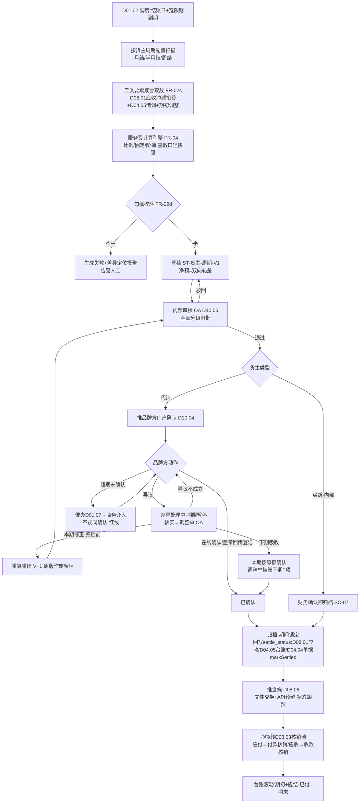
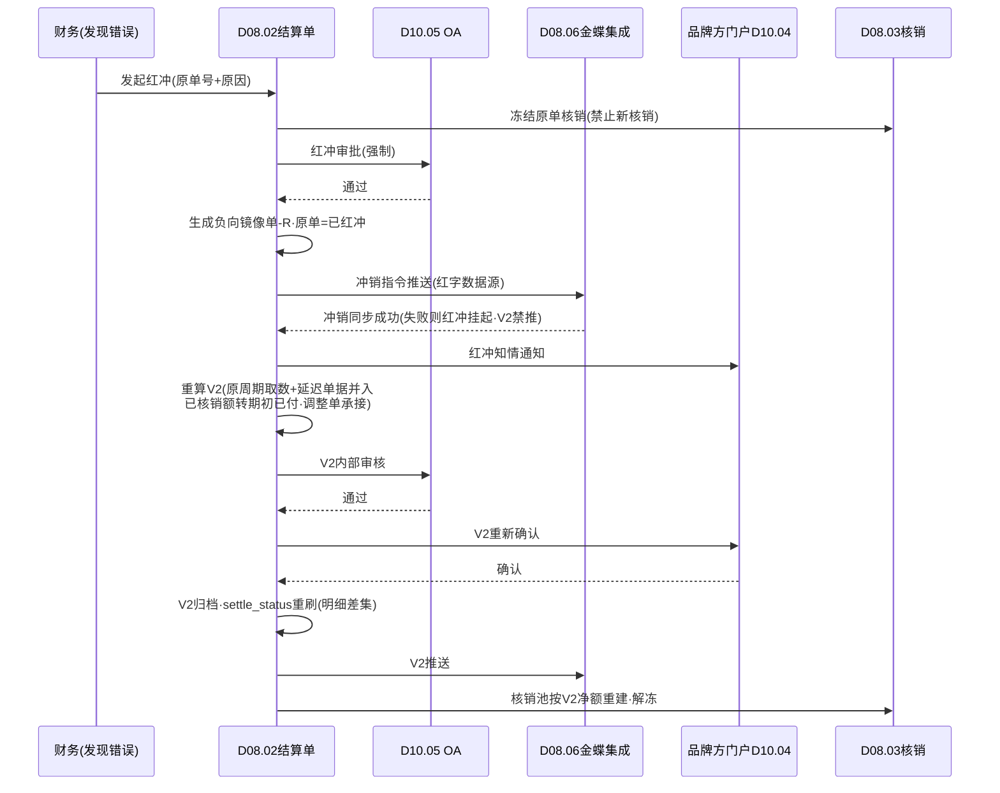

# SRS-D08.02 结算单模块 需求规格说明书

> 文档编号：SRS-D08.02 · 版本 V1.0 · 2026-10-24 · 编写：小凯 · 状态：待审阅（批次④）
> 所属域：D08 财务对账域 · 分期：**P1（M3）** · schema：**oms_finance**（全单据 tenant_id）
> 上游依据：SRS-00 §4.4 契约「货主维度」· SRS-D08.01（IF-D08.01-04 `ArQueryService::getSettleData/getFeeData` 应收/冲减/扣费结算取数、IF-D08.01-08 事件 `finance.ar.*`）· SRS-D04.05（IF-D04.05-04 `LendLedgerService::query(owner, period)` 借调台账月度消耗→内部交易明细、lend_ledger.settle_month/settle_status 回写位）· SRS-D04.07（FR-04b 代销结算成本：品牌订单出库按结算价结转，本模块取数；FR-05a 销售成本明细）· SRS-D05.03（退款台账冲减经 D08.01 入账，settle_carry_next 下期吸收标记）· D10.04 品牌方门户（在线确认）· D10.05 OA（泛微审批）· 逆向文档 04 §2.6（statement 期初/本期增加/已付/期末台账结构）/§6（月结 GAP 列）/§12-2（经销账期自建启示）
>
> **全局决策（本模块承载，红线）**：① **金蝶记账，OMS 出统计+明细+排查工具**（Q5）——结算单是**业务对账单**（凯淳×品牌方的结算协议凭证），不是会计凭证；确认后经 D08.06 推金蝶生成应付/应收凭证（首期文件交换+API 适配层预留，本模块只在接口处引用）；② **代销结算周期=按货主可配置**（最新决策）：月结/半月结/周结，货主级配置；结算触发=周期到期自动生成结算单草稿→核对→确认→归档；③ **双向结算净额**：同一货主同一周期内「凯淳应付品牌方货款」与「品牌方应付凯淳服务费」双向轧差，结算单呈现净额与方向；④ 全单据 owner_id（结算单天然以货主为主维度）。

---

## 1. 模块概述

### 1.1 定位

结算单是凯淳与品牌方（货主）之间**周期性资金结算的唯一业务单据**：按货主配置的结算周期（月/半月/周）到期自动生成草稿，聚合周期内五类结算要素——销售应收（D08.01，双口径）、退款冲减（D08.01 负向应收）、平台扣费（D08.01 扣费明细）、借调内部交易（D04.05 台账月度消耗）、代销服务费/佣金（本模块计算引擎，按货主合同配置）——形成「期初调整 + 本期销售应收 − 本期退款 − 平台扣费 − 服务费 ± 借调交易 = 本期应结」的结算结构，经内部审核→品牌方门户确认（D10.04 在线确认或线下盖章回传登记）→归档→推金蝶（D08.06）。同时管理结算差异（品牌方异议→调整单→下期吸收或本期修正）与红冲重算（错误结算单红冲重出，已推金蝶联动冲销）。

商派对应机制：purchase.statement（供应商结算台账，期初/增加/已付/期末结构）+ finance.monthly_report（店铺×月份账期汇总）。凯淳关键差异：**商派 statement 是供应商应付侧台账且无品牌方确认环节；凯淳结算单=代销双向结算（货款应付×服务费应收轧差）+品牌方门户在线确认闭环+货主级周期可配**——商派无此模型，为本 SRS 关键原创设计。

### 1.2 职责边界

**做**：结算周期配置（货主级：月/半月/周+结账日+确认期限）；结算单自动生成（周期到期调度）；五类结算要素聚合取数；代销服务费/佣金计算引擎（比例/固定/阶梯三模型，基数口径可配）；双向结算净额计算；结算单状态机（草稿→内部审核→品牌方确认→归档→已推金蝶）；品牌方门户确认交互（在线确认/异议/线下盖章登记）；结算差异登记与调整单（下期吸收/本期修正）；红冲与重算（含金蝶联动冲销）；结算台账（货主维度期初期末滚动）；结算状态回写（D08.01 应收 settle_status、D04.05 lend_ledger settle_month/settle_status、D04.04 单据经 IF-D04.04-06 `markSettled`）。

**不做**：应收/冲减/扣费明细生成（→ D08.01，本模块只聚合取数）；借调台账与消耗记录（→ D04.05，本模块按 settle_month 取数并回写）；代销结算成本单价维护（→ D04.07 代管账 settle_price）；核销与收款（→ D08.03，结算单归档后应付/应收余额转核销池）；金蝶凭证生成（→ D08.06 适配层，本模块推送确认后的结算单数据）；运费结算（→ D08.04，运费对账结果作为扣费项经 D08.01 汇入）；发票开具（→ D08.05，结算单确认后开票申请关联）；OA 审批流实现（→ D10.05）。

### 1.3 与其他模块关系

| 模块 | 关系 |
|---|---|
| D08.01 应收 | 上游取数：`getSettleData(owner_id, period)`（应收+冲减）/`getFeeData`（扣费）；归档后回写 settle_status/settle_bn（其 IF-D08.01-D7） |
| D04.05 借调 | 上游取数：`LendLedgerService::query(owner, period)` 台账消耗→内部交易明细（settle_price_type：内部购销价/成本价/免费）；归档回写 settle_month/settle_status |
| D04.07 成本 | 上游取数：代销结算成本（FR-04b，品牌订单出库×结算价）=货款应付基数核对；买断货主销售成本（结算单附成本参考列，毛利分析） |
| D04.04 单据 | 归档后经 IF-D04.04-06 `markSettled(billBns[], settleBn)` 回写出入库单据结算锁定 |
| D10.04 门户 | 品牌方在线确认/异议/对账单下载（本货主行隔离） |
| D10.05 OA | 内部审核审批链、差异调整超阈值审批、红冲审批、线下盖章例外登记审批 |
| D08.03 核销 | 下游：归档结算单的净额转应付/应收核销池（凯淳付品牌方→付款核销；品牌方付凯淳→收款核销） |
| D08.06 金蝶 | 下游：确认后结算单+明细推送（首期文件交换）；红冲联动冲销指令 |
| D08.05 发票 | 结算单确认后开票申请关联（服务费开票/货款收票） |
| D10.01 货主 | 货主档案与合同要素（结算周期/服务费条款/账期的配置载体） |
| D11 报表 | 结算汇总/GMV/服务费收入指标供数 |
| D01.02 调度 | 周期到期自动生成、确认超期催办、台账日校验 |

---

## 2. 业务场景

**SC-D08.02-01 月结货主结算单自动生成（主流程）**
品牌 A（代销，月结，结账日=自然月末，确认期限 10 天）。10 月 1 日凌晨调度触发：生成 2026-09 周期结算单草稿 ST-A-202609——聚合：本期销售应收（客户实付口径 42 万，D08.01 getSettleData）− 退款冲减 3 万 − 平台扣费（佣金/推广费分摊）2.5 万 − 代销服务费（合同：销售额 5% 比例模型，基数=客户实付口径，(42−3)×5%=1.95 万）+ 借调内部交易（品牌 A 消耗凯淳包材 1.8 万件×内部购销价 2 元=3.6 万，品牌 A 应付凯淳）= 本期应结。方向轧差：凯淳应付品牌 A 货款 36.5 万（应收净额−服务费）vs 品牌 A 应付凯淳 5.55 万（服务费 1.95+借调 3.6）→ 净额=凯淳应付品牌 A 30.95 万。草稿→内部审核（财务复核明细勾稽）→推品牌方门户确认。

**SC-D08.02-02 品牌方门户在线确认**
品牌 A 财务登录门户（D10.04，只见本货主）：查看结算单汇总+五类要素明细（可下钻到应收行/扣费行/借调台账行）+对账单 PDF 下载。核对无误 → 在线确认（电子签核留痕：确认人/时间/IP）→ 结算单归档 → 推金蝶（D08.06）+ 回写 settle_status（D08.01 应收/D04.05 台账/D04.04 单据）→ 净额转 D08.03 付款核销池。

**SC-D08.02-03 品牌方异议与差异处理**
品牌 B 对 9 月结算单异议：某笔退款冲减 800 元认为不应扣（平台介入资损，责任在凯淳运营）。门户提交异议（行级引用+理由+附件）→ 结算单转「差异处理中」（确认期限暂停计时）→ 内部核实：异议成立 → 生成调整单（+800，类型=差异调整，OA 审批）→ 品牌 B 选择「本期修正」（结算单重算重出 V2，原 V1 作废留档）或「下期吸收」（本期按原额确认，调整单挂账下期期初）→ 重新确认闭环。异议不成立 → 沟通记录留痕 → 品牌方再确认或升级商务线下协商（协商结果登记，OA 审批）。

**SC-D08.02-04 半月结/周结货主**
品牌 C（代销，半月结：每月 15 日/月末两期）。9 月下半月周期（9.16-9.30）10 月 1 日生成草稿，流程同 SC-01；周期粒度只影响取数区间与生成频率，五类要素/净额/确认流完全同构。品牌 D（周结，每周一结上周）同理——**结算引擎与周期解耦**（周期配置驱动，无周期特化代码分支）。

**SC-D08.02-05 阶梯服务费计算**
品牌 E 合同：GMV（客户实付口径净销售额）≤50 万部分费率 6%，50-100 万部分 5%，>100 万部分 4%。本期净销售额 120 万 → 服务费=50×6%+50×5%+20×4%=3+2.5+0.8=6.3 万。计算引擎输出阶梯明细（每档基数×费率=金额，可解释）；阶梯档位按周期累计口径（非单笔），跨周期不累计（每期独立重算档位）。

**SC-D08.02-06 结算单红冲重算**
财务发现 ST-A-202609 漏聚合一批 9 月 30 日深夜完成的订单应收（D08.01 事件延迟，getSettleData 取数窗口截断）：结算单已归档已推金蝶 → 发起红冲（OA 审批）→ 原单红冲（负向镜像单 ST-A-202609-R，状态=已红冲）→ 金蝶联动冲销指令（D08.06）→ 重算生成 V2（含补漏明细，期初调整列承接原单已确认差异）→ 重新走审核-确认-归档流。品牌方已确认过的 V1 红冲需品牌方门户知情确认（红冲通知+V2 重新确认）。

**SC-D08.02-07 买断货主结算（内部视角，简化流）**
凯淳买断货主（货主=凯淳自身）：无品牌方确认环节（内部结算），结算单聚合销售应收−退款−扣费+成本参考（D04.07 销售成本结转），产出**内部经营结算表**（毛利=应收−成本）供 D11 与金蝶；无服务费/借调项（自借自不结算）。买断与代销共用单据模型，确认流按货主类型分支（内部确认=财务审核即归档）。

---

## 3. 功能需求

### FR-D08.02-01 结算周期配置（货主级）

- FR-01a 配置载体：货主档案扩展（D10.01 关联）——结算周期类型：`月结/半月结/周结`；结账日锚点（月结=自然月末/自定义日；半月结=15 日+月末；周结=周日制）；确认期限（默认 10 天，超期催办）；宽限期（周期结束后 N 天内允许补录应收参与本期结算，默认 3 天，覆盖跨期延迟单据）。
- FR-01b 取数窗口：周期区间=[上期结账日+1, 本期结账日]（按业务发生日归属，与 D08.01 §5.4 周期口径一致）；宽限期内延迟到达的本期单据自动并入（草稿生成时点=结账日+宽限期）。
- FR-01c 配置变更：周期类型/结账日变更走 OA 审批，**只对未来周期生效**（历史结算单不重算，审计要求，同 D04.07 §5.3 口径变更规则）；变更留痕（前值/后值/生效周期）。
- FR-01d 服务费条款配置见 FR-04；账期配置归 D08.03（付款账期与结算周期解耦）。

### FR-D08.02-02 结算单自动生成

- FR-02a 触发：调度任务（D01.02）每日扫描「结账日+宽限期到期」的货主周期 → 自动生成结算单草稿；生成失败（取数异常/勾稽不平）→ 告警人工（不产出错误草稿）。
- FR-02b 结算单号：`ST{货主码}{周期标识}{版本}`（如 ST-A01-202609-V1）；同周期红冲重算版本号递增，历史版本保留。
- FR-02c 聚合取数（五类要素，全部带明细行引用可下钻）：
  1. 本期销售应收：`ArQueryService::getSettleData(owner_id, period)`（D08.01 IF-D08.01-04）——正向应收，双口径分列；
  2. 本期退款冲减：同接口负向应收（含上期结转 settle_carry_next 项，D08.01 FR-02f）；
  3. 平台扣费：`getFeeData(owner_id, period)`（佣金/技术服务费/推广费/运费险/仓储费，含 D08.04 运费对账记账后汇入的运费差异项）；
  4. 借调内部交易：`LendLedgerService::query(owner, period)`（D04.05 IF-D04.05-04）按台账 consumed_num×结算价（settle_price_type：内部购销价/成本价/免费额度=0）生成内部交易明细行（方向：本货主为借入方=应付凯淳/为借出方=应收借入货主）；
  5. 期初调整：上期差异调整单（下期吸收类）+ 本期人工期初调整（OA 审批）。
- FR-02d 勾稽校验（生成前置）：Σ明细行=汇总列（逐要素）；应收明细与 D08.01 台账当期 added_ar/offset_ar 交叉核对（±0.01）；借调明细与 D04.05 台账 settle_month 未结算集合一致；不平 → 生成失败+差异定位报告（排查工具，D08.06 联动）。
- FR-02e 幂等：唯一键=(owner_id, period, 版本)；重复触发返回已存在草稿。
- FR-02f 零交易周期：周期内无任何要素 → 生成空结算单（本期应结=0）或按货主配置跳过（默认生成，保持周期连续性，台账滚动不断档）。

### FR-D08.02-03 结算单结构与净额计算

- FR-03a 结算公式（品牌方视角，双口径分列呈现、结算以**客户实付口径**为货款基数默认——平台承担口径是否参与结算为货主级配置项，合同差异）：

```
本期销售应收(结算口径)  A = Σ正向应收(配置口径)
本期退款冲减            B = Σ负向应收(同口径) + 上期结转冲减
平台扣费                C = Σ扣费明细(佣金/推广/运费险/...)
代销服务费              D = 计算引擎输出(FR-04)
借调内部交易            E = Σ(本货主为借入方应付 − 为借出方应收)
期初调整                F = 上期吸收调整 + 本期人工期初调整(OA)
本期应结净额 = A − B − C − D − E + F
方向判定: 净额>0 → 凯淳应付品牌方(货款结算); 净额<0 → 品牌方应付凯淳(服务费/借调超货款)
```

- FR-03b 双向呈现：结算单同时列示「凯淳应付品牌方」与「品牌方应付凯淳」两向明细（不只有净额）——品牌方对账习惯+金蝶凭证双向取数（应付单+应收单）。
- FR-03c 台账滚动（商派 statement 结构镜像）：期初应付余额 + 本期应结 − 本期已付（D08.03 核销回写）= 期末应付余额；货主维度连续滚动，跨期可溯。
- FR-03d 买断货主分支（SC-07）：无 D/E 项，附成本参考列（D04.07 销售成本明细聚合，毛利=应收−成本），内部确认即归档。
- FR-03e 精度：金额 2 位小数、服务费比例 4 位小数；净额轧差不产生尾差（各要素独立 2 位小数，轧差为代数运算）。

### FR-D08.02-04 代销服务费/佣金模型

- FR-04a 服务费类型（货主合同级配置，一货主可多条款并存——如基础服务费+活动专项服务费）：
  1. **销售额比例**：费率 r（4 位小数），服务费=基数×r；
  2. **固定金额**：周期固定费 F（保底服务费/平台运营固定费），可与比例组合（保底与比例取高：max(F, 基数×r)，组合模式可配）；
  3. **阶梯费率**：档位表（区间下限/上限/费率），按周期累计基数落档分档计费（SC-05），档位配置带生效期间（合同续签费率变更只对未来周期生效）。
- FR-04b 计算基数口径（货主级可配，合同差异核心点）：`客户实付口径`（paid，默认——买家真金白银）/ `平台结算口径`（客户实付+平台承担，即 GMV 全额）/`净销售额`（应收−退款冲减后，默认含冲减；可选不冲减按毛销售额，合同条款）；基数定义逐条款配置快照固化在结算单（计算可回放）。
- FR-04c 计算引擎：草稿生成时同步计算，输出服务费明细（条款×档位×基数×费率=金额，全量可解释行）；引擎为纯函数（输入=条款配置+基数明细，输出=服务费+计算轨迹），重算幂等。
- FR-04d 佣金（平台扣点）与服务费（凯淳向品牌方收取）严格区分：平台佣金=C 项扣费（平台收，D08.01 登记）；代销服务费=D 项（凯淳收）；界面与字段命名禁止混用「佣金」一词指代服务费（术语约定：`service_fee`）。
- FR-04e 服务费调整：计算结果人工调整（合同特殊条款/商务让步）走调整单（OA 审批+调整理由必填），原计算轨迹保留。

### FR-D08.02-05 结算确认流

- FR-05a 状态机：`草稿 → 内部审核中 → 待品牌方确认 → 差异处理中(可循环) → 已确认 → 已归档 → 已推金蝶`；分支：`已红冲`（任意已确认后状态经红冲流程）、`已作废`（草稿/审核中可作废重出）。
- FR-05b 内部审核：财务复核（勾稽/口径/服务费抽查）→ OA 审批链（D10.05，金额分级：>50 万升级财务总监）；审核驳回 → 回草稿（驳回原因结构化，修改留痕）。
- FR-05c 品牌方确认（双通道）：
  1. **门户在线确认**（D10.04）：品牌方账户查看汇总+明细下钻+PDF 对账单 → 在线确认（电子签核：确认人/时间/IP 留痕）或提交异议（FR-06）；
  2. **线下盖章回传登记**：品牌方线下盖章扫描件回传 → 凯淳财务登记（附件必传+登记人+OA 备案）→ 视同确认（登记通道标记 `offline_sealed`）。
- FR-05d 确认催办：确认期限（FR-01a）到期未确认 → 门户+短信+邮件催办（D01.07）；超期 N 天（默认再 5 天）→ 商务介入任务；**超期不视同确认**（资金单据红线，必须明示确认动作）。
- FR-05e 归档：确认后自动归档（期间锁定：该周期该货主结算要素禁止再进新结算单，后续差异全走调整单）；归档触发 settle_status 回写（D08.01 应收/D04.05 台账 settle_month+settle_status/D04.04 单据 `markSettled`）。
- FR-05f 推金蝶：归档后经 D08.06 推送（结算单头+双向明细+服务费明细，首期文件交换，API 适配层预留）；推送状态跟踪（待推/已推/推送失败重试）；推送成功 → 状态=已推金蝶。

### FR-D08.02-06 结算差异与调整单

- FR-06a 异议登记：品牌方门户行级异议（引用结算明细行+理由+附件）；异议期间确认期限暂停计时；一单可多轮异议（每轮留痕）。
- FR-06b 调整单（settle_adjust）：类型=差异调整（异议成立）/期初调整（下期吸收承接）/人工调整（商务让步）；金额带方向（±）；OA 审批（超阈值升级）；吸收方式二选一：
  1. **本期修正**：当期结算单重算重出（版本+1，原版本作废留档）——限归档前；
  2. **下期吸收**：本期按原额确认，调整单挂账 → 下期结算单 F 项（期初调整）自动承接。
- FR-06c 调整单台账：货主维度调整历史连续可查（哪期产生/哪期吸收/审批链）；长期未吸收（>2 期）告警。
- FR-06d 沟通留痕：异议-核实-结论全过程记录（内部核实结论+品牌方回复），门户双方可见（透明对账）。

### FR-D08.02-07 红冲与重算

- FR-07a 红冲条件：已确认/已归档/已推金蝶的结算单发现错误（漏聚合/口径错/服务费错）→ 红冲流程；草稿/审核中错误直接作废重出（不走红冲）。
- FR-07b 红冲语义：生成负向镜像单（全要素取负，引用原单号，版本标识 -R）；原单状态=已红冲（保留全量数据）；红冲单同样走内部审核（OA 强制审批）+品牌方知情确认（门户红冲通知，V2 重新确认）。
- FR-07c 金蝶联动：已推金蝶的原单红冲 → 冲销指令随红冲单推送 D08.06（金蝶侧生成红字凭证数据源）；推送失败 → 红冲挂起（状态=红冲待同步），禁止 V2 先行推送（顺序保证：先冲销后重推）。
- FR-07d 重算：红冲完成后按当前明细重新生成 V2（期初调整承接：原单已付/已核销部分（D08.03）转入 V2 期初调整列，不重复结算）；重算取数窗口=原周期（含延迟补录单据，宽限期外到达的本期单据此时并入）。
- FR-07e 核销联动：原单已部分付款核销（D08.03）→ 红冲前先冻结该单核销（禁止新核销），V2 确认后核销池按 V2 净额重建，已核销金额转 V2 期初已付。

### FR-D08.02-08 结算台账与查询

- FR-08a 结算台账（货主维度）：期初余额/本期应结/本期已付（D08.03 回写）/期末余额/未决差异（调整单未吸收额），逐期滚动；双口径分列（货款口径/服务费口径）。
- FR-08b 结算工作台：草稿待审/待品牌方确认/差异处理中/待推金蝶/红冲中队列；批量内部审核（同周期多货主）。
- FR-08c 结算单详情：汇总（FR-03a 公式逐项）+五类要素明细下钻（应收行/扣费行/借调行/服务费计算轨迹/调整历史）+确认历史（门户操作留痕/盖章附件）+版本链（V1→R→V2）+金蝶推送状态。
- FR-08d 品牌方门户（D10.04）：本货主结算单列表/详情/对账单 PDF 下载/确认与异议入口/调整单跟踪（全程只见本货主，租户行隔离）。
- FR-08e 导出（D01.06）：结算单/台账/服务费明细/借调交易明细。

---

## 4. 业务流程

### 4.1 结算单生成-确认-归档全流程



### 4.2 红冲重算时序



---

## 5. 处理逻辑

### 5.1 服务费计算引擎（纯函数，可回放）

```
输入: 条款集 terms[](货主合同配置, 带生效期间), 基数明细 base(口径按条款配置取数)
for term in terms(生效于本周期者):
    基数 = 按 term.base_caliber 取:
        paid_caliber      → Σ行 ar_customer − 冲减(按条款含冲减配置)
        platform_caliber  → Σ(ar_customer + ar_platform) − 冲减
    按 term.model:
        ratio:   fee = 基数 × rate                      # rate 4位小数, 结果 round 2位
        fixed:   fee = F  (组合保底: fee = max(F, 基数×rate))
        ladder:  fee = Σ档位 min(max(基数−下限,0), 上限−下限) × 档费率   # 周期累计落档
    输出明细行: (term_id, 档位, 基数快照, 费率, 金额)   # 全量轨迹固化
Σ服务费 D = Σ term.fee;  人工调整(FR-04e)独立调整单, 不改计算轨迹
幂等: 同(条款版本, 基数明细)重算结果恒等; 条款配置变更只对未来周期生效(FR-01c/04a)
```

### 5.2 借调内部交易取数与方向

```
输入: LendLedgerService::query(owner_id, period)  → 台账行(consumed_num, settle_price_type, 借出/借入方)
计价: settle_price_type=内部购销价 → 单价取 D04.05 规则配置价; =成本价 → 取 D04.07 出库成本快照; =免费 → 0(仅件数统计)
方向: 本货主=借入方 → E项应付(+); 本货主=借出方 → E项应收(−, 轧抵)
交叉验证: 对方货主同周期结算单中该台账行方向相反金额相等(镜像勾稽, 生成时校验)
回写: 归档 → lend_ledger.settle_month=period, settle_status=已结算; 红冲 → 回滚未结算
```

### 5.3 周期与宽限期边界（跨期单据归属）

```
周期归属 = 业务发生日(D08.01 §5.4: 应收按订单完成日/冲减按退款成功日/扣费按账单日)
宽限期 G(默认3天): 草稿生成时点 = 结账日 + G; (结账日, 结账日+G] 内到达的本期单据并入本期
宽限期后到达的本期单据:
    本期未归档 → 补入草稿(重出)
    本期已归档 → 自动挂调整单(下期吸收类, 免OA小额通道·阈值内) 或人工决策本期修正(红冲重算 FR-07)
月结/半月结/周结共用同一套边界算法(周期区间参数化), 无特化分支
```

### 5.4 状态机与锁定规则

```
草稿 →(提交) 内部审核中 →(OA通过) 待品牌方确认 →(确认/盖章登记) 已确认 →(自动) 已归档 →(推送成功) 已推金蝶
待品牌方确认 ⇄ 差异处理中(异议提交/撤回, 期限暂停)
已红冲: 已确认/已归档/已推金蝶 --(红冲OA+镜像单+金蝶冲销同步成功)--> 已红冲
已作废: 草稿/内部审核中 --(作废, 原因必填)--> 已作废
锁定:
  归档后 → 本期要素明细 settle_status=已结算(禁止进新结算单/禁止应收调整 D08.01 FR-03c)
  红冲发起 → 原单核销冻结(D08.03 联动)
  金蝶冲销未同步 → V2 禁推(顺序红线)
并发: 同(owner, period)结算操作分布式锁; OA回调/门户确认按单号+状态CAS幂等
```

### 5.5 双向净额与台账滚动

```
应付方向 P = max(净额, 0)   # 凯淳应付品牌方
应收方向 R = max(−净额, 0)  # 品牌方应付凯淳
台账(货主, 应付侧): 期末 = 期初 + 本期P − 本期已付(D08.03付款核销回写)
台账(货主, 应收侧): 期末 = 期初 + 本期R − 本期已收(D08.03收款核销回写)
两向独立滚动(金蝶应付单/应收单双向取数, FR-03b); 台账日校验 vs 明细累加(同 D08.01 §5.4 规则)
```

---

## 6. 数据字段（业务字段描述，schema：oms_finance）

### 6.1 结算周期配置（finance_settle_config，货主级）

| 字段 | 业务含义 | 取值/校验 |
|---|---|---|
| owner_id / tenant_id | 货主/租户 | 一货主一生效配置 |
| cycle_type | 周期类型 | monthly/semi_monthly/weekly |
| anchor_day | 结账日锚点 | 月结=月末/自定义日；半月=15+月末；周=周日 |
| grace_days | 宽限期 | 默认 3（FR-02a/§5.3） |
| confirm_deadline_days | 品牌方确认期限 | 默认 10，超期催办不视同确认 |
| settle_caliber | 货款结算口径 | 客户实付（默认）/平台结算口径（含平台承担，合同差异） |
| effect_from / effect_to | 生效期间 | 变更只对未来周期生效（FR-01c），历史版本留档 |
| oa_ref | 配置变更审批 | OA 单引用 |

### 6.2 服务费条款（finance_service_fee_term）

| 字段 | 业务含义 | 取值/校验 |
|---|---|---|
| owner_id / term_name | 货主/条款名 | 一货主多条款并存（FR-04a） |
| model | 计费模型 | ratio 比例/fixed 固定/ladder 阶梯/保底组合（max 语义） |
| rate / fixed_amount / ladder_json | 费率(4 位小数)/固定额/档位表 | 档位=(下限,上限,费率)[]，带生效期间 |
| base_caliber | 基数口径 | paid/platform/含冲减与否（FR-04b，逐条款配置） |
| effect_from / effect_to / contract_ref | 生效期间/合同引用 | 续签变更只对未来周期生效 |
| status / oa_ref | 生效状态/审批 | OA 备案 |

### 6.3 结算单（finance_settlement）

| 字段 | 业务含义 | 取值/校验 |
|---|---|---|
| settle_id / settle_bn | 主键/单号 | ST{货主码}{周期}{版本}（FR-02b） |
| owner_id / tenant_id / brand_id | 货主/租户/品牌 | **必填（SRS-00 契约）**；结算单以货主为主维度 |
| period_start / period_end / period | 周期区间/周期标识 | FR-01b 取数窗口 |
| owner_type | 货主类型 | 代销（完整流）/买断（内部简化流，FR-03d） |
| amt_receivable / amt_refund / amt_platform_fee / amt_service_fee / amt_lend_trade / amt_init_adjust | 六要素金额：销售应收/退款冲减/平台扣费/服务费/借调交易/期初调整 | 2 位小数，口径=配置 settle_caliber；逐项=Σ明细行 |
| amt_net / net_direction | 本期应结净额/方向 | 净额>0 凯淳应付品牌方；<0 品牌方应付凯淳（FR-03a） |
| payable_side / receivable_side | 双向呈现金额 | FR-03b（金蝶双向取数） |
| cost_memo | 成本参考列（买断毛利分析） | D04.07 聚合，不参与结算 |
| status | 状态 | §5.4 状态机 |
| version / origin_settle_bn | 版本/红冲原单引用 | 版本链 V1→R→V2（FR-07） |
| confirm_channel / confirmer / confirm_time / confirm_ip | 确认通道（在线/盖章登记）/签核留痕 | FR-05c；offline_sealed 附件必传 |
| seal_attachment | 盖章扫描件 | 线下通道必传 |
| kd_push_status / kd_push_time | 金蝶推送状态/时间 | 待推/已推/失败重试（经 D08.06） |
| archive_time / period_lock | 归档时间/期间锁定标记 | FR-05e |
| oa_refs | 审批引用集（内部审核/红冲/调整） | JSON |

### 6.4 结算明细行（finance_settlement_item）

| 字段 | 业务含义 | 取值/校验 |
|---|---|---|
| settle_id / element_type | 归属/要素类型 | 应收/冲减/扣费/借调/服务费/期初调整 |
| source_ref | 来源引用 | ar_id/fee_id/lend_ledger_id/term_id/adjust_id（全量可下钻） |
| amount_customer / amount_platform | 双口径金额 | 要素适用时拆分（应收/冲减必拆） |
| lend_direction / lend_num / lend_price | 借调方向/数量/单价 | FR-04c §5.2（镜像勾稽校验） |
| fee_calc_trace | 服务费计算轨迹 | 档位×基数快照×费率（§5.1 固化，可回放） |
| owner_id / tenant_id | 归属 | 必填 |

### 6.5 调整单（finance_settle_adjust）与结算台账（finance_settle_ledger）

| 字段 | 业务含义 |
|---|---|
| ——调整单—— |
| adjust_bn / owner_id / adjust_type | 单号/货主/类型（差异调整/期初调整/人工调整） |
| amount / direction | 金额（±）/方向 |
| absorb_mode / absorb_period | 吸收方式（本期修正/下期吸收）/吸收周期（挂账追溯） |
| source_settle_bn / dispute_ref | 来源结算单/异议引用 |
| status / oa_ref | 待审批/已生效/已吸收；OA 单 |
| ——台账—— |
| owner_id / period | 维度（逐期滚动） |
| init_payable / period_payable / period_paid / final_payable | 应付侧四列（§5.5，D08.03 回写已付） |
| init_receivable / period_receivable / period_received / final_receivable | 应收侧四列 |
| pending_adjust | 未决调整额（未吸收调整单汇总） |

---

## 7. 接口

### 7.1 内部接口（本模块提供）

| 编号 | 接口 | 消费方 | 说明 |
|---|---|---|---|
| IF-D08.02-01 | `SettleGenerateService::generate(owner_id, period)` | D01.02 调度/人工补生成 | 草稿自动生成（幂等 FR-02e，勾稽前置校验） |
| IF-D08.02-02 | `SettleFlowService::submit/reject/confirmBrand/sealRegister(单号, 动作, 留痕)` | 内部工作台/OA 回调/D10.04 门户 | 状态机流转唯一入口（CAS+§5.4 校验） |
| IF-D08.02-03 | `SettleAdjustService::submit/approve/absorb(调整单)` | 门户异议/OA 回调/下期生成任务 | 差异调整与吸收（FR-06） |
| IF-D08.02-04 | `SettleRedFlushService::redFlush(settle_bn, 原因)` / `recalculate(settle_bn)` | 财务工作台（OA 前置） | 红冲与重算（FR-07，金蝶冲销顺序保证） |
| IF-D08.02-05 | `SettleQueryService::get/list` / `getLedger(owner, period)` / `getPortalView(owner_tenant)` | D08.03/D08.06/D10.04/D11 | 结算单/台账/门户视图取数 |
| IF-D08.02-06 | `ServiceFeeService::calculate(owner_id, period, 基数明细)` | 本模块生成流程/D11 模拟测算 | 服务费计算引擎（纯函数 §5.1，轨迹输出） |
| IF-D08.02-07 | 事件 `finance.settle.drafted/confirmed/archived/redflushed` | D08.03/D08.06/D10.04/D11 | 结算生命周期广播（DB-00 事件字典登记） |

### 7.2 依赖接口（本模块消费）

| 编号 | 接口 | 提供方 | 说明 |
|---|---|---|---|
| IF-D08.02-D1 | `ArQueryService::getSettleData/getFeeData(owner_id, period)` | D08.01（IF-D08.01-04） | 应收/冲减/扣费结算取数（含 settle_carry_next 结转项） |
| IF-D08.02-D2 | `LendLedgerService::query(owner, period)` | D04.05（IF-D04.05-04） | 借调台账消耗→内部交易明细（settle_month/settle_status 回写位） |
| IF-D08.02-D3 | `IoBillService::markSettled(billBns[], settleBn)` | D04.04（IF-D04.04-06） | 归档后出入库单据结算锁定回写 |
| IF-D08.02-D4 | 代销结算成本/销售成本明细取数 | D04.07（FR-04b/05a，经其 IF-D04.07-04 查询族） | 货款基数核对+买断成本参考列 |
| IF-D08.02-D5 | OA 审批（内部审核/红冲/调整/配置变更） | D10.05 | 审批链与回调 |
| IF-D08.02-D6 | 品牌方门户确认/异议交互 | D10.04 | 在线确认+对账单下载（本货主行隔离） |
| IF-D08.02-D7 | 调度/通知/导出/审计 | D01.02/D01.07/D01.06/D10.06 | 底座能力 |
| IF-D08.02-D8 | 核销冻结/核销池重建联动 | D08.03 | 红冲冻结与 V2 重建（FR-07e） |

### 7.3 外部接口

| 编号 | 接口 | 方向 | 说明 |
|---|---|---|---|
| EF-D08.02-01 | 金蝶结算数据推送与冲销指令（经 D08.06） | 出 | 首期文件交换（结算单头+双向明细+服务费轨迹），API 适配层预留；红冲冲销指令顺序保证（FR-07c）。**OMS 不生成凭证（Q5 红线）** |
| EF-D08.02-02 | 门户通知（短信/邮件催办，经 D01.07） | 出 | 确认催办/红冲知情通知 |

---

## 8. 非功能需求

| 项 | 要求 |
|---|---|
| 性能 | 单货主月结草稿生成（5 万应收行+2000 扣费行聚合）≤5 分钟；服务费计算 ≤1s/货主；批量生成 50 货主 ≤30 分钟（并行分片）；门户明细下钻查询 P95 ≤500ms |
| 幂等 | 生成/流转/确认/红冲/调整全路径幂等（§5.4）；OA 回调与门户确认 CAS 防并发双确认 |
| 一致性 | 勾稽校验不可绕过（Σ明细=汇总，跨模块交叉核对 ±0.01）；借调镜像双向勾稽；台账=明细派生日终校验；金蝶冲销-重推顺序红线 |
| 精度 | 金额 2 位小数、费率 4 位小数；服务费计算轨迹固化可回放；净额轧差零尾差（代数运算） |
| 资金安全 | 超期不视同确认（明示确认动作红线）；红冲 OA 强制+品牌方知情；调整单全审批留痕；OMS 零资金操作（Q5） |
| 审计 | 版本链完整（V1→R→V2 全量保留）；计算轨迹/基数快照/确认留痕（人/时间/IP）/盖章附件不可改删；配置变更只未来生效 |
| 数据权限 | 品牌方门户租户行隔离（只见本货主）；内部按 D10.03 四维过滤 |
| 容量 | 200 货主×月结×3 年 ≈ 7200 结算单+百万级明细行，明细按 period 分区 |

---

## 9. 验收标准

| 编号 | 验收条件 |
|---|---|
| AC-01 | SC-01 月结全流程数字全对：A42 万−B3 万−C2.5 万−D1.95 万+E3.6 万+F0=净额，双向呈现（凯淳应付 36.5 万/品牌应付 5.55 万）与净额 30.95 万勾稽一致 |
| AC-02 | 周期配置驱动验证：月结/半月结/周结三货主同引擎生成，取数窗口边界正确（结账日+1 至下期结账日），无周期特化分支；配置变更 OA 后只对未来周期生效，历史单不重算 |
| AC-03 | 宽限期：结账日后第 2 天延迟到达的本期应收并入草稿；已归档后到达 → 自动挂下期吸收调整单（阈值内免 OA），台账 pending_adjust 可见 |
| AC-04 | SC-05 阶梯服务费：120 万基数三档计费=6.3 万，计算轨迹（档位×基数×费率）固化；重算恒等（幂等）；费率 4 位小数、金额 2 位舍入正确 |
| AC-05 | 基数口径可配：同货主分别按客户实付/平台结算口径配置生成，服务费基数差异正确且快照留档；含冲减/不含冲减条款各自取数正确 |
| AC-06 | SC-02 门户在线确认：品牌方只见本货主；确认后归档+settle_status 回写三处（D08.01 应收/D04.05 台账 settle_month/D04.04 markSettled）+金蝶推送状态跟踪；确认留痕（人/时间/IP）完整 |
| AC-07 | 线下盖章通道：附件未传登记被拒；登记后视同确认且通道标记 offline_sealed |
| AC-08 | SC-03 异议闭环：行级异议→期限暂停→调整单 OA→本期修正（V2 重出原 V1 作废留档）与下期吸收（挂账下期 F 项自动承接）两路径均正确；异议-核实-沟通全程留痕双方可见 |
| AC-09 | SC-06 红冲重算：已推金蝶单红冲→OA→镜像单→冲销指令先于 V2 推送（冲销失败时 V2 禁推验证）；已核销额转 V2 期初已付不重复结算；品牌方红冲知情通知+V2 重新确认 |
| AC-10 | 借调交易：品牌 A 结算单 E 项与凯淳（借出方）同周期结算单镜像金额相等方向相反；归档后 lend_ledger.settle_month/settle_status 回写；红冲回滚 |
| AC-11 | 买断货主简化流：无服务费/借调项，成本参考列=D04.07 聚合，内部确认即归档，不出门户 |
| AC-12 | 勾稽校验：构造 D08.01 台账与结算取数差 0.02 → 生成失败+差异定位报告（不产出错误草稿）；零交易周期按配置生成空单或跳过 |
| AC-13 | 台账滚动：连续 3 期期初=上期期末；已付列由 D08.03 核销回写驱动；日终台账 vs 明细校验一致 |
| AC-14 | 催办红线：确认期限+5 天超期不自动确认，催办记录与商务介入任务生成 |

---

## 变更记录

| 日期 | 版本 | 变更 | 原因 |
|---|---|---|---|
| 2026-10-24 | V1.0 | 首版 | — |

---

*参考实现溯源：商派 purchase.statement（供应商结算台账：initial_pay/pay_add/paid/final_pay + initial_receive/receive_add/received/final_receive 八列期初期末结构 + difference 差额 + object_type 业务类型，`sheet.php:42 statementDo` 预付款抵扣与部分结算 statement_status=4）+ finance.monthly_report（店铺×月份账期汇总+GAP 列）+ 逆向文档 04 §12-2「经销域缺账期/信用额度需自建，可参考 supplier.credit_lv+statement 镜像为应收台账」启示。关键差异：① **结算主体反转**——商派 statement 是采购应付侧供应商台账，凯淳结算单=代销货主双向结算（货款应付×服务费应收轧差净额），商派无品牌方结算模型，为本 SRS 关键原创设计；② **品牌方门户在线确认闭环**（电子签核/线下盖章登记双通道+超期不视同确认红线，商派无任何客户侧确认环节）；③ **货主级周期可配**（月/半月/周同引擎参数化，商派仅月度账期）；④ 服务费计算引擎产品化（比例/固定/阶梯/保底组合四模型+基数口径可配+计算轨迹固化可回放，商派 dealer 仅有 deal_cost 订单处理费公式字段无引擎）；⑤ 借调内部交易入结算（D04.05 台账镜像双向勾稽，商派无借调模型）；⑥ 红冲重算带金蝶冲销顺序保证与核销池联动（商派 statement 无红冲语义）；⑦ 记账凭证全部移交金蝶（Q5），结算单定位=业务对账单。待确认项：货款结算口径默认客户实付是否全货主统一、保底组合模式合同样本、金蝶双向凭证映射格式（D08.06 定义）。*
