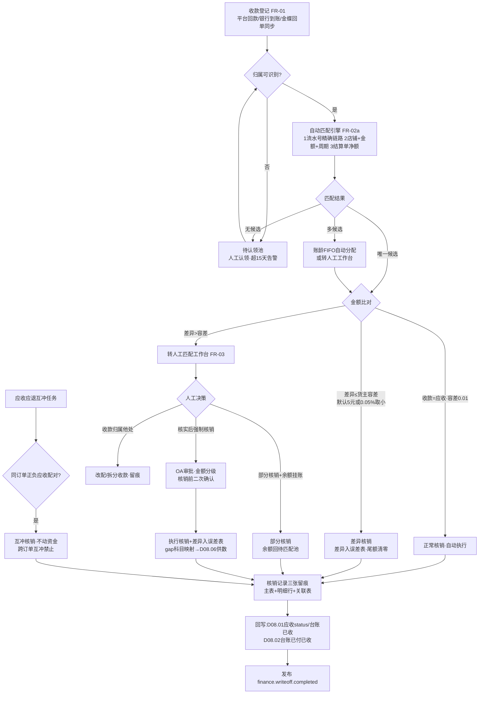
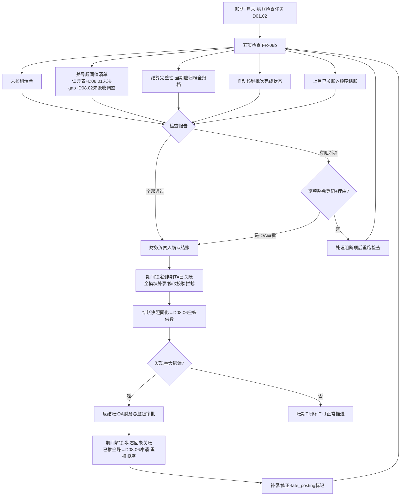

# SRS-D08.03 核销与差异处理模块 需求规格说明书

> 文档编号：SRS-D08.03 · 版本 V1.0 · 2026-10-24 · 编写：小凯 · 状态：待审阅（批次④）
> 所属域：D08 财务对账域 · 分期：**P1（M3）** · schema：**oms_finance**（全单据 tenant_id）
> 上游依据：SRS-D08.01（IF-D08.01-04 `ArQueryService` 应收明细/台账、IF-D08.01-07 `ArLedgerQuery` 账龄、事件 `finance.ar.*`、gap_type→借贷科目映射 §5.3）· SRS-D08.02（IF-D08.02-05 `SettleQueryService::getLedger` 结算台账、IF-D08.02-D8 核销冻结/核销池重建联动、归档净额转核销池）· SRS-D04.04（IF-D04.04-06 `IoBillService::markSettled`，单据 settle_status 联动回写）· SRS-D05.03（退款台账红冲语义同款）· 逆向文档 04 §6.3（核销引擎 verification：三档正常/差异/强制 + doManVerificate/doAutoVerificate/do_cancel + 核销留痕三张表 + financebase_bill_verification_error 核销误差表 + financebase_gap 差异借贷科目映射）/§6.5（账期月结 monthly_report + colse_book 关账 + 关账前校验）
>
> **全局决策（本模块承载，红线）**：① **金蝶记账，OMS 出统计+明细+排查工具**（Q5）——核销是**业务对账动作**（收款与应收的匹配确认），不产生会计凭证；误差表与 gap 科目映射作为 D08.06 金蝶凭证数据源（商派「差异直接映射借贷科目」的审计可解释性设计保留，但 OMS 侧只供数不记账）；② OMS 零资金操作：收款登记=记录事实（平台钱包提现到账/银行到账），不发起任何转账打款；③ 商派核销三档（正常/差异/强制）完整保留；④ 已核销单据锁定，红冲须先反核销；⑤ 月末结账=期间锁定，禁止补录，反结账走 OA。

---

## 1. 模块概述

### 1.1 定位

核销与差异处理是财务对账域的**资金闭环模块**：登记收款事实（平台钱包提现到账/银行到账——金蝶回单同步或人工登记），执行收款与应收的核销匹配（自动匹配：店铺+金额+周期；人工匹配工作台兜底），核销分三档——**正常核销**（收款=应收精确匹配）/**差异核销**（容差内小额差异核销，差异入误差表）/**强制核销**（超容差人工决策，OA 审批）；维护误差表（核销差异累计，借贷方向+差异科目映射 gap 表）与未核销余额（挂账应收/预收）；管理货主级账期与逾期预警；执行核销锁定（已核销单据禁改，红冲先反核销，联动 D04.04 单据 settle_status 回写）与月末结账（结账检查→期间锁定→反结账 OA）。

商派对应机制：finance verification 核销引擎（doManVerificate 人工/doAutoVerificate 自动/doAutoArVerificate 应收应退互冲/checkVerificate 核销前检查含强制核销确认交互/do_cancel 撤销）+ verification/verification_items/bill_verification_relation 三张留痕表 + financebase_bill_verification_error 误差表 + financebase_gap（差异类型→借/贷会计科目）+ monthly_report 账期月结（colse_book 关账：关账前校验上月/下月账期状态与自动核销完成状态，记账受账期约束）。凯淳关键差异：**核销对象从「店铺级 AR」升级为「货主级应收明细+结算单净额」双层 + 收款登记对接金蝶回单同步（商派为 payments 手工/支付宝流水）+ 结账检查与 D08.01 差异清单/D08.02 调整单联动收口**。

### 1.2 职责边界

**做**：收款登记（平台回款/银行到账/金蝶回单同步）；收款-应收自动匹配与人工匹配工作台；核销三档执行与留痕；应收应退互冲核销（未签收直接退款场景）；误差表与差异科目映射维护；未核销余额管理（挂账应收/预收/多收）；账期管理（货主级配置/逾期预警）；核销锁定与反核销（红冲前置，联动 D04.04 单据 settle_status 回写）；月末结账与反结账；核销数据供给（D08.01 台账已收列/D08.02 台账已付已收列/D08.06 金蝶/D11）。

**不做**：应收明细与账单匹配（→ D08.01，本模块消费其应收与差异清单）；结算单生成与确认（→ D08.02，本模块消费其归档净额入核销池）；实际资金收付（**平台/银行执行，OMS 只登记事实**）；金蝶凭证（→ D08.06，误差表/gap 映射为供数）；账龄分档计算（→ D08.01 FR-09，本模块供逾期账期口径）；OA 审批流（→ D10.05）。

### 1.3 与其他模块关系

| 模块 | 关系 |
|---|---|
| D08.01 应收 | 上游：应收明细（待核销池）；下游回写：核销状态（status/received 列，其 IF-D08.01-D6）与台账已收列；差异清单（gap 未决）是结账检查输入 |
| D08.02 结算 | 上游：归档结算单净额转核销池（应付→付款核销/应收→收款核销，其 §4.1）；下游回写：台账已付/已收列（其 §5.5）；红冲冻结/核销池重建联动（其 IF-D08.02-D8） |
| D04.04 单据 | settle_status 联动：应收核销闭环后经结算链回写单据结算锁定（`markSettled`，其 IF-D04.04-06） |
| D05.03 退款 | 应收应退互冲核销场景（未发货退款：负向应收与正向应收互冲，不动资金） |
| D08.06 金蝶 | 下游：核销记录/误差表/gap 科目映射供给（金蝶收款单与差异凭证数据源）；上游：金蝶银行回单同步（收款登记来源之一） |
| D10.05 OA | 强制核销/反核销/反结账/坏账处理审批 |
| D10.01 货主 | 账期配置载体（货主档案扩展） |
| D10.04 门户 | 品牌方本货主对账视图（已收/未收/误差，只读脱敏） |
| D01.02/01.07 | 调度（自动核销批/逾期扫描/结账检查）；告警（逾期/差异超阈值） |
| D11 报表 | 核销率/差异率/逾期余额/DSO 指标供数 |

---

## 2. 业务场景

**SC-D08.03-01 平台回款自动核销（主流程）**
淘系店铺 9 月货款由支付宝结算，10 月 5 日钱包提现 38.5 万到账凯淳银行账户。收款登记（金蝶回单同步 EF-02/人工登记银行到账）→ 自动匹配引擎：按店铺+金额+周期在核销池检索——命中 D08.01 已匹配账单流水对应的应收明细集合（Σ=38.5 万，精确一致）→ **正常核销**（批量生成核销记录：一笔收款×N 笔应收明细，逐行核销金额）→ 回写 D08.01 应收 status=已核销+台账已收列 → 发布 `finance.writeoff.completed`。

**SC-D08.03-02 差异核销（容差内小额差异）**
京东钱包提现 12.00 万，对应应收明细 Σ=12.0035 万，差 −3.50 元（平台手续费尾差）。容差规则（货主级配置：单笔核销容差默认 ≤5 元或 ≤0.05%，取小）内 → **差异核销**：按收款额核销，差异 3.50 元入误差表（gap_type=平台手续费尾差，借贷方向=借方损失，映射科目经 D08.06 供金蝶）；应收明细尾额 3.50 标记「差异已核销」不留挂账余额（容差内清零）。误差表按类型×货主×期间累计，月度汇总超阈值（默认 500 元，货主级可配）→ 告警财务复核。

**SC-D08.03-03 强制核销（超容差人工决策）**
抖音回款 8.2 万 vs 应收 8.5 万，差 3000 元（平台罚款扣款无账单明细）。超容差 → 自动核销拒绝，入人工匹配工作台：财务核实平台罚单邮件 → 发起**强制核销**（核销 8.2 万+差异 3000 入误差表确认损失，或余额挂账）→ OA 审批（D10.05，金额分级）→ 通过后执行；决策依据（罚单附件）留痕。误差表记 gap_type=平台罚没，借方科目映射营业外支出（D08.06 供数）。

**SC-D08.03-04 应收应退互冲核销（不动资金）**
未发货整单退款订单：正向应收（订单完成前取消场景无应收；已完成后退款场景）与负向冲减应收同货主同店铺并存 → 互冲核销（商派 doAutoArVerificate 机制保留）：自动任务将同订单的正负应收对冲（+80/−80 两行互冲，核销记录类型=应收互冲），双方核销状态闭环，不产生资金流。互冲仅限同订单/同货主配对，跨订单互冲禁止（审计红线）。

**SC-D08.03-05 结算净额付款核销（凯淳付品牌方）**
D08.02 归档结算单 ST-A-202609 净额=凯淳应付品牌 A 30.95 万。付款由金蝶执行（OMS 零资金操作）：金蝶付款单回传（EF-02 同步/文件）→ 本模块登记付款事实 → 与结算单应付余额核销 → 回写 D08.02 台账已付列（期末余额递减）。品牌方门户可见「本期已结清」。

**SC-D08.03-06 预收挂账与账期逾期**
品牌 F 预打服务保证金 5 万（尚无结算单）：收款登记时无可匹配应收 → 挂**预收余额**（货主级预收池）；下期结算单归档后自动/人工从预收池核销抵扣。账期管理：品牌 G 结算单归档确认账期 30 天（货主级配置），到期未收 → 逾期标记+预警（D01.07 推商务与财务）；逾期清单与 D08.01 账龄 >90 天红色预警联动（催收依据合并视图）。

**SC-D08.03-07 反核销与单据联动**
发现某笔核销错误（收款实际归属另一店铺）：发起**反核销**（OA 审批）→ 核销记录作废（红冲语义：负向记录+原记录保留）→ 应收 status 回退待核销、台账已收列冲减；若涉及已归档结算单，按 §5.3 判定表联动（仅需核销层回退则结算锁定不动；净额受影响则走 D08.02 FR-07 红冲全链并联动 D04.04 settle_status 解锁）。**已核销单据禁止直接修改金额**（D08.01 FR-03c 锁定的执行方）：修改必先反核销。

**SC-D08.03-08 月末结账与反结账**
9 月账期结账：结账检查任务——① 未核销清单（待核销应收/未匹配收款/预收挂账余额）② 差异超阈值清单（误差表月度累计超阈+D08.01 未决 gap 差异清单+D08.02 未吸收调整单）③ 结算单状态检查（当期应归档结算单是否全部归档/确认中）→ 检查报告输出（可结/阻断项清单）→ 财务负责人确认结账（阻断项可带病结账——逐项豁免登记+理由，OA 审批）→ **期间锁定**：9 月账期禁止补录/修改任何该期间财务单据（应收/收款/核销/调整，D08.01 §5.4 结账联动的执行方）→ 结账数据快照供金蝶（D08.06）。发现 9 月重大遗漏 → **反结账**（OA 强制审批，财务总监级）→ 期间解锁 → 补录/修正 → 重新结账（重结账检查全量重跑）。

---

## 3. 功能需求

### FR-D08.03-01 收款登记

- FR-01a 收款来源三通道：① **平台回款**（钱包提现到账：支付宝/京东钱包/抖音支付等，账单流水关联 D08.01 bill_flow 收入方向）；② **银行到账**（金蝶回单同步 EF-02 自动登记/人工登记：到账日期/金额/付款方/银行流水号/回单附件）；③ **线下收款**（品牌方转账等，人工登记+凭证必传+双人复核，登记≠审批）。
- FR-01b 收款单（receipt）：单号 `RC{YYYYMMDD}{6位序列}`；到账日期/金额（2 位小数）/币种（默认 CNY，多币种 P2 预留）/渠道/银行流水号/付款方/归属店铺与货主（可后补：未识别到账挂「待认领池」人工认领，超 15 天未认领告警）/状态（待匹配/部分核销/已核销/已认领挂预收）；幂等键=(渠道, 银行流水号)，金蝶回单重复同步直接返回。
- FR-01c 付款登记（凯淳付品牌方，结算净额场景 SC-05）：同构单据 payment（`PY` 前缀），来源=金蝶付款单回传/人工登记；OMS 零资金操作红线（只记录事实，不发起支付）。

### FR-D08.03-02 收款-应收匹配与核销三档

- FR-02a 自动匹配规则（优先级从高到低）：① 银行流水号/平台流水号 ↔ D08.01 已匹配 bill_flow → 应收明细集合（精确链路）；② 店铺+金额（±容差）+周期（到账日所属账期±1）→ 候选应收集合；③ 结算单净额（D08.02 归档单，付款/收款方向一致+金额一致）→ 结算核销。多候选 → 按账龄优先（先老先核，FIFO）自动分配或转人工。
- FR-02b **正常核销**：收款金额=应收金额（精确匹配，容差 0.01 元内）→ 自动执行；一对多（一笔收款核 N 笔应收）/多对一（多笔收款核 1 笔应收，部分核销累计）均支持。
- FR-02c **差异核销**：|差异| ≤ 容差（货主级配置：绝对额默认 5 元 或 相对 0.05%，取小）→ 按收款额核销，差异入误差表（FR-04），应收尾额容差内清零（标记差异已核销）。
- FR-02d **强制核销**：超容差 → 自动通道拒绝，转人工匹配工作台；人工决策（核销+差异入误差表确认损失/部分核销+余额挂账）→ OA 审批（金额分级：>1000 元财务经理，>1 万财务总监，货主级阈值可配）→ 执行；核销前检查交互保留（商派 checkVerificate「确认强制核销？」二次确认语义）。
- FR-02e 应收应退互冲核销（SC-04）：自动任务同订单正负应收配对互冲（核销类型=应收互冲，不动资金）；跨订单互冲禁止；互冲留痕同核销记录。
- FR-02f 核销记录（writeoff）三张留痕（商派结构保留）：核销主表（核销流水号/日期/执行人或自动标记/核销类型 0 应收互冲 1 收款核销 2 付款核销/核销金额/摘要）+ 核销明细行（收款单/应收单/结算单三方引用+行核销金额）+ 核销关联表（流水↔单据↔订单↔平台流水号多键检索）。
- FR-02g 部分核销：应收 status=部分核销（已核销金额累计 confirm_amount，未核销余额 unconfirm_amount 逐笔递减）；收款同理（部分核销余额可继续匹配）。
- FR-02h 核销回写：D08.01 应收 status/confirm_money+台账已收列（其 IF-D08.01-D6）；D08.02 台账已付/已收列（其 §5.5）；发布 `finance.writeoff.completed`。

### FR-D08.03-03 人工匹配工作台

- FR-03a 工作台队列：自动匹配失败收款、待认领池、超容差待强制决策、互冲待确认、反核销待处理；按货主/店铺/金额区间/到账日期筛选。
- FR-03b 匹配操作：一笔收款手工勾选多笔应收（试算平衡提示）；拆分收款（一笔到账拆给多货主/多店铺，依据留痕）；合并收款（多笔到账核一笔大额应收）；操作全留痕（谁/何时/依据备注），人工匹配同样产生标准核销记录（auto_flag=人工，商派字段语义保留）。

### FR-D08.03-04 误差表与差异科目映射（gap 表）

- FR-04a 误差表（writeoff_error）：每笔差异核销/强制核销的差异行——差异金额（带符号）/**借贷方向**（借方=凯淳损失/贷方=多收挂账）/gap_type（差异类型字典，与 D08.01 FR-07a 同一字典）/来源核销记录引用/处理状态（累计中/已月度清理/已转损益）。
- FR-04b gap 科目映射表（差异类型→借方科目+贷方科目，金蝶科目编码）：商派 financebase_gap 设计**完整保留**（审计可解释性基础）；映射维护走配置管理（变更 OA 备案）；映射数据经 D08.06 供金蝶差异凭证（OMS 不记账，Q5 红线）。
- FR-04c 误差累计与清理：按类型×货主×期间累计；月度清理任务——容差内尾差批量转损益（清理批次，金蝶供数）；单笔超阈值（默认 100 元）逐笔人工定性。
- FR-04d 月度差异超阈值告警：误差表月累计 > 货主级阈值（默认 500 元）→ 告警财务复核（D01.07）；连续 3 期同类型差异 → 规则优化建议（提示调整容差/排查平台扣费口径）。

### FR-D08.03-05 未核销余额管理

- FR-05a 挂账应收：未核销余额（unconfirm_amount>0）持续跟踪；账龄联动 D08.01 FR-09；长期挂账（>180 天）→ 坏账评估清单（OA 审批后转坏账：核销入账损失，gap 映射坏账科目，金蝶供数）。
- FR-05b 预收挂账（SC-06）：无可匹配应收的收款挂货主级预收池；结算单归档后自动抵扣建议（人工确认执行）或指定用途认领；预收余额台账（货主×期间滚动）。多收挂账：核销后收款余额（贷方差异）挂「多收待处理」——退回（登记退款事实，平台/银行执行）或转预收池；处理时限 30 天，超期告警。

### FR-D08.03-06 账期管理

- FR-06a 账期配置（货主级，D10.01 档案扩展）：结算单确认后的收款/付款账期天数（默认 30 天，品牌方可谈判差异化）；账期起算日=结算单归档日（可配=确认日）。
- FR-06b 逾期管理：到期未核销 → 逾期标记（应收/应付双向）；逾期预警（D01.07：到期前 3 天提醒+逾期当日红色告警，推商务与财务）；逾期清单（货主×金额×逾期天数）与 D08.01 账龄合并催收视图。
- FR-06c 逾期熔断联动（P2 预留）：逾期超阈值可联动 D03 审单拦截（该货主新单 hold）——首期只预警不熔断（业务连续性优先），接口占位。

### FR-D08.03-07 核销锁定与反核销

- FR-07a 锁定规则：已核销（全额）的应收/收款单**禁止修改金额与归属**（D08.01 FR-03c/D08.02 调整锁定的执行方）；部分核销单据修改仅限未核销余额部分且需 OA。
- FR-07b 反核销：红冲语义（负向核销记录+原记录保留，禁物理删除）；OA 审批；回写逆向联动（应收 status 回退/台账已收冲减/D08.02 台账冲减）；反核销后收款余额回待匹配池。
- FR-07c 结算联动判定（SC-07）：涉及已归档结算单的核销回退 → 判定结算单是否需红冲（净额受影响=需红冲，走 D08.02 FR-07 全链：冻结→红冲→V2；净额不受影响=仅核销层回退，结算锁定不动）。
- FR-07d D04.04 单据 settle_status 联动：核销闭环→结算归档→`markSettled` 链已锁定的单据，反核销+结算红冲后联动解锁（settle_status 回退未结算，经 D08.02 重算链回写）；只反核销不红冲结算的，单据锁定不动。
- FR-07e 锁定可视化：应收/收款/结算/单据各界面显示锁定状态与锁定来源（哪笔核销/哪张结算单），一键追溯。

### FR-D08.03-08 月末结账与反结账

- FR-08a 账期（period）：自然月（与 D08.01 §5.4/D08.02 周期口径对齐）；账期状态机：`未启用 → 未关账 → 已关账`（商派 colse_book 枚举保留）。
- FR-08b 结账检查（结账前置任务，检查报告输出）：① 未核销清单（待核销应收/未匹配收款/待认领池余额）；② 差异超阈值清单（误差表月累计超阈+D08.01 未决 gap 差异+D08.02 未吸收调整单）；③ 结算完整性（当期应归档结算单全部归档或豁免登记）；④ 自动核销完成状态（商派 get_auto_flag_status 语义：自动匹配批次全部跑完）；⑤ 上/下月账期状态校验（上月未关账禁止关本月——顺序结账，商派 get_monthly_book_status 语义保留）。
- FR-08c 结账执行：检查通过（或阻断项逐项豁免登记+理由+OA 审批）→ 财务负责人确认结账 → **期间锁定**：该账期禁止补录/修改任何财务单据（应收生成/收款登记/核销/调整/结算——各模块写入前校验 period 状态，本模块为账期状态唯一裁决方）→ 结账快照（汇总数据固化）→ 供 D08.06 金蝶。
- FR-08d 反结账：OA 强制审批（财务总监级）→ 期间解锁（状态回未关账）→ 补录/修正 → 重新结账（检查全量重跑）；反结账全程留痕（原因/审批/操作清单）；已推金蝶期间的反结账 → 联动 D08.06 冲销-重推流程（顺序同 D08.02 FR-07c）。
- FR-08e 关账后单据：归属已关账期间的业务事件（如延迟退款冲减）→ 自动落**当期账期**（业务发生日与实际入账期分离标记 `late_posting`，追溯原属期），不允许改历史期间（审计要求，与 D04.07 §5.3「口径变更只未来生效」同一原则）。

### FR-D08.03-09 查询工作台与数据供给

- FR-09a 核销工作台：待匹配/差异待决/预收池/逾期清单/坏账评估/结账检查六视图；核销记录多维检索（核销流水号/收款单/应收单/订单号/平台流水号——关联表多键，商派 bill_verification_relation 检索能力保留）；导出（D01.06）：核销记录/误差表/未核销清单/结账检查报告。
- FR-09b 品牌方门户（D10.04）：本货主已收/未收/预收余额/逾期状态只读（脱敏）。数据供给：D08.01 台账已收列回写、D08.02 台账已付/已收列回写、D08.06 金蝶（核销记录/误差表/gap 映射/结账快照，首期文件交换）、D11（核销率/差异率/逾期余额/DSO 应收周转天数指标）。

---

## 4. 业务流程

### 4.1 核销匹配决策流程



### 4.2 月末结账与反结账流程



---

## 5. 处理逻辑

### 5.1 核销档位判定（决策表）

```
diff = 收款金额 − Σ候选应收金额(本次核销集)
容差 tol = min(货主级绝对额(默认5元), 应收额×0.05%)   # 取小, 货主级可配
档位判定:
  |diff| ≤ 0.01          → 正常核销(自动, 无需审批)
  0.01 < |diff| ≤ tol    → 差异核销(自动, 差异入误差表, 尾额清零)
  |diff| > tol           → 强制核销通道(人工决策+OA金额分级+二次确认)
diff 符号语义: diff<0 平台少付(借方损失方向); diff>0 多收(贷方挂账方向→FR-05b)
互冲核销: 同订单正负应收 |Σ| ≤ 0.01 → 自动互冲(不动资金); 跨订单禁止
部分核销: 收款不足额 → 按账龄FIFO逐笔核至收款额尽, 余应收挂账; 收款有余额 → 挂待匹配/预收
```

### 5.2 误差表借贷方向与 gap 科目映射（商派审计可解释设计保留）

```
误差行 = (差异金额|绝对值|, 借贷方向, gap_type, 核销记录引用, 处理状态)
借贷方向规则:
  收款 < 应收(少收)  → 借方(损失方向): 差额为凯淳损失/费用
  收款 > 应收(多收)  → 贷方(挂账方向): 差额为负债(预收/待退)
gap_type → (借方科目, 贷方科目) 映射(与 D08.01 §5.3 同一映射表, 金蝶科目编码):
  平台手续费尾差   → 借:财务费用-手续费   贷:应收账款
  平台罚没         → 借:营业外支出-罚没   贷:应收账款
  坏账核销         → 借:信用减值损失      贷:应收账款
  多收待退         → 借:银行存款          贷:预收账款/其他应付
月度清理: 容差内尾差批量转损益(清理批次, 金蝶供数); 单笔>100元逐笔人工定性
OMS 只供数不记账(Q5): 凭证在金蝶按映射生成, 误差表=可解释数据源
```

### 5.3 反核销与锁定联动判定

```
反核销申请(OA) → 锁定影响分析:
  1. 核销层回退: 负向核销记录(红冲语义) + 应收status回退 + 台账已收冲减 + 收款余额回池
  2. 结算影响判定: 该应收所属结算单(D08.02)是否已归档?
     未归档 → 仅核销层回退(结算草稿重出时自动反映)
     已归档 → 净额是否受影响?
       受影响(金额/归属变化) → 触发 D08.02 FR-07 红冲全链(冻结→红冲→冲销同步→V2)
       不受影响(如收款侧改配, 应收不动) → 仅核销层回退, 结算锁定不动
  3. D04.04 单据联动: 仅当结算红冲 → markSettled 锁定回退(settle_status=未结算)
顺序红线: 结算红冲未同步金蝶冲销前, 反核销的 V2 侧数据禁推(同 D08.02 FR-07c)
```

### 5.4 结账检查与期间锁定裁决

```
结账检查(账期T): 五项全跑 → 检查报告(阻断项清单, 逐项可豁免+理由+OA)
顺序约束: T-1 未关账 → T 禁止关账(商派 get_monthly_book_status 语义)
期间锁定裁决(本模块为账期状态唯一裁决方):
  isPeriodOpen(owner无关, period) → 全模块写入前调用:
    D08.01 应收/冲减/调整生成、D08.02 结算操作、本模块收款/核销 —— 已关账期间一律拒绝
  延迟事件(late_posting): 归属已关账期的业务事件 → 落当前开放账期+原属期标记(追溯)
反结账: OA财务总监级 → 解锁 → 补录 → 重跑检查 → 重关账; 已推金蝶 → 冲销-重推顺序联动
账期状态机: 未启用 →(启用) 未关账 →(结账) 已关账 →(反结账) 未关账
```

### 5.5 幂等与并发

```
登记幂等: (渠道,银行流水号)唯一; 核销幂等: 核销批次号唯一, 自动匹配按(店铺,账期)分片+分布式锁
核销并发: 余额扣减 CAS(unconfirm_amount 前值校验) + 同笔收款并发互斥(收款单锁); 反核销与自动核销互斥(应收单级锁), OA回调按单号CAS
结账竞态: 关账瞬间进行中的写入以 period 裁决时点为准(写入事务内校验), 关账后到达的落 late_posting
```

---

## 6. 数据字段（业务字段描述，schema：oms_finance）

### 6.1 收款单（finance_receipt）/ 付款单（finance_payment）

| 字段 | 业务含义 | 取值/校验 |
|---|---|---|
| receipt_id / receipt_bn / direction | 主键/单号/收付方向 | RC/PY 前缀唯一（FR-01b/c） |
| arrive_date / amount / currency | 到账日/金额/币种 | 金额 2 位小数；币种默认 CNY（多币种 P2 预留） |
| channel / bank_serial_no / source | 渠道/银行流水号/来源 | 幂等键=(channel, bank_serial_no)；来源=平台回款/金蝶回单同步/人工登记/线下 |
| payer_name / attach | 付款方/回单附件 | 线下登记凭证必传+双人复核 |
| owner_id / shop_id / claim_operator | 归属货主/店铺/认领人 | 可后补（待认领池）；认领留痕 |
| status / unconfirm_amount | 状态/未核销余额 | 待匹配/部分核销/已核销/挂预收/多收待处理；余额逐笔递减（CAS） |
| period / tenant_id | 归属账期/租户 | 必填；结账锁定校验位 |

### 6.2 核销记录三张（finance_writeoff / _item / _relation，商派留痕结构保留）

| 字段 | 业务含义 | 取值/校验 |
|---|---|---|
| ——主表—— | | |
| writeoff_bn / writeoff_date | 核销流水号/日期 | 唯一 |
| writeoff_type | 核销类型 | 0 应收互冲/1 收款核销/2 付款核销（商派枚举保留+付款扩展） |
| writeoff_level | 核销档位 | 正常/差异/强制/互冲（三档+互冲，FR-02） |
| amount / auto_flag | 核销金额/自动人工标记 | 2 位小数；商派字段语义保留（0 人工/1 自动） |
| operator / oa_ref / memo | 执行人/OA 引用（强制与反核销必填）/摘要 | 强制核销二次确认留痕 |
| reverse_flag / origin_writeoff_bn | 反核销标记/原核销引用 | 红冲语义（FR-07b） |
| ——明细行—— | | |
| receipt_ref / ar_ref / settle_ref / line_amount / diff_amount | 收款单/应收单/结算单三方引用+行核销额/差异额 | 差异行联动误差表 |
| ——关联表—— | | |
| serial_no / bill_bn / order_bn / platform_serial_no | 流水↔单据↔订单↔平台流水号 | 多键检索（商派 relation 能力保留） |

### 6.3 误差表（finance_writeoff_error）与 gap 科目映射（finance_gap_mapping）

| 字段 | 业务含义 | 取值/校验 |
|---|---|---|
| ——误差表—— | | |
| error_id / writeoff_bn / owner_id / period / tenant_id | 差异行/来源核销/归属 | 归属必填 |
| diff_amount / diff_direction | 差异金额（绝对值）/借贷方向 | 借=损失方向/贷=挂账方向（§5.2） |
| gap_type / process_status / clean_batch_id | 差异类型（D08.01 FR-07a 同字典）/处理状态（累计中/已月度清理/已转损益）/清理批次 | 批量转损益追溯 |
| ——gap 映射—— | | |
| gap_type / debit_account / credit_account | 差异类型/借方科目/贷方科目 | 金蝶科目编码（D08.06 维护映射）；变更 OA 备案 |
| auto_clean_threshold / alert_threshold | 单笔自动清理上限（默认 100 元）/月度告警阈值（默认 500 元，货主级可配） | FR-04c/d |

### 6.4 账期（finance_period）与账期配置（finance_credit_term，货主级）

| 字段 | 业务含义 | 取值/校验 |
|---|---|---|
| ——账期—— | | |
| period / start_date / end_date | 账期标识（YYYYMM）/起止 | 自然月，与 D08.01/D08.02 口径对齐 |
| status / close_time / close_operator | 状态（未启用/未关账/已关账，商派 colse_book 枚举保留）/关账时间/结账人 | 期间锁定唯一裁决位（§5.4） |
| exempt_items / snapshot_ref / reopen_oa_ref | 豁免登记项（JSON：阻断项+理由+OA）/结账快照/反结账审批 | FR-08c/d；快照供 D08.06，留痕 |
| ——账期配置—— | | |
| owner_id / credit_days / start_anchor | 货主/账期天数（默认 30）/起算日（归档日或确认日，可配） | FR-06a |
| overdue_alert_days / freeze_threshold / tolerance_abs / tolerance_rate | 逾期预警提前天数（默认 3）/熔断阈值（P2 占位）/差异核销容差（绝对额默认 5 元/相对 0.05%，取小） | FR-06b/c；§5.1，货主级 |

### 6.5 预收池（finance_advance_balance）

owner_id/tenant_id（货主维度）· receipt_ref/amount/used_amount/balance（来源收款/金额/已抵扣/余额）· purpose/status（用途认领：保证金/预付货款/多收转入；状态：挂账/部分抵扣/已清）· period（归属账期）。

---

## 7. 接口

### 7.1 内部接口（本模块提供）

| 编号 | 接口 | 消费方 | 说明 |
|---|---|---|---|
| IF-D08.03-01 | `ReceiptService::register(收款/付款事实)` | 金蝶回单同步任务/财务工作台 | 收款付款登记（幂等 FR-01b；待认领池分流） |
| IF-D08.03-02 | `WriteoffService::autoMatch(店铺, 账期)` / `manualWriteoff(收款, 应收集[], 档位, 依据)` | 调度批任务/人工工作台 | 自动匹配核销与人工核销（三档判定 §5.1） |
| IF-D08.03-03 | `WriteoffService::reverse(writeoff_bn, 原因, OA单)` | 财务工作台（OA 前置） | 反核销（红冲语义+锁定联动判定 §5.3） |
| IF-D08.03-04 | `PeriodService::isPeriodOpen(period)` / `close(period, 豁免项)` / `reopen(period, OA单)` | **D08.01/D08.02/本模块全部写入路径**/财务负责人 | 账期状态唯一裁决+结账+反结账（§5.4） |
| IF-D08.03-05 | 核销结果回写（应收 status/confirm_money、台账已收/已付列） | D08.01（其 IF-D08.01-D6）/D08.02（其 §5.5） | 核销闭环回写 |
| IF-D08.03-06 | `ErrorTableQuery::getErrors/list` / `getGapMapping(gap_type)` | D08.06/D11/财务工作台 | 误差表与科目映射取数 |
| IF-D08.03-07 | 事件 `finance.writeoff.completed` / `finance.writeoff.reversed` / `finance.period.closed` / `finance.period.reopened` | D08.01/D08.02/D08.06/D11 | 核销与结账生命周期广播（DB-00 事件字典登记） |
| IF-D08.03-08 | `CreditTermService::checkOverdue(owner)` / 逾期清单 | D01.07/D11/D10.04 门户 | 账期逾期预警供数 |

### 7.2 依赖接口（本模块消费）

| 编号 | 接口 | 提供方 | 说明 |
|---|---|---|---|
| IF-D08.03-D1 | `ArQueryService::getAr/list`（待核销池）+ bill_flow 已匹配流水 | D08.01（IF-D08.01-04/06） | 应收明细与精确匹配链路（流水号→应收集合） |
| IF-D08.03-D2 | `SettleQueryService::get/list`（归档净额入核销池）+ 红冲冻结/重建联动 | D08.02（IF-D08.02-05/D8） | 结算核销与红冲协同（其 FR-07e） |
| IF-D08.03-D3 | `ArLedgerQuery::getAging` | D08.01（IF-D08.01-07） | 账龄联动催收合并视图（FR-06b） |
| IF-D08.03-D4 | `IoBillService::markSettled` 回退联动（经 D08.02 红冲链） | D04.04（IF-D04.04-06） | settle_status 解锁回写（FR-07d） |
| IF-D08.03-D5 | OA 审批（强制核销/反核销/豁免结账/反结账/坏账） | D10.05 | 审批链与回调 |
| IF-D08.03-D6 | 调度/告警/导出/审计/门户 | D01.02/D01.07/D01.06/D10.06/D10.04 | 底座能力 |

### 7.3 外部接口

| 编号 | 接口 | 方向 | 说明 |
|---|---|---|---|
| EF-D08.03-01 | 金蝶核销数据供给（经 D08.06） | 出 | 核销记录/误差表+gap 科目映射/结账快照/坏账清单（首期文件交换，API 适配层预留）。**OMS 不生成凭证（Q5 红线）** |
| EF-D08.03-02 | 金蝶银行回单/付款单同步（经 D08.06） | 入 | 收款/付款事实登记来源（FR-01a②/FR-01c）；只读同步，无任何资金指令下发（资金红线同 D05.03） |

---

## 8. 非功能需求

| 项 | 要求 |
|---|---|
| 性能 | 自动匹配批（1 万收款×50 万应收，店铺分片）≤20 分钟；单笔核销 P95 ≤200ms；结账检查（全量五项）≤10 分钟；工作台查询 P95 ≤500ms |
| 幂等 | 登记/核销/反核销/结账全路径幂等（§5.5）；OA 回调与金蝶同步重复零副作用 |
| 一致性 | 核销余额扣减 CAS+应收单级锁；台账回写与核销记录同事务；结账瞬间竞态以 period 裁决时点为准（late_posting 兜底不丢单） |
| 精度 | 金额 2 位小数；容差比较基于绝对值分（0.01 元）；误差表金额带借贷方向语义，禁止无符号混算 |
| 资金安全 | OMS 零资金操作（登记事实红线）；强制核销 OA+二次确认；反核销红冲语义禁物理删除；线下登记双人复核 |
| 审计 | 核销三张留痕表不可改删；豁免结账逐项理由+OA；反结账财务总监级审批全程留痕；gap 映射变更 OA 备案 |
| 数据权限 | 品牌方门户只见本货主（租户行隔离 D10.03）；内部四维过滤 |
| 容量 | 月核销记录 ~10 万行×3 年在线；writeoff 按 period 分区；关联表多键索引（流水/订单/平台单号） |

---

## 9. 验收标准

| 编号 | 验收条件 |
|---|---|
| AC-01 | SC-01 正常核销：提现到账 38.5 万经流水号精确链路自动核销 N 笔应收（逐行金额勾稽 Σ=收款额），D08.01 应收 status/台账已收列 1 分钟内回写正确；重复同步回单幂等 |
| AC-02 | SC-02 差异核销：差 3.50 元（容差 5 元内）自动差异核销，尾额清零不留挂账，误差表落行（借贷方向=借、gap_type=手续费尾差、科目映射可查）；差 6 元（超容差）转人工强制通道 |
| AC-03 | SC-03 强制核销：超容差自动通道拒绝；人工决策+OA 分级审批（构造 999/1001/10001 元三档验证审批链路由）+二次确认交互；决策依据附件留痕 |
| AC-04 | SC-04 互冲核销：同订单 +80/−80 自动互冲闭环不动资金；构造跨订单互冲请求被拒绝（审计红线） |
| AC-05 | SC-05 结算净额核销：归档结算单净额入核销池，金蝶付款回传登记后核销，D08.02 台账已付列/期末余额递减正确；门户显示「本期已结清」 |
| AC-06 | SC-06 预收与账期：无匹配收款挂预收池、结算归档后抵扣建议执行闭环；账期 30 天到期未收→逾期标记+到期前 3 天提醒+逾期当日告警；逾期清单与 D08.01 账龄合并视图一致 |
| AC-07 | SC-07 反核销：红冲语义（负向记录+原记录保留）；应收 status 回退/台账冲减/收款余额回池三处联动正确；涉及已归档结算单时按 §5.3 判定表路由（净额受影响→触发 D08.02 红冲链+D04.04 settle_status 解锁；不受影响→仅核销层回退） |
| AC-08 | 锁定红线：已核销应收修改金额被拒（提示先反核销）；部分核销单据仅未核销余额可改且需 OA；锁定来源一键追溯（哪笔核销/哪张结算单） |
| AC-09 | 误差表治理：月度累计超 500 元告警；单笔 >100 元不入自动清理批次；连续 3 期同类型差异输出规则优化建议；gap 映射变更 OA 备案留痕 |
| AC-10 | SC-08 结账五项检查：构造五类阻断项（未核销/差异超阈/结算未归档/自动批未完成/上月未关账）全部检出；豁免登记+OA 后可带病结账；关账后向该期间补录应收/收款/核销/调整全部被拒（isPeriodOpen 拦截，含 D08.01/D08.02 写入路径） |
| AC-11 | 反结账：OA 财务总监级审批后解锁，补录单据带 late_posting 标记+原属期可溯，重结账检查全量重跑；已推金蝶账期反结账触发 D08.06 冲销-重推顺序（冲销未同步禁重推） |
| AC-12 | 并发核销：同笔收款 20 并发核销请求恰好一次成功（收款单锁+CAS）；关账瞬间进行中的核销写入按 period 裁决时点归属正确，无丢失无跨期错账 |

---

## 变更记录

| 日期 | 版本 | 变更 | 原因 |
|---|---|---|---|
| 2026-10-24 | V1.0 | 首版 | — |

---

*参考实现溯源：商派 finance verification 核销引擎（`verification.php`：do_save 核销日志、核销类型 0 应收互冲/1 应收实收、doManVerificate 人工/doAutoVerificate 自动/doAutoArVerificate「应收应退自动核销（针对未签收直接退款）」/checkVerificate 核销前检查含「确认强制核销：当前实收实退是否最终确认强制核销？」交互与核销误差值判断/do_cancel 撤销、每次核销 addOpLog「正常核销|差异核销|强制核销」）+ 留痕三张表（verification 主表/verification_items 明细「单据号类型 0 实收 1 应收」/bill_verification_relation 关联表「流水单据号↔单据号↔订单号↔业务流水号↔售后订单关联号」多键检索）+ finance_ar.verification_status（等待/正常/差异/强制四态）与 auto_flag + financebase_bill_verification_error 核销误差表 + financebase_gap 差异表（**差异类型→借/贷会计科目 ID 映射**，审计可解释性设计）+ financebase.account_chart（科目表应用场景 platform_amount/actually_amount 各一条）+ monthly_report 账期月结（colse_book 未启用 0/未关账 1/已关账 2、关账前校验 get_monthly_book_status 上下月账期状态+get_auto_flag_status 自动核销完成、do_charge「单据所属账期已月结，批量记账失败!」账期约束）+ ome.payments 支付记录（业务侧收款登记）/bank_account 银行账户。关键差异：① **核销对象升级为货主级双层**（应收明细核销+D08.02 结算单净额核销，商派仅店铺级 AR 单层且无品牌方结算语义）；② 收款登记对接**金蝶回单/付款单同步**（商派 payments 手工+支付宝流水导入，凯淳金蝶为资金事实权威源，OMS 只读同步——Q5 分工在资金侧的落地）；③ 误差表+gap 借贷科目映射**完整保留但降级为 D08.06 供数**（商派在 OMS 内记账 charge_status，凯淳凭证全部在金蝶，OMS 侧记账语义删除）；④ 结账检查与 D08.01 差异清单/D08.02 调整单/结算归档状态**跨模块收口**（商派关账校验仅账期状态+自动核销两项）+豁免带病结账机制（逐项理由+OA，商派无）；⑤ 反核销→结算红冲→D04.04 settle_status 三级联动判定表（§5.3，商派 do_cancel 仅核销层回退无下游联动）；⑥ 账期管理产品化（货主级账期配置+逾期预警+催收合并视图，商派无账期模型——逆向文档 04 §12-2「缺账期需自建」的落地）；⑦ 待认领池/预收池/多收挂账三类未核销余额显式建模（商派散落无池化）；⑧ 跨订单互冲禁止+强制核销 OA 分级为新增审计红线。待确认项：容差默认值（5 元/0.05%）与坏账阈值需财务确认、金蝶回单同步格式（D08.06 定义）、逾期熔断 P2 联动范围。*
