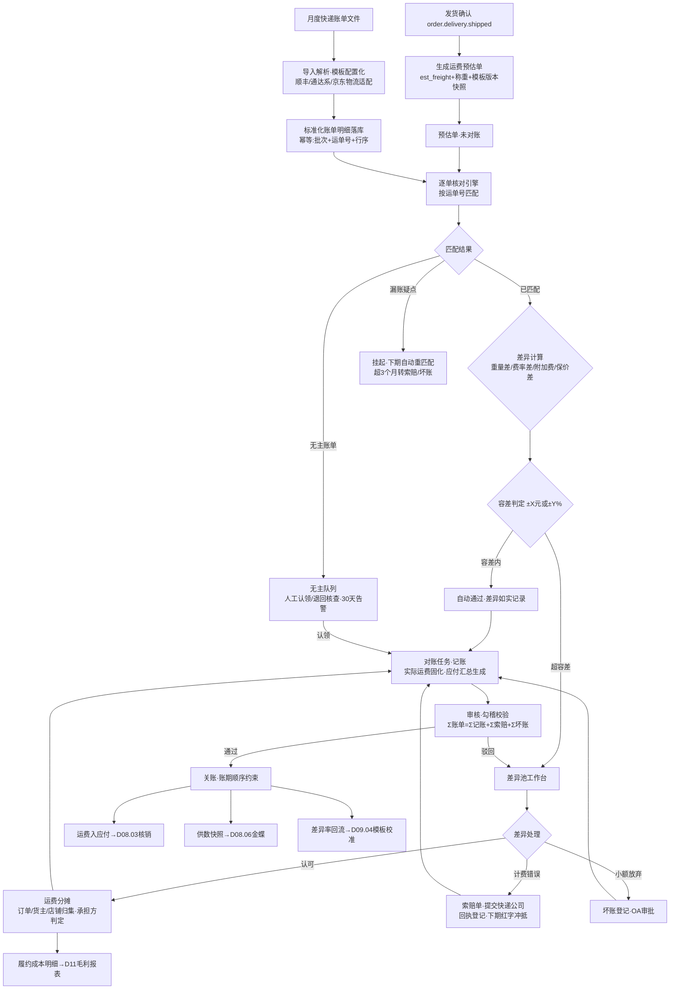
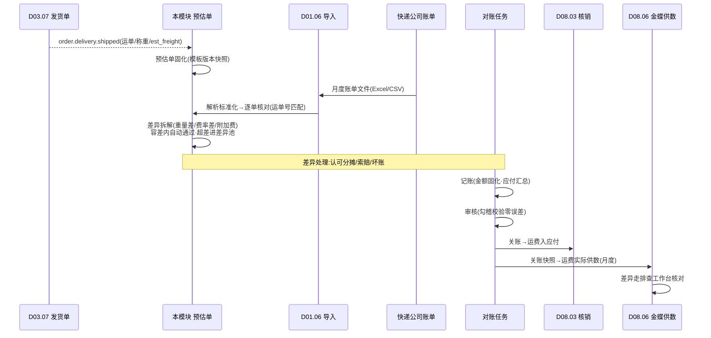

# SRS-D08.04 运费对账模块 需求规格说明书

> 文档编号：SRS-D08.04 · 版本 V1.0 · 2026-10-24 · 编写：小凯 · 状态：待审阅（批次④）
> 所属域：D08 财务对账域 · 分期：**P1（M3）** · schema：`oms_finance`
> 上游依据：SRS-D09.04（运费模板与 `LogisticsRouteService::estimateFreight`，IF-D09.04-02——预估账单数据源；FR-05c 预估-实际差异回流校准）· SRS-D09.02（出库回传包裹称重 `wms.outbound.callback`，IF-D09.02-04——重量依据）· SRS-D03.07（发货单 est_freight/保价费落库 FR-03d、delivery_package 称重落库 FR-05e、`order.delivery.shipped` 事件 IF-D03.07-06）· SRS-D09.05（direct 类月结账号取号量/作废量 FR-08b③——账单覆盖度参考）· SRS-D08.01（应收/账单流水归集框架）· SRS-D08.03（核销三档/误差表/差异借贷科目——关账后运费入应付联动核销）· SRS-D04.07（成本口径对齐原则：预估≠结算、口径变更只未来生效）· SRS-D08.06（运费实际供金蝶）· 逆向文档 04 §8（logisticsaccounts：estimate/actual/actual_task/actual_object 四表，预估/实际双账单+按 logi_no 匹配+对账任务批次记账→审核→关账）
>
> **全局决策（本模块承载）**：运费对账=**预估+月度账单核对**（决策A）——发货时按运费模板预估落单、月度导入快递账单按运单号逐单核对、差异登记与分摊；关账后运费入应付（联动 D08.03 核销）。所有财务单据携带 owner_id + tenant_id，金额 2 位小数。

---

## 1. 模块概述

### 1.1 定位

本模块是物流费用的**业务对账中心**：发货确认时固化预估运费（预估值落单据，构成订单履约成本），月度导入快递公司实际账单，按运单号逐单核对预估 vs 实际，差异分类登记、按订单/货主/店铺归集分摊，超差部分发起快递公司索赔申诉；对账任务批次走**记账→审核→关账**三阶段（商派模式保留），关账后实际运费入应付、供 D08.03 核销与 D08.06 金蝶供数。

> 财务边界（Q5 决策）：运费的记账权威源在金蝶。OMS 产出**运单级的运费明细与差异分析**，关账批次确认后经 D08.06 供数；两边差异走 D08.06 排查工作台核对。

商派对应机制：logisticsaccounts 四表（estimate 预估账单 / actual 物流账单 / actual_task 对账任务 / actual_object 账单对象），定时任务按发货单+合同价生成预估（status：未对账→待记账→已记账→已审核→已关账），CSV 导入实际账单按 logi_no 匹配（status：未匹配/已匹配/比预估低/比预估高/已记账），对账任务按物流公司+仓库维度记账→审核→关账。凯淳自研在其基础上升级：① 预估值在**发货确认时实时固化**（含模板版本快照，替代商派定时任务按天补算）；② 账单解析**配置化多快递适配**（商派仅单一 CSV 模板）；③ 差异增加**容差自动通过与分摊归集**（商派仅高低两态标记）；④ 全单据携带货主维度（商派无 owner 概念）。

### 1.2 职责边界

**做**：运费预估单生成（发货确认触发，est_freight+称重+模板版本快照固化）、快递账单文件导入与解析（顺丰/通达系/京东物流等格式适配，CSV/Excel 模板配置化）、账单明细标准化（运单号/计费重量/费用明细拆分）、逐单核对引擎（运单号匹配→差异计算→差异分类）、容差配置与自动通过、差异登记与分摊（按订单/货主/店铺归集）、索赔申诉管理（快递公司计费错误）、对账任务批次（记账→审核→关账）、关账后应付联动（D08.03）、运费分摊明细供履约成本/毛利报表（D11）与金蝶（D08.06）、预估-实际差异回流运费模板校准（D09.04 FR-05c）。

**不做**：运费模板维护与预估算法（→ D09.04，本模块消费 `estimateFreight` 结果与模板版本）；称重采集（→ D09.02/D03.07，本模块消费回传数据）；快递付款执行与应付核销（→ D08.03/D08.06，本模块供关账后应付数据）；金蝶凭证（→ D08.06）；月结账号面单费/耗材费等非运费费用对账（P2 预留扩展）。

### 1.3 与其他模块关系

| 模块 | 关系 |
|---|---|
| D03.07 发货单 | 订阅 `order.delivery.shipped`（IF-D03.07-06）触发预估单生成；消费发货单 est_freight/保价费（FR-03d 落库值）与 delivery_package 称重/运单号（FR-05e） |
| D09.04 物流分单 | 运费模板与 `estimateFreight`（IF-D09.04-02）是预估口径事实源；模板版本快照随预估单固化；对账差异回流其模板校准（FR-05c） |
| D09.02 出库回传 | `wms.outbound.callback`（IF-D09.02-04）包裹/称重数据——运费核对的重量依据（出库称重 vs 账单计费重量） |
| D09.05 面单 | direct 类月结账号取号量/作废量（FR-08b③）——账单覆盖度核对参考（取号有、账单无 → 漏账疑点） |
| D08.01 应收账单 | 平台账单中运费类流水（买家运费/平台运费险）与运费应付的口径衔接 |
| D08.03 核销 | 关账后运费应付进入核销体系（正常/差异/强制三档）；差异分摊的借贷科目映射消费其 gap 差异表 |
| D08.02 结算单 | 代销货主运费承担方式（凯淳承担/品牌方承担/买家承担）影响结算单费用行 |
| D04.07 成本 | 运费是否计入存货成本走其 §5.3 价外费用分摊口径（本模块供实际运费数，口径决策归其）【待确认：运费资本化口径】 |
| D08.06 金蝶 | 关账后「运费实际」供数（供数清单⑤）；差异科目映射联动 |
| D11 报表 | 运费分摊明细（订单行级履约成本）供毛利报表；对账差异率监控看板 |
| D01.06 导入导出 | 账单文件异步导入通道 |

---

## 2. 业务场景

**SC-D08.04-01 发货确认预估落单（主流程）**
发货单 DLV202610001（中通-标快，华东仓→杭州）发货确认：`order.delivery.shipped` 事件触发本模块生成**运费预估单**——取发货单 est_freight=4.50 元（D03.07 落库时已含模板版本快照）、出库回传称重 1.2kg、运单号 78123456789012，固化预估明细（预估运费/预估计费重/模板版本 ID/物流商/店铺/货主）。预估单状态=未对账，等待月度账单核对。

**SC-D08.04-02 月度账单导入与逐单核对**
11 月 5 日财务导入中通 10 月账单（Excel）：导入解析适配器按「中通月结账单模板」配置解析出 12 万行明细（运单号/计费重量/首重费/续重费/偏远附加费/保价费/合计）→ 逐单核对引擎按运单号匹配预估单：匹配成功 11.8 万行，其中差异在容差内（±0.5 元或±5%）自动通过 11.5 万行、超容差 3000 行进差异池；账单有而 OMS 无（无主账单 1500 行：其他仓发出/运单号录错）进无主队列人工认领；OMS 有而账单无（漏账疑点 500 行）标记待下期核对。

**SC-D08.04-03 重量差与费率差定位**
差异池某单：OMS 出库称重 1.2kg、账单计费重 2.0kg（体积重取大——包装后体积重超实重），预估 4.50 vs 实际 7.30，差异 +2.80 元。系统按差异分类算法判定=**重量差**（计费重>出库称重且费率一致），附证据链（称重快照/账单明细行/模板版本重算结果）；运营复核认可 → 差异通过 → 分摊入该订单履约成本；若判定快递公司称重错误 → 转索赔。

**SC-D08.04-04 差异分摊与货主归集**
某差异单归属品牌 A 代销订单（运费凯淳承担，合同约定）：超差 +2.80 元按归集规则记「品牌 A 货主·店铺 S·订单 O」的履约成本明细；月底按货主汇总生成运费分摊表——买断货主运费入凯淳销售费用、代销货主按合同承担方入结算单费用行（D08.02 取数）或凯淳自担。

**SC-D08.04-05 索赔申诉（快递公司计费错误）**
批次核对发现某运单账单含「偏远地区附加费 3 元」但收货地为杭州市区（非偏远清单）：差异分类=**附加费争议**→ 生成索赔单（运单号/争议金额/证据：地址+偏远清单截图）→ 提交快递公司月度申诉 → 回执结果登记（认可退款/驳回/部分认可）→ 认可金额在下期账单冲抵核对（红字行）或现金退款登记；索赔超期未回执（30 天）升级告警。

**SC-D08.04-06 对账任务批次：记账→审核→关账**
财务按月创建对账任务（物流公司=中通×结算主体）：任务归集当期全部核对结果 → ①**记账**：核对通过+差异已处理的明细置「已记账」，实际运费金额固化；②**审核**：财务主管复核任务汇总（账单总额 vs 记账总额 vs 差异总额勾稽），审核通过；③**关账**：任务关闭，运费入应付（联动 D08.03），关账数据经 D08.06 供金蝶；关账后任务锁定不可改（红冲重开走独立流程）。上月未关账任务阻塞本月关账（账期顺序约束，对齐 D08.03 关账口径）。

**SC-D08.04-07 预估-实际差异回流模板校准**
月度对账差异率报表：中通「华东→华南」线路差异率 18%（预估系统性偏低——续重单价已调价但模板未更新）：差异率超阈值（默认 20%，D09.04 FR-05c）自动生成模板校准工单 → 物流运营更新运费模板（新版本生效）→ 后续预估口径回归；历史预估不回改（版本快照可回放）。

**SC-D08.04-08 多快递账单格式适配**
顺丰账单（CSV，费用项含「基础运费/续重费/保价费/燃油附加」）、京东物流账单（Excel，含「配送费/旺季服务费」）、中通账单（Excel，首续重合并列）：导入时选择/自动识别快递商 → 路由对应解析模板（列映射+费用项字典映射配置化）→ 标准化为统一账单明细模型（§6.2）；新快递公司=新增一套模板配置（无需改代码）。

---

## 3. 功能需求

### FR-D08.04-01 运费预估单生成
- FR-01a 触发：订阅 `order.delivery.shipped`（IF-D03.07-06）按发货单生成预估单（异步，MQ 消费，幂等键=delivery_id）；一发货单一预估单，多包裹时包裹明细行展开（每运单号一行预估）。
- FR-01b 固化内容：运单号/物流商/产品/发货单号/订单号/店铺/货主/出库称重（delivery_package.weight）/预估计费重（模板口径：max(实重, 体积/系数)）/预估运费+保价费（发货单 est_freight 落库值）/**运费模板版本 ID 快照**（D09.04 FR-05c，历史可回放）/发货时间/收货区域（省市）。
- FR-01c 预估重算兜底：发货确认时 est_freight 缺失（异常路径/迁移单）→ 调 `LogisticsRouteService::estimateFreight`（IF-D09.04-02）按出库称重补算，标记 source=recalc。
- FR-01d 取消与作废：发货单取消/运单作废（D09.05 `waybill.cancelled`）→ 预估单联动作废；已记账后作废走红冲（不可改删，对齐 D08 财务单据铁律）。
- FR-01e 预估单状态机：未对账→部分核对→已核对→已记账→已审核→已关账；分支：作废。状态推进仅由对账批次驱动（§FR-05）。

### FR-D08.04-02 快递账单导入与解析
- FR-02a 导入通道：经 D01.06 异步导入（大文件 10 万行级）；账单头信息登记（快递公司/账单周期/结算账号[月结编码]/文件/导入人）。
- FR-02b **解析模板配置化**：快递商×账单格式粒度配置列映射（运单号列/计费重量列/费用列族/合计列）+费用项字典映射（各家费用名→标准费用项：首重费/续重费/偏远附加费/保价费/燃油附加/旺季服务费/其他）+文件类型（CSV/Excel，编码/表头行偏移可配）；模板可复制派生（同快递商不同结算账号格式差异）；新快递商=新增模板配置零代码。
- FR-02c 解析校验：行数勾稽（明细合计 vs 账单汇总行金额）、运单号格式校验、必填列缺失拦截；解析失败行落错误报告（不阻塞正确行，D01.06 口径）。
- FR-02d 标准化落库：解析成功行→统一账单明细模型（§6.2），幂等键=账单导入批次+运单号+费用行序（重复导入同批次拒绝，跨批次同运单号允许多行——补账/红冲行场景，红字金额负数）。
- FR-02e 账单覆盖度核对：direct 类月结账号（D09.05 FR-08b③ 供数）当期取号量 vs 账单行数比对，缺口>阈值（默认 2%）告警（漏账疑点清单）。

### FR-D08.04-03 逐单核对引擎
- FR-03a 匹配：按**运单号**匹配账单明细↔预估单（商派 logi_no 匹配模式保留）；多包裹子单号归并主单匹配；匹配结果三态=已匹配/无主账单（账单有 OMS 无）/漏账疑点（OMS 有账单无）。
- FR-03b 差异计算（已匹配行）：`差异额 = 实际合计 - 预估运费 - 预估保价费`；差异因子拆解=**重量差**（账单计费重 vs 出库称重，按模板费率重算差额）/**费率差**（计费重一致但单价不符——按模板版本重算比对）/**附加费**（偏远/燃油/旺季等预估未含项）/**保价费差**/**其他**（无法归因，转人工）；拆解算法输出主因+金额构成（可多因并存）。
- FR-03c 容差与自动通过：容差配置（物流商×结算账号粒度：绝对值 ±X 元[默认 0.50] 或相对值 ±Y%[默认 5%]，取满足其一即通过）；容差内差异自动置「通过（容差内）」，差异额仍如实记录（分摊用实际值，不抹平——账实一致原则）；超容差进差异池待处理。
- FR-03d 无主账单处理：无主队列人工认领（关联非 OMS 发货来源：线下单/其他系统）或退回快递核查；超 30 天未认领升级告警；认领后按 source=manual 登记入对账（不参与预估差异计算，全额进费用）。
- FR-03e 漏账疑点：挂起至下期账单自动重匹配（跨期匹配窗口默认 3 个月）；超窗仍无账单 → 转索赔/坏账处理流程（人工决策：按预估入账或挂账追问快递公司）。
- FR-03f 核对批处理：单次任务 10 万行级核对 ≤10 分钟（异步任务+进度可查）；核对幂等（重跑覆盖前次未记账结果，已记账行不重核）。

### FR-D08.04-04 差异处理：登记→分摊→索赔
- FR-04a 差异登记：差异池工作台（按物流商/店铺/货主/差异分类/金额区间筛选）；逐单处理动作=认可通过（进分摊）/转索赔/转人工核价（模板疑义回流 D09.04）/坏账登记（小额放弃，需审批）；批量处理（同因差异一键批量认可，抽样复核机制）。
- FR-04b **运费分摊**：实际运费（含差异）按归集维度落**履约成本明细**——订单维度（一单一包裹直接归属；合单母单运费按子单订单金额比例分摊；多包裹按包裹归属订单行）→ 货主/店铺维度汇总；承担方判定（配置：货主×物流商粒度——凯淳承担/品牌方承担[入 D08.02 结算单费用行]/买家承担[入 D08.01 应收]）；分摊明细供 D11 毛利报表（订单行级收入-商品成本-运费分摊）。
- FR-04c 索赔管理：索赔单（运单号/争议分类/争议金额/证据附件/提交日期）；状态机=草稿→已提交→部分认可→认可退款→驳回→关闭；回执登记（认可金额/冲抵方式：下期账单红字行自动关联冲抵或现金退款登记）；索赔超期告警（30 天无回执升级）；索赔结果回写差异单闭环。
- FR-04d 差异借贷科目：认可差异与坏账按 D08.03 gap 差异表的借贷科目映射入账（审计可解释——差异不是黑洞，每笔有科目去向）。

### FR-D08.04-05 对账任务批次（记账→审核→关账）
- FR-05a 任务创建：按**结算主体（快递公司×月结账号）×账期（月）**创建对账任务（商派物流公司+仓库维度升级：增加结算账号粒度，一快递多账号独立对账）；任务自动归集当期账单导入批次与匹配预估单。
- FR-05b **记账**：任务内明细全部达「已核对+差异已处理」→ 记账动作：实际运费金额固化到明细行、预估单状态→已记账、生成运费应付汇总（按货主/店铺/科目维度）；记账后明细锁定不可改。
- FR-05c **审核**：财务主管复核——勾稽校验（Σ账单金额 = Σ记账金额 + Σ待索赔金额 + Σ坏账金额，误差必须为零才可通过）、差异率报告（本期差异额/账单额，超阈值需附说明）；审核通过→已审核；驳回→退回记账前状态（差异重新处理）。
- FR-05d **关账**：已审核任务关账（账期顺序约束：同结算主体上月任务未关账则阻塞）；关账动作=运费入应付（生成应付数据推 D08.03 核销体系）+供数快照固化（D08.06 金蝶「运费实际」取数源）+任务终态锁定。
- FR-05e 红冲重开：关账后发现错误→红冲流程（独立授权+OA 审批，D10.05）：生成红字冲销明细+重开新任务重走三阶段（对齐 D08.06 文件红冲重出机制）；红冲全程审计留痕。
- FR-05f 任务状态机：草稿→核对中→待记账→已记账→已审核→已关账；分支：驳回退回/红冲。

### FR-D08.04-06 报表与供数
- FR-06a 对账报表：月度运费对账汇总表（按物流商/货主/店铺：预估总额/实际总额/差异额/差异率/索赔额）、差异分类分布表、运费分摊明细表（订单行级）、漏账与无主清单。
- FR-06b 差异率回流：物流商×线路（仓 region→收货省）粒度差异率统计，超阈值（默认 20%）自动生成模板校准工单（D09.04 FR-05c 联动）。
- FR-06c 金蝶供数：关账任务的运费应付汇总+明细（按 D08.06 供数清单⑤格式）；频率=月（关账后）。
- FR-06d 品牌方门户（D10.04）：本货主运费分摊明细与承担费用汇总（只读，行级隔离）。

---

## 4. 业务流程

### 4.1 月度运费对账全流程



### 4.2 核对与差异处理时序



---

## 5. 处理逻辑

### 5.1 差异拆解算法（伪代码）

```
diff(预估单 e, 账单行 a):
    差异额 = a.合计 - e.预估运费 - e.预估保价费          # 2位小数,含正负
    if |差异额| ≤ 容差(绝对值X or 相对Y%): return 通过(容差内), 差异额如实记录

    # 因子拆解(可多因并存,按序归因)
    重算额 = 模板重算(e.模板版本, a.计费重, e.收货区域)    # 用账单计费重+当时模板重算
    重量差额 = 重算额 - e.预估运费                        # 计费重≠出库称重导致
    费率差额 = (a.基础运费 - 重算额) if 计费重一致          # 单价与模板不符
    附加费额 = a.偏远附加 + a.燃油 + a.旺季 + a.其他附加    # 预估未含项
    保价差额 = a.保价费 - e.预估保价费
    其他 = 差异额 - Σ已归因
    return 差异池(主因=最大绝对值因子, 金额构成明细, 证据链快照)
```
- 重量差判定细分：`a.计费重 > e.出库称重` 且体积重规则可解释（模板体积重系数）→ 正常重量差（包装体积重）；不可解释（超 20%）→ 疑似称重错误转索赔。
- 模板重算用**预估单快照的模板版本**（不是当前版本），保证差异归因不受模板改版干扰。

### 5.2 分摊归集规则

```
订单归属: 一单一包裹→直接归属; 合单母单→按子单订单金额比例分摊(尾差入最大子单)
          多包裹→包裹关联订单行归属(delivery_package↔order_item映射)
货主/店铺: 随订单归属自然携带(owner_id/shop_id冗余落分摊明细行)
承担方判定(配置 货主×物流商 粒度):
    凯淳承担   → 销售费用·运费科目(D08.03科目映射)
    品牌方承担 → D08.02结算单费用行(结算时扣收)
    买家承担   → D08.01应收(订单运费收入对冲,差额即履约损益)
精度: 分摊金额2位小数,比例分摊尾差入最大额行(不产生分不平)
```

### 5.3 勾稽与关账约束

- 审核勾稽恒等式：`Σ账单导入金额 = Σ记账金额(通过+认可差异) + Σ待索赔金额 + Σ坏账金额 + Σ无主未认领金额`——任何一项缺口不允许审核通过（无主未认领需先处置：认领入账或退回核查出账）；
- 账期顺序：同结算主体（快递公司×月结账号）任务按月顺序关账，上月未关本月阻塞（红冲重开例外：红冲任务关账后解锁后续）；
- 关账锁定：关账后预估单/账单明细/分摊明细全锁定，只可查询；修改需求一律走红冲重开（FR-05e）。

### 5.4 预估口径声明（对齐 D09.04 FR-05d）

预估运费仅供落单参考与对账基线，**实际运费以快递账单关账数为准**；履约成本明细中双值并存（预估列/实际列），毛利报表默认取实际（关账前期间可用预估+未关账标记）。

---

## 6. 数据字段（业务字段描述）

> 物理表落 `oms_finance` schema；DDL 见 DB-D08。金额一律 2 位小数；所有表 tenant_id/owner_id 必填（SRS-00 契约）。

### 6.1 运费预估单（fin_freight_estimate）

| 字段 | 业务含义 | 取值/校验 |
|---|---|---|
| delivery_id / delivery_bn / order_bn | 发货单/订单关联 | 幂等键=delivery_id（包裹级明细行展开） |
| waybill_no | 运单号 | 核对匹配键（D09.05 取号结果） |
| corp_id / product_code | 物流商/产品 | D09.04 canonical 编码 |
| ship_weight / bill_calc_weight | 出库称重/账单计费重 | 称重来自 delivery_package（D09.02 回传）；账单核对后回填计费重 |
| est_freight / est_protect_fee | 预估运费/保价费 | 发货单落库值（FR-01b） |
| template_version_id | 运费模板版本快照 | D09.04 FR-05c，重算回放依据 |
| receiver_province / city | 收货区域 | 线路维度差异分析 |
| status | 状态 | 未对账/部分核对/已核对/已记账/已审核/已关账/作废（FR-01e） |
| source | 来源 | shipped（默认）/recalc（补算）/manual |
| shop_id / owner_id / tenant_id | 归属 | 必填 |

### 6.2 账单明细（fin_freight_bill / _item）

| 字段 | 业务含义 | 取值/校验 |
|---|---|---|
| bill：import_batch_no / corp_id / settle_account(月结编码) / period(账期) / file_ref / total_amount / row_count / import_status | 账单导入批次头 | 勾稽基准（FR-02c） |
| item：waybill_no / calc_weight / first_fee / add_fee / remote_fee / protect_fee / fuel_fee / peak_fee / other_fee / total_amount | 标准化费用行 | 费用项字典映射产物（FR-02b）；红字行金额为负 |
| item：match_status / estimate_id / diff_amount / diff_factors_json / tolerance_result | 核对结果 | 已匹配/无主/漏账；差异因子构成（§5.1） |
| item：idempotent_key | 幂等键 | 导入批次+运单号+费用行序 唯一 |
| 两表 tenant_id / owner_id(认领后回填) | 归属 | 必填 |

### 6.3 差异与索赔（fin_freight_diff / _claim）

| 字段 | 业务含义 |
|---|---|
| diff：waybill_no / diff_type(重量差-费率差-附加费-保价差-其他) / diff_amount / main_factor / evidence_json(称重快照+账单行+重算结果) / handle_status(待处理-认可-转索赔-坏账-关闭) / handle_operator / subject_ids_json(借贷科目,D08.03 gap映射) | 差异单（FR-04a/04d） |
| claim：claim_bn / waybill_nos / claim_type / claim_amount / evidence_refs / status(草稿-已提交-部分认可-认可退款-驳回-关闭) / ack_amount / offset_way(下期红字-现金退款) / submit_date / ack_date | 索赔单（FR-04c） |

### 6.4 运费分摊明细（fin_freight_alloc）

| 字段 | 业务含义 |
|---|---|
| order_bn / order_item_id / delivery_id / waybill_no | 归属维度（订单行级） |
| alloc_amount / est_amount / actual_amount | 分摊额/预估/实际（双值并存 §5.4） |
| bearer_type | 承担方：凯淳/品牌方/买家（§5.2 判定） |
| subject_code | 科目映射（D08.03/D08.06 编码映射） |
| task_id / period | 对账任务与账期 |
| owner_id / shop_id / tenant_id | 归属，必填 |

### 6.5 对账任务（fin_freight_task）

| 字段 | 业务含义 |
|---|---|
| task_bn / corp_id / settle_account / period | 任务键：结算主体×账期（FR-05a） |
| bill_total / accounted_total / claim_total / bad_debt_total / unclaimed_total | 勾稽五金额（§5.3 恒等式） |
| diff_rate | 本期差异率（审核报告） |
| status | 草稿/核对中/待记账/已记账/已审核/已关账/驳回退回/红冲（FR-05f） |
| account_time / audit_operator / audit_time / close_time | 三阶段时点与经手 |
| reversal_ref | 红冲关联（原任务/红冲任务互指） |
| owner_id / tenant_id | 必填 |

---

## 7. 接口

### 7.1 内部接口（本模块提供）

| 编号 | 接口 | 消费方 | 说明 |
|---|---|---|---|
| IF-D08.04-01 | `FreightEstimateService::createFromShipped(delivery_id)` | 事件消费器（`order.delivery.shipped`） | 预估单生成（幂等，FR-01a） |
| IF-D08.04-02 | `FreightBillService::import(file, corp, 模板)` | 财务工作台/经 D01.06 | 账单导入解析（异步任务+进度） |
| IF-D08.04-03 | `FreightCheckService::run(task_id)` / `retryMatch(waybill_nos)` | 对账任务/工作台 | 核对引擎执行与漏账重匹配 |
| IF-D08.04-04 | `FreightDiffService::handle(diff_id, 动作, 凭证)` | 差异工作台 | 差异处理（认可/索赔/坏账，审计留痕） |
| IF-D08.04-05 | `FreightTaskService::account/audit/close/reverse(task_id)` | 财务工作台 | 三阶段推进+红冲（独立授权+OA） |
| IF-D08.04-06 | `FreightAllocQuery::listByOrder/listByOwner(条件)` | D11 毛利报表/D08.02 结算/D10.04 门户 | 运费分摊明细取数（行级权限过滤） |
| IF-D08.04-07 | 事件 `freight.task.closed`（任务/账期/应付汇总/供数快照引用） | D08.03（应付核销）/D08.06（金蝶供数）/D11 | 关账广播（事件字典 DB-00 登记） |
| IF-D08.04-08 | `FreightActualService::getPayable(period, corp)` | D08.03/D08.06 | 关账后运费应付数据（供数清单⑤取数口） |

### 7.2 依赖接口（本模块消费）

| 编号 | 接口 | 提供方 | 说明 |
|---|---|---|---|
| IF-D08.04-D1 | 事件 `order.delivery.shipped`（运单/包裹/称重） | D03.07（IF-D03.07-06） | 预估单触发源 |
| IF-D08.04-D2 | `LogisticsRouteService::estimateFreight` + 模板版本查询 | D09.04（IF-D09.04-02） | 预估补算与差异重算（模板版本回放） |
| IF-D08.04-D3 | 事件 `wms.outbound.callback`（包裹/称重明细） | D09.02（IF-D09.02-04） | 重量依据（经 D03.07 落库后读取） |
| IF-D08.04-D4 | 面单台账月结账号取号量/作废量查询 | D09.05（FR-08b③） | 账单覆盖度核对 |
| IF-D08.04-D5 | 核销体系入口（应付登记）+ gap 差异科目映射 | D08.03 | 关账后应付与差异科目 |
| IF-D08.04-D6 | 结算单费用行写入 | D08.02 | 品牌方承担运费入结算 |
| IF-D08.04-D7 | 异步导入导出/调度注册/OA 审批/企微告警/审计 | D01.06/D01.02/D10.05/D01.07/D10.06 | 底座能力 |
| IF-D08.04-D8 | 供数快照登记（运费实际类） | D08.06 | 关账供数与红冲重出联动 |

### 7.3 外部接口

| 编号 | 接口 | 方向 | 说明 |
|---|---|---|---|
| EF-D08.04-01 | 快递公司账单获取（官网下载/邮件附件人工转存） | 入 | 首期人工上传文件；P2 预留账单 API/邮箱自动采集【待确认：各快递公司账单获取方式】 |
| EF-D08.04-02 | 索赔申诉通道（快递公司客服/商务线下+邮件） | 双向 | 首期线下流程线上登记；P2 预留申诉 API |

---

## 8. 非功能需求

| 项 | 要求 |
|---|---|
| 性能 | 预估单生成（事件消费）≤100ms/单，大促峰值 500 单/分钟无积压；账单导入解析 10 万行 ≤5 分钟；核对引擎 10 万行 ≤10 分钟（异步+进度可查） |
| 幂等 | 预估单幂等键=delivery_id；账单明细幂等键=批次+运单号+行序；核对重跑不产生重复差异单；关账事件重复发布消费方安全 |
| 一致性 | 勾稽恒等式强制（§5.3）；分摊比例尾差入最大额行（总额分毫不差）；关账后全量锁定；预估-实际双值并存不互相覆盖 |
| 精度 | 金额 2 位小数（全局决策）；计费重 3 位小数（kg）；比例分摊中间计算 4 位小数舍入 |
| 审计/安全 | 差异处理/坏账/红冲独立授权+审计（D10.06）；坏账与红冲走 OA 审批（D10.05）；账单文件与索赔证据 OSS 加密存储 |
| 可观测 | 漏账率/无主账单量/差异率（物流商×线路）/索赔回收率/关账及时率监控（D11.03）；差异率超阈值自动校准工单 |

---

## 9. 验收标准

| 编号 | 验收条件 |
|---|---|
| AC-01 | 预估落单（SC-01）：发货确认事件触发预估单生成，est_freight/称重/运单号/模板版本快照固化正确；重复消费事件不重复生成（幂等） |
| AC-02 | est_freight 缺失场景走 `estimateFreight` 补算成功，source=recalc 标记；运单作废联动预估单作废 |
| AC-03 | 账单导入（SC-02/08）：顺丰 CSV/京东 Excel/中通 Excel 三套模板配置解析正确（费用项字典映射）；10 万行 ≤5 分钟；重复导入同批次拒绝；解析失败行出错误报告不阻塞正确行 |
| AC-04 | 逐单核对：运单号匹配三态（已匹配/无主/漏账）判定正确；子单号归并主单匹配；核对重跑已记账行不重核 |
| AC-05 | 差异拆解（SC-03）：构造重量差/费率差/附加费/保价差四类用例，因子金额构成与主因判定正确；重算使用预估单模板版本快照（改模板后历史差异归因不漂移） |
| AC-06 | 容差：±0.5 元或±5% 配置生效（满足其一自动通过）；容差内差异额仍如实记录进分摊（不抹平）；容差按结算账号粒度独立配置 |
| AC-07 | 分摊（SC-04）：一单一包裹直接归属、合单按金额比例（尾差入最大子单，总额勾稽零误差）、多包裹按包裹归属；承担方三种配置分别流入 D08.01/D08.02/凯淳费用科目 |
| AC-08 | 索赔（SC-05）：索赔单全状态机流转；认可退款在下期账单红字行自动关联冲抵；30 天无回执升级告警；索赔结果回写差异单闭环 |
| AC-09 | 三阶段批次（SC-06）：记账后明细锁定；审核勾稽恒等式不满足（构造 1 元缺口）拒绝通过；上月未关账本月关账被阻塞；关账事件触发 D08.03 应付与 D08.06 供数快照 |
| AC-10 | 红冲重开：关账任务红冲（OA 审批+独立授权）生成红字明细+新任务重走三阶段；红冲后后续账期解锁；全程审计留痕 |
| AC-11 | 无主与漏账：无主账单人工认领后 source=manual 入账；漏账疑点下期账单到达自动重匹配成功；超 3 个月转人工处置流程 |
| AC-12 | 差异回流（SC-07）：物流商×线路差异率超 20% 自动生成模板校准工单；模板更新后新预估按新版本、历史预估按快照版本回放一致 |
| AC-13 | 覆盖度核对：构造月结账号取号 1000 单、账单 950 行 → 缺口 5% 超阈值告警并输出漏账疑点清单 |
| AC-14 | 品牌方门户行级隔离：货主 A 账号仅见本货主分摊明细与费用汇总 |

---

## 变更记录

| 日期 | 版本 | 变更 | 原因 |
|---|---|---|---|
| 2026-10-24 | V1.0 | 首版 | — |

---

*参考实现溯源：商派 logisticsaccounts 四表（estimate 预估账单：crontab_delivery 定时按发货单+合同价算 delivery_cost_expect，status 0未对账→1待记账→2已记账→3已审核→4已关账；actual 物流账单：CSV 导入按 logi_no 匹配 estimate，status 0未匹配/1已匹配/2比预估低/3比预估高/4已记账；actual_task 对账任务：物流公司+仓库维度，记账状态 1已记账/2已审核/3已关账；actual_object 账单对象异常备注）+ 记账规则「实际记账=预估记账无需运算，不等则差额调整进费用」+ 记账后运费进 finance_bill 费用项体系。关键差异：① 预估固化时点从定时任务按天补算改为**发货确认事件实时落单**（含模板版本快照，差异归因可回放，商派合同价无版本化——逆向文档 04 §12.4 亦指出此缺口）；② 账单解析从单一 CSV 模板升级为**配置化多快递适配**（列映射+费用项字典，新快递商零代码）；③ 差异从高低两态标记升级为**因子拆解（重量差/费率差/附加费/保价差）+容差自动通过+分摊归集**（订单/货主/店铺三级，含承担方判定）；④ 新增索赔管理闭环（商派无索赔建模）；⑤ 对账任务维度从物流公司+仓库升级为**结算主体（快递×月结账号）×账期**，增加勾稽恒等式审核门禁与账期顺序关账约束；⑥ 新增红冲重开机制（对齐 D08.06）；⑦ 全单据携带 owner_id/tenant_id（商派财务域无货主维度——逆向文档 04 §10.4 短板5）；⑧ 差异率回流运费模板校准工单（D09.04 FR-05c 联动）新增。待确认项：各快递公司账单获取方式（API/邮箱自动采集）、运费资本化口径（是否计入存货成本，D04.07 §5.3）。*
