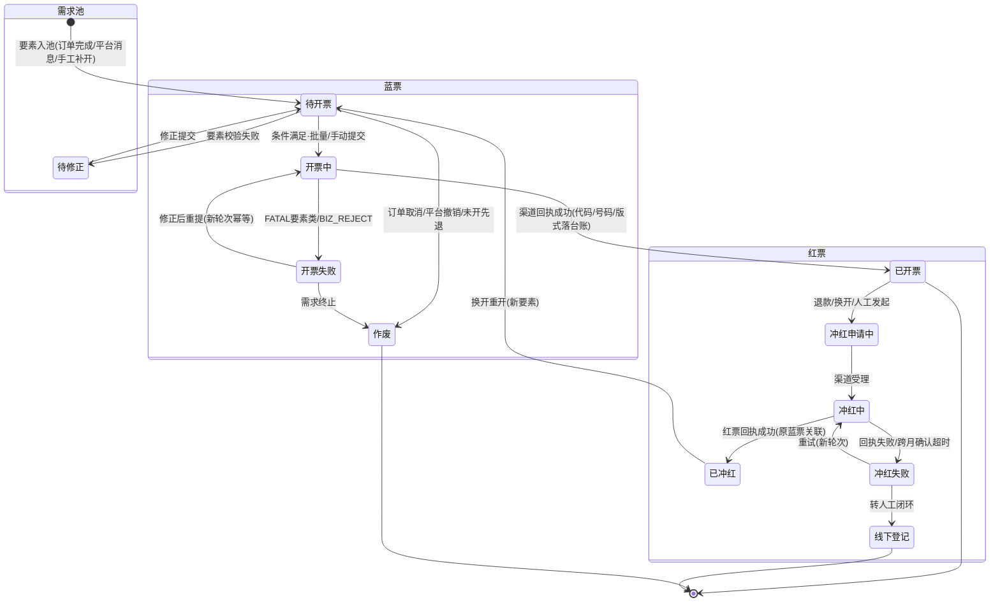
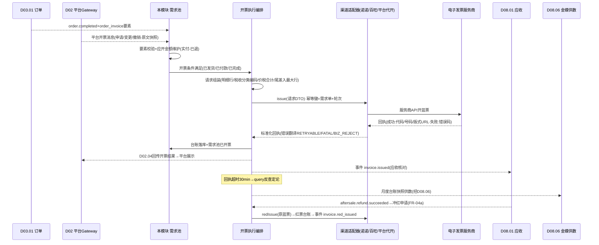

# SRS-D08.05 发票管理模块 需求规格说明书

> 文档编号：SRS-D08.05 · 版本 V1.0 · 2026-10-24 · 编写：小凯 · 状态：待审阅（批次④）
> 所属域：D08 财务对账域 · 分期：**P1（M3）** · schema：`oms_finance`
> 上游依据：SRS-D03.01（订单发票信息 order_invoice 落库 FR-04a、发票要素校验软失败口径、`order.completed` 事件 IF-D03.01-06、状态流转归 D08.05 声明）· SRS-D03.02（invoice_check 审单插件：要素完整性/税号校验）· SRS-D03.08（改发票：未开票改要素/已开票转冲红重开，联动本模块）· SRS-D02.03（平台消息通道 `platform.*` 事件族 IF-D02.03-03——平台开票消息同步入口）· SRS-D05.03（`aftersale.refund.succeeded` 事件 IF-D05.03-06——退款触发冲红/金额调整）· SRS-D04.01（物料开票属性 tax_rate/tax_name/tax_code；`CostService::reverseEstimate(invoiceRef)` IF-D04.07-03 采购发票到触发暂估回冲的语义参照）· SRS-D08.01（应收双口径金额——开票金额=客户实付口径基准）· SRS-D08.02（结算单——发票与结算联动）· SRS-D08.06（发票台账供金蝶，业务/税务两口径边界）· 逆向文档 04 §9（invoice 12 表：order_front 预发票需求池/order 正式发票分离、合票保留原票映射、冲红 sync_status 10 同步状态、order_setting 开票配置+操作条件触发、京东优惠扣减开票金额特例）
>
> **全局决策（本模块承载）**：OMS 管**开票申请与状态跟踪**，实际开票走**电子发票服务商**（渠道适配层独立可插拔：诺诺/百旺/平台代开等）；**OMS 记业务发票台账，金蝶记税务发票**——两边按发票代码+号码对账（边界经 D08.06 排查工作台核对）。销方主体=凯淳或品牌方（按货主/业务类型决定：买断凯淳开、代销可能品牌方直开）【标注假设待业务确认】。所有单据携带 owner_id + tenant_id，金额 2 位小数；消费者抬头/税号按 PIPL 脱敏存储。

---

## 1. 模块概述

### 1.1 定位

本模块是销售发票的**业务台账与开票编排中心**：接收开票需求（订单发票要素/平台开票消息/手工补开）入预发票需求池，按开票条件（已发货/已付款/已完成，店铺级配置）批量或自动触发开票执行——经电子发票渠道适配层调服务商 API 开蓝票，回执落发票台账（发票代码/号码/金额/状态）；退款/要素错误驱动冲红与换开（收敛商派 10 同步状态为四态状态机）；支持同客户多单合票（保留原单映射）与单单拆票（明细行级）；开票金额与应收核对（未开票应收清单），发票台账供金蝶（税务口径以金蝶为准，OMS 业务口径两边对账）；对消费者（经平台展示）与品牌方门户（本货主台账）提供查询交付。

商派对应机制：invoice 12 表三层模型——order_front 预发票（需求池，开票要求 0需开票/1已开票/2需作废）+ order 订单发票（正式发票，is_status 0未开票/1已开票/2已作废）+ channel 电子发票渠道（百望/航信，金税系统版本）；order_taobao 平台原始开票申请（blue/red，触发类型 buyer_payed/sent_goods/invoice_supply）；order_setting 开票配置（开票方信息/税率/含税标志/税控盘/电子发票操作条件 1已发货 2已付款 3已完成/开票渠道）+ setting_shopid_relation 店铺绑定；sync_status 10 个同步状态（0未同步/1开蓝中/2开蓝失败/3开蓝成功/4冲红中/5冲红失败/6冲红成功/7冲红确认中/8冲红确认失败/9冲红确认成功/10金税三期冲红）；合票 order_items 保留原发票 id/明细 ID；京东订单开票金额需减优惠特例。凯淳自研升级：① 渠道适配层独立可插拔（对齐 D09.05 面单适配器思想，新增服务商=注册新适配器）；② 冲红 10 态收敛为 4 态业务状态机+渠道原始状态留痕；③ 全台账携带货主/租户维度+销方主体建模（多主体开票：凯淳/品牌方）；④ 开票金额口径显式绑定 D08.01 客户实付双口径；⑤ 与金蝶发票模块边界显式化（业务台账 vs 税务发票，两边对账）。

### 1.2 职责边界

**做**：开票申请接收（订单发票要素同步/平台开票消息经 D02/手工补开）、预发票需求池管理（应开未开清单/条件触发/批量开票）、开票配置管理（销方主体×店铺：开票方信息/税率/含税标志/操作条件/渠道绑定）、电子发票渠道适配层（开票/冲红/查询/版式文件获取的统一适配器接口）、开票执行编排（请求→回执→台账）、发票台账（蓝票/红票全生命周期）、冲红与换开（冲红申请→渠道冲红→红票台账→重开）、合票与拆票（合票映射保留/明细行拆分）、发票与结算联动（开票金额 vs 应收核对、未开票应收清单、供 D08.02 结算）、发票查询与交付（消费者经平台/品牌方门户台账/内部工作台）、发票数据供金蝶（经 D08.06，业务口径）。

**不做**：税务申报与税务发票权威记录（→ 金蝶发票/税务模块，OMS 只记业务台账，边界见 §5.5）；订单发票要素的采集落库（→ D03.01 order_invoice，本模块消费）；发票要素审单校验（→ D03.02 invoice_check 插件，本模块供开票能力就绪校验口径）；采购发票三单匹配与暂估回冲（→ D06.04/D04.07，采购侧发票不在本模块——本模块只管**销售开票**）；平台开票 API 的签名/session 托管（→ D02.01，平台代开类适配器复用其出口）；应收记账与核销（→ D08.01/D08.03，本模块供核对数据）。

### 1.3 与其他模块关系

| 模块 | 关系 |
|---|---|
| D03.01 订单 | order_invoice 发票要素来源（FR-04a 落库，状态流转归本模块）；订阅 `order.completed`（IF-D03.01-06）驱动需求池状态 |
| D03.02 审单 | invoice_check 插件（要素完整性/开票能力就绪）——本模块提供开票配置就绪校验口径 |
| D03.08 改单 | 改发票联动：未开票→要素变更同步需求池；已开票→转本模块冲红重开流程 |
| D02.03 拉单 | 平台开票消息（`platform.*` 事件族扩展：开票申请/变更/撤销语义）经 D02 适配器标准化后入本模块 |
| D02.01 接入框架 | 平台代开类渠道（如平台自营开票服务）经统一调用出口 |
| D05.03 退款 | 订阅 `aftersale.refund.succeeded`（IF-D05.03-06）：已开票订单退款→触发冲红或部分冲红决策 |
| D08.01 应收 | 开票金额口径=客户实付（双口径契约）；未开票应收清单核对供数 |
| D08.02 结算 | 代销场景品牌方直开时 OMS 不记收入发票，只记台账备查；结算单关联发票号 |
| D08.06 金蝶 | 发票台账供数（供数清单⑥）；OMS 业务台账 vs 金蝶税务发票两边对账（§5.5） |
| D04.01 物料 | 开票属性（tax_rate/tax_name/tax_code）——发票明细行税收分类编码来源 |
| D01.05 PIPL | 消费者抬头/税号/邮箱手机加密存储+展示脱敏 |
| D10.04 门户 | 品牌方本货主发票台账只读视图 |
| D01.02/D01.07/D10.06 | 调度（批量开票/回执超时反查）/告警/审计 |

---

## 2. 业务场景

**SC-D08.05-01 订单开票要素入需求池（主流程）**
天猫订单 O202610001 下单时买家填企业抬头+税号（D03.01 order_invoice 落库）：审单 invoice_check 通过 → 发货 → 订单完成事件触发本模块生成**预发票需求**（应开金额=客户实付 199.00，销方主体=凯淳[买断货]，开票条件=已完成[店铺配置]）→ 入需求池待开清单；每晚批量开票任务扫描条件满足的需求 → 组装开票请求（购方信息+明细行[商品/税收分类编码/税率]+价税合计）→ 渠道适配器（诺诺）开蓝票 → 回执成功：发票代码/号码/开票日期/版式文件 URL 落台账，需求池状态=已开票。

**SC-D08.05-02 平台开票消息同步**
抖音买家在平台侧申请开票（平台开票消息经 D02 适配器标准化）：本模块接收 → 匹配订单 → 校验要素（抬头/税号格式）→ 入需求池（source=platform，保留平台申请原文快照）→ 按平台时效要求（如 48h 内开票）优先排队 → 开票成功后经 D02.04 回传开票结果至平台（发票代码/号码/金额）→ 平台展示给消费者；平台撤销申请消息 → 需求池作废（未开票前）。

**SC-D08.05-03 手工补开**
消费者超期申请补开（客服工单）：客服在工作台按订单号发起补开 → 校验（订单存在/未开过票或原票已冲红/金额=客户实付-已退金额）→ 录入/修正抬头要素 → 人工确认提交 → 走标准开票执行链路；补开原因结构化登记（漏开/要素错误重开/退款后重开）。

**SC-D08.05-04 退款触发冲红**
订单 O202610001 已开票 199.00，买家全额退款成功（`aftersale.refund.succeeded`）：本模块自动生成**冲红申请**（关联原蓝票）→ 财务确认（可配置自动）→ 渠道适配器冲红 → 回执成功：红票台账落库（负数金额，关联原蓝票号码）→ 原蓝票状态=已冲红 → 应收联动（D08.01 冲减核对）。部分退款场景：全额冲红原票+按净额重开新票（换开），或按平台规则部分红冲【待确认：各服务商部分冲红支持度】。

**SC-D08.05-05 要素错误换开**
买家税号填错要求换开：客服发起换开 → 原蓝票冲红（SC-04 链路）→ 冲红成功后自动以新要素重开（换开=冲红+重开的原子编排，中间态防呆：冲红失败则换开终止）→ 新蓝票台账关联原票（换开链可溯）。

**SC-D08.05-06 合票与拆票**
同客户（企业抬头+税号相同）当月 5 笔订单申请合并开票：需求池按合票指纹（购方税号+销方主体+店铺，可配置维度）分组 → 5 单合开一张票（明细行聚合，每原单保留映射：发票行↔订单行）→ 合票冲红时按映射整票冲红；拆票场景：一张订单含两货主商品（合单发货）→ 按销方主体强制拆开（不同销方不可合票），一单两票。

**SC-D08.05-07 冲红失败与状态收敛**
冲红请求提交诺诺后回执失败（原票跨月需购方确认流程）：渠道状态=冲红失败+失败原因（服务商原始码留痕）→ 业务状态机停在「冲红中/失败可重试」→ 工作台人工处理（重新发起/转线下流程登记）；服务商的细分中间态（冲红确认中/确认失败等，商派 10 态）收敛为业务四态（申请中/冲红中/已冲红/失败），原始状态在渠道日志留痕（§5.4）。

**SC-D08.05-08 未开票应收核对与金蝶供数**
月末财务跑「未开票应收清单」：应收台账（D08.01）已确认收入订单 vs 发票台账已开票 → 差异清单（应开未开/已开未应收[预收开票]/金额不符）→ 逐项处理（催开/挂起说明）；发票台账月度供数快照经 D08.06 推金蝶（业务口径）：金蝶税务模块以税控/服务商数据为权威源，两边按发票代码+号码逐票对账，差异（金额/状态/红冲关联）走 D08.06 排查工作台闭环。

---

## 3. 功能需求

### FR-D08.05-01 开票申请接收与需求池
- FR-01a 申请来源三通道：① 订单发票要素（D03.01 order_invoice，随订单完成事件自动生成需求）；② 平台开票消息（经 D02 标准化：申请/变更/撤销，保留平台原文快照）；③ 手工补开（工作台，SC-03，原因结构化+独立授权）。
- FR-01b **预发票需求池**（商派 order_front 模式保留）：应开未开清单（需求单：订单号/购方要素/应开金额/销方主体/来源/条件状态）；需求池状态机=待开票→开票中→已开票→已冲红/作废；应开金额动态维护（退款成功扣减：`应开 = 客户实付 - 累计已退`，D08.01 双口径契约——开票金额=客户实付口径）。
- FR-01c 开票条件（店铺级配置，商派 order_setting 操作条件语义）：1已发货/2已付款/3已完成 三档触发条件+平台时效要求（有平台时限的按更早者）；条件满足进批量开票队列。
- FR-01d 批量开票：定时任务（D01.02）按店铺×销方主体分组批量组装开票请求；单次批量上限与失败隔离（单票失败不阻塞批次）；手动批量（工作台勾选）。
- FR-01e 要素校验：抬头类型（个人/企业）、税号格式（15/18/20 位校验）、专票必填项（地址电话开户行账号）；校验失败挂起需求池待修正（客服联系买家，平台消息回询）。
- FR-01f 需求作废：订单取消/平台撤销申请/全额退款（未开票即退）→ 需求作废（留痕）；已开票走冲红（FR-04）。

### FR-D08.05-02 开票配置与销方主体
- FR-02a 销方主体档案（invoice_issuer）：主体名称/纳税人识别号/地址电话/开户行账号/开票点信息；**主体归属规则**：货主类型×业务类型→销方主体映射（凯淳买断→凯淳主体；品牌代销→品牌方主体或凯淳代收代开【假设待业务确认，映射表可配置】）。
- FR-02b 开票配置（店铺×销方主体粒度）：默认开票内容（商品明细/大类）、税率（默认取物料 tax_rate，D04.01）、含税标志、优惠政策标识、开票人/收款人/复核人、渠道绑定（服务商+账号）、操作条件（FR-01c）、合票开关与指纹维度。
- FR-02c 配置校验：店铺无有效开票配置 → 审单 invoice_check「开票能力未就绪」口径（D03.02）；配置变更审计+未来生效（历史需求按下单时配置快照执行）。

### FR-D08.05-03 开票执行与渠道适配层
- FR-03a **渠道适配层统一接口**（可插拔，对齐 D09.05 适配器思想；服务商=诺诺/百旺/航信/平台代开等，字典可扩展）：

| 适配器方法 | 语义 | 说明 |
|---|---|---|
| `issue(开票请求DTO)` | 蓝票开具 | 异步受理+回执/轮询双模 |
| `redIssue(冲红请求DTO)` | 红票开具（冲红） | 携原蓝票信息；服务商差异（确认单流程）适配器内消化 |
| `query(流水号/发票号)` | 开票结果反查 | 回执超时兜底 |
| `getPdf(发票号)` | 版式文件获取 | PDF/OFD 下载引用 |
| `cancel(流水号)` | 开票撤销 | 受理未出票前撤回 |

- FR-03b 开票请求组装：购方要素+明细行（商品名/规格/数量/单价/金额/税率/税额/**税收分类编码**[D04.01 tax_code]/优惠行[折扣行按服务商规范]）+价税合计；明细行金额分摊（订单行优惠按 D03.01 order_pmt 分摊结果，保证 Σ行金额=开票金额，尾差入最大行）；运费开票行（订单含运费收入时独立行，税收分类=运输服务【待确认：运费开票类目】）。
- FR-03c 平台特例口径：京东类「优惠当支付金额使用」订单开票金额=总额-优惠（商派 getInvoiceMoney 语义）——平台口径差异收敛在 D02 适配器金额标准化+本模块应开金额规则，不散落特判。
- FR-03d 回执处理：成功→发票台账落库（发票代码/号码/开票日期/金额/税额/版式文件引用）+需求池已开票+事件广播；失败→错误分类（RETRYABLE 退避重试/D02.05 口径；FATAL 要素类转人工修正；BIZ_REJECT 税控盘/额度类告警转财务）；回执超时（默认 30 分钟）→ `query` 反查定论。
- FR-03e 幂等：开票请求幂等键=需求单 ID+开票轮次（重试不重复出票，服务商侧流水号双保险）；冲红幂等键=原蓝票号+冲红轮次。

### FR-D08.05-04 冲红与换开
- FR-04a 冲红触发：退款成功事件（全额→自动冲红申请；部分→按配置全额冲红重开或部分红冲【待确认服务商支持度】）/要素错误换开/订单取消（已开票）/财务人工发起（独立授权+原因必填）。
- FR-04b **冲红业务状态机（商派 10 同步状态收敛）**：`申请中→冲红中→已冲红/失败`四态；服务商细分中间态（开蓝中/冲红确认中/确认失败/金税三期冲红等）在渠道日志留痕不进业务状态机（§5.4 映射表）；失败可重试（新轮次）或转线下登记。
- FR-04c 红票台账：负数金额行，关联原蓝票（发票代码+号码）；原蓝票状态→已冲红（部分冲红→部分冲红+余额）；红票事件广播（D08.01 应收冲减核对/D08.06 供数）。
- FR-04d 换开编排：冲红+重开原子编排（换开单：原票→红票→新蓝票三票关联链）；冲红失败换开终止（不出半程票）；新要素与旧要素差异留痕。
- FR-04e 跨月冲红：服务商确认单流程（购方确认）适配器内消化，业务侧「冲红中」等待+超时告警（默认 7 天）。

### FR-D08.05-05 合票与拆票
- FR-05a 合票：合票指纹分组（购方税号+销方主体+店铺，维度可配置）；合开票保留**原单映射**（发票明细行↔订单/订单行，商派 order_items 合票原发票 id 语义）；合票冲红按映射整票处理（部分订单退款→整票冲红重开，或按配置拒绝合票含退款单）。
- FR-05b 拆票：不同销方主体强制分票（一单多货主合单发货场景）；单票明细行数超限（服务商约束，默认 8 行）自动拆多票（票组关联）；拆票后每票独立台账+映射。
- FR-05c 合票窗口：合票需求归集时间窗（默认自然月，可配置）；窗口关账后新需求独立开票。

### FR-D08.05-06 发票与结算联动
- FR-06a 未开票应收清单：月度任务比对 D08.01 应收台账（已确认收入）vs 发票台账 → 差异三分类（应开未开/已开未应收/金额不符）清单+处理登记（催开/挂起说明/调整）。
- FR-06b 结算联动：D08.02 结算单关联发票号（代销服务费/货款结算的开票凭据）；品牌方直开场景 OMS 台账登记「外部开票」类型（不入 OMS 开票执行，只记票号/金额/影像引用备查）。
- FR-06c 金蝶供数：发票台账（蓝/红/换开链）按 D08.06 供数清单⑥格式月度快照供给；业务口径声明见 §5.5。

### FR-D08.05-07 发票查询与交付
- FR-07a 消费者交付：开票结果经 D02.04 回传平台（平台展示发票信息/版式文件链接）；私域订单邮件/短信交付（版式文件下载链接，D01.07）。
- FR-07b 内部工作台：发票台账查询（多维筛选：票号/订单/店铺/货主/销方/状态/日期）、开票失败/冲红失败/回执超时/要素待修正四类异常队列（D11.03）。
- FR-07c 品牌方门户（D10.04）：本货主发票台账只读（行级隔离）+版式文件下载。
- FR-07d PIPL：购方个人抬头/税号/邮箱/手机加密存储（D01.05）、界面脱敏、明文查看独立授权+审计；版式文件存储加密+访问留痕；消费者数据导出脱敏。

---

## 4. 业务流程

### 4.1 开票-冲红状态机



### 4.2 开票执行全链路时序（SC-01/02）



---

## 5. 处理逻辑

### 5.1 应开金额维护规则

```
应开金额 = 订单客户实付(D08.01双口径·实付口径) - 累计已退金额(D05.03退款台账)
           + 运费收入行(如店铺配置运费开票) - 平台优惠扣减特例(D02适配器金额标准化,FR-03c)
时点: 入池时初算; 退款成功事件重算(未开票直接改; 已开票触发冲红决策FR-04a)
合票: Σ成员需求应开金额 = 合票票面价税合计(勾稽校验,不等拒绝合开)
精度: 金额2位小数; 明细行分摊尾差入最大行(Σ行=票面,分毫不差)
```

### 5.2 合票指纹与拆票判定

```
合票指纹 = hash(购方税号 + 销方主体 + 店铺 [+配置维度])   # 商派合单指纹思想复用
拆票强制条件(优先级高于合票):
    ① 销方主体不同 → 必须分票(一单多货主)
    ② 明细行数 > 服务商上限(默认8行) → 自动拆票组
    ③ 税率不同类目可同票分行(服务商规范) → 不拆
合票含退款单拦截: 窗口内成员单发生退款 → 移出合票组独立处理(防整票冲红牵连)
```

### 5.3 换开原子编排

```
换开单 = {原蓝票, 冲红轮次, 重开需求}
执行: redIssue成功 → 红票台账落库 → 自动创建重开需求(新要素) → issue → 新蓝票关联换开单
失败防呆: 冲红失败 → 换开单挂起(不出半程票) → 重试或人工; 重开失败 → 已冲红状态+重开异常队列(票已红必须重开闭环,不允许悬空)
三票关联链: 原蓝票 ↔ 红票 ↔ 新蓝票(台账互指,审计可溯)
```

### 5.4 渠道状态收敛映射（商派 10 态 → 业务 4 态）

| 服务商/商派原始状态 | 业务状态机 | 说明 |
|---|---|---|
| 0 未同步 / 1 开蓝中 / 7 冲红确认中 | 申请中/开票中/冲红中 | 进行中态归并 |
| 2 开蓝失败 / 5 冲红失败 / 8 冲红确认失败 | 失败（可重试） | 失败原因留渠道日志 |
| 3 开蓝成功 | 已开票 | 台账落库触发点 |
| 6 冲红成功 / 9 冲红确认成功 / 10 金税三期冲红 | 已冲红 | 红票台账落库触发点 |

原始状态全量写渠道日志（不丢失服务商语义）；业务状态机只认四态+失败重试轮次——状态收敛原则：**业务可读性优先，渠道细节留痕**。

### 5.5 与金蝶发票模块的边界（全局决策落地）

| 维度 | OMS（本模块） | 金蝶发票/税务模块 |
|---|---|---|
| 定位 | **业务发票台账**：申请-执行-状态-关联（订单/退款/结算） | **税务发票权威源**：税务申报口径、进项销项税务台账 |
| 数据 | 发票代码/号码/金额/状态/购销方/明细行/映射链 | 税控口径发票数据（服务商直连或税务采集） |
| 对账 | 两边按**发票代码+号码**逐票对账（月度）：存在性/金额/状态/红冲关联四要素 | 差异走 D08.06 排查工作台（差异定位→原因登记→闭环） |
| 供数 | 台账月度快照经 D08.06 供数清单⑥ | — |

边界铁律：OMS 不做税务申报、不改税务口径；金蝶侧发票数据回流 OMS 仅作对账比对，不覆盖 OMS 业务台账（双源并存，差异显式化）。

---

## 6. 数据字段（业务字段描述）

> 物理表落 `oms_finance` schema；DDL 见 DB-D08。金额 2 位小数；tenant_id/owner_id 必填。

### 6.1 预发票需求（fin_invoice_demand）

| 字段 | 业务含义 | 取值/校验 |
|---|---|---|
| order_bn / delivery_bn | 业务关联 | 需求池锚点 |
| source | 来源 | order（订单完成）/platform（平台消息）/manual（补开，原因结构化） |
| buyer_type / buyer_title / buyer_tax_no / buyer_addr_tel / buyer_bank | 购方要素 | 个人/企业；税号格式校验；**加密存储（D01.05）界面脱敏** |
| demand_amount | 应开金额 | §5.1 动态维护（实付-已退） |
| issuer_id | 销方主体 | FR-02a 映射规则产物 |
| condition_type / condition_met_time | 开票条件/满足时间 | 已发货/已付款/已完成（店铺配置） |
| platform_deadline | 平台开票时限 | 平台消息类优先排队依据 |
| merge_fingerprint / merge_group_id | 合票指纹/组 | §5.2 |
| status | 状态 | 待开票/待修正/开票中/已开票/作废 |
| platform_raw_ref | 平台申请原文快照 | 审计溯源 |
| config_snapshot | 开票配置快照 | 下单时点配置（FR-02c 未来生效原则） |

### 6.2 发票台账（fin_invoice / _item）

| 字段 | 业务含义 | 取值/校验 |
|---|---|---|
| invoice：invoice_code / invoice_no | 发票代码/号码 | 台账业务主键（金蝶对账键 §5.5） |
| invoice_type | 票种 | 电子普票/电子专票/纸质普票（登记类）/外部开票（品牌方直开备查） |
| color | 蓝/红 | 红票金额负数，关联原蓝票（origin_invoice_ref） |
| issuer_id / buyer_info_enc | 销方/购方 | 购方加密存储 |
| amount / tax_amount / total_amount | 金额/税额/价税合计 | Σ明细行=票面（勾稽） |
| invoice_date / channel_id / channel_serial_no | 开票日期/渠道/服务商流水号 | 渠道日志关联 |
| pdf_ref / ofd_ref | 版式文件引用 | 加密存储，访问留痕 |
| status | 状态 | 已开票/部分冲红/已冲红/作废（业务四态派生） |
| exchange_ref | 换开链引用 | 三票关联（§5.3） |
| issue_round | 开票/冲红轮次 | 幂等键成分 |
| demand_id / order_bns_json | 需求/订单映射 | 合票多单映射（FR-05a） |
| sync_status_raw | 渠道原始状态 | 10 态留痕（§5.4） |
| owner_id / shop_id / tenant_id | 归属 | 必填 |
| item：goods_name / spec / num / price / amount / tax_rate / tax_code / order_item_ref | 明细行 | 税收分类编码（D04.01）；行↔订单行映射 |

### 6.3 冲红与换开单（fin_invoice_red / _exchange）

| 字段 | 业务含义 |
|---|---|
| red：origin_invoice_id / trigger_type(退款-换开-取消-人工) / refund_ref / status(申请中-冲红中-已冲红-失败-线下登记) / red_round / fail_reason / confirm_deadline(跨月确认超时) | 冲红单（FR-04） |
| exchange：origin_invoice_id / red_invoice_id / new_invoice_id / new_buyer_info_enc / diff_snapshot(新旧要素差异) / status | 换开单（§5.3 三票链） |

### 6.4 开票配置（fin_invoice_issuer / _setting）

| 字段 | 业务含义 |
|---|---|
| issuer：issuer_name / tax_no / addr_tel / bank_account / owner_ref(归属主体:凯淳/品牌方) / status | 销方主体档案（FR-02a） |
| setting：shop_id / issuer_id / content_mode(明细-大类) / default_tax_rate / tax_included_flag(含税标志) / operator_names(开票人/收款人/复核人) / channel_id / channel_account_enc / condition_type / merge_switch / merge_dims / status | 店铺×销方配置（FR-02b）；渠道账号密钥加密存储 |
| issuer_rule：owner_type / biz_type → issuer_id 映射表 | 销方主体归属规则（可配置，【待业务确认】） |

### 6.5 渠道日志（fin_invoice_channel_log）

| 字段 | 业务含义 |
|---|---|
| invoice_ref / action(issue-redIssue-query-cancel) / request_payload_ref / response_payload_ref / raw_status / error_class(RETRYABLE-FATAL-BIZ_REJECT) / retry_count / elapsed_ms | 渠道调用全留痕（原始 10 态语义保存，§5.4） |

---

## 7. 接口

### 7.1 内部接口（本模块提供）

| 编号 | 接口 | 消费方 | 说明 |
|---|---|---|---|
| IF-D08.05-01 | `InvoiceDemandService::createFromOrder(order_id)` / `syncFromPlatform(消息DTO)` / `createManual(order_bn, 要素, 原因)` | 事件消费器（`order.completed`）/D02 消息消费器/工作台 | 需求池三入口（幂等：订单+来源） |
| IF-D08.05-02 | `InvoiceDemandService::adjustAmount(order_id, 退款事件)` | D05.03 事件消费器 | 应开金额重算+冲红触发决策（FR-01b/04a） |
| IF-D08.05-03 | `InvoiceIssueService::batchIssue(demand_ids)` / `issueOne(demand_id)` | 调度任务/工作台 | 开票执行（幂等键=需求单+轮次） |
| IF-D08.05-04 | `InvoiceRedService::applyRed(invoice_id, 触发源)` / `exchange(invoice_id, 新要素)` | 退款联动/D03.08 改单/工作台 | 冲红与换开编排（§5.3） |
| IF-D08.05-05 | `InvoiceQueryService::get/list/trace(条件)` | 工作台/D10.04 门户/D08.02 结算 | 台账查询与三票链追溯（行级权限过滤） |
| IF-D08.05-06 | `InvoiceConfigService::readyCheck(shop_id)` | D03.02 invoice_check 插件 | 开票能力就绪校验口径 |
| IF-D08.05-07 | 事件 `invoice.issued` / `invoice.red_issued` / `invoice.demand.created` | D08.01（应收核对）/D08.06（供数）/D02.04（平台回传）/D11 | 发票生命周期广播（事件字典 DB-00 登记） |
| IF-D08.05-08 | `InvoiceReconService::unbilledList(period)` | D08.01/财务工作台 | 未开票应收清单（FR-06a） |

### 7.2 依赖接口（本模块消费）

| 编号 | 接口 | 提供方 | 说明 |
|---|---|---|---|
| IF-D08.05-D1 | 事件 `order.completed` + order_invoice 要素读取 | D03.01（IF-D03.01-06） | 需求池主触发源 |
| IF-D08.05-D2 | 平台开票消息标准化事件（`platform.*` 扩展语义） | D02.03（IF-D02.03-03 事件族）/D02.02 适配器 | SC-02 入口 |
| IF-D08.05-D3 | 事件 `aftersale.refund.succeeded` + `RefundLedgerQuery` 累计已退 | D05.03（IF-D05.03-05/06） | 冲红触发与应开金额扣减 |
| IF-D08.05-D4 | 双口径金额（客户实付）读取 | D08.01 | 开票金额口径基准 |
| IF-D08.05-D5 | 物料开票属性（tax_rate/tax_name/tax_code） | D04.01 | 明细行税收分类编码 |
| IF-D08.05-D6 | 统一调用出口（签名/session/限流/api_log） | D02.01 | 平台代开类渠道 |
| IF-D08.05-D7 | 结算单发票关联写入 | D08.02 | FR-06b |
| IF-D08.05-D8 | 加密脱敏组件/调度注册/分级重试口径/OA 审批/企微告警/审计 | D01.05/D01.02/D02.05/D10.05/D01.07/D10.06 | 底座能力 |
| IF-D08.05-D9 | 供数快照登记（发票台账类） | D08.06 | FR-06c |

### 7.3 外部接口

| 编号 | 接口 | 方向 | 说明 |
|---|---|---|---|
| EF-D08.05-01 | 电子发票服务商 API（诺诺/百旺/航信等：开票/冲红/查询/版式文件） | 双向 | 渠道适配器直连（独立 SDK，报文日志同规范）；服务商字典可扩展 |
| EF-D08.05-02 | 平台代开/平台开票结果回传 API | 双向 | 经 D02.01 出口+D02.04 回传 |
| EF-D08.05-03 | 邮件/短信交付通道（版式文件链接） | 出 | 经 D01.07（私域订单交付） |

---

## 8. 非功能需求

| 项 | 要求 |
|---|---|
| 性能 | 需求池入池（事件消费）≤100ms/单；批量开票 1 万票/小时（渠道并发按服务商限额分组限速）；回执处理 ≤200ms/票；台账查询 P95 ≤500ms |
| 幂等 | 开票幂等键=需求单+轮次、冲红幂等键=原蓝票+轮次——重试/重投绝不重复出票（服务商流水号双保险核对） |
| 一致性 | Σ明细行=票面价税合计（勾稽强制）；合票金额勾稽（Σ成员=票面）；换开三票链完整性（红票成功必须重开闭环，悬空告警）；台账与需求池状态事务一致 |
| 精度 | 金额/税额 2 位小数；单价 4 位小数（服务商报文规范）；分摊尾差入最大行 |
| 安全/PIPL | 购方要素加密存储+界面脱敏+明文查看独立授权审计（D01.05/D10.06）；版式文件加密存储+下载留痕；渠道密钥/税控凭据加密+独立授权 |
| 审计 | 冲红/换开/手工作废独立授权+原因必填+OA 审批（大额/批量）；渠道日志全留痕（原始报文 3 年）；配置变更未来生效+审计 |
| 可观测 | 开票成功率/回执超时率/冲红失败率/需求池积压（平台时限临近预警）/未开票应收差异额监控（D11.03） |

---

## 9. 验收标准

| 编号 | 验收条件 |
|---|---|
| AC-01 | 需求池主流程（SC-01）：订单完成事件入池、应开金额=客户实付、开票条件（三档配置）满足触发批量开票、回执成功台账落库（代码/号码/版式引用）+需求池已开票+`invoice.issued` 事件广播 |
| AC-02 | 平台消息同步（SC-02）：平台开票申请/变更/撤销消息正确处理（原文快照留痕）；开票结果经 D02.04 回传平台；平台时限临近（48h）优先排队+超时预警 |
| AC-03 | 手工补开（SC-03）：校验拦截（已开票重复补开拒绝/金额=实付-已退）；补开原因结构化+独立授权+审计留痕 |
| AC-04 | 应开金额动态维护：入池后发生退款 → 未开票需求金额自动扣减重算；退款后应开为 0 → 需求自动作废（不产生 0 元票） |
| AC-05 | 冲红链路（SC-04）：全额退款自动冲红申请→渠道冲红→红票台账（负数金额+原蓝票关联）→原蓝票已冲红→`invoice.red_issued` 事件；冲红幂等（重试不重复出红票） |
| AC-06 | 状态收敛（SC-07）：构造服务商 10 种原始状态回执 → 业务状态机正确归并四态；原始状态渠道日志留痕完整；冲红失败可重试（新轮次）与转线下登记两路径闭环 |
| AC-07 | 换开原子性（SC-05）：冲红成功自动重开、三票关联链可溯；冲红失败换开终止不出半程票；重开失败进异常队列（红票悬空告警） |
| AC-08 | 合票拆票（SC-06）：合票指纹分组正确、原单映射保留、合票金额勾稽（Σ成员=票面，不等拒绝合开）；窗口内成员退款移出合票组；不同销方主体强制拆票；明细超 8 行自动拆票组关联 |
| AC-09 | 明细行组装：税收分类编码取 D04.01 物料属性；优惠分摊后 Σ行金额=开票金额（尾差入最大行）；运费独立行（配置开启时） |
| AC-10 | 回执容错：RETRYABLE 退避重试成功；FATAL（税号格式类）转待修正队列；回执超时 30 分钟 query 反查定论补台账（不重复出票） |
| AC-11 | 未开票应收核对（SC-08）：构造应开未开/已开未应收/金额不符三类差异 → 月度清单全部检出+处理登记闭环 |
| AC-12 | 金蝶边界：发票台账月度快照供数（经 D08.06 清单⑥格式）；构造 OMS-金蝶票面差异（金额不符 1 票）→ D08.06 排查工作台按发票代码+号码定位闭环；金蝶回流数据不覆盖 OMS 台账 |
| AC-13 | PIPL：购方税号/邮箱落库密文、界面脱敏、明文查看需授权且留审计；版式文件下载留痕；品牌方门户仅见本货主台账（行级隔离） |
| AC-14 | 配置未来生效：修改店铺开票配置后，存量需求按下单时配置快照执行、新需求按新配置 |

---

## 变更记录

| 日期 | 版本 | 变更 | 原因 |
|---|---|---|---|
| 2026-10-24 | V1.0 | 首版 | — |

---

*参考实现溯源：商派 invoice 12 表（order_front/order_front_items 预发票需求池：开票要求 0需开票/1已开票/2需作废，来源 id/业务单号/运营组织；order/order_items 正式发票：is_status 0未开票/1已开票/2已作废，合票原发票 id/明细 ID 映射；order_electronic_items 电子发票行；order_taobao/_items 平台原始开票申请：blue/red+触发类型 buyer_payed/sent_goods/invoice_supply；channel 渠道档案：节点/金税系统版本；content 开票内容字典；goods_items 税收分类编码；order_setting 开票配置：开票方四要素/开票人收款人复核人/税率/含税标志/优惠政策/零税率标识/税控盘/操作条件 1已发货 2已付款 3已完成/开票渠道；setting_shopid_relation 店铺绑定）+ sync_status 10 同步状态 + process->create/cancel 编排（未开票未同步直接改金额作废、已开票走冲红、合票冲红原票）+ getInvoiceMoney 平台最新开票金额 + 京东优惠扣减特例 + 运费开票分类编码行（校验开票金额不能小于运费）。关键差异：① 渠道适配层独立可插拔（issue/redIssue/query/getPdf/cancel 五方法统一接口+错误分类翻译，新增服务商零改存量），商派 channel 表仅档案级；② 冲红 10 同步状态收敛为业务四态（申请中/冲红中/已冲红/失败）+渠道原始态日志留痕，商派 10 态直接暴露业务层；③ 销方主体建模+归属规则映射表（凯淳/品牌方多主体开票），商派单开票方配置；④ 全台账 owner_id/tenant_id 货主维度+品牌方门户行级隔离，商派财务域无货主维度；⑤ 应开金额显式绑定 D08.01 客户实付双口径+退款事件动态重算，商派散落在 getInvoiceMoney/updateOrderInvoiceProcess；⑥ 换开原子编排（三票关联链+失败防呆不出半程票）新增；⑦ 合票窗口+退款单移出机制新增；⑧ OMS 业务台账 vs 金蝶税务发票边界显式化+按发票代码号码逐票对账（经 D08.06），商派无金蝶边界声明；⑨ 购方要素 PIPL 加密脱敏全链路，商派明文存储。待确认项：销方主体归属规则（代销品牌方直开的业务边界）、服务商部分冲红支持度、运费开票税收类目。*
