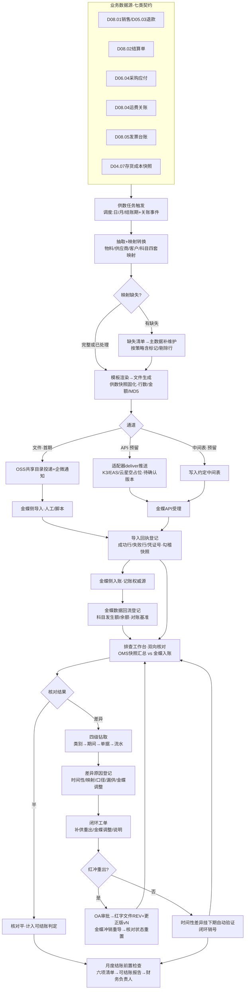
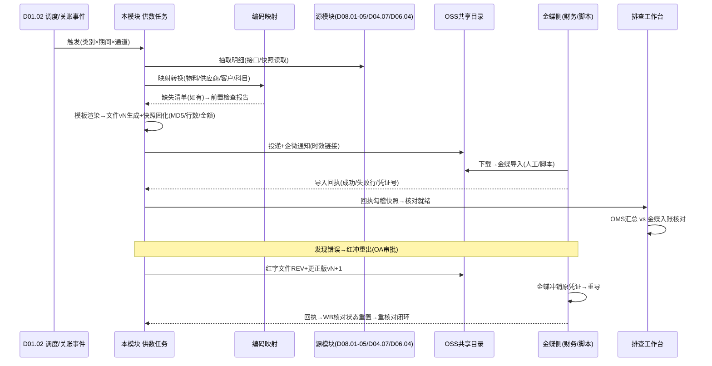

# SRS-D08.06 金蝶集成与排查工具模块 需求规格说明书

> 文档编号：SRS-D08.06 · 版本 V1.0 · 2026-10-24 · 编写：小凯 · 状态：待审阅（批次④）
> 所属域：D08 财务对账域 · 分期：**P1（M3）** · schema：`oms_finance`
> 上游依据：SRS-00 §3 D08 清单（统计+明细数据供给金蝶、可插拔适配层、凭证外推、OMS 侧排查核对工作台）/§4.4 契约 · SRS-D04.07（成本含税口径 §5.3、暂估机制、日终量价双快照 FR-05b、EF-D04.07-01 金蝶存货核算供数经本模块、口径变更只未来生效原则）· SRS-D04.01（`kingdee_material_code` 金蝶物料编码 FR-02b）· SRS-D04.02（日终库存快照）· SRS-D06.04（采购对账与供应商台账：现购按单挂账/赊购按入库挂账的应付单、供应商台账期初/增加/已付/期末、应付数据供给金蝶——SRS-00 §3 D06 清单口径）· SRS-D08.01（应收双口径）· SRS-D08.02（结算单）· SRS-D08.03（核销三档/误差表/gap 差异借贷科目映射）· SRS-D08.04（关账后运费实际：`FreightActualService::getPayable` IF-D08.04-08、事件 `freight.task.closed`、红冲重出机制 FR-05e）· SRS-D08.05（发票台账供数 IF-D08.05-07/D9、OMS 业务台账 vs 金蝶税务发票边界 §5.5）· SRS-D05.03（退款台账 `RefundLedgerQuery` IF-D05.03-05）· 逆向文档 04 §6（financebase account_chart 会计科目表：编码/记账码/税率/应用场景；gap 差异表借贷科目；月结 GAP 列结构）
>
> **全局决策（本模块承载，最新决策C）**：金蝶对接=**首期文件交换（Excel/CSV 标准格式+中间表）+ API 适配层预留**——可插拔适配层设计，金蝶版本（K3/EAS/云星空）**待确认**【待确认：金蝶版本与接口】，本文档按「**版本无关的数据供给契约**」编写：供数内容/格式/频率/口径与传输通道解耦，通道（文件/API）可替换而供数契约不变。
> **集成定位（Q5 决策）**：金蝶=**记账权威源**，OMS=**业务对账+明细供给+排查工具**。OMS 不做凭证、不做总账；金蝶不做订单级明细管理。

---

## 1. 模块概述

### 1.1 定位

本模块是 OMS 与金蝶之间的**唯一集成通道**，承担三件事：

1. **供数**：把 OMS 七类业务明细/汇总数据（销售/退款/结算/采购应付/运费实际/发票台账/存货成本）按标准模板生成导出文件（首期）或推送 API（预留），登记供数快照与导入回执；
2. **对账排查**：OMS-金蝶**双向核对工作台**——按供数类别逐期核对（OMS 明细汇总 vs 金蝶入账金额），差异钻取（类别→期间→单据→流水四级定位），差异原因登记与闭环，月度结账前置检查清单；
3. **映射治理**：编码映射管理（物料/供应商/客户/科目四套映射表），映射缺失前置拦截，gap 差异科目与 D08.03 误差表联动。

商派对应机制：financebase 的 account_chart 会计科目表（科目编码/记账码/税率/应用场景 platform_amount/actually_amount 等）+ gap 差异表（差异类型→借/贷会计科目）+ 月结 GAP 列结构（销售应收-平台收入），以及金蝶凭证外推类项目常见的「中间表+定时导出」模式。凯淳自研升级：① 供数收敛为**七类标准数据契约**（版本无关，文件/API 双通道可插拔）；② 新增**排查核对工作台**（商派无 OMS-金蝶双向对账产品化能力，差异靠人工 Excel 比对）；③ 编码映射显式治理（商派科目应用场景硬编码在 account_chart 行上）；④ 文件版本与**红冲重出机制**（对齐 D08.04 FR-05e/D08.03 红冲口径）。

### 1.2 职责边界

**做**：供数任务编排（七类数据的抽取→模板渲染→文件生成→导出投递→回执登记）、供数快照固化（关账/日终时点数据不可变）、文件版本管理与红冲重出、API 适配层框架（接口抽象+金蝶版本适配器占位）、OMS-金蝶双向对账核对（逐期逐类）、差异四级钻取定位、差异原因登记与闭环工单、月度结账前置检查任务清单、编码映射管理（物料/供应商/客户/科目）与缺失拦截、金蝶侧数据回流登记（入账金额/科目余额导入，供对账基准）。

**不做**：凭证生成与总账记账（→ 金蝶，权威源）；业务明细的产生与口径定义（→ 各源模块：D03/D04.07/D05/D06.04/D08.01-05，本模块只抽取供数不改数）；关账动作本身（→ D08.03/D08.04，本模块消费其关账事件与快照）；税务发票权威台账（→ 金蝶税务模块，边界见 D08.05 §5.5）；BI 供数（→ D11.02，通道相似但消费方与口径不同，不复用混流）。

### 1.3 与其他模块关系

| 模块 | 关系 |
|---|---|
| D08.01 应收账单 | 供数①销售明细/②退款明细的应收口径来源（双口径金额） |
| D08.02 结算单 | 供数③结算单（货主周期汇总）来源 |
| D08.03 核销 | 核销结果与 gap 差异科目映射（本模块科目映射表联动其误差表）；关账事件驱动供数 |
| D08.04 运费对账 | 供数⑤运费实际（关账后 `FreightActualService::getPayable`）；红冲重出联动其 FR-05e |
| D08.05 发票管理 | 供数⑥发票台账（月度快照）；发票代码+号码对账键（其 §5.5 边界） |
| D04.07 成本 | 供数⑦存货余额与出入库成本（日终量价双快照，EF-D04.07-01 契约）；含税口径 §5.3 全局一致 |
| D04.01/D04.02 | 物料 `kingdee_material_code` 映射源；日终库存快照（数量账基准） |
| D06.04 采购对账 | 供数④采购入库与应付（供应商台账/应付单）；供应商编码映射 |
| D03.01/D05.03 | 订单/退款明细行级数据源（`RefundLedgerQuery` 退款台账） |
| D01.06 导入导出 | 文件生成/异步导出通道 |
| D01.02 调度 | 供数任务/对账任务/结账检查定时编排 |
| D10.05/D10.06 | 红冲重出 OA 审批；映射变更/差异处理审计 |
| D11.03 监控 | 供数成功率/对账差异率/映射缺失率监控 |

---

## 2. 业务场景

**SC-D08.06-01 月度销售明细供数（文件通道主流程）**
月结日+1，调度触发供数任务（类别=销售明细，期间=上月）：抽取 D08.01 应收台账订单行级明细（双口径金额/货主/店铺/成本结转引用）→ 按标准模板（CSV 字段定义 §5.2）渲染 → 生成文件 `KD_SALES_202609_v1.csv` → 上传 OSS 共享目录（金蝶侧财务下载）→ 供数快照固化（文件 MD5+行数+金额合计）→ 财务在金蝶侧完成导入后回填**导入回执**（成功行数/失败行/入账凭证号）→ 回执登记闭环。导入失败行（物料映射缺失）→ 补映射后**文件重出 v2**（v1 作废留痕，金蝶侧删旧导新）。

**SC-D08.06-02 日终存货余额供数**
每日凌晨调度：抽取 D04.07 日终量价双快照（三元行：仓×SKU×货主的数量/均价/货值+出入库成本流水汇总）→ 生成日文件（买断货主存货口径；代销代管货值单独文件备查）→ 金蝶存货核算模块导入（首期人工/脚本）；月末最后一日快照同时作为**月度存货余额对账基准**。

**SC-D08.06-03 双向对账与差异钻取（排查工作台核心）**
财务月结前打开排查工作台（期间=2026-09）：七类供数逐类核对卡片——销售明细类：OMS 汇总（Σ应收 1,250,300.00）vs 金蝶入账（导入回执+金蝶侧科目发生额回流登记 1,250,300.00）→ 平；运费实际类：OMS 关账 86,420.50 vs 金蝶 86,120.50 → **差异 300.00** → 钻取：期间→对账任务（中通 9 月任务）→单据（3 笔索赔认可金额未入应付）→流水（D08.04 差异处理记录）→ 原因登记=「索赔冲抵跨期，金蝶侧计入 10 月」→ 差异类型=时间性差异 → 闭环（下期自动核销验证）。

**SC-D08.06-04 红冲重出**
10 月发现 9 月销售明细文件中某店铺 50 单货主归属错误（供数快照数据源问题）：发起红冲重出（OA 审批+独立授权）→ 生成红字冲销文件 `KD_SALES_202609_REV_v3.csv`（负数金额行，引用原文件版本）+ 更正后全量文件 v4 → 金蝶侧冲销原凭证重新导入 → 回执登记 → 对账工作台该期核对状态重置为「重出待核对」→ 重核对通过闭环；原 v1/v2 版本留痕不可删。

**SC-D08.06-05 编码映射缺失拦截**
供数任务抽取时发现 12 个 SKU 无 `kingdee_material_code`（新品未维护）：任务不中断——缺失行落入**映射缺失清单**（前置检查报告），文件按「含缺失标记」或「剔除缺失行」策略（类别级配置）生成；缺失清单推 D04.01 主数据工作台补维护 → 补全后增量重出；连续缺失告警（D01.07）。

**SC-D08.06-06 月度结账前置检查**
每月结账日前 2 天，调度自动生成**结账检查任务清单**：① 七类供数文件全部生成且回执闭环？② 排查工作台当期核对全绿（或差异已登记闭环）？③ 编码映射缺失清单清零？④ D08.03 核销误差表未处理差异=0？⑤ D08.04 上月运费任务已关账？⑥ 红冲重出无悬空（重出未回执）？——逐项状态汇总为「可结账/不可结账」报告推财务负责人（企微+工作台），不可结账项一键跳转对应处理页面。

**SC-D08.06-07 API 通道切换（预留演练）**
金蝶版本确认为云星空后【待确认】：实施 WebAPI 适配器（凭证引入接口/单据状态回写）→ 通道配置从 `file` 切到 `api`（类别粒度可灰度：先切发票台账类）→ 供数契约（字段/口径/频率）不变，仅投递方式变化 → 供数任务改推送 API+同步回执（替代人工回填）→ 排查工作台核对逻辑零修改（对账基准从回执登记切换为 API 状态回写）。

---

## 3. 功能需求

### FR-D08.06-01 供数任务编排与数据契约
- FR-01a **七类供数清单（数据契约核心，版本无关）**：

| # | 类别 | 数据源 | 粒度 | 频率 | 口径要点 |
|---|---|---|---|---|---|
| ① | 销售明细 | D08.01 应收+D03 订单行+D04.07 成本结转 | 订单行级 | 日增量+月全量（结账期） | **双口径金额**（客户实付/平台承担分列）；货主/店铺/科目映射；成本结转额（出库成本快照） |
| ② | 退款明细 | D05.03 退款台账（`RefundLedgerQuery`）+D08.01 应退 | 退款单行级 | 日增量+月全量 | 退款双口径冲减；分摊回冲明细；关联原销售行 |
| ③ | 结算单 | D08.02 | 货主×周期汇总+明细引用 | 月（结算周期关账后） | 代销服务费/佣金计算结果；货主分账 |
| ④ | 采购入库与应付 | D06.04（应付单：现购按单/赊购按入库挂账；供应商台账） | 单据级+台账汇总 | 月（结账期） | 含税口径与 D04.07 §5.3 全局一致；暂估/价差回冲标记（D04.07 estimate_batch） |
| ⑤ | 运费实际 | D08.04 关账任务（`FreightActualService::getPayable`） | 关账汇总+运单明细 | 月（关账后） | 仅关账数据；承担方/科目映射；索赔与坏账单列 |
| ⑥ | 发票台账 | D08.05（蓝/红/换开链） | 发票级+明细行 | 月快照 | **业务口径声明**（D08.05 §5.5：金蝶税务为权威源，本供数供两边对账） |
| ⑦ | 存货余额与出入库成本 | D04.07 日终量价双快照+D04.02 数量快照 | 三元行（仓×SKU×货主）日快照+成本流水月汇总 | 日（快照）+月（汇总） | 买断存货口径与代销代管口径分文件；均价/货值/流水类型（入库计价/出库结转/暂估回冲/调整） |

- FR-01b 供数任务模型：任务=（类别×期间×通道×版本）；触发=调度（日/月/结账期）+关账事件驱动（`freight.task.closed`/D08.03 关账）+手动重出；任务状态机=待生成→已生成→已投递→回执闭环/失败重出。
- FR-01c **供数快照固化**：生成时点数据不可变（快照表存汇总指纹：行数/金额合计/MD5）；重出=新版本文件（旧版作废留痕），不改快照——审计可回放「金蝶拿到的到底是哪版数」。
- FR-01d 模板字段定义：每类别标准模板（CSV/Excel 双格式，字段清单/类型/精度/必填/映射列见 §5.2）；模板版本化（口径变更只未来生效，对齐 D04.07 §5.3 原则）；金额一律 2 位小数。

### FR-D08.06-02 文件交换机制（首期通道）
- FR-02a 文件生成：模板渲染（异步，D01.06 通道；10 万行级 ≤10 分钟）；文件命名规范 `KD_{类别}_{期间}_{版本}.{ext}`（红冲文件 `_REV_` 标识）；生成即登记（文件引用/快照指纹/任务关联）。
- FR-02b 导出投递：OSS 共享目录（金蝶侧财务人工下载或定时脚本拉取）；投递通知（D01.07 企微：文件就绪+指纹+下载链接，链接时效控制）；敏感文件加密（密码另通道送达）。
- FR-02c **导入回执登记**：金蝶侧导入完成后回填回执（人工登记或脚本回传：成功行数/失败行清单/金蝶凭证号/入账期间）；回执与供数快照勾稽（成功行数+失败行数=文件行数，失败行原因分类：映射缺失/校验失败/金蝶侧异常）；回执超时（默认 3 个工作日）催办告警。
- FR-02d **文件版本与红冲重出**：版本链（v1→v2 重出→REV 红冲→v3 更正）全程留痕；红冲重出走 OA 审批（D10.05）+独立授权；红字文件=负数金额行+原版本引用；重出后对账工作台核对状态重置（SC-04）。
- FR-02e 中间表预留：金蝶侧若采用「中间库/中间表」模式，本模块支持写入约定的中间表（表结构=模板字段的 DB 化，JDBC/文件落地两种投递）——中间表结构与文件模板同源定义（一份契约两种载体）【待确认：金蝶侧中间表规范】。

### FR-D08.06-03 API 适配层预留（通道抽象）
- FR-03a **通道抽象接口**（可插拔，供数契约与通道解耦）：

| 适配器方法 | 语义 | 文件通道实现（首期） | API 通道实现（预留占位） |
|---|---|---|---|
| `deliver(供数包)` | 数据投递 | 生成文件→OSS→通知 | 凭证/单据推送 API（分页批量） |
| `receipt(任务)` | 回执获取 | 人工登记/脚本回传 | 同步应答+异步状态查询 |
| `reverse(红冲包)` | 红冲冲销 | 红字文件 | 红字凭证/冲销接口 |
| `queryBalance(科目/期间)` | 余额/发生额查询 | 金蝶侧报表人工回流登记 | 科目余额查询 API |
| `writeBackStatus(单据, 状态)` | 单据状态回写 | —（首期无） | 凭证号回写 OMS 单据 |

- FR-03b 适配器注册机制：金蝶版本适配器占位（`KingdeeK3Adapter`/`KingdeeEasAdapter`/`KingdeeCloudAdapter` 云星空 WebAPI——【待确认：金蝶版本与接口】，确认哪个版本即实施哪个，其余留空壳）；新增版本=注册新适配器，供数任务/对账工作台零修改。
- FR-03c 通道配置：类别粒度通道选择（file/api/中间表）+灰度切换（SC-07：按类别逐类切流）；通道切换不改变数据契约与对账逻辑。
- FR-03d API 通道可靠性（实施时生效）：分级重试（RETRYABLE/FATAL/BIZ_REJECT，D02.05 口径）、幂等（供数任务 ID+版本为幂等键，金蝶侧防重）、报文日志全留痕。

### FR-D08.06-04 排查核对工作台（Q5 明确要求）
- FR-04a **双向对账核对**：按供数类别×期间逐类核对——OMS 侧数（供数快照汇总：行数/金额合计）vs 金蝶侧数（导入回执入账金额+`queryBalance` 科目发生额/余额回流登记）；核对状态=未核对/核对平/差异待处理/差异已闭环/重出待核对；核对卡片总览（当期七类状态一览+可结账判定 §FR-06）。
- FR-04b **差异四级钻取**：类别→期间→**单据级**（差异金额分解到具体单据：订单/退款单/结算单/应付单/运费任务/发票/三元行）→**流水级**（单据的业务流水：应收流水/成本流水 cost_change_log/核销记录/差异处理记录）；钻取路径全程带上下文（差异额随层收敛，末层定位到具体流水行）。
- FR-04c 差异原因登记：原因分类字典（时间性差异[跨期]/映射差异[科目/编码错]/口径差异[含税/暂估/双口径理解]/漏供[文件缺行]/金蝶侧调整[人工凭证]/其他）；登记要素=原因+说明+责任人+预计闭环期；时间性差异自动挂下期核对验证（下期平则自动闭环）。
- FR-04d 差异闭环工单：差异→工单（指派/处理/复核/关闭）；闭环证据（补供文件版本/金蝶调整凭证号/说明附件）；超期未闭环升级告警；差异台账（历史全量可查，审计口径）。
- FR-04e 金蝶侧数据回流登记：首期人工导入金蝶科目余额表/入账汇总（Excel 模板，`queryBalance` 的文件版）；API 通道后自动查询（FR-03a）；回流数据只作对账基准，不落 OMS 业务账（§1.2 边界）。
- FR-04f **月度结账前置检查**：检查项清单（SC-06 六项，可扩展配置）→ 结账检查报告（可结账/不可结账+缺项明细+一键跳转）→ 推财务负责人（D01.07）；检查任务调度（结账日前 N 天，可配置）。

### FR-D08.06-05 编码映射管理
- FR-05a 四套映射表：**物料映射**（OMS bm_id ↔ `kingdee_material_code`，源=D04.01 FR-02b，本模块只读消费+缺失拦截）；**供应商映射**（OMS supplier_id ↔ 金蝶供应商编码，D06 档案扩展位）；**客户映射**（货主/店铺/经销商 ↔ 金蝶客户编码，D10.01 组织档案扩展位）；**科目映射**（OMS 业务类型×承担方×差异类型 → 金蝶科目编码，商派 account_chart 应用场景语义升级：结构化映射表替代硬编码行）。
- FR-05b 科目映射明细：业务类型字典（销售收入/平台承担收入/退款冲减/运费费用/代销服务费/佣金/暂估应付/价差调整/坏账/索赔回收…）×维度（货主类型/店铺/承担方）→ 科目编码+记账方向（借/贷）；**gap 差异科目联动 D08.03 误差表**（核销差异/运费差异/发票差异的借贷科目取本映射表，D08.03/D08.04 FR-04d 消费同一事实源）。
- FR-05c 映射维护：工作台 CRUD+批量导入（D01.06）；变更审计+未来生效（已生成供数文件不回改）；映射版本随供数快照固化（历史文件可回放当时映射）。
- FR-05d 缺失拦截：供数任务前置检查映射完整性 → 缺失清单（SC-05）→ 按类别策略（含缺失标记/剔除行）+补全后增量重出；缺失率监控（D11.03）。

### FR-D08.06-06 监控、审计与安全
- FR-06a 供数监控：任务成功率/及时性（结账期 SLA）/回执闭环率/映射缺失率/对账差异率（类别×期间趋势）。
- FR-06b 审计：红冲重出/映射变更/差异闭环/回流登记全审计（D10.06）；文件下载链接访问留痕。
- FR-06c 安全：财务数据文件加密传输+时效链接；OSS 目录访问控制（金蝶侧账号最小权限）；工作台数据行级隔离（D10.03：品牌方不可见，仅内部财务租户）。

---

## 4. 业务流程

### 4.1 供数-对账-排查闭环全流程



### 4.2 供数任务与红冲重出时序



---

## 5. 处理逻辑

### 5.1 供数契约的版本无关原则

```
契约三层解耦:
    数据层(是什么): 七类清单的字段/口径/粒度/频率 —— 唯一事实源,与通道无关
    载体层(长什么样): CSV/Excel模板 = 中间表DDL = API报文schema —— 同源定义三种渲染
    通道层(怎么送): file(首期) / api(预留) / 中间表(预留) —— 类别粒度可配置可灰度
金蝶版本差异(K3/EAS/云星空)只影响通道层适配器实现,不影响数据层契约
    →【待确认:金蝶版本与接口】确认前,数据层契约即可先行开发与验收(用文件通道)
口径全局一致: 含税/不含税=D04.07 §5.3全局配置项; 双口径金额=D08.01定义;
    金额2位小数; 模板/映射变更只未来生效(历史快照可回放)
```

### 5.2 模板字段定义示例（类别①销售明细，其余类别同构定义见 DB-D08 附录）

| 字段 | 类型 | 说明 |
|---|---|---|
| bill_no / bill_date | string/date | OMS 单据号（订单号）/业务日期 |
| owner_code / shop_code | string | 货主/店铺编码（客户映射转换后金蝶编码并列 OMS 原码） |
| material_code / kd_material_code | string | OMS 物料编码/金蝶物料编码（映射缺失标记列） |
| qty / price | decimal | 数量/单价（4 位） |
| amount_actual / amount_platform | decimal(2) | **双口径**：客户实付/平台承担（D08.01 契约） |
| cost_amount | decimal(2) | 成本结转额（D04.07 出库快照） |
| subject_code / direction | string | 科目映射编码/借贷方向（FR-05b） |
| tax_flag / tax_rate | string/decimal | 含税口径标记（D04.07 §5.3）/税率 |
| settle_ref / period | string | 结算单引用/账期 |
| tenant_id / owner_id | string | 全域携带（SRS-00 契约） |

文件尾行=汇总行（行数+金额合计，与快照指纹勾稽）；红字文件金额列为负+`origin_file` 引用列。

### 5.3 双向对账算法

```
核对(类别c, 期间p):
    oms数  = 供数快照(c,p,最新版本).{行数, Σ金额}      # 含红冲净额的净版本口径
    kd数   = 回执入账金额(c,p) ⊕ 回流登记.科目发生额(映射科目集, p)
    差异额 = oms数 - kd数
    if |差异额| = 0 且 行数勾稽平: → 核对平
    else: → 差异待处理, 启动钻取:
        L1 类别×期间 → L2 分解到供数文件版本/金蝶凭证组
        L3 单据级: 按单据号集合差(OMS有金蝶无/金蝶有OMS无/两边都有金额不符)
        L4 流水级: 单据→业务流水(应收流水/cost_change_log/核销记录/D08.04差异处理)
    钻取辅助: 时间性差异候选(期末±3天单据自动标记跨期疑点)
```

### 5.4 结账前置检查规则（FR-04f 检查项配置化）

| 检查项 | 判定 | 不通过跳转 |
|---|---|---|
| 七类供数回执闭环 | 当期全部任务状态=回执闭环 | 供数任务列表 |
| 核对全绿或差异闭环 | 无「差异待处理」状态 | 排查工作台 |
| 映射缺失清零 | 缺失清单空 | 映射维护页 |
| D08.03 误差表未处理=0 | 核销差异无悬空 | D08.03 工作台 |
| 上月运费任务已关账 | D08.04 账期顺序约束满足 | D08.04 任务页 |
| 红冲重出无悬空 | REV 文件全部有回执 | 重出任务列表 |

---

## 6. 数据字段（业务字段描述）

> 物理表落 `oms_finance` schema；DDL 见 DB-D08。金额 2 位小数；tenant_id/owner_id 必填。

### 6.1 供数任务与快照（fin_kd_feed_task / _snapshot）

| 字段 | 业务含义 | 取值/校验 |
|---|---|---|
| task：feed_type(①-⑦) / period / channel(file-api-中间表) / version / trigger(调度-关账事件-手动重出) / status(待生成-已生成-已投递-回执闭环-失败重出) / file_ref / adapter_code | 供数任务 | 幂等键=类别+期间+版本 |
| snapshot：row_count / amount_sum / md5 / mapping_version / template_version / gen_time | 供数快照指纹 | 不可变（FR-01c）；对账 OMS 侧基准 |
| receipt：succ_rows / fail_rows_json / voucher_nos / kd_period / receipt_time / receipt_by | 导入回执 | 勾稽：succ+fail=row_count |

### 6.2 对账核对与差异（fin_kd_recon / _diff / _ticket）

| 字段 | 业务含义 |
|---|---|
| recon：feed_type / period / oms_amount / oms_rows / kd_amount / kd_rows / diff_amount / status(未核对-核对平-差异待处理-差异已闭环-重出待核对) / check_time | 双向核对卡片（FR-04a） |
| diff：recon_id / drill_level(类别-期间-单据-流水) / bill_ref / flow_ref / diff_amount / reason_type(时间性-映射-口径-漏供-金蝶调整-其他) / reason_desc / owner_user / expect_close_date / auto_verify_period(时间性挂下期) / status | 差异登记（FR-04b/04c） |
| ticket：diff_ids / assignee / handle_log / evidence_refs(补供版本-金蝶凭证号-附件) / status(待处理-处理中-待复核-已关闭) / close_time | 闭环工单（FR-04d） |

### 6.3 红冲重出登记（fin_kd_reversal）

| 字段 | 业务含义 |
|---|---|
| origin_task_id / origin_version / rev_file_ref / new_file_ref / oa_ref(审批单) / reason / operator / status(审批中-已生成-已投递-回执闭环) | 红冲重出链（FR-02d，版本链留痕不可删） |

### 6.4 编码映射（fin_kd_mapping）

| 字段 | 业务含义 | 取值/校验 |
|---|---|---|
| map_type | 映射类型 | material/supplier/customer/subject 四类 |
| oms_code / kd_code | OMS 编码/金蝶编码 | material 类只读消费 D04.01 `kingdee_material_code` |
| biz_type / dimension_json | 科目映射专用：业务类型×维度 | 货主类型/店铺/承担方（FR-05b） |
| direction / gap_flag | 借贷方向/是否 gap 差异科目 | gap 科目联动 D08.03 误差表（同一事实源） |
| effective_from / version / status | 生效时间/版本/启停 | 未来生效；快照固化映射版本 |
| tenant_id | 租户 | 必填 |

### 6.5 金蝶回流登记与结账检查（fin_kd_balance_import / _close_check）

| 字段 | 业务含义 |
|---|---|
| balance：period / subject_code / opening / occur_debit / occur_credit / closing / source(人工导入-API) / file_ref | 金蝶科目余额回流（对账基准，不落业务账 FR-04e） |
| close_check：period / check_items_json(六项状态) / result(可结账-不可结账) / report_ref / notify_time | 结账前置检查报告（FR-04f） |

---

## 7. 接口

### 7.1 内部接口（本模块提供）

| 编号 | 接口 | 消费方 | 说明 |
|---|---|---|---|
| IF-D08.06-01 | `KdFeedService::generate(feed_type, period)` / `redeliver(task_id, 原因)` | 调度/工作台/关账事件消费器 | 供数任务生成与重出（幂等：类别+期间+版本） |
| IF-D08.06-02 | `KdFeedService::registerReceipt(task_id, 回执)` | 财务工作台/脚本回传端点 | 导入回执登记+勾稽校验（FR-02c） |
| IF-D08.06-03 | `KdReversalService::apply(task_id, 原因)` | 工作台（OA 审批回调驱动） | 红冲重出编排（FR-02d） |
| IF-D08.06-04 | `KdReconService::runCheck(feed_type, period)` / `drill(diff_id, level)` | 排查工作台/调度 | 双向核对与四级钻取（FR-04a/04b） |
| IF-D08.06-05 | `KdDiffService::register/close(diff_id, 要素)` | 排查工作台 | 差异登记与闭环（审计留痕） |
| IF-D08.06-06 | `KdMappingService::get/map/batchImport(map_type, oms_code)` | 各源模块（D08.03 gap 科目/D08.04 分摊科目/供数任务） | 映射查询与转换（科目映射单一事实源） |
| IF-D08.06-07 | `KdCloseCheckService::report(period)` | 财务工作台/D01.07 | 结账前置检查报告（FR-04f） |
| IF-D08.06-08 | `KdAdapterRegistry::register/get(channel)` | 实施配置 | 通道适配器注册（金蝶版本占位，FR-03b） |
| IF-D08.06-09 | 事件 `kd.feed.delivered` / `kd.recon.diff_found` / `kd.close.ready` | D01.07/D11.03 | 供数与对账状态广播（事件字典 DB-00 登记） |

### 7.2 依赖接口（本模块消费）

| 编号 | 接口 | 提供方 | 说明 |
|---|---|---|---|
| IF-D08.06-D1 | `FreightActualService::getPayable(period, corp)` + 事件 `freight.task.closed` | D08.04（IF-D08.04-07/08） | 供数⑤运费实际 |
| IF-D08.06-D2 | 事件 `invoice.issued/red_issued` + 台账月度快照读取 | D08.05（IF-D08.05-07/D9） | 供数⑥发票台账 |
| IF-D08.06-D3 | `CostService` 快照/流水读取 + 日终量价双快照 | D04.07（EF-D04.07-01 契约）/D04.02 | 供数⑦存货余额与出入库成本 |
| IF-D08.06-D4 | 应付单/供应商台账读取（月结账期） | D06.04 | 供数④采购入库与应付 |
| IF-D08.06-D5 | 应收/应退台账+双口径金额读取 | D08.01 | 供数①②数据源 |
| IF-D08.06-D6 | 结算单读取（关账后） | D08.02 | 供数③ |
| IF-D08.06-D7 | `RefundLedgerQuery::get/list`（退款台账与分摊回冲明细） | D05.03（IF-D05.03-05） | 供数②退款明细 |
| IF-D08.06-D8 | gap 差异科目消费（本模块映射表为其事实源） | D08.03 | 科目映射联动（FR-05b） |
| IF-D08.06-D9 | 物料金蝶编码/开票属性 | D04.01（`kingdee_material_code`） | 物料映射只读源 |
| IF-D08.06-D10 | 导入导出/调度/OA 审批/企微告警/审计/OSS | D01.06/D01.02/D10.05/D01.07/D10.06 | 底座能力 |

### 7.3 外部接口

| 编号 | 接口 | 方向 | 说明 |
|---|---|---|---|
| EF-D08.06-01 | OSS 共享目录（文件投递+时效链接） | 出 | 首期文件通道（FR-02b） |
| EF-D08.06-02 | 金蝶 WebAPI（云星空凭证引入/科目余额查询/单据状态回写）或 K3/EAS 对应接口 | 双向 | API 通道预留占位（FR-03）【待确认：金蝶版本与接口】 |
| EF-D08.06-03 | 金蝶侧中间表（约定库表写入） | 出 | 中间表通道预留（FR-02e）【待确认：金蝶侧中间表规范】 |

---

## 8. 非功能需求

| 项 | 要求 |
|---|---|
| 性能 | 供数文件生成 10 万行 ≤10 分钟（异步）；月度全量七类供数在结账日+1 上午 8 点前就绪（SLA）；工作台钻取查询 P95 ≤3s（单据级）/≤10s（流水级） |
| 幂等 | 供数任务幂等键=类别+期间+版本；回执重复登记拒绝（勾稽冲突告警）；API 通道推送幂等（任务 ID+版本，金蝶侧防重） |
| 一致性 | 供数快照不可变+MD5 指纹勾稽回执；对账基准取净版本（含红冲净额）；映射/模板变更只未来生效（历史快照回放一致） |
| 精度 | 金额 2 位小数；汇总行与明细 Σ 严格相等（生成期校验，不平即任务失败） |
| 可靠性 | 供数任务失败自动重试+告警；回执超时催办（3 个工作日）；红冲重出悬空纳入结账检查（不允许带病结账） |
| 安全/审计 | 财务文件加密+时效链接+访问留痕；红冲重出/映射变更/差异闭环 OA+审计（D10.05/D10.06）；工作台仅内部财务租户（品牌方不可见，D10.03） |
| 可观测 | 供数成功率/及时性/回执闭环率/映射缺失率/差异率趋势/差异闭环时长监控（D11.03） |

---

## 9. 验收标准

| 编号 | 验收条件 |
|---|---|
| AC-01 | 供数主流程（SC-01）：调度触发销售明细类任务 → 文件生成（模板字段齐全/双口径分列/尾行汇总与快照指纹一致）→ OSS 投递+企微通知 → 回执登记勾稽通过（成功+失败行数=文件行数）→ 任务闭环 |
| AC-02 | 七类契约完备性：①-⑦ 每类各构造一期供数，字段/粒度/频率/口径符合 §FR-01a 清单定义；类别⑦按 D04.07 日终量价双快照生成（数量×均价=货值勾稽）；买断/代销分文件 |
| AC-03 | 快照不可变与版本：重出 v2 后 v1 快照与文件仍完整可查（留痕不可删）；对账基准自动取净版本（含红冲净额） |
| AC-04 | 红冲重出（SC-04）：OA 审批通过才生成 REV 红字文件（负数金额+原版本引用）；金蝶冲销重导回执后核对状态重置为「重出待核对」；重核对通过闭环；全程审计留痕 |
| AC-05 | 双向核对与钻取（SC-03）：构造 300 元运费差异 → 核对卡片检出「差异待处理」→ 四级钻取定位到 3 笔索赔认可单据级+D08.04 差异处理流水级 → 原因登记（时间性差异）→ 挂下期自动验证 → 下期平自动闭环 |
| AC-06 | 差异原因五分类：时间性/映射/口径/漏供/金蝶侧调整各构造一例，登记要素完整（原因/责任人/预计闭环期），闭环工单证据（补供版本/金蝶凭证号）关联正确 |
| AC-07 | 结账前置检查（SC-06）：六项检查逐项构造不通过场景 → 报告判定「不可结账」+缺项明细+一键跳转；全部通过 →「可结账」报告推送财务负责人 |
| AC-08 | 编码映射（SC-05）：物料映射缺失 12 SKU → 缺失清单生成+按类别策略（剔除行）文件照常产出+补全后增量重出；科目映射变更 → 已生成文件不回改（未来生效）、新任务按新版；gap 差异科目与 D08.03 误差表消费同一映射事实源（改一处两处同步生效） |
| AC-09 | 通道抽象：file 通道全链路验收后，以模拟 API 适配器（mock）演示通道切换——供数任务/核对工作台代码零修改跑通 deliver/receipt/reverse 三动作；适配器注册表可见 K3/EAS/云星空三占位（【待确认版本】标注） |
| AC-10 | 回执与催办：回执超时 3 个工作日自动催办告警；回执行数勾稽不平（构造缺 10 行）拒绝登记+告警 |
| AC-11 | 金蝶回流登记：科目余额表人工导入（Excel 模板）成功登记为对账基准；回流数据不落 OMS 业务账（仅 recon 消费） |
| AC-12 | 性能与安全：10 万行文件生成 ≤10 分钟；结账日+1 早 8 点前七类就绪（SLA 演练）；文件链接过期后不可下载；品牌方租户访问工作台被行级隔离拒绝 |
| AC-13 | 口径一致性：含税口径配置项与 D04.07 §5.3 全局一致（改一处全域生效）；模板版本化——口径变更后历史期间按旧模板版本重出文件字段一致（回放验证） |

---

## 变更记录

| 日期 | 版本 | 变更 | 原因 |
|---|---|---|---|
| 2026-10-24 | V1.0 | 首版 | — |

---

*参考实现溯源：商派 financebase account_chart 会计科目表（科目编码/名称/记账码/客户/成本中心/税率/税率会计科目/**应用场景** platform_amount/actually_amount/refundplatform_amount/refundactually_amount 每种只能一条/原因代码——科目映射的雏形，但应用场景硬编码在行上）+ financebase_gap 差异表（差异类型→借/贷会计科目，D08.03 已承接）+ 月结 monthly_report GAP 列结构（销售应收-平台收入差异分析口径）+ bill_import 族批量导入模式（批次登记/错误报告，本模块回执登记同构）+ 逆向文档 04 §12.3「核销三档+误差表+差异映射借贷科目是审计可解释性基础」。关键差异：① 商派无金蝶集成产品化模块（凭证外推散落项目定制），本模块收敛为**七类版本无关供数契约**+可插拔通道（file 首期/api 预留/中间表预留），金蝶版本差异隔离在适配器层【待确认版本】；② **排查核对工作台**为全新能力（双向核对/四级钻取/差异五分类/闭环工单/时间性差异自动挂下期验证），商派差异靠人工 Excel 比对；③ 月度结账前置检查清单（六项门禁+可结账报告）新增；④ 供数快照不可变+MD5 指纹勾稽回执+**红冲重出版本链**（OA 审批+留痕不可删）新增，对齐 D08.04 FR-05e；⑤ 编码映射四套显式治理（物料/供应商/客户/科目）+科目映射替代 account_chart 应用场景硬编码+gap 差异科目单一事实源（D08.03/D08.04 共同消费）；⑥ 映射缺失前置拦截+缺失清单闭环（商派导入失败才暴露）；⑦ Q5 集成定位显式化：金蝶=记账权威源、OMS=业务对账+明细供给+排查工具，金蝶回流数据只作对账基准不落业务账。待确认项：金蝶版本（K3/EAS/云星空）与接口规范、金蝶侧中间表规范、含税口径（D04.07 §5.3 同一配置项）、运费资本化口径。*
