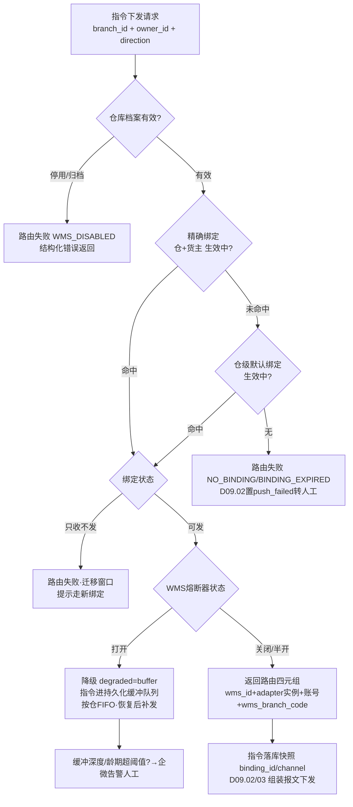
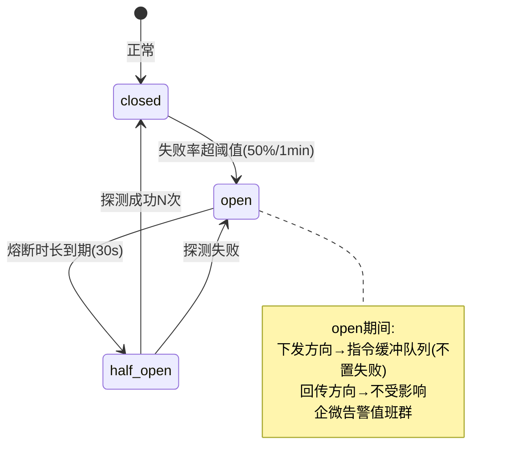
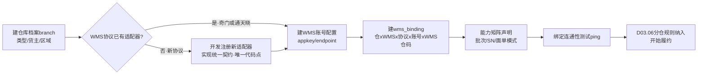

# SRS-D09.01 仓库与多 WMS 路由模块 需求规格说明书

> 文档编号：SRS-D09.01 · 版本 V1.0 · 2026-10-24 · 编写：小凯 · 状态：待审阅（批次③）
> 所属域：D09 履约集成域 · 分期：**P0（M1-M2）**
> 上游依据：SRS-00 §3 D09 模块清单/§4.4 契约 · 逆向文档 05 §5.5（WMS 多协议通道对比 lib/wms/）/§5.1-5.2（奇门 qimen 出向与入向）· 逆向文档 03 §4.2-4.4（branch 仓库分类/wmsmgr 第三方仓绑定 branch_relation）· SRS-D03.07（推仓按仓路由 wms_binding）· SRS-D09.02/D09.03（指令通道消费本模块路由能力）
>
> **全局决策（本模块承载）**：WMS 对接协议 = **奇门标准协议 + 通天晓自有 RESTful 双协议**；每仓按 wms_binding 绑定选择协议适配器；**加 WMS = 加协议适配器 + 加仓库绑定，纯增量不改存量**；多 WMS 按仓（branch）路由（通天晓为主，预留富勒/万里牛等）。

---

## 1. 模块概述

### 1.1 定位

本模块是 OMS 与所有 WMS 之间的**寻址与适配基座**：管理仓库档案（branch）、WMS 档案与协议适配器（奇门/RESTful 双协议抽象）、仓库×WMS 绑定关系（wms_binding）、按仓路由决策、WMS 健康检查与熔断降级、仓库-WMS 能力矩阵。D09.02（出库指令）与 D09.03（入库指令）下发任何指令前，都必须经本模块解析出「目标 WMS + 协议适配器 + 账号配置 + WMS 侧仓编码」四元组。

商派验证过的核心设计在新栈重建：branch 仓库多维分类（逆向文档 03 §4.2）、wmsmgr 的「系统仓↔WMS 仓映射」（branch_relation）、erpapi_wms_config 统一寻址 +「仓库绑定 WMS 类型后单据自动路由到对应通道」（逆向文档 05 §5.5）。关键升级：商派通道族硬编码在 lib/wms/ 目录树（matrix/qimen、openapi、prism、ftp、selfwms 并存、按目录寻址），本模块抽象为**协议适配器注册机制**——适配器实现统一接口契约即可插拔，协议差异（奇门 XML 签名报文 vs 通天晓 JSON RESTful）被隔离在适配器内部。

### 1.2 职责边界

**做**：仓库档案（类型/归属货主/区域/管控属性）、WMS 档案（服务商/协议/账号配置）、协议适配器抽象接口与注册机制（奇门适配器、通天晓 RESTful 适配器为首批实现）、wms_binding（仓×WMS×协议×账号×WMS 仓编码映射）、路由决策服务（发货单/入库单按仓查绑定选适配器）、WMS 健康检查与熔断降级、仓库-WMS 能力矩阵（批次/SN/盘点/面单回传等能力声明）、绑定变更管理（换 WMS 迁移窗口）。

**不做**：出库/入库指令的报文组装与收发执行（→ D09.02/D09.03，本模块提供路由结果与适配器实例）；分仓决策——选哪个仓发货（→ D03.06，本模块只管「仓定了之后走哪个 WMS」）；库存记账与三元台账（→ D04.02）；面单取号（→ D09.05）；物流公司分单路由（→ D09.04）。

### 1.3 与其他模块关系

| 模块 | 关系 |
|---|---|
| D09.02 出库指令 | `WmsRouteService::route(branch_id, 货主)` 解析路由四元组；适配器实例由本模块注册表提供 |
| D09.03 入库指令 | 同上（采购/退货/调拨入库按目标仓路由） |
| D03.06 配货分仓 | 分仓规则的候选仓来源（仓库档案+能力矩阵：是否支持批次/SN 影响选仓） |
| D03.07 发货单 | delivery.branch_id + wms_channel_id 落库溯源（本模块路由结果） |
| D04.02 库存记账 | 三元记账键 branch_id 的实体来源；仓库类型（正品/次品仓）影响口径归属 |
| D04.08 可售同步 | 仓库档案的管控属性（是否计可售）供可售计算排除（商派 getProductSum 排除平台自发仓同款口径） |
| D10.01 组织 | 仓库挂组织树节点；货主（owner_id）档案来源 |
| D10.03 数据权限 | 仓库维度授权（branch_ops 同款四维之一） |
| D01.02 调度 | 健康检查探活任务调度 |
| D01.07 告警 | 熔断/降级/绑定失效告警（企微） |
| D11.03 监控看板 | WMS 通道健康度、路由失败率数据源 |

---

## 2. 业务场景

**SC-D09.01-01 新仓接入（纯增量）**
凯淳新签一家云仓（富勒 WMS 运营）：① 建仓库档案 branch（类型=云仓，归属货主=品牌 A 代销，区域=华北）；② 建 WMS 档案（富勒，协议=奇门标准）——奇门适配器已注册无需开发；③ 建 wms_binding（仓×富勒×奇门协议×appkey/secret×WMS 侧仓编码 FL-BJ01）；④ 能力矩阵声明（支持批次、不支持 SN、面单回传=WMS 回传运单号）。全程零代码改动，D03.06 分仓规则纳入新仓后即可履约。

**SC-D09.01-02 出库指令路由（主流程）**
发货单 DLV202610001（华东仓 branch_101，货主=凯淳买断）推仓：D09.02 调 `route(branch_101, owner_kc)` → 查有效 wms_binding → 命中通天晓 RESTful 绑定 → 返回四元组（wms=通天晓、adapter=TtxRestAdapter、账号=kc-ttx-prod、wms_branch_code=TTX-HD01）→ D09.02 用适配器实例组装 JSON 报文下发。路由结果写入 delivery.wms_channel_id 供追溯。

**SC-D09.01-03 一仓多货主、一 WMS 多账号**
通天晓华南仓同时服务凯淳买断与品牌 B 代销两个货主：wms_binding 支持（仓×货主）粒度绑定不同 WMS 账号（货主在 WMS 侧是独立货主编码 ownerCode）。路由时携带 owner_id，命中对应绑定的账号配置；报文组装时货主编码随单下发。

**SC-D09.01-04 WMS 故障熔断与降级**
通天晓接口连续超时（错误率 >50% 持续 1 分钟）：熔断器打开，后续路由该 WMS 的指令不再实时下发，转入**指令缓冲队列**（本地持久化，状态=待下发）；D09.02 推送动作返回「受理成功、延迟下发」，发货单置 pushed（sync_status=缓冲中）而非 push_failed——避免把 WMS 故障误判为单据失败。半开探测恢复后按序补发（保持同仓 FIFO）。同时企微告警值班群；若该仓配置了备用绑定（同仓双 WMS 极少见，预留），可人工切流。

**SC-D09.01-05 仓库换绑 WMS（迁移）**
华东仓从通天晓迁到自建 WMS：新建绑定（生效时间=迁移日）+ 旧绑定置「截止日失效」；迁移窗口内旧绑定只收不发（存量在途指令继续走旧通道回传闭环），新指令走新绑定；在途指令清零后旧绑定归档。绑定变更全程审计，历史指令的路由溯源不变（指令落库时已快照 channel_id）。

**SC-D09.01-06 能力矩阵影响分仓与指令组装**
D03.06 分仓：SN 管理商品（3C 类）只能路由到能力矩阵声明「支持 SN」的仓；D09.03 入库报文组装：目标仓 WMS 不支持批次回传时，入库单据批次字段以 OMS 侧登记为准并告警人工核对；D09.05 面单：能力矩阵「面单回传=WMS 侧取号」的仓（保税仓特殊监管）允许例外通道，默认仍为 OMS 取号+仓内打印（全局决策）。

---

## 3. 功能需求

### FR-D09.01-01 仓库档案（branch）
- FR-01a 仓库类型枚举：`实体仓`（自营/合作实体库）/ `云仓`（第三方 WMS 托管）/ `门店仓`（O2O 门店库，联动 D03.11）/ `保税仓`（跨境监管，联动 D03.12 P2 预留）/ `虚拟仓`（卡密等虚拟品，D03.07 FR-09 免推仓）/ `次品仓`（不良品口径物理归集，D04.02 次品口径联动）。
- FR-01b 归属与管控属性：归属货主（owner_id，一仓可服务多货主时以 wms_binding 货主粒度区分）、区域（province/city + 区域码，供 D03.06 区域路由与 D09.04 物流分单）、管控库存标记（is_ctrl：不管控仓跳过记账，商派 is_ctrl_store 口径）、计可售标记（供 D04.08 排除，如平台自发仓）。
- FR-01c 仓库状态机：启用/停用/迁移中/归档；停用仓不可被分仓规则命中，存量在途指令继续闭环。
- FR-01d 仓库编码唯一（branch_bn），全链路以 branch_id 为三元记账键成分（SRS-00 §4.4 契约）。
- FR-01e 仓库档案变更审计（D10.06）：类型/管控/绑定变更留痕。

### FR-D09.01-02 WMS 档案与协议适配器
- FR-02a WMS 档案：服务商名称、协议类型（`qimen` 奇门标准 / `ttx_rest` 通天晓 RESTful，字典可扩展：flux 富勒/wln 万里牛等按协议归族）、账号配置（appkey/secret、customerId/ownerCode、endpoint、超时/重试参数，密文存储 D01.05）、环境标记（沙箱/生产）。
- FR-02b **协议适配器抽象接口**（统一契约，双协议实现）：

| 适配器方法 | 语义 | 奇门实现 | 通天晓 RESTful 实现 |
|---|---|---|---|
| `outboundPush(指令DTO)` | 出库通知下发 | `taobao.qimen.deliveryorder.create`（XML+签名） | `POST /openapi/outbound/order`（JSON+token） |
| `outboundCancel(单号)` | 出库叫回 | `deliveryorder.cancel` | `POST /outbound/order/cancel` |
| `inboundPush(指令DTO)` | 入库通知下发 | `entryorder.create` | `POST /openapi/inbound/order` |
| `inboundCancel(单号)` | 入库取消 | `entryorder.cancel` | `POST /inbound/order/cancel` |
| `queryOrder(wms单号)` | 单据反查对账 | `deliveryorder.query` | `GET /outbound/order/{no}` |
| `parseCallback(原始报文)` | 回传报文→标准化 DTO | 奇门回调 XML 解析+验签 | RESTful 回调 JSON 解析+token 校验 |
| `ping()` | 健康探活 | 轻量查询接口 | `/health` |

- FR-02c 适配器只负责**协议转换与传输**（报文映射/签名/加密/HTTP 客户端/错误码翻译），不含业务规则；指令 DTO 与回传 DTO 为域内标准结构（D09.02/D09.03 定义业务字段，适配器做字段映射表配置化）。
- FR-02d **适配器注册机制**：适配器以类名+协议码注册到路由注册表（配置驱动，注册表/entry_points）；新增 WMS=注册新适配器类（若新协议）或复用已有协议适配器+新增账号配置（同协议不同服务商），存量代码零修改。
- FR-02e 错误码翻译：各 WMS 原始错误码 → 统一错误分类（`RETRYABLE` 可重试 / `FATAL` 不可重试 / `BIZ_REJECT` 业务拒绝），供 D09.02/D09.03 与 D02.05 同款分级退避重试消费。

### FR-D09.01-03 wms_binding（仓×WMS×协议×账号绑定）
- FR-03a 绑定要素：branch_id、wms_id、协议适配器码、账号配置 ID、owner_id（货主粒度，可空=仓级默认绑定）、wms_branch_code（WMS 侧仓编码映射，商派 branch_relation sys_branch_bn↔wms_branch_bn 口径）、优先级（同仓多绑定时取最高优先级有效绑定）。
- FR-03b 生效窗口：effective_from / effective_to（迁移场景 SC-05）；状态=生效/待生效/只收不发/失效归档。
- FR-03c 唯一性约束：同（branch_id, owner_id, 生效窗口重叠）只允许一条「可发」绑定；违反即配置校验拒绝。
- FR-03d 绑定测试：保存前可发起沙箱/生产连通性测试（ping + 试算签名），结果落库。
- FR-03e 变更审计与快照：指令下发时快照 binding_id+channel 信息到指令记录（历史溯源不随绑定变更漂移）。

### FR-D09.01-04 路由决策服务
- FR-04a 统一入口：`WmsRouteService::route(branch_id, owner_id, direction)` → 返回路由四元组（wms_id / adapter 实例 / 账号配置 / wms_branch_code）+ binding_id；direction=出库/入库（能力差异时可分流）。
- FR-04b 决策顺序：① 精确匹配（仓+货主）绑定 → ② 仓级默认绑定（owner_id 空）→ ③ 无有效绑定 = 路由失败（结构化错误 `NO_BINDING`，D09.02 转 push_failed 人工处理）。
- FR-04c 熔断感知：目标 WMS 熔断打开时返回降级标记（`degraded=buffer`），指令进缓冲队列（SC-04）；路由结果缓存（Redis，绑定变更主动失效）。
- FR-04d 路由失败分类字典：NO_BINDING / BINDING_EXPIRED / WMS_DISABLED / CIRCUIT_OPEN（降级非失败）/ ADAPTER_MISSING，全部结构化落日志供监控（D11.03）。

### FR-D09.01-05 WMS 健康检查与熔断降级
- FR-05a 主动探活：调度任务（D01.02，每分钟）对每个生效 WMS 账号执行 `ping()`，结果滑动窗口记录（成功率/P99 延迟）。
- FR-05b 被动熔断：调用失败率阈值（默认 50%/1 分钟窗口，可按 WMS 配置）触发熔断打开；半开探测（默认 30s 一次）成功 N 次后关闭。
- FR-05c 熔断期降级策略：指令进**持久化缓冲队列**（按仓 FIFO），不置单据失败；恢复后自动按序补发；缓冲深度/最老龄期超阈值（默认 30 分钟）升级告警人工决策（继续等待/切备用仓/线下同步 WMS）。
- FR-05d 回传通道独立：熔断只影响下发方向；WMS 回传接收（D09.02/D09.03 回调入口）不受熔断影响（回传是 WMS 主动推 OMS）。
- FR-05e 通道健康看板：各 WMS 可用性/延迟/熔断历史/缓冲积压（D11.03 数据源）。

### FR-D09.01-06 仓库-WMS 能力矩阵
- FR-06a 能力项字典（绑定粒度声明，默认值取 WMS 档案级）：

| 能力项 | 取值 | 消费方 |
|---|---|---|
| 批次管理 | 支持/不支持（回传批次号） | D09.03 入库/D04.09 |
| SN 序列号 | 支持/不支持 | D03.06 分仓/D09.02 回传 |
| 效期管理 | 支持/不支持 | D04.09 |
| 盘点回传 | 支持/不支持（盘盈盘亏单据回传） | D04.06（P1） |
| 面单模式 | OMS 取号+仓内打印（默认）/ WMS 侧取号（例外，保税仓） | D09.05/D09.02 |
| 部分出库回传 | 支持多批次/仅一次性 | D09.02 |
| 称重回传 | 支持/不支持 | D09.02/D08.04 |
| 质检分流 | 支持良不良分仓/不支持 | D09.03/D05.02 |
| 叫回（拦截） | 支持/不支持（不支持则叫回必失败，前置提示） | D09.02 |

- FR-06b 能力消费口径：分仓规则（D03.06）读取能力做候选过滤；指令组装（D09.02/03）按能力裁剪报文字段与回传预期；能力不满足时结构化告警而非静默。
- FR-06c 能力矩阵可视化：仓库详情内嵌展示；品牌方门户只读（本货主相关仓）。

### FR-D09.01-07 仓库工作台与查询
- FR-07a 仓库/绑定/能力三合一列表与详情（多维筛选：类型/货主/区域/WMS/状态）；数据权限仓库维度行级过滤（D10.03）。
- FR-07b 路由模拟工具：输入（仓+货主+方向）输出路由决策明细（命中绑定/降级状态），排障用。
- FR-07c 配置导入导出（D01.06）：仓库档案与能力矩阵批量维护。

---

## 4. 业务流程

### 4.1 路由决策流程（D09.02/D09.03 每次下发指令必经）



### 4.2 熔断-降级-恢复状态机



### 4.3 新仓接入流程（SC-01，纯增量）



---

## 5. 处理逻辑

### 5.1 路由决策伪代码

```
route(branch_id, owner_id, direction):
    branch = 仓库档案(branch_id)
    if branch.status in (停用, 归档): return fail(WMS_DISABLED)
    binding = 查绑定(branch_id, owner_id, 生效中, 可发, order by 优先级 desc)   # 精确
    if not binding:
        binding = 查绑定(branch_id, owner_id=null, 生效中, 可发)               # 仓级默认
    if not binding: return fail(NO_BINDING)
    if circuit(binding.wms_id).is_open():
        return ok(degraded=BUFFER, binding)          # 缓冲降级，非失败
    adapter = AdapterRegistry.get(binding.adapter_code)
    if not adapter: return fail(ADAPTER_MISSING)
    return ok(wms_id, adapter, account(binding.account_id),
              wms_branch_code=binding.wms_branch_code, binding_id)
```

- 缓存：路由结果 Redis 缓存（key=branch+owner+direction，TTL 5min）；绑定/熔断/仓库状态变更主动失效。
- 一致性：指令下发方（D09.02/03）必须落库快照路由结果，禁止依赖缓存做历史追溯。

### 5.2 熔断器参数与缓冲队列

| 参数 | 默认 | 说明 |
|---|---|---|
| 失败率阈值 / 窗口 | 50% / 60s | 按 WMS 可配；只统计 RETRYABLE/FATAL 网络类错误，BIZ_REJECT 不计入（业务拒绝不是通道故障） |
| 熔断时长 | 30s | open→half_open |
| 半开探测成功次数 | 2 | 关闭熔断 |
| 缓冲队列 | 按仓 FIFO 持久化（DB+MQ） | 恢复后按序补发；补发仍走幂等键（D09.02 契约） |
| 升级告警阈值 | 缓冲龄期 >30min 或深度 >500 | 企微告警人工决策 |

### 5.3 协议适配器映射表（配置驱动）

- 每适配器维护「标准 DTO 字段 ↔ WMS 报文字段」映射配置（JSON 映射表，随账号配置版本化）；映射缺失字段=组装失败（FATAL，配置问题快速暴露）。
- 奇门适配器：XML 组装 + MD5/HMAC 签名 + 奇门网关路由（appkey 寻址目标 WMS 服务商标识 target_app_key）；回调验签。
- 通天晓 RESTful 适配器：JSON + OAuth token（自动续期，失败按 D02.06 同款授权告警口径）；回调 token 校验 + IP 白名单（双保险）。
- 回传标准化：`parseCallback` 输出标准回传 DTO（单号/批次号/明细行/运单/包裹/称重/质检结果），D09.02/D09.03 只消费标准 DTO——**协议差异不出适配器层**。

### 5.4 换绑迁移窗口规则（SC-05）

```
迁移日 T: 旧绑定 effective_to=T（状态→只收不发）; 新绑定 effective_from=T
T 前在途指令: 路由快照=旧通道 → 回传仍按旧 binding 匹配闭环
T 后新指令: 路由命中新绑定
旧绑定归档条件: 在途指令清零 + 对账无未闭环回传（人工确认）
禁止: 生效窗口重叠的双「可发」绑定（FR-03c 强约束）
```

---

## 6. 数据字段（业务字段描述）

### 6.1 仓库档案（fulfill_branch）

| 字段 | 业务含义 | 取值/校验 |
|---|---|---|
| branch_bn / branch_name | 仓库编码/名称 | 编码全局唯一 |
| branch_type | 仓库类型 | 实体仓/云仓/门店仓/保税仓/虚拟仓/次品仓（FR-01a） |
| owner_id | 归属货主 | 多货主仓以绑定粒度区分；单一归属仓必填 |
| region_code / province / city / address | 区域与地址 | 供 D03.06 区域路由、D09.04 物流分单 |
| is_ctrl | 管控库存 | 不管控仓跳过记账（商派口径） |
| countable_flag | 计可售 | D04.08 排除依据（平台自发仓=false） |
| status | 状态 | 启用/停用/迁移中/归档（FR-01c） |
| org_node_id | 组织树节点 | D10.01 关联 |
| tenant_id | 租户 | 必填（SRS-00 契约） |

### 6.2 WMS 档案与账号（fulfill_wms / fulfill_wms_account）

| 字段 | 业务含义 | 取值/校验 |
|---|---|---|
| wms_code / wms_name | WMS 服务商编码/名称 | 通天晓/富勒/万里牛… |
| protocol | 协议类型 | qimen / ttx_rest（字典可扩展） |
| account：appkey / secret / endpoint / owner_code | 账号配置 | secret 密文存储（D01.05）；owner_code=WMS 侧货主编码 |
| account：env | 环境 | 沙箱/生产 |
| account：timeout / retry_policy | 超时与重试参数 | 默认 10s/3 次退避 |
| status | 状态 | 启用/停用（停用即全绑定不可发） |

### 6.3 绑定与能力（fulfill_wms_binding / fulfill_wms_capability）

| 字段 | 业务含义 | 取值/校验 |
|---|---|---|
| binding：branch_id / wms_id / adapter_code / account_id | 绑定四要素 | 适配器必须已注册 |
| binding：owner_id | 货主粒度 | 空=仓级默认 |
| binding：wms_branch_code | WMS 侧仓编码 | 报文中 warehouseCode 字段来源 |
| binding：priority | 优先级 | 同仓多绑定取最高 |
| binding：effective_from / effective_to / status | 生效窗口与状态 | 生效/待生效/只收不发/失效归档；重叠可发绑定禁止 |
| capability：binding_id / cap_key / cap_value | 能力项 | FR-06a 字典；绑定级覆盖 WMS 级默认 |

### 6.4 通道健康（fulfill_wms_health / fulfill_route_log）

| 字段 | 业务含义 |
|---|---|
| health：wms_id / probe_time / success / latency_ms | 探活滑动窗口明细 |
| health：circuit_status / open_time / buffer_depth | 熔断状态与缓冲积压快照 |
| route_log：指令引用 / branch / owner / binding_id / 结果(成功/降级/失败码) / 耗时 | 路由决策日志（监控与排障，按月分表） |

---

## 7. 接口

### 7.1 内部接口（本模块提供）

| 编号 | 接口 | 消费方 | 说明 |
|---|---|---|---|
| IF-D09.01-01 | `WmsRouteService::route(branch_id, owner_id, direction)` | D09.02/D09.03 | 路由决策统一入口（FR-04a），返回四元组+binding_id 或结构化失败/降级标记；幂等只读 |
| IF-D09.01-02 | `WmsAdapterRegistry::get(adapter_code, account_id)` | D09.02/D09.03 | 获取适配器实例（含账号配置注入）；FR-02b 统一契约 |
| IF-D09.01-03 | `BranchService::get/listByType/queryCapability(branch_id)` | D03.06/D04.02/D04.08/D09.02/03 | 仓库档案与能力矩阵查询（分仓过滤/口径判定/报文裁剪） |
| IF-D09.01-04 | `WmsHealthService::circuitState(wms_id)` / 事件 `wms.circuit.opened` / `wms.circuit.closed` | D09.02/D09.03/D11.03/D01.07 | 熔断状态查询与广播（缓冲/补发编排依据） |
| IF-D09.01-05 | `WmsBindingService::save/test/migrate(配置)` | 运营后台 | 绑定维护（含连通性测试与迁移窗口编排） |
| IF-D09.01-06 | 事件 `wms.binding.changed`（binding_id/变更类型） | D09.02/D09.03/缓存 | 绑定变更广播（路由缓存主动失效） |

### 7.2 依赖接口（本模块消费）

| 编号 | 接口 | 提供方 | 说明 |
|---|---|---|---|
| IF-D09.01-D1 | 组织树/货主档案 | D10.01 | 仓库挂节点、owner_id 合法性 |
| IF-D09.01-D2 | 调度注册（探活任务） | D01.02 | 每分钟健康检查 |
| IF-D09.01-D3 | 企微告警发送 | D01.07 | 熔断/缓冲超限/绑定失效 |
| IF-D09.01-D4 | `AuditService` | D10.06 | 档案/绑定/能力变更审计 |
| IF-D09.01-D5 | 密文存储组件 | D01.05 | 账号 secret 加密 |

### 7.3 外部接口

| 编号 | 接口 | 方向 | 说明 |
|---|---|---|---|
| EF-D09.01-01 | 各 WMS 探活接口（奇门轻量查询 / 通天晓 /health） | 出 | 经适配器 `ping()`，仅健康检查用 |
| EF-D09.01-02 | 通天晓 OAuth token 端点 | 出 | token 获取与续期（RESTful 适配器内部） |
| EF-D09.01-03 | 奇门网关（qimen 路由寻址） | 出 | 奇门适配器经网关中转至目标 WMS（商派 matrix 中转的替代：直连奇门开放网关） |

---

## 8. 非功能需求

| 项 | 要求 |
|---|---|
| 性能 | 路由决策（缓存命中）P99 ≤5ms、未命中 ≤30ms；支撑大促推仓峰值 500 指令/分钟的路由解析 |
| 可用性 | 路由服务无单点（模块化单体内多 worker）；Redis 缓存 miss 降级直查 DB（D04.03 同款口径）；探活/熔断误判容忍：半开探测双确认 |
| 幂等/一致性 | 路由只读幂等；绑定变更与缓存失效最终一致（TTL 兜底 5min）；指令侧快照保证追溯一致性 |
| 扩展性 | 新增 WMS（已有协议）=纯配置（档案+账号+绑定+能力），零代码零发布；新协议=一个适配器类+映射配置 |
| 安全 | 账号 secret 密文存储、界面脱敏；回传验签/白名单双校验（适配器内）；绑定/档案变更独立授权点+审计 |
| 可观测 | route_log 全量落库；熔断/降级/路由失败分类指标暴露 D11.03；缓冲队列深度与龄期实时可查 |

---

## 9. 验收标准

| 编号 | 验收条件 |
|---|---|
| AC-01 | 新仓接入（SC-01）：仅通过配置（档案+账号+绑定+能力）完成一家奇门协议新云仓接入，路由模拟工具返回正确四元组，全程零代码变更 |
| AC-02 | 路由优先级：同仓存在（货主精确绑定+仓级默认绑定）时精确绑定命中；仅仓级默认时正确回落；无绑定返回结构化 NO_BINDING，D09.02 侧置 push_failed |
| AC-03 | 一仓多货主（SC-03）：同仓两货主路由到不同 WMS 账号（ownerCode 各自正确），报文组装携带各自货主编码 |
| AC-04 | 熔断降级（SC-04）：模拟通天晓连续超时→熔断打开→新指令进缓冲队列且发货单不置失败；企微告警触发；恢复后半开探测→按仓 FIFO 顺序补发全部缓冲指令，幂等无重复下发 |
| AC-05 | 熔断只影响下发：熔断打开期间 WMS 回传（D09.02 回调）正常接收处理 |
| AC-06 | 能力矩阵消费：不支持 SN 的仓被 SN 商品分仓规则过滤（联动 D03.06 用例）；能力缺失字段组装时结构化告警不静默 |
| AC-07 | 换绑迁移（SC-05）：重叠双可发绑定被配置校验拒绝；「只收不发」窗口内旧在途指令回传按旧绑定闭环、新指令走新绑定；历史指令路由溯源快照不随绑定变更漂移 |
| AC-08 | 双协议适配器契约一致性：同一标准指令 DTO 分别经奇门适配器（XML+签名）与通天晓适配器（JSON+token）下发，WMS 侧（沙箱）均正确解析；回传经各自 parseCallback 输出结构一致的标准 DTO |
| AC-09 | 绑定连通性测试：错误 appkey 保存时测试失败并阻断（可强制保存但状态=未验证+告警） |
| AC-10 | 权限与审计：无仓库授权账号不可见/不可改对应仓与绑定；档案/绑定/能力变更全部留痕（旧值新值） |

---

## 变更记录

| 日期 | 版本 | 变更 | 原因 |
|---|---|---|---|
| 2026-10-24 | V1.0 | 首版 | — |

---

*参考实现溯源：商派 `wmsmgr`（第三方仓储添加、绑定管理，5 表：channel 渠道/branch_relation 系统仓↔WMS 仓映射 sys_branch_bn+wms_branch_bn+negative 权重）+ `ome_mdl_branch`（branch 多维分类：owner 自建/第三方/平台自发、is_ctrl_store 管控、type 主仓/残次仓、b_type 电商/门店，逆向文档 03 §4.2-4.3）+ `lib/wms/` 多协议通道族（matrix/qimen 奇门标准、matrix/bms 菜鸟、openapi 直连、prism、ftp、selfwms，erpapi_wms_config 统一寻址，「仓库绑定 WMS 类型后单据自动路由」，逆向文档 05 §5.5）+ `app/qimen` 奇门服务端（入向验签分发，§5.2）+ omevirtualwms 模拟仓。关键差异：① 商派按目录树硬编码通道族，本设计升级为**协议适配器注册机制**（统一契约接口+配置驱动映射表，新 WMS 纯增量）；② 协议收敛为奇门+通天晓 RESTful 双协议（商派十余通道族大多为矩阵中转历史包袱，直连化）；③ 新增熔断降级与指令缓冲队列（商派靠 api_fail 重试兜底，无通道级熔断）；④ 能力矩阵显式产品化（商派能力差异散落在各通道代码 if 判断）；⑤ 绑定货主粒度+生效窗口迁移编排（商派 branch_relation 无货主维度与时间窗）；⑥ 路由决策日志与快照溯源（商派无路由留痕）。*
