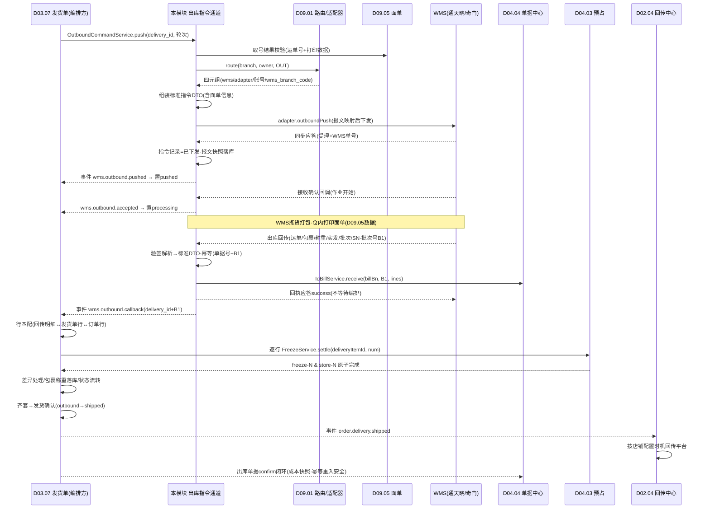
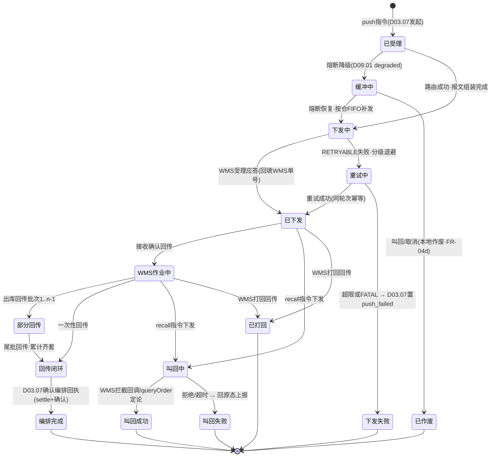
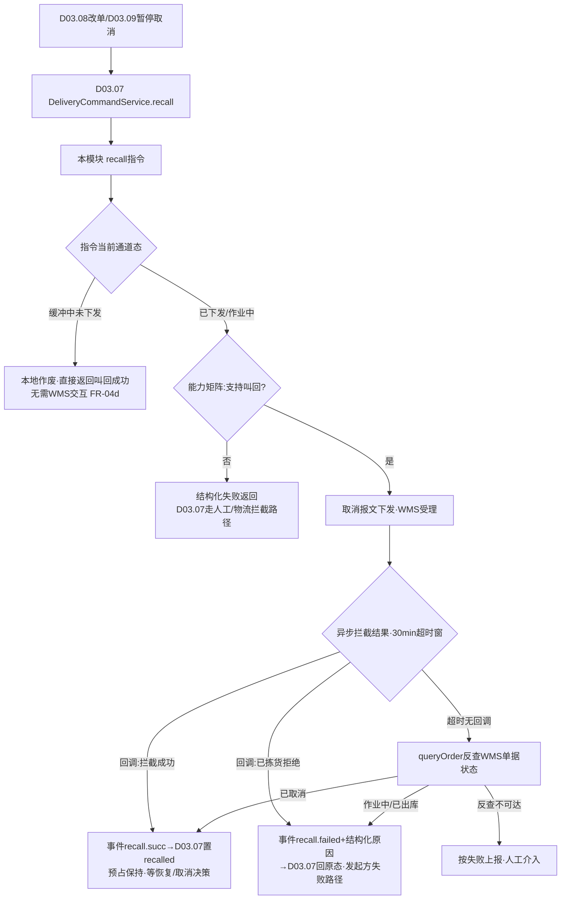

# SRS-D09.02 出库指令与回传模块 需求规格说明书

> 文档编号：SRS-D09.02 · 版本 V1.0 · 2026-10-24 · 编写：小凯 · 状态：待审阅（批次③）
> 所属域：D09 履约集成域 · 分期：**P0（M1-M2）**
> 上游依据：SRS-D03.07（**发货单指令状态机契约权威定义源，本文档引用不重定义**；本模块是其 IF-D03.07-D1 依赖的 WMS 通道执行方）· SRS-D04.03（`FreezeService::settle` 出库转扣减）· SRS-D04.04（`IoBillService::receive/confirm` 出库单据回传登记）· SRS-D09.01（路由四元组与协议适配器）· SRS-D02.04（平台回传中心，经 D03.07 事件触发）· SRS-D09.05（电子面单：OMS 取号+仓内打印，取号结果随指令下发）· 逆向文档 05 §5.1（奇门 WMS 通道 deliveryorder.create/cancel）/§3.2（QIMEN_CP_NOTIFY 作业节点回传）/api_fail 分级重试 · 逆向文档 02 §3.6（ome_delivery_notice 推仓）
>
> **全局决策（本模块承载）**：出库指令携带面单信息（D09.05 取号结果：运单号+打印数据），打印指令/文件下发仓内客户端或 WMS；回传幂等键=单据号+WMS 批次号；推仓指令状态机与 D03.07 完全一致。

---

## 1. 模块概述

### 1.1 定位

本模块是发货单出库履约的 **WMS 通道执行方**：消费 D03.07 的四指令（推送/叫回/恢复/确认中经通道的部分），将发货单业务数据组装为标准出库指令 DTO，经 D09.01 路由与协议适配器（奇门/通天晓 RESTful）下发目标 WMS；接收 WMS 出库回传（接收确认/拣货作业/出库/打回），完成验签解析、标准化、幂等登记、回执应答与出库单据回传登记（D04.04），发布标准化事件驱动 D03.07 的业务编排（settle 转扣减→发货单回写→平台回传触发）。

商派对应机制：`ome_delivery_notice::create/cancel/renew`（推仓/叫回/恢复通知单）+ erpapi `WMS_SALEORDER_CREATE`（store.wms.saleorder.create/cancel/get 奇门报文）+ api_fail 分级重试 + QIMEN_CP_NOTIFY/CP_OUT 作业节点回传 + `search_wmsdelivery` 反查对账。本模块在新栈将其收敛为统一指令通道：**协议差异不出适配器层（D09.01 契约），业务编排不进通道层（D03.07 契约）**，本模块专注指令生命周期管理、报文组装、可靠传输与回传标准化。

### 1.2 职责边界

**做**：出库指令单据化（指令记录：delivery_id+轮次+WMS 侧单号+报文快照）、指令组装（发货单→标准 DTO，含面单信息/密文收货人处理）、经适配器下发与分级重试、指令通道状态机（对齐 D03.07 §4.1，引用不重定义）、叫回/恢复指令通道执行、WMS 回传接收（验签/解析/标准化/幂等/应答回执）、出库单据回传登记（`IoBillService::receive`）、标准化回传事件发布（`wms.outbound.callback` 等）、回传超时反查对账（`queryOrder`）、通道日志与报文留痕。

**不做**：发货单指令状态机的定义与业务流转（→ D03.07 契约权威）；回传的业务编排——行匹配/settle/差异处理决策/发货确认/订单回写（→ D03.07 FR-05c 编排，本模块供数）；预占转扣减记账（→ D04.03 `FreezeService::settle(deliveryItemId, num)`，由 D03.07 编排调用）；出库单据的确认记账与成本快照（→ D04.04 `IoBillService::confirm`）；平台发货回传 API 调用（→ D02.04，由 D03.07 事件 `order.delivery.shipped` 触发）；面单取号（→ D09.05，本模块消费其取号结果）；路由与协议转换（→ D09.01）。

### 1.3 与其他模块关系

| 模块 | 关系 |
|---|---|
| D03.07 发货单 | 上游指令方：调本模块 `OutboundCommandService::push/recall/resume`（IF-D03.07-D1）；订阅本模块标准化事件完成业务编排（settle/确认/回写） |
| D03.08 改单 / D03.09 暂停取消 | 间接联动：经 D03.07 `DeliveryCommandService::recall` 进入本模块叫回通道 |
| D09.01 路由 | 每指令经 `WmsRouteService::route` 取四元组；熔断降级时指令进缓冲队列（补发编排在本模块） |
| D09.05 面单 | 取号结果（运单号/打印数据）随指令下发；仓内打印指令通道 |
| D04.03 预占 | 回传驱动 `FreezeService::settle`（D03.07 编排调用，settle 结果影响本模块闭环判定） |
| D04.04 单据中心 | 回传登记 `IoBillService::receive(billBn, wmsBatch, lines[])`（销售出库单据，源单=发货单）；`iobill.confirmed` 事件回流对账 |
| D02.04 回传中心 | 经 D03.07 `order.delivery.shipped` 事件触发平台回传（本模块不直连） |
| D02.05 失败重试 | 同款分级退避重试机制复用（错误码分级字典由 D09.01 适配器翻译提供） |
| D04.09 批次/SN | 回传批次号/序列号登记透传（能力矩阵裁剪预期） |
| D11.03 监控 | 推仓失败/回传超时/缓冲积压数据源 |

---

## 2. 业务场景

**SC-D09.02-01 出库指令下发（主流程）**
D03.07 对发货单 DLV202610001（华东仓，通天晓）发起推送指令：本模块 ① 取发货单全量数据（头/行/明细溯源/收货人/物流）+ D09.05 面单取号结果（运单号 SF123…+打印数据 URL）；② 调 D09.01 `route(branch_101, owner, OUT)` 取四元组；③ 组装标准出库指令 DTO→适配器映射为通天晓 JSON 报文（warehouseCode=TTX-HD01，面单信息随单）；④ 下发成功→指令记录置「已下发」、回填 WMS 受理单号→通知 D03.07 置 pushed；⑤ 报文快照+通道日志落库（全链路可溯）。

**SC-D09.02-02 出库回传处理（全链路）**
通天晓拣货打包完成，回调出库回传（运单号/2 包裹/称重 3.2kg/实发量/批次/SN）：本模块 ① 验签+解析（适配器 parseCallback）→标准回传 DTO；② 幂等校验（单据号+WMS 批次号唯一，重复投递直接应答成功不重复处理）；③ 匹配指令记录→回填 WMS 单号关联；④ 调 D04.04 `IoBillService::receive` 登记出库单据回传行（部分回传累积）；⑤ 应答 WMS 回执（success）；⑥ 发布 `wms.outbound.callback`（delivery_id+批次幂等）→ D03.07 编排：行匹配→逐行 `FreezeService::settle(deliveryItemId, 实发num)` 预占转扣减→包裹/称重落库→发货确认→回写订单 ship_status→事件 `order.delivery.shipped`→D02.04 平台回传。通道层与编排层解耦：⑤ 应答不等待编排完成（异步化，编排失败不回滚回执，靠补偿与对账兜底）。

**SC-D09.02-03 部分出库与多批次回传**
一单 3 行分 2 批次出库：首批回传（批次 B1，行 1-2）→ receive 登记+事件发布→D03.07 置 partial_outbound；尾批（B2，行 3）→累计核销齐套→outbound→发货确认。每批次独立幂等键（单据号+B1/B2）；批次乱序到达（B2 先于 B1）通道层照单全收（每批独立处理），齐套判定归 D03.07。

**SC-D09.02-04 叫回指令（改单/暂停联动）**
买家退款订单暂停（D03.09）→D03.07 叫回指令→本模块 `recall`：组装取消报文（奇门 deliveryorder.cancel / 通天晓 cancel）下发→WMS 同步应答「受理」→等待异步拦截结果回调：拦截成功→发布 `wms.outbound.recall.succ`→D03.07 置 recalled；WMS 已开始拣货拒绝→`wms.outbound.recall.failed`（结构化原因）→D03.07 回原态。叫回超时（30 分钟无回调）→本模块主动 `queryOrder` 反查 WMS 单据状态定论（已取消/作业中），反查不可达按失败上报。

**SC-D09.02-05 推送失败与缓冲补发**
下发超时：错误经适配器翻译为 RETRYABLE→分级退避重试（1/5/15min…）→超限发布 `wms.outbound.push.failed`→D03.07 置 push_failed 人工介入；不可重试错误（报文校验失败 FATAL）直接失败告警。WMS 熔断（D09.01）：指令进缓冲队列，恢复后按仓 FIFO 补发（幂等键=delivery_id+推送轮次，WMS 侧防重）；补发前复核发货单仍处可推态（D03.07 已取消/已叫回的指令作废出库）。

**SC-D09.02-06 出库差异（实发≠指令）**
回传实发 8<指令 10（仓内破损 2）：通道层差异识别（Σ实发≠Σ指令→指令记录打差异标记+差异明细随事件透传）→D03.07 编排：settle 按实发 8 转扣减、差额 2 release+差异登记（类型/责任）→补发（D05.04）或缺口退款（D05.03）决策。实发 11>指令 10：超发差额走 D04.03 FR-03c 直扣口径，通道层告警标记（超发属异常，WMS 侧对账追责）。差异的业务处理决策全部归 D03.07/D05，本模块只做识别、透传与留痕。

**SC-D09.02-07 打回（WMS 缺货拒单）**
WMS 回传缺货打回（拒单原因结构化：缺货/地址不可达/仓内异常）：本模块标准化→发布 `wms.outbound.rejected`→D03.07 调 `DeliveryService::reject`（IF-D03.07-09）：split_num 回退+预占释放+订单回审单池。指令记录终态=已打回闭环。

**SC-D09.02-08 密文单推仓（PIPL）**
平台密文收货人订单（抖音/拼多多密文面单体系）：指令 DTO 携带密文标识+解密通道参数（按 WMS 能力：支持密文透传的走面单密文通道——WMS 打印时经平台解密接口出图；不支持的按 D09.05 决策由 OMS 侧完成面单渲染后下发打印文件）。明文场景收货人字段传输加密（适配器层），OMS 侧展示脱敏（D01.05）。

---

## 3. 功能需求

### FR-D09.02-01 出库指令下发通道
- FR-01a 统一入口：`OutboundCommandService::push(delivery_ids, 推送轮次)`（D03.07 IF-D03.07-D1 契约）——受理即返回（异步下发），指令记录落库（delivery_id+轮次+幂等键唯一）。
- FR-01b 指令组装：发货单数据→标准出库指令 DTO（单号/仓/货主编码/明细行[物料+数量+批次要求+SN 要求]/收货人[明文加密或密文标识]/物流要求/**面单信息**[运单号+打印数据引用，D09.05 取号结果]/时效要求/备注）；母子单场景仅母单下发（D03.07 FR-04c 口径），子单明细聚合溯源。
- FR-01c 下发执行：路由（D09.01）→适配器报文映射→HTTP 下发→同步应答处理（受理成功回填 WMS 单号/受理失败按错误分类进重试或终态失败）；报文快照与通道日志全量落库。
- FR-01d 分级重试：复用 D02.05 机制口径——RETRYABLE 按退避序列自动重试（重试同轮次幂等），超限/FATAL 转终态失败；重试全程指令状态=下发中可观测。
- FR-01e 熔断缓冲：路由返回 degraded=buffer 时指令进持久化缓冲队列（按仓 FIFO）；恢复补发前复核发货单可推态；缓冲深度/龄期告警（D09.01 FR-05c 联动）。
- FR-01f 下发结果通知：成功→D03.07 置 pushed（本模块返回/事件 `wms.outbound.pushed`）；失败→`wms.outbound.push.failed`（结构化原因）供其置 push_failed。

### FR-D09.02-02 指令状态机（严格对齐 D03.07，引用不重定义）
- FR-02a **状态机权威定义=SRS-D03.07 §4.1/§5.1**（SRS-00 §4.4 契约）：draft→pushed→processing→partial_outbound/outbound→shipped→finished，分支 push_failed/recalling/recalled/rejected/cancelled。本模块不新增、不修改任何状态与流转，只维护**通道侧指令记录状态**与之映射：

| D03.07 发货单状态（契约） | 本模块指令记录状态 | 触发 |
|---|---|---|
| draft→pushed | 指令：已受理→已下发 | push 成功应答 |
| —（下发失败） | 指令：下发失败（重试中/终态） | push_failed 通知 D03.07 |
| pushed→processing | 指令：WMS 已接收确认 | 接收确认回传（作业开始） |
| processing→partial_outbound/outbound | 指令：部分回传/回传闭环 | 出库回传（批次累积） |
| outbound→shipped | 指令：编排完成（settle+确认闭环） | D03.07 确认编排回执 |
| pushed/processing→recalling→recalled | 指令：叫回中→叫回成功/失败 | recall 通道（FR-04） |
| →rejected | 指令：已打回 | WMS 打回回传 |

- FR-02b 状态一致性：指令记录状态是发货单状态的**通道侧投影**，冲突时以 D03.07 状态机为准；每日对账任务核对两侧状态映射一致性，不一致告警人工。
- FR-02c 回传乱序防护：未推送先收到出库回传（异常场景）→进异常缓冲队列人工核对（D03.07 FR-02c 同款口径），不静默丢弃。

### FR-D09.02-03 出库回传接收与标准化
- FR-03a 回调入口：奇门服务端（验签+分发，商派 app/qimen 机制新栈重建）与 RESTful 回调端点（token+IP 白名单）双通道；入口只做传输层校验，解析归适配器 `parseCallback`。
- FR-03b 回传类型：接收确认（作业开始）/拣货节点（可选，能力矩阵）/出库回传（运单号/物流公司/包裹明细/称重/体积/实发量/批次号/SN 清单）/打回（结构化原因）/取消（叫回）结果；标准回传 DTO 统一承载（类型字段区分）。
- FR-03c **回传幂等**：唯一键=（OMS 单据号[指令携带回填]+WMS 回传批次号）；重复投递→直接应答成功、不重复登记不重复发事件（WMS 侧重试风暴防护）。
- FR-03d 回传处理编排（通道层五步）：① 解析标准化→② 幂等校验→③ 指令记录匹配回填（WMS 单号关联；匹配失败→无主回传队列人工认领）→④ `IoBillService::receive(billBn, wmsBatch, lines[])` 出库单据回传登记（D04.04 IF-D04.04-03，部分回传累积、批次/SN 透传）→⑤ 应答 WMS 回执→发布标准化事件（异步，编排层消费）。回执应答不阻塞等待业务编排（快速应答+异步处理，编排失败走补偿不回滚回执）。
- FR-03e 标准化事件族（供 D03.07 订阅，事件字典 DB-00 登记）：`wms.outbound.callback`（出库回传：delivery_id/批次/明细/包裹/称重/运单/差异标记）、`wms.outbound.accepted`（接收确认）、`wms.outbound.rejected`（打回）、`wms.outbound.recall.succ`/`recall.failed`。
- FR-03f 回传超时反查：指令已下发超阈值（默认 24h 无接收确认、72h 无出库回传，可按 WMS 配置）→调度触发适配器 `queryOrder` 反查 WMS 单据状态→补录回传（同幂等键安全）或告警人工（商派 search_wmsdelivery 反查对账机制）。

### FR-D09.02-04 叫回与恢复指令通道
- FR-04a 叫回：`OutboundCommandService::recall(delivery_id, 业务引用)`（D03.07 recall 编排调用）→取消报文下发→同步受理+异步结果回调→事件上报（succ/failed+结构化原因）；叫回超时（默认 30 分钟，D03.07 FR-08b 契约）→`queryOrder` 反查定论→仍不可达按失败上报。
- FR-04b 恢复：`resume(delivery_id)`=重推通道（recalled→pushed），复用 push 全逻辑（新推送轮次，幂等键区分）；恢复前复核归 D03.07（FR-08c），本模块只管通道执行。
- FR-04c 能力前置校验：目标 WMS 能力矩阵「叫回=不支持」时（D09.01 FR-06a），recall 直接返回结构化失败（不空发报文），D03.07 按失败路径处理（挂起转人工/物流拦截 D05）。
- FR-04d 缓冲中指令的叫回：指令尚在熔断缓冲队列（未实际下发）→本地直接作废指令+返回叫回成功（无需 WMS 交互），D03.07 正常置 recalled。

### FR-D09.02-05 出库回传驱动的业务编排（编排归 D03.07，本模块供数与联动）
- FR-05a 编排链路（契约引用，D03.07 FR-05c 七步）：行匹配→逐行 `FreezeService::settle(deliveryItemId, num)`（D04.03 IF-D04.03-04，预占转扣减 freeze-N & store-N）→差异处理（少发 release/多发直扣）→包裹/称重/运单落库→状态流转→发货确认→事件发布（`order.delivery.shipped`→D02.04 平台回传）。本模块职责边界：提供标准回传 DTO 全量数据（含批次/SN/称重/差异标记），并完成出库单据回传登记（FR-03d ④）；settle 失败补偿、确认失败重试等编排容错归 D03.07（§5.3 引用其口径）。
- FR-05b 出库单据确认联动：D03.07 发货确认后，D04.04 出库单据（类型=销售出库，源单=发货单）走 `confirm` 闭环（单据携带成本快照）；settle 幂等键（detail_id+批次）保证 D03.07 编排路径与 D04.04 模板路径重入安全、不重复转扣减（单一事实源=D04.03 台账）。
- FR-05c 称重/包裹数据供给：随事件透传供 D08.04 运费对账（预估 vs 实际）与 D09.05 包裹合并校验。

### FR-D09.02-06 面单信息随指令下发（D09.05 决策落地）
- FR-06a 取号前置：push 受理时校验面单取号结果（运单号必须已取，D09.05「OMS 取号」决策）；未取号→联动 D09.05 补取（同步等待，超时按下发失败可重试）或按店铺配置「WMS 侧取号例外」（能力矩阵面单模式=WMS 取号，保税仓等）。
- FR-06b 面单信息载体：运单号+物流公司编码+打印数据（PDF/云打印 URL/菜鸟模板报文，按 WMS 能力选择形态）随出库指令下发；一母单一面单（合单场景 D03.07 FR-04c）。
- FR-06c 仓内打印指令：打印数据下发仓内打印客户端（D09.05 打印队列的仓内模式通道）或 WMS 由其驱动打印；打印结果回执（成功/失败/补打）透传 D09.05 打印台账。
- FR-06d 换单场景：叫回后改物流重推→重新取号（D09.05）→新面单随新轮次指令下发；旧运单号作废标记透传。

### FR-D09.02-07 通道日志、对账与工作台
- FR-07a 报文留痕：每指令的请求/应答/回调原始报文+标准 DTO 双份落库（按月分表，脱敏视图展示）；追溯链=发货单↔指令记录↔报文↔WMS 单号↔回传批次。
- FR-07b 通道对账：每日任务三方核对——指令记录（已下发未回传清单）vs WMS `queryOrder` 反查 vs D03.07 发货单状态；差异生成对账工单（漏回传/状态漂移/无主回传）。
- FR-07c 异常工作台：下发失败/回传超时/无主回传/乱序缓冲/差异标记五类队列（D11.03 数据源）；人工操作（重发/作废/认领/补录）独立授权+审计。

---

## 4. 业务流程

### 4.1 出库下发-回传全链路时序图（SC-01/02）



### 4.2 指令通道状态机（D03.07 契约的通道侧投影，FR-02a 映射表为准）



> 发货单业务状态机（draft/pushed/processing/outbound/shipped/…）以 SRS-D03.07 §4.1 为唯一权威定义，本图仅为通道侧指令记录投影，映射关系见 FR-02a 表。

### 4.3 叫回通道流程（SC-04，联动 D03.07/D03.08/D03.09）



---

## 5. 处理逻辑

### 5.1 指令组装规则（发货单→标准 DTO）

```
buildOutboundDTO(delivery, 轮次):
    dto.单号 = delivery_bn + "-R" + 轮次          # 幂等键成分，重推新轮次新单号防WMS重单
    dto.wms_branch_code = route结果.wms_branch_code
    dto.owner_code = WMS账号配置.ownerCode(货主)   # 一仓多货主按绑定账号区分(D09.01 SC-03)
    dto.lines[] = 发货单行(物料外部编码=WMS侧货品编码映射, 数量, 批次要求, SN要求)
    dto.receiver = 密文单? {密文标识, 解密通道参数} : 加密传输(明文)   # SC-08
    dto.waybill = {运单号, 物流公司编码, 打印数据引用}                 # D09.05取号结果 FR-06
    dto.母子单 = 母单聚合下发(子单明细溯源展开为行备注/扩展字段)
    物料编码映射缺失 → 组装失败(FATAL, 主数据问题告警D04.01联动)
```

### 5.2 幂等键体系（全通道）

| 动作 | 幂等键 | 防重语义 |
|---|---|---|
| 指令下发 | delivery_id + 推送轮次 | 重推=新轮次；同轮次重试 WMS 侧防重（单号含轮次） |
| 回传接收 | OMS 单据号 + WMS 回传批次号 | 重复投递应答成功不重复处理（SRS-00 全局决策口径） |
| 单据登记 | receive(billBn, wmsBatch)（D04.04 §5.3 同键） | 与回传幂等一致 |
| settle | detail_id + 批次（D04.03/D03.07 §5.3 契约） | 双路径重入安全（FR-05b） |
| 叫回 | delivery_id + 叫回轮次 | 重复叫回返回首次结果 |

### 5.3 回传处理与编排容错（引用 D03.07 契约）

- 通道层快速应答：⑤ 回执在幂等登记+receive 完成即返回（P99 ≤200ms），事件发布异步（本地事务表+MQ）；
- 编排层容错归 D03.07（其 FR-05c/§5.3 为准）：settle 失败行进补偿队列不阻塞状态落库、确认失败状态不回退、每日三方对账（发货单核销 vs 预占台账 vs D04.04 出库流水）兜底——本模块对账（FR-07b）与其互补：通道对账管「指令↔WMS 单据」，业务对账管「单据↔库存」。
- 无主回传（匹配不到指令记录）：落无主队列（原始报文保留）→人工认领关联或按 WMS 单号自动补配（延迟到达的指令记录场景）；超 48h 未认领告警。

### 5.4 错误分类与重试策略（消费 D09.01 FR-02e 翻译结果）

| 分类 | 示例 | 策略 |
|---|---|---|
| RETRYABLE | 超时/5xx/限流 | 退避重试 1/5/15/60min×N（D02.05 同款），同轮次幂等 |
| FATAL | 报文校验失败/映射缺失/账号无效 | 不重试，终态失败+告警（配置/主数据修复后人工重推新轮次） |
| BIZ_REJECT | WMS 业务拒绝（库存不足打回/单据重复） | 不重试；打回类走 rejected 流程（SC-07），重复类视为已受理（对账确认） |

### 5.5 性能与洪峰

- 大促推仓峰值 500 指令/分钟：下发异步化（受理即返回，MQ 消费下发），按仓分组消费（同仓串行防 WMS 侧乱序，跨仓并行）；
- 回传洪峰：回调入口削峰（幂等登记同步、事件异步），消费并发按仓分组（D03.07 §5.6 同款口径）；
- 报文快照存储：原始报文压缩落库，3 年在线+归档（随发货单归档 D03.13 口径）。

---

## 6. 数据字段（业务字段描述）

### 6.1 出库指令记录（fulfill_outbound_cmd）

| 字段 | 业务含义 | 取值/校验 |
|---|---|---|
| cmd_bn | 指令号 | 唯一；delivery_bn+轮次派生 |
| delivery_id / delivery_bn | 发货单引用 | 必填（D03.07 溯源） |
| push_round | 推送轮次 | 重推递增；幂等键成分 |
| wms_id / binding_id / adapter_code | 路由快照 | 下发时快照（D09.01 FR-03e，历史溯源不漂移） |
| wms_bill_no | WMS 侧单号 | 受理应答回填；回传匹配键 |
| cmd_type | 指令类型 | 推送/叫回/恢复 |
| status | 通道状态 | §4.2 投影状态机 |
| waybill_no / print_ref | 面单信息 | D09.05 取号结果引用（FR-06） |
| diff_flag | 差异标记 | 实发≠指令时置位+差异明细引用（SC-06） |
| idempotent_key | 幂等键 | delivery_id+轮次 唯一索引 |
| owner_id / tenant_id / branch_id | 归属 | 必填（SRS-00 契约） |

### 6.2 回传批次登记（fulfill_outbound_callback）

| 字段 | 业务含义 | 取值/校验 |
|---|---|---|
| cmd_id / delivery_id | 指令/发货单匹配 | 匹配失败→无主队列（owner 空） |
| wms_batch_no | WMS 回传批次号 | 幂等键成分（单据号+批次号唯一，FR-03c） |
| callback_type | 回传类型 | 接收确认/出库/打回/取消结果/节点 |
| lines_json | 标准明细（物料/实发/批次/SN） | 适配器标准化产物 |
| packages_json | 包裹/称重/体积/运单 | 供 D03.07 落库与 D08.04 对账 |
| reject_reason | 打回结构化原因 | 缺货/地址不可达/仓内异常（SC-07） |
| process_status | 处理状态 | 已登记/已发事件/编排闭环/异常缓冲 |
| raw_payload_ref | 原始报文引用 | 压缩存储（FR-07a） |
| receive_time / ack_time | 接收/应答时间 | 回执时效监控 |

### 6.3 指令缓冲与通道日志（fulfill_outbound_buffer / fulfill_channel_log）

| 字段 | 业务含义 |
|---|---|
| buffer：cmd_id / branch_id / wms_id / 入队时间 / 状态(缓冲/已补发/已作废) | 熔断缓冲队列（按仓 FIFO） |
| log：cmd_id / 方向(出/入) / 动作 / 请求应答报文引用 / 错误分类 / 耗时 / 重试次数 | 通道日志（按月分表） |

---

## 7. 接口

### 7.1 内部接口（本模块提供）

| 编号 | 接口 | 消费方 | 说明 |
|---|---|---|---|
| IF-D09.02-01 | `OutboundCommandService::push(delivery_ids, 轮次)` | D03.07（IF-D03.07-D1 契约） | 出库指令下发（受理即返回，异步执行）；幂等 |
| IF-D09.02-02 | `OutboundCommandService::recall(delivery_id, 业务引用)` | D03.07 | 叫回通道执行（FR-04）；返回受理结果，终态经事件 |
| IF-D09.02-03 | `OutboundCommandService::resume(delivery_id)` | D03.07 | 恢复重推（新轮次复用 push 逻辑） |
| IF-D09.02-04 | 事件 `wms.outbound.callback`（标准回传 DTO：明细/包裹/称重/运单/批次/SN/差异标记） | D03.07（FR-05b 订阅） | 出库回传标准化事件（delivery_id+批次幂等） |
| IF-D09.02-05 | 事件 `wms.outbound.pushed` / `push.failed` / `accepted` / `rejected` / `recall.succ` / `recall.failed` | D03.07 | 指令通道结果族（状态机投影驱动） |
| IF-D09.02-06 | `OutboundQueryService::traceByDelivery(delivery_id)` / `queryCmdStatus(cmd_bn)` | D03.07 工作台/D11.03 | 指令与报文追溯查询 |
| IF-D09.02-07 | 事件 `wms.outbound.waybill.printed`（打印回执透传） | D09.05 | 仓内打印结果回传台账 |

### 7.2 依赖接口（本模块消费）

| 编号 | 接口 | 提供方 | 说明 |
|---|---|---|---|
| IF-D09.02-D1 | `WmsRouteService::route` / `WmsAdapterRegistry::get` / 事件 `wms.circuit.opened/closed` | D09.01 | 路由四元组、适配器实例、熔断联动（IF-D09.01-01/02/04） |
| IF-D09.02-D2 | `IoBillService::receive(billBn, wmsBatch, lines[])` | D04.04 | 出库单据回传登记（IF-D04.04-03；部分回传累积） |
| IF-D09.02-D3 | 面单取号结果查询/补取 + 打印数据下发通道 | D09.05 | FR-06（OMS 取号+仓内打印决策落地；批次③同批文档） |
| IF-D09.02-D4 | 分级重试框架/错误码字典口径 | D02.05 | 复用其退避重试机制（§5.4） |
| IF-D09.02-D5 | 调度注册（回传超时反查/通道对账/缓冲监控） | D01.02 | FR-03f/FR-07b |
| IF-D09.02-D6 | 企微告警 | D01.07 | 失败超限/超时/无主回传/缓冲超限 |
| IF-D09.02-D7 | `AuditService` | D10.06 | 人工重发/作废/认领审计 |
| IF-D09.02-D8 | 货品外部编码映射（WMS 侧货品编码） | D04.01 | 指令组装物料映射（§5.1） |

> 说明：`FreezeService::settle`（D04.03 IF-D04.03-04）与订单回写、`order.delivery.shipped` 发布由 D03.07 编排调用（其 IF-D03.07-D2/FR-06c），本模块不直接调用——回传数据经 IF-D09.02-04 事件供给。

### 7.3 外部接口

| 编号 | 接口 | 方向 | 说明 |
|---|---|---|---|
| EF-D09.02-01 | WMS 出库通知下发/取消/反查（经 D09.01 适配器） | 出 | 奇门 deliveryorder.create/cancel/query · 通天晓 RESTful outbound 族 |
| EF-D09.02-02 | WMS 出库回传接收（奇门服务端回调 / RESTful 回调端点） | 入 | 验签+token/IP 白名单双通道（FR-03a） |
| EF-D09.02-03 | 仓内打印客户端指令下发（经 D09.05 通道） | 出 | 打印数据/指令到仓（FR-06c） |

---

## 8. 非功能需求

| 项 | 要求 |
|---|---|
| 性能 | push 受理 ≤50ms（异步下发）；单指令下发 P95 ≤2s（含报文组装+HTTP）；回传接收→应答回执 P99 ≤200ms；大促日处理 50 万指令+80 万回传批次无积压（MQ 削峰，同仓串行跨仓并行） |
| 幂等 | §5.2 全动作幂等键体系；WMS 重复回调/重试风暴无副作用；MQ 重投安全 |
| 一致性 | 指令状态与发货单状态（D03.07）每日对账；通道对账（指令↔WMS 反查）+业务对账（D03.07 三方）互补兜底；回执与编排解耦（快速应答+异步编排+补偿） |
| 可靠性 | 熔断缓冲不丢单（持久化队列）；回传超时反查自动补录；无主回传不丢弃（人工认领闭环）；下发失败分级重试 |
| 安全/PIPL | 收货人明文仅适配器传输层加密出现，落库密文/脱敏；密文单密文标识透传不落明文；回调验签+白名单；报文查询独立授权+水印审计 |
| 可观测 | 指令全生命周期状态可查；通道日志/报文快照全留痕（3 年）；失败/超时/缓冲/差异指标暴露 D11.03 |

---

## 9. 验收标准

| 编号 | 验收条件 |
|---|---|
| AC-01 | 主流程（SC-01）：发货单 push→路由命中通天晓适配器→报文含面单信息（运单号+打印数据引用）→WMS 受理→D03.07 置 pushed；报文快照与路由快照（binding_id）落库可溯 |
| AC-02 | 出库回传全链路（SC-02）：回传→幂等登记→`IoBillService::receive` 登记→回执应答 ≤200ms→事件 `wms.outbound.callback`→D03.07 编排 settle（freeze-N & store-N）→发货确认→`order.delivery.shipped`→D02.04 平台回传，全链路状态一致 |
| AC-03 | 回传幂等：同（单据号+批次号）重复投递 10 次，仅首次登记与发事件，其余直接应答成功；WMS 侧收到一致 success 回执 |
| AC-04 | 部分出库多批次（SC-03）：B1/B2 两批独立处理，receive 累计正确；批次乱序（B2 先到）不丢不重，齐套判定由 D03.07 完成后指令记录=回传闭环 |
| AC-05 | 叫回三路径（SC-04）：拦截成功→recall.succ→D03.07 置 recalled；拣货中拒绝→recall.failed+结构化原因→回原态；30 分钟超时→queryOrder 反查定论（反查不可达按失败上报） |
| AC-06 | 缓冲叫回（FR-04d）：熔断缓冲中的指令叫回→本地作废即返回成功，无 WMS 交互；恢复后补发队列不含已作废指令 |
| AC-07 | 推送失败分级（SC-05）：模拟超时→RETRYABLE 退避重试成功；模拟报文校验失败→FATAL 不重试直接 push.failed；重推新轮次 WMS 侧无重复单（单号含轮次） |
| AC-08 | 熔断缓冲补发：熔断打开期间 20 条指令进缓冲（发货单不置失败）；恢复后按仓 FIFO 全部补发成功；已取消发货单的缓冲指令作废不出库 |
| AC-09 | 出库差异（SC-06）：实发 8<指令 10→差异标记+明细透传→D03.07 settle 按 8、差额 2 release+差异登记；实发 11>10→超发直扣口径+通道告警；差异决策入口（补发/退款）可达 |
| AC-10 | 打回（SC-07）：WMS 缺货打回→rejected 事件→D03.07 reject 编排（split_num 回退+释放+回审单池）；指令记录终态=已打回 |
| AC-11 | 密文单推仓（SC-08）：密文收货人订单下发报文不含明文个人信息；面单按 WMS 能力走密文透传或 OMS 渲染打印文件；界面展示脱敏 |
| AC-12 | 回传超时反查：已下发 24h 无接收确认→自动 queryOrder 反查→WMS 已作业则补录接收确认；72h 无出库回传→反查补录或生成对账工单 |
| AC-13 | 无主回传：伪造无匹配指令的回传→进无主队列不丢弃、48h 告警；人工认领关联后正常走登记与事件链路 |
| AC-14 | 状态一致性对账：人为制造指令记录与发货单状态漂移 3 条→每日对账全部检出并生成工单 |
| AC-15 | 双协议等价：同一发货单分别经奇门适配器与通天晓适配器下发（沙箱），标准 DTO 语义一致；回传经各自 parseCallback 输出结构一致，编排层无协议感知 |

---

## 变更记录

| 日期 | 版本 | 变更 | 原因 |
|---|---|---|---|
| 2026-10-24 | V1.0 | 首版 | — |

---

*参考实现溯源：商派 `ome_delivery_notice::create/cancel/renew`（推仓/叫回/恢复通知单，forbid_notice_wms_create 禁推扩展点）+ erpapi `WMS_SALEORDER_CREATE`（store.wms.saleorder.create/cancel/get）与 api_fail 重试（delivery 已 succ/cancel/back 直接删失败记录、ready/progress 未暂停重推——终态防误推口径）+ `search_wmsdelivery`/`queryOrder` 反查对账型重试 + lib/wms/matrix/qimen 奇门出向通道（deliveryorder.create XML+签名）+ QIMEN_CP_NOTIFY/QIMEN_CP_OUT 作业节点回传 + app/qimen 入向服务端（验签分发五步管线，openapi_entrance 复用）+ `delivery_sync` 回写状态（none/run/succ/fail+fail_type 四分类）。关键差异：① 通道层与编排层显式解耦（本模块=指令通道+回传标准化，业务编排单一归属 D03.07），商派推仓/回传/记账散落 delivery::succ 回调链与 notice 模块；② 指令状态机引用 D03.07 契约不重定义+通道侧投影状态显式映射，商派 delivery 9 平铺态与 notice 状态双轨易漂移；③ 回传幂等键（单据号+WMS 批次号）产品化+快速应答异步编排，商派靠 write_log 排重无强约束；④ 熔断缓冲队列（WMS 故障不置单据失败）新增，商派仅 api_fail 重试；⑤ 面单信息随指令下发（OMS 取号+仓内打印全局决策落地），商派打印与推仓分离无统一载体；⑥ 密文单推仓通道（PIPL）新增；⑦ 报文快照+路由快照双留痕（历史溯源不随绑定变更漂移）。*
