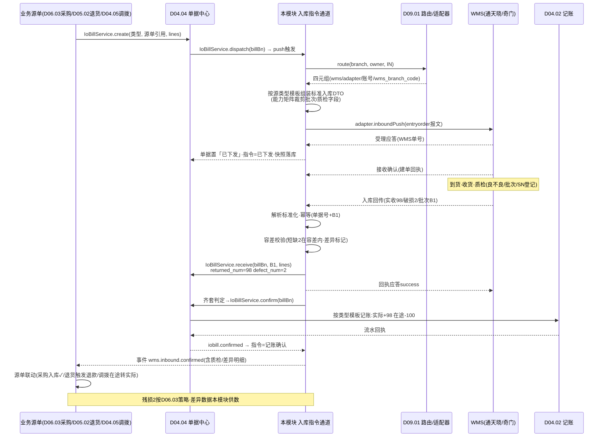
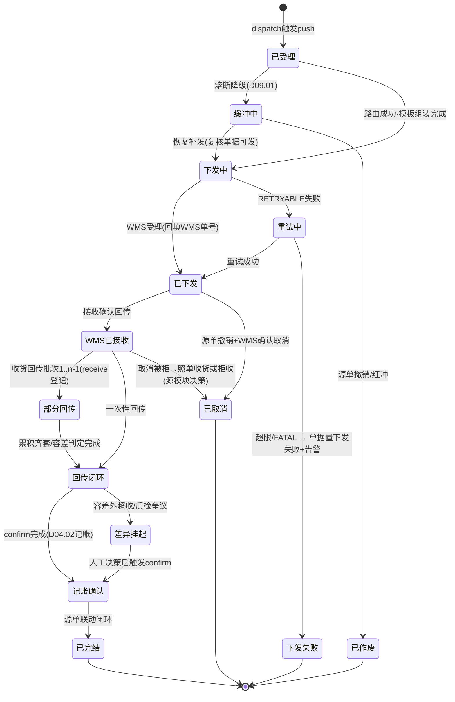
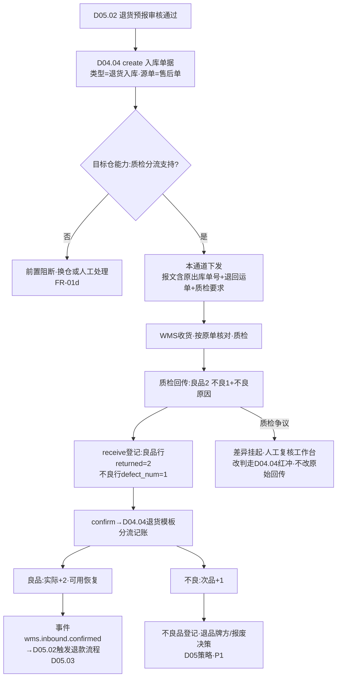

# SRS-D09.03 入库指令模块 需求规格说明书

> 文档编号：SRS-D09.03 · 版本 V1.0 · 2026-10-24 · 编写：小凯 · 状态：待审阅（批次③）
> 所属域：D09 履约集成域 · 分期：**P0 基础（采购/调拨入库，M2-M3）· 退货入库 M2（随 D05.02）**
> 上游依据：SRS-D04.04（**IoBillService 契约：create/dispatch/receive/confirm，本模块是入库单据回传登记的通道执行方**）· SRS-D09.01（路由四元组/协议适配器/能力矩阵）· SRS-D09.02（同款通道机制：幂等/重试/熔断缓冲/反查对账，本文档引用其口径不重复定义）· SRS-D06.03（采购到货入库，批次④——契约以 D04.04 §1.3 已定关系为准）· SRS-D05.02（退货预报推 WMS、良/不良质检分仓，批次③同批）· SRS-D04.05（调拨入库，IF-D04.05-01 `TransferService::dispatch`）· 逆向文档 05 §5.1（奇门 entryorder.create WMS_INORDER_CREATE/WMS_RETURNORDER_CREATE）/§5.5（菜鸟 BMS 按单据类型反查对账）· 逆向文档 03（wmsmgr 第三方仓库存以回传为准）
>
> **全局决策（本模块承载）**：回传幂等键=单据号+WMS 批次号（与 D09.02 同口径）；全单据 owner_id+tenant_id；三类入库源（采购 D06.03/退货 D05.02/调拨 D04.05）统一走本通道，加源类型=加报文组装模板，纯增量。

---

## 1. 模块概述

### 1.1 定位

本模块是所有**入库类单据下发 WMS 与回传接收**的统一通道：消费三类业务源（采购入库 D06.03、退货入库 D05.02、调拨入库 D04.05）经 D04.04 单据中心 `dispatch` 触发的下发请求，组装标准入库指令 DTO，经 D09.01 路由与协议适配器（奇门 entryorder.create / 通天晓 RESTful inbound 族）下发目标仓 WMS；接收 WMS 入库回传（收货/质检结果/实收量/批次/SN），完成验签、标准化、幂等登记，调 D04.04 `IoBillService::receive` 登记回传、驱动 `confirm` 记账闭环（在途-、实际+/次品+），发布标准化事件回驱各业务源单状态联动。

与 D09.02（出库通道）为姊妹模块：**通道机制（幂等键体系/分级重试/熔断缓冲/回传超时反查/无主回传/报文留痕）完全复用 D09.02 §5.2-§5.4 口径，本文档只定义入库特有差异**——三类源报文模板、质检良不良分流回传、超收容差/短缺差异、入库指令状态机。

商派对应机制：`WMS_INORDER_CREATE`（采购单 check_status=2 触发 store.wms.entryorder.create）、`WMS_RETURNORDER_CREATE`（reship is_check=1 触发 store.wms.returnorder.create 退货预报）、菜鸟 BMS `store.wlb.wms.stockin.bill.get`（入库收货反查）/`return.bill.get`（销退收货）。本模块在新栈统一为单据中心驱动的单一入库通道。

### 1.2 职责边界

**做**：入库指令单据化下发（指令记录：io_bill 单据号+轮次+WMS 单号+报文快照）、三类源报文组装模板（采购/退货/调拨字段差异）、经适配器下发与分级重试（D09.02 机制复用）、入库指令状态机（通道侧）、入库回传接收（收货/质检/批次/SN 标准化+幂等+回执）、`IoBillService::receive` 登记与 `confirm` 触发编排、质检良不良分流数据供给（联动 D05.02/D06.03 策略）、入库差异识别与透传（超收容差/短缺）、回传超时反查对账、双向追溯数据链维护。

**不做**：出入库单据生命周期与记账规则（→ D04.04 权威：口径影响模板/红冲/结算状态）；库存口径记账执行（→ D04.02，经 D04.04 confirm 调用）；采购业务规则（到货登记/残损索赔策略 → D06.03）；退货业务规则（退款触发/售后状态机 → D05.02/D05.01）；调拨编排（在途生成/借调 → D04.05）；路由与协议转换（→ D09.01）；出库通道（→ D09.02）。

### 1.3 与其他模块关系

| 模块 | 关系 |
|---|---|
| D04.04 单据中心 | **核心契约方**：业务源单先 `IoBillService::create` 生成入库单据（草稿）→ `dispatch(billBn)` 触发本模块下发；回传后本模块调 `receive(billBn, wmsBatch, lines[])` 登记，齐套/容差判定后触发 `confirm(billBn)` 记账（在途-、实际+/次品+）；`iobill.confirmed` 事件回驱源单 |
| D06.03 采购入库 | 源单：采购单到货登记→入库单据（类型=采购入库）→本通道下发；回传驱动采购单 5 状态之「入库」联动、残损处理数据供给 |
| D05.02 退货退款执行 | 源单：退货预报（reship 语义）→入库单据（类型=退货入库）→本通道下发；质检良/不良回传分流→良品入实际（触发退款联动）、不良入次品 |
| D04.05 调拨 | 源单：调拨单入库侧（`TransferService::dispatch`）→入库单据（类型=调拨入库）；出库侧走 D09.02 姊妹通道（调拨出库）；回传驱动在途转实际 |
| D09.01 路由 | 每指令 `WmsRouteService::route(branch, owner, IN)`；能力矩阵（批次/质检分流/效期支持）裁剪报文与回传预期 |
| D09.02 出库通道 | 通道机制复用（幂等/重试/熔断/反查/无主回传/日志），调拨场景出库入库双通道配对 |
| D04.09 批次/SN | 回传批次号/效期/SN 登记透传（入库是批次/SN 的主要产生点） |
| D02.05 重试框架 | 分级退避重试机制复用（同 D09.02 §5.4） |
| D11.03 监控 | 入库下发失败/回传超时/差异积压数据源 |

---

## 2. 业务场景

**SC-D09.03-01 采购入库下发与回传（主流程）**
采购单 PO2026001（凯淳买断，基础物料 bm_1002×100）到货登记（D06.03）→ D04.04 生成入库单据（类型=采购入库，源单=PO2026001，草稿）→ `dispatch` 触发本模块：路由华东仓（通天晓）→组装采购入库报文（供应商/预计到货时间/明细行[物料外部编码+数量+批次要求]）→下发受理→指令「已下发」，单据「已下发 WMS」。WMS 收货质检后回传（批次号 B1：实收 98、破损 2）：幂等登记→`receive` 登记（returned_num 累积 98，defect_num=2）→短缺 2 在容差内→单据「全部回传」→触发 `confirm`：按 D04.04 口径模板记账（实际+98、在途-100）→残损 2 按采购残损策略处理（次品+2 或供应商索赔不入账，D06.03 决策，本模块供数）→`iobill.confirmed` 事件→采购单入库状态✓、结算状态=未结算供月结（D06.04/D08）。

**SC-D09.03-02 退货入库与质检分流（M2，联动 D05.02）**
售后单 RA2026001 买家退货 3 件：D05.02 退货预报→入库单据（类型=退货入库，源单=售后单，含原发货单/运单溯源）→本通道下发（报文携带原出库单号+退回运单号，供 WMS 按单收货）→WMS 收货质检回传：良品 2、不良 1（质检明细：不良原因=破损/污渍，能力矩阵「质检分流=支持」）→`receive` 登记两行（良品行 returned_num=2、不良行 defect_num=1）→`confirm` 按 D04.04 退货模板分流记账：良品行实际+2（可用恢复）、不良行次品+1→事件回驱 D05.02：良品入库确认触发退款流程（D05.03）、不良品登记（退品牌方/报废决策留待 D05 策略）。

**SC-D09.03-03 调拨入库（配对通道）**
调拨单 TR2026001（华东仓→华南仓，凯淳货主）：出库侧走 D09.02（调拨出库，华东仓在途+）；货到华南仓，调拨单入库侧 `TransferService::dispatch` →本通道下发入库指令（报文携带调拨单号+出库指令关联号，WMS 按预期到货单收货）→回传实收→`receive`+`confirm`：实际+（华南仓三元行）、在途-；实收<发出（运输损耗）→短缺差异登记，按调拨损耗策略处理（D04.05 口径：损耗归属登记，超阈值告警）。

**SC-D09.03-04 分批收货（部分回传累积）**
采购单 100 件分两批到货：首批回传 60（批次 B1）→`receive` 累积，单据「部分回传」，在途不减（confirm 未触发）；次批回传 40（B2）→累积=100 齐套→`confirm` 一次性记账（实际+100、在途-100）。是否按批次分段 confirm 由 D04.04 单据类型配置决定（默认齐套确认；支持分批确认的类型每批 receive 后即 confirm 该批），本模块按单据中心回执编排，不自定记账时机。

**SC-D09.03-05 入库差异（超收容差/短缺）**
下发 100、实收 103（供应商多发）：容差配置（D04.04 §5.1 口径，类型级：采购入库容差+5%）内→按实收 103 记账+超收差异登记（供 D06.04 与供应商对账）；容差外（实收 120）→`receive` 拒绝超限部分（登记 105=上限）+差异工单人工决策（拒收退回/补充采购单）。短缺（实收 95<100）：按实收记账+短缺差异登记（在途差额 5 由 confirm 模板处理：在途-100 实际+95，差 5 转差异挂账或释放在途，D04.04 模板决定）→采购侧索赔/补发数据供给（D06.03）。

**SC-D09.03-06 下发失败与回传超时反查**
下发失败：分级重试（RETRYABLE 退避/FATAL 终态）同 D09.02 §5.4；超限→单据回退「下发失败」+告警人工（D04.04 单据状态联动）。回传超时：下发后 N 天（采购默认 7 天/退货 15 天/调拨 3 天，类型级配置）无回传→调度触发 `queryOrder` 反查 WMS 单据状态：WMS 已收货未回传→补录（同幂等键安全）；WMS 无此单→重下发（新轮次）；仍未决→对账工单人工。

**SC-D09.03-07 入库取消（源单作废联动）**
采购单取消/退货预报撤销（D06.03/D05.02）→D04.04 单据红冲或撤销→本通道下发取消报文（entryorder.cancel）→WMS 未收货确认取消→指令闭环「已取消」；WMS 已收货拒绝取消→回传源模块走收货后处理（照单收货入库或拒收退回，业务决策归源模块），本模块透传结果。

---

## 3. 功能需求

### FR-D09.03-01 入库指令下发通道
- FR-01a 统一入口：`InboundCommandService::push(billBn, 轮次)`——由 D04.04 `IoBillService::dispatch(billBn)`（IF-D04.04-02）触发；受理即返回，指令记录落库（billBn+轮次幂等键唯一）。
- FR-01b 三类源报文组装模板（类型驱动，加源=加模板配置，纯增量）：

| 模板要素 | 采购入库 | 退货入库 | 调拨入库 |
|---|---|---|---|
| 单号/源单 | 单据号+采购单号 | 单据号+售后单号+**原出库单号+退回运单号** | 单据号+调拨单号+出库指令关联号 |
| 预期到货 | 供应商+预计到货时间 | 买家退回物流（公司+运单）| 发出仓+在途关联 |
| 明细行 | 物料外部编码+数量+批次/效期要求 | 物料+预报数量+**质检要求（良不良分流）** | 物料+发出数量+批次 |
| 货主编码 | owner_code（WMS 侧货主） | 同左 | 同左（借调场景双货主标识，D04.05） |
| 特殊指令 | 残损登记要求 | 按原单收货+质检分流回传 | 运输损耗登记 |

- FR-01c 下发执行/分级重试/熔断缓冲/报文快照：完全复用 D09.02 FR-01c/01d/01e 与 §5.4 机制（引用不重定义）；缓冲补发前复核单据仍可下发（已撤销/红冲的作废出库）。
- FR-01d 能力矩阵裁剪（D09.01 FR-06）：WMS 不支持批次→报文裁剪批次要求+回传预期降级（批次以 OMS 登记为准+告警人工核对）；不支持质检分流→退货入库前置阻断（该仓不可承接退货入库，配置校验+分仓联动 D05.02 换仓）。
- FR-01e 结果通知：成功→D04.04 单据置「已下发」；失败终态→单据置「下发失败」+事件 `wms.inbound.push.failed` 告警人工。

### FR-D09.03-02 入库指令状态机（通道侧）
- FR-02a 状态枚举：`已受理→下发中→已下发→WMS已接收→部分回传→回传闭环→记账确认（confirm 完成）→已完结`；分支：`重试中/下发失败`、`缓冲中/已作废`、`已取消`（源单撤销）、`差异挂起`（容差外超收/无主差异待人工）。
- FR-02b 与 D04.04 单据状态映射（单据生命周期权威=D04.04 §4.1，本状态为通道投影）：

| D04.04 单据状态（契约） | 本模块指令状态 | 触发 |
|---|---|---|
| 草稿→已下发 | 已受理→已下发 | dispatch→push 成功 |
| 已下发→部分回传 | WMS已接收→部分回传 | receive 登记（首批/分批） |
| 部分回传→全部回传 | 回传闭环 | 累积齐套（或容差判定完成） |
| 全部回传→已确认 | 记账确认 | confirm 回执（D04.02 记账完成） |
| —（红冲/撤销） | 已取消/已作废 | 取消通道（SC-07） |

- FR-02c 一致性对账：指令状态 vs 单据状态 vs WMS 反查三方每日核对（同 D09.02 FR-07b 机制，入库口径）；漂移告警人工。

### FR-D09.03-03 入库回传接收与登记
- FR-03a 回传类型：接收确认（WMS 建单）/收货回传（实收量+批次+效期+SN）/质检结果回传（良/不良+不良原因，退货与采购残损场景）/差异上报（超收/短缺/无单到货）/取消结果；标准回传 DTO 统一承载（同 D09.02 FR-03b 结构，入库字段族）。
- FR-03b **回传幂等**：唯一键=（OMS 单据号+WMS 回传批次号）——与 D09.02/SRS-00 全局决策同口径；重复投递应答成功不重复处理。
- FR-03c 回传处理编排（通道层六步）：① 解析标准化（适配器 parseCallback）→② 幂等校验→③ 指令记录匹配（WMS 单号/OMS 单据号回填关联；失败→无主回传队列，同 D09.02 §5.3 口径，含**无单到货**场景=商派无头件来源，转 D04.04 FR-03c 无头件单据流程）→④ 容差校验与差异识别（§5.2）→⑤ `IoBillService::receive(billBn, wmsBatch, lines[])` 登记（IF-D04.04-03，行级 returned_num/defect_num/批次/SN 透传）→⑥ 应答回执+发布事件（异步）。
- FR-03d confirm 触发编排：receive 后按单据类型配置判定（齐套确认/分批确认，SC-04）→满足即调 `IoBillService::confirm(billBn)`（IF-D04.04-04，记账执行归 D04.04→D04.02/D04.03）；confirm 失败→补偿队列重试（D04.04 口径：确认与状态同事务，失败不回退已登记回传）；差异挂起单据不自动 confirm（人工决策后触发）。
- FR-03e 标准化事件族：`wms.inbound.callback`（收货/质检回传标准 DTO）、`wms.inbound.confirmed`（记账闭环，转发 `iobill.confirmed` 关键载荷）、`wms.inbound.diff`（差异登记：超收/短缺/破损）、`wms.inbound.cancel.succ/failed`；消费方=D06.03/D05.02/D04.05（源单状态联动）与 D11.03（监控）。
- FR-03f 回传超时反查：类型级超时阈值（采购 7 天/退货 15 天/调拨 3 天，可配）→`queryOrder` 反查补录/重下发/对账工单（SC-06；商派菜鸟 BMS 按单据类型反查 stockin.bill.get/return.bill.get 机制的新栈统一）。

### FR-D09.03-04 退货入库质检分流（联动 D05.02）
- FR-04a 分流数据标准：质检回传行级拆分（良品数→实际口径、不良数+不良原因→次品口径），`receive` 登记 defect_num 字段（D04.04 §6.2 契约字段）；`confirm` 按 D04.04 退货入库模板分流记账（良品实际+、不良次品+）——**记账规则权威在 D04.04 §5.1 模板，本模块保证分流数据完整透传**。
- FR-04b 退款联动供数：良品入库确认事件（`wms.inbound.confirmed` 含良品明细）→D05.02 触发退款流程（入库触发退款契约，SRS-00 §3 D05.02）；不良品登记供后续处理决策（退品牌方/报废，D05 策略，P1）。
- FR-04c 质检争议：WMS 质检结果与买家/客服判定不一致→差异挂起+人工复核工作台（复核改判走 D04.04 红冲纠错机制，不改回传原始记录）。
- FR-04d 换货入库（P1 预留）：类型=换货入库（D04.04 类型字典已有）复用本通道，联动 D05.04。

### FR-D09.03-05 入库差异处理（超收容差/短缺）
- FR-05a 容差配置消费：容差规则权威=D04.04 §5.1（类型级：拒绝或允许+告警）；本模块在 receive 前执行校验——容差内按实收登记+差异标记；容差外拒绝超限部分+差异挂起（人工决策：拒收/补单/红冲纠错）。
- FR-05b 差异登记与透传：差异明细（类型=超收/短缺/破损/串货，数量，WMS 侧凭证引用）随 `wms.inbound.diff` 事件透传源模块：采购差异→D06.03 残损索赔/供应商对账（D06.04）；调拨损耗→D04.05 损耗归属；退货差异（预报 3 实退 2）→D05.02 部分退货处理（按实收触发退款）。
- FR-05c 差异闭环跟踪：差异挂起队列（超期未决升级告警）；处理结果回写指令记录（差异闭环状态），全程留痕可溯。

### FR-D09.03-06 双向追溯
- FR-06a 正查：源单（采购单/售后单/调拨单）→入库单据（D04.04）→指令记录→报文快照→WMS 单号→回传批次→记账流水（D04.02）七级链路。
- FR-06b 反查：任一回传批次/流水→反溯指令与源单（含 WMS 原始报文调阅，独立授权+审计，同 D09.02 FR-07a 口径）。
- FR-06c 追溯查询服务：`InboundQueryService::trace(billBn/源单号/运单号)` 统一入口（工作台/D10.04 品牌方门户本货主只读）。

---

## 4. 业务流程

### 4.1 入库下发-回传全链路时序图（SC-01 采购入库为例）



### 4.2 入库指令状态机（通道侧，FR-02a；单据生命周期权威=D04.04 §4.1）



### 4.3 退货入库质检分流流程（SC-02，联动 D05.02）



---

## 5. 处理逻辑

### 5.1 报文组装规则（单据→标准 DTO）

```
buildInboundDTO(ioBill, 轮次):
    dto.单号 = bill_bn + "-R" + 轮次                 # 幂等键成分(同D09.02 §5.1口径)
    dto.wms_branch_code = route结果.wms_branch_code
    dto.owner_code = 账号配置.ownerCode(ioBill.owner_id)
    dto.模板 = 模板注册表[ioBill.bill_type]           # 采购/退货/调拨(FR-01b)·加源=加模板
    dto.lines[] = 单据行(物料外部编码映射D04.01, issued_num, 批次/效期要求, SN要求)
    dto.扩展 = 模板特有字段(供应商/原出库单号+退回运单/调拨关联号/质检要求)
    能力裁剪: 目标WMS不支持批次 → 移除批次要求+登记降级告警(FR-01d)
    物料映射缺失 → FATAL失败(主数据告警)
```

### 5.2 容差校验与差异识别（receive 前置）

```
checkTolerance(ioBill, 回传行):
    容差规则 = D04.04类型配置(ioBill.bill_type)        # 权威口径引用
    累计 = 行.returned_num(已登记) + 本次实收
    if 累计 ≤ 行.issued_num: 正常登记(短缺差异=issued-累计·终批时登记)
    elif 累计 ≤ issued×(1+超收容差): 按实收登记+超收差异标记(wms.inbound.diff)
    else: 拒绝超限部分(登记至上限)+指令置差异挂起+差异工单
    质检行: defect_num独立累积·不参与超收容差(不良是实收内拆分)
```

### 5.3 confirm 触发时机判定

| 单据类型 | 默认策略 | 可配项 |
|---|---|---|
| 采购入库 | 齐套确认（累积=下发或容差判定完成） | 分批确认（大批量到货按批记账，在途分段释放） |
| 退货入库 | 一次回传即确认（退货通常单次收货） | 质检争议挂起不自动确认（FR-04c） |
| 调拨入库 | 齐套确认 | 分批确认（大宗调拨） |

- confirm 由本模块触发、D04.04 执行（记账同事务+失败补偿队列，其 FR-02b 口径）；本模块不做任何记账逻辑。
- 幂等重入：confirm 重复调用由 D04.04 幂等保障（bill_type+bill_bn+bill_item_id，其 FR-02b），本模块重试安全。

### 5.4 通道机制复用清单（引用 D09.02，不重复定义）

| 机制 | 引用 |
|---|---|
| 幂等键体系（下发/回传/取消） | D09.02 §5.2（回传=单据号+WMS 批次号，SRS-00 全局决策） |
| 错误分类与分级重试 | D09.02 §5.4（RETRYABLE/FATAL/BIZ_REJECT） |
| 熔断缓冲队列（按仓 FIFO/补发复核/告警） | D09.02 FR-01e + D09.01 FR-05c |
| 回传乱序/无主回传队列 | D09.02 FR-02c/§5.3（入库特有：无单到货→转 D04.04 无头件流程） |
| 报文留痕/通道日志/工作台授权审计 | D09.02 FR-07a/07c |
| 洪峰削峰（MQ/按仓分组消费） | D09.02 §5.5 |

---

## 6. 数据字段（业务字段描述）

### 6.1 入库指令记录（fulfill_inbound_cmd）

| 字段 | 业务含义 | 取值/校验 |
|---|---|---|
| cmd_bn | 指令号 | bill_bn+轮次派生，唯一 |
| bill_id / bill_bn / bill_type | D04.04 单据引用 | 必填（契约关联） |
| source_type / source_bill_bn | 业务源类型/源单号 | 采购/退货/调拨 + PO/RA/TR 单号（追溯链头） |
| push_round | 下发轮次 | 幂等键成分 |
| wms_id / binding_id / adapter_code | 路由快照 | 下发时快照（同 D09.02 口径） |
| wms_bill_no | WMS 侧单号 | 受理回填；回传匹配键 |
| status | 通道状态 | §4.2 状态机 |
| diff_flag / diff_ref | 差异标记/差异登记引用 | 超收/短缺/破损/争议（FR-05） |
| idempotent_key | 幂等键 | bill_bn+轮次 唯一索引 |
| owner_id / tenant_id / branch_id | 归属 | 必填（SRS-00 契约） |

### 6.2 入库回传批次登记（fulfill_inbound_callback）

| 字段 | 业务含义 | 取值/校验 |
|---|---|---|
| cmd_id / bill_bn | 指令/单据匹配 | 失败→无主队列 |
| wms_batch_no | WMS 回传批次号 | 幂等键成分（bill_bn+批次号唯一） |
| callback_type | 回传类型 | 接收确认/收货/质检/差异上报/取消结果 |
| lines_json | 标准明细（实收/批次/效期/SN/良品数/不良数+原因） | 质检分流字段族（FR-04a） |
| qc_result_json | 质检结果明细 | 退货/残损场景（不良原因字典） |
| process_status | 处理状态 | 已登记/received/confirmed/差异挂起/异常缓冲 |
| raw_payload_ref | 原始报文引用 | 压缩存储（D09.02 FR-07a 同款） |
| receive_time / ack_time | 接收/应答时间 | 回执时效监控 |

### 6.3 差异登记（fulfill_inbound_diff）

| 字段 | 业务含义 |
|---|---|
| cmd_id / bill_bn / 行引用 | 差异归属 |
| diff_type | 超收/短缺/破损/串货/质检争议/预报不符 |
| diff_num / 容差快照 | 差异数量与当时容差规则（可解释） |
| wms_evidence_ref | WMS 侧凭证（照片/单据引用） |
| handle_status / handle_result / handler | 处理状态/结果/经手人（闭环跟踪 FR-05c） |
| source_notify_status | 源模块透传状态（事件送达确认） |

---

## 7. 接口

### 7.1 内部接口（本模块提供）

| 编号 | 接口 | 消费方 | 说明 |
|---|---|---|---|
| IF-D09.03-01 | `InboundCommandService::push(billBn, 轮次)` | D04.04 dispatch 触发（IF-D04.04-02 下游） | 入库指令下发（受理即返回）；幂等 |
| IF-D09.03-02 | `InboundCommandService::cancel(billBn, 业务引用)` | D04.04 撤销/D06.03/D05.02 经单据中心 | 入库取消通道（SC-07） |
| IF-D09.03-03 | 事件 `wms.inbound.callback`（收货/质检标准 DTO） | D06.03/D05.02/D04.05/D04.04 | 入库回传标准化事件（bill_bn+批次幂等） |
| IF-D09.03-04 | 事件 `wms.inbound.confirmed`（含质检分流/差异明细载荷） | D06.03（采购入库状态）/D05.02（触发退款）/D04.05（在途转实际回执） | 记账闭环广播（转发 iobill.confirmed 关键载荷） |
| IF-D09.03-05 | 事件 `wms.inbound.diff` / `push.failed` / `cancel.succ` / `cancel.failed` | 源模块/D11.03/D01.07 | 差异/失败/取消结果族 |
| IF-D09.03-06 | `InboundQueryService::trace(billBn/源单号/运单号)` / `queryCmdStatus(cmd_bn)` | 工作台/D10.04 门户/D11.03 | 双向追溯查询（FR-06c） |

### 7.2 依赖接口（本模块消费）

| 编号 | 接口 | 提供方 | 说明 |
|---|---|---|---|
| IF-D09.03-D1 | `IoBillService::receive(billBn, wmsBatch, lines[])` | D04.04（IF-D04.04-03） | 回传登记（部分回传累积，defect_num/批次/SN 透传） |
| IF-D09.03-D2 | `IoBillService::confirm(billBn)` | D04.04（IF-D04.04-04） | 确认记账触发（模板执行归其，含 D04.02 记账/D04.03 衔接） |
| IF-D09.03-D3 | 事件 `iobill.confirmed` 订阅 | D04.04（IF-D04.04-07） | 记账回执→指令状态闭环+事件转发 |
| IF-D09.03-D4 | `WmsRouteService::route(branch, owner, IN)` / `WmsAdapterRegistry::get` / `queryCapability` | D09.01（IF-D09.01-01/02/03） | 路由四元组、适配器、能力裁剪 |
| IF-D09.03-D5 | 分级重试框架口径 | D02.05 | 复用（D09.02 §5.4 同） |
| IF-D09.03-D6 | 调度注册（回传超时反查/三方对账） | D01.02 | FR-03f/FR-02c |
| IF-D09.03-D7 | 企微告警 | D01.07 | 失败超限/差异挂起超期/超时未决 |
| IF-D09.03-D8 | `AuditService` | D10.06 | 人工决策（差异处理/取消/补录）审计 |
| IF-D09.03-D9 | 货品外部编码映射 | D04.01 | 报文物料映射（§5.1） |

### 7.3 外部接口

| 编号 | 接口 | 方向 | 说明 |
|---|---|---|---|
| EF-D09.03-01 | WMS 入库通知下发/取消/反查（经 D09.01 适配器） | 出 | 奇门 entryorder.create/cancel/query · 通天晓 RESTful inbound 族 |
| EF-D09.03-02 | WMS 入库回传接收（奇门服务端回调 / RESTful 回调端点） | 入 | 收货/质检/差异上报（与 D09.02 EF-02 共用回调入口，按报文类型分发） |

---

## 8. 非功能需求

| 项 | 要求 |
|---|---|
| 性能 | push 受理 ≤50ms；单指令下发 P95 ≤2s；回传接收→应答 P99 ≤200ms；日处理入库单据 2 万+回传批次 5 万无积压（入库量级低于出库，D04.04 §8 口径） |
| 幂等 | 下发（bill_bn+轮次）/回传（单据号+WMS 批次号）/receive/confirm 全幂等；重复回调与 MQ 重投无副作用 |
| 一致性 | 指令状态 vs 单据状态 vs WMS 反查三方每日对账；receive 登记与回执应答先于事件发布（本地事务表+MQ 最终一致）；confirm 失败补偿不丢单 |
| 可靠性 | 熔断缓冲不丢单；回传超时反查自动补录；无主回传/无单到货转人工闭环不丢弃 |
| 安全/PIPL | 退货入库报文含买家退回信息→传输加密+落库脱敏；报文调阅独立授权+审计；账号 secret 密文（D09.01 口径） |
| 可观测 | 指令全生命周期可查；差异挂起队列龄期监控；失败/超时/差异指标暴露 D11.03 |

---

## 9. 验收标准

| 编号 | 验收条件 |
|---|---|
| AC-01 | 采购入库主流程（SC-01）：create→dispatch→路由→报文（含供应商/批次要求）→受理→回传实收 98 破损 2→receive 登记（returned=98/defect=2）→confirm 记账（实际+98、在途-100）→`iobill.confirmed`→采购单入库状态联动、结算状态=未结算；七级追溯链（源单→流水）完整 |
| AC-02 | 退货质检分流（SC-02）：良品 2 实际+可用恢复、不良 1 次品+且不影响可用；`wms.inbound.confirmed` 良品明细驱动 D05.02 触发退款；不良原因结构化落库 |
| AC-03 | 质检分流能力阻断：不支持质检分流的仓承接退货入库被前置阻断（配置校验+换仓提示），不下发必败报文 |
| AC-04 | 调拨配对（SC-03）：出库走 D09.02、入库走本通道，调拨单号双向关联；回传后实际+（入库仓）在途-；运输损耗短缺差异登记归属（D04.05 口径） |
| AC-05 | 分批收货（SC-04）：60+40 两批 receive 累积正确、单据部分回传→全部回传；齐套后一次 confirm 记账；批次重复回传幂等忽略 |
| AC-06 | 超收容差（SC-05）：容差内（+3%≤5%）按实收记账+超收差异登记供对账；容差外拒绝超限部分+差异挂起人工决策（拒收/补单），不自动 confirm |
| AC-07 | 短缺差异：实收 95<下发 100→按实收记账+短缺差异透传 D06.03（索赔数据）；在途差额按 D04.04 模板处理正确 |
| AC-08 | 回传幂等：同（单据号+批次号）重复投递仅首次生效；receive/confirm 重入安全（D04.04 幂等键），无重复记账 |
| AC-09 | 回传超时反查（SC-06）：采购指令 7 天无回传→queryOrder 反查→已收货补录（幂等安全）/无此单重下发新轮次/仍不决生成对账工单 |
| AC-10 | 取消通道（SC-07）：源单撤销→取消报文→WMS 未收货确认取消指令闭环；已收货拒绝→cancel.failed 透传源模块决策（照单收货路径可走通） |
| AC-11 | 无单到货（无头件）：无匹配指令的到货回传→无主队列→转 D04.04 无头件单据流程（暂挂待认领），不静默丢弃 |
| AC-12 | 熔断缓冲：入库下发遇 WMS 熔断进缓冲不置失败；恢复补发前已红冲单据的指令作废不出库 |
| AC-13 | 质检争议改判：争议挂起人工复核，改判经 D04.04 红冲+重记账，原始回传记录不被修改（可溯） |
| AC-14 | 状态三方对账：人为制造指令/单据/WMS 状态漂移 3 条→每日对账全部检出生成工单 |

---

## 变更记录

| 日期 | 版本 | 变更 | 原因 |
|---|---|---|---|
| 2026-10-24 | V1.0 | 首版 | — |

---

*参考实现溯源：商派 erpapi `WMS_INORDER_CREATE`（采购单 check_status=2/eo_status=1 触发 console_event_trigger_purchase::create；淘管 iso 出入库单触发 otherstockin）+ `WMS_RETURNORDER_CREATE`（store.wms.returnorder.create 退货预报，reship is_check=1 触发 ome_receipt_reship::reship_create 重推）+ `WMS_RETURNORDER_CANCEL/UPDATE_LOGISTICS/ADDRESS` 退货指令族 + 奇门 entryorder.create/cancel（lib/wms/matrix/qimen）+ 菜鸟 BMS 按单据类型反查对账（store.wlb.wms.stockin.bill.get 入库收货/return.bill.get 销退收货/inventory.profitloss.get 盘点）+ qimen 入向 onex.oms.custom.iostock.add（接收转仓单通知创建入库单，逆向文档 05 §5.2）+ wmsmgr 第三方仓「库存以回传为准」口径。关键差异：① 三类入库源统一为 D04.04 单据中心驱动的单一通道（商派采购/退货/转仓三套触发逻辑分散在 erpapi 事件、reship、qimen 入向三处）；② 通道机制与 D09.02 出库姊妹复用（幂等/重试/熔断/反查/无主队列一套口径），商派出入库通道各自实现；③ 质检良不良分流数据结构化（行级 defect_num+不良原因字典）并驱动 D05.02 退款联动，商派 is_check 布尔+人工界面判定；④ 超收容差/短缺差异产品化闭环（容差权威=D04.04 类型配置，差异事件透传源模块+挂起队列跟踪），商派超收直接拒绝无容差体系；⑤ confirm 触发时机类型级可配（齐套/分批），记账规则单一归属 D04.04 模板，通道层零记账逻辑；⑥ 无单到货与 D04.04 无头件流程显式衔接（商派无头件靠人工建单）；⑦ 七级双向追溯链+报文调阅授权审计。*
