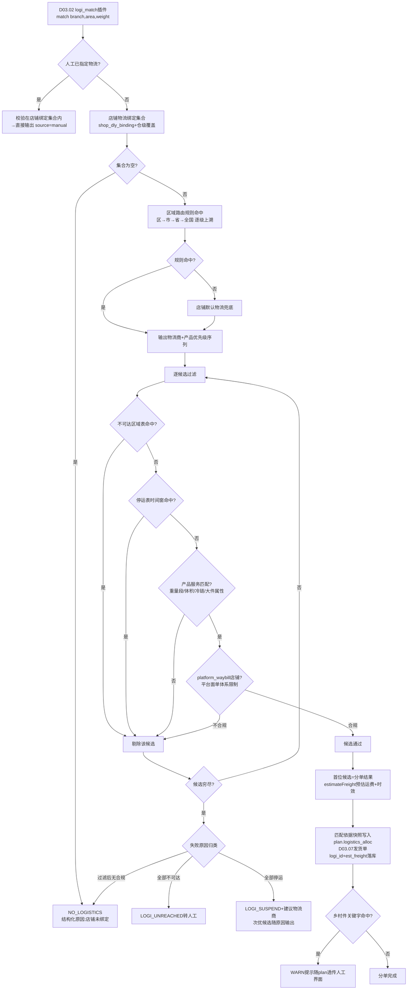
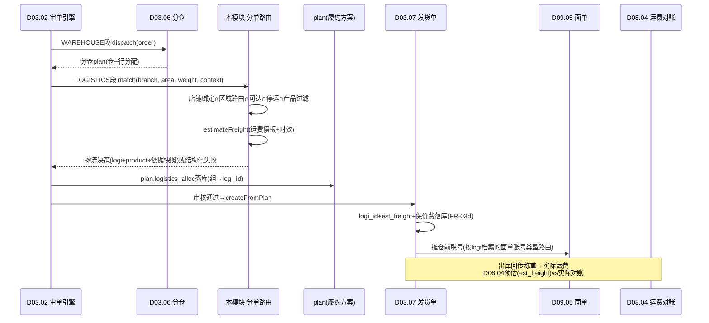

# SRS-D09.04 物流公司与分单路由模块 需求规格说明书

> 文档编号：SRS-D09.04 · 版本 V1.0 · 2026-10-24 · 编写：小凯 · 状态：待审阅（批次③）
> 所属域：D09 履约集成域 · 分期：**P0（M1-M2）· 物流轨迹订阅 P1（M3）**
> 上游依据：SRS-00 §3 D09 清单/§4.4 契约 · SRS-D03.06（分仓 plan——本模块是其物流环节的决策提供方；IF-D03.06-D6 物流到达/运费模板契约）· SRS-D03.02（LOGISTICS 段 logi_match 插件消费本模块 `LogisticsRouteService::match`，IF-D03.02-D11 契约；address_check 插件消费禁运区域表）· SRS-D03.07（FR-03d 按本模块分单规则确定 logi_id 与预估运费/保价费；IF-D03.07-D5 契约）· SRS-D09.05（物流商→面单账号类型路由的档案依据）· SRS-D02.06（店铺物流绑定与 `ShopBindingService` 输入）· SRS-D02.02（FR-04c 物流公司 canonical 编码基准）· SRS-D08.04（运费模板供预估账单）· 逆向文档 02 §7.4（logi/reclogi/arrived/logikeyword 插件）/§3.5（getDeliveryFreight 运费计算）· 逆向文档 05 §8.2（菜鸟智选物流/物流轨迹接口族）

---

## 1. 模块概述

### 1.1 定位

本模块回答履约路由的第二个问题：**仓定了之后，这张发货单交给哪家物流商、用什么产品发**。它是物流侧的主数据与规则中心：管理物流公司档案（dly_corp，全系统 canonical 物流编码基准）、物流产品（标快/特快/经济/冷链等）、区域路由规则（收货地址省市区→物流商+产品优先级）、不可达/禁运区域表、停运表、店铺物流绑定（可用物流商集合+默认物流）、运费模板（首重续重+区域报价）；对外提供**物流分单决策服务**（D03.02 审单 LOGISTICS 段与 D03.07 发货单生成消费）与**运费预估服务**（D03.07 预估运费落库、D03.06 改仓界面展示、D08.04 运费对账预估账单）。

商派对应机制：`dly_corp` 物流公司字典 + `shop_dly_corp` 店铺物流公司绑定 + logi/reclogi/arrived/logikeyword 四插件（按仓库-物流绑定、地区可达、重量段费用自动选物流，选不出 HOLD 位标记旗标「物/停/到/村」）+ `getDeliveryFreight(area_id, logi_id, weight)` 运费计算 + logisticsmanager 区域覆盖。本模块在新栈将其收敛为统一的**区域路由规则引擎**（复用 D01.03 框架），位标记旗标升级为结构化错误码（NO_LOGISTICS / LOGI_SUSPEND / LOGI_UNREACHED，对齐 D03.02 契约），并新增**物流产品维度**（商派仅到物流公司级）与**运费模板产品化**（商派运费散落在 dly_corp.weight 与区域报价表）。

### 1.2 职责边界

**做**：物流公司档案与 canonical 编码体系、物流产品档案（时效/重量段/服务属性）、区域路由规则（区域→物流商+产品优先级序列）与命中算法（精确匹配→上级区域兜底）、不可达区域（禁运表）与停运表管理、店铺物流绑定（可用集合+默认+仓级覆盖）、店铺-物流-仓三方约束校验、运费模板（首重续重/区域报价/保价费率）与运费预估服务、分单执行（消费 D03.06 分仓 plan 的仓维度+收货地址→输出物流商+产品决策）、物流轨迹订阅（P1 预留：快递100/菜鸟轨迹推送对接）。

**不做**：选仓决策（→ D03.06，本模块在其 plan 之后按仓分单）；审单插件链编排与 HOLD 处置（→ D03.02，本模块供决策数据与结构化原因）；面单账号管理与取号（→ D09.05，本模块的物流商档案是其账号路由依据）；平台物流公司编码翻译（→ D02.02 FR-04c，本模块提供 canonical 编码基准）；实际运费对账（→ D08.04，本模块供预估口径）；WMS 通道与仓档案（→ D09.01）；发货单 logi_id/logi_no 落库（→ D03.07）。

### 1.3 与其他模块关系

| 模块 | 关系 |
|---|---|
| D03.02 审单引擎 | LOGISTICS 段 logi_match 插件调 `LogisticsRouteService::match(branch, area, weight)`（IF-D03.02-D11 契约）；address_check 插件查禁运区域表（ADDRESS_FORBIDDEN） |
| D03.06 配货分仓 | 分仓 plan 的仓维度是本模块分单输入；候选仓硬过滤消费本模块不可达区域表（IF-D03.06-D6，「仓库物流不到区域剔除」）；改仓界面展示预估运费时效（FR-06a） |
| D03.07 发货单 | 发货单生成时按本模块分单结果确定 logi_id+产品，预估运费/保价费计算落库（FR-03d/IF-D03.07-D5） |
| D09.05 面单打印 | 物流商档案（面单账号类型属性）是取号账号路由依据；分单结果决定取号用哪家面单体系 |
| D02.06 店铺授权 | 店铺物流绑定配置来源（允许物流公司列表+默认物流，`ShopBindingService` IF-D02.06-06）；本模块店铺级绑定表与其店铺档案联动 |
| D02.02 平台适配器 | 本模块 canonical 物流编码是平台编码映射基准（发货回传翻译） |
| D08.04 运费对账 | 运费模板供预估账单（预估 vs 实际双账单，实际以 D03.07 称重为准） |
| D09.01 仓库路由 | 仓库档案 region_code（仓所在区域）是「仓→区域」时效与运费起点 |
| D01.03 规则引擎 | 区域路由规则的承载框架（条件→动作模型） |
| D11.03 监控 | 分单命中率/无物流 HOLD 率/停运命中数据源 |

---

## 2. 业务场景

**SC-D09.04-01 自动分单（主流程）**
天猫旗舰店订单收货地杭州市西湖区，分仓 plan 定仓=华东仓（昆山）。审单 LOGISTICS 段调 `match(branch_华东, area_西湖区, weight 1.2kg)`：① 店铺绑定过滤（该店允许物流集合={中通, 圆通, 顺丰}，默认=中通）；② 区域路由命中「浙江省→[中通-标快(P1), 圆通-标快(P2), 顺丰-标快(P3)]」；③ 交集排序+停运/不可达校验通过 → 输出 logi=中通、产品=标快、匹配依据快照（规则 ID/候选序/预估运费 4.5 元）。D03.07 生成发货单时 logi_id=中通落库、预估运费 4.5 元+保价费 0 写入。

**SC-D09.04-02 精确匹配→上级区域兜底**
区域路由只配到「广东省广州市→顺丰」，订单收货地为广州市天河区：区级无规则 → 上溯市级命中「广州市」规则；若市级也无 → 上溯省级「广东省」；省级也无 → 落店铺默认物流；默认物流对该区域不可达 → NO_LOGISTICS 结构化原因转人工（商派 HOLD 旗标「物」的新栈替代）。

**SC-D09.04-03 不可达区域与禁运拦截**
某物流商新疆/西藏部分区域不派送（不可达区域表）：分单时该物流商候选剔除；若全部候选均不可达 → LOGI_UNREACHED 转人工（换物流商/换仓/协商自提）。禁运品场景（含酒精类商品发航空件限制）：address_check 插件查禁运区域表命中 → ADDRESS_FORBIDDEN（D03.02 契约），拦截在审单段。

**SC-D09.04-04 停运表（节假日/疫情/天气）**
春节前某物流商网点停收：运营在停运表配置「圆通，2027-02-10~2027-02-20，全国」。分单时圆通候选剔除并按规则序顺延至下一家；全部命中停运 → LOGI_SUSPEND+建议物流商（对齐商派 reclogi「常用快递停运，请使用建议快递」语义），D03.02 HOLD 转人工，人工可强制指定或等待恢复。

**SC-D09.04-05 店铺-物流-仓三方约束**
品牌 A 店铺合同约定仅用顺丰，且品牌 A 货只存华东仓（货主仓属，D03.06 SC-04）：分单校验链=店铺绑定（仅顺丰）∩ 仓级物流覆盖（华东仓支持顺丰揽收）∩ 区域可达（顺丰达收货地）；若华东仓不支持顺丰揽收（仓-物流揽收关系未配置）→ 配置校验报错提前暴露（绑定保存时校验），运行期命中 → NO_LOGISTICS+结构化原因指明约束缺口。

**SC-D09.04-06 运费预估与改仓辅助**
客服在 D03.06 改仓界面比较候选仓：本模块按（仓 region→收货区域, 物流商, 预估重量）查运费模板返回各家预估运费与承诺时效（华东→杭州 中通 4.5 元/2 天，顺丰 12 元/1 天），辅助决策。发货单生成时同口径预估落库（est_freight），月底 D08.04 按运单号拉取实际账单对账（预估 vs 实际差异=模板校准输入）。

**SC-D09.04-07 物流产品差异化分单**
生鲜店铺订单（冷链商品标记）：区域路由规则条件含物料分类=生鲜 → 命中「冷链产品优先」规则（顺丰冷运/京东冷链），普通快递候选剔除（产品服务属性不匹配）；重量 15kg 大件订单 → 重量段过滤（标快上限 30kg，经济件上限 60kg）后选大件产品。

**SC-D09.04-08 物流轨迹订阅（P1）**
发货确认后（`order.delivery.shipped` 事件）自动向快递100/菜鸟订阅该运单轨迹推送：揽收/运输/派送/签收节点回流 OMS（轨迹表），供订单跟踪界面展示、签收超时预警（发货 N 天未签收告警客服）、售后举证（D05 物流异常件拦截依据）；轨迹数据随订单归档（D03.13）。

---

## 3. 功能需求

### FR-D09.04-01 物流公司档案（dly_corp）
- FR-01a 档案要素：canonical 物流编码（全系统唯一基准，D02.02 平台编码映射的锚点）、名称/简称、类型（快递/快运/落地配/同城/邮政/平台物流/特殊：当当-亚马逊类平台自配送）、面单账号类型属性（菜鸟系/平台系/快递直客/无需面单——D09.05 账号路由依据）、保价能力（protect 费率）、揽收方式（上门/自送/驿站）、状态（启用/停用）。
- FR-01b 服务范围：物流商默认覆盖区域（省粒度声明）+ 不可达区域表引用（FR-03c）；服务属性标签（冷链/大件/生鲜/贵重品/到付/签单返还），供产品与规则条件消费。
- FR-01c 编码治理：canonical 编码不可变更（历史单据溯源）；停用物流商不可被新分单命中，存量在途单据不受影响。
- FR-01d 变更审计（D10.06）：档案/服务范围/状态变更留痕。

### FR-D09.04-02 物流产品（dly_product）
- FR-02a 产品档案：归属物流商、产品编码（logi_product_code，面单取号需携带——如顺丰标快/特快）、产品类型（标快/特快/经济/冷链/大件/同城/国际，字典可扩展）、时效承诺（区域级时效表，天）、重量段限制（min/max kg）、体积限制、服务属性（继承+覆盖物流商标签）、启停状态。
- FR-02b 产品与分单联动：区域路由规则输出粒度=物流商+产品（商派仅到物流商，本模块升级）；无产品配置的物流商按「默认产品」参与分单（兼容小快递商）。
- FR-02c 产品与面单联动：产品编码供 D09.05 取号报文（express_type/coupon 等各家字段映射由 D09.05 适配器承载）。

### FR-D09.04-03 区域路由规则（area_router）
- FR-03a 规则模型（复用 D01.03 条件→动作框架）：条件维度=收货区域（省/市/区三级 area_id）/发货仓（branch_id 或仓 region）/店铺/平台/物料分类/重量体积段/订单标签/时间段；输出=物流商+产品优先级序列（有序候选清单，首位为推荐）。
- FR-03b **命中算法（精确匹配→上级区域兜底）**：区级规则 → 市级规则 → 省级规则 → 全国缺省规则，逐级上溯首个命中生效；同区域内多规则按 weight DESC 首个全条件命中；规则缓存（Redis，area_id 维度，变更事件失效——对齐 D03.06 §5.4 口径）。
- FR-03c 不可达区域表（unreach_area）：物流商×区域（省/市/区粒度）不可达清单（含原因：不派送/超区/网点撤并），支持批量导入（D01.06）与有效期；分单硬过滤+D03.06 候选仓过滤（IF-D03.06-D6）+address_check 禁运联动（D03.02 插件 12）三处消费同一事实源。
- FR-03d 停运表（suspend_table）：物流商×区域×时间窗停运配置（节假日/疫情/天气），命中即候选剔除；全候选停运 → LOGI_SUSPEND+建议物流商（次优候选）；停运表支持运营快速启停（分钟级生效）。
- FR-03e 乡村件/特殊地址关键字表（logikeyword 语义保留）：地址含关键字（村/组/屯等末端投递困难特征）→ 输出 WARN 级提示（不 HOLD，随 plan 快照透传人工审单界面），可选限定物流商（邮政/京东等下沉网络强的优先）。
- FR-03f 规则变更审计+生效/排除时间段（大促临时切物流，对齐 D03.06 FR-02d 同款机制）。

### FR-D09.04-04 店铺物流绑定（shop_dly_binding）
- FR-04a 绑定要素：店铺×物流商（可用集合）+默认物流+默认产品+优先级覆盖（店铺级调整规则序）；仓级覆盖（店铺×仓×物流商：某仓不发某物流，如华东仓无京东揽收）；配置来源与 D02.06 店铺档案联动（`ShopBindingService` 读取店铺允许物流列表，本表做履约侧细化）。
- FR-04b 平台管控店铺约束：platform_waybill_flag=true 店铺（抖音/拼多多/视频号等，D02.06 FR-06b）可用物流集合受平台面单体系限制（仅平台合作的物流商可选）——绑定保存时校验，运行期分单硬过滤。
- FR-04c **店铺-物流-仓三方约束校验**：绑定保存/变更时静态校验（物流商启用+产品有效+仓揽收关系存在），冲突即时报错；运行期分单按「店铺绑定 ∩ 仓级覆盖 ∩ 区域可达 ∩ 未停运」四重过滤（§5.1 算法），约束缺口输出结构化原因（指明缺哪一环）。
- FR-04d 仓-物流揽收关系（branch_dly_rel）：仓库×物流商×产品揽收支持声明（是否上门揽收/截单时间/揽收时间段），D09.01 仓库档案联动；截单时间供 D03.07 推仓时机参考（P1）。

### FR-D09.04-05 运费模板（freight_template）
- FR-05a 模板模型：物流商×产品粒度；计费方式=首重续重（首重 kg+首价+续重单位+续价）/按件/体积重取大（体积重系数可配）；区域报价（发货仓 region × 收货省/市 差异化报价行，缺省行兜底）；保价费率（声明价值×费率，上限可配）；折扣协议价（月结客户折扣系数，货主/店铺粒度可选）。
- FR-05b 运费预估服务：`estimateFreight(branch, area, weight, volume, logi, product, 声明价值)` → 预估运费+保价费+时效（查产品时效表）；消费方：D03.07 发货单 est_freight 落库（FR-03d 契约）、D03.06 改仓界面（FR-06a）、D08.04 预估账单口径、人工审单展示。
- FR-05c 模板版本化：生效时间+版本快照（发货单预估落库时快照模板版本 ID，历史可回放）；批量导入/导出（D01.06）；模板与实际账单差异分析报表（D08.04 对账差异回流，P1）。
- FR-05d 预估≠结算口径：预估仅供展示/落库参考/对账基线，实际运费以物流商账单（D08.04）为准——文档级显式声明防止口径混用。

### FR-D09.04-06 分单执行（决策服务）
- FR-06a 统一入口：`LogisticsRouteService::match(branch, area, weight)`（D03.02 IF-D03.02-D11 契约签名，扩展参数经 context 传递：订单/店铺/物料/体积/标签）→ 返回分单结果（logi_id+product_id+候选序+匹配依据快照：命中规则 ID/过滤明细/预估运费/时效）或结构化失败（NO_LOGISTICS / LOGI_SUSPEND+建议 / LOGI_UNREACHED，错误码对齐 D03.02 插件 8 契约）。
- FR-06b 执行位置：审单 LOGISTICS 段插件内同步调用（决策）；D03.07 发货单生成时消费 plan.logistics_alloc（D03.02 FR-05a 物流方案：组→logi_id+匹配依据快照）落库——**决策与执行分离**，与 D03.06 分仓同构（本模块只出决策，不写发货单）。
- FR-06c 人工指定物流：人工审单（D03.03）可改物流商/产品（限店铺绑定集合内，越界需授权点+审计）；指定结果同构落 plan（source=manual）。
- FR-06d 改物流重算：改单（D03.08 改地址）/改仓（D03.06 FR-06）触发物流重匹配（新轮次随 plan）；已取号发货单改物流须先作废运单（联动 D09.05 取消运单+D09.02 换单重推 FR-06d）。
- FR-06e 分单结果幂等：同（订单+plan 轮次）重复调用返回缓存决策（Redis 短窗），决策快照落 plan 不漂移。

### FR-D09.04-07 物流轨迹订阅（P1 预留）
- FR-07a 订阅编排：`order.delivery.shipped` 事件触发 → 按物流商路由轨迹服务商（快递100 订阅推送 / 菜鸟轨迹接口，服务商字典可扩展）→ 运单级订阅登记（幂等：运单号唯一）；批量订阅（大促削峰，MQ 异步）。
- FR-07b 轨迹回流：推送回调（验签）→ 标准化轨迹节点（时间/状态/描述/城市）落轨迹表 → 事件 `logistics.trace.updated`（供订单跟踪界面/售后 D05 物流异常识别/签收超时预警 D11.03）。
- FR-07c 异常治理：签收超时（发货后 N 天，可配）预警；轨迹断更（M 小时无节点）标记异常；退签/拒收节点联动售后提示；轨迹数据随订单归档（D03.13），在线保留 1 年。
- FR-07d P0 期预留：轨迹表结构与订阅登记接口先行定义（表+空实现），服务商对接随 P1 交付。

---

## 4. 业务流程

### 4.1 区域路由决策树（分单主流程）



### 4.2 分单在审单链路中的位置（决策执行分离）



---

## 5. 处理逻辑

### 5.1 分单算法（伪代码）

```
match(branch, area, weight, context):
    # ① 人工指定短路（D03.03 指定物流/改单后重指定）
    if context.manual_logi: 
        校验 ∈ shopBinding(shop, branch) → 输出(source=manual) / 拒绝(越界)

    # ② 店铺绑定集合（含仓级覆盖）
    candidates = shopBinding(shop_id) ∩ branchDlyRel(branch)   # FR-04a/04d
    if empty(candidates): return fail(NO_LOGISTICS, "店铺未绑定或仓无揽收")

    # ③ 区域路由规则：精确→上级兜底（FR-03b）
    seq = areaRouter.match(area_id 区级 → 市级 → 省级 → 全国缺省,
                           条件: branch/shop/物料分类/重量段/标签/时间段)
    命中: candidates 按 seq 排序(seq 外绑定物流排尾部按绑定优先级)
    未命中: 店铺默认物流置首

    # ④ 逐候选硬过滤（顺序固定，过滤原因累积供结构化输出）
    for c in candidates:
        if unreachArea.hit(c.logi, area): mark(c, UNREACHED); continue
        if suspend.hit(c.logi, area, now): mark(c, SUSPENDED); continue
        if not productFit(c, weight, volume, 服务属性): mark(c, PRODUCT_MISMATCH); continue
        if platformWaybillShop and not c.平台面单合规: mark(c, PLATFORM_LIMIT); continue
        return ok(c.logi, c.product, 依据快照)     # 首个通过者

    # ⑤ 全部剔除：原因归类（对齐 D03.02 错误码契约）
    if 全部 UNREACHED: return fail(LOGI_UNREACHED)
    if 存在 SUSPENDED: return fail(LOGI_SUSPEND, 建议=剔除停运后的次优)
    return fail(NO_LOGISTICS, 过滤明细)

productFit(c, weight, volume, attrs):
    产品重量段 min≤weight≤max ∧ 体积限制 ∧ (冷链单→冷链产品) ∧ (大件→大件产品)
```

### 5.2 运费预估口径

```
estimateFreight(branch, area, logi, product, weight, volume, 声明价值):
    计费重 = max(weight, volume/体积重系数)             # FR-05a 体积重取大
    报价行 = 模板.区域报价(branch.region → area.省/市) ?? 缺省行
    运费 = 报价行.首价 + ceil((计费重-首重)/续重单位) × 报价行.续价
    保价费 = 声明价值>0 ? min(声明价值×费率, 上限) : 0
    折扣 = 协议折扣系数(货主/店铺粒度, 可空)
    时效 = 产品.区域时效表(branch.region → area.省) 
    return {运费×折扣, 保价费, 时效, 模板版本ID}        # 版本快照随plan落库
```
- 预估运费与 D08.04 对账差异 >阈值（默认 20%）自动生成模板校准工单（P1）。

### 5.3 主数据缓存与一致性

- 缓存对象：区域路由规则（area_id 维度）、不可达/停运表（logi×area 维度）、店铺绑定（shop 维度）、运费模板（template_id 维度）；Redis 缓存+变更事件主动失效（≤5s 生效，对齐 D02.06 AC-10 口径）；
- 停运表分钟级生效要求：停运写入即广播失效（不依赖 TTL）；
- canonical 编码一致性：物流商停用不影响历史单据（logi_id 引用不漂移）；平台编码映射缺失由 D02.02 回传时拒绝并提示补配置（本模块提供编码清单查询接口）。

### 5.4 与 D03.06 分仓的先后契约

- 顺序恒定为**先分仓后分单**（物流依赖仓：揽收关系/运费起点/仓级覆盖）；分仓 plan 多仓分组时每组独立分单（各组区域路由的 branch 条件不同）；
- 分单失败不回退分仓（物流问题不换仓）——LOGI_* 原因 HOLD 转人工，人工可改物流/改仓（改仓走 D03.06 FR-06 编排后重分单）；
- D03.06 候选仓硬过滤消费本模块不可达区域表（「仓库物流不到区域剔除」= 该仓所有绑定物流对收货地均不可达时剔除候选仓，IF-D03.06-D6 契约）——同一 unreach_area 事实源两处消费，口径唯一。

---

## 6. 数据字段（业务字段描述）

> 物理表落 `oms_fulfill` schema（D09 独立，SRS-00 全局决策）；DDL 见 DB-D09。

### 6.1 物流公司档案（fulfill_dly_corp）

| 字段 | 业务含义 | 取值/校验 |
|---|---|---|
| corp_code | canonical 物流编码 | 全局唯一，不可变更（D02.02 映射基准） |
| corp_name / short_name | 名称/简称 | |
| corp_type | 类型 | 快递/快运/落地配/同城/邮政/平台物流/特殊（字典） |
| waybill_account_type | 面单账号类型 | 菜鸟系/平台系/快递直客/无需面单（D09.05 路由依据） |
| protect_rate / protect_max | 保价费率/上限 | FR-05a 联动 |
| service_tags | 服务属性标签 | JSON：冷链/大件/生鲜/贵重/到付/签返 |
| pickup_mode | 揽收方式 | 上门/自送/驿站 |
| status | 状态 | 启用/停用（停用不可被新分单命中） |
| owner_id / tenant_id | 归属 | 必填（SRS-00 契约；平台级共享档案 owner=系统） |

### 6.2 物流产品（fulfill_dly_product）

| 字段 | 业务含义 | 取值/校验 |
|---|---|---|
| corp_id / product_code | 归属物流商/产品编码 | 产品编码=面单取号 express_type 映射源 |
| product_type | 产品类型 | 标快/特快/经济/冷链/大件/同城/国际（字典可扩展） |
| weight_min / weight_max / volume_limit | 重量段/体积限制 | productFit 过滤依据（§5.1） |
| service_tags | 服务属性 | 继承物流商+覆盖 |
| timeliness_table | 区域时效表 | JSON：发货 region×收货省→承诺天数 |
| status | 启停 | |
| tenant_id | 租户 | 必填 |

### 6.3 区域路由规则（fulfill_area_router）

| 字段 | 业务含义 | 取值/校验 |
|---|---|---|
| rule_name / area_level / area_id | 规则名/区域级别/区域 | 区/市/省/全国四级（FR-03b 上溯序） |
| conditions | 条件集 | JSON：branch/shop/平台/物料分类/重量体积段/标签/时间段 |
| logi_seq | 输出候选序 | JSON 有序：[{corp_id, product_id, priority}] |
| weight | 匹配权重 | 同级多规则 DESC 首个命中 |
| effective_period / exclude_period | 生效/排除时间段 | 大促临时切物流 |
| default_flag / status | 全国缺省标记/启停 | 缺省规则全局唯一 |
| tenant_id | 租户 | 必填 |

### 6.4 不可达/停运/关键字表（fulfill_unreach_area / fulfill_suspend / fulfill_addr_keyword）

| 字段 | 业务含义 |
|---|---|
| unreach：corp_id / area_id / reason / valid_from / valid_to / status | 物流商×区域不可达（三处消费同一事实源，§5.4） |
| suspend：corp_id / area_id(可空=全国) / suspend_from / suspend_to / reason / status | 停运时间窗（分钟级生效） |
| keyword：keyword / level(WARN-BLOCK) / logi_limit(可空=限定物流商) / status | 乡村件等地址关键字（FR-03e） |
| 各表 tenant_id 必填 | |

### 6.5 店铺物流绑定与仓揽收关系（fulfill_shop_dly / fulfill_branch_dly）

| 字段 | 业务含义 |
|---|---|
| shop_dly：shop_id / corp_id / product_id(默认) / is_default / priority / branch_id(可空=仓级覆盖) / status | 店铺可用物流集合+默认+仓级覆盖（FR-04a） |
| branch_dly：branch_id / corp_id / product_id / pickup_support / cutoff_time / pickup_window / status | 仓-物流揽收关系（FR-04d） |
| 两表 tenant_id / owner_id(shop_dly 冗余店铺货主) | 必填 |

### 6.6 运费模板（fulfill_freight_template / _region_price）

| 字段 | 业务含义 |
|---|---|
| template：corp_id / product_id / charge_mode(首重续重-按件-体积重取大) / first_weight / first_price / add_weight / add_price / volume_factor / protect_rate / discount_json / version / effective_from / status | 模板头（版本化，FR-05c） |
| region_price：template_id / from_region(仓region) / to_area(省/市) / first_price / add_price / timeliness_days / default_flag | 区域报价行（缺省行兜底） |
| tenant_id / owner_id(协议价粒度可选) | 必填 |

### 6.7 轨迹订阅与节点（fulfill_trace_sub / fulfill_trace_node，P1）

| 字段 | 业务含义 |
|---|---|
| sub：waybill_no(唯一) / corp_id / provider(快递100-菜鸟) / delivery_id / sub_status / sub_time | 订阅登记（幂等：运单号唯一） |
| node：waybill_no / node_time / node_status(揽收-运输-派送-签收-退签-异常) / desc / city / source | 标准化轨迹节点 |
| tenant_id / owner_id | 必填 |

---

## 7. 接口

### 7.1 内部接口（本模块提供）

| 编号 | 接口 | 消费方 | 说明 |
|---|---|---|---|
| IF-D09.04-01 | `LogisticsRouteService::match(branch, area, weight, context)` | D03.02 logi_match 插件（IF-D03.02-D11 契约） | 分单主入口；返回决策+依据快照或结构化失败（NO_LOGISTICS/LOGI_SUSPEND/LOGI_UNREACHED）；幂等（§FR-06e） |
| IF-D09.04-02 | `LogisticsRouteService::estimateFreight(branch, area, weight, volume, logi, product, 声明价值)` | D03.07（FR-03d 预估落库）/D03.06（改仓界面 FR-06a）/D08.04（预估账单） | 运费+保价费+时效预估（含模板版本快照） |
| IF-D09.04-03 | `LogisticsRouteService::reachable(branch, area)` / `unreachList(corp)` | D03.06 候选仓硬过滤（IF-D03.06-D6）/D03.02 address_check | 可达性判定（仓全绑定物流均不可达=false） |
| IF-D09.04-04 | `DlyCorpService::get/list/encodeMap(corp_code)` | D09.05（账号类型路由）/D02.02（canonical 编码基准）/全域 | 物流商档案与面单账号类型属性查询 |
| IF-D09.04-05 | `ShopDlyBindingService::allowed(shop_id, branch_id)` | D03.03 人工审单（指定物流下拉）/D02.06 联动 | 店铺（×仓）可用物流集合 |
| IF-D09.04-06 | `DlyRuleService::save/matchTrace(rule)` | 规则配置后台 | 规则 CRUD 与命中回放（依据快照反查） |
| IF-D09.04-07 | 事件 `logistics.trace.updated`（P1） | 订单跟踪/D05 售后/D11.03 | 轨迹节点回流广播（FR-07b） |
| IF-D09.04-08 | 订阅 `order.delivery.shipped`（P1） | 经 D03.07 | 轨迹订阅触发（FR-07a） |

### 7.2 依赖接口（本模块消费）

| 编号 | 接口 | 提供方 | 说明 |
|---|---|---|---|
| IF-D09.04-D1 | `ShopBindingService`（店铺允许物流列表/平台管控面单标识 platform_waybill_flag） | D02.06（IF-D02.06-06） | 店铺绑定配置来源与平台面单约束 |
| IF-D09.04-D2 | 仓库档案（branch region_code/状态） | D09.01 | 运费起点/揽收关系锚点 |
| IF-D09.04-D3 | 规则引擎框架（注册/条件求值/缓存） | D01.03 | 区域路由规则承载 |
| IF-D09.04-D4 | 导入导出中心 | D01.06 | 不可达区域/运费模板批量维护 |
| IF-D09.04-D5 | `AuditService` | D10.06 | 档案/规则/绑定/人工指定审计 |
| IF-D09.04-D6 | 调度注册（轨迹断更扫描/签收超时预警，P1） | D01.02 | FR-07c |
| IF-D09.04-D7 | 企微告警（配置校验失败/停运生效通知） | D01.07 | 运营触达 |

### 7.3 外部接口

| 编号 | 接口 | 方向 | 说明 |
|---|---|---|---|
| EF-D09.04-01 | 快递100 订阅推送 / 菜鸟轨迹接口（P1） | 双向 | 轨迹订阅与回流（FR-07，服务商字典可扩展） |
| EF-D09.04-02 | 菜鸟智选物流报价/覆盖查询（P1 预留） | 出 | 智能推荐物流比价（逆向文档 05 §8.2 STORE_CN_SMARTDELIVERY_* 语义，本期不实现） |

---

## 8. 非功能需求

| 项 | 要求 |
|---|---|
| 性能 | match 单次 P99 ≤20ms（规则/绑定/不可达全缓存命中，支撑审单洪峰 500 单/分钟）；estimateFreight ≤10ms；规则变更生效 ≤5s |
| 一致性 | 不可达区域表单一事实源（分单/分仓过滤/地址校验三处消费同表）；canonical 编码不可变；决策快照随 plan 落库不漂移 |
| 幂等/并发 | match 同（订单+plan 轮次）幂等返回缓存决策；规则/绑定保存静态校验防运行期约束缺口 |
| 容错 | 缓存 miss 降级 DB 直查（对齐 D04.02 miss 降级契约）；分单失败结构化原因转人工不静默 |
| 安全/审计 | 档案/规则/绑定/停运变更全审计；人工指定物流独立授权点；越界指定拒绝 |
| 可观测 | 分单命中率/NO_LOGISTICS 率/停运命中分布/预估-实际运费差异率监控（D11.03）；规则命中回放（matchTrace） |
| 容量 | 区域路由/不可达数据量级：物流商 ~50×区域 ~3000 区划 → 全量缓存 ≤50MB；轨迹节点（P1）按运单×节点 ~10 条，随订单归档 |

---

## 9. 验收标准

| 编号 | 验收条件 |
|---|---|
| AC-01 | 主流程（SC-01）：分仓 plan 定仓后 match 输出物流商+产品+依据快照，D03.07 发货单 logi_id/est_freight 与决策一致；plan.logistics_alloc 可回放命中规则 |
| AC-02 | 上溯兜底（SC-02）：仅配市级规则时区级地址正确上溯命中；省/全国缺省逐级验证；全无命中落店铺默认物流；默认物流不可达输出 NO_LOGISTICS 转人工（D03.02 HOLD 原因码一致） |
| AC-03 | 不可达过滤（SC-03）：不可达区域表命中候选剔除且原因累积；全候选不可达输出 LOGI_UNREACHED；同一表被 D03.06 候选仓过滤与 D03.02 address_check 消费口径一致（构造仓全物流不可达→候选仓剔除） |
| AC-04 | 停运表（SC-04）：时间窗内候选剔除并顺延次优；全停运输出 LOGI_SUSPEND+建议物流商；停运配置写入 ≤1 分钟对新分单生效 |
| AC-05 | 三方约束（SC-05）：绑定保存时静态校验（物流停用/仓无揽收/产品无效）即时报错；运行期四重过滤（绑定∩仓覆盖∩可达∩停运）构造缺口场景输出结构化原因指明缺失环节 |
| AC-06 | 平台管控店铺：platform_waybill_flag=true 店铺绑定非平台合作物流被保存校验拒绝；运行期候选硬过滤生效 |
| AC-07 | 运费预估（SC-06）：首重续重/体积重取大/区域报价/保价费/折扣计算正确（用例覆盖缺省行兜底）；预估落库携带模板版本 ID，模板改版后历史预估可回放旧版口径 |
| AC-08 | 产品差异化（SC-07）：冷链单仅命中冷链产品；超重订单重量段过滤生效；无产品配置物流商按默认产品参与分单 |
| AC-09 | 人工指定与改物流重算：人工指定限店铺绑定集合内（越界拒绝需授权）；改地址/改仓触发重匹配新轮次快照；已取号发货单改物流先作废运单（D09.05 联动）再换单重推（D09.02 FR-06d 链路验证） |
| AC-10 | 性能与缓存：500 单/分钟压测 match P99 ≤20ms；规则/绑定/停运缓存命中率 ≥99%；缓存 miss 降级 DB 结果一致 |
| AC-11 | 乡村件关键字（FR-03e）：命中输出 WARN 随 plan 透传人工界面，不 HOLD；配置限定物流商时优先邮政/京东类候选 |
| AC-12 | 轨迹订阅（P1 预演）：shipped 事件触发订阅登记（运单号幂等）；模拟推送回流标准化节点+`logistics.trace.updated` 事件；签收超时预警按阈值触发 |

---

## 变更记录

| 日期 | 版本 | 变更 | 原因 |
|---|---|---|---|
| 2026-10-24 | V1.0 | 首版 | — |

---

*参考实现溯源：商派 `dly_corp` 物流公司字典（type=DANGDANG/AMAZON 特殊类型、protect 保价、weight 重量段）+ `sdb_ome_shop_dly_corp` 店铺物流公司绑定（allDlyCrop/corp_id 审单指定口径）+ logi/reclogi/arrived/logikeyword 四插件（逆向文档 02 §7.4：仓-物流绑定+地区可达+重量段费用自动选物流，位标记旗标「物 0x04/停 0x400000/到 0x40000/村 0x20」）+ `getDeliveryFreight(area_id, logi_id, weight)` 运费计算（mkDelivery 时含保价费）+ logisticsmanager_warehouse.region_ids 区域覆盖 + `service.areas.all.get` 物流可达性免鉴权接口 + 菜鸟智选物流 STORE_CN_SMARTDELIVERY_*（推荐/报价/合作物流，P1 预留源）+ 物流轨迹 store.logistics.trace.get/快递鸟 trace.detail.get/包裹异常查询（FR-07 P1 源）。关键差异：① 分单输出粒度升级为**物流商+产品**（商派仅到 dly_corp 级，产品差异靠人工）；② 区域路由收敛为统一规则引擎（区→市→省→全国显式上溯算法+依据快照回放），商派 logi/arrived/reclogi 三插件各查各表口径分散；③ 位标记旗标改结构化错误码（NO_LOGISTICS/LOGI_SUSPEND/LOGI_UNREACHED，对齐 D03.02 契约）；④ 运费模板产品化+版本化（首重续重/体积重/区域报价/协议折扣，预估-实际差异回流校准），商派运费散落 dly_corp.weight 与区域报价且无版本快照；⑤ 不可达区域表单一事实源三处消费（分单/分仓候选过滤/地址校验），商派 arrived 到不到表仅审单插件消费；⑥ 店铺-物流-仓三方约束保存期静态校验+运行期四重过滤显式化，商派仅运行期 HOLD；⑦ 平台管控面单店铺约束（platform_waybill_flag 联动 D02.06）新增，商派按平台目录硬编码；⑧ 决策与执行分离（本模块只出决策，logi_id 落库归 D03.07 plan 执行器），与 D03.06 分仓同构；⑨ 轨迹订阅产品化（订阅登记幂等+标准化节点+异常治理），商派为按需拉取无订阅编排。*
