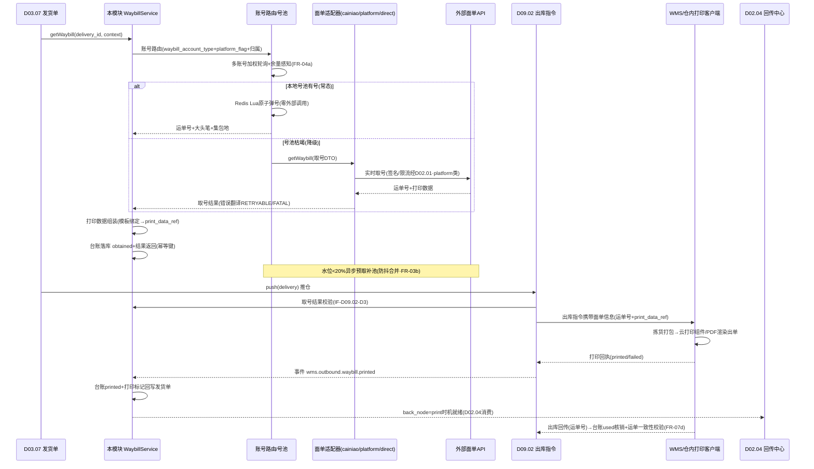
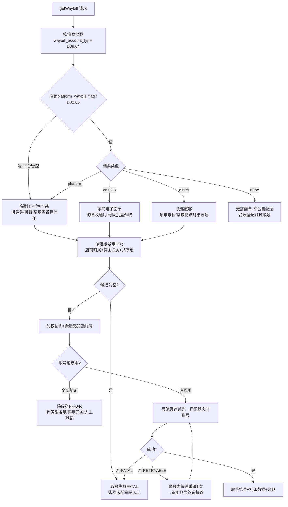
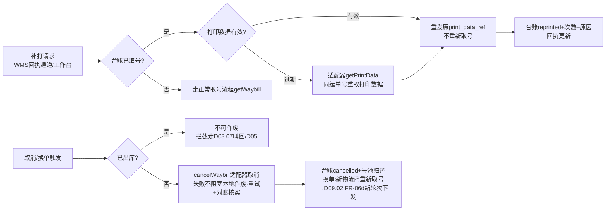

# SRS-D09.05 电子面单与打印模块 需求规格说明书

> 文档编号：SRS-D09.05 · 版本 V1.0 · 2026-10-24 · 编写：小凯 · 状态：待审阅（批次③）
> 所属域：D09 履约集成域 · 分期：**P0 基础（M1-M2）· 集中打印/云打印硬件直连 P1**
> 上游依据：SRS-00 §3 D09 清单（三类面单账号统一抽象/打印模板/打印队列/包裹合并）· SRS-D09.02（**全局决策契约：出库指令携带面单信息**，IF-D09.02-D3 取号结果查询/补取+打印数据下发通道；FR-06 面单随指令下发；IF-D09.02-07 打印回执事件 `wms.outbound.waybill.printed`）· SRS-D03.07（发货单需面单号，FR-03d 菜鸟智选类运单号预取；delivery_package.waybill_no 包裹-面单关联；IF-D03.07-D6 打印分组数据）· SRS-D09.04（物流商档案 waybill_account_type=账号类型路由依据，IF-D09.04-04）· SRS-D02.06（platform_waybill_flag 平台管控面单标识）· SRS-D09.01（能力矩阵「面单模式」：OMS 取号+仓内打印默认/WMS 侧取号例外）· SRS-D03.11（门店打包打印）· SRS-D03.12（保税单面单预取号）· 逆向文档 05 §8（print_queue/print_tmpl/print_otmpl/print_tmpl_diy/print_tag + 电子面单 apiname 常量族）· 逆向文档 02 §3.6（自发货 print_finish/expre_status）

---

## 1. 模块概述

### 1.1 定位

本模块是电子面单的**取号中心与打印调度中心**。全局决策（SRS-D09.02 承载，本模块落地）：**电子面单=OMS 取号+仓内打印**——取号统一在 OMS 完成（三类面单账号统一抽象：① 菜鸟电子面单（淘系及通用）② 平台系面单（拼多多/抖音/京东各自面单体系）③ 快递直客面单（顺丰/京东物流月结账号）），打印指令/文件经 D09.02 出库指令携带下发仓内客户端或 WMS，打印结果回执回流本模块台账。核心服务：`WaybillService::getWaybill(发货单/包裹)` → 按物流商档案（D09.04 waybill_account_type）路由账号类型 → 调对应面单 API 取号（运单号+大头笔/集包地+打印数据）；配套号段预取与本地缓存、多账号负载均衡轮询、失败重试与降级、面单模板管理（标准/自定义/云打印）、打印任务队列（print_queue：削峰/重试/批量）、包裹合并打印与补打幂等。

商派对应机制：电子面单 `store.*` 方法族经矩阵中心统一代理（菜鸟系 store.cn.waybill.ii.get/平台面单 store.waybill.i.get 抖快红书视频号/直连快递 store.sf.orderservice 顺丰、store.etms.waybillcode.get 京东等），OMS 侧只面对「取号/取消/模板/打印数据」四动作 + print_queue/print_queue_items 打印批次 + print_tmpl（快递单模板：宽高/偏移 mm）/print_otmpl（单据模板）/print_tmpl_diy（自定义）/print_tag（打印标记，配合 back_node=print 回传时机）+ 易连云云打印硬件。凯淳自研**无矩阵中心代理**，须直连各面单 API——本模块的三类账号统一抽象即商派「store.* 方法族解耦」思想的直连版实现。

### 1.2 职责边界

**做**：三类面单账号统一抽象与账号档案（密钥加密存储/号段余量/月结编码）、取号服务（账号路由/号段预取/本地缓存/多账号轮询/失败重试与降级）、运单取消与作废（换单/订单取消联动）、面单模板管理（标准/自定义/云打印模板，菜鸟云打印组件对接）、模板与店铺/物流商绑定、打印任务生成与打印队列（print_queue）、打印下发通道（仓内客户端/WMS 经 D09.02/集中打印 P1 预留）、打印状态回执与打印台账、包裹合并打印（母子单合并/多包裹分单）、补打（幂等不重复取号）、打印标记回写（供 D02.04 back_node=print 回传时机）。

**不做**：出库指令的报文组装与下发执行（→ D09.02，本模块供取号结果与打印数据）；物流商选择与分单（→ D09.04，本模块按其分单结果与档案属性路由账号）；发货单/包裹数据模型（→ D03.07，本模块消费其打印分组数据）；平台面单 API 的签名/session 托管（→ D02.01 接入框架统一出口，本模块的面单适配器复用其能力）；运费结算（→ D08.04）；针式单据打印（拣货单/备货单等仓内作业单据 → WMS 侧自理，本模块只管电子面单与发货清单类打印 P1）。

### 1.3 与其他模块关系

| 模块 | 关系 |
|---|---|
| D09.02 出库指令 | **契约方**：push 受理时校验取号结果（其 FR-06a），本模块供 `WaybillQueryService::getByDelivery` + 补取 `getWaybill`（IF-D09.02-D3）；打印数据随指令 DTO 下发（waybill_no+print_ref）；仓内打印回执经其事件 `wms.outbound.waybill.printed`（IF-D09.02-07）回流本模块台账；换单场景重新取号+旧运单作废标记（其 FR-06d） |
| D03.07 发货单 | 取号对象=发货单/包裹（delivery_package.waybill_no 关联落库）；打印分组数据消费（IF-D03.07-D6）；一母单一面单（合单场景其 FR-04c）；菜鸟智选类运单号预取写入（其 FR-03d）；打印标记回写供 back_node=print 平台回传时机（D02.04） |
| D09.04 物流分单 | `DlyCorpService`（IF-D09.04-04）物流商档案 waybill_account_type=账号类型路由依据；改物流重算触发本模块作废重取（其 FR-06d） |
| D02.06 店铺授权 | platform_waybill_flag（平台管控面单店铺标识，其 FR-06b）：命中店铺强制走平台系账号取号 |
| D02.01 接入框架 | 平台系面单 API 经统一调用出口（签名/session/限流/api_log）；快递直客 API 直连（独立 SDK，报文日志同规范） |
| D09.01 仓库路由 | 能力矩阵「面单模式」：默认 OMS 取号+仓内打印；例外「WMS 侧取号」（保税仓特殊监管）走例外通道（其 SC-06） |
| D03.11 O2O 门店 | 门店作业台打包打印（店铺绑定快递账号，其 FR-03b）：本模块提供门店打印通道（打印任务直发门店客户端） |
| D03.12 跨境 | 保税单申报前国内段运单号预分配（其 FR-02a，经本模块预取号） |
| D05 售后 | 补发/换货 0 元单履约复用本模块取号打印；退货运单（买家寄回）不经本模块（无取号需求） |
| D01.05 PIPL | 面单密钥/月结账号加密存储；打印数据含收货人明文——下发通道加密、台账脱敏 |
| D11.03 监控 | 取号成功率/耗时/号段余量/打印队列积压/失败分布数据源 |

---

## 2. 业务场景

**SC-D09.05-01 取号主流程（菜鸟系）**
天猫旗舰店发货单 DLV202610001（分单结果=中通-标快，D09.04）推仓前取号：`getWaybill(delivery)` → 物流商档案 waybill_account_type=菜鸟系 → 选账号（该店铺绑定的菜鸟面单账号，多账号时轮询负载）→ 本地号段缓存有余量：直接从预取号池分配运单号 78123456789012+大头笔「021-05-03」+集包地（无外部调用，≤5ms）→ 打印数据组装（云打印模板报文）→ 取号台账落库（waybill_no↔delivery_id↔账号↔模板）→ D09.02 push 时随指令 DTO 下发。号段余量低于水位（默认 20%）→ 异步触发下一批预取（防抖合并）。

**SC-D09.05-02 平台系面单（抖音管控单）**
抖音店铺订单（platform_waybill_flag=true）：分单结果物流商=中通，但**账号类型强制路由平台系**（平台管控单号，商家自有菜鸟账号不可用）→ 经 D02.01 接入框架调抖音电子面单 API（store.waybill.i.get 语义：订单号+物流商映射平台 cp_code）→ 返回平台运单号+打印数据（密文收货人：打印数据为平台渲染的密文面单，OMS 不落明文）→ 台账标记密文单。取号失败（平台限流）→ 退避重试；持续失败 → 发货单挂起（D09.02 push 前置校验不通过，FR-06a 联动补取超时按下发失败可重试）。

**SC-D09.05-03 快递直客面单（顺丰月结）**
高价值订单店铺绑定顺丰月结账号（快递直客类，月结编码 7551234567）：调顺丰丰桥 API 下单取号（订单服务：月结编码+收寄件+产品信息=标快）→ 返回运单号 SF123…+大头笔/路由标签+打印数据（顺丰标准模板）；子母件（多包裹）场景一次请求取主单号+子单号列表（包裹级关联）。月结账号余额/权限异常 → 账号熔断（标记不可用+告警）→ 同物流商备用账号轮询接管；无备用 → 取号失败转人工（换账号/换物流重走 D09.04）。

**SC-D09.05-04 号段预取与本地缓存（大促防抖）**
大促前调度任务（D01.02）按店铺×物流商历史用量预热号段：菜鸟系按账号批量预取（waybill.ii.get 单次可批量取 N 号）入本地号池（Redis+DB 双写，号池表记录号段归属）；大促峰值取号全部本地分配（零外部调用），外部 API 仅承担号段补充（异步、限流保护）；号池水位三线（预取水位 20%/告警水位 5%/枯竭）：枯竭时同步直取（降级为实时取号，接受外部延迟）；未消耗号段过期前批量取消归还（防号源浪费，菜鸟/平台系号段有效期口径）。

**SC-D09.05-05 多账号轮询负载均衡**
大卖家同一物流商配置 3 个菜鸟面单账号（单账号日取号量有平台限额）：取号按轮询+余量感知分配（优先余量充足账号；单账号失败自动跳过并降权，熔断后恢复探测）；账号用量/余量看板（D11.03），限额临近（80%）预警运营补充账号或调配。

**SC-D09.05-06 仓内打印（默认模式）**
出库指令携带面单信息下发通天晓 WMS（D09.02 FR-06b：运单号+打印数据引用）：WMS 拣货打包后驱动仓内打印客户端出单（云打印组件渲染或 PDF 直打）→ 打印结果回执经 D09.02 事件 `wms.outbound.waybill.printed` 回流 → 本模块打印台账更新（printed/failed/补打次数）→ 打印标记回写发货单（expre_status 语义，供 D02.04 back_node=print 时机回传平台）。打印失败（缺纸/客户端离线）：回执 failed → 仓内重打（补打幂等：同运单号重发打印数据，不重新取号）。

**SC-D09.05-07 集中打印（P1 预留）与门店打印**
自发货店铺（无仓，self_delivery）/总部分流场景：OMS 侧生成打印任务入 print_queue → 推送办公区集中打印客户端（本地打印控件协议，商派 lib/print/controltmpl 语义）→ 批量出单（批次号管理）→ 客户端回执打印状态。门店履约（D03.11 FR-03b）：门店作业台发起打印 → 本模块按店铺-快递账号绑定取号（多已预取）→ 打印任务直发门店客户端 → 回执+运单号录入闭环。本期仓内为主，集中打印通道架构预留（打印下发通道抽象：仓内/集中/门店三路由）。

**SC-D09.05-08 母子单合并打印与多包裹分单打印**
合单母单（D03.07 merge，3 子单同收货人）：一母单一面单——取号对象=母单（子单不取号），打印数据聚合母单明细（装箱清单合并）；多包裹发货单（超箱拆分，一单 3 包裹）：取号按包裹粒度（3 个运单号或子母件号组），打印任务 3 条（每包裹一面单+对应装箱明细），delivery_package 逐包裹关联 waybill_no。

**SC-D09.05-09 补打与运单作废**
面单破损仓内申请补打：补打入口（WMS 侧经回执通道请求 / OMS 工作台人工发起）→ 幂等校验（delivery_id+waybill_no 已取号 → 直接重发原打印数据，**不重复取号**；台账补打次数+1）；已打印未发货订单取消 → 运单作废：台面单账号类型调对应取消 API（store.cn.waybill.ii.cancel / store.waybill.cancel / 顺丰订单取消语义）→ 台账置 cancelled → 号池归还（预取号场景）；换单（改物流，D09.04 FR-06d）→ 旧运单作废+新物流商重新取号 → 新面单随新轮次指令下发（D09.02 FR-06d 联动）。

**SC-D09.05-10 打印队列削峰与失败重试**
大促波次打印（单波 5000 发货单集中推仓）：打印任务批量入 print_queue（批次粒度，MQ 削峰）→ 消费按仓/客户端分组限速下发（保护仓内打印机与客户端）→ 单任务失败分级重试（客户端离线=RETRYABLE 退避重投；打印数据渲染失败=FATAL 转人工）→ 重试超限告警+异常队列（工作台重发/改集中打印兜底）；队列积压/龄期监控（D11.03）。

---

## 3. 功能需求

### FR-D09.05-01 三类面单账号统一抽象（账号档案）
- FR-01a 账号类型枚举（**统一抽象核心**）：`cainiao`（菜鸟电子面单：淘系及通用，账号=菜鸟 CP 账号+网点）/ `platform`（平台系：拼多多/抖音/京东/快手/小红书/视频号各自面单体系，账号=店铺授权 token，经 D02.01）/ `direct`（快递直客：顺丰丰桥/京东物流/EMS 等月结账号）/ `none`（无需面单：平台自配送类）；类型字典可扩展，每类型实现统一适配器接口（FR-01e）。
- FR-01b 账号档案（waybill_account）：账号类型/corp_id（归属物流商，D09.04 档案）/店铺或货主归属（platform 类必挂店铺；cainiao/direct 类可多店铺共享）/月结编码（direct 类：customerCode/月结卡号）/网点信息（cainiao 类：网点编码+发货地址）/密钥凭据（appKey/secret/token——**加密存储 D01.05，界面脱敏，独立授权点查看**）/日限额与余量/状态（启用/停用/熔断）/优先级权重（轮询用）。
- FR-01c 账号路由规则：物流商 waybill_account_type（D09.04 IF-D09.04-04）定类型 → platform_waybill_flag 店铺强制 platform 类（覆盖物流商档案类型，D02.06 FR-06b 契约）→ 类型内按（店铺归属 > 货主归属 > 共享池）匹配候选账号集 → 多账号轮询负载（FR-04）。
- FR-01d 号段余量管理：账号级余量视图（预取号池存量/日限额已用/剩余）；水位预警（预取 20%/告警 5%/限额 80%，D01.07 企微通知）；余量数据供轮询分配感知。
- FR-01e **面单适配器统一接口**（协议差异隔离在适配器内，对齐 D09.01 适配器思想）：

| 适配器方法 | 语义 | cainiao 实现 | platform 实现 | direct 实现 |
|---|---|---|---|---|
| `getWaybill(取号DTO)` | 取号（批量/单） | waybill.ii.get（号段批量） | 各平台面单 API（经 D02.01） | 顺丰 orderservice/京东 etms 等 |
| `getPrintData(运单)` | 打印数据获取 | 云打印模板报文 | 平台打印数据接口 | 各家打印数据/PDF |
| `cancelWaybill(运单)` | 取消/作废 | waybill.ii.cancel | 平台取消接口 | 订单取消 |
| `getTemplates()` | 模板列表同步 | stdtemplates/mystdtemplates | 平台模板接口 | 标准模板内置 |
| `queryWaybill(运单)` | 反查对账 | waybill.ii.search | 平台检索接口 | 各家查询接口 |

- FR-01f 适配器注册机制（新增面单体系=注册新适配器，存量零修改）；错误码翻译（RETRYABLE/FATAL/BIZ_REJECT，对齐 D02.05/D09.02 §5.4 口径）。
- FR-01g 账号连通性测试：保存前沙箱/生产试调（getTemplates 轻量验证），结果落库；授权过期联动 D02.06 告警。

### FR-D09.05-02 取号服务（WaybillService）
- FR-02a 统一入口：`WaybillService::getWaybill(delivery_id | package_refs, context)` → 返回取号结果（运单号/大头笔/集包地/路由标签/打印数据引用/账号快照）；取号对象=发货单或包裹（多包裹按包裹粒度，母子单按母单粒度，§FR-06）；幂等键=delivery_id+package_no+取号轮次（重复调用返回已取结果，不重复取号）。
- FR-02b 取号编排五步：① 账号路由（FR-01c）→ ② 号段缓存优先（FR-03：本地号池有号直接分配，零外部调用）→ ③ 无缓存则适配器实时取号 → ④ 打印数据组装（模板渲染引用，FR-05）→ ⑤ 台账落库+结果返回。
- FR-02c 取号结果结构（D09.02 IF-D09.02-D3 契约供数）：waybill_no/corp_code/product_code/账号 ID/big_head（大头笔）/gather_place（集包地）/print_data_ref（打印数据引用：云打印报文 ID/PDF 文件 ID/平台打印数据 URL）/密文标记（platform 密文单）/取号时间/有效期。
- FR-02d 补取通道：D09.02 push 前置校验未取号 → 同步补取（其 FR-06a：同步等待，超时按下发失败可重试）；WMS 侧取号例外仓（D09.01 能力矩阵）跳过本模块取号，出库回传运单号仅登记台账（source=wms）。
- FR-02e 预取号（特殊场景）：跨境保税单申报前国内段运单预分配（D03.12 FR-02a）；菜鸟智选类场景运单号预取写入发货单（D03.07 FR-03d）；视频号预取号（store.waybill.i.pre.get 语义）——预取号入号池绑定单据，超期未用归还。
- FR-02f 运单取消/作废：`cancelWaybill(delivery_id, reason)`——订单取消/换单/取号错误场景；台账置 cancelled+号池归还+适配器取消 API 调用（失败不阻塞本地作废，进重试队列+定期对账 queryWaybill 核实）；已出库运单不可作废（拦截走 D03.07 叫回/售后拦截）。

### FR-D09.05-03 号段预取与本地缓存
- FR-03a 号池模型（waybill_pool）：号段按（账号×物流商×产品）批量预取入池（Redis List/号池表双写：号段区间+已分配水位）；分配=原子弹出（Redis Lua，对齐 D04.03 原子扣减思想）；号池余量三线水位（FR-01d）。
- FR-03b 预取调度：定时任务（D01.02）按店铺×物流商近 7 日日均用量×系数（大促期人工调参）计算预取量；水位触发式补取（低于预取水位异步触发，**防抖合并**：同账号 5 分钟窗口内多次触发合并为一次）；大促预热模式（手动/日历触发批量预取）。
- FR-03c 枯竭降级：号池空 → 同步实时取号（接受外部 API 延迟）；实时取号也失败 → FR-02 重试/降级链路；外部 API 全局故障 → 取号失败结构化上报（发货单挂起等待，不静默丢单）。
- FR-03d 号段归还：未消耗号段过期前 T-1 日批量 cancelWaybill 归还（各面单体系号段有效期差异由适配器承载）；归还失败告警人工（号源浪费追责）。
- FR-03e 缓存一致性：号池 Redis 与 DB 水位定时对账（每小时），不一致以 DB 为准修复+告警；分配流水全记录（号→单据→时间），可审计每一号去向。

### FR-D09.05-04 多账号负载均衡与失败处理
- FR-04a 轮询策略：候选账号集内加权轮询（权重=优先级×余量系数）；余量感知（低于告警水位的账号降权跳过）；日限额防护（限额已用账号当日剔除）。
- FR-04b 账号熔断：单账号连续失败 N 次（默认 5）或错误率超阈值 → 熔断标记（新取号跳过）→ 半开探测（定时 queryWaybill/getTemplates 轻量试调）恢复；熔断事件告警（D01.07）。
- FR-04c 取号失败重试与降级链：账号内重试（1 次快速重试）→ 同类型备用账号轮询接管 → 同物流商跨类型账号（配置允许时，如菜鸟系失败降快递直客月结）→ 全部失败=取号失败结构化上报（错误分类 RETRYABLE 进重试队列退避重投/FATAL 转人工）；重试全程台账状态=getting 可观测。
- FR-04d 降级开关（应急）：物流商级「停用取号」开关（面单 API 全局故障时运营一键停取，发货单排队等待而非批量失败）；店铺级「转人工取号」通道（线下运单号手工登记入台账 source=manual，打印走普通模板）。

### FR-D09.05-05 面单模板管理
- FR-05a 模板类型：`标准模板`（面单服务商标准版式，平台系强制平台模板）/`自定义模板`（标准模板+自定义区：商家 logo/店铺信息/商品简称/条码——菜鸟 customareas 语义）/`云打印模板`（菜鸟云打印组件模板 ID 体系：模板+打印数据报文分离，仓内客户端经云打印组件渲染）/`本地渲染模板`（PDF 生成：直客面单/集中打印场景，版式配置：宽高/偏移 mm，沿袭商派 print_tmpl 物理纸张建模）。
- FR-05b 模板绑定：店铺×物流商（×产品）粒度绑定默认模板；模板同步（getTemplates 定时/手动同步服务商模板列表）；绑定缺失 → 取号时按物流商缺省标准模板兜底+告警补配置。
- FR-05c 打印数据组装：取号结果+模板 → print_data_ref（云打印报文/PDF 文件/平台打印数据 URL 三形态，按 D09.02 FR-06b「按 WMS 能力选择形态」契约：能力矩阵声明打印数据形态偏好）；密文单打印数据=平台渲染引用（OMS 不落明文，D09.02 SC-08 口径）。
- FR-05d 单据类打印模板（P1）：发货清单/装箱单模板（print_otmpl 语义，type 分类+变量过滤 bodyFilter）；针式拣货单等仓内作业单据归 WMS 不在本模块。

### FR-D09.05-06 打印执行与打印队列（print_queue）
- FR-06a 打印任务生成：取号成功即生成打印任务（print_task：delivery_id/package_no/waybill_no/print_data_ref/打印通道/模板）；打印任务粒度=面单（一包裹一任务）；合并打印场景按母单/批次聚合（FR-07）。
- FR-06b 打印通道三路由（通道抽象，本期仓内为主）：`仓内`（打印数据随 D09.02 出库指令携带下发，WMS/仓内客户端执行——默认）/`集中`（OMS 直推集中打印客户端，P1）/`门店`（D03.11 门店作业台客户端）；通道选择按发货单履约形态（有仓=仓内/self_delivery=集中/门店仓=门店）。
- FR-06c 打印队列（print_queue，商派同名机制新栈重建）：批次管理（print_queue 批次头：批次号/发起者/单据数/发货单号集合+print_queue_items 明细）；MQ 削峰（批量打印任务入队，消费按仓/客户端分组限速）；失败分级重试（§SC-10：客户端离线 RETRYABLE 退避/渲染失败 FATAL 人工）；队列积压与龄期告警（D11.03）。
- FR-06d 打印状态回执与台账：仓内回执经 D09.02 事件 `wms.outbound.waybill.printed`（IF-D09.02-07 契约）；集中/门店客户端直接回执；台账（print_log）：任务/通道/状态（pending/sent/printed/failed/reprinted）/回执时间/补打次数；打印标记回写发货单（expre_status 语义 → D02.04 back_node=print 回传时机消费，D03.07 FR-06c 契约链）。
- FR-06e 打印任务幂等：同（delivery_id+package_no+waybill_no）重复生成请求返回既有任务；重发打印数据不产生新取号。

### FR-D09.05-07 包裹合并与补打
- FR-07a 母子单合并打印：合单母单（D03.07 FR-04c 一母单一面单）取号对象=母单；打印数据聚合全部子单明细（装箱清单合并展示）；子单不独立取号不独立打印（台账以母单为锚，子单引用关联）。
- FR-07b 多包裹分单打印：一单多包裹（拆箱/子母件）按包裹粒度取号打印（§SC-08）；子母件号组（顺丰类：主单+子单一次请求）整组落台账；包裹-运单关联回写 delivery_package.waybill_no（D03.07 §6.3 契约）。
- FR-07c 补打：入口=WMS 侧回执通道请求重发 / OMS 工作台人工补打（独立授权点）；**幂等铁律：补打只重发打印数据，绝不重复取号**（已取号校验 → 原 waybill_no 打印数据重新下发 → 台账 reprinted+次数）；打印数据过期（平台打印数据 URL 时效）→ 适配器重新 getPrintData（同运单号，非取号）；补打原因结构化（破损/模糊/卡纸/丢失）。
- FR-07d 打印与发货校验（可选配置，店铺级）：出库回传的运单号与 OMS 取号台账核对（不一致告警——防仓内贴错单）；称重后打印模式（先称重后出单，P1）。

### FR-D09.05-08 台账、对账与工作台
- FR-08a 取号台账（waybill_record）全生命周期：getting→obtained→printed→used（出库回传核销）/cancelled/returning（归还）/expired；每号可溯（号→账号→单据→包裹→打印记录→取消/归还）。
- FR-08b 对账任务（D01.02 调度）：① 号池对账（Redis vs DB，FR-03e）；② 取号-发货一致性（台账 obtained 超 48h 未 printed → 异常队列；printed 超 72h 未出库 → 告警核查）；③ 面单账单对账供数（direct 类月结账号取号量/作废量 → D08.04 运费对账参考维度）；④ 平台系面单与平台订单一致性（queryWaybill 抽检反查）。
- FR-08c 工作台：取号失败/打印失败/号池枯竭/账号熔断/对账差异五类异常队列（D11.03）；人工操作（重取/补打/作废/手工登记运单号/账号启停）独立授权+审计（D10.06）；账号用量与余量看板。

---

## 4. 业务流程

### 4.1 取号-打印全流程时序（SC-01/02/06 主链路）



### 4.2 三类账号路由决策（FR-01c）



### 4.3 补打与作废流程（SC-09，幂等铁律）



---

## 5. 处理逻辑

### 5.1 取号编排（伪代码）

```
getWaybill(delivery_id, package_refs, context):
    # 幂等：已取号直接返回（补打/重推/重复调用安全）
    existing = WaybillRecord.find(delivery_id, package_no, 轮次, status≠cancelled)
    if existing: return existing.result

    acct = routeAccount(物流商.waybill_account_type, shop.platform_waybill_flag,
                        归属: 店铺>货主>共享池, 轮询+余量感知+熔断跳过)   # FR-01c/04a
    if acct == null: return fail(FATAL, NO_ACCOUNT)

    if acct.类型 ∈ {cainiao} and pool.has(acct, corp, product):
        no = pool.popAtomic(acct)                    # Redis Lua, FR-03a
        data = adapter.getPrintData(no, 模板绑定)     # 云打印报文组装
    else:
        (no, data) = adapter.getWaybill(dto)          # 实时取号(platform/direct/枯竭降级)
        错误: RETRYABLE→账号内重试1次→备用账号轮询→跨类型降级→失败上报  # FR-04c

    record.save(waybill_no, acct快照, 模板快照, print_data_ref, 密文标记, status=obtained)
    asyncCheckPool水位(acct)                          # <20% 触发防抖预取 FR-03b
    return {waybill_no, big_head, gather_place, print_data_ref, 有效期}

routeAccount 失败降级链: 备用账号 → 跨类型账号(配置允许) → 停用开关排队 → 人工登记通道
```

### 5.2 号段预取与防抖

```
预取触发源: ① 定时(每小时检查水位) ② 分配时水位检查(异步) ③ 大促预热(手动/日历)
防抖: 同(账号×物流商×产品) 5分钟窗口合并为一次预取任务(Redis SETNX窗口锁)
预取量 = min(日均用量×系数(大促可调), 账号日限额-已用, 单次批量上限(服务商约束))
入池: 号段区间DB落库(waybill_pool) + Redis List push(号明细) 双写
归还: 过期前T-1日批量cancel; 归还失败→告警+人工(号源追责)
对账: 每小时 Redis余量 vs DB水位 核对, 以DB为准修复+告警
```

### 5.3 打印队列消费与限速

- 队列模型：print_queue 批次头+items 明细（商派同构）；MQ topic 按打印通道分队列（仓内/集中/门店）；
- 消费限速：按（仓×客户端）分组令牌桶（默认 100 任务/分钟/客户端，可配），保护仓内打印机；同发货单任务保序（包裹 1→2→3 顺序出单）；
- 失败分级（对齐 D09.02 §5.4 口径）：客户端离线/超时=RETRYABLE（退避 1/5/15min，超限告警）；渲染失败/模板缺失=FATAL（转人工，模板修复后重发）；
- 回执闭环：仓内经 D09.02 事件回流；集中/门店客户端 HTTP 回执（打印成功/失败+原因）；回执超时（下发后 30 分钟无回执）→ 主动查询客户端任务状态或告警核查。

### 5.4 密文面单与 PIPL 边界

- platform 类密文单：打印数据=平台渲染引用（URL/报文），OMS 全链路**不落收货人明文**（台账仅运单号+密文标记）；打印数据引用下发经 D09.02 加密通道（其 SC-08 契约：WMS 支持密文透传→引用直达客户端由平台组件解密出图；不支持→OMS 侧完成渲染后下发 PDF——按 D09.01 能力矩阵选择）；
- cainiao/direct 类明文单：打印数据含收货人明文——文件存储加密（D01.05）、下发通道 TLS、台账查询界面脱敏、打印数据文件保留期=出库后 30 天自动清理（最小化留存）；
- 面单密钥（appKey/secret/月结账号）加密存储+独立授权点+查看审计（D10.06）。

### 5.5 与出库链路的时序契约（引用 D09.02）

```
取号前置: D09.02 push受理时校验运单号已取(其FR-06a) → 未取号联动本模块同步补取(超时=下发失败可重试)
面单载体: 出库指令DTO.waybill = {运单号, corp_code, print_data_ref}(其FR-06b/§5.1)
回执回流: wms.outbound.waybill.printed(其IF-D09.02-07) → 本模块台账printed → 打印标记回写发货单
换单联动: D09.04改物流(其FR-06d) → 本模块旧运单作废+新取号 → D09.02新轮次指令携带新面单
例外通道: D09.01能力矩阵"WMS侧取号"(保税仓) → 跳过取号, 回传运单号登记台账(source=wms)
```

---

## 6. 数据字段（业务字段描述）

> 物理表落 `oms_fulfill` schema（D09 独立）；DDL 见 DB-D09。

### 6.1 面单账号档案（fulfill_waybill_account）

| 字段 | 业务含义 | 取值/校验 |
|---|---|---|
| account_type | 账号类型 | cainiao/platform/direct/none（FR-01a 字典可扩展） |
| corp_id | 归属物流商 | D09.04 档案引用（必填，none 类可空） |
| shop_id / owner_id | 店铺/货主归属 | platform 类必挂店铺；cainiao/direct 可空=共享池 |
| monthly_code | 月结编码 | direct 类必填（customerCode/月结卡号） |
| site_info | 网点信息 | cainiao 类：网点编码+发货地址 |
| credential_ref | 密钥凭据引用 | appKey/secret/token 加密存储（D01.05），本字段仅引用 ID |
| daily_limit / daily_used | 日限额/已用 | 轮询剔除依据（FR-04a） |
| pool_balance | 号池余量 | 冗余视图（实时源=号池表） |
| priority / weight | 优先级/权重 | 加权轮询 |
| circuit_status | 熔断状态 | 正常/熔断中/半开探测（FR-04b） |
| status / last_test_time / test_result | 启停/连通性测试 | FR-01g |
| tenant_id | 租户 | 必填（SRS-00 契约） |

### 6.2 号池（fulfill_waybill_pool）

| 字段 | 业务含义 | 取值/校验 |
|---|---|---|
| account_id / corp_id / product_code | 号段归属 | 账号×物流商×产品粒度 |
| segment_start / segment_end / allocated_to | 号段区间/已分配水位 | DB 对账基准（FR-03e） |
| expire_date | 号段有效期 | T-1 归还调度依据（FR-03d） |
| status | 状态 | 在池/部分分配/已耗尽/已归还 |
| tenant_id | 租户 | 必填 |

### 6.3 取号台账（fulfill_waybill_record）

| 字段 | 业务含义 | 取值/校验 |
|---|---|---|
| waybill_no | 运单号 | 台账业务主键成分 |
| delivery_id / package_no / order_ref | 单据关联 | 幂等键成分（delivery+package+轮次） |
| corp_id / product_code / account_id | 物流商/产品/账号快照 | 取号时点快照（账号变更不漂移） |
| big_head / gather_place / route_label | 大头笔/集包地/路由标签 | 分拣要素（随指令下发） |
| print_data_ref / template_id | 打印数据引用/模板快照 | 云打印报文 ID/PDF 文件 ID/平台 URL |
| cipher_flag | 密文单标记 | platform 密文=true（不落明文，§5.4） |
| source | 取号来源 | oms（默认）/wms（例外仓回传登记）/manual（人工登记） |
| status | 生命周期 | getting/obtained/printed/used/cancelled/returning/expired（FR-08a） |
| reprint_count / cancel_reason | 补打次数/作废原因 | FR-07c/02f |
| idempotent_key | 幂等键 | delivery_id+package_no+取号轮次 唯一索引 |
| owner_id / tenant_id / shop_id | 归属 | 必填 |
| get_time / print_time / used_time / expire_time | 时点族 | 对账与清理依据 |

### 6.4 打印队列与任务（fulfill_print_queue / _item / _log）

| 字段 | 业务含义 |
|---|---|
| queue：batch_no / initiator / channel(仓内-集中-门店) / delivery_count / delivery_bns / order_bns / status / create_time | 打印批次头（商派 print_queue 同构） |
| item：batch_id / delivery_id / package_no / waybill_no / task_status(pending-sent-printed-failed-reprinted) / retry_count / fail_reason | 批次明细=打印任务 |
| log：task_id / action(下发-回执-补打-重发) / channel / operator / 回执时间 / raw_ref | 打印操作台账（回执与人工操作留痕） |
| 各表 tenant_id / owner_id 必填 | |

### 6.5 面单模板（fulfill_print_tmpl / _binding）

| 字段 | 业务含义 |
|---|---|
| tmpl：tmpl_type(标准-自定义-云打印-本地渲染) / corp_id / provider_tmpl_id(服务商模板ID) / width / height / offset_x / offset_y / custom_area_json(自定义区) / file_ref / status | 模板档案（商派 print_tmpl 宽高偏移 mm 建模沿袭） |
| binding：shop_id / corp_id / product_id / tmpl_id / is_default / status | 店铺×物流商（×产品）绑定（FR-05b） |
| tenant_id 必填 | |

---

## 7. 接口

### 7.1 内部接口（本模块提供）

| 编号 | 接口 | 消费方 | 说明 |
|---|---|---|---|
| IF-D09.05-01 | `WaybillService::getWaybill(delivery_id, package_refs, context)` | D03.07（推仓前取号/FR-03d 预取）/D09.02（补取，IF-D09.02-D3 契约）/D03.11（门店打包）/D03.12（保税预取号）/D05.04（补发换货） | 取号统一入口；幂等（已取号返回既有结果） |
| IF-D09.05-02 | `WaybillService::cancelWaybill(delivery_id, reason)` | D03.07（取消联动）/D09.04（改物流换单 FR-06d）/工作台 | 运单作废+号池归还（FR-02f） |
| IF-D09.05-03 | `WaybillQueryService::getByDelivery(delivery_id)` | D09.02（push 前置校验+指令组装，IF-D09.02-D3 契约） | 取号结果查询（运单号+print_data_ref） |
| IF-D09.05-04 | `PrintService::createTask/reprint(delivery_id, package_no, reason)` | D03.07（打印分组）/WMS 回执通道（经 D09.02）/工作台 | 打印任务生成与补打（幂等不重复取号，FR-07c） |
| IF-D09.05-05 | `PrintService::markPrinted(delivery_id, waybill_no, 回执)` | D09.02（事件 `wms.outbound.waybill.printed` 消费）/集中与门店客户端回执 | 打印状态回执入账+打印标记回写发货单 |
| IF-D09.05-06 | `WaybillAccountService::list/test/route(shop, corp)` | 配置后台/D09.04（档案联动）/D03.11（门店账号绑定） | 账号档案 CRUD+连通测试+路由试算 |
| IF-D09.05-07 | 事件 `waybill.obtained` / `waybill.cancelled` / `print.task.failed` | D03.07/D11.03/D01.07 | 取号与打印状态广播（事件字典 DB-00 登记） |
| IF-D09.05-08 | 订阅 `wms.outbound.waybill.printed`（IF-D09.02-07） | 经 D09.02 | 仓内打印回执回流 |

### 7.2 依赖接口（本模块消费）

| 编号 | 接口 | 提供方 | 说明 |
|---|---|---|---|
| IF-D09.05-D1 | `DlyCorpService`（waybill_account_type/corp_code） | D09.04（IF-D09.04-04） | 账号类型路由依据 |
| IF-D09.05-D2 | 出库指令面单载体与打印下发通道（DTO.waybill/打印客户端指令） | D09.02（FR-06/EF-D09.02-03） | 仓内打印默认通道 |
| IF-D09.05-D3 | 发货单/包裹数据与打印分组（delivery_package/merge 结构） | D03.07 | 取号与打印任务对象 |
| IF-D09.05-D4 | 统一调用出口（签名/session/限流/api_log） | D02.01 | platform 类面单 API 出口 |
| IF-D09.05-D5 | 店铺档案（platform_waybill_flag/授权状态） | D02.06（IF-D02.06-06） | 平台管控约束与授权过期联动 |
| IF-D09.05-D6 | 能力矩阵（面单模式/打印数据形态偏好） | D09.01（FR-06a） | WMS 侧取号例外+打印形态选择 |
| IF-D09.05-D7 | 加密存储/脱敏组件 | D01.05 | 密钥与明文打印数据（§5.4） |
| IF-D09.05-D8 | 调度注册（水位检查/号段归还/对账/熔断探测） | D01.02 | FR-03b/03d/04b/08b |
| IF-D09.05-D9 | 分级重试框架口径 | D02.05 | 取号/打印失败退避重试（同 D09.02 §5.4） |
| IF-D09.05-D10 | `AuditService` / 企微告警 | D10.06/D01.07 | 人工操作审计/水位与熔断告警 |

### 7.3 外部接口

| 编号 | 接口 | 方向 | 说明 |
|---|---|---|---|
| EF-D09.05-01 | 菜鸟电子面单 API（waybill.ii.get/cancel/search、stdtemplates、customareas、云打印组件） | 双向 | cainiao 类适配器（经 D02.01 淘系出口或直连菜鸟开放平台） |
| EF-D09.05-02 | 平台系面单 API（拼多多/抖音/京东/快手/小红书/视频号各自面单体系） | 双向 | platform 类适配器，强制经 D02.01（店铺授权 token） |
| EF-D09.05-03 | 快递直客 API（顺丰丰桥 orderservice/子母件、京东物流、EMS） | 双向 | direct 类适配器直连（独立 SDK，报文日志同规范） |
| EF-D09.05-04 | 仓内/集中/门店打印客户端指令通道 | 出 | 打印数据下发与回执（仓内默认经 D09.02 EF-D09.02-03） |
| EF-D09.05-05 | 云打印硬件（易连云类，P1 预留） | 出 | 集中打印硬件直连（商派 YLY_* 语义，本期不实现） |

---

## 8. 非功能需求

| 项 | 要求 |
|---|---|
| 性能 | 号池命中取号 ≤5ms；实时取号（含外部 API）P95 ≤2s；取号整体（大促峰值 500 单/分钟）无积压——号池常态命中率 ≥95%；打印任务下发 P95 ≤500ms |
| 高可用 | 面单 API 是外部强依赖：号段预取把常态取号与外部解耦（§FR-03）；账号熔断+备用轮询+跨类型降级+停用开关四级容错；外部全局故障不丢单（挂起排队可恢复） |
| 幂等 | 取号幂等键（delivery+package+轮次）——重推/补打/重复调用绝不重复取号；打印任务幂等；取消 API 失败不阻塞本地作废（对账核实兜底） |
| 一致性 | 号池 Redis-DB 每小时对账以 DB 为准；取号台账-发货单-打印标记三方状态一致（出库回传核销 used）；打印回执超时主动核查 |
| 安全/PIPL | 密钥加密存储+独立授权+查看审计；密文单全链路不落明文；明文打印数据文件加密+30 天自动清理；台账界面脱敏；下发货主/店铺行级隔离（D10.03） |
| 可观测 | 取号成功率/号池命中率/水位/账号熔断/打印队列积压与龄期/补打率监控（D11.03）；每一号全生命周期可溯（FR-08a） |
| 容量 | 台账≈发货单量×1.1（含作废/补取），日均 3 万 → 3 年在线按月分表，随订单归档（D03.13）；打印数据文件 30 天滚动清理不长期占用 |

---

## 9. 验收标准

| 编号 | 验收条件 |
|---|---|
| AC-01 | 取号主流程（SC-01）：菜鸟系号池命中取号 ≤5ms 零外部调用；台账 obtained 落库含大头笔/集包地/模板快照；D09.02 push 指令 DTO 携带运单号+print_data_ref（其 FR-06b 契约验证） |
| AC-02 | 三类账号路由（SC-02/03）：platform_waybill_flag 店铺强制 platform 类（即使物流商档案=菜鸟系）；direct 类月结编码随请求下发；物流商档案 waybill_account_type 变更 → 新取号即时按新类型路由 |
| AC-03 | 号段预取与防抖（SC-04）：水位 <20% 异步触发预取且同账号 5 分钟窗口多次触发合并一次；大促预热模式批量入池；枯竭时降级同步实时取号成功；过期号段 T-1 自动归还（归还失败告警） |
| AC-04 | 号池一致性：构造 Redis-DB 水位不一致 → 每小时对账检出以 DB 为准修复+告警；分配流水可审计每一号去向（号→单据→时间） |
| AC-05 | 多账号负载与熔断（SC-05）：3 账号加权轮询分配量比例符合权重；单账号连续失败 5 次熔断（新取号跳过）+半开探测恢复；日限额已用账号当日剔除 |
| AC-06 | 取号失败降级链：账号内重试→备用账号→跨类型（配置允许）→停用开关排队→人工登记，逐级验证；FATAL（账号未配置）直接转人工不空转重试 |
| AC-07 | 仓内打印闭环（SC-06）：打印数据随指令下发→WMS 回执→`wms.outbound.waybill.printed` 事件→台账 printed→打印标记回写发货单→back_node=print 店铺 D02.04 按打印时机回传平台（D03.07 FR-06c 链路验证） |
| AC-08 | 打印队列削峰（SC-10）：5000 任务批量入队按客户端限速消费无丢失；客户端离线 RETRYABLE 退避重投恢复后续打；渲染失败 FATAL 转人工，模板修复后重发成功 |
| AC-09 | 合并与分单打印（SC-08）：合单母单仅取一号（子单无取号记录）、打印数据聚合子单明细；多包裹按包裹粒度取号，子母件号组整组落台账；delivery_package.waybill_no 逐包裹关联正确 |
| AC-10 | 补打幂等（SC-09）：补打 10 次运单号不变、无新增取号记录、reprint_count 累计正确；打印数据过期场景 getPrintData 重取（同运单号）成功出单 |
| AC-11 | 运单作废与换单：未出库取消→cancelWaybill 适配器取消+台账 cancelled+号池归还；已出库作废被拒（转叫回/拦截）；取消 API 失败本地照常作废+重试队列+对账核实；改物流换单→旧单作废+新取号+新轮次指令下发（D09.02 FR-06d 联动） |
| AC-12 | 密文单 PIPL（SC-02）：platform 密文单全链路检索无收货人明文落库；打印数据为平台渲染引用；界面展示脱敏；明文打印数据文件 30 天自动清理任务验证 |
| AC-13 | 例外通道：能力矩阵「WMS 侧取号」仓跳过 OMS 取号，出库回传运单号登记台账 source=wms；D09.02 push 对该仓不做取号前置校验（其 FR-06a 例外分支） |
| AC-14 | 对账与异常队列：obtained 超 48h 未 printed 进异常队列；printed 超 72h 未出库告警；出库回传运单号与台账不一致（贴错单模拟）告警检出；五类工作台队列可达且人工操作留审计 |

---

## 变更记录

| 日期 | 版本 | 变更 | 原因 |
|---|---|---|---|
| 2026-10-24 | V1.0 | 首版 | — |

---

*参考实现溯源：商派电子面单 `store.*` 方法族经矩阵中心统一代理（逆向文档 05 §8.2：菜鸟系 store.cn.waybill.ii.get/cancel/search+stdtemplates/mystdtemplates/customareas+大头笔 store.wlb.waybill.i.distributeinfo；平台面单 store.waybill.i.get 抖音+open.express.ebill.get 快手+store.waybill.i.pre.get 视频号预取号+唯品会 jitx+得物虚拟运单；直连快递 store.sf.orderservice 顺丰含子母件 store.waybill.sub.i.get+store.etms.waybillcode.get 京东含京配 range.check+韵达/申通/EMS/品骏/快递鸟；取消 store.waybill.cancel）+ print_queue/print_queue_items 打印批次 + print_tmpl（宽/高/偏移 mm 物理纸张建模）/print_otmpl（单据模板 type 分类+bodyFilter）/print_tmpl_diy（自定义底稿）/print_tag（打印标记，配合 back_node=print 回传时机）+ lib/print/controltmpl 客户端打印控件协议 + 易连云 YLY_* 云打印硬件 + 自发货 print_finish/expre_status（逆向文档 02 §3.6）+ 菜鸟智选运单号预取写 logi_no（逆向文档 02 §7.4）。关键差异：① 商派经矩阵中心代理面单调用（SaaS 中转），凯淳自研**直连**——三类账号统一抽象（cainiao/platform/direct）+适配器注册机制承接商派「取号/取消/模板/打印数据」四动作解耦思想；② 号段预取+本地号池（Redis Lua 原子分配+水位三线+防抖预取+过期归还）为新增核心能力（商派按需实时取号无号池，大促受外部 API 限流制约）；③ 多账号负载均衡轮询+账号熔断+四级降级链新增（商派单账号配置）；④ 电子面单=OMS 取号+仓内打印全局决策落地：打印数据随 D09.02 出库指令携带下发+回执事件回流台账，商派打印（后台 print_queue 推本地控件）与推仓分离无统一载体；⑤ 补打幂等铁律显式化（只重发打印数据绝不重复取号+台账 reprint_count），商派 print_tag 仅记是否已打印；⑥ 密文面单 PIPL 边界（平台渲染引用不落明文+明文文件 30 天清理）新增；⑦ 取号台账全生命周期（getting→obtained→printed→used→cancelled/returning/expired）+四类对账任务，商派无号源级追溯；⑧ 打印通道抽象三路由（仓内/集中/门店），商派仅后台集中打印单通道；⑨ 集中打印与云打印硬件直连（易连云类）降为 P1 预留（本期仓内为主）。*
