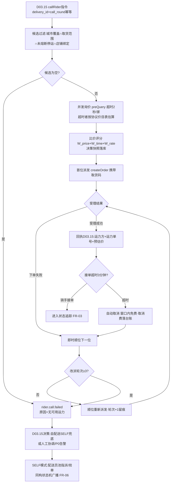
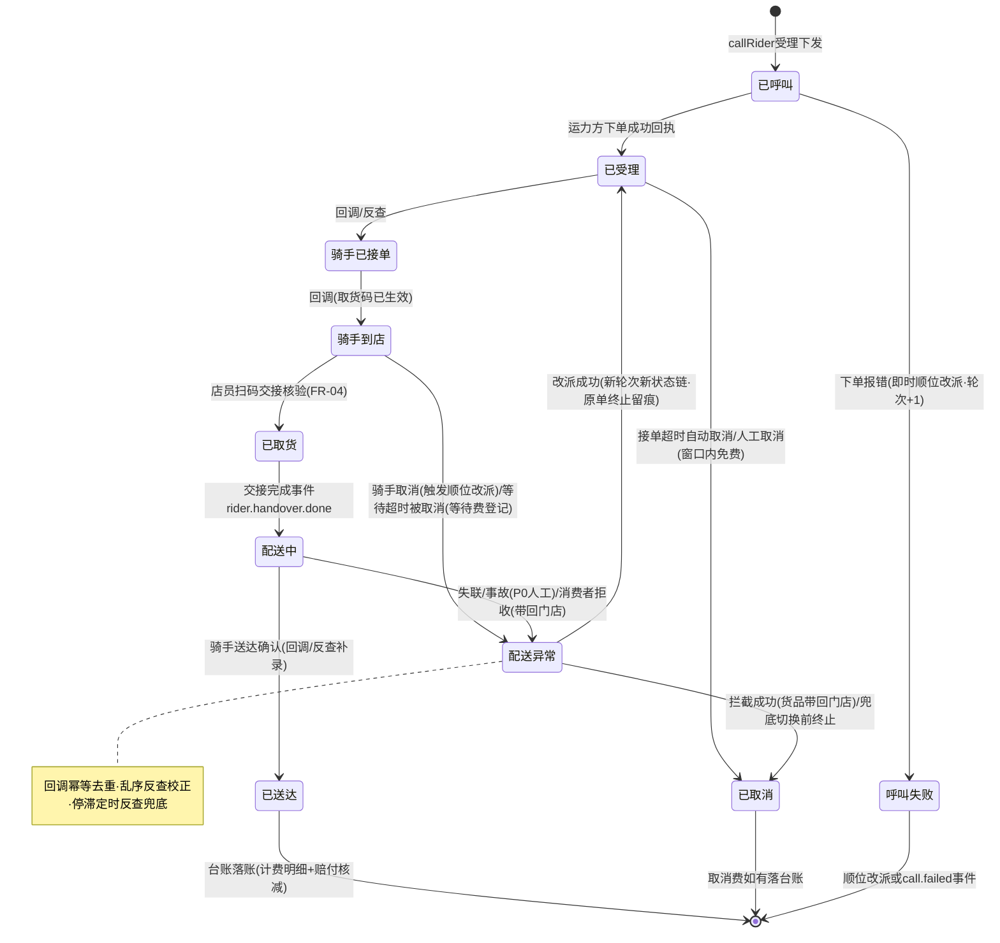

# SRS-D09.06 同城配送运力对接模块 需求规格说明书

> 文档编号：SRS-D09.06 · 版本 V1.0 · 2026-10-24 · 编写：小凯 · 状态：待审阅（V1.2 友商对标增补，G1 决策）
> 所属域：D09 履约集成域 · 分期：**P1（M2-M3，随 O2O 门店履约/即时零售同批）· 骑手位置轨迹 P2 可选**
> 上游依据：SRS-D03.15（即时零售履约——本模块唯一编排消费方，呼叫指令与状态事件契约）· SRS-D09.04（物流公司与分单路由——本模块是快递物流的同城版对标，运力方档案与 dly_corp 同构治理）· SRS-D02.02（适配器可插拔注册机制——运力方适配器同构复用其目录约定思想）· SRS-D08.04（运费对账——同城配送费台账扩展其账单体系）· SRS-D03.11（门店履约——自提转配送/门店自配送兜底的作业台联动）· SRS-D01.07（呼叫失败/运力熔断告警）· 《友商 OMS 对标与缺口分析》§G1（配送资源：美团跑腿/蜂鸟/达达/闪送/顺丰同城）

---

## 1. 模块概述

### 1.1 定位

本模块是**骑手运力聚合层**：对标 D09.04 之于快递物流（档案+路由+决策），解决同城即时配送的「运力方档案与接入、智能呼叫与比价派发、配送状态追踪、交接确认、运费结算、自配送兜底」六件事。上游 D03.15 即时零售履约（及 D03.11 门店转配送场景）只发一条 `callRider` 指令，本模块负责把这条指令翻译成对**美团跑腿/蜂鸟即配/达达快送/闪送/顺丰同城**等运力方的具体呼叫——比价选优、失败顺位改派、状态回流标准化、账单归集。

架构风格与 D02.02 平台适配器同构：**加运力方 = 加适配器目录 + 加配置 + 加映射，纯增量操作**；运力方 API 差异（下单报文/状态枚举/计费规则/取消窗口）全部封在适配器内，聚合层只面向统一的 `CarrierAdapter` 接口与标准化状态机。

与 D09.04 的边界（同为履约集成域，通道不同）：D09.04 管快递（天级、面单、区域路由）；本模块管同城骑手（分钟级、无面单、门店为取货点）；运力方档案独立建表（carrier 表）但治理规则同构（canonical 编码不可变/停用不影响存量在途单/变更审计）。

### 1.2 职责边界

**做**：运力方档案与接入管理（协议凭证/服务城市/计费协议/接单率指标/启停与熔断）；运力方适配器框架（`CarrierAdapter` 统一接口，可插拔注册）；智能呼叫（比价决策→自动派发→失败顺位改派）与预呼叫支持；配送状态追踪（回调→标准化状态机→事件广播）与骑手位置轨迹（P2 可选）；交接确认凭证管理（店员扫码：取货码生成/核验/留痕）；同城配送费台账（按单计费落账/改派费用归集/赔付核减联动）；自配送兜底（品牌自有配送员：配送员池/指派/送达确认）。

**不做**：履约编排与异常业务决策（→ D03.15：缺货/兜底切换判定/超时责任判定归其，本模块执行呼叫与回流事实）；门店作业台界面（→ D03.11/D03.15，本模块提供交接码与自配送数据服务）；运费对账引擎与账单三阶段（→ D08.04，本模块供同城账单数据源）；快递物流档案与分单（→ D09.04）；平台侧配送状态回传（→ D03.15 经 D02.04）；运力方结算付款执行（→ D08 财务链路）。

### 1.3 与其他模块关系

| 模块 | 关系 |
|---|---|
| D03.15 即时零售 | 唯一编排消费方：`callRider/cancelCall/updateCall` 指令入口；`rider.status.changed`/`rider.handover.done`/`rider.exception.*`/`rider.call.failed` 事件供给 |
| D03.11 门店履约 | 自配送兜底配送员池数据来源（store_profile.self_delivery_enabled/courier_pool）；自提转配送可复用呼叫通道（P2） |
| D09.04 物流分单 | 运力方档案治理规则同构（canonical 编码/停用口径/审计）；「同城」类型枚举互通（快递商兼营同城时档案关联引用不合并） |
| D02.02/D02.01 | 适配器目录约定/DI 标签注册/映射版本化机制同构复用（独立注册表同一架构模式）；运力方 API 出站调用复用其签名/限流/api_log 与凭证托管口径 |
| D08.04 运费对账 | 同城配送费台账=其账单体系扩展（`FreightBillService::import` 增同城模板；按运力方单号匹配） |
| D01.01/D01.02/D01.07 | 回调消费异步化；呼叫超时扫描/指标统计调度；呼叫失败/熔断/交接差异告警（P1/P0） |
| D10.06/D11.03 | 档案/协议价/启停/人工改派审计；呼叫成功率/改派率/接单率/账单差异率指标供数 |

---

## 2. 业务场景

**SC-D09.06-01 智能比价与自动派发（主流程）**
D03.15 拣货完成触发 `callRider`（门店 A→消费者地址 3.2km，重量 1.5kg，期望 21:00 前送达）。聚合层执行：① 候选运力方过滤（服务城市覆盖/门店在取货范围/未熔断/未停运）→ 剩美团跑腿、蜂鸟、达达；② 比价决策——各适配器预下单询价（价格：美团 6.5 元/蜂鸟 6 元/达达 5.5 元；预计接单耗时与送达时长；近 7 日接单率：98%/95%/88%）→ 加权评分选达达首位；③ 派发下单（携带取货码）→ 达达受理返回运力单号 → 回执 D03.15 落发货单扩展字段；④ 骑手接单→到店→扫码取货交接→配送中→送达，状态回调逐节点标准化广播。配送费 5.5 元落台账（订单关联）。

**SC-D09.06-02 呼叫失败顺位改派**
首位达达下单后 3 分钟无骑手接单（超时阈值=店铺配置，默认 3 分钟）：自动取消达达单（取消窗口内免费）→ 顺位改派第二位蜂鸟（比价评分序）→ 受理成功；蜂鸟也失败 → 第三位美团跑腿 → 全部失败发 `rider.call.failed` 事件（含逐位失败原因）→ D03.15 决策自配送兜底。改派全程轮次留痕（call_round），每轮费用（如产生取消费）归集台账。

**SC-D09.06-03 预呼叫与变更**
D03.15 拣货进度 70% 预呼叫（expected_pickup_time=now+8 分钟）：聚合层按预呼叫模式下单（运力方支持预约单则用预约语义，不支持则延迟派发——内部定时器到点再下单，适配器能力声明区分）。拣货报缺货品变更：`updateCall`（货品清单/重量更新）→ 适配器翻译各运力方变更接口（不支持变更的运力方=取消重呼，费用差异留痕）。骑手到店拣货未完成等待超运力方阈值被取消 → 自动重呼下一顺位 + 等待费登记（责任=门店，D03.15 台账输入）。

**SC-D09.06-04 店员扫码交接（防货损纠纷）**
骑手到店出示取货码（运力方 App 展示）：店员作业台扫码核验（码=呼叫时生成随单下发，一次一码）→ 核验通过展示货品清单 → 店员确认交接 → 交接凭证落库（码/店员账户/时间/骑手信息/清单快照）→ 广播 `rider.handover.done`。骑手未到店但回调「已取货」（运力方骑手违规操作）→ 交接缺失差异标记 → P1 告警 + 货损纠纷时凭证链举证（交接前责任=门店，交接后责任=运力方）。

**SC-D09.06-05 运力方熔断与恢复**
晚高峰蜂鸟下单失败率 5 分钟 >50%：熔断开启（暂停参与比价派发，存量在途回调仍正常消费）→ P1 告警（履约值班+运力对接人）→ 半开探测（每 2 分钟询价）→ 恢复自动闭合+恢复通知；熔断期间呼叫自动走其余顺位；全熔断 → `rider.call.failed`（原因=运力全故障）→ D03.15 自配送兜底 + P0 告警。

**SC-D09.06-06 同城配送费台账与月度对账**
每单送达后台账落账（计费明细：基础运费+距离/重量/时段加价+取消费/等待费+赔付核减）。月底导入达达账单（D08.04 `FreightBillService::import` 同城模板）：按运力单号匹配台账 → 差异（账单 6 元 vs 台账 5.5 元）→ D08.04 差异处理（认可/索赔）；差异率 >20% 运力方生成协议复核工单。责任=运力方的超时赔付（D03.15 `instant.compensation.created`）自动核减台账应付。

**SC-D09.06-07 自配送兜底（品牌自有配送员）**
门店 B 位于三线城市，仅顺丰同城覆盖且当晚停运：`rider.call.failed` 后 D03.15 切自配送 → 本模块自配送面板数据服务：门店配送员池（store_profile.courier_pool：姓名/手机号/状态）→ 店长指派（或配送员抢单模式，店铺配置）→ 配送员收到通知（D01.07 短信/企微：地址+联系方式隐私号+货品清单）→ 取货确认（同扫码交接，码由作业台生成配送员核验）→ 送达确认（作业台/配送员 H5 按钮+拍照可选）→ 状态事件同构广播（D03.15 编排无感知差异）；自配送成本按人工工时口径不入运力台账（店铺级成本科目，D08 口径另行登记）。

---

## 3. 功能需求

### FR-D09.06-01 运力方档案与接入
- FR-01a 运力方档案（carrier）：canonical 运力编码（全局唯一不可变，治理规则同 D09.04 FR-01c）、名称/简称、类型（平台自营运力：美团跑腿/蜂鸟；第三方众包：达达/闪送；快递同城：顺丰同城；品牌自配送=内置虚拟运力方 SELF）、服务城市集（city_code 列表）、取货范围约束（门店半径 km，可空=城市内不限）、计费协议（协议价折扣系数/月结账号）、状态（启用/停用/熔断中）。
- FR-01b 接入凭证管理：各运力方开放平台 appKey/secret/门店绑定关系（运力方侧商家门店 ID 映射：OMS 门店 branch_id × 运力方 → 运力方门店 ID，入驻开通时登记）；凭证经 D01.05 L3 加密，复用 D02.01 框架托管口径。
- FR-01c 运力方适配器（`CarrierAdapter` 统一接口，可插拔注册——目录约定与 DI 标签机制同构 D02.02 FR-03）：

| 能力 | 接口方法 | 说明 |
|---|---|---|
| 询价 | `preQuery(deliveryReq)` | 预估价+预计接单耗时+预计送达时长（比价输入；不支持询价的运力方按协议价目表本地估算，能力声明区分） |
| 下单 | `createOrder(deliveryReq, 取货码)` | 呼叫派发（含预约语义支持声明） |
| 取消 | `cancelOrder(carrierOrderNo, 原因)` | 返回是否产生取消费 |
| 变更 | `updateOrder(carrierOrderNo, 变更项)` | 货品/重量/取货时间变更；不支持=CAPABILITY_NOT_SUPPORTED（取消重呼） |
| 查询 | `queryOrder(carrierOrderNo)` | 状态对账反查（回调丢失兜底，D01.02 定时扫描） |
| 回调解析 | `parseCallback(rawMessage)` | 运力方状态回调 → 标准化状态事件（验签委托 D02.01） |

- FR-01d 能力白名单与差异声明：每运力方声明支持能力（预约单/变更/询价/轨迹）；映射版本化（状态枚举映射表落库，同 D02.02 FR-04e 机制）。
- FR-01e 接单率指标：近 7 日/30 日接单率、平均接单耗时、取消率、超时率按运力方×城市维度滚动统计（D01.02 调度，比价决策输入+D11.03 看板）。
- FR-01f 熔断器：下单失败率/超时率阈值触发熔断（5 分钟窗口 >50% 开启，默认值运力方级可配）→ 暂停参与派发（存量在途单回调仍消费）→ 半开探测自动恢复；熔断/恢复告警（D01.07 P1）；全运力熔断=P0。
- FR-01g 停运配置：运力方×城市×时间窗停运表（节假日/天气，同 D09.04 停运表机制）；分钟级生效。

### FR-D09.06-02 智能呼叫（比价→派发→改派）
- FR-02a 统一入口：`InstantDeliveryService::callRider(deliveryReq)`——deliveryReq 含：发货单/订单引用、取货门店（branch_id+地址+经纬度+联系人隐私号）、收货人（地址+经纬度+隐私号）、货品（清单/重量/体积/声明价值）、期望送达时间、预呼叫标记与预计取货时间、呼叫轮次；返回受理结果（运力方+运力单号+预估价）或结构化失败（`rider.call.failed` 事件含逐位失败原因）。
- FR-02b 候选过滤：服务城市覆盖 ∩ 门店取货范围 ∩ 未熔断未停运 ∩ 店铺运力绑定集合（店铺级配置可用运力方+优先级覆盖，同 D09.04 店铺物流绑定机制）。
- FR-02c 比价决策：`score = W_price×价格分 + W_time×时效分 + W_rate×接单率分`（权重全局默认 0.4/0.35/0.25，店铺级可配）；价格分=1−(报价−最低价)/(最高价−最低价+ε)；时效分按预计送达 vs 期望送达裕量；接单率分=近 7 日接单率；询价并发调用（超时 2 秒/家，超时者按协议价目表估算参与）；决策快照落库（各家报价/评分/选择依据——对账争议与算法校准回放）。
- FR-02d 自动派发与顺位改派：首位派发 → 受理成功即返回；受理失败（下单报错）即时顺位；受理成功但**接单超时**（默认 3 分钟无骑手接单，店铺级可配）→ 自动取消（窗口内）→ 顺位下一位；改派上限（默认 3 轮，超过发 `rider.call.failed` 交 D03.15 兜底决策）；每轮留痕（轮次/运力方/失败原因/耗时/取消费）。
- FR-02e 预呼叫模式：支持预约语义的运力方直接下预约单；不支持的走**延迟派发**（内部定时器：expected_pickup_time − 运力方平均接单耗时 前触发实际下单）；变更（FR-02f）与取消窗口按预呼叫口径管理。
- FR-02f 呼叫变更：`updateCall(carrierOrderNo, 变更项)` → 适配器变更接口；不支持变更 → 自动取消重呼（重呼沿用比价，费用差异留痕）；骑手已取货后变更拒绝（转 D03.15 异常编排）。
- FR-02g 呼叫取消：`cancelCall(carrierOrderNo, 原因)` → 窗口内免费取消；窗口外产生取消费落台账（责任方标记）；骑手已取货取消=拦截请求（结果事件回 D03.15，成功则货品带回门店）。
- FR-02h 呼叫幂等：幂等键=(delivery_id + call_round)；重复指令返回首次受理结果；改派轮次单调递增（并发防护：呼叫单级分布式锁）。

### FR-D09.06-03 配送状态追踪
- FR-03a 标准化状态机（本模块权威定义）：`已呼叫 → 已受理 → 骑手已接单 → 骑手到店 → 已取货(交接完成) → 配送中 → 已送达`；异常分支：`呼叫失败/已取消(窗口内外)/骑手取消(改派触发)/配送异常(失联/事故/拒收)`——见 §4.2。
- FR-03b 状态回调消费：运力方回调（webhook）→ 适配器 `parseCallback` 标准化 → 幂等去重（运力单号+状态+回调时间戳）→ 状态机流转校验（非法流转/乱序回调：以运力方查询接口 `queryOrder` 反查校正，仍冲突进异常缓冲人工核对）→ 广播 `rider.status.changed`（payload：呼叫单/运力方/状态/骑手信息脱敏/时间戳）。
- FR-03c 回调丢失兜底：在途单定时扫描（D01.02，每 2 分钟）——状态停滞超阈值（如「骑手已接单」>15 分钟无进展）主动 `queryOrder` 反查同步；送达后回调缺失（>30 分钟）反查补录+差异标记。
- FR-03d 骑手位置轨迹（**P2 可选**）：轨迹订阅接口占位（适配器能力声明 trajectory）；轨迹点落库（运力单×经纬度×时间，在线 7 天）；查询服务供作业台/门户展示；P1 仅落关键节点（接单/到店/取货/送达）不采集连续轨迹。
- FR-03e 骑手信息隐私：骑手姓名/手机号脱敏存储展示（D01.05）；联系经隐私号（运力方虚拟号透传）；消费者联系方式给运力方一律隐私号口径（适配器报文层强制，明文拒绝下发）。

### FR-D09.06-04 交接确认（店员扫码）
- FR-04a 取货码生成：呼叫受理成功即生成（6 位数字，一次一码：呼叫单维度唯一，改派轮次换码旧码作废）；随下单报文下发运力方（骑手 App 展示）。
- FR-04b 扫码核验交接：店员作业台扫骑手出示码 → 校验（码有效/属本呼叫单/未核验/未作废）→ 展示货品清单核对 → 确认交接 → 凭证落库（码/店员账户/时间/骑手信息/清单快照/交接方式=扫码）→ 广播 `rider.handover.done`（D03.15 消费推进编排）。
- FR-04c 交接差异治理：运力方回调「已取货」但无扫码交接记录 → 差异标记 + P1 告警 + 补录入口（店员确认+备注原因）；交接凭证=货损纠纷责任分界举证链（交接前门店/交接后运力方，D03.15 责任判定输入）；错误码连续 5 次锁定 10 分钟（防暴力尝试，同 D03.11 自提核销口径）。
- FR-04d 交接时效监控：骑手到店→交接完成耗时 >10 分钟 P1 催办（门店侧延误，D03.15 台账等骑手耗时细分输入）。

### FR-D09.06-05 运费结算（同城配送费台账）
- FR-05a 台账落账：送达确认（或取消产生费用）即落台账行——订单/发货单/运力方/运力单号/呼叫轮次/计费明细（基础运费/距离加价/重量加价/时段加价/小费/取消费/等待费）/预估价 vs 实际价/赔付核减/责任方；全单据 owner_id+tenant_id。
- FR-05b 赔付核减联动：订阅 D03.15 `instant.compensation.created`（责任方=运力方）→ 台账应付核减登记（核减项关联赔付台账 ID，审计可解释）；核减后应付=Σ计费明细−赔付核减。
- FR-05c 账单对账（D08.04 扩展）：运力方月度账单导入走 `FreightBillService::import`（同城模板：按运力单号匹配台账）；差异处理/三阶段推进（记账→审核→关账）复用 D08.04 既有引擎；预估 vs 实际差异率 >20% 运力方生成协议复核工单（校准 FR-02c 价格分输入）。
- FR-05d 应付数据供给：关账后按运力方×货主×周期汇总应付（`FreightActualService::getPayable` 口径扩展同城运力维度）→ D08.03/D08.06 金蝶供数链路。

### FR-D09.06-06 自配送兜底（品牌自有配送员）
- FR-06a 内置虚拟运力方 SELF：参与比价的特殊候选（价格=0 显性成本、时效=人工评估、优先级店铺可配「仅兜底/始终参与」两模式，默认仅兜底——第三方呼叫全失败或店铺显式选 SELF 时启用）。
- FR-06b 配送员池管理：门店维度（store_profile.courier_pool 联动，D03.11 数据源）：姓名/手机号（加密）/状态（在班/休息）/当前在途单数；配送员无独立账号体系（P1 轻量：手机号+短信验证码登录 H5，P2 并入 D10.02 账户）。
- FR-06c 指派与接单：店长指派（作业台选配送员）或抢单模式（池内广播通知 D01.07 短信，先抢先得，并发锁防双抢）；接单后同构进入标准化状态机（到店/取货交接同扫码流程 FR-04/送达确认=作业台或配送员 H5 按钮+拍照可选）。
- FR-06d 状态事件同构广播：自配送与第三方运力对 D03.15 完全同构（`rider.status.changed` 等事件 payload 运力方=SELF），编排层无感知差异；自配送成本不入运力台账（无外部应付），单量/耗时统计落台账（自配送率/单均耗时，D11.03 看板）。

### FR-D09.06-07 监控与治理
- FR-07a 指标供数（D11.03）：呼叫成功率/首轮受理率/平均改派轮次/运力方接单率与超时率排名/交接差异率/台账-账单差异率/自配送兜底率，按门店/城市/运力方/货主维度。
- FR-07b 告警清单（D01.07 FR-06 登记增补）：呼叫连续失败（P1）/运力方熔断（P1）/全运力不可用（P0）/交接差异（P1）/在途单状态停滞反查失败（P1）/台账账单差异超阈（P2 日报）。配置审计：运力方档案/协议价/权重/绑定/停运/人工改派与强制取消全部写 D10.06。

---

## 4. 业务流程

### 4.1 呼叫-比价-改派流程（SC-01/02）



### 4.2 配送单标准化状态机（FR-03a 权威定义）



---

## 5. 处理逻辑

### 5.1 比价评分算法（FR-02c 伪代码）

```
输入: deliveryReq, 候选运力方集 C(过滤后), 店铺权重 W(默认0.4/0.35/0.25)
并发询价: quote[c] = c.preQuery(req) timeout=2s; 超时/不支持→协议价目表本地估算(estimated=true)
for c in C:
    price_score = 1 − (quote[c].price − price_min) / (price_max − price_min + 0.01)
    slack = promise_time − (now + quote[c].eta_送达分钟)     # 时效裕量
    time_score = clamp(slack / 15分钟, 0, 1)                 # 裕量≥15分钟满分
    rate_score = c.近7日接单率(city维度)                      # FR-01e 滚动统计
    score[c] = W.price×price_score + W.time×time_score + W.rate×rate_score
排序: score DESC → 派发序; 并列取接单率高者
决策快照: {各家quote/score/依据/权重版本} 落库(call_decision表)
校准: 台账预估vs实际差异率>20%运力方 → 协议复核工单(FR-05c) → 价目表修正
```

### 5.2 改派编排与幂等（FR-02d/h）

```
callRider(req): 锁(delivery_id)
  round = req.call_round ?? 当前轮次+1
  幂等: (delivery_id, round) 已有受理结果 → 直接返回
  for carrier in 比价排序(FR-02c):
      下单受理失败(报错) → 记录原因 → continue(即时顺位)
      受理成功 → 启动接单超时定时器(MQ延迟消息·默认3min店铺可配)
      定时器到期未接单 → cancelOrder(窗口内) → 取消费登记 → 重入排序剩余位
      骑手接单 → 取消定时器 · 返回受理回执
  全部失败 或 累计改派轮次>3 → 事件 rider.call.failed(逐位原因快照)
回调与改派竞争: 取消指令与「骑手已接单」回调竞争 → 以运力方查询反查为准;
  取消失败(已被接单) → 状态回滚接续追踪(留痕)
```

### 5.3 状态回调标准化与乱序治理（FR-03b/c）

```
handleCallback(carrier, raw):
    event = adapter.parseCallback(raw)          # 验签经D02.01
    幂等: (carrier_order_no, native_status, callback_ts) 已处理 → 忽略
    映射: std_status = enum_mapping(carrier, native_status)   # 版本化
    未命中映射 → 异常缓冲 + P1告警(不静默丢弃·同D02.02 FR-04b口径)
    流转校验: 合法(§4.2) → 落状态+广播 rider.status.changed
             乱序(如未到店先送达) → queryOrder反查校正 → 仍冲突进异常缓冲人工
定时兜底(D01.02·2分钟): 停滞超阈 → queryOrder反查同步; 送达后30分钟无终态回调
  → 反查补录+差异标记(台账以反查结果落账)
```

### 5.4 取货码交接核验与熔断降级（FR-04/FR-01f）

```
取货码: 受理成功即生成6位随机码; 唯一约束=(carrier_order_no, call_round)
  改派新轮次换码·旧码作废(作废表留痕防重放)
核验链(顺序短路): 码存在 → 属本呼叫单 → 未核验未作废 → 锁定检查
核验通过: 订单级锁内 落交接凭证+状态=已取货+广播 handover.done
差异: 回调已取货但无核验记录 → 差异标记+P1告警+补录(店员确认+备注)
错误计数: Redis INCR(门店+设备), 5次锁10分钟(同D03.11 §5.3口径)
熔断器(per carrier×city): 滑动窗口5分钟 下单失败率>50%(阈值可配) → OPEN
  OPEN: 比价候选剔除(存量在途回调正常消费) + P1告警(值班+运力对接人)
  半开: 每2分钟 preQuery 探测 ×3 成功 → CLOSED + 恢复通知(D01.07 FR-04f口径)
全运力OPEN或候选恒空: rider.call.failed(原因=运力全故障) + P0告警
降级链: 第三方运力 → SELF自配送(D03.15决策) → 人工协调(客服外呼)
```

---

## 6. 数据字段（业务字段描述）

> 物理表落 `oms_fulfill` schema（D09 域，同 D09.04 口径）；DDL 见 DB-D09 增补。

### 6.1 运力方档案（fulfill_carrier）

| 字段 | 业务含义 | 取值/校验 |
|---|---|---|
| carrier_code / carrier_name / short_name | canonical 运力编码/名称/简称 | 编码全局唯一不可变（MEITUAN_PAOTUI/FENGNIAO/DADA/SHANSONG/SF_CITY/SELF） |
| carrier_type | 类型 | 平台自营/第三方众包/快递同城/品牌自配送 |
| service_cities / pickup_radius | 服务城市集/取货范围 km | JSON city_code 列表（候选过滤输入）；空=城市内不限 |
| capability_flags / agreement_json | 能力声明/计费协议 | JSON：预约单/变更/询价/轨迹（FR-01d 白名单）；折扣系数/价目表引用/月结账号 |
| circuit_status / suspend_json / status | 熔断状态/停运配置/启停 | 熔断运行态；停运=城市×时间窗（分钟级生效）；停用不参与新派发，在途单不受影响（D09.04 FR-01c 同口径） |
| tenant_id / owner_id | 归属 | 平台级共享档案 owner=系统（SRS-00 契约） |

### 6.2 呼叫单（fulfill_rider_call）

| 字段 | 业务含义 | 取值/校验 |
|---|---|---|
| call_no / delivery_id / order_id | 呼叫单号/关联发货单订单 | call_no 唯一；(delivery_id, call_round) 幂等键 |
| call_round / pre_call_flag / expected_pickup_time | 呼叫轮次/预呼叫标记/预计取货时间 | 轮次 ≥1，>3 告警 |
| carrier_code / carrier_order_no / status | 运力方/运力单号/标准化状态 | 受理成功必填；SELF=自配送；状态=§4.2 枚举 |
| pickup_code / code_voided | 取货码/作废标记 | 一次一码，改派换码 |
| promise_time / eta_time / est_price / decision_snapshot_id | 期望送达/预计送达/预估价/决策快照引用 | 比价输入；FR-02c 回放依据 |
| cancel_fee / wait_fee / fee_liability | 取消费/等待费/责任方 | 台账归集输入 |
| courier_name / courier_phone(加密) | 骑手信息 | 脱敏展示（FR-03e） |
| self_courier_id / assign_mode | 自配送员/指派方式 | SELF 模式：指派/抢单 |
| store_branch_id / shop_id / tenant_id / owner_id | 归属 | 必填 |

### 6.3 状态轨迹与交接凭证（fulfill_rider_track / fulfill_handover）

| 字段 | 业务含义 |
|---|---|
| track：call_no / std_status / native_status / carrier_ts / receive_ts / source(回调-反查-补录) / rider_snapshot；P2 增 lng/lat/point_ts | 状态流水（幂等去重键=carrier_order_no+native_status+ts）；骑手轨迹点在线 7 天（FR-03d） |
| handover：call_no / pickup_code / verify_operator(店员账户) / verify_time / item_snapshot(清单快照) / verify_mode(扫码-补录) / diff_flag | 交接凭证（货损纠纷举证链，责任分界=交接时点） |
| 两表 tenant_id / owner_id | 必填 |

### 6.4 配送费台账（fulfill_city_freight）

| 字段 | 业务含义 | 取值/校验 |
|---|---|---|
| call_no / carrier_order_no / order_id / delivery_id | 关联键 | 运力单号唯一（账单匹配键） |
| base_fee / distance_fee / weight_fee / period_fee / tip_fee / cancel_fee / wait_fee | 计费明细+取消费/等待费 | 送达后按运力方账单口径落账；责任方标记联动 |
| compensation_deduct / deduct_ref | 赔付核减/依据 | `instant.compensation.created` 关联（FR-05b） |
| est_price / actual_price / diff_rate | 预估/实际/差异率 | 比价校准输入 |
| settle_status / bill_period / tenant_id / owner_id | 结算状态/账期/归属 | D08.04 三阶段（记账→审核→关账）；必填（货主分账口径） |

### 6.5 决策快照/运力指标/店铺运力绑定（fulfill_call_decision / fulfill_carrier_metric / fulfill_shop_carrier）

| 字段 | 业务含义 |
|---|---|
| decision：call_no / quotes_json(各家报价+eta+接单率) / scores_json / weights_version / chosen_carrier / estimated_flags | 决策回放（对账争议与权重校准依据） |
| metric：carrier_code / city_code / stat_date / accept_rate_7d / accept_rate_30d / avg_accept_seconds / cancel_rate / overtime_rate | 滚动指标（FR-01e，比价输入+看板） |
| shop_carrier：shop_id / carrier_code / priority / self_mode(仅兜底-始终参与) / accept_timeout / reassign_limit / status | 店铺可用运力集合+优先级+接单超时/改派上限覆写（FR-02b/d 参数源） |
| store_carrier_map：store_branch_id / carrier_code / carrier_store_id | 运力方侧门店 ID 映射（FR-01b 入驻登记） |
| 各表 tenant_id / owner_id | 必填 |

---

## 7. 接口

### 7.1 内部接口（本模块提供）

| 编号 | 接口 | 消费方 | 说明 |
|---|---|---|---|
| IF-D09.06-01 | `InstantDeliveryService::callRider(deliveryReq)` | D03.15（IF-D03.15-D3） | 呼叫主入口（含预呼叫）；幂等键=(delivery_id, call_round)；返回受理回执或异步 `rider.call.failed` |
| IF-D09.06-02 | `InstantDeliveryService::queryCall(callNo/deliveryId)` | D03.15/工作台/门户 | 呼叫单与状态轨迹查询（含决策快照回放） |
| IF-D09.06-03 | `InstantDeliveryService::cancelCall(carrierOrderNo, 原因)` | D03.15（取消/拦截编排） | 取消（窗口内免费/取消费登记/已取货=拦截请求）；幂等 |
| IF-D09.06-04 | `InstantDeliveryService::updateCall(carrierOrderNo, 变更项)` | D03.15（预呼叫变更） | 货品/重量/取货时间变更；不支持变更的运力方自动取消重呼 |
| IF-D09.06-05 | `HandoverService::genCode/verify(code, storeId, operator)/supplement(callNo, operator, 备注)` | 门店作业台 | 取货码生成/扫码核验/差异补录（FR-04） |
| IF-D09.06-06 | `SelfDeliveryService::courierPool(storeId)/assign(callNo, courierId)/grab(callNo, courierId)/confirmDeliver(callNo, 拍照?)` | 作业台/配送员 H5 | 自配送兜底（FR-06） |
| IF-D09.06-07 | 事件 `rider.status.changed` / `rider.handover.done` / `rider.call.failed` / `rider.exception.reassigned` / `rider.exception.lost` / `rider.order.cancelled` | D03.15 编排/D01.07/D11.03 | 标准化状态广播（DB-00 附录 A 事件字典登记增补） |
| IF-D09.06-08 | `CityFreightService::ledgerQuery(条件)` / 台账数据供给 | D08.04 对账/D10.04 门户/D11 | 同城配送费台账（账单匹配与应付汇总口径） |
| IF-D09.06-09 | `CarrierService::get/list/metric(carrier_code)` | 配置后台/D11.03/比价引擎 | 运力方档案与滚动指标查询 |

### 7.2 依赖接口（本模块消费）

| 编号 | 接口 | 提供方 | 说明 |
|---|---|---|---|
| IF-D09.06-D1 | 门店档案/自配送池（store_profile.instant 扩展列） | D03.11/D03.15（§6.4） | 取货点信息/经纬度/自配送数据源 |
| IF-D09.06-D2 | 订阅 `instant.compensation.created` | D03.15（IF-06） | 赔付核减台账（FR-05b） |
| IF-D09.06-D3 | `FreightBillService::import` / `FreightCheckService::run` / `FreightActualService::getPayable` | D08.04（IF-02/03/08） | 同城账单导入/核对/应付供给（模板扩展） |
| IF-D09.06-D4 | D02.01 框架出口（签名/限流/api_log）+ 验签 | D02.01 | 运力方 API 调用与回调验签通道 |
| IF-D09.06-D5 | `AlertService::alert` / `NotifyService::send` | D01.07（IF-01/02） | 熔断/失败/交接差异告警；配送员通知（短信/企微） |
| IF-D09.06-D6 | 任务通道/延迟消息（接单超时定时器）/定时扫描（停滞反查/指标统计） | D01.01/D01.02 | FR-02d/03c/01e 承载 |
| IF-D09.06-D7 | `AuditService` | D10.06 | 档案/协议/权重/人工操作审计 |

### 7.3 外部接口

| 编号 | 接口 | 方向 | 说明 |
|---|---|---|---|
| EF-D09.06-01 | 5 运力方开放平台（下单/取消/变更/查询/状态回调）：美团跑腿 meituan_paotui（预约语义支持）/蜂鸟即配 fengnuo/达达快送 dada/闪送 shansong/顺丰同城 sf_city | 双向 | 各家一个适配器目录（FR-01c） |
| EF-D09.06-02 | 运力方轨迹接口（P2 可选） | 出 | 骑手位置订阅/拉取（能力声明 trajectory） |

> 各适配器实现 `CarrierAdapter` 六能力接口（FR-01c）；新运力方接入=新目录+配置+映射，聚合层零改动；沙箱联调+录制回放测试集同 D02.02 §5.4 策略。

---

## 8. 非功能需求

| 项 | 要求 |
|---|---|
| 性能 | callRider 受理端到端（过滤+询价+派发）P95 ≤3 秒（询价并发 2 秒封顶）；状态回调处理 ≤200ms；接单超时定时器精度 ±10 秒 |
| 可用性 | 单运力方故障不影响其余顺位（熔断隔离）；全故障降级链（SELF→人工）；回调丢失反查兜底不丢终态；在途单状态可观测率 100% |
| 幂等/并发 | 呼叫/取消/变更/交接核验全幂等（幂等键 §5.2/§5.4）；改派与回调竞争以运力方反查为准；呼叫单级分布式锁 |
| 一致性 | 状态机-台账-交接凭证联动补偿链闭环；台账以送达/取消终态落账（反查补录差异标记）；预估-实际差异回流校准 |
| 安全/PIPL | 骑手/消费者/配送员手机号加密存储、隐私号下发（明文拒绝）；凭证 D01.05 L3 加密；取货码防重放（一次一码+作废表）；操作审计（D10.06） |
| 可观测 | 呼叫成功率/改派轮次/接单率/交接差异率/台账差异率指标（D11.03）；决策快照全量可回放 |
| 容量 | 呼叫单≈即时零售单量×1.2（改派系数）；轨迹点（P2）在线 7 天滚动清理；台账随订单归档（D03.13 口径） |
| 租户隔离 | 全表 tenant_id+owner_id；品牌方门户仅见本货主呼叫单/台账/自配送统计 |

---

## 9. 验收标准

| 编号 | 验收条件 |
|---|---|
| AC-01 | 主流程（SC-01）：callRider 后候选过滤→并发询价→比价评分选优→派发受理 ≤3 秒（P95）；决策快照落库可回放各家报价与评分；受理回执（运力方+运力单号+预估价）正确回 D03.15 |
| AC-02 | 顺位改派（SC-02）：首位下单失败即时顺位；受理成功 3 分钟无骑手接单自动取消（窗口内免费）并顺位；改派 3 轮全失败发 `rider.call.failed`（含逐位原因快照）；每轮留痕完整 |
| AC-03 | 5 运力方适配器（沙箱）：呼叫/取消/变更/查询/回调解析五能力联调通过；新增模拟运力方适配器只加目录+配置即注册成功，存量运力方回归全绿（纯增量验证，D02.02 AC-08 同口径） |
| AC-04 | 预呼叫与变更（SC-03）：预约语义运力方下预约单、不支持者延迟派发（到点自动下单）；updateCall 货品变更成功；不支持变更运力方自动取消重呼且费用差异留痕；骑手已取货后变更被拒 |
| AC-05 | 状态追踪：回调标准化→状态机按 §4.2 流转→逐节点广播 `rider.status.changed`；重复回调幂等忽略；乱序回调查询反查校正；在途单停滞 15 分钟定时反查同步；未命中映射进异常缓冲+P1 告警不静默 |
| AC-06 | 交接确认（SC-04）：扫码核验成功落凭证（码/店员/时间/清单快照）+广播 `rider.handover.done`；回调已取货但无核验记录→差异标记+P1 告警+补录入口；错误码 5 次锁定 10 分钟；改派换码后旧码作废不可复用 |
| AC-07 | 熔断降级（SC-05）：注入下单失败率 >50% → 该运力方熔断剔除候选+P1 告警，存量在途回调正常；半开探测恢复自动闭合+恢复通知；全运力熔断→call.failed+P0+自配送兜底链路打通 |
| AC-08 | 运费台账与对账（SC-06）：送达落账计费明细完整；赔付核减事件自动登记应付核减（关联赔付台账 ID）；月度账单导入按运力单号匹配，差异走 D08.04 处理流程；差异率 >20% 运力方生成协议复核工单 |
| AC-09 | 自配送兜底（SC-07）：SELF 模式配送员池查询/店长指派/抢单（并发双抢仅一人成功）/扫码取货/送达确认（H5+拍照）全链路；状态事件与第三方运力同构（D03.15 无感知差异）；自配送单量统计不入运力应付台账 |
| AC-10 | 隐私与审计：骑手/消费者手机号存储加密展示脱敏，下发运力方报文强制隐私号（构造明文请求被拒）；运力方档案/协议价/权重/停运/人工改派与强制取消操作全审计可查；呼叫单/台账/交接凭证全表 owner_id+tenant_id 且门户行级隔离生效 |

---

## 变更记录

| 日期 | 版本 | 变更 | 原因 |
|---|---|---|---|
| 2026-10-24 | V1.0 | 首版 | 友商对标 G1 缺口，Jason 决策「有业务，补完整能力」（V1.2 增补） |

---

*参考实现溯源：商派 meituan4sg/meituan4medicine/meituan4flash/meituan4group/meituan4wm 等 5 个美团适配目录（矩阵中心平台目录族中美团系即时配送报文映射：闪购/医药/闪送/团购/外卖——配送下单与状态回调的矩阵协议实现，运力方耦合在各平台目录内无聚合层）+ 商派 o2o 模块（logisticsmanager 同城配送商预留：达达/顺丰同城对接占位，店掌柜交接作业参考，逆向文档 05 §5.3）+ 万里牛即时零售方案公开资料（美团跑腿/蜂鸟/达达/闪送/顺丰同城五运力聚合、智能比价与自动派单、骑手轨迹追踪、多运力顺位改派、同城配送费月结对账形态）。关键差异：① 商派美团系配送能力散落 5 个平台适配目录（每平台各自直连运力，无比价无聚合），本设计收敛为独立运力聚合层（`CarrierAdapter` 六能力统一接口+可插拔注册，架构模式同构 D02.02 适配器机制但注册表独立）；② 比价决策显式算法化（价格/时效/接单率三因子加权+决策快照回放+预估-实际差异回流校准），商派与万里牛公开资料均为「按配置顺序呼叫」无比价评分；③ 标准化状态机为本模块权威定义源（乱序回调反查校正+停滞定时反查+映射未命中告警缓冲），商派回调状态各目录硬编码翻译；④ 取货码一次一码+改派换码作废+交接凭证举证链（货损责任分界=交接时点）产品化，商派 o2o 无扫码交接闭环；⑤ 熔断器+半开探测+全运力降级链（SELF 自配送→人工）显式化，商派无运力方治理；⑥ 同城配送费台账对齐 D08.04 预估/实际双账单与三阶段关账模型（赔付核减事件驱动登记），商派运费无同城口径；⑦ 自配送兜底为内置虚拟运力方 SELF（对编排层完全同构广播），商派/万里牛公开资料均无自配送模式。*
