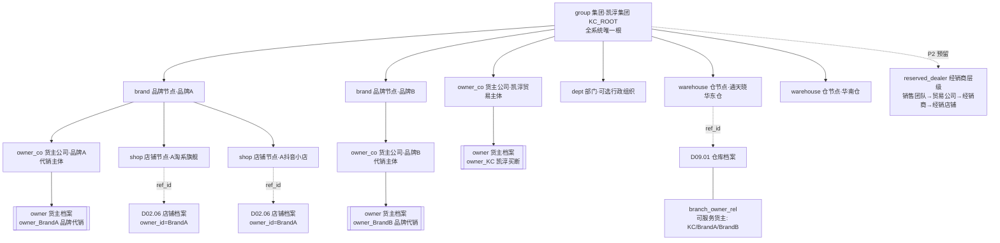
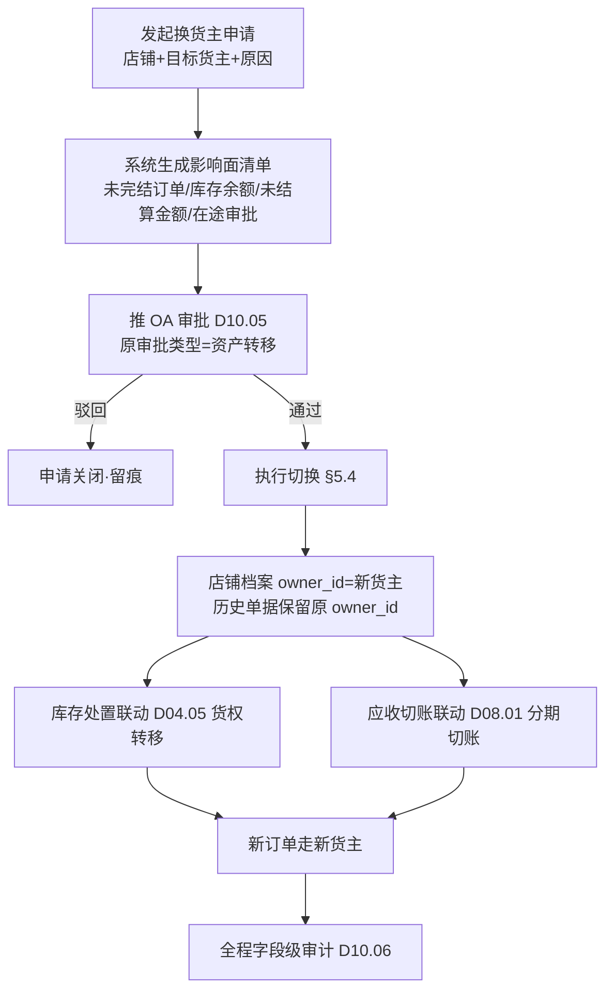
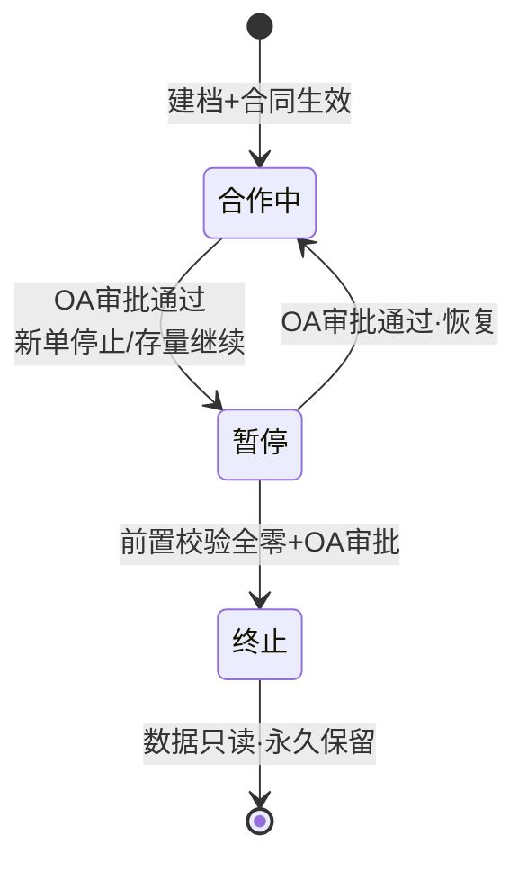

# SRS-D10.01 组织架构与货主管理 需求规格说明书

> 文档编号：SRS-D10.01 · 版本 V1.0 · 2026-10-24 · 编写：小凯 · 状态：待审阅（批次⑤随组织权限门户域整体交审）
> 所属域：D10 组织权限与门户域 · 分期：**P0（M1 前置）**
> 上游依据：SRS-00 §4.4 契约「货主维度」（本模块=唯一定义源）· 逆向文档 04 §10（organization 双树模型与权限继承）· 逆向文档 07 §2.8 · 41 问决策（Q2 货主隔离/Q27/Q39 审批）
> 定位：全系统组织与货主主数据的**唯一定义源**——组织树、货主档案、货主类型枚举（SRS-00 契约）均在此定义，其他模块只引用不重复定义。

---

## 1. 模块概述

### 1.1 定位

组织架构与货主管理维护凯淳 OMS 的两套主数据骨架：

1. **一棵统一组织树**（`org_node`）：节点类型 = 集团 / 品牌 / 货主公司 / 店铺 / 仓，承载内部员工按组织授权的数据权限根基（D10.03 权限继承四步模型的树就是它）；
2. **货主档案**（`owner`）：库存与单据的法律归属主体（SRS-00 术语表），货主类型枚举 = `凯淳买断 / 品牌代销 / 经销商贸易公司（预留 P2）`，是三元记账键 `(branch_id, sku_id, owner_id)` 第三元的权威来源。

商派逆向验证的核心教训（逆向文档 04 §10.4）：cos 树与 organization 树**两棵树并存、语义重叠、编码前缀互认**，脆弱难维护；cos_id 用逗号分隔字符串存集合无法建索引；数据隔离只到字段级归属、无租户行隔离。凯淳重写为**一棵带类型枚举的组织树 + 关系表关联 + 货主维度上升为全域强制字段**。

### 1.2 职责边界

**做**：组织树模型与树操作（增删改移动）、货主档案全生命周期（合作中/暂停/终止）、货主与品牌方合同关联、结算周期配置载体（供 D08.02 消费）、组织节点与账户/店铺/仓/货主的关联关系、组织变更影响面管控（店铺换货主=资产转移需审批）、default 运营组织初始化。
**不做**：账户与登录认证（→ D10.02，本模块只提供组织节点与货主 ID）；数据权限的计算与注入（→ D10.03，本模块提供树结构与授权展开所需的节点关系）；店铺的平台授权与凭证（→ D02.06，本模块只定义店铺-货主-组织归属关系）；仓库档案的 WMS 属性（→ D09.01，本模块只定义仓节点与货主归属校验）；品牌档案的权威维护（→ D04.01，本模块品牌节点与其建立映射）。

### 1.3 与其他模块关系

| 模块 | 关系 |
|---|---|
| D10.02 租户账户 | 内部租户按组织树授权；外部租户（品牌方）关联货主档案 |
| D10.03 数据权限 | 组织树=权限继承四步模型的树结构；owner_id/shop_id/branch_id 四维中三维的 ID 合法性校验来源 |
| D10.04 门户 | 品牌方门户可见范围=其租户关联货主（本模块定义关联） |
| D02.06 店铺授权 | 店铺档案挂组织树店铺节点+货主；店铺清单服务引用 owner_id |
| D09.01 仓库 | 仓库档案挂组织树仓节点；`IF-D09.01-D1` 校验 owner_id 合法性 |
| D04.01 物料 | 基础物料建档必填 owner_id（货主建档后不可改，D04.02 §SC-01）；品牌节点↔品牌档案映射 |
| D04.02 记账 | 三元记账键 owner_id 的权威来源 |
| D08.02 结算单 | 货主档案扩展=结算周期/确认期限/宽限期配置载体（`IF-D08.02` FR-01a 引用） |
| D08.03 核销 | 货主级账期天数配置载体（FR-06a 引用） |
| D06.01 采购 | `IF-D06.01-D8`：仅凯淳买断货主可发起采购申请（本模块提供货主类型判定） |
| D10.05 审批 | 店铺换货主（资产转移）、货主终止走 OA 审批 |
| D10.06 审计 | 组织树与货主档案全部变更字段级审计 |

---

## 2. 业务场景

**SC-D10.01-01 组织树初始化与新品牌接入**
系统上线初始化 default 运营组织（凯淳集团根节点）。品牌 A 签约代运营：运营专员在集团下建品牌节点「品牌A」→ 建货主公司节点（类型=品牌代销）→ 货主档案 `owner_BrandA` 挂该节点 → 关联合同（编号/期限/结算周期=月结/服务费条款引用）→ 品牌 A 的淘系旗舰店、抖音小店（D02.06 建档）挂店铺节点并绑定货主 → 通天晓华东仓挂仓节点。此后该店铺订单/库存/结算自动携带 owner_id（契约生效）。

**SC-D10.01-02 凯淳买断业务组织**
凯淳自营买断业务：货主档案 `owner_KC`（类型=凯淳买断，货主公司节点=凯淳贸易主体）。买断货的采购申请（D06.01 校验仅买断货主可发起）、存货成本核算（D04.07）、内部经营结算表（D08.02 SC-06 内部确认流）均以该货主为主体。

**SC-D10.01-03 店铺换货主（资产转移）**
品牌 A 的拼多多店从「代销」转「凯淳买断」：店铺当前货主 owner_BrandA → 目标 owner_KC。这是**资产转移**：店铺在途订单、未结库存（三元行 owner=BrandA 的余额）、应收应付（D08.01）都要处置。流程：发起换货主申请 → 影响面清单自动生成（未完结订单数/库存余额/未结算金额）→ 推 OA 审批（D10.05，双方货主负责人+财务）→ 通过后执行：店铺节点货主字段变更 + 存量在途单据保留原 owner_id（历史不变）+ 新单走新货主 + 库存走货权转移（D04.05 FR-04）+ 应收走 D08 分期切账。

**SC-D10.01-04 货主生命周期终止**
品牌 B 解约：货主状态 合作中 → 暂停（新单停止，店铺授权冻结，存量单继续履约与售后）→ 终止（前置校验：库存五口径全零、无未完结订单/售后单/在途结算，否则列清单阻断）。终止后货主数据**只读**：门户关闭登录、历史单据可查不可改、审计保留（PIPL 保留期见 D10.06）。

**SC-D10.01-05 组织节点移动**
凯淳内部调整：把「抖音运营组」品牌节点从华东大区移到集团直属。移动=子树整体迁移，校验目标位置类型约束（§5.1）；移动后 D10.03 权限继承自动重算（新增子节点自动继承的反向场景：移出节点的既有授权按「授权跟节点」原则保留，受影响账户清单在移动确认页展示）。

**SC-D10.01-06 预留经销商组织（P2）**
经销业务启动（D07）：货主类型启用第三枚举「经销商贸易公司」，组织树在集团下扩展 销售团队→贸易公司→经销商→经销店铺 层级（对齐商派 cos 树语义，但统一在一棵树内用类型枚举表达，不再双树）。本期只预留枚举与层级约束，不实现界面。

---

## 3. 功能需求

### FR-D10.01-01 组织树模型（一棵树+类型枚举，SRS-00 契约载体）

- FR-01a 节点类型枚举（`org_type`）：`group 集团 / brand 品牌 / owner_co 货主公司 / shop 店铺 / warehouse 仓 / dept 部门（内部行政组织，可选挂）/ reserved_dealer 经销商（P2 预留）`。
- FR-01b 层级约束（§5.1 矩阵校验）：父子类型合法性强校验；层级深度 ≤8；一个节点只有一个父节点（严格树，非 DAG）。
- FR-01c 节点档案：编码（`org_code` 全局唯一，创建后不可改）、名称、类型、父节点、路径（`org_path` 形如 `,1,5,12,`，写时补全——继承商派 saveCos 路径冗余设计，读时子树查询用 `LIKE ',5,%'` 前缀索引）、排序、状态（启用/停用）、备注。
- FR-01d 路径与冗余维护：节点移动/新增时同步重算自身及子树 `org_path` 与 `level`；冗余字段事务内一致（禁止商派 child_nos 逗号集合模式，子节点关系一律实时查 parent_id+path）。
- FR-01e 单根约束：`group` 类型节点全系统唯一（default 凯淳集团），初始化脚本创建，不可删除。

### FR-D10.01-02 树操作（增删改移动）

- FR-02a 新增节点：校验层级约束+编码唯一；店铺/仓节点创建时**联动引导**建档（店铺→D02.06 档案、仓→D09.01 档案，双向引用 `ref_id`）。
- FR-02b 停用节点：有子节点或有生效关联（账户授权/店铺/仓/货主）时禁止停用，给出引用清单；停用后子树在授权选择器中不可见（历史授权保留但置灰）。
- FR-02c 删除：仅允许删除无关联、无子节点的停用节点（软删除 `del_mark`，保留审计追溯）；default 根节点与货主公司节点（有货主档案）永不可删。
- FR-02d 移动：目标父节点类型约束校验 + 影响面预览（子树节点数/受影响账户授权数/关联店铺仓清单）+ 确认执行；移动写审计（旧父/新父/操作人）；跨货主公司子树移动视同资产转移走 OA 审批。
- FR-02e 树查询：懒加载子树、按类型过滤、按名称/编码搜索、返回带路径全名的节点（面包屑）。

### FR-D10.01-03 货主档案（owner，货主维度契约定义源）

- FR-03a 货主类型枚举（SRS-00 契约，P0 预留经销扩展位）：`KC_BUYOUT 凯淳买断 / BRAND_CONSIGN 品牌代销 / DEALER_TC 经销商贸易公司（P2 预留，本期置灰不可选）`。类型创建后**不可改**（改类型=资产转移，走新货主+SC-03 流程）。
- FR-03b 货主档案字段：编码（`owner_code` 唯一）、名称、类型、归属组织节点（owner_co 类型，必填）、统一社会信用代码、联系人/电话、状态、结算配置扩展（FR-05）、合同关联（FR-04）。
- FR-03c 唯一默认货主：初始化创建 `owner_KC`（类型=凯淳买断），系统自身单据（内部领用/报损等无明确货主场景）默认归属，不可停用。
- FR-03d 货主合法性校验服务：全域写单据时 `owner_id` 必填校验（SRS-00 契约「所有业务单据必填 owner_id」）；提供 `OwnerService::assertValid(owner_id)`（存在+状态可用）供各域调用（如 D09.01 仓库建档、D04.01 物料建档）。
- FR-03e 货主类型判定服务：`OwnerService::isBuyout(owner_id)` 供 D06.01（仅买断可采购）、D08.02（买断走内部确认流）、D04.07（买断计存货成本/代销只记代管）、D04.10（买断补货 vs 代销门户协作）分流消费。

### FR-D10.01-04 货主与品牌方合同关联

- FR-04a 合同档案（`owner_contract`）：合同编号、签约主体（凯淳主体↔品牌方主体）、合同期限（起止）、合作模式（=货主类型快照）、附件（扫描件，OSS 加密存储）。
- FR-04b 一个货主可多份合同（续签历史），任意时刻至多一份生效中；续签=新合同+旧合同到期归档，货主档案不动。
- FR-04c 合同到期预警：到期前 60/30/7 天推企微通知商务与运营（D01.07）；到期未续签 → 货主自动置「暂停」候选提醒（不自动暂停，人工决策）。
- FR-04d 合同要素引用：结算周期/服务费条款等**结构化配置落在货主档案扩展**（FR-05），合同附件仅作法律凭证留档——避免「配置在 PDF 里」的商派式不可机读问题。

### FR-D10.01-05 结算周期配置（D08.02/D08.03 配置载体）

- FR-05a 结算周期类型：`月结 / 半月结 / 周结`；结账日锚点（月结=自然月末或自定义日；半月结=15 日+月末；周结=周日制）——D08.02 FR-01a 唯一配置入口。
- FR-05b 品牌方确认期限（默认 10 天，超期催办不视同确认）与宽限期（默认 3 天，跨期延迟单据补录窗口）——D08.02 FR-01a/FR-05d 消费。
- FR-05c 收付款账期天数（默认 30 天，可谈判差异化；起算日=结算单归档日或确认日可配）——D08.03 FR-06a 消费。
- FR-05d 服务费条款参数（费率/阶梯/计费基数口径：客户实付或含平台承担）——D08.02 `ServiceFeeService::calculate` 消费。
- FR-05e 配置变更走 OA 审批（D10.05，资金条款红线）+ 变更前后快照审计（D10.06）；变更只影响**未来周期**，已生成结算单不重算（版本化：结算单生成时快照当时的配置版本）。

### FR-D10.01-06 货主生命周期

- FR-06a 状态机：`合作中 → 暂停 → 终止`；暂停可恢复回合作中；终止不可逆（状态机见 §4.3）。
- FR-06b 暂停效果：新单停止（店铺授权冻结联动 D02.06 暂停拉单）、存量在途订单/售后继续履约、门户降级只读+不可确认结算（待确认结算单挂起并通知商务）、记账与查询不受影响。
- FR-06c 终止前置校验（阻断式清单）：库存五口径全零（含在途/次品/借调未还，D04.02/D04.05）、无未完结订单与售后单（D03/D05）、无未归档结算单与未核销应收应付（D08）、无在途审批单（D10.05）。任一不满足即展示未决清单，禁止终止。
- FR-06d 终止效果：货主数据**只读**（全域写接口经 `assertValid` 拒绝新单据）；门户租户禁用登录（D10.02 联动）；组织节点置停用；数据保留（审计与历史查询按 D10.06/D03.13 保留策略）。
- FR-06e 暂停与终止均走 OA 审批（D10.05，审批类型=货主状态变更），审批通过才执行状态迁移。

### FR-D10.01-07 组织节点与账户/店铺/仓/货主关联

- FR-07a 关联一律**关系表/单值外键**（禁止商派 FIND_IN_SET 逗号集合）：账户↔节点多对多（授权关系表在 D10.03，本模块提供节点合法性）；店铺↔店铺节点一对一（`ref_id`）+店铺↔货主多对一；仓↔仓节点一对一+仓↔可服务货主多对多（`branch_owner_rel`，D09.01 消费：一个物理仓可存多货主货物，三元记账前提）；货主↔货主公司节点一对一。
- FR-07b 店铺换货主（资产转移）：独立申请单 `shop_owner_transfer`——申请（店铺/目标货主/原因）→ 影响面清单自动生成（未完结订单/库存余额/未结算金额/在途审批）→ OA 审批（D10.05）→ 执行（§5.4 算法：历史单据保留原 owner_id、新单切新货主、库存与应收处置联动）→ 全程审计。
- FR-07c 单据运营组织冗余：订单/发货单/支付单等携带 `org_id`（下单时点快照，继承商派单据冗余 org_id 设计——报表按组织过滤不依赖实时树遍历）；组织树后续调整不回刷历史单据。

### FR-D10.01-08 default 运营组织初始化

- FR-08a 初始化脚本幂等创建：`group` 根节点「凯淳集团」（org_code=KC_ROOT，唯一根）+ 货主 `owner_KC`（凯淳买断）+ 货主公司节点「凯淳贸易主体」+ 内部租户 `tenant_KC`（D10.02 消费）+ 超管账户引导（D10.02）。
- FR-08b 初始化失败可重跑（以 org_code/owner_code 判重）；初始化数据版本化登记（与 D04 初始账本初始化同机制）。

---

## 4. 业务流程

### 4.1 组织树节点关系图



> 约束要点：店铺节点挂品牌（代运营视角）或货主公司（自营视角）；仓节点直属集团（物理仓多货主共用，经 branch_owner_rel 关联货主——修正商派「仓经 o2o.store 中转、无法按货主授权」的短板，逆向文档 04 §10.4-4）。

### 4.2 店铺换货主（资产转移）流程



### 4.3 货主生命周期状态机



---

## 5. 处理逻辑

### 5.1 层级约束矩阵（父类型 → 允许的子类型）

| 父节点类型 | 允许子类型 | 说明 |
|---|---|---|
| （无父） | group | 唯一根 |
| group 集团 | brand / owner_co / dept / warehouse | 品牌与自营货主公司并列；仓直属集团（物理仓多货主共用） |
| brand 品牌 | owner_co / shop | 品牌下可挂该品牌的货主公司与店铺 |
| owner_co 货主公司 | shop / reserved_dealer(P2) | 货主公司=货权单元（对齐商派 betc 语义） |
| shop 店铺 | （叶子） | 店铺是叶子节点，ref_id 联动 D02.06 档案 |
| warehouse 仓 | （叶子） | 叶子，ref_id 联动 D09.01 档案 |
| dept 部门 | dept | 纯行政树，不参与业务单据归属 |

校验算法：`assertParentChild(parent.org_type, child.org_type)` 查矩阵，违例抛结构化错误（前端阻止+接口 4xx）。

### 5.2 org_path 维护算法（继承商派 saveCos 路径补全 + 移动子树重算）

```
create(node):
    node.org_path = parent.org_path + node.id + ','
    node.level = parent.level + 1

move(node, new_parent):
    assertParentChild 链校验（node 子树内每个节点类型与新祖先路径兼容）
    old_prefix = node.org_path
    new_prefix = new_parent.org_path + node.id + ','
    UPDATE org_node SET org_path = REPLACE(org_path, old_prefix, new_prefix)  -- 子树批量
        WHERE org_path LIKE old_prefix + '%'   -- 前缀索引，事务内完成
    重算子树 level（Δlevel 偏移）
    发布事件 org.node.moved（D10.03 权限重算订阅）
```

子树查询统一 `WHERE org_path LIKE ',{node_id},%'`（前缀索引），禁止递归 CTE 高频调用（报表类离线场景除外）。

### 5.3 货主终止前置校验算法

```
assertTerminable(owner_id):
    checks = [
      D04.02: SELECT COUNT(*) FROM stock_ledger WHERE owner_id=? AND (store!=0 OR freeze!=0 OR arrive_store!=0 OR defective!=0),
      D04.05: 借调台账未归还量 = 0,
      D03: 未完结订单数 = 0（audit/fulfill 非终态）,
      D05: 未闭环售后单数 = 0,
      D08.02: 未归档结算单数 = 0,
      D08.01/03: 未核销应收应付余额 = 0,
      D10.05: 在途审批实例数 = 0,
    ]
    任一 >0 → 返回未决清单（类型/单号/金额/数量），阻断终止
```

### 5.4 店铺换货主执行算法

```
transfer(shop_id, new_owner_id):
    1. 快照影响面（执行前二次校验与申请时清单一致，偏差>阈值则中止重审）
    2. 店铺档案 owner_id ← new_owner_id（D02.06，字段级审计）
    3. 历史单据不回刷：orders/delivery/ar/settle 保留原 owner_id（org_id/owner_id 均下单时点快照）
    4. 库存：原货主三元行余额 → 发起 D04.05 货权转移（购销配对单据），转移完成前该店新单预占按新货主校验（新货主无货即缺货流程，不隐式借用旧货主库存）
    5. 应收：切换日起新单应收记新货主；旧货主存量应收继续走 D08 原周期结算直至归档
    6. 发布事件 org.shop.owner_transferred（D02.06 刷新拉单归属 / D04.08 可售同步策略重算 / D08.01 分账路由）
```

### 5.5 缓存与一致性

- 组织树与货主档案为低频变更高频读主数据：Redis 缓存（树全量 Hash + 货主档案 KV，key=`org:tree` / `owner:{id}`），变更事务提交后删缓存+发布事件（D10.03 权限缓存联动失效，见其 FR-08）。
- 缓存 miss 降级 DB 直读；树全量重建接口 `OrgService::rebuildCache()`（发布/故障恢复用，对齐 D04.02 FR-05d 模式）。

---

## 6. 数据字段（业务字段描述）

### 6.1 组织节点（org_node）

| 字段 | 业务含义 | 取值/校验 |
|---|---|---|
| id / org_code | 节点 ID / 编码 | org_code 全局唯一，创建后不可改 |
| org_name | 名称 | 必填，同父下不重名 |
| org_type | 节点类型 | §FR-01a 枚举 |
| parent_id / org_path / level | 父节点/路径/层级 | path 形如 `,1,5,12,`；level ≤8 |
| ref_id | 关联业务档案 ID | shop→D02.06 shop_id；warehouse→D09.01 branch_id；其余空 |
| sort_no / status / del_mark | 排序/状态/软删 | 停用节点授权选择器置灰 |
| tenant_id | 租户 | 内部组织树固定 tenant_KC；P2 经销树按租户隔离预留 |

### 6.2 货主档案（owner）

| 字段 | 业务含义 | 取值/校验 |
|---|---|---|
| owner_id / owner_code | 货主 ID/编码 | 编码唯一；全域单据 owner_id 外键来源 |
| owner_name | 名称 | 必填 |
| owner_type | 货主类型 | KC_BUYOUT / BRAND_CONSIGN / DEALER_TC(P2 置灰)；创建后不可改 |
| org_node_id | 归属货主公司节点 | 必填，org_type=owner_co |
| tax_no | 统一社会信用代码 | 格式校验 |
| contact_name / contact_phone | 联系人 | 电话脱敏展示（D01.05 策略） |
| status | 生命周期 | 合作中/暂停/终止（§4.3） |
| settle_config（扩展组） | 结算周期/锚点/确认期限/宽限期/账期天数/服务费条款 | FR-05；变更走 OA+版本化快照 |
| contract_id_cur | 当前生效合同 | FR-04b 至多一份生效 |

### 6.3 货主合同（owner_contract）

| 字段 | 业务含义 | 取值/校验 |
|---|---|---|
| contract_no / owner_id | 合同编号/货主 | 编号唯一 |
| party_a / party_b | 签约主体 | 凯淳主体↔品牌方主体 |
| start_date / end_date | 期限 | 到期预警 60/30/7 天 |
| mode_snapshot | 合作模式快照 | =签约时货主类型 |
| attachment | 扫描件 | OSS 加密存储（D01.05 策略） |
| status | 状态 | 草稿/生效中/已到期/已作废 |

### 6.4 店铺换货主申请（shop_owner_transfer）

| 字段 | 业务含义 | 取值/校验 |
|---|---|---|
| transfer_bn / shop_id | 申请单号/店铺 | 单号唯一 |
| from_owner_id / to_owner_id | 原/目标货主 | 均须状态=合作中 |
| impact_snapshot | 影响面清单 JSON | 申请时与执行前双快照 |
| approval_status / oa_instance_id | 审批状态/OA 实例 | D10.05 契约 |
| status | 单据状态 | 草稿/审批中/执行中/完成/关闭 |

### 6.5 仓-货主服务关系（branch_owner_rel）

| 字段 | 业务含义 | 取值/校验 |
|---|---|---|
| branch_id / owner_id | 仓/货主 | 联合唯一 |
| status | 关系状态 | 启用后该仓可为该货主开立三元记账行 |

---

## 7. 接口

### 7.1 内部接口（本模块提供）

| 编号 | 接口 | 消费方 | 说明 |
|---|---|---|---|
| IF-D10.01-01 | `OrgService::getTree/getChildren/getNode/search(type?, keyword?)` | D10.02/D10.03 授权界面、全域组织选择器 | 树查询族（懒加载/类型过滤/带路径全名） |
| IF-D10.01-02 | `OrgService::create/update/disable/move(node)` | 组织管理界面 | 树操作（§5.1/5.2 校验与重算）；move 发布事件 |
| IF-D10.01-03 | `OwnerService::assertValid(owner_id)` | 全域写单据入口（D03/D04/D06/D08/D09） | 货主合法性校验（存在+状态可用，SRS-00 契约落地） |
| IF-D10.01-04 | `OwnerService::isBuyout(owner_id)` / `getType(owner_id)` | D04.07/D04.10/D06.01/D08.02 | 货主类型分流判定 |
| IF-D10.01-05 | `OwnerService::get/archive(owner_id)` / `list(status?, type?)` | D02.06/D04.01/D08.02/D10.04 | 货主档案读取 |
| IF-D10.01-06 | `OwnerService::getSettleConfig(owner_id, period)` | D08.02/D08.03 | 结算配置（按周期返回**版本化快照**，FR-05e） |
| IF-D10.01-07 | `OwnerTransferService::apply/approve/execute(transfer_bn)` | 组织管理界面/D10.05 回调 | 店铺换货主（§5.4） |
| IF-D10.01-08 | 事件 `org.node.created/moved/disabled`、`org.owner.status_changed`、`org.shop.owner_transferred` | D10.03（权限重算）/D02.06/D04.08/D08.01/D10.02 | 组织变更广播（DB-00 事件字典登记） |

### 7.2 外部接口

| 编号 | 接口 | 方向 | 说明 |
|---|---|---|---|
| EF-D10.01-01 | OA 审批（经 D10.05） | 双向 | 店铺换货主/货主暂停终止/结算配置变更 |
| EF-D10.01-02 | 金蝶主体档案映射（经 D08.06 通道，P1） | 出 | 货主↔金蝶核算主体编码映射（结算推凭证用） |

---

## 8. 非功能需求

| 项 | 要求 |
|---|---|
| 性能 | 树查询（≤5000 节点）P99 ≤50ms（Redis 缓存命中 ≤5ms）；`assertValid`/`isBuyout` 为全域热路径，缓存命中 P99 ≤2ms；move 子树（≤500 节点）事务 ≤1s |
| 一致性 | 树操作与 path 重算同事务；缓存失效在事务提交后（先 DB 后删缓存+事件广播）；换货主执行为 Saga（步骤可补偿，中途失败回滚店铺 owner_id 并告警） |
| 幂等 | 初始化脚本可重跑（编码判重）；OA 回调按实例号幂等；换货主执行以 transfer_bn CAS 防并发双执行 |
| 安全 | 组织/货主变更全量字段级审计（D10.06）；结算配置与换货主强制 OA；合同附件加密存储 |
| 数据权限 | 本模块管理界面仅内部租户超管/组织管理员角色（D10.02/D10.03）；货主档案读取对品牌方门户脱敏（只暴露本货主名称/结算配置，不见其他货主存在性） |
| 容量 | 节点 ≤5000、货主 ≤200、合同 ≤2000——单表无分表需求 |

---

## 9. 验收标准

| 编号 | 验收条件 |
|---|---|
| AC-01 | 层级约束矩阵生效：店铺节点下建子节点、仓下挂品牌等非法操作被结构化拒绝；深度 >8 被拒绝 |
| AC-02 | 初始化幂等：重复执行初始化脚本不产生重复根节点/重复 owner_KC；default 根节点删除操作被拒绝 |
| AC-03 | 节点移动：子树 org_path/level 全量重算正确（子树内任意节点 path LIKE 新前缀）；移动后 D10.03 相关账户数据权限即时重算；移动审计含旧父/新父/操作人 |
| AC-04 | 货主类型不可改：修改 owner_type 请求被拒绝；买断货主发起采购申请通过（D06.01 校验），代销货主被拒 |
| AC-05 | `assertValid` 契约：终止货主后，任意域新建单据携带该 owner_id 均被拒绝；历史单据查询不受影响（只读） |
| AC-06 | 终止前置校验：构造库存余额 1 件的货主，终止被阻断且未决清单展示三元键与数量；清零后终止成功、门户租户登录被禁、数据只读 |
| AC-07 | SC-03 换货主：影响面清单与实际存量一致；OA 通过才执行；历史订单 owner_id 不变、新订单 owner_id=新货主；库存货权转移单据联动生成；全程审计可检索 |
| AC-08 | 结算配置版本化：修改品牌 A 结算周期（月结→半月结）走 OA；已生成未归档结算单仍按旧配置；下一周期按新配置生成（D08.02 联测） |
| AC-09 | 合同到期预警：60/30/7 天企微通知触达；到期未续签产生「暂停候选」提醒但不自动暂停 |
| AC-10 | 缓存一致性：修改节点名称后 5s 内全域组织选择器可见新名称；手动删 Redis key 后自动降级 DB 并可 rebuildCache 重建 |

---

## 变更记录

| 日期 | 版本 | 变更 | 原因 |
|---|---|---|---|
| 2026-10-24 | V1.0 | 首版 | — |

---

*参考实现溯源：商派 organization 模块（4 张表双树：cos 企业组织树 bbu/betc/bs/shop + organization 门店树；`cos_path` 路径冗余与 saveCos 补全算法；单据冗余 org_id「运营组织」字段；o2o.store 编码约定关联）+ desktop/pam 授权关系（cos_ops/organization_ops）。关键差异：① **两棵树统一为一棵带类型枚举的组织树**（规避商派双树语义重叠与 BS_ 前缀编码互认的脆弱性，逆向文档 04 §10.4-1）；② 逗号分隔集合（FIND_IN_SET）全部改关系表/外键（§10.4-2）；③ 新增**货主档案为一等公民**（商派无 owner 实体，货权靠 betc 贸易公司隐含表达）——货主类型枚举上升为 SRS-00 全域契约；④ 仓直接挂树+branch_owner_rel 多货主服务关系（修正 §10.4-4 仓经门店中转无法按货主授权的短板）；⑤ 货主生命周期与店铺换货主（资产转移）流程为凯淳原创（商派无货主终止/转移模型）；⑥ 结算配置结构化落货主档案+版本化快照（商派配置散落且无版本）。*
