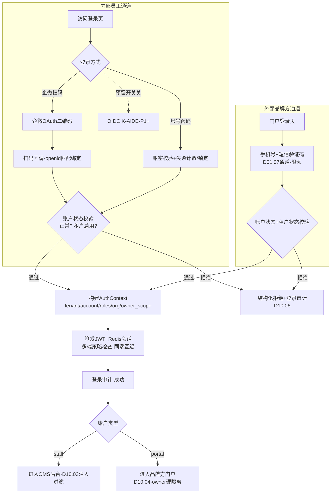
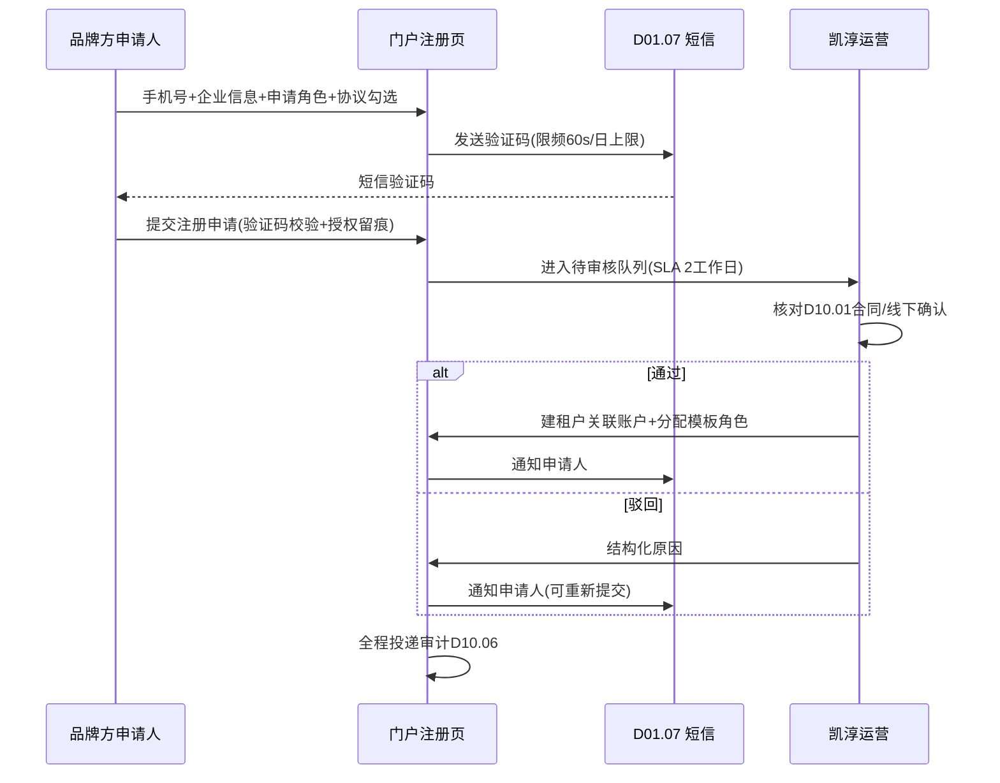
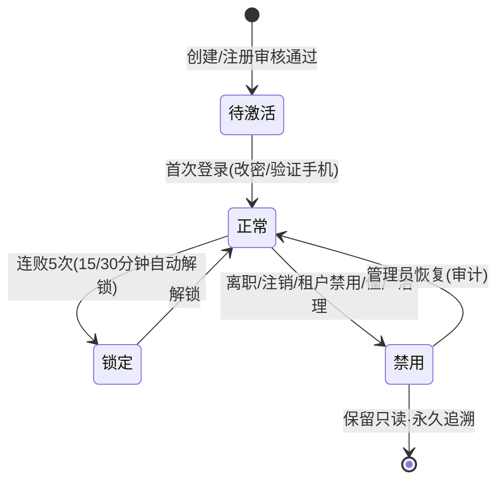

# SRS-D10.02 租户账户与角色 需求规格说明书

> 文档编号：SRS-D10.02 · 版本 V1.0 · 2026-10-24 · 编写：小凯 · 状态：待审阅（批次⑤随组织权限门户域整体交审）
> 所属域：D10 组织权限与门户域 · 分期：**P0（M1 前置）**
> 上游依据：SRS-00 §4.4 契约「租户级行隔离」· 41 问最新决策（内部员工=自建账号+企业微信扫码；品牌方门户=手机号+短信验证码；预留 SSO/OIDC 对接 K-AIDE）· 逆向文档 07 §2.8 · 商派 pam/desktop 账户体系参考
> 定位：全系统**身份层唯一定义源**——租户模型、双通道账户体系、角色模型、登录认证与会话管理在此定义；D10.03 权限、D10.04 门户、D10.06 审计均消费本模块身份上下文。

---

## 1. 模块概述

### 1.1 定位

租户账户与角色提供「你是谁、属于哪个租户、有什么角色」三件事：

1. **租户模型**：内部租户（凯淳员工，tenant_KC，按组织树授权）与外部租户（品牌方，一品牌方一租户，行级隔离只见本货主数据）——SRS-00 契约「租户级行隔离」的身份侧载体；tenant_id + owner_id 双维过滤的前者由本模块定义，后者由 D10.01 定义；
2. **双通道账户体系**（最新决策）：内部员工=自建账号体系+企业微信扫码登录绑定；外部品牌方用户=手机号+短信验证码登录，账号由凯淳运营创建或品牌方自助注册+审核；
3. **角色模型**：系统角色（预置不可删）+自定义角色，角色-权限点绑定（权限点注册表由 D10.03 定义，本模块管角色与绑定关系）。

商派 pam 模块（pam_account 操作员、desktop_users 门户用户）验证了「内外账户分体系」的可行性；其短板是账户与组织/权限耦合松散、无租户概念。凯淳在 pam 思想上引入租户维度与双通道认证。

### 1.2 职责边界

**做**：租户档案与生命周期、内部员工账户（自建+企微扫码绑定、部门岗位）、外部用户账户（手机号+验证码、自助注册+审核流）、角色模型与角色-权限点绑定、登录认证（会话管理、多端登录策略、密码策略、登录审计）、账户生命周期（入职/转岗/离职禁用联动）、预留 SSO/OIDC 对接 K-AIDE。
**不做**：权限点注册与数据权限计算/注入（→ D10.03，本模块只存角色↔权限点绑定关系）；组织树与货主档案（→ D10.01，本模块账户引用其节点/货主 ID）；门户功能与页面（→ D10.04，本模块提供门户登录与会话）；操作审计存储（→ D10.06，本模块投递登录/账户变更事件）；短信/邮件通道（→ D01.07，本模块消费发送验证码）。

### 1.3 与其他模块关系

| 模块 | 关系 |
|---|---|
| D10.01 组织货主 | 内部账户挂组织节点（dept/品牌节点）；外部租户关联货主档案；货主终止联动租户禁用 |
| D10.03 数据权限 | 登录后构建权限上下文（tenant_id+账户+角色集）注入请求上下文；角色-权限点绑定关系存本模块 |
| D10.04 门户 | 门户登录=外部用户通道（手机号+验证码）；门户会话与水印用户标识来源 |
| D10.05 审批 | 审批发起人/审批回避（发起人≠审批人）身份校验供数 |
| D10.06 审计 | 登录成功/失败、账户增删改、角色变更、密码重置全量投递审计 |
| D01.07 通知 | 验证码短信、审批注册审核通知、离职禁用通知 |
| D01.05 PIPL | 账户手机号等 PII 加密存储+脱敏展示；登录授权留痕 |
| D02.07 OpenAPI(P2) | Agent/第三方调用身份=服务账户（本模块预留 machine 账户类型） |
| 全域 | 所有单据 operator/op_id 字段=本模块 account_id（商派 op_id→pam_account 同款约定） |

---

## 2. 业务场景

**SC-D10.02-01 内部员工入职开户与企微扫码登录**
新员工张三入职运营部：HR/管理员在后台创建内部账户（姓名/手机号/部门岗位/挂组织节点），系统生成初始密码并短信通知；张三首次登录（账号+初始密码）强制改密+**绑定企业微信**（扫企微二维码，绑定 openid↔account_id）；此后日常登录=企微扫码一键登录（免密），PC 与移动端会话并存。

**SC-D10.02-02 品牌方门户自助注册+审核**
品牌 A 的财务李四访问门户注册页：填手机号+短信验证码+企业名称+统一社会信用代码+申请角色（财务/运营）→ 提交注册申请 → 凯淳运营后台审核（核对 D10.01 合同联系人、必要时线下确认）→ 通过后自动创建外部账户并关联品牌 A 租户与货主 → 李四收到短信通知即可登录（手机号+验证码）。运营也可直接为品牌方创建账户（跳过自助注册）。

**SC-D10.02-03 转岗与离职联动**
张三从抖音运营组转岗到品牌 A 项目组：管理员调整其组织节点与数据权限授权（D10.03），角色从「抖音审单员」换为「品牌A运营」——转岗即权限重算，即时生效。员工离职：HR 触发离职流程 → 账户禁用（会话立即全部踢出、企微绑定解除、待办任务转交提示）→ 账户保留（历史单据 operator 追溯不可删，只禁用）→ 审计留痕。

**SC-D10.02-04 多端登录与异常登录风控**
审单员小王同时在 PC 工作台与移动端 App 处理订单：多端策略=同租户同账户允许多端并存（PC+移动各 1 会话），同端重复登录挤掉旧会话（会话表记录设备指纹）。凌晨 3 点某账户连续 5 次密码错误：触发锁定（15 分钟）+企微通知管理员；锁定与失败记录进登录审计。

**SC-D10.02-05 预留 SSO/OIDC 对接 K-AIDE**
K-AIDE Agent 平台（公司统一身份）上线后：内部账户通道扩展 OIDC 对接（K-AIDE 作为 IdP，OMS 作为 RP）——已有企微绑定不动，新增「K-AIDE SSO 登录」按钮；账户表预留 `sso_subject` 字段与 IdP 配置表，本期只落库结构与开关（关闭），不实现对接流程。Agent 服务间调用用 machine 账户（预留类型，凭 API 密钥，走 D02.07）。

---

## 3. 功能需求

### FR-D10.02-01 租户模型

- FR-01a 租户类型：`internal 内部租户`（全系统唯一 tenant_KC，凯淳员工）/ `external 外部租户`（品牌方，一品牌方一租户；P2 预留供应商门户租户——D06.04 FR-05d 同源机制）。
- FR-01b 租户档案：编码、名称、类型、状态（启用/禁用）、关联货主（外部租户 ↔ D10.01 owner_id，一对一或多对一：一个品牌方集团可多货主一租户）、联系人、有效期（对齐合同期限，到期联动提醒）。
- FR-01c 租户与货主关联是 D10.03 外部租户强制隔离的**唯一数据来源**：门户登录会话的 owner 范围=租户关联货主集，不可在门户侧配置放宽。
- FR-01d 租户禁用（D10.01 货主终止联动或人工）：该租户下全部账户禁止登录、存量会话立即失效；内部租户永不可禁用。
- FR-01e 所有业务表 `tenant_id` 必填（SRS-00 契约）：内部业务数据 tenant_id=tenant_KC；外部租户不落业务数据（只读+确认类操作，见 D10.04），门户产生的确认/异议记录携带门户租户 tenant_id。

### FR-D10.02-02 内部员工账户（自建账号+企微扫码）

- FR-02a 账户档案：account_id（全域 operator/op_id 引用值）、姓名、手机号（PIPL 加密存储+脱敏展示）、邮箱、部门/岗位（文本+组织节点 ID 双记）、账户类型=`staff`、状态（正常/锁定/禁用）、创建人/时间。
- FR-02b 自建账号体系：账号=手机号或工号（唯一）；初始密码短信下发；首次登录强制改密。
- FR-02c 企业微信扫码绑定与登录：账户绑定企微成员（corp 内 openid↔account_id 一对一）；登录页展示企微二维码（企微开放平台 OAuth 扫码），扫码成功→匹配绑定→建会话；未绑定账户走账密登录后引导绑定（可配置强制绑定）。
- FR-02d 密码策略（可配置，默认值）：长度 ≥8 且含字母+数字；90 天过期提醒（不强制断登）；连续 5 次失败锁定 15 分钟；历史 3 次不重复；重置密码仅管理员操作+短信通知本人。
- FR-02e 部门岗位与组织节点：账户挂 D10.01 组织节点（主节点，dept 或品牌/货主公司节点）；组织选择器供 D10.03 授权用。

### FR-D10.02-03 外部用户账户（手机号+验证码）

- FR-03a 账户档案：account_id、姓名、手机号（唯一登录凭证，PIPL 加密）、所属外部租户、门户角色（品牌方管理员/财务/运营，见 FR-05c）、状态、注册来源（运营创建/自助注册）。
- FR-03b 登录=手机号+短信验证码（最新决策，无密码）：验证码 6 位、5 分钟有效、同号 60 秒重发限制、单号日发送上限（默认 10 条，防轰炸）；连续 5 次验证码错误锁定 30 分钟。
- FR-03c 自助注册+审核流：注册申请（手机号+验证码+企业名称+信用代码+申请角色+授权协议勾选留痕）→ 待审核队列 → 凯淳运营审核（核对合同/线下确认；通过=自动建租户关联账户；驳回=结构化原因通知）→ 审核时限 SLA 2 个工作日，超时提醒运营。
- FR-03d 运营代建：凯淳运营为品牌方直接创建账户（指定租户/角色），短信通知本人，首次登录验证手机号即激活。
- FR-03e 品牌方管理员可管理本租户子账户（增删改、角色分配——范围限本租户，操作进审计）；子账户数上限默认 20（可配）。

### FR-D10.02-04 角色模型

- FR-04a 角色分类：`system 系统角色`（初始化预置：超级管理员/组织管理员/审单员/库存专员/财务/采购/客服/品牌方管理员/品牌方财务/品牌方运营——不可删除，权限点可升版不可任意改）/ `custom 自定义角色`（租户内自建；外部租户角色由凯淳运营模板派生，品牌方管理员仅可在模板内选人，不可改权限点）。
- FR-04b 角色-权限点绑定：权限点注册表由 D10.03 维护（功能权限点编码），本模块存 `role_permission` 绑定关系；绑定变更即时触发 D10.03 权限缓存失效（FR-08 联动）。
- FR-04c 账户-角色多对多（`account_role`）：内部账户可多角色（并集语义，D10.03 合并规则）；外部账户限本租户模板角色。
- FR-04d 角色档案：编码（租户内唯一）、名称、类型、数据权限模式引用（D10.03 定义：全部/组织节点/自定义四维组合）、状态、备注；删除角色前校验无账户绑定。

### FR-D10.02-05 登录认证与会话管理

- FR-05a 认证通道矩阵：内部=账密 / 企微扫码 /（预留 OIDC-K-AIDE，开关默认关）；外部=手机号+验证码；machine 账户=API 密钥（P2 预留，D02.07 消费）。通道实现为可插拔 Authenticator（新增 IdP 不改核心流程）。
- FR-05b 会话管理：JWT（短期 access 2h + refresh 7d，refresh 落库可吊销）+ Redis 会话表（`session:{account_id}:{device}`）；登出/禁用/踢出=删 Redis+refresh 吊销双保险。
- FR-05c 多端登录策略（可配置）：默认 内部账户=PC 1+移动 1 并存、同端互踢；外部账户=同端互踢、最多 2 端；machine=不限端。
- FR-05d 登录审计：成功/失败（原因结构化：密码错/锁定/禁用/租户禁用/验证码错）、设备指纹、IP、地点（IP 库粗粒度）、通道；全量投递 D10.06；异常规则（异地/凌晨/连败）企微告警管理员（D01.07）。
- FR-05e 权限上下文构建：登录成功即组装 `AuthContext{tenant_id, account_id, account_type, roles[], org_node_ids[], owner_scope[]}` 供 D10.03 每请求注入过滤（上下文缓存 Redis，权限/角色变更事件驱动失效）。

### FR-D10.02-06 账户生命周期（入职/转岗/离职）

- FR-06a 入职：创建账户（SC-01）→ 分配角色与组织 → 通知本人；支持批量导入开户（D01.06）。
- FR-06b 转岗：调整组织节点/角色 → D10.03 权限即时重算 → 变更前后快照审计；转岗不影响历史单据 operator 归属。
- FR-06c 离职禁用：账户置禁用 → 全部会话即时踢出 → 企微绑定解除 → 该账户名下待办（审单队列分派 D03.03、审批在途 D10.05）生成转交清单提醒管理员 → 账户保留只读（审计追溯，商派 op_id 外键约定：历史单据操作人永久可解析）。
- FR-06d 外部账户注销：品牌方管理员或凯淳运营注销；注销=禁用+PIPL 处理（手机号按 D10.06/D01.05 保留策略处理）。
- FR-06e 僵尸账户治理：内部账户 90 天未登录提醒管理员；外部账户 180 天未登录自动禁用（可配）+通知租户管理员。

### FR-D10.02-07 预留 SSO/OIDC（K-AIDE）

- FR-07a 预留结构：IdP 配置表（issuer/client_id/密钥引用/JWKS 缓存位）、账户 `sso_subject` 映射字段、认证通道开关。
- FR-07b 本期只交付表结构与开关（默认关闭）；对接流程（授权码模式、账户映射策略：sso_subject 匹配已有账户或 JIT 自动开户）写入 P1+ 需求占位，接口签名预留 `OidcAuthenticator` 实现位。

---

## 4. 业务流程

### 4.1 登录认证流程（双通道）



### 4.2 外部用户自助注册+审核流



### 4.3 账户状态机



---

## 5. 处理逻辑

### 5.1 会话与令牌

```
login_success(account):
    多端策略检查: 查 Redis session:{account}:{device_type}
        同端已存在 → 吊销旧会话(踢出通知) 
    access_token = JWT{sub: account_id, tid: tenant_id, roles_ver, exp: 2h}
    refresh_token → 落库(session表, 设备指纹/IP) + Redis 索引
    AuthContext 组装并缓存: auth:ctx:{account_id} (TTL 30min + 事件失效)

每请求: JWT 验签 → Redis 会话存在性校验(支持即时吊销) → 注入 AuthContext
roles_ver: 角色绑定版本号——角色/权限变更时版本+1, JWT 内版本落后即强制刷新上下文
```

### 5.2 验证码安全（外部通道）

```
send_sms_code(phone):
    限频: 同号60s内1条; 同号日≤10条; 同IP日≤30条(滑块/图形码升级阈值可配)
    生成: 6位随机, Redis TTL 5min, 单活跃码(重发作废旧码)
verify(phone, code):
    连败计数: 5次错误 → 锁定30min; 验证成功即销毁
    验证码明文不落库不进日志(只记发送/校验事件, 值本身Redis短存)
```

### 5.3 离职禁用联动算法

```
disable(account_id, reason=离职):
    1. 账户状态→禁用; 2. 遍历 Redis 会话全删 + refresh 吊销(即时踢出)
    3. 解除企微绑定; 4. 生成待办转交清单:
       - D03.03 审单队列分派 op_id=本人 → 回公共池+提醒组长
       - D10.05 在途审批发起人为本人的实例 → 提醒管理员(OA侧代理见D10.05 FR-07)
       - D10.01 组织管理员为本人的节点 → 阻断式提醒(必须移交)
    5. 投递审计(变更前后快照); 6. 账户保留(历史 operator 永久可解析)
```

### 5.4 密码存储与 PII

- 密码：`argon2id`（或 bcrypt cost≥12）单向哈希，禁明文/可逆存储；初始密码短信下发后库中只存哈希。
- 手机号/邮箱：D01.05 PIPL 组件加密存储（信封加密），界面脱敏（138****0000），明文查看需独立授权点+审计（对齐 D08.05 购方要素策略）。
- 登录授权留痕：外部注册协议勾选、企微 OAuth 授权、（预留）OIDC consent 均记录授权事件（时间/文本版本/通道）——PIPL「授权留痕」策略由 D10 定义、D01.05 组件执行。

### 5.5 缓存失效联动

| 变更 | 失效动作 |
|---|---|
| 账户角色绑定变更 | `auth:ctx:{account}` 删除 + roles_ver+1（在线会话下次请求强制重建） |
| 角色-权限点变更 | 该角色全部账户 ctx 批量失效（D10.03 权限缓存联动，见其 FR-08） |
| 账户禁用/租户禁用 | 会话全删+refresh 吊销（即时） |
| 组织节点变更（D10.01 事件） | 挂该节点账户的 ctx 失效 |

---

## 6. 数据字段（业务字段描述）

### 6.1 租户（tenant）

| 字段 | 业务含义 | 取值/校验 |
|---|---|---|
| tenant_id / tenant_code | 租户 ID/编码 | 全域业务表 tenant_id 来源；内部租户唯一 tenant_KC |
| tenant_type | 类型 | internal / external（P2 预留 supplier） |
| tenant_name / status | 名称/状态 | 禁用即全员禁登 |
| owner_ids | 关联货主集 | 外部租户↔D10.01 owner（1..n）；D10.03 隔离唯一来源 |
| valid_until | 有效期 | 对齐合同期限，到期提醒 |

### 6.2 账户（account）

| 字段 | 业务含义 | 取值/校验 |
|---|---|---|
| account_id | 账户 ID | 全域 operator/op_id 引用值 |
| account_type | 类型 | staff / portal / machine(P2 预留) |
| tenant_id | 所属租户 | 必填 |
| name / mobile / email | 姓名/手机/邮箱 | mobile、email 加密存储脱敏展示；portal 账户 mobile=登录凭证且租户内唯一 |
| login_name / password_hash | 账号/密码哈希 | 仅 staff；argon2id；portal 无密码 |
| wecom_openid / sso_subject | 企微绑定/OIDC 预留 | 一对一；sso_subject 本期只落结构 |
| org_node_id / dept / position | 组织节点/部门/岗位 | staff 必填节点（D10.01） |
| status | 状态 | 待激活/正常/锁定/禁用（§4.3） |
| lock_until / fail_count | 锁定截止/连败计数 | §FR-02d/03b |
| last_login_at / last_login_ip | 最近登录 | 僵尸治理依据 |
| create_op / create_time / disable_reason | 创建人/时间/禁用原因 | 审计要素 |

### 6.3 角色（role）与绑定

| 字段 | 业务含义 | 取值/校验 |
|---|---|---|
| role_id / role_code / role_name | 角色标识 | role_code 租户内唯一 |
| role_type | 类型 | system（预置不可删）/ custom |
| tenant_id | 所属租户 | 自定义角色租户内隔离 |
| data_scope_mode | 数据权限模式引用 | D10.03 定义：all / org_node / custom（四维组合） |
| account_role（关系表） | 账户↔角色 | 多对多；并集语义 |
| role_permission（关系表） | 角色↔权限点 | 权限点编码来自 D10.03 注册表 |
| register_apply | 注册申请单 | 手机号/企业信息/申请角色/协议版本/审核状态/审核人/驳回原因 |

### 6.4 会话（session）

| 字段 | 业务含义 | 取值/校验 |
|---|---|---|
| session_id / account_id / tenant_id | 会话标识 | Redis 主存+DB 落档（登录审计源） |
| device_type / device_fp / ip | 设备类型/指纹/IP | 多端策略键 |
| channel | 登录通道 | password / wecom_qr / sms_code / oidc(预留) |
| refresh_token_hash / expire_at | 刷新令牌/过期 | 可吊销 |
| status | 状态 | 活跃/登出/被踢/被吊销 |

---

## 7. 接口

### 7.1 内部接口（本模块提供）

| 编号 | 接口 | 消费方 | 说明 |
|---|---|---|---|
| IF-D10.02-01 | `AuthService::login(channel, credentials)` / `logout()` / `refresh()` | 登录网关/门户 | 双通道认证入口（§4.1） |
| IF-D10.02-02 | `AuthService::getAuthContext(account_id)` | D10.03 中间件、全域请求上下文 | AuthContext（tenant/roles/org/owner_scope，Redis 缓存） |
| IF-D10.02-03 | `AccountService::create/update/disable/enable/resetPwd` | 账户管理界面/HR 流程 | 账户生命周期（禁用联动 §5.3） |
| IF-D10.02-04 | `AccountService::get/resolveName(account_ids[])` | 全域单据 operator 展示、D10.06 审计 | 账户解析（历史操作人永久可解析） |
| IF-D10.02-05 | `RoleService::list/bind/unbind(role, account)` / `bindPermission(role, perm_codes[])` | 角色管理界面 | 角色绑定（变更触发 §5.5 失效） |
| IF-D10.02-06 | `TenantService::assertActive(tenant_id)` / `getOwnerScope(tenant_id)` | D10.03/D10.04 | 租户状态与货主范围（外部门户硬隔离来源） |
| IF-D10.02-07 | `PortalAccountService::register/audit/selfManage` | D10.04 门户 | 自助注册审核流与品牌方子账户自管理 |
| IF-D10.02-08 | 事件 `auth.account.disabled/role_changed`、`auth.tenant.disabled` | D10.03（权限缓存失效）/D10.04/D01.07 | 身份变更广播 |

### 7.2 外部接口

| 编号 | 接口 | 方向 | 说明 |
|---|---|---|---|
| EF-D10.02-01 | 企业微信开放平台（OAuth 扫码/通讯录成员匹配） | 双向 | 扫码登录与成员绑定；corp secret 加密存储（D01.05） |
| EF-D10.02-02 | 短信通道（经 D01.07） | 出 | 验证码/初始密码/审核通知 |
| EF-D10.02-03 | K-AIDE OIDC（预留，开关默认关） | 双向 | P1+ 对接；FR-07 占位 |

---

## 8. 非功能需求

| 项 | 要求 |
|---|---|
| 性能 | 登录（含上下文构建）P95 ≤500ms；每请求 JWT 验签+会话校验 ≤5ms（Redis）；AuthContext 缓存命中 ≥99% |
| 可用性 | 企微通道故障自动降级账密通道（提示切换）；短信通道故障→验证码邮件备用通道（外部账户需已验证邮箱）；Redis 故障→DB 会话表兜底（限流保护） |
| 安全 | 密码 argon2id；验证码不落明文日志；暴力破解锁定+IP 限频；会话即时吊销；PII 加密+脱敏+明文查看独立授权审计（D01.05/D10.06）；登录全审计 |
| 幂等 | 注册申请以手机号判重（在审/已存在拒绝重复提交）；审核回调按申请单 CAS；会话踢出幂等 |
| 合规 | PIPL：注册授权协议留痕（版本化）；账户注销与禁用后 PII 按保留策略处理（D10.06 §FR-08）；登录日志保留 ≥1 年（等保） |
| 容量 | 内部账户 ≤2000、外部账户 ≤5000、会话峰值 ≤1 万——单表+Redis 即可 |

---

## 9. 验收标准

| 编号 | 验收条件 |
|---|---|
| AC-01 | SC-01 企微扫码登录闭环：绑定后扫码免密登录成功；未绑定账户扫码被拒并引导账密登录；解绑后旧扫码通道失效 |
| AC-02 | SC-02 自助注册审核流：提交→待审核→通过后账户可登录；驳回带结构化原因且可重新提交；SLA 超时提醒触达运营；协议授权留痕含版本号 |
| AC-03 | 密码策略全项生效：弱密码拒绝、连败 5 次锁定 15 分钟自动解锁、重置密码仅管理员且短信通知；密码库中仅存 argon2id 哈希 |
| AC-04 | 多端策略：PC+移动并存互不影响；同端二次登录旧会话被踢且收到踢出提示；禁用账户全部端即时失效（会话删除+refresh 吊销双验证） |
| AC-05 | SC-03 离职联动：禁用后登录被拒；审单队列分派回公共池；组织管理员未移交产生阻断提醒；历史单据 operator 仍可解析出姓名（账户保留验证） |
| AC-06 | 外部账户无密码通道：仅验证码登录；验证码 5 分钟过期、重发作废旧码、60s 限频、日上限触发拒发；连败 5 次锁定 30 分钟 |
| AC-07 | 租户禁用联动：品牌方租户禁用后其全部账户登录被拒、存量会话即时失效；内部租户禁用操作被系统拒绝 |
| AC-08 | 角色变更即时生效：给在线账户新增角色后，其下一次请求即拥有新权限（roles_ver 强制刷新验证，无需重新登录） |
| AC-09 | 登录审计完整：成功/失败（各结构化原因）/锁定/踢出均可在 D10.06 按账户/时间/IP/通道检索；异常规则（连败）触发企微告警 |
| AC-10 | SSO 预留验证：IdP 配置表与 sso_subject 字段可落库、通道开关默认关且登录页不展示 OIDC 入口；打开开关（测试环境）可走 OidcAuthenticator 桩流程 |

---

## 变更记录

| 日期 | 版本 | 变更 | 原因 |
|---|---|---|---|
| 2026-10-24 | V1.0 | 首版 | — |

---

*参考实现溯源：商派 pam 模块（pam_account 操作员账户，全域 op_id 外键约定「历史操作人永久可解析」）+ desktop_users（门户用户，ownerId 操作人语义）+ 登录审计字段（操作员/支付 IP 等散落各表的审计位）。关键差异：① 引入**租户维度**（商派无租户概念，账户单层）——internal/external 双租户类型与 owner_scope 硬关联；② 内部认证升级为**自建账号+企业微信扫码**（商派为传统账密+阿里云 IDaaS 通道 aliyun.idaas.account.create），并预留 OIDC/K-AIDE 可插拔 Authenticator；③ 外部通道=**手机号+验证码无密码化**+自助注册审核流（商派门户无自助注册）；④ 会话即时吊销与 roles_ver 版本化失效机制（商派 session 无细粒度吊销）；⑤ 账户生命周期与待办转交联动（离职清单化）为凯淳原创；⑥ PII 按 D01.05 统一加密脱敏（商派明文散落）。*
