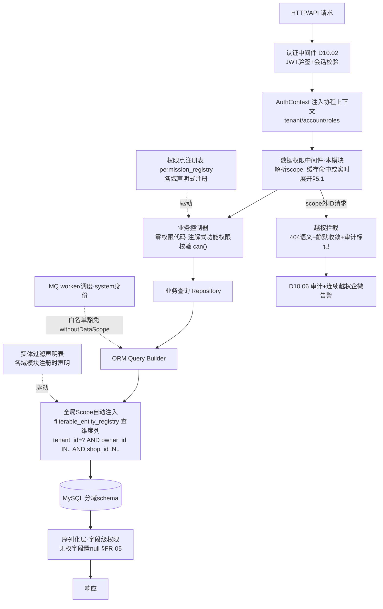
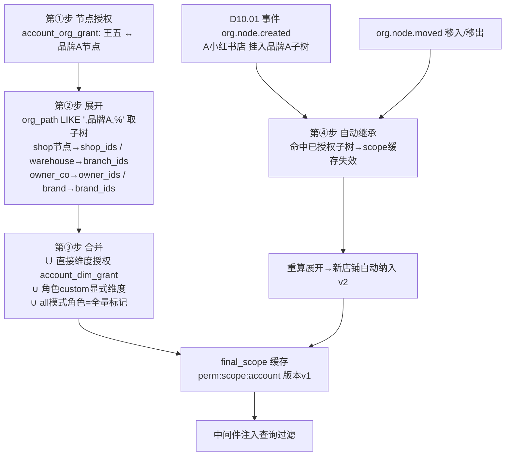
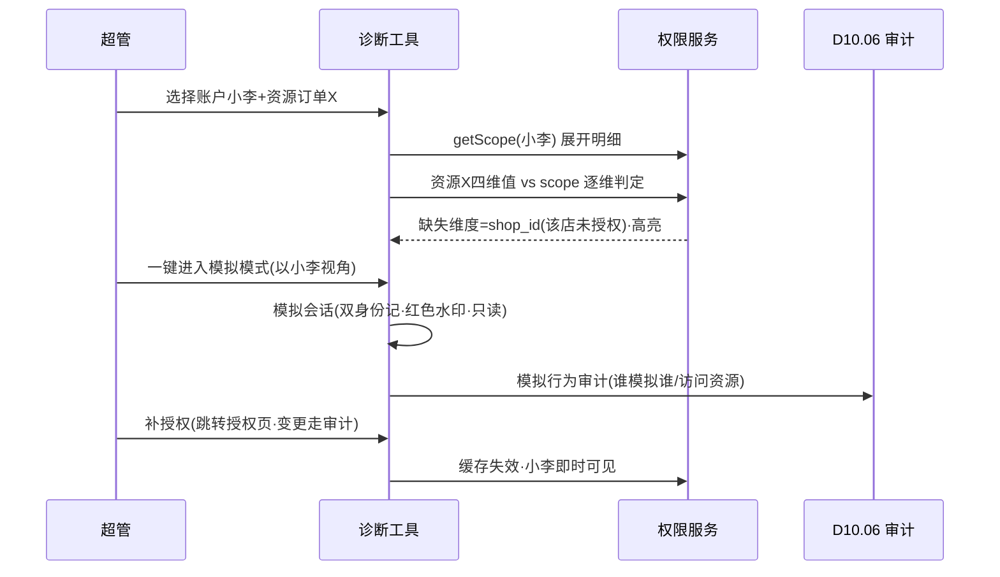

# SRS-D10.03 多维数据权限 需求规格说明书

> 文档编号：SRS-D10.03 · 版本 V1.0 · 2026-10-24 · 编写：小凯 · 状态：待审阅（批次⑤随组织权限门户域整体交审）
> 所属域：D10 组织权限与门户域 · 分期：**P0（M1 前置）**
> 上游依据：SRS-00 §4.4 契约「租户级行隔离」（本模块=唯一定义源）· 逆向文档 04 §10.3（商派 organization/permission.php 权限继承：expandUserBranchIds 展开 / getMergedBranchIds 合并 / autoInheritPermissionForNewStore 自动继承）· 逆向文档 07 §2.8（多租户行隔离、数据权限中心统一拦截）
> 定位：**全域横切契约核心**——功能权限+四维数据权限+租户行隔离的唯一定义源。各业务域 SRS「数据权限」小节一律引用本模块（如 D03.01 FR-10a、D08.01 FR-10d、D03.13 FR-04a、D02.07 FR-05a），不重复定义。业务域接入方式=**无感知**（§5.2 统一中间件自动注入）。

---

## 1. 模块概述

### 1.1 定位

多维数据权限回答「这个账户能看到什么、能操作什么」：

1. **功能权限**：菜单/操作/按钮级授权点（权限点注册表），控制「能不能进这个页面、点这个按钮」；
2. **数据权限**：店铺 / 品牌 / 仓库 / 货主 **四维行级过滤** + **租户级行隔离**，控制「能看到哪些行」；
3. **权限继承四步模型**（商派 permission.php 验证）：节点授权 → 展开到仓库/店铺 → 与直接授权合并 → 新增子节点自动继承；
4. **统一注入机制**：数据权限中间件对所有业务查询自动注入 tenant_id/owner_id/shop_id/branch_id 过滤条件，**业务域无感知**、不可绕过；
5. **字段级权限**：敏感字段（成本/毛利等）按角色可见性控制；
6. **外部租户强制隔离**：品牌方=本货主行级硬隔离，不可配置放宽；
7. **权限模拟与诊断工具**：管理员以某账户视角查看，排障必备。

商派短板（逆向文档 04 §10.4-3）：cos_id/org_id 只是字段级归属，无行级安全，跨组织查询靠应用层各处 filter，**漏一处即数据越权**。凯淳方案：过滤注入收敛到统一中间件层（ORM 全局 Scope + 服务层守卫双保险），业务代码零散过滤被架构性消除。

### 1.2 职责边界

**做**：权限点注册表、角色数据权限模式解析、权限继承四步算法、四维授权关系维护、行级过滤注入中间件（本模块=全域唯一注入点）、越权访问拦截、字段级权限、外部租户硬隔离策略、权限缓存与即时失效、权限模拟与诊断工具。
**不做**：账户/角色/会话管理（→ D10.02，本模块消费 AuthContext 与 role_permission 绑定）；组织树与货主档案（→ D10.01，本模块消费树结构做展开）；门户页面（→ D10.04，本模块提供其硬隔离）；审计存储（→ D10.06，权限变更与越权事件投递审计）。

### 1.3 与其他模块关系

| 模块 | 关系 |
|---|---|
| D10.01 组织货主 | 组织树=继承展开的树结构（org_path 子树查询）；货主/店铺/仓 ID 合法性 |
| D10.02 租户账户 | AuthContext（tenant/account/roles/org/owner_scope）；role_permission 绑定存 D10.02，权限点编码在本模块注册 |
| D10.04 门户 | 外部租户硬隔离策略执行（FR-06）；门户只读权限集 |
| D10.06 审计 | 授权变更/越权拦截/模拟行为全量审计 |
| D03 订单域 | 订单查询四维过滤（D03.01 FR-10a、D03.03 FR-01a、D03.08 FR-08a、D03.09 FR-02f、D03.13 FR-04a 引用） |
| D04 库存域 | 记账行/调拨/预警查询过滤（D04.02 FR-01c、D04.10 行隔离引用） |
| D02 Gateway | 店铺维度过滤（D02.06 FR-01c）；OpenAPI 越权参数静默收敛（D02.07 FR-05a） |
| D06/D08 | 货主行隔离+敏感字段（供货价/成本/毛利角色级可见：D06.01 §8、D06.02 §8、D06.04 §8、D08.06 FR-06c） |
| D09 | 仓库维度授权（D09.01 FR-07a，商派 branch_ops 同款语义的新栈实现） |

---

## 2. 业务场景

**SC-D10.03-01 组织节点授权与继承展开（四步模型全链路）**
运营主管王五被授权组织节点「品牌A」（品牌层）：
① **节点授权**：管理员把王五挂到「品牌A」节点（授权关系表 account_org_grant）；
② **展开**：系统沿 org_path 展开子树——「品牌A」下的货主公司节点→货主 owner_BrandA（货主维），店铺节点→A淘系旗舰/A抖音小店（店铺维），关联仓（branch_owner_rel 服务该货主的仓）→华东仓/华南仓（仓库维）；
③ **合并**：王五另有直接授权的「拼多多自营店」（account_dim_grant 直接授权），与继承展开结果取并集；
④ **自动继承**：次月品牌 A 新开「A小红书店」挂到品牌A子树——事件驱动，王五的展开结果自动纳入新店，无需人工补授权。
最终王五查订单列表：中间件注入 `shop_id IN (A旗舰,A抖音,A小红书,拼多多自营) AND owner_id IN (BrandA, KC)`，其他品牌行不可见也不可猜（越权 ID 查询返回 404 语义）。

**SC-D10.03-02 品牌方门户硬隔离（不可放宽）**
品牌 A 财务登录门户：AuthContext.tenant=external_A，owner_scope=[BrandA]（D10.02 租户关联，唯一来源）。查结算单（D08.02 getPortalView）：中间件强制注入 `tenant_id=external_A AND owner_id=BrandA`——即使品牌 A 账户构造请求携带 owner_id=BrandB，静默收敛回 BrandA 并记越权审计标记（对齐 D02.07 FR-05a 口径）。该隔离**无任何配置项可放宽**（超管亦不可给外部租户授其他货主）。

**SC-D10.03-03 字段级权限（成本/毛利按角色）**
库存专员查库存列表：可见五口径数量，`unit_cost/inventory_cost` 列不可见（无 `field.stock.cost.view` 权限点）；财务角色同页面可见成本列。API 层面：无权限字段的值在序列化层置 null（不是前端隐藏列——防抓包越权），字段访问尝试记审计。

**SC-D10.03-04 权限变更即时生效**
管理员 14:00 收回王五「品牌A」节点授权：授权表变更事务提交 → 权限缓存失效（王五的 scope 缓存删除+版本号 bump）→ 王五 14:00:01 的下一次列表查询即不含品牌 A 数据（无需重登录，机制=D10.02 §5.5 roles_ver 联动）。已打开页面的旧数据不回溯（查询时点权限为准）。

**SC-D10.03-05 权限模拟与诊断（排障必备）**
客服反馈「小李看不到某订单」。超管进入权限诊断工具：选择账户=小李 → 一键「以小李视角」打开订单页（模拟会话，顶栏红色水印「模拟模式：以 小李 视角」）→ 复现看不到 → 诊断面板展示：小李的四维 scope 展开明细（哪些来自继承、哪些直接授权）、该订单的四维值、命中/未命中判定与缺失维度高亮 → 定位=小李缺少该店铺授权 → 补授权（写审计：模拟行为+补授权动作双留痕）。

**SC-D10.03-06 越权访问拦截**
离职未禁用的账户（漏洞窗口）直接调 API 携带其他货主 owner_id：中间件比对 scope 未命中 → 拒绝（数据行返回 404 语义，不暴露存在性）→ 越权事件投递 D10.06（账户/IP/目标资源/请求参数）→ 连续越权触发企微告警安全管理员。

---

## 3. 功能需求

### FR-D10.03-01 权限模型总纲（功能权限+数据权限双层）

- FR-01a **功能权限**=权限点（permission point）三级：`menu 菜单级 / action 操作级（接口与动作）/ button 按钮级（页面元素）`；编码规范 `域.模块.资源.动作`（如 `d03.order.skipAudit`、`d08.settle.confirmBrand`、`field.stock.cost.view`）。
- FR-01b **权限点注册表**（permission_registry）：各业务模块以声明式清单注册（模块上线/升版时随迁移脚本登记：编码/名称/类型/所属模块/默认角色建议）；本模块是唯一注册入口；未注册编码不可绑定（防拼写漂移）。
- FR-01c **数据权限**=四维行级过滤：`shop_id 店铺 / brand_id 品牌 / branch_id 仓库 / owner_id 货主` + **tenant_id 租户隔离（第 0 维，永远最先注入）**。
- FR-01d 判定公式：`可操作 = 功能权限点命中 AND 数据行四维均在 scope 内`；查询=注入过滤，写操作=前置校验+注入双保险。

### FR-D10.03-02 授权关系模型

- FR-02a **组织节点授权**（account_org_grant）：账户 ↔ D10.01 组织节点（多对多），继承展开的源头（四步模型第①步）。
- FR-02b **直接维度授权**（account_dim_grant）：账户 ↔ 维度值 直接绑定（dim_type=shop/brand/branch/owner + dim_id），用于不便经组织树表达的点状授权（如单店临时支援）；与继承结果**合并取并集**（第③步）。
- FR-02c 角色数据权限模式（role.data_scope_mode，D10.02 FR-04d）：`all 全部`（仅内部超管类角色可设）/ `org_node 按授权节点展开` / `custom 自定义四维组合`；账户最终 scope = 各角色模式解析结果的并集。
- FR-02d 授权关系一律关系表（禁止商派 FIND_IN_SET 逗号集合，逆向文档 04 §10.4-2）。
- FR-02e 授权变更（增/删/改）：独立授权点（`d10.grant.manage`）+ 全量审计（变更前后快照）+ 缓存失效（FR-08）。

### FR-D10.03-03 权限继承四步模型（商派 permission.php 验证，算法详见 §5.1）

- FR-03a **第①步 节点授权**：账户挂组织节点（FR-02a）；一账户可挂多节点（多品牌团队场景）。
- FR-03b **第②步 展开到仓库/店铺/货主/品牌**：沿 org_path 取授权节点子树，按子树内节点类型换算四维值——shop 节点→shop_id 集合；warehouse 节点→branch_id 集合；owner_co 节点→owner_id；brand 节点→brand_id 及其子树全部 shop/owner_co 换算值（对齐商派 expandUserBranchIds 的「组织层→经销商→门店→branch_id」逐级换算，但维度从单一 branch 扩展为四维）。
- FR-03c **第③步 与直接授权合并**：`final_scope = ∪(各授权节点展开) ∪ (直接维度授权) ∪ (角色 custom 显式维度)`；并集语义，任一来源命中即可见。
- FR-03d **第④步 新增子节点自动继承**：订阅 D10.01 事件 `org.node.created/moved`——新节点（或移入子树的节点）落在某账户已授权节点的子树内 → 该账户 scope 缓存失效重算，**自动纳入**新节点四维值（对齐商派 autoInheritPermissionForNewStore，但从「新门店写授权表」升级为「事件驱动缓存重算」——不物化冗余授权行，规避商派 syncBranchOpsFromOrganization 双写一致性负担）。
- FR-03e 无任何组织授权的内部账户：scope=空集（**拒绝一切**）——修正商派「无授权返回全部门店仓」的超管隐式语义（逆向文档 04 §10.3），全部数据权限必须显式来自 all 模式角色（仅系统角色可设）。

### FR-D10.03-04 行级过滤注入机制（全域横切契约核心，业务域无感知接入）

- FR-04a **统一数据权限中间件**（FastAPI middleware/Depends + SQLAlchemy 全局过滤 `with_loader_criteria`/ORM 事件）：每个请求进入时从 AuthContext 解析 scope → 注入 contextvars 请求上下文；所有注册了「可过滤实体」的 ORM 查询**自动追加** `tenant_id = ? AND owner_id IN (...) AND shop_id IN (...) AND branch_id IN (...) AND brand_id IN (...)`（仅注入该实体声明拥有的维度列，见 FR-04b）。
- FR-04b **实体过滤声明表**（filterable_entity_registry）：各业务域在模块注册时声明实体与维度列映射（如 `oms_order.orders → {tenant_id, owner_id, shop_id}`、`oms_stock.stock_ledger → {tenant_id, owner_id, branch_id}`）；未声明实体默认**只注入 tenant_id**（保底隔离）+ 开发期告警（提醒补声明）。
- FR-04c **业务域无感知**：业务查询代码不写任何权限条件（写了也不冲突，取交集）；各业务域 SRS「数据权限」小节只需一句「查询统一注入 D10.03 四维行级过滤」即完成契约接入（现行 21 处引用均此口径）；新模块接入=注册实体声明+权限点，零过滤代码。
- FR-04d **豁免通道（受控）**：系统级任务（MQ worker/调度/平台回传处理）无用户上下文 → 以 `system` 身份运行，走白名单豁免（豁免代码块显式 `withoutDataScope()`，登记调用点清单，CI 静态检查豁免滥用）；跨货主聚合任务（D08 结算生成、D11 报表）用豁免通道+专用系统角色，输出结果仍按消费方权限二次过滤（报表查询侧照常注入）。
- FR-04e **越权拦截**：写操作前置校验（目标行四维 ∈ scope，否则拒绝）；按 ID 直查未命中返回**404 语义**（不暴露行存在性）；请求参数携带 scope 外维度值 → 静默收敛到 scope 内（D02.07 FR-05a 口径）+ 越权审计标记；连续越权企微告警。
- FR-04f **注入不可绕过**：ORM Scope 在 Query Builder 层生效（原生 SQL 走 DB 门面时强制经 `ScopedDb` 包装）；代码评审规约+CI 规则：业务域仓库内出现裸 DB::table 查询即告警（豁免清单外）。

### FR-D10.03-05 字段级权限（敏感字段可见性）

- FR-05a 敏感字段注册（field_registry）：实体+字段+所需权限点（如 `stock_ledger.unit_cost → field.stock.cost.view`、`purchase_order.supply_price → field.po.price.view`、结算毛利 → `field.settle.margin.view`）。
- FR-05b 执行层：序列化/导出层按权限点置 null（**服务端脱敏**，非前端隐藏）；列表列、详情、导出文件（D01.06）、门户视图（D10.04 品牌方永远无内部成本字段）统一生效。
- FR-05c 消费者 PII 字段（姓名/电话/地址）走 D01.05 加密+脱敏策略，本模块叠加「明文查看」独立权限点（`field.pii.plaintext.view`）+每次查看投递审计（对齐 D08.05 购方要素口径）。
- FR-05d 字段权限变更同 FR-08 缓存失效；字段访问尝试（无权而请求带该字段选择器）记审计。

### FR-D10.03-06 外部租户强制隔离（品牌方硬隔离，不可配置放宽）

- FR-06a 外部租户 scope **恒等于** `tenant_id=本租户 AND owner_id ∈ 租户关联货主集`（D10.02 IF-D10.02-06 getOwnerScope 唯一来源）；四维中 shop/branch/brand 按货主集推导（该货主的店铺/服务仓/品牌），推导结果只收窄不放宽。
- FR-06b **不可配置放宽**：授权界面对外部租户不提供 all 模式、不提供跨货主直接授权；数据库层校验（grant 写入时 tenant_type=external 且目标维度值 ∉ owner_scope 推导集 → 拒绝）；即使超管误操作也被写入校验拦截。
- FR-06c 门户权限集=只读权限点+确认类操作权限点（`d08.settle.confirmBrand`、`d08.settle.dispute` 等白名单，D10.04 FR-03 消费）；写业务数据的功能权限点对外部租户不可绑定（注册表标记 `internal_only`）。
- FR-06d 多品牌方互不可见：不同外部租户之间零共享（连「其他货主存在性」都不暴露——枚举类接口对外部租户只返回本货主集）。

### FR-D10.03-07 权限上下文与判定服务

- FR-07a `PermissionService::can(account, perm_code, resource?)`：功能权限+（携带资源时）数据权限联合判定，全域操作入口统一调用（控制器注解 `#[RequirePermission('d03.order.skipAudit')]` 声明式接入）。
- FR-07b `PermissionService::getScope(account)`：四维 scope 快照（展开明细含来源标记：继承/直接/角色 custom——诊断工具与审计消费）。
- FR-07c scope 数据结构：`{tenant_id, all:bool, owner_ids[], shop_ids[], branch_ids[], brand_ids[]}`（all=true 仅内部 all 模式角色；IN 集合超 1000 项时物化临时表 JOIN 注入，防 SQL 过长）。

### FR-D10.03-08 权限缓存与即时生效

- FR-08a 缓存结构：Redis `perm:scope:{account_id}`（scope 快照 JSON+版本号）、`perm:tree:{node_id}`（节点展开结果，多账户共享复用）；TTL 30min + 事件失效。
- FR-08b 失效触发源：授权变更（FR-02e）/角色绑定或权限点变更（D10.02 事件）/组织节点变更（D10.01 事件）/租户货主关联变更；失效=删缓存+账户版本号 bump（在线会话下一请求重建，机制同 D10.02 §5.5 roles_ver）。
- FR-08c **即时生效定义**：变更事务提交后 ≤1s 内，该账户新发起的查询即按新 scope 过滤（已渲染页面不回溯）；树展开结果共享缓存的失效按受影响子树节点批量删除。
- FR-08d 缓存 miss/Redis 故障：降级实时计算（DB 展开查询，限流保护）；降级期间告警。

### FR-D10.03-09 权限模拟与诊断工具（管理员排障必备）

- FR-09a **模拟模式**：超管（`d10.perm.simulate` 独立授权点）选择目标账户 → 生成模拟会话（原身份+target_account 双记，全部操作以「模拟」标记写审计）→ 以目标账户 scope 浏览系统；顶栏持久红色水印（模拟中：原身份→目标身份）；模拟会话只读（写操作默认禁用，可显式开关+双审计）。
- FR-09b **诊断面板**：输入账户+资源（订单号/记账行等）→ 输出：账户四维 scope 展开明细（每项带来源：继承自哪个节点/直接授权/角色）、目标资源四维值、逐维命中判定、缺失维度高亮与「一键跳授权页」；批量诊断（CSV 账户×资源）。
- FR-09c **scope 试算**：授权变更前预演——「若收回此节点，该账户将失去哪些店铺/货主」影响面预览（对齐 D10.01 移动影响面机制）。
- FR-09d 模拟与诊断行为全量审计（谁模拟了谁、看了什么资源）。

---

## 4. 业务流程

### 4.1 权限过滤注入架构（业务域无感知）



### 4.2 权限继承四步流程



### 4.3 权限模拟与诊断流程



---

## 5. 处理逻辑

### 5.1 权限继承四步算法（核心，详述）

```
resolveScope(account) → Scope:
  # ① 取授权源
  org_grants  = account_org_grant.where(account_id)          # 组织节点授权
  dim_grants  = account_dim_grant.where(account_id)          # 直接维度授权
  roles       = account_role.where(account_id)               # D10.02
  if any(role.data_scope_mode == 'all'):                     # 仅内部系统角色可能
      return Scope{tenant_id, all: true}                     # 内部全量（外部租户被 FR-06b 写入校验排除）

  # ② 展开：每个授权节点 → 四维值（子树换算）
  scope = Scope{tenant_id, owner_ids:{}, shop_ids:{}, branch_ids:{}, brand_ids:{}}
  for node in org_grants:
      subtree = OrgService.query("org_path LIKE ',{node.id},%'")   # 前缀索引，含自身
      for n in subtree:
          match n.org_type:
            'shop'      → scope.shop_ids += n.ref_id                # D02.06 shop_id
            'warehouse' → scope.branch_ids += n.ref_id              # D09.01 branch_id
            'owner_co'  → scope.owner_ids += OwnerService.byNode(n.id)
            'brand'     → scope.brand_ids += BrandService.byNode(n.id)  # D04.01 映射
      # 维度联动推导（只收窄语义的补全）：
      scope.owner_ids += owners_of(scope.shop_ids)      # 店铺→其货主（订单 owner 过滤需要）
      scope.branch_ids += serving_branches(scope.owner_ids)  # 货主→branch_owner_rel 服务仓

  # ③ 合并直接授权与角色 custom 维度
  for g in dim_grants: scope[g.dim_type + '_ids'] += g.dim_id
  for role in roles where mode=='custom': scope ∪= role.custom_dims

  # 外部租户强制收敛（FR-06a，最后一步不可跳过）：
  if tenant.type == 'external':
      allowed_owners = TenantService.getOwnerScope(tenant_id)
      scope.owner_ids ∩= allowed_owners; 若为空 → Scope{deny_all}
      scope.shop_ids ∩= shops_of(allowed_owners)
      （brand/branch 同理按货主集推导收敛）

  # ④ 自动继承不在此算法内——由事件驱动失效缓存后重跑本算法（FR-03d）
  return scope  # 写缓存 perm:scope:{account_id} + version
```

> 与商派对照：expandUserBranchIds 只展开 branch 单维（门店仓），且「无授权=全部」；本算法四维展开+「无授权=空集」+外部租户末端强制收敛（商派无此概念）。getMergedBranchIds 的并集语义保留（③）。autoInheritPermissionForNewStore 的「写授权表物化继承」改为「事件驱动缓存重算」（④），消除双写一致性负担。

### 5.2 SQL 注入形态（中间件生成）

```
-- 实体 orders 声明维度 {tenant_id, owner_id, shop_id}：
SELECT ... FROM orders
WHERE (业务条件...)
  AND tenant_id = :ctx_tenant
  AND owner_id IN (:scope_owner_ids)      -- all=true 时省略该维
  AND shop_id  IN (:scope_shop_ids)
-- scope 为空集 → AND 1=0（deny_all，返回空结果而非报错——不暴露存在性）
-- IN 集合 >1000 → JOIN 临时物化表 perm_scope_tmp_{account}_{ver}
```

### 5.3 写操作前置校验

```
assertWritable(entity_row, account):
    scope = getScope(account)
    for dim in entity.dims:               # filterable_entity_registry
        if not scope.all and row[dim] not in scope[dim+'_ids']:
            投递越权审计(account, entity, row_pk, dim, 请求来源)
            throw Forbidden(404语义)       # 不暴露行存在性
```

### 5.4 缓存失效矩阵

| 触发事件 | 失效范围 | 时延目标 |
|---|---|---|
| account_org_grant / account_dim_grant 变更 | 该账户 scope | ≤1s |
| role_permission / account_role 变更（D10.02） | 该角色全部账户 scope+版本 bump | ≤5s |
| org.node.created/moved/disabled（D10.01） | 命中子树的共享展开缓存 perm:tree:* + 关联账户 scope | ≤5s |
| owner.status_changed / tenant 货主关联变更 | 关联外部租户全部账户 | ≤1s（禁用即时踢会话由 D10.02 负责） |
| permission_registry 升版（模块发布） | 全量权限点缓存 | 发布流程内同步 |

### 5.5 一致性说明

- 权限判定为**查询时点语义**：以每次请求解析的 scope 为准；变更传播窗口 ≤5s（缓存失效为异步事件驱动，极端积压时以 TTL 30min 兜底）；资金/敏感写操作（OA 审批类）在**执行时二次校验**（审批通过回调执行前重查 scope，防「审批期间权限被收回」窗口）。

---

## 6. 数据字段（业务字段描述）

### 6.1 权限点注册表（permission_registry）

| 字段 | 业务含义 | 取值/校验 |
|---|---|---|
| perm_code | 权限点编码 | `域.模块.资源.动作` 全局唯一；未注册不可绑定 |
| perm_name / perm_type | 名称/类型 | menu / action / button / field |
| module | 所属模块 | D03.02 等，随发布升版 |
| internal_only | 仅内部租户 | true 时外部租户不可绑定（FR-06c） |
| status / version | 状态/注册版本 | 下线权限点置废弃（绑定自动失效并提示） |

### 6.2 组织节点授权（account_org_grant）

| 字段 | 业务含义 | 取值/校验 |
|---|---|---|
| account_id / org_node_id | 账户/节点 | D10.01/D10.02 外键；联合唯一 |
| grant_type | 授权类型 | inherit（可继承展开）/ self_only（仅本节点不展开子树，特殊场景） |
| grant_op / grant_time / expire_at | 授权人/时间/有效期 | 有效期可空=长期；到期自动失效 |

### 6.3 直接维度授权（account_dim_grant）

| 字段 | 业务含义 | 取值/校验 |
|---|---|---|
| account_id / dim_type / dim_id | 账户/维度/维度值 | dim_type=shop/brand/branch/owner；外部租户写入校验 FR-06b |
| reason / grant_op / expire_at | 事由/授权人/有效期 | 事由必填（点状授权可追溯） |

### 6.4 实体过滤声明表（filterable_entity_registry）

| 字段 | 业务含义 | 取值/校验 |
|---|---|---|
| entity / table_name | 实体与物理表 | schema.table |
| dim_columns | 维度列映射 JSON | {tenant_id, owner_id?, shop_id?, branch_id?, brand_id?}；tenant_id 必含 |
| module / register_version | 声明模块/版本 | 未声明实体默认只注入 tenant_id+开发期告警 |

### 6.5 敏感字段注册表（field_registry）

| 字段 | 业务含义 | 取值/校验 |
|---|---|---|
| entity / field_name | 实体字段 | 如 stock_ledger.unit_cost |
| perm_code | 所需权限点 | field.* 类；PII 明文字段叠加 D01.05 策略 |
| mask_rule | 脱敏规则引用 | D01.05 规则编码（手机号/地址等） |

### 6.6 越权事件（perm_violation，投递 D10.06 前的本地缓冲）

| 字段 | 业务含义 | 取值/校验 |
|---|---|---|
| account_id / tenant_id | 主体 | |
| resource / row_pk / miss_dim | 目标资源/主键/缺失维度 | 404 语义返回后异步投递 |
| request_uri / ip / param_snapshot | 请求上下文 | 参数快照脱敏后存储 |

---

## 7. 接口

### 7.1 内部接口（本模块提供，全域横切）

| 编号 | 接口 | 消费方 | 说明 |
|---|---|---|---|
| IF-D10.03-01 | 数据权限中间件（FastAPI middleware+SQLAlchemy 全局过滤，框架级自动生效） | **全域所有 HTTP/API 查询** | 行级过滤注入唯一通道（FR-04）；业务域无感知接入 |
| IF-D10.03-02 | `PermissionService::can(account, perm_code, resource?)` | 全域控制器（注解 `#[RequirePermission]`）/D10.05 发起校验 | 功能+数据联合判定 |
| IF-D10.03-03 | `PermissionService::getScope(account)` / `getScopeDetail(account)` | 中间件/诊断工具/审计 | scope 快照与带来源明细展开（FR-07b/09b） |
| IF-D10.03-04 | `GrantService::grantOrg/grantDim/revoke/list(account)` | 授权管理界面/D10.01 组织管理员 | 授权维护（审计+失效联动） |
| IF-D10.03-05 | `GrantService::previewRevoke(grant)` | 授权界面 | 收回影响面试算（FR-09c） |
| IF-D10.03-06 | `PermRegistry::registerPoints(module, points[])` / `registerFilterable(entity, dims)` | 各业务域模块注册（迁移脚本） | 权限点与实体声明注册入口（FR-01b/04b） |
| IF-D10.03-07 | `SimulateService::start/stop(target_account)` | 管理员工具 | 模拟会话（只读默认+双身份审计，FR-09a） |
| IF-D10.03-08 | 订阅 `org.node.*`（D10.01）、`auth.role_changed/auth.account.disabled`（D10.02） | — | 自动继承与缓存失效事件源（FR-03d/08b） |
| IF-D10.03-09 | 事件 `perm.scope_invalidated`、`perm.violation` | D10.06/安全告警（D01.07） | 失效广播与越权事件 |

### 7.2 外部接口

| 编号 | 接口 | 方向 | 说明 |
|---|---|---|---|
| EF-D10.03-01 | 无直接外部接口 | — | OA/企微等经 D10.05/D10.02；本模块纯内部横切 |

---

## 8. 非功能需求

| 项 | 要求 |
|---|---|
| 性能 | scope 解析缓存命中 P99 ≤2ms（每请求）；实时展开（miss）≤200ms（子树 ≤500 节点）；注入后查询额外开销 ≤5%（维度列均有索引前提，DB-00 建索引规约）；IN 集合 >1000 自动切临时表 JOIN |
| 一致性 | 变更传播 ≤5s（资金/敏感写操作执行时二次校验兜底）；缓存与授权表最终一致，TTL 30min 兜底 |
| 安全 | 注入不可绕过（ORM Scope+ScopedDb+CI 规约三层）；越权 404 语义不暴露存在性；外部租户硬隔离写入校验（超管误操作也拦截）；豁免通道白名单+静态检查 |
| 幂等 | 授权变更以关系表唯一键幂等；缓存失效事件重复消费无副作用 |
| 审计 | 授权变更前后快照、越权事件、模拟行为、字段明文查看全量投递 D10.06 |
| 可诊断性 | 任一「看不到数据」问题可在诊断工具 3 步内定位（scope 明细→资源四维→缺失维度）；豁免调用点清单可导出 |

---

## 9. 验收标准

| 编号 | 验收条件 |
|---|---|
| AC-01 | SC-01 四步模型全链路：品牌A节点授权→订单列表只见 A 店铺+A货主行；子树新增店铺后 ≤5s 自动可见（无需人工补授权）；移出子树的店铺即时不可见 |
| AC-02 | 合并语义：继承展开 ∪ 直接授权并集正确——王五同时看到品牌A子树店铺与直接授权的拼多多自营店 |
| AC-03 | 无授权=空集：新建内部账户不授任何节点，全部业务列表为空（1=0），而非全量数据（修正商派超管隐式语义验证） |
| AC-04 | 业务域无感知接入验证：抽取 D03.01 订单列表与 D04.02 库存查询——业务代码零权限条件，SQL 日志确认中间件注入 tenant/owner/shop 过滤；新注册实体未声明维度时默认注入 tenant_id 并产生开发期告警 |
| AC-05 | SC-02 硬隔离：品牌A门户账户构造 owner_id=BrandB 请求→静默收敛回 BrandA+越权审计标记；授权界面无法给外部租户授其他货主（写入校验拦截，含超管尝试）；枚举接口不暴露其他货主存在性 |
| AC-06 | 越权拦截：scope 外 ID 直查返回 404 语义（与不存在 ID 响应不可区分）；连续 3 次越权触发企微告警；越权事件在 D10.06 可按账户/资源检索 |
| AC-07 | 字段级权限：无 `field.stock.cost.view` 的账户查询库存，API 响应中 unit_cost=null（抓包验证服务端置空非前端隐藏）；导出文件同样无该列；有权账户正常可见 |
| AC-08 | 即时生效：收回授权后 1s 内该账户新查询不含被收回维度数据（无需重登录）；在线会话版本号 bump 验证；审批类写操作在回调执行时二次校验（审批期间权限收回→执行拒绝） |
| AC-09 | SC-05 模拟与诊断：超管以小李视角浏览，全操作双身份审计+红色水印；诊断面板准确输出缺失维度=shop 并高亮；模拟会话写操作默认被禁 |
| AC-10 | 豁免受控：MQ worker 系统任务正常跨货主处理（withoutDataScope 白名单）；业务代码新增裸 DB 查询触发 CI 告警；豁免调用点清单与登记一致 |
| AC-11 | 缓存降级：删除 Redis perm:scope key 后请求自动实时展开（≤200ms）且回填缓存；Redis 整体故障时降级 DB 直算+告警，权限判定不失效（fail-closed：降级也失败则拒绝请求） |
| AC-12 | 性能基线：压测 500 并发列表查询，注入 overhead ≤5%；scope IN 1200 项时自动切临时表 JOIN 且查询正确 |

---

## 变更记录

| 日期 | 版本 | 变更 | 原因 |
|---|---|---|---|
| 2026-10-24 | V1.0 | 首版 | — |

---

*参考实现溯源：商派 organization/lib/organization/permission.php（类注释「组织架构权限继承服务类 实现权限继承、展开、合并等核心逻辑」）——expandUserBranchIds（节点授权展开：组织层1→经销商3→门店2→branch_id 逐级换算，online/offline b_type 区分）、getMergedBranchIds（组织继承 ∪ branch_ops 直接授权合并）、autoInheritPermissionForNewStore+syncBranchOpsFromOrganization（新门店自动继承+授权表回写）、getDealerIdsByOperator（反查，BS_ 前缀编码匹配）；desktop 模块权限化操作环境；pam 账户关联。关键差异：① 单维 branch 展开升级为**店铺/品牌/仓库/货主四维**+tenant 第 0 维；② 继承从「物化写授权表+双写同步」升级为**事件驱动缓存重算**（消除 syncBranchOps 一致性负担）；③ 「无授权=全部」超管隐式语义修正为**无授权=空集**、全量必须显式 all 角色；④ 应用层散落 filter（漏一处即越权，§10.4-3）收敛为 **ORM 全局 Scope 统一注入+实体声明注册+CI 防绕过**——业务域无感知接入是本 SRS 关键原创契约；⑤ 新增外部租户硬隔离（写入校验级不可放宽）、字段级服务端脱敏、权限模拟与诊断工具（商派均无）。*
