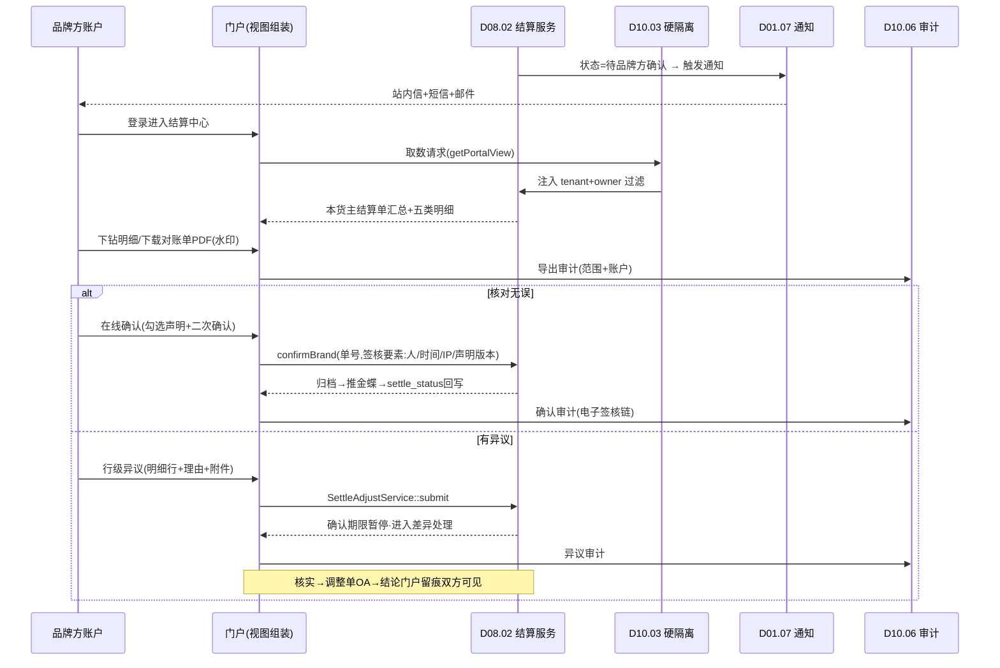
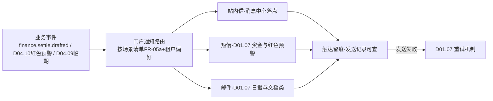

# SRS-D10.04 品牌方门户 需求规格说明书

> 文档编号：SRS-D10.04 · 版本 V1.0 · 2026-10-24 · 编写：小凯 · 状态：待审阅（批次⑤随组织权限门户域整体交审）
> 所属域：D10 组织权限与门户域 · 分期：**P1（M3）**
> 上游依据：SRS-00 契约「租户级行隔离」· SRS-D10.02（外部租户账户：手机号+验证码/自助注册审核）· SRS-D10.03 FR-06（外部租户硬隔离）· SRS-D08.02 FR-05c/FR-08d（结算单门户在线确认）· SRS-D04.10（门户预警只读）· SRS-D04.09 FR-03d（门户临期报告）· 逆向文档 07 §2.8（品牌方多租户门户、SaaS 化预留 Q41）
> 定位：品牌方（外部租户）自助服务门户——**只读本货主数据 + 确认类操作**；商派无门户产品（desktop_users 仅内部操作员），本模块为凯淳原创，是「代运营透明化协作」的产品化载体。

---

## 1. 模块概述

### 1.1 定位

品牌方门户是面向外部租户（品牌方）的独立 Web/H5 应用：品牌方自助查询本货主的订单、库存、售后、结算数据，完成结算单在线确认/异议等确认类操作，接收预警与报告通知——把原先靠微信群+Excel 邮件的代运营协作，收敛为**行级硬隔离（D10.03 FR-06）+ 全程审计（D10.06）**的产品化通道。

### 1.2 职责边界

**做**：门户信息架构与页面框架、门户功能清单（查询视图组装+确认类操作入口）、门户数据范围管控（消费 D10.03 硬隔离）、门户体验（移动端适配/水印导出）、通知触达（消费 D01.07）、门户审计投递、账号自助管理界面（消费 D10.02 FR-03e）。
**不做**：业务数据的计算与状态机（→ 各业务域，门户只是**视图组装层**：调各域查询接口取数，不复制业务逻辑不落业务数据）；外部账户与登录认证（→ D10.02）；隔离策略定义（→ D10.03，门户不可配置放宽）；短信/邮件发送（→ D01.07）；审计存储（→ D10.06）。

### 1.3 与其他模块关系（门户取数契约一览）

| 模块 | 门户消费的接口/能力 | 门户呈现 |
|---|---|---|
| D03.01/D03.07 | 订单查询（FR-10a 四维过滤）、发货单列表（FR-10a 明示品牌方只见本货主发货单） | 订单查询/发货跟踪 |
| D03.09 | EF-D03.09-03：代销货缺货跟催通知/本货主异常单只读视图 | 缺货协作 |
| D04.01 | 本货主基础物料与其店铺销售物料（§8 数据权限口径） | 商品库存视图 |
| D04.02 | FR-04c：代销货主人工调整生成品牌方门户通知；FR-06a 日终快照 | 库存变动知情 |
| D04.03 | AC-08：品牌方门户可见本货主预占台账 | 预占台账 |
| D04.05 | §8：品牌方可见本方借调台账 | 借调台账 |
| D04.09 | FR-03d：本货主临期结构（30/90/180 天分布与货值）门户报告；IF-D04.09-06 `SerialService::getHistory` SN 履历 | 临期报告/SN 追溯 |
| D04.10 | IF-D04.10-04 `ReplenishService::getSuggestions(owner, status)`：本货主缺货风险与补货建议只读（代销货补货责任在品牌方） | 预警与补货建议 |
| D05.01/D05.03/D05.04 | IF-D05.01-05 `ReturnApplyQuery`、IF-D05.03-05 `RefundLedgerQuery`、IF-D05.04-06 `ExchangeQuery`（本货主只读+脱敏） | 售后单跟踪 |
| D08.01 | IF-D08.01-04/07 `ArQueryService`/`ArLedgerQuery`（本货主应收台账只读） | 应收台账 |
| D08.02 | IF-D08.02-05 `SettleQueryService::getPortalView(owner_tenant)`、IF-D08.02-02 `SettleFlowService::confirmBrand`、IF-D08.02-03 `SettleAdjustService::submit`（异议） | **结算单在线确认**（核心确认类操作） |
| D10.02 | IF-D10.02-07 `PortalAccountService::selfManage` | 账号自助管理 |
| D10.03 | IF-D10.03-01 中间件硬隔离（每次取数自动生效） | 数据范围 |
| D10.06 | 门户操作审计投递 | — |
| D01.07 | 短信/邮件/门户站内信通知通道 | 通知触达 |

---

## 2. 业务场景

**SC-D10.04-01 品牌方财务月度结算确认（核心场景，对齐 D08.02 SC-02）**
月初 D08.02 生成品牌 A 上月结算单并内部审核归档为「待品牌方确认」→ 门户+短信+邮件通知品牌 A 财务李四 → 李四登录门户「结算中心」：查看结算单汇总（货款/退款/扣费/服务费/借调五类要素）+明细下钻（应收行/扣费行/借调台账行）+对账单 PDF 下载（带水印）→ 核对无误在线确认（电子签核：确认人/时间/IP 留痕，调 `SettleFlowService::confirmBrand`）→ 结算单归档推金蝶。有异议则走行级异议（SC-03）。

**SC-D10.04-02 品牌方运营日常巡检**
品牌 A 运营小王每天打开门户首页看板：昨日订单量/发货量/退款率、当前库存五口径汇总（本货主）、红色预警（断货≤3 天 SKU 清单，D04.10）、临期库存占比（D04.09 30/90/180 天分布）→ 点预警 SKU 下钻补货建议详情（建议补货量/在途/日均销）→ 决策向凯淳下补货计划（线下/邮件，门户本期只读不代下单）。

**SC-D10.04-03 结算异议与对账差异反馈（对齐 D08.02 SC-03）**
李四核对发现某笔扣费 3200 元无对应平台账单明细 → 门户结算单详情页发起**行级异议**（引用结算明细行+理由+附件截图，调 `SettleAdjustService::submit`）→ 确认期限暂停计时 → 凯淳财务核实（门户沟通留痕双方可见）→ 异议成立生成调整单（OA 审批）本期修正 V2 重出 / 不成立回复理由。全过程在门户「异议跟踪」页透明可查。

**SC-D10.04-04 缺货协作与售后跟踪**
品牌 A 爆款断货：D04.10 红色预警即时推送门户+短信（代销货补货责任在品牌方，SC-03 协作规则）；同时 D03.09 缺货挂起的本货主异常单在门户「缺货协作」页只读可见（订单号/SKU/缺口/挂起时长），品牌方补货到位后可见恢复流转。消费者发起退货：门户「售后跟踪」页按申请单号/订单号查询本货主售后单（`ReturnApplyQuery::trace`），状态时间线+退款进度（`RefundLedgerQuery`），买家信息脱敏展示。

**SC-D10.04-05 账号自助管理**
品牌 A 管理员李四在门户「账号管理」：为本司新入职运营开子账户（姓名+手机号+角色=品牌方运营，上限 20 个可配）→ 子账户收到短信即可登录；离职子账户禁用；全部操作进审计（凯淳侧可见）。

---

## 3. 功能需求

### FR-D10.04-01 门户定位与信息架构

- FR-01a 定位红线：门户=**只读本货主数据 + 确认类操作**；确认类操作白名单（本期）：结算单在线确认/异议、对账差异反馈、账号自助管理；其余一律只读。白名单外新增写操作需求必须升版本文档（防门户演变成第二 OMS）。
- FR-01b 信息架构（§4.1）：首页看板 / 订单中心 / 库存中心 / 售后中心 / 结算中心 / 预警与报告 / 消息中心 / 账号管理。
- FR-01c 独立部署形态：独立域名与前端应用（portal.*），与内部 OMS 后台（admin.*）物理分离；共享后端 API 网关但独立路由前缀 `/portal-api/*`（独立限流与 WAF 策略）；会话与内部完全隔离（D10.02 外部通道）。
- FR-01d SaaS 化预留（Q41）：门户主题（Logo/主色）按租户可配；功能菜单按租户开关（为未来对外输出给其他代运营公司预留）。

### FR-D10.04-02 门户功能清单（视图组装，逐页定义）

- FR-02a **首页看板**：昨日/本月订单量、发货量、退款率、库存汇总（五口径）、红橙预警数、待确认结算单数、未读消息；数据卡片点击直达对应中心。
- FR-02b **订单查询**：本货主订单列表（订单号/平台单号/店铺/状态四套/时间区间检索）+详情（商品行/金额双口径/物流轨迹）+发货单跟踪（D03.07 FR-10a 口径）；消费者 PII 一律脱敏（姓名/电话/地址，D01.05 规则，门户**无明文查看权限点**——D10.03 FR-06c internal_only）。
- FR-02c **库存中心**：五口径余额查询（按仓/SKU/批次维度，D04.02 FR-01c 口径）；库存变动流水（本货主，含凯淳人工调整知情通知 D04.02 FR-04c）；预占台账（D04.03 AC-08）；借调台账（本货主借出/借入，D04.05）；批次效期结构与临期报告（D04.09 FR-03d：30/90/180 天分布与货值）；SN 履历查询（D04.09 IF-D04.09-06，售后核销追溯）。成本字段对品牌方**永不展示**（内部成本为凯淳商业机密，D10.03 field_registry 标记）。
- FR-02d **售后中心**：售后申请单跟踪（`ReturnApplyQuery::get/list/trace`）+退款台账（`RefundLedgerQuery`）+换货单（`ExchangeQuery`，含差价明细）；状态时间线可视化；买家信息脱敏。
- FR-02e **结算中心**（核心，对齐 D08.02 FR-08d）：本货主结算单列表/详情（`getPortalView`）；五类要素明细下钻（应收行/扣费行/借调台账行/服务费计算轨迹/调整历史）；对账单 PDF 下载（FR-04c 水印）；**在线确认**（`confirmBrand`：确认前强制阅读确认声明+勾选，电子签核留痕=确认人/时间/IP/声明版本）；**行级异议**（`SettleAdjustService::submit`：引用明细行+理由必填+附件）；异议-核实-结论沟通留痕双方可见（D08.02 FR-06d）；调整单跟踪；红冲知情通知与 V2 重新确认（D08.02 FR-07b）；应收台账与账龄只读（D08.01 `ArLedgerQuery`）。
- FR-02f **预警与报告**：缺货预警与补货建议只读（D04.10 IF-D04.10-04：预警分级红/橙/黄、建议量/在途/日均销、忽略状态与原因）；临期报告（D04.09）；滞销清单（D04.10 SC-05）；缺货挂起异常单只读（D03.09 EF-D03.09-03）；历史报告归档下载。
- FR-02g **消息中心**：站内信列表（通知触达的门户落点，FR-05）；已读/未读；按类型过滤。
- FR-02h **账号管理**：品牌方管理员管理本租户子账户（D10.02 IF-D10.02-07 selfManage：增/禁用/角色分配，限本租户模板角色，上限可配）；本人资料与手机号变更（验证码双确认）。

### FR-D10.04-03 门户数据范围（货主行级隔离）

- FR-03a 全部取数经 D10.03 中间件硬隔离（tenant_id+owner_id ∈ 租户货主集，FR-06a 末端强制收敛）；门户层**不做第二套过滤逻辑**（单一事实源，防两套过滤漂移）。
- FR-03b 多品牌方互不可见：不同外部租户零共享；枚举/聚合接口只返回本货主集（不暴露其他货主存在性）；同品牌方多货主（集团型租户，D10.02 FR-01b）门户内按货主切换器隔离视图。
- FR-03c 请求携带 scope 外参数→静默收敛+越权审计（D10.03 FR-04e 口径）；门户 API 独立限流（按租户 QPS 配额）。
- FR-03d 货主暂停/终止联动（D10.01 FR-06）：暂停=门户降级只读+结算确认入口关闭（挂起提示联系商务）；终止=租户禁用登录（D10.02 FR-01d）。

### FR-D10.04-04 门户体验

- FR-04a 移动端适配：响应式 H5（看板/查询/消息/确认操作移动可完成；异议附件上传支持拍照）；结算确认等资金操作在移动端需二次确认弹窗。
- FR-04b 性能体验：列表查询 P95 ≤500ms（对齐 D08.02 门户明细下钻口径）；大报表异步导出（D01.06）+完成通知。
- FR-04c **数据导出带水印**：全部导出文件（Excel/PDF）嵌入水印（账户姓名+手机号后四位+租户名+导出时间，斜排平铺）；PDF 对账单同规则；导出行为全量审计（谁/何时/导了什么范围）；导出单次行数上限（默认 5 万，超限走异步）。
- FR-04d 页面水印：明细/结算页背景水印（同 FR-04c 要素，防截图外泄溯源）；可配置开关（默认开）。
- FR-04e 引导与帮助：首次登录引导（功能导览）；每页帮助入口（术语解释：五口径/借调/双口径金额——对齐 SRS-00 术语表口径）。

### FR-D10.04-05 通知触达（消费 D01.07）

- FR-05a 通知场景清单（事件驱动订阅）：

| 场景 | 触发事件 | 通道 | 时效 |
|---|---|---|---|
| 结算单待确认 | `finance.settle.drafted`→内部审核后（D08.02 状态机） | 站内信+短信+邮件 | 即时 |
| 结算确认催办 | 确认期限到期未确认（D08.02 FR-05d） | 站内信+短信+邮件 | 每日 |
| 红冲知情/V2 重确认 | `finance.settle.redflushed`（D08.02 FR-07b） | 站内信+短信+邮件 | 即时 |
| 异议处理结论 | 调整单审批完成（D08.02 FR-06） | 站内信+邮件 | 即时 |
| 缺货红色预警 | D04.10 FR-04b 红色分级（代销货主路由） | 站内信+短信 | 即时 |
| 橙/黄预警与滞销 | D04.10 日报汇总 | 站内信+邮件 | 日报 |
| 临期红色预警 | D04.09 30 天红色（代销货） | 站内信+短信 | 即时 |
| 库存人工调整知情 | D04.02 FR-04c（代销货主调整） | 站内信 | 即时 |
| 账号审核结果/子账户开通 | D10.02 注册审核/代建 | 短信 | 即时 |

- FR-05b 通知偏好：租户管理员可按场景配置通道开关与接收人（短信仅保留资金与红色预警类，防打扰）；偏好变更审计。
- FR-05c 触达留痕：通知发送记录（场景/通道/接收人/状态）可查（对账「品牌方声称没收到」场景）；发送失败重试（D01.07 机制）。

### FR-D10.04-06 门户审计（品牌方操作也进审计）

- FR-06a 门户全部**确认类操作**逐笔投递 D10.06：结算确认（含声明版本/IP/设备指纹）、异议提交/撤回、账号增删改、通知偏好变更、数据导出（含范围参数）。
- FR-06b 只读查询抽样审计：明细查询/导出类高频只读操作按采样率记录（默认导出 100%、查询 10% 采样，PIPL 消费者数据访问日志保留期口径见 D10.06 FR-08）。
- FR-06c 审计记录携带双身份要素（外部账户+租户+货主），内部审计工作台可按租户/货主检索品牌方操作（纠纷取证：结算确认争议时调取签核链）。

---

## 4. 业务流程

### 4.1 门户信息架构

```mermaid
flowchart TD
    LOGIN[门户登录<br/>D10.02 手机号+验证码] --> HOME[首页看板<br/>订单/发货/退款率/库存汇总/预警数/待确认结算]

    HOME --> ORD[订单中心]
    HOME --> INV[库存中心]
    HOME --> AS[售后中心]
    HOME --> SET[结算中心 ★确认类]
    HOME --> WARN[预警与报告]
    HOME --> MSG[消息中心]
    HOME --> ACC[账号管理 ★确认类]

    ORD --> ORD1[订单查询·脱敏] & ORD2[发货单跟踪 D03.07] & ORD3[缺货挂起单只读 D03.09]
    INV --> INV1[五口径余额 D04.02] & INV2[变动流水/调整知情] & INV3[预占台账 D04.03] & INV4[借调台账 D04.05] & INV5[临期报告 D04.09] & INV6[SN履历 D04.09]
    AS --> AS1[售后单跟踪 D05.01] & AS2[退款台账 D05.03] & AS3[换货单 D05.04]
    SET --> SET1[结算单列表/详情 getPortalView] & SET2[明细下钻·五类要素] & SET3[对账单PDF·水印下载] & SET4[在线确认 confirmBrand ★] & SET5[行级异议+跟踪 ★] & SET6[应收台账 D08.01]
    WARN --> W1[缺货预警/补货建议 D04.10] & W2[滞销清单] & W3[历史报告归档]
    ACC --> A1[子账户管理 selfManage ★] & A2[本人资料/手机号]

    SCOPE[D10.03 硬隔离中间件<br/>tenant+owner 全取数生效] -.横切.- ORD & INV & AS & SET & WARN
    AUD[D10.06 门户审计<br/>★操作逐笔/只读采样] -.横切.- SET & ACC & ORD
```



### 4.2 结算单门户确认时序（核心确认链路）



### 4.3 门户通知触达流程



---

## 5. 处理逻辑

### 5.1 视图组装原则（门户不落业务数据）

```
门户页面 = f(各域查询接口, D10.03 scope):
    1. 门户 BFF 层只做: 接口聚合(一页多源)、字段裁剪(去内部字段)、
       展示模型转换(状态码→文案/时间线)、脱敏规则应用(D01.05)
    2. 禁止: 业务计算(金额汇总由各域接口返回权威值)、状态判断副本、业务数据落地
    3. 确认类操作 = 直调各域写接口(如 confirmBrand), 门户不代持状态
    → 保证单一事实源: 门户所见 = 内部 OMS 所见(同接口同过滤)
```

### 5.2 电子签核要素（结算确认）

```
confirmBrand 签核包: {
    settle_bn, 确认声明版本号(文本留档),
    account_id + 姓名 + 手机号(脱敏), tenant_id, owner_id,
    确认时间(服务端时间), IP, 设备指纹, 二次确认动作标记
} → 投递 D10.06(不可篡改存储) → 纠纷取证时与 OA/金蝶链路互证
```

### 5.3 水印生成

```
watermark(user, tenant):
    text = 姓名 + 手机后4位 + 租户名 + yyyy-MM-dd HH:mm
    Excel: 页眉+背景平铺(导出服务 D01.06 统一注入, 业务模板无感)
    PDF: 斜排45°平铺半透明图层
    页面: CSS 背景层(canvas 生成 dataURL), 防开发者工具移除仅尽力而为
        (法律溯源以导出水印+审计为准)
```

### 5.4 门户与内部权限的边界规则

| 规则 | 说明 |
|---|---|
| 权限点白名单 | 门户可用权限点=注册表 `internal_only=false` 且标记 `portal_visible=true` 的子集；确认类权限点逐个显式标记 |
| 明文 PII | 门户永不开放（D10.03 FR-06c；`field.pii.plaintext.view` 为 internal_only） |
| 成本/毛利/服务费计算参数 | 对品牌方按合同可见性分级：服务费**结果**可见（结算单 D 项），费率参数与内部成本不可见 |
| 功能演进 | 新增写操作=修改 FR-01a 白名单+本文档升版+Jason 审阅（红线流程） |

---

## 6. 数据字段（业务字段描述）

> 门户自身仅落少量运营数据（业务数据一律取各域接口），核心实体如下。

### 6.1 门户消息（portal_message）

| 字段 | 业务含义 | 取值/校验 |
|---|---|---|
| msg_id / tenant_id | 消息 ID/租户 | 行隔离 |
| scene_code | 通知场景 | FR-05a 清单枚举 |
| title / content / link | 标题/内容/跳转 | 内容模板化（变量注入） |
| ref_type / ref_id | 关联业务对象 | 如 settle_bn |
| read_status / read_at | 已读状态 | |
| push_channels | 同步推送通道记录 | 站内信+短信/邮件发送 ID 引用（D01.07 留痕互查） |

### 6.2 通知偏好（portal_notify_pref）

| 字段 | 业务含义 | 取值/校验 |
|---|---|---|
| tenant_id / scene_code | 租户×场景 | 联合唯一 |
| channels / receivers | 通道开关/接收人 | 短信仅资金与红色预警可开（FR-05b 约束） |
| update_op / update_time | 变更留痕 | 审计要素 |

### 6.3 导出记录（portal_export_log）

| 字段 | 业务含义 | 取值/校验 |
|---|---|---|
| export_id / tenant_id / account_id | 导出主体 | |
| scene / query_params_snapshot | 导出场景/范围参数快照 | 参数快照脱敏存储 |
| row_count / file_ref | 行数/文件引用 | OSS 加密+时效链接（对齐 D08.06 文件策略） |
| watermark_text | 水印内容 | FR-04c 要素 |
| export_time / ip | 时间/IP | 审计要素 |

### 6.4 确认签核包（confirm_sign，投递 D10.06 前的结构化载体）

| 字段 | 业务含义 | 取值/校验 |
|---|---|---|
| biz_type / biz_bn | 业务类型/单号 | settle_confirm / dispute_submit 等白名单 |
| statement_version | 声明版本 | 文本版本化留档 |
| account_snapshot | 确认人快照 | 姓名+手机脱敏+租户+货主 |
| sign_time / ip / device_fp | 签核三要素 | 服务端时间权威 |

---

## 7. 接口

### 7.1 内部接口（本模块提供）

| 编号 | 接口 | 消费方 | 说明 |
|---|---|---|---|
| IF-D10.04-01 | `PortalBffService::*`（`/portal-api/*` 路由族：看板聚合/订单/库存/售后/结算/预警/消息/账号） | 门户前端 | 视图组装层（§5.1 原则：聚合+裁剪+脱敏，不落业务数据） |
| IF-D10.04-02 | `PortalMsgService::push(tenant, scene, payload)` | D08.02/D04.09/D04.10/D03.09/D10.02（事件订阅） | 门户通知统一入口（FR-05 路由+留痕） |
| IF-D10.04-03 | `PortalSignService::buildSignPack(biz_type, biz_bn, ctx)` | 结算确认/异议链路 | 电子签核包组装（§5.2，随业务调用投递 D10.06） |
| IF-D10.04-04 | 订阅 `finance.settle.drafted/confirmed/redflushed`、`stock.shortage`、`batch.frozen`、D04.10 预警事件、`auth.*` 账号事件 | — | 通知场景事件源 |
| IF-D10.04-05 | `PortalExportService::export(scene, params)` | 门户前端 | 导出统一入口（水印注入+审计+异步大文件经 D01.06） |

### 7.2 消费的外部域接口（关键契约清单）

| 编号 | 接口 | 提供方 | 用途 |
|---|---|---|---|
| IF-D10.04-D1 | `SettleQueryService::getPortalView(owner_tenant)` / `SettleFlowService::confirmBrand` / `SettleAdjustService::submit` | D08.02（IF-D08.02-05/02/03） | 结算中心全部能力 |
| IF-D10.04-D2 | `ArQueryService` / `ArLedgerQuery` | D08.01（IF-D08.01-04/07） | 应收台账只读 |
| IF-D10.04-D3 | `ReturnApplyQuery` / `RefundLedgerQuery` / `ExchangeQuery` | D05.01/03/04 | 售后中心 |
| IF-D10.04-D4 | `ReplenishService::getSuggestions(owner, status)` | D04.10（IF-D04.10-04） | 预警与补货建议只读 |
| IF-D10.04-D5 | `SerialService::getHistory(sn)` / 临期报告数据 | D04.09（IF-D04.09-06/FR-03d） | SN 履历与临期报告 |
| IF-D10.04-D6 | `StockLedgerService::getBalance/queryAvailable`（经 scope 过滤） | D04.02 | 库存中心 |
| IF-D10.04-D7 | `PortalAccountService::selfManage` / `AuthService::login(sms_code)` | D10.02 | 账号自助与登录 |
| IF-D10.04-D8 | 通知发送/导出中心/审计投递 | D01.07/D01.06/D10.06 | 底座能力 |

### 7.3 外部接口

| 编号 | 接口 | 方向 | 说明 |
|---|---|---|---|
| EF-D10.04-01 | 短信/邮件通道（经 D01.07） | 出 | 通知触达 |
| EF-D10.04-02 | OSS（导出文件加密存储+时效链接） | 出 | 下载安全 |

---

## 8. 非功能需求

| 项 | 要求 |
|---|---|
| 性能 | 门户页面首屏 ≤2s；列表查询 P95 ≤500ms（对齐 D08.02 口径）；看板聚合（6 数据源并行取数）≤1s；支撑 50 租户并发在线 |
| 安全 | D10.03 硬隔离不可绕过（门户层零过滤代码，单一事实源）；独立域名+独立限流+WAF；PII 永不明文；导出全水印+全审计；确认操作电子签核链不可篡改（D10.06）；会话与内部后台完全隔离 |
| 可用性 | 单业务域接口故障→门户对应卡片降级展示（错误占位不白屏）；通知失败重试（D01.07）；门户整体可用性 ≥99.5%（工作时间） |
| 合规 | PIPL：门户展示的消费者数据全脱敏；品牌方导出行为留痕可追责；授权协议留痕（D10.02） |
| 幂等 | 结算确认/异议按单号+状态 CAS（D08.02 §5.4 口径，防并发双确认）；通知按事件 ID 去重 |
| 体验 | 移动端主流机型适配（iOS/Android 近 3 年）；无障碍基线（对比度/字号可调） |

---

## 9. 验收标准

| 编号 | 验收条件 |
|---|---|
| AC-01 | SC-01 结算确认闭环：通知触达→查看汇总+五类明细下钻+PDF 水印下载→在线确认（签核包含人/时间/IP/声明版本）→D08.02 状态机归档推金蝶；确认记录在 D10.06 可检索且不可改 |
| AC-02 | SC-03 异议闭环：行级异议提交→确认期限暂停（D08.02 联动验证）→沟通留痕门户双方可见→调整结论跟踪页可查；异议撤回同样留痕 |
| AC-03 | 硬隔离：品牌 A 账户以任何手段（改参数/改请求体/枚举 ID）无法获取品牌 B 数据；scope 外 ID 返回与不存在 ID 不可区分；越权尝试进审计 |
| AC-04 | 脱敏验证：门户所有页面与导出文件中消费者姓名/电话/地址均脱敏；成本/毛利/服务费率参数不出现（抓包响应体验证服务端裁剪） |
| AC-05 | 导出水印：Excel/PDF 导出文件含完整水印要素（姓名+手机后4位+租户+时间）；导出记录含范围参数快照可审计追溯 |
| AC-06 | 通知触达：FR-05a 清单 9 场景逐一触发验证通道正确（短信仅资金/红色预警）；租户偏好关闭某场景后不再推送；发送记录可查（含失败重试） |
| AC-07 | 账号自助管理：品牌方管理员建子账户→短信通知→子账户验证码登录成功；子账户数达上限拒绝；禁用子账户即时失效；操作审计凯淳侧可检索 |
| AC-08 | 只读红线：白名单外写操作在门户无入口且 API 层拒绝（直接调 /portal-api 写接口返回 403+审计） |
| AC-09 | 移动端：结算确认在移动端完成全流程（含二次确认弹窗+拍照上传异议附件）；主流机型布局无错乱 |
| AC-10 | 降级体验：模拟 D04.10 接口超时，预警卡片降级占位、其余页面正常；门户不白屏 |
| AC-11 | 货主暂停联动：货主置暂停后门户只读+结算确认入口关闭并提示联系商务；恢复后入口重开 |

---

## 变更记录

| 日期 | 版本 | 变更 | 原因 |
|---|---|---|---|
| 2026-10-24 | V1.0 | 首版 | — |

---

*参考实现溯源：商派无品牌方门户产品——desktop 模块（16 张表，「提供带权限和工作流的操作环境」）与 desktop_users 仅服务内部操作员；矩阵中心/矩阵店铺为平台侧通道而非客户自助门户；逆向文档 07 §2.8 将「品牌方多租户门户」列为凯淳新增合规与产品能力（租户级行隔离+SaaS 化预留 Q41）。本模块为**凯淳原创设计**，机制性吸收：① 商派 desktop 的「权限化操作环境」思想→门户权限点白名单+D10.03 硬隔离横切；② 商派 finance bill_confirm（账单确认单）的确认留痕字段（操作员/支付 IP/下载时间）→电子签核包要素；③ D08.02 门户确认契约（getPortalView/confirmBrand/异议）在本模块产品化落地。关键差异：多租户硬隔离（商派无）、只读+确认白名单红线（防第二 OMS）、水印导出与页面水印（商派导出无水印）、通知偏好与触达留痕、SaaS 化租户主题/菜单开关预留。*
