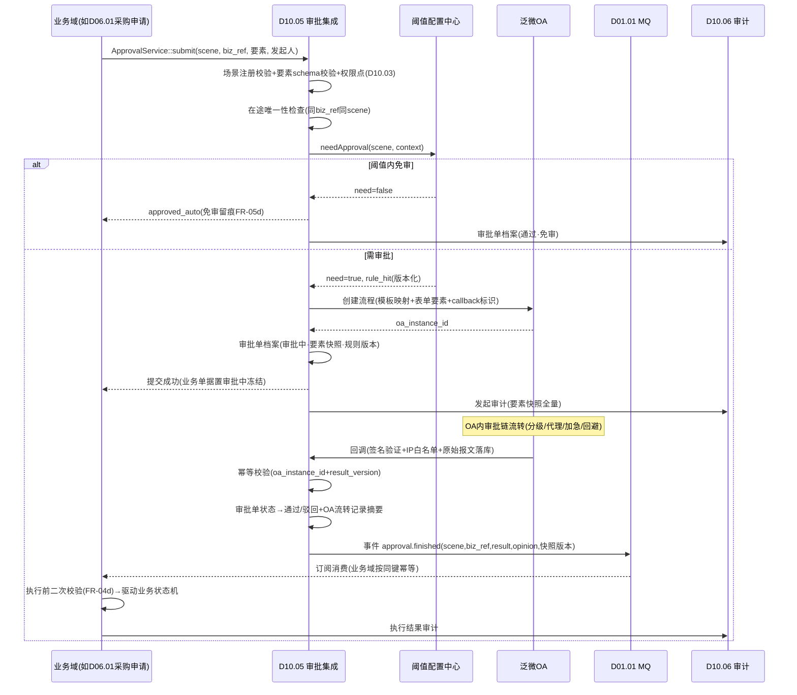
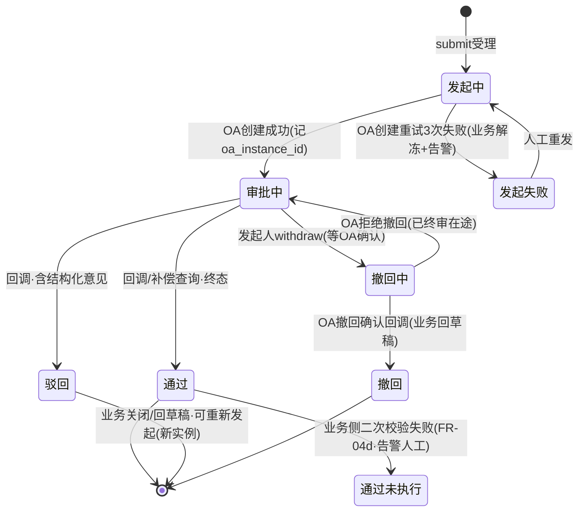
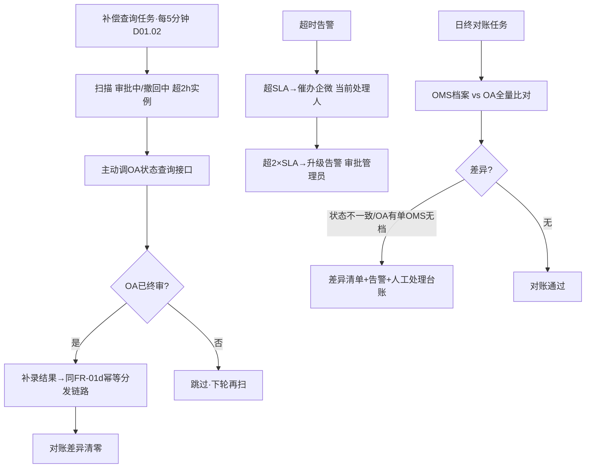

# SRS-D10.05 审批流集成 需求规格说明书

> 文档编号：SRS-D10.05 · 版本 V1.5 · 2026-10-24 · 编写：小凯 · 状态：待审阅（批次⑤随组织权限门户域整体交审）
> 所属域：D10 组织权限与门户域 · 分期：**P1（M3），但 M1 预留接口**（D04.02/D06.01 等 P0 模块已按本契约预留调用位）
> 上游依据：41 问决策（Q27/Q39 敏感操作审批推泛微 OA）· 逆向文档 07 §2.8/§5（泛微 OA 双向：审批流推 OA、接收结果）· 各业务域 SRS 已引用的审批场景（本文档 §3 FR-02 场景清单为汇总登记源）
> 定位：OMS 与泛微 OA 之间**唯一审批通道**——统一发起接口、统一回调驱动、统一状态机、统一阈值配置中心。各业务域只声明「什么场景、什么要素、什么阈值」，不各自对接 OA（防 21+ 处散落对接的报文/幂等/补偿重复建设）。

---

## 1. 模块概述

### 1.1 定位

审批流集成把 OMS 内的敏感操作决策**外置到泛微 OA**（凯淳统一审批平台，审批人/组织/代理关系以 OA 为权威），OMS 侧只做三件事：

1. **发起**：业务单据达阈值 → 组装审批要素 → 按「审批场景→OA 流程模板」映射推送 OA → 业务单据置「审批中」冻结；
2. **接收**：OA 审批结果回调（通过/驳回/撤回确认）→ 幂等校验 → 驱动业务状态机继续（生效/关闭/回草稿）；
3. **管控**：审批状态机、回调可靠性（幂等/补偿查询/超时告警）、阈值配置中心、审批代理与加急、全程审计（D10.06）。

架构原则：**OA 管「人与流程」（谁审、几级审、代理、加签），OMS 管「事与数据」（什么单、什么阈值、通过后干什么）**——审批链编排不在 OMS 重建（商派在 ERP 内自建审批的教训：与公司 OA 双轨、审批人两套维护）。

### 1.2 职责边界

**做**：泛微 OA 集成适配层（API 封装/签名/报文映射）、审批场景注册表与模板映射、统一发起/撤回接口、回调接收与幂等分发、审批状态机与审批单档案、回调可靠性（补偿查询/超时告警/对账）、阈值配置中心、审批代理与加急透传、审批看板与催办。
**不做**：审批通过后的业务动作（→ 各业务域回调处理器执行，本模块只分发事件）；审批链/审批人编排（→ 泛微 OA 权威）；阈值**归属规则**的业务定义（→ 各业务域 SRS 定义语义，本模块提供统一配置载体与读取接口）；审计存储（→ D10.06）。

### 1.3 与其他模块关系

| 模块 | 关系 |
|---|---|
| 全域审批场景方（§3 FR-02 清单 20+ 场景） | 消费 `ApprovalService::submit/withdraw` + 订阅结果事件驱动业务 |
| D01.01 MQ | 回调结果经 MQ 分发给业务域（削峰+重试） |
| D01.02 调度 | 补偿查询任务/超时扫描/对账任务注册 |
| D01.07 通知 | 催办/超时告警（企微+短信） |
| D10.01 | 发起前校验（店铺换货主/货主状态变更/结算配置变更场景） |
| D10.02 | 发起人身份（account_id）；离职账户在途审批转交提醒 |
| D10.03 | 发起与查看审批的功能权限点；执行时二次校验（scope 收回窗口防护，D10.03 §5.5） |
| D10.06 | 审批全生命周期字段级审计（发起要素/每次流转/回调报文） |

---

## 2. 业务场景

**SC-D10.05-01 采购申请全量审批（对齐 D06.01 FR-02）**
采购专员提交采购申请（买断货主）：OMS 调 `ApprovalService::submit(scene=purchase_request, 要素={货主/仓/总金额/行数/明细附件})` → 映射 OA 流程模板「采购申请审批」→ 申请状态=审批中（冻结编辑）+记录 OA 流程实例号 → OA 内审批链流转（金额分级审批人在 OA 配置）→ 审批人驳回（意见：建议量过大砍至 300）→ OA 回调 → 本模块幂等校验后发事件 `approval.rejected` → D06.01 消费：申请状态=已驳回+企微通知申请人（含驳回意见）→ 修改后重新提交（**新审批实例**，历史留痕）。

**SC-D10.05-02 手工改库存超阈值（对齐 D04.02 FR-04b）**
库存专员发起人工调整 -50 件（货值 1.2 万，超「绝对值>10 或货值>5000」阈值）：调整单提交 → 本模块按阈值配置判定需审批 → 推 OA（模板「库存调整审批」，要素含三元键/数量/类型/原因/附件）→ 审批中调整单冻结（库存不变动）→ 通过回调 → 事件驱动 D04.02 记账生效+流水+代销货主门户通知；阈值内（如 -3 件）直接生效不发起。

**SC-D10.05-03 撤回（对齐 D06.01 FR-08b：以 OA 回调为准，不做乐观撤回）**
申请人在审批完成前撤回：OMS 调 `withdraw` → 向 OA 发终止请求 → **等待 OA 撤回确认回调**才把申请置回草稿——期间申请仍显示「撤回中」冻结操作，防止 OMS 草稿态与 OA 在途流程并存（双轨状态红线）。

**SC-D10.05-04 回调丢失与补偿**
OA 审批通过但回调 HTTP 请求因网络故障丢失：本模块补偿查询任务（每 5 分钟扫描「审批中/撤回中」超 N 小时的实例）主动调 OA 状态查询接口 → 发现已终审 → 补录结果走同一幂等分发链路 → 业务恢复；连续补偿失败或状态不一致 → 企微告警运维（对账日报兜底：每日全量比对在途实例 OMS vs OA 状态）。

**SC-D10.05-05 审批代理与加急**
大促期间财务总监休假：OA 内配置代理人（OA 权威）→ OMS 发起的审批在 OA 自动流转给代理人（OMS 不感知代理逻辑，只透传展示 OA 返回的当前处理人）；紧急采购申请：发起人勾选加急（理由必填）→ 本模块透传 OA 加急标记（OA 侧提醒策略）+ 同步企微通知当前审批人；加急滥用治理：加急率进审批看板（按发起人统计）。

---

## 3. 功能需求

### FR-D10.05-01 泛微 OA 集成架构

- FR-01a 适配层封装：OA REST API 客户端（认证凭据加密存储 D01.05、超时/重试/熔断——复用 D02.05 分级重试口径思想但独立实现，OA 为内部系统通道）；报文日志（请求/响应全量落 `oa_api_log`，对齐 D02.01 api_log 机制）。
- FR-01b **审批模板映射**（approval_scene_registry）：OMS 审批场景编码 ↔ OA 流程模板 ID（workflowId）+ 表单字段映射（OMS 要素 JSON → OA 表单字段）；映射配置化（OA 模板升版不改代码）；场景注册时声明：编码/名称/来源模块/要素 schema/阈值配置引用/回调处理器（业务域事件订阅方）。
- FR-01c 发起链路：`submit` → 场景校验（注册表存在+要素 schema 校验+D10.03 权限点）→ 阈值判定（FR-05，需审批才发起；免审直接返回 `approved_auto` 结果码）→ 组装 OA 表单+回传 callback 标识 → 调 OA 创建流程 → 落审批单档案（oa_instance_id）→ 返回业务方。OA 创建失败：重试 3 次仍失败 → 审批单置「发起失败」+业务单据解冻回原状态+告警（**不阻塞业务单据本身**，人工介入重发）。
- FR-01d 回调链路：OA 回调（HTTP POST，签名验证+来源 IP 白名单）→ 落回调报文（原始 JSON 全量）→ 幂等校验（FR-04a）→ 更新审批单状态 → 投递 MQ 事件 `approval.finished`（payload：scene/biz_type/biz_bn/result/opinion/oa_instance_id/finish_time）→ 业务域订阅消费驱动状态机。
- FR-01e **M1 预留接口**：P0 阶段（M1）本模块未上线时，各业务域调用位以桩实现（`ApprovalStubService`：阈值内直接通过、超阈值置「待人工线下审批」标记+企微通知管理员，OA 单号字段留空）——接口签名与本模块完全一致，M3 切换实现不改业务代码（D04.02/D06.01 等已按此预留）。

### FR-D10.05-02 敏感操作审批场景清单（全域汇总登记，本文档=登记源）

| # | 场景编码 | 场景 | 来源模块（SRS 引用位） | 阈值/触发口径 | 阈值配置归属 |
|---|---|---|---|---|---|
| 1 | order_price_change | 订单改价 | D03.08（IF-D03.08-D3 模板=改价审批） | 改价幅度超阈值（金额/比例可配）；改价审批不可由发起人自审（OA 回避） | D03.08 |
| 2 | order_skip_audit | 跳过审单 | D03.03 FR-05b（IF-D03.03-D7） | 全量（独立授权点+必审） | 无阈值（固定必审） |
| 3 | order_force_ship | 强制发货（跳过库存校验） | D03.09（EF-D03.09-01） | 全量必审 | 固定 |
| 4 | order_blacklist_change | 黑名单加入/移除 | D03.09 FR-07b | 全量必审 | 固定 |
| 5 | order_oversell_refund | 超卖自动退款超阈值 | D03.09 | 单笔/累计金额阈值 | D03.09 |
| 6 | order_batch_cancel | 批量取消订单 | D03.10（EF-D03.10-03） | 批量单数阈值 | D03.10 |
| 7 | card_batch_void | 卡密批量作废 | D03.10 FR-05f | 数量/金额阈值 | D03.10 |
| 8 | warehouse_force_change | 强制低满足度改仓 | D03.06 FR-06c | 满足度低于阈值 | D03.06 |
| 9 | order_export_plaintext | 历史订单明文导出 | D03.13 FR-04d | 全量必审（PIPL） | 固定 |
| 10 | stock_manual_adjust | 手工库存调整超阈值 | D04.02 FR-04b（EF-D04.02-02） | 绝对值>10 件或货值>5000 元（按货主/仓/调整类型可配） | D04.02 |
| 11 | stocktake_diff | 盘点差异超阈值 | D04.06（EF-D04.06-02）/D03.11 门店盘点 | 差异数量/货值阈值 | D04.06 |
| 12 | manual_freeze | 人工预占（活动锁库） | D04.03 FR-01d（SC-05） | 数量/货值阈值 | D04.03 |
| 13 | stock_transfer_over | 仓间调拨超阈值 | D04.05（EF-D04.05-02） | 货值阈值 | D04.05 |
| 14 | lend_rule_change | 借调规则新建/变更 | D04.05 FR-02 | 全量必审（货主间资金关系） | 固定 |
| 15 | ownership_transfer | 货权转移（购销） | D04.05 FR-04 | 全量必审+双方确认 | 固定 |
| 16 | purchase_request | 采购申请 | D06.01 FR-02a（IF-D06.01-D3） | **全量无阈值豁免** | 固定 |
| 17 | purchase_order_over | 采购单超阈值/取消/反审核 | D06.02 FR-02e（IF-D06.02-D5） | 金额阈值；反审核=超阈值+双人复核 | D06.02 |
| 18 | purchase_damage_accept | 残损让步接收/索赔放弃 | D06.03 FR-04d | 货值>2000 元（可配） | D06.03 |
| 19 | payment_apply | 供应商付款申请 | D06.04 FR-04a | 金额分级阈值 | D06.04 |
| 20 | refund_over_limit | 超额退款 | D05.03 FR-04a | 超人工权限（默认 2000 元）升级 OA | D05.03 |
| 21 | settle_internal_review | 结算单内部审核 | D08.02 FR-05b | 金额分级：>50 万升级财务总监 | D08.02 |
| 22 | settle_adjust_over | 结算差异调整超阈值 | D08.02 FR-06b | 调整金额阈值 | D08.02 |
| 23 | settle_red_flush | 结算单红冲 | D08.02 FR-07b | 全量必审（资金红线） | 固定 |
| 24 | writeoff_force | 强制核销/反核销 | D08.03（IF-D08.03-D5） | 金额分级 | D08.03 |
| 25 | period_reopen | 反结账/豁免结账 | D08.03/D08.01 §结账联动 | 全量必审 | 固定 |
| 26 | bad_debt | 坏账处理 | D08.03 | 金额阈值 | D08.03 |
| 27 | freight_red_flush | 运费对账红冲重开 | D08.04 FR-05e | 全量必审 | 固定 |
| 28 | shop_owner_transfer | 店铺换货主（资产转移） | D10.01 FR-07b | 全量必审 | 固定 |
| 29 | owner_status_change | 货主暂停/终止 | D10.01 FR-06e | 全量必审 | 固定 |
| 30 | settle_config_change | 货主结算配置变更 | D10.01 FR-05e | 全量必审（资金条款） | 固定 |
| 31 | declare_element_change | 跨境申报要素人工修改/账册差异强制调整 | D03.12（EF-D03.12-03） | 全量必审 | 固定 |
| 32 | price_below_floor | 破线改价（目标价<底价红线 floor_price） | D04.11 调价计划（V1.5，S4 决策修正） | 目标价低于价格档案底价红线全量必审；不破线改价走内部双人复核（可配免审） | D04.11 |

- FR-02a 场景注册表管理：新增场景=注册表配置+OA 模板映射+业务域回调处理器订阅，零核心代码改动；场景清单升版需本文档变更记录登记（单一事实源）。
- FR-02b 场景要素 schema：每场景声明必填要素（表单映射与审计展示用）；要素含业务快照（发起时点数据，审批人看的是快照而非实时值——防「审批期间数据被改」，执行前二次校验见 FR-04d）。

### FR-D10.05-03 审批状态机与审批单档案

- FR-03a 状态机：`发起中 → 审批中 → 通过 / 驳回 / 撤回`；异常态：`发起失败`（FR-01c）、`撤回中`（等 OA 确认，SC-03）；终态不可逆（通过后发现问题走业务域红冲/反审核流程+新审批，不改历史审批单）。
- FR-03b 审批单档案（approval_bill）：审批单号（OMS 侧唯一）、场景编码、业务引用（biz_type+biz_bn，联合幂等键成分）、发起人、要素快照 JSON、OA 实例号、状态、OA 侧流转记录摘要（节点/处理人/意见/时间，回调或补偿查询时同步）、加急标记、完成时间。
- FR-03c 业务单据冻结语义：审批中业务单据的操作冻结由各业务域自行实现（本模块只提供状态查询/事件）；同一业务单据同场景**在途审批唯一**（重复 submit 返回已有实例，防双发起）。

### FR-D10.05-04 回调可靠性（幂等/补偿查询/超时告警）

- FR-04a **幂等**：回调以 `(oa_instance_id, result_version)` 唯一键去重——重复回调/乱序回调（旧版本后到）只处理最新终态一次；MQ 事件消费侧由业务域按同键幂等（各域 SRS 已约定，如 D06.01 FR-02b、D08.02 §5.4 CAS）。
- FR-04b **补偿查询**：调度任务（D01.02）每 5 分钟扫描「审批中/撤回中」且超 N 小时（默认 2h）未收到回调的实例 → 主动查 OA 状态 → 已终审则补录分发（走 FR-01d 同链路）；扫描窗口与频率可配。
- FR-04c **超时告警**：审批中超 SLA（场景级可配，默认 24h）→ 催办（企微通知当前处理人+发起人可见）；超 2×SLA → 升级告警（通知审批管理员）；OA 通道不可用（熔断开启）→ 即时告警运维。
- FR-04d **执行前二次校验**（与 D10.03 §5.5 联动）：回调分发事件携带发起时要素快照版本，业务域执行前重验（发起人权限是否仍有效/业务数据是否变化超容差）——校验失败不执行业务动作，审批单标记「通过未执行」+告警人工介入（防审批期间权限收回/数据漂移窗口）。
- FR-04e **日终对账**：每日全量比对在途与当日终态实例（OMS 档案 vs OA 查询）→ 差异清单（状态不一致/OA 有单 OMS 无档/要素快照缺失）→ 告警+人工处理台账。

### FR-D10.05-05 阈值配置中心（各场景阈值统一配置）

- FR-05a 配置模型：`scene_code + 维度条件（货主/仓/店铺/调整类型等场景自定义维度）→ 阈值规则（数值/比例/枚举）+ 是否免审 + 生效期间`；阈值**语义定义权在各业务域 SRS**（FR-02 表「阈值配置归属」列），本模块提供统一配置载体、版本化与读取接口——一处配置界面，全域阈值可查。
- FR-05b 判定接口：`ThresholdService::needApproval(scene, context)` → `{need:bool, rule_hit, auto_result?}`；业务域 submit 前调用（或 submit 内部自动判定，二选一由场景注册声明）。
- FR-05c 配置变更管控：阈值修改需高权限点（`d10.approval.threshold.manage`）+变更前后快照审计（D10.06）；资金类场景（19/21-27）阈值变更本身走 OA 审批（自举）；配置版本化——审批单档案记录发起时命中的规则版本（可解释「当时为什么需要/不需要审批」）。
- FR-05d 免审白名单：阈值内直接生效的场景，`submit` 返回 `approved_auto` 结果码并落审批单档案（状态=通过·免审，保留完整留痕——「免审也要有记录」审计红线）。

### FR-D10.05-06 审批代理与加急

- FR-06a 代理：以 OA 为权威（代理关系在 OA 配置生效）；OMS 侧只做展示（当前处理人含代理标记）与不重复建代理体系；发起人离职联动（D10.02 §5.3：在途审批提醒管理员，OA 侧转办）。
- FR-06b 加急：发起时可选（理由必填）→ 透传 OA 加急标记+企微即时通知当前处理人；加急权限点独立；加急率看板（FR-07c）。
- FR-06c 回避透传：发起人信息传 OA，由 OA 回避规则处理「发起人≠审批人」（D03.08 改价、D03.03 跳过审单等场景的回避要求落 OA 配置，OMS 不重建回避逻辑）。

### FR-D10.05-07 审批看板与查询

- FR-07a 我的审批：我发起的（状态/OA 链接跳转）/待我处理的（OA 待办同步展示，点击跳 OA 处理——OMS 不做审批操作界面）。
- FR-07b 管理视图：按场景/模块/状态/时间检索全部审批单；在途超 SLA 清单；发起失败与「通过未执行」异常队列（人工处理台账）。
- FR-07c 统计：场景×月度发起量/通过率/平均时长/加急率/驳回原因 TOP（治理数据：驳回率异常场景反馈业务域优化阈值或流程）。

---

## 4. 业务流程

### 4.1 审批发起-回调时序（主链路）



### 4.2 审批状态机



### 4.3 回调可靠性兜底流程



---

## 5. 处理逻辑

### 5.1 发起判定算法

```
submit(scene, biz_ref, payload, initiator):
    reg = SceneRegistry.get(scene)                     # 未注册场景拒绝
    validate(payload, reg.element_schema)              # 要素完整性
    assert can(initiator, reg.perm_code)               # D10.03 功能权限
    existing = ApprovalBill.findInFlight(scene, biz_ref)
    if existing: return existing                       # 在途唯一,幂等返回
    verdict = ThresholdService.needApproval(scene, payload.context)
    if not verdict.need:
        bill = create(status=通过·免审, rule_ver=verdict.rule_ver)  # FR-05d 留痕
        audit(bill); return {result: approved_auto}
    bill = create(status=发起中, snapshot=payload, rule_ver=verdict.rule_ver)
    try:
        inst = OaClient.createWorkflow(reg.oa_template, mapFields(payload), callback_tag(bill.bn))
        bill.update(status=审批中, oa_instance_id=inst.id)
    catch (retry 3 次后):
        bill.update(status=发起失败); alert(); return {result: submit_failed}   # 业务解冻
    audit(bill, 全量要素快照)
    return {result: submitted, approval_bn: bill.bn, oa_instance_id: inst.id}
```

### 5.2 回调幂等与分发算法

```
onCallback(oa_payload):
    verify_sign(oa_payload); assert ip_whitelist        # 安全前置
    raw_log.insert(oa_payload)                          # 原始报文全量落库(先落库再处理)
    inst_id = oa_payload.instance_id; ver = oa_payload.result_version
    if CallbackDedup.exists(inst_id, ver): return ACK   # 重复回调直接确认
    bill = ApprovalBill.byOaInstance(inst_id)
    if bill.status in (通过, 驳回, 撤回):                # 终态后乱序旧版本
        return ACK(忽略并记录乱序标记)
    bill.transit(oa_payload.result, opinion, flow_summary)   # CAS 状态迁移
    CallbackDedup.mark(inst_id, ver)
    MQ.publish('approval.finished', {scene, biz_type, biz_bn, result, opinion,
                                     oa_instance_id, snapshot_ver, finish_time})
    audit(bill)
    return ACK                                          # ACK 必须在 MQ 投递成功后(本地消息表保证)
```

> 本地消息表：`bill.transit` 与 MQ 投递意向同事务落库，投递失败由重投任务补偿——回调 ACK 给 OA 后事件必达（至少一次，业务域幂等消费兜底）。

### 5.3 阈值规则匹配

```
needApproval(scene, context):
    rules = ThresholdRule.where(scene).orderBy(维度特异性 desc, priority)  # 货主+仓+类型 > 货主 > 全局默认
    for r in rules:
        if r.match(context) and r.inEffectPeriod(now):
            return {need: r.need, rule_id: r.id, rule_ver: r.version}
    return {need: reg.default_need, rule_ver: 'default'}    # 场景注册默认值兜底
```

### 5.4 M1 桩实现与切换

```
ApprovalStubService (M1, 接口签名与 ApprovalService 完全一致):
    submit: 阈值内→approved_auto; 超阈值→置 pending_manual(企微通知管理员线下审批,
            管理员在桩界面登记线下结果→驱动同一 approval.finished 事件)
    切换(M3): DI 容器替换实现, 业务代码零改动; 桩期审批单档案保留(oa_instance_id=null 标记)
```

---

## 6. 数据字段（业务字段描述）

### 6.1 审批单档案（approval_bill）

| 字段 | 业务含义 | 取值/校验 |
|---|---|---|
| approval_bn | OMS 审批单号 | 唯一 |
| scene_code | 审批场景 | FR-02 注册表枚举 |
| biz_type / biz_bn | 业务引用 | 联合在途唯一（FR-03c） |
| initiator_id / urgent_flag / urgent_reason | 发起人/加急 | 加急理由必填 |
| element_snapshot | 要素快照 JSON | 发起时点快照（FR-02b），审计与二次校验基准 |
| rule_ver | 命中阈值规则版本 | FR-05c 可解释性 |
| oa_instance_id / oa_template_id | OA 实例/模板 | 发起成功必填 |
| status | 状态 | §4.2 状态机 |
| result_opinion / flow_summary | 终态意见/OA 流转摘要 | 驳回意见结构化回传业务域 |
| snapshot_ver / execute_check_status | 快照版本/二次校验结果 | FR-04d（通过未执行标记） |
| finish_time / sla_due_at | 完成时间/SLA 截止 | 超时催办依据 |

### 6.2 审批场景注册表（approval_scene_registry）

| 字段 | 业务含义 | 取值/校验 |
|---|---|---|
| scene_code / scene_name / source_module | 场景标识与来源 | FR-02 清单登记源 |
| oa_template_id / field_mapping | OA 模板/字段映射 | 配置化，模板升版不改代码 |
| element_schema | 要素 schema | JSON Schema 校验 |
| perm_code | 发起权限点 | D10.03 注册 |
| default_need / sla_hours | 默认需审/SLA | 兜底与催办 |
| callback_consumers | 结果事件订阅方 | 业务域登记 |
| status / version | 状态/注册版本 | 下线场景置废弃（在途单跑完为止） |

### 6.3 阈值规则（approval_threshold_rule）

| 字段 | 业务含义 | 取值/校验 |
|---|---|---|
| scene_code / dim_condition | 场景+维度条件 | JSON（货主/仓/店铺/类型等场景自定义维度） |
| rule_expr | 阈值表达式 | 数值/比例/枚举（如 `abs_qty>10 OR value>5000`） |
| need_approval / effect_period | 是否需审/生效期间 | 支持大促临时策略 |
| version / update_op / update_time | 版本与变更留痕 | 资金类场景变更自举走 OA（FR-05c） |

### 6.4 回调去重表（oa_callback_dedup）与报文日志（oa_api_log）

| 字段 | 业务含义 | 取值/校验 |
|---|---|---|
| oa_instance_id / result_version | 幂等键 | 联合唯一索引 |
| callback_raw / receive_time / process_status | 原始报文/接收时间/处理状态 | 报文全量保留（审计与重放依据）；按月分表 |

---

## 7. 接口

### 7.1 内部接口（本模块提供，全域审批唯一通道）

| 编号 | 接口 | 消费方 | 说明 |
|---|---|---|---|
| IF-D10.05-01 | `ApprovalService::submit(scene, biz_ref, payload, initiator)` | 全域 31 场景（FR-02 清单）；M1 为桩实现（§5.4），签名不变 | 统一发起（含阈值判定/在途唯一/免审留痕） |
| IF-D10.05-02 | `ApprovalService::withdraw(approval_bn, initiator)` | D06.01 FR-08b 等 | 撤回（以 OA 回调确认为准，撤回中冻结） |
| IF-D10.05-03 | `ApprovalService::getStatus(approval_bn / biz_ref)` | 业务域单据详情展示 | 状态与 OA 流转摘要查询 |
| IF-D10.05-04 | 事件 `approval.finished`（scene/biz_ref/result/opinion/oa_instance_id/snapshot_ver/finish_time） | 各业务域订阅（D04.02/D05.03/D06.01-04/D08.02-04/D03.03/06/08/09/10/13/D04.03/05/06/D10.01） | 结果分发唯一通道（本地消息表必达，业务域幂等消费） |
| IF-D10.05-05 | `ThresholdService::needApproval(scene, context)` / `getRules(scene)` | 业务域前置判定/配置界面 | 阈值统一读取（FR-05） |
| IF-D10.05-06 | `ApprovalAdminService::retryFailed/resyncInstance/reopenCheck(approval_bn)` | 运维/管理员工具 | 发起失败重发/手动补偿同步/二次校验重跑 |
| IF-D10.05-07 | `SceneRegistry::register(scene_config)` | 各业务域模块注册（迁移脚本） | 场景注册入口（对齐 D10.03 权限点注册模式） |

### 7.2 外部接口

| 编号 | 接口 | 方向 | 说明 |
|---|---|---|---|
| EF-D10.05-01 | 泛微 OA 流程创建 API（模板+表单字段+回传标识） | 出 | 发起与撤回；凭据加密存储 |
| EF-D10.05-02 | 泛微 OA 审批结果回调（HTTP POST，签名+IP 白名单） | 入 | 结果接收（FR-01d） |
| EF-D10.05-03 | 泛微 OA 状态查询/待办查询 API | 出 | 补偿查询（FR-04b）/待办同步展示（FR-07a） |
| EF-D10.05-04 | 企微通知（经 D01.07） | 出 | 催办/加急/告警 |

---

## 8. 非功能需求

| 项 | 要求 |
|---|---|
| 性能 | submit（含 OA 创建）P95 ≤2s（OA 超时 3s+重试）；回调处理 ≤200ms（落库+分发异步化）；支撑日均审批 500 单、大促峰值 100 单/小时 |
| 可靠性 | 回调必达（本地消息表+重投）；补偿查询覆盖回调丢失（≤2h 发现）；日终对账零容忍差异（差异必闭环）；OA 熔断期间 submit 快速失败不阻塞业务线程（业务单据解冻回原态） |
| 幂等 | submit 在途唯一；回调 (instance_id, result_version) 去重；MQ 至少一次+业务域幂等消费（契约已约定）；补偿查询与回调并发竞争以 CAS 状态迁移防双写 |
| 安全 | 回调签名验证+IP 白名单+原始报文全量落库；OA 凭据加密（D01.05）；发起权限点+回避规则 OA 侧执行；阈值变更资金类自举审批 |
| 审计 | 发起要素快照/每次状态流转/回调原始报文/催办加急/阈值变更前后值全量投递 D10.06；免审通过也留痕（FR-05d 红线） |
| 可解释性 | 任一历史审批单可回答：当时命中哪条阈值规则（rule_ver）、审批人看了什么要素（快照）、OA 里谁在何时给了什么意见（flow_summary） |

---

## 9. 验收标准

| 编号 | 验收条件 |
|---|---|
| AC-01 | SC-01 采购申请全链路：submit→OA 创建→审批中冻结→驳回回调→D06.01 状态=已驳回+企微通知含意见→重新提交生成新实例（旧实例历史留痕） |
| AC-02 | 幂等：同一业务单据重复 submit 返回同一在途实例；OA 重复回调（同 result_version）只分发一次事件；乱序回调（终态后收到旧版本）被忽略且留乱序标记 |
| AC-03 | SC-03 撤回：撤回中状态冻结业务操作；OA 确认回调后才回草稿；OA 拒绝撤回（已终审）状态回审批中且终态结果正常分发 |
| AC-04 | SC-04 补偿：人为丢弃 OA 回调（模拟网络故障），补偿任务 2h 窗口内主动查询补录结果并正常驱动业务；补录与后到回调并发不产生双事件（CAS 验证） |
| AC-05 | 超时与对账：超 SLA 催办触达当前处理人、超 2×SLA 升级告警；日终对账构造 3 类差异（状态不一致/OA 有单 OMS 无档/快照缺失）全部进差异清单并告警 |
| AC-06 | 阈值配置中心：修改 D04.02 库存调整阈值（5000→3000）后新提交按新阈值判定；历史审批单 rule_ver 仍显示发起时规则版本；资金类场景阈值变更本身触发 OA 审批（自举验证） |
| AC-07 | 免审留痕：阈值内调整单 submit 返回 approved_auto，审批单档案存在（状态=通过·免审）且 D10.06 可检索 |
| AC-08 | 二次校验：审批期间收回发起人权限（D10.03 联动），通过回调后业务侧执行拒绝，审批单标记「通过未执行」+告警；人工 resync 处理后可闭环 |
| AC-09 | M1 桩切换：桩实现与正式实现接口签名一致（同一业务域代码在两实现下通过同一测试集）；桩期线下审批登记同样产生 approval.finished 事件驱动业务 |
| AC-10 | 发起失败降级：模拟 OA 不可用，submit 重试 3 次后置发起失败、业务单据解冻回原状态+告警；恢复后人工重发成功 |
| AC-11 | 场景清单一致性：FR-02 表 31 场景与注册表数据逐一核对（编码/来源模块/阈值归属），业务域 SRS 引用位（如 D03.03 IF-D03.03-D7、D08.02 IF-D08.02-D5）均可对应到已注册场景 |

---

## 变更记录

| 日期 | 版本 | 变更 | 原因 |
|---|---|---|---|
| 2026-10-24 | V1.0 | 首版 | — |
| 2026-10-24 | V1.5 | 场景清单 31→32：新增 price_below_floor 破线改价审批（D04.11 价格管理，目标价<底价红线强制 OA） | S4 决策修正（Jason：价格要管，破线改价走 OA） |

---

*参考实现溯源：商派在 ERP 内自建审批（purchase act=checklist 待审核队列、ome_return_product 的 apply_op_id/verify_op_id 申请-审核双人字段、finance bill 审核流），无外部 OA 集成——审批人与组织在 ERP 内二次维护，与公司流程双轨。凯淳决策（Q27/Q39）为敏感操作统一推**泛微 OA**。本模块机制性吸收：① 商派「申请-审核」双人分离与留痕字段 → 审批单档案发起人/意见/流转摘要结构；② 商派 desktop 工作流操作环境 → 审批看板与待办视图；③ D02.01 api_log 报文日志机制 → oa_api_log 全量报文落库。关键差异（本 SRS 原创设计）：① OA 管人与流程、OMS 管事与数据的**职责切分**（不在 OMS 重建审批链/代理/回避）；② 31 场景统一注册表+模板映射配置化（各业务域已引用位零散对接收敛为唯一通道）；③ 回调可靠性四件套（幂等去重/补偿查询/超时催办/日终对账）+本地消息表必达；④ 要素快照+规则版本+执行前二次校验的**可解释性闭环**（审批期间数据漂移防护）；⑤ M1 桩实现契约（接口先行，业务域 P0 代码零改动切换）；⑥ 免审也留痕的审计红线。*
