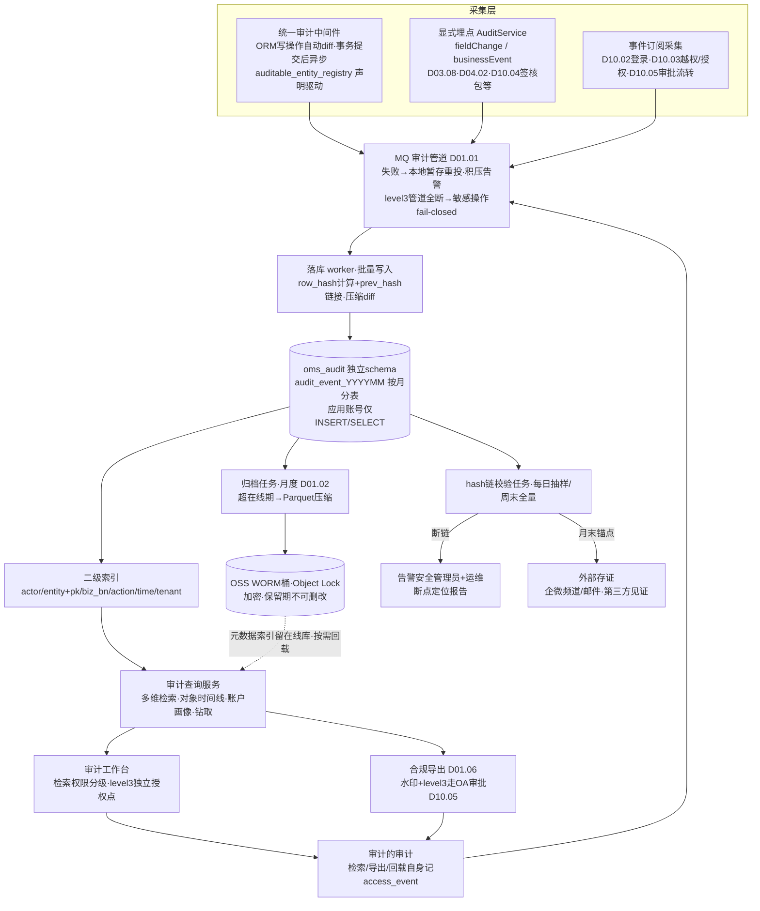
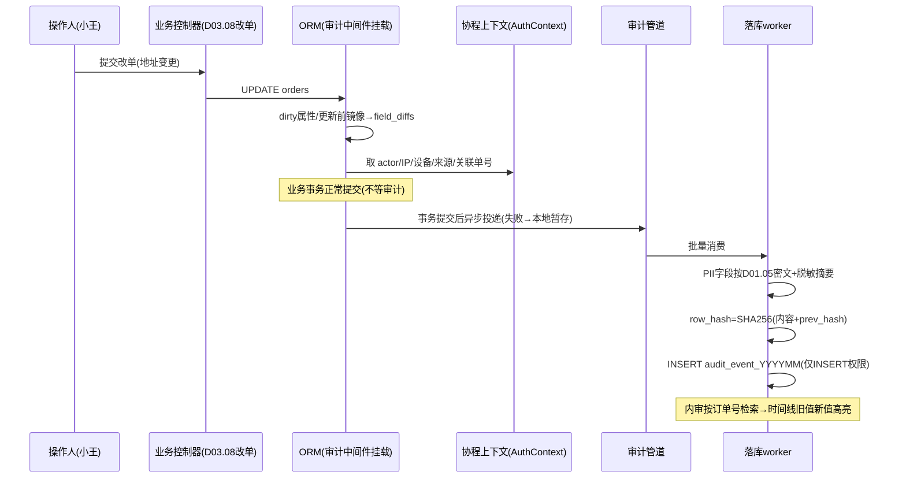

# SRS-D10.06 操作审计 需求规格说明书

> 文档编号：SRS-D10.06 · 版本 V1.0 · 2026-10-24 · 编写：小凯 · 状态：待审阅（批次⑤随组织权限门户域整体交审）
> 所属域：D10 组织权限与门户域 · 分期：**P1（M2 起逐步接入，审计框架 P0）**——框架与中间件 M1 随底座上线（P0 模块 D04.02 流水/调整留痕即依赖），业务域接入按批次②-⑤推进
> 上游依据：SRS-00 D10 清单（字段级审计日志：谁/何时/改了什么/旧值新值、独立存储、检索与导出）· 逆向文档 05（PIPL 相关：授权留痕/隐私号）· 逆向文档 04（商派散落审计字段：操作员/支付 IP/单据下载时间）· 各业务域 SRS 审计引用（D03.08 IF-D03.08-D4 `AuditService::fieldChange`、D09.01 IF-D09.01-D4 等）
> 定位：全系统**审计唯一存储与检索中心**——统一审计中间件自动采集写操作字段级 diff + 关键业务事件显式埋点，独立存储（量大）、防篡改（只增不改不删）、可检索导出（等保/内审/纠纷取证）。

---

## 1. 模块概述

### 1.1 定位

操作审计回答「谁在何时何地对什么做了什么，改前改后是什么」：

1. **审计事件模型**：谁（账户双身份）/何时/何地（IP/设备）/做了什么（操作类型）/对象（实体+主键）/旧值新值（字段级 diff）/来源（人工/系统/回调）；
2. **采集机制**：统一审计中间件对写操作**自动采集**字段级 diff（业务无感知）+ 关键业务事件**显式埋点**（`AuditService::fieldChange/businessEvent` 接口，各域 SRS 已引用）；
3. **独立存储**：审计量大（预估日增 50-100 万条），独立 schema `oms_audit`（与 oms_org 分离）按月分表，在线 1 年+归档；
4. **防篡改**：只增不改不删 + hash 链（前条哈希入后条）+ WORM 策略（归档只写介质），审计的审计（谁查了审计也留痕）；
5. **合规**：等保 2.0（日志留存 ≥6 个月，本方案在线 1 年）、内审、PIPL（消费者数据访问日志保留期专项策略）、纠纷取证（D10.04 结算签核链）。

商派短板：审计字段散落各业务表（操作员/审核人/支付 IP/下载时间各表各记），无统一检索、无字段级 diff、无防篡改——出纠纷靠翻表拼凑。凯淳收敛为统一审计中心，业务表只保留业务必需的操作人冗余字段（如 op_id），完整留痕一律进本模块。

### 1.2 职责边界

**做**：审计事件模型与采集中间件、显式埋点接口、异步落库管道、独立存储（分表/归档）、防篡改（hash 链/WORM）、多维检索与钻取、合规导出与审计报表、保留策略执行（含 PIPL 消费者数据访问日志）、审计的审计。
**不做**：业务流水（→ 各域自有：D04.02 stock_change_log 是**业务账**，本模块是**操作账**，两账并存互不替代——业务流水记「库存变了多少」，审计记「谁在哪个界面用什么理由改的」）；登录认证日志的采集（→ D10.02 产生，投递本模块存储）；权限变更快照的产生（→ D10.03/D10.02，投递本模块）；MQ/调度基础设施（→ D01.01/D01.02）。

### 1.3 与其他模块关系

| 模块 | 关系 |
|---|---|
| 全域业务模块 | 写操作自动采集（中间件）；显式埋点接口消费方（D03.08 IF-D03.08-D4、D09.01 IF-D09.01-D4、D09.02 IF-D09.02-D7、D08.01 §8 等 30+ 引用位） |
| D10.01 | 组织/货主/结算配置变更审计（变更前后快照） |
| D10.02 | 登录成功失败/账户增删改/角色变更/密码重置投递存储 |
| D10.03 | 授权变更快照/越权事件/模拟行为/字段明文查看投递 |
| D10.04 | 门户确认签核包（§5.2 confirm_sign）/导出记录/异议操作投递 |
| D10.05 | 审批全生命周期（发起要素快照/流转/回调报文索引/阈值变更）投递 |
| D01.05 | PII 字段审计值加密策略（审计中的旧值新值同样脱敏/加密） |
| D01.06 | 大结果集审计导出异步化 |
| D01.01/D01.02 | MQ 落库管道/归档与校验任务调度 |

---

## 2. 业务场景

**SC-D10.06-01 改单字段级 diff 自动采集（对齐 D03.08 FR-10a）**
客服小王修改订单收货地址：业务更新走 ORM → 审计中间件在事务提交后自动捕获 `orders` 行的字段 diff（receiver_address 旧值→新值，PII 字段按 D01.05 策略以**密文+脱敏摘要**存储）+ 上下文（小王 account_id/IP/设备/来源=人工界面/关联单据=改单单号）→ 异步投递落库。内审查「这单地址为什么变了」：按订单号检索 → 时间线展示每次变更（谁/何时/旧值新值/关联改单与审批单号）。

**SC-D10.06-02 显式埋点：库存调整决策留痕（对齐 D04.02 FR-04）**
库存调整单生效：D04.02 除业务流水（stock_change_log）外，显式埋点 `AuditService::businessEvent(scene=stock_adjust, 对象=调整单号, 载荷={三元键,数量,类型,原因,附件引用,审批单号})`——审计中心记录**决策语境**（为什么调），与业务流水（调了多少）互补；代销货主门户通知的发送也随事件留痕。

**SC-D10.06-03 纠纷取证：结算确认签核链（对齐 D10.04 §5.2）**
品牌 A 事后否认确认过 3 月结算单：法务在审计中心检索 `biz_type=settle_confirm + settle_bn` → 调出电子签核包（确认人+姓名手机快照+声明版本+服务端时间+IP+设备指纹）→ hash 链完整性校验通过（出具防篡改证明）→ 导出取证报告（含 hash 链校验值，可第三方复验）。

**SC-D10.06-04 等保合规审计报表**
年度等保测评：安全管理员导出审计报表——近一年特权操作清单（超管登录/授权变更/阈值变更/豁免通道调用）、日志完整性证明（hash 链校验记录）、日志留存周期证明（在线+归档策略配置快照）、审计系统自身的访问日志（审计的审计）。

**SC-D10.06-05 PIPL：消费者数据访问日志**
消费者投诉「我的信息被谁看过」：按订单号/手机号（密文匹配）检索 PII 访问类审计（明文查看 `field.pii.plaintext.view` 每次触发、门户/导出中 PII 处理记录）→ 输出访问清单（谁/何时/什么场景/是否授权依据）；该类日志保留期执行 PIPL 专项策略（FR-08c：不少于业务必要期限，超期匿名化而非删除——保留统计价值消除个体关联）。

**SC-D10.06-06 防篡改验证**
运维误操作（或恶意）尝试 UPDATE 审计表某行：DB 权限层拒绝（审计库账号无 UPDATE/DELETE 权限，只 INSERT/SELECT）；即便绕过（DBA 直连），每日 hash 链校验任务发现断链 → 告警安全管理员 → 定位断点记录与时间窗 → 与归档副本比对恢复取证。

---

## 3. 功能需求

### FR-D10.06-01 审计事件模型（统一 schema）

- FR-01a 事件八要素（SRS-00 口径「谁/何时/改了什么/旧值新值」全展开）：

| 要素 | 字段组 | 说明 |
|---|---|---|
| 谁 | actor_id/actor_name_snapshot/actor_type(staff/portal/system)/tenant_id | 双身份（模拟模式记原身份+目标身份）；system=MQ worker/调度 |
| 何时 | event_time（毫秒）/receive_time | 服务端时间权威 |
| 何地 | ip/ip_region/device_fp/channel(web/h5/api/mq) | IP 库粗粒度地点 |
| 做了什么 | action(create/update/delete/login/export/approve/grant/simulate/view_pii/business_event) + perm_code + scene_code | 操作类型字典化 |
| 对象 | entity/table_name/row_pk/biz_type/biz_bn | 实体+主键+业务单据引用 |
| 旧值新值 | field_diffs JSON [{field, old, new, mask_rule}] | 字段级 diff；PII 密文+脱敏摘要（D01.05） |
| 来源 | source(manual/scheduler/mq/oa_callback/platform_notify/openapi) + ref_ids（关联审批单/改单单/回调报文 ID） | 决策语境链 |
| 结果 | result(success/fail/denied) + fail_reason | 越权拒绝与失败也记（SC 见 D10.03 FR-04e） |

- FR-01b 事件分类：`data_change 数据变更`（自动 diff）/ `auth_event 认证事件`（登录/登出/锁定）/ `perm_event 权限事件`（授权/角色/越权/模拟）/ `decision_event 决策事件`（审批/调整/确认签核）/ `access_event 访问事件`（PII 明文查看/敏感导出/审计检索本身）/ `system_event 系统事件`（配置变更/豁免通道调用）。
- FR-01c 敏感级别标记（sensitive_level 1-3）：3=资金/PII 明文/权限变更（检索与导出需独立授权点）；分级驱动保留策略与导出审批（3 级导出走 D10.05 场景 9 同款审批口径）。

### FR-D10.06-02 采集机制（自动+显式双通道）

- FR-02a **统一审计中间件**（自动，业务无感知）：拦截 ORM 写操作（Model 事件 created/updated/deleted）→ 事务提交后异步生成 field_diffs（更新前镜像由中间件在 UPDATE 前自动 SELECT 快照或经 ORM dirty 属性获取）→ 附加请求上下文（AuthContext/IP/设备，协程上下文透传）→ 投递 MQ。
- FR-02b **采集范围声明**（auditable_entity_registry）：各域注册需自动采集的实体与字段白名单（默认全字段，可排除大文本/无意义字段）；未注册实体不自动采集（防无差别采集爆量）+开发期告警提醒声明——与 D10.03 filterable_entity_registry 同模式注册。
- FR-02c **显式埋点接口**（决策语境类，自动 diff 覆盖不了的）：`AuditService::fieldChange(实体, 字段, 旧值, 新值, 操作人, 单据引用)`（D03.08 IF-D03.08-D4 已引用签名）与 `AuditService::businessEvent(scene, 对象, 载荷, 上下文)`；埋点清单随各域 SRS 验收核对（AC-08）。
- FR-02d 采集可靠性：MQ 投递失败 → 本地暂存文件重投（对齐 D04.02 FR-03c 流水模式）；**审计不阻塞业务事务**（异步落库，业务提交不等审计）；MQ 积压告警；极端场景（审计管道全断）业务侧降级策略=敏感操作（sensitive_level 3）暂停执行+告警（fail-closed），普通操作继续（fail-open）——策略可配。
- FR-02e 系统任务采集：MQ worker/调度以 system 身份记录（actor_type=system+任务标识）；豁免通道调用（D10.03 withoutDataScope）强制记 system_event。

### FR-D10.06-03 审计存储（独立存储，量大）

- FR-03a 独立 schema `oms_audit`（独立库实例可选，与业务库 IO 隔离）；主表 `audit_event` **按月分表**（audit_event_YYYYMM）；预估量：日增 50-100 万条（写操作 diff+登录+访问事件），单月 ≤3000 万条，分表+时间索引支撑检索。
- FR-03b 在线保留 1 年（等保 ≥6 个月的加严）；超期迁移归档（FR-08）；归档格式 Parquet/压缩 SQL 落 OSS（加密）+元数据索引留在线库（可检索定位、按需回载）。
- FR-03c 存储优化：field_diffs JSON 压缩存储；高频检索维度（actor_id/entity+row_pk/biz_bn/action/event_time/tenant_id）建二级索引；冷数据索引降级（只留时间+主键索引）。
- FR-03d DB 权限隔离：审计库应用账号仅 INSERT/SELECT（**无 UPDATE/DELETE 权限**，防篡改第一层）；归档删除仅归档任务专用账号（走 FR-08 保留策略）。

### FR-D10.06-04 防篡改（只增不改不删）

- FR-04a **hash 链**：每条审计记录含 `prev_hash`（前条记录哈希）与 `row_hash`（本条内容+prev_hash 的 SHA-256）——链式结构使任何中间篡改导致后续全链校验失败；分表内成链+跨月锚点（每月末条 hash 写入锚点表并同步外部存证——企微机器人频道/邮件发送安全管理员，低成本外部见证）。
- FR-04b 每日校验任务（D01.02）：抽样+全量（周末）hash 链校验 → 断链告警（安全管理员+运维双通知）→ 断点定位报告（时间窗/表/记录区间）。
- FR-04c **WORM 策略**：归档文件写 OSS 合规保留策略桶（Object Lock/WORM 模式，保留期内任何人不可删改）；在线库防篡改靠 FR-03d 权限+hash 链双保险。
- FR-04d 审计的审计：审计中心的检索/导出/回载操作本身记 access_event（谁查了审计、查了什么范围、导出了什么）——检索权限分级（sensitive_level 3 需独立授权点 `d10.audit.sensitive.view`）。

### FR-D10.06-05 审计查询（多维检索+钻取）

- FR-05a 检索维度：人（actor/actor_type/tenant）× 对象（entity+row_pk/biz_type+biz_bn）× 时间（区间）× 操作类型（action/scene/perm_code）× 来源 × 结果 × 敏感级别；组合条件+关键词（单号/手机号密文匹配——PII 检索走 D01.05 密文索引）。
- FR-05b 对象时间线视图：按 row_pk 或 biz_bn 聚合的时间线（该订单/该调整单的全部审计事件按时间排列，diff 可视化：旧值→新值高亮）——SC-01 内审体验。
- FR-05c 钻取详情：单事件完整载荷（八要素+field_diffs 全量+关联引用跳转：审批单 D10.05/改单单 D03.08/回调报文 oa_api_log）。
- FR-05d 账户画像视图：某账户时间段内全部操作流水（离职审查/异常行为排查：非工作时间操作、高频导出、连续越权）。
- FR-05e 检索性能：近 3 个月单维度检索 P95 ≤2s；跨月大范围检索走异步（D01.06 导出模式）；归档数据检索=元数据定位+按需回载（分钟级，提示等待）。

### FR-D10.06-06 合规导出与审计报表

- FR-06a 导出：检索结果异步导出（Excel/CSV，D01.06）；导出文件水印（对齐 D10.04 FR-04c 要素）；sensitive_level 3 导出走 OA 审批（D10.05）；导出行为自身记审计（FR-04d）。
- FR-06b 内置审计报表（等保/内审要求，SC-04）：特权操作月报（超管/授权/阈值/豁免）、登录异常报表（连败/异地/非工作时间）、越权事件报表、PII 访问报表、审批治理报表（与 D10.05 FR-07c 统计互补：本模块出「操作留痕」视角）、日志完整性证明（hash 链校验记录+外部存证快照）。
- FR-06c 报表订阅：月度自动生成推送安全管理员/内审负责人（D01.07 邮件）；留存周期证明与策略配置快照随报表出具。

### FR-D10.06-07 审计事件接入管理

- FR-07a 接入注册台：各模块接入状态一览（已声明实体数/埋点清单/日均事件量/采集失败率）——批次②-⑤逐步接入的进度管理工具（M2 起）。
- FR-07b 事件字典：action/scene_code 字典化管理（与 DB-00 领域事件字典对齐登记）；新场景注册校验（防 scene 拼写漂移）。
- FR-07c 采集质量监控：中间件采集成功率、MQ 积压、落库延迟（事件时间 vs 落库时间差 P99 ≤30s）、暂存文件重投队列——异常告警运维。

### FR-D10.06-08 审计保留策略（含 PIPL）

- FR-08a 分级保留：`sensitive_level 3（资金/权限/PII 明文）：在线 1 年+归档 ≥5 年`；`level 2（一般数据变更/决策）：在线 1 年+归档 ≥3 年`；`level 1（普通访问/登录成功）：在线 6 个月+归档 1 年`；归档期满销毁需安全管理员+内审双确认（销毁记录本身留痕）。
- FR-08b 业务终态联动：关联业务单据归档（D03.13）不缩短审计保留（审计独立时钟）。
- FR-08c **PIPL 专项**：涉消费者 PII 的审计记录（访问日志/diff 中的 PII 字段）保留期=业务必要期限（合同履行+诉讼时效，默认 3 年）；超期执行**匿名化**（actor 保留角色/部门粒度，PII 字段值销毁只留脱敏摘要与 mask 规则标识）而非物理删除——满足「日志留存」与「个人信息最小保留」双要求；匿名化任务留痕（何时/何范围/何策略）。
- FR-08d 保留策略配置化+版本化（策略变更审计）；策略与法规冲突时以法务书面意见为准（流程占位）。

---

## 4. 业务流程

### 4.1 审计采集-存储-查询架构



### 4.2 字段级 diff 自动采集时序



### 4.3 保留与匿名化流程

```mermaid
flowchart LR
    A[审计事件落库] --> B{sensitive_level}
    B -- 3 资金/权限/PII明文 --> C[在线1年→归档WORM≥5年]
    B -- 2 一般变更/决策 --> D[在线1年→归档≥3年]
    B -- 1 登录/普通访问 --> E[在线6月→归档1年]
    C & D & E --> F[归档期满销毁<br/>安全+内审双确认·销毁留痕]
    C -. 涉PII记录 .-> G[PIPL专项: 业务必要期(默认3年)后<br/>匿名化: actor降粒度+PII值销毁留脱敏摘要<br/>匿名化任务留痕]
```

---

## 5. 处理逻辑

### 5.1 hash 链算法

```
写入时(单表内串行, worker 单分区保证顺序):
    prev_hash = 该分表当前链尾 hash(Redis 缓存链尾, miss 查 MAX(id) 行)
    row_hash  = SHA256(canonical_json(事件八要素+field_diffs) + prev_hash + event_id)
    INSERT (…, prev_hash, row_hash)     # 仅 INSERT 权限

校验时:
    按 id 顺序重算: verify(row_i) = SHA256(内容+row_{i-1}.hash) == row_i.row_hash
    断链 → 输出首个断点 id/时间窗 → 与归档副本(若已归档)比对定位篡改区间
    月末锚点: last_hash(月表) → 锚点表 + 外部存证推送(企微/邮件)
```

> 设计权衡：hash 链要求写入串行化（单 worker 分区），峰值写入能力约 2000 条/s（批量组哈希），满足日均 100 万条（峰值 ≈50/s）余量 40 倍；若未来超量，按 tenant/entity 分链并行（链粒度细化，校验逻辑不变）。

### 5.2 diff 采集与 PII 处理

```
capture_diff(model):
    for field in model.getDirty():                 # ORM dirty 属性(更新前镜像)
        if field not in registry(entity).fields: continue   # 声明白名单
        old, new = model.getOriginal(field), model.getAttribute(field)
        if isPII(field):                            # D01.05 注册
            old, new = encrypt(old), encrypt(new)   # 密文存储
            mask_hint = mask(old) + '→' + mask(new) # 脱敏摘要(检索展示用)
        diffs.append({field, old, new, mask_rule})
    delete 事件: diffs = 全字段快照(密文规则同)
    create 事件: diffs = [{field, old:null, new:v}] (可配精简)
```

### 5.3 检索路由

```
query(条件):
    时间区间 → 定位月表集合(跨表 UNION 或按表串行归并)
    在线表: 二级索引直查(P95≤2s, 限近3个月; 更大范围→异步导出)
    归档命中: 元数据索引(在线库, 记录归档文件+区间) → 回载任务(OSS拉取→临时表) → 通知检索人(分钟级)
    PII 关键词: 先加密(检索词)→密文等值匹配(D01.05 密文索引), 不支持密文模糊
    敏感级别3: 校验 d10.audit.sensitive.view 授权点 + 本次检索记 access_event
```

### 5.4 与业务流水的分工（两账并存）

| | 业务流水（如 stock_change_log） | 审计事件（本模块） |
|---|---|---|
| 记什么 | 业务事实：库存口径变了多少、前后余额 | 操作事实：谁在哪个界面用什么理由触发的 |
| 归属 | 各业务域自有自管（D04.02 契约） | 统一审计中心 |
| 幂等/重算 | 参与业务对账重算 | 不参与业务计算，只增不改 |
| 关联 | 单据号互引（ref_ids ↔ bill_bn） | 同左——一次调整两账各一条，单号互查 |

---

## 6. 数据字段（业务字段描述）

### 6.1 审计事件（audit_event_YYYYMM，按月分表）

| 字段 | 业务含义 | 取值/校验 |
|---|---|---|
| event_id | 事件 ID | 雪花 ID（时间有序，链序基础） |
| event_class / action / scene_code / perm_code | 分类/操作/场景/权限点 | FR-01b 字典；scene 与 D10.05 注册表对齐 |
| actor_id / actor_name_snapshot / actor_type / tenant_id | 谁 | 快照冗余（账户禁用后仍可解析展示） |
| simulate_origin_id | 模拟模式原身份 | D10.03 FR-09a 双身份 |
| event_time / receive_time | 何时 | 毫秒；服务端时间权威 |
| ip / ip_region / device_fp / channel | 何地 | |
| entity / table_name / row_pk / biz_type / biz_bn | 对象 | 检索主维度 |
| field_diffs | 旧值新值 | JSON 压缩；PII 密文+mask_hint |
| source / ref_ids | 来源与关联单据 | 审批单/改单单/回调报文 ID 互引 |
| result / fail_reason | 结果 | denied（越权）必记 |
| sensitive_level | 敏感级别 | 1-3（驱动保留/导出/检索分级） |
| prev_hash / row_hash | hash 链 | §5.1；只增不改不删 |

### 6.2 采集声明表（auditable_entity_registry）

| 字段 | 业务含义 | 取值/校验 |
|---|---|---|
| entity / table_name | 实体 | 与 D10.03 filterable 注册同模式 |
| fields_include / fields_exclude | 字段白/黑名单 | 默认全字段；排除大文本 |
| module / register_version | 声明模块/版本 | 未声明不自动采集+开发期告警 |

### 6.3 hash 链锚点（audit_anchor）与保留策略（audit_retention_policy）

| 字段 | 业务含义 | 取值/校验 |
|---|---|---|
| anchor: month_table / last_event_id / last_hash / external_proof_ref | 月链锚点 | 外部存证引用（企微消息 ID/邮件 ID） |
| policy: level / online_months / archive_years / pii_anonymize_after / version | 分级保留策略 | FR-08；变更留痕 |
| destroy_log: policy_ref / range / confirm_ops(双人) / destroy_time | 销毁留痕 | 双确认必填 |

---

## 7. 接口

### 7.1 内部接口（本模块提供）

| 编号 | 接口 | 消费方 | 说明 |
|---|---|---|---|
| IF-D10.06-01 | 审计中间件（ORM Model 事件挂载，框架级自动生效） | 全域写操作（声明实体） | 自动 diff 采集（FR-02a，业务无感知） |
| IF-D10.06-02 | `AuditService::fieldChange(entity, field, old, new, operator, ref)` | D03.08（IF-D03.08-D4 已引用签名）等显式埋点方 | 字段级埋点 |
| IF-D10.06-03 | `AuditService::businessEvent(scene, object, payload, ctx)` | D04.02/D04.05/D06.03/D08.01/D10.04（签核包）/D10.05（审批流转） | 决策事件埋点 |
| IF-D10.06-04 | `AuditQuery::search(多维条件)` / `timeline(row_pk或biz_bn)` / `profile(actor, 期间)` | 审计工作台/内审/法务 | 检索/时间线/账户画像（分级授权） |
| IF-D10.06-05 | `AuditExport::export(条件, 格式)` | 审计工作台 | 合规导出（水印+level3 走 D10.05 审批） |
| IF-D10.06-06 | `AuditIntegrity::verify(month_table?, range?)` / `getProof(month)` | 校验任务/等保测评/法务取证 | hash 链校验与完整性证明出具 |
| IF-D10.06-07 | `AuditRegistry::registerAuditable(entity, fields)` / `registerScene(scene)` | 各业务域模块注册（迁移脚本） | 采集声明与事件字典注册 |
| IF-D10.06-08 | 订阅 D10.02 `auth.*`、D10.03 `perm.violation/scope_invalidated`、D10.05 `approval.*`、D01 系统事件 | — | 事件订阅采集源（FR-02 架构图 SUB 通道） |

### 7.2 外部接口

| 编号 | 接口 | 方向 | 说明 |
|---|---|---|---|
| EF-D10.06-01 | OSS WORM 桶（Object Lock 合规保留） | 出 | 归档不可删改存储 |
| EF-D10.06-02 | 外部存证通道（企微机器人频道/邮件，经 D01.07） | 出 | 月末锚点 hash 第三方见证 |

---

## 8. 非功能需求

| 项 | 要求 |
|---|---|
| 性能 | 采集对业务事务零阻塞（异步，业务提交不等审计）；落库吞吐 ≥500 条/s（hash 链串行分区，峰值余量 40 倍）；落库延迟 P99 ≤30s；近 3 月检索 P95 ≤2s |
| 可靠性 | MQ 失败本地暂存重投（零丢失目标）；level 3 管道全断时敏感操作 fail-closed（可配）；归档文件双副本（OSS 跨区域） |
| 完整性 | hash 链+每日校验+外部存证+WORM+DB 仅 INSERT 权限四层防篡改；断链 24h 内发现 |
| 安全 | 检索分级授权（level 3 独立授权点）；审计的审计；PII 审计值密文+脱敏摘要；导出水印+审批 |
| 合规 | 等保 2.0 日志留存（在线 1 年>6 个月要求）；PIPL 最小保留+超期匿名化（FR-08c）；销毁双确认留痕 |
| 容量 | 日增 50-100 万条、单条均值 1.5KB → 月增 ≤45GB；在线 1 年 ≤550GB（独立库+压缩后 ≈200GB）；归档 OSS 低成本存储 |

---

## 9. 验收标准

| 编号 | 验收条件 |
|---|---|
| AC-01 | SC-01 自动采集：改地址后审计中心按订单号可检索到 field_diffs（旧值→新值）+操作人+IP+关联改单号；PII 字段库中为密文、界面展示脱敏摘要；业务事务耗时不因审计增加（压测对比 ≤5%） |
| AC-02 | 显式埋点：D04.02 调整单生效后 businessEvent 落库（决策语境含原因/审批单号），与 stock_change_log 业务流水按单号互查（两账并存验证） |
| AC-03 | 防篡改-权限层：应用账号执行 UPDATE/DELETE 审计表被 DB 拒绝；归档桶保留期内删除请求被 OSS 拒绝（WORM 验证） |
| AC-04 | 防篡改-hash 链：DBA 直连篡改某行后，每日校验任务发现断链并输出断点定位报告；月末锚点 hash 与外部存证（企微频道消息）一致可复验 |
| AC-05 | SC-03 取证：按 settle_bn 检索签核包完整（人/声明版本/时间/IP/设备指纹）；导出取证报告含 hash 链校验值，第三方可复验 |
| AC-06 | 检索体验：多维组合检索（人×对象×时间×操作类型）正确；对象时间线按时间排列且 diff 高亮；账户画像输出离职审查清单（非工作时间/高频导出/越权记录） |
| AC-07 | 分级与审批：无 `d10.audit.sensitive.view` 账户检索 level 3 被拒且该拒绝本身记审计；level 3 导出触发 OA 审批（D10.05 联测）；导出文件含水印 |
| AC-08 | 采集可靠性：模拟 MQ 故障，事件进本地暂存且恢复后重投零丢失；管道全断时 level 3 敏感操作被暂停（fail-closed）+告警，level 1/2 业务不受影响 |
| AC-09 | SC-05 PIPL 保留：构造超业务必要期（模拟 3 年+）的 PII 审计记录，匿名化任务执行后 actor 降粒度、PII 值销毁仅留脱敏摘要，匿名化任务自身留痕；按手机号密文匹配可检索匿名化前窗口内的访问记录 |
| AC-10 | SC-04 等保报表：特权操作月报/登录异常/越权/PII 访问/完整性证明五类报表数据与明细检索结果一致；报表订阅月度自动推送触达 |
| AC-11 | 归档回载：超在线期数据经元数据索引定位→回载临时表→检索返回正确结果（分钟级）；回载操作记 access_event |
| AC-12 | 接入管理：注册台准确展示各模块接入状态（声明实体/埋点/日均量/失败率）；未声明实体的写操作产生开发期告警 |

---

## 变更记录

| 日期 | 版本 | 变更 | 原因 |
|---|---|---|---|
| 2026-10-24 | V1.0 | 首版 | — |

---

*参考实现溯源：商派审计字段散落各业务表（ome_orders 操作员/审核人/审核时间、payments 支付 IP/下载时间、finance bill_op_logs 流水操作日志、dealer batch_log 批量日志、organization recently_enabled_time/first_enable_time 启停审计时间）——无统一模型、无字段级 diff、无防篡改、检索靠翻表；逆向文档 05 PIPL 相关（隐私号 700 虚拟号、消费者字段处理）提供了 PII 审计脱敏的场景依据。凯淳差异（本 SRS 原创设计）：① 散落字段收敛为**统一八要素事件模型**+六类事件分类+敏感分级；② 自动 diff 中间件（业务无感知）+显式埋点双通道，与业务流水**两账并存分工**（§5.4）；③ 独立 schema 按月分表+在线 1 年+WORM 归档（商派无归档策略）；④ **hash 链+外部存证+仅 INSERT 权限+审计的审计**四层防篡改（商派可随意改日志）；⑤ PIPL 超期匿名化而非删除（日志留存与最小保留双合规）；⑥ 等保/内审/取证三类合规报表产品化。*
