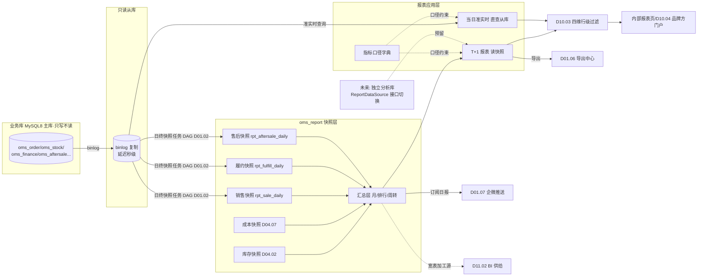
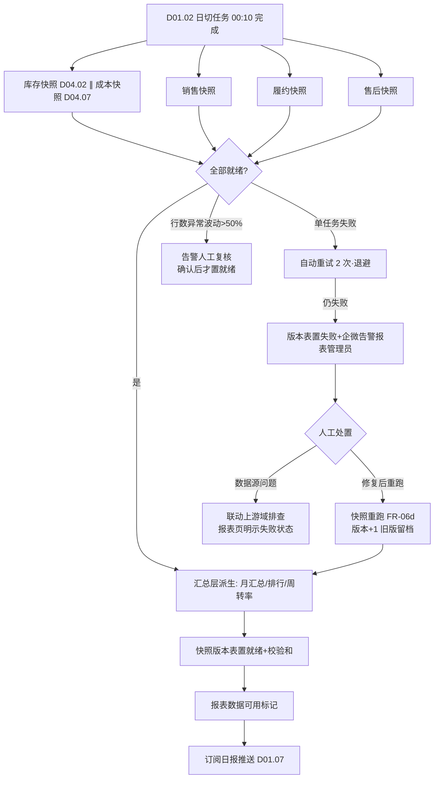

# SRS-D11.01 固定报表模块 需求规格说明书

> 文档编号：SRS-D11.01 · 版本 V1.0 · 2026-10-24 · 编写：小凯 · 状态：待审阅（批次⑤）
> 所属域：D11 数据与报表域 · 分期：**P1（M3）** · schema：**oms_report**（D11 独立 schema：快照与汇总表）
> 上游依据：SRS-00 §3 D11 清单 · 需求决策 **Q29 决策 A**（固定报表内置：销售/库存/履约时效/售后率四大类；自助分析不做，BI 数仓承接）· **报表实现最新决策：业务库只读从库实时查询 + 日终快照表预汇总，不引入独立分析库/新组件**（接口层抽象好，未来数据量上来可平滑切独立分析库——预留）· 数据供给方契约：SRS-D04.02（FR-06a 日终库存快照）/ SRS-D04.07（FR-05b 日终成本快照、FR-05a 毛利基础数据）/ SRS-D08.01（应收台账/账龄/双口径）/ SRS-D08.02（结算数据）/ SRS-D08.04（运费预估/实际）/ SRS-D03.03（FR-07 审单绩效）/ SRS-D03.09（异常单统计）/ SRS-D04.05（调拨/借调执行）/ SRS-D04.09（批次临期）/ SRS-D04.10（滞销）· 逆向文档 01（omeanalysts 15 表：branch_product_stock_detail 商品库存日报/products_sale 销售排行/ome_salestatistics 退货率统计/logistics_analysts 物流配送统计/ordersPrice 客单价分布/ordersTime 下单时间分析）· 逆向文档 06 差距分析表（omeanalysts「裁剪保留」：固定报表内置，宽表/订阅给 BI）
>
> **全局决策（本模块承载，红线）**：① 报表只读——**任何报表不得回写业务库**；② **指标口径字典为唯一事实源**（§5.1，防「同名不同义」——商派报表散落各模块口径漂移的教训）；③ 全部报表按 D10.03 四维（店铺/品牌/仓库/货主）行级过滤，品牌方门户（D10.04）只见本货主报表；④ 金额指标**逐字段标注双口径**（客户实付 / 平台承担，SRS-00 术语表契约），禁止混算。

---

## 1. 模块概述

### 1.1 定位

固定报表是 OMS 内置的**经营报表中心**：面向运营/财务/管理层提供销售、库存、履约时效、售后、毛利五大类共 20 余张内置报表，数据实现=**业务库 MySQL8 只读从库实时查询（当日/明细类）+ 日终快照表预汇总（历史/趋势/排行类）**，快照与汇总表落 D11 独立 schema `oms_report`。本模块同时维护**报表指标口径字典**（每个指标的计算公式+数据来源表，全系统报表指标的唯一事实源），并承载报表通用能力：多维筛选、汇总行、导出（D01.06）、订阅推送（日报推企微，D01.07）。

商派对应机制：`omeanalysts`（15 张报表统计表：商品库存日报 branch_product_stock_detail、销售排行 products_sale、退货率统计 ome_salestatistics、客单价分布 ordersPrice、下单时间分析 ordersTime、呆滞库存 analysis_stocknsale 等）+ `sales` 单据报表层（销售单/发货销售单/售后单报表）+ monitor 作业流程监控。凯淳关键差异：**① 全部报表增加货主维度（三元记账/货主分账贯穿，商派无货主概念）；② 报表口径收敛为统一指标字典（商派各报表口径散落代码）；③ 从库+快照轻量方案（商派 omeanalysts 为业务库上的定时统计表，与交易争抢资源）；④ 毛利报表按货主类型分流（买断出毛利、代销出服务费）。**

### 1.2 职责边界

**做**：五大类固定报表（清单/维度/指标/口径见 §3）；日终快照机制（销售快照/履约快照，本域新增；库存/成本快照由 D04.02/D04.07 提供，本模块消费）；快照任务依赖链编排（业务日切→快照→报表可用，联动 D01.02 DAG）；快照重跑与修数；报表指标口径字典维护；报表通用能力（多维筛选/汇总行/导出/订阅推送）；报表查询接口层抽象（数据源可切换：从库/快照/未来独立分析库）。

**不做**：自助多维分析/拖拽建模（**BI 数仓承接**，Q29 决策 A；OMS 供宽表见 SRS-D11.02）；实时监控看板（→ D11.03，Redis 实时链路，与本模块从库/快照链路分离）；业务数据的产生与口径定义（各业务域为源，本模块只引用其契约字段）；导出引擎（→ D01.06）；通知通道（→ D01.07）；金蝶供数（→ D08.06，报表数据与其同源但通道独立）；品牌方门户框架（→ D10.04，本模块供报表查询接口）。

### 1.3 与其他模块关系

| 模块 | 关系 |
|---|---|
| D04.02 库存记账 | 消费其 FR-06a 日终库存快照（三元键全量五口径余额）→ 库存类报表 |
| D04.07 成本核算 | 消费其 FR-05b 日终成本快照（量价双快照）与 FR-05a 销售成本明细 → 毛利/货值类报表 |
| D08.01 应收账单 | 消费 `ArQueryService`（IF-D08.01-04）应收明细/台账/账龄 → 销售收入（双口径）/退款冲减 |
| D08.02 结算单 | 消费 `SettleQueryService`（IF-D08.02-05）→ 代销服务费报表 |
| D08.04 运费对账 | 消费预估/实际运费明细 → 毛利报表运费项（默认取实际，未关账期间取预估+标记，其 §5 口径） |
| D03.01/D03.07 订单/发货单 | 从库直查订单头行/发货单/时间戳字段 → 销售明细与履约时效 |
| D03.03 审单工作台 | 消费绩效汇总表 audit_performance（IF-D03.03-08）→ 审单时效/审单员绩效报表 |
| D03.09 异常缺货 | 消费异常单统计口径（其 FR-08b）→ 缺货表/异常闭环指标（看板联动 D11.03） |
| D04.05/D04.09/D04.10 | 调拨单/借调台账 → 调拨执行率；批次临期级别 → 临期库存表；滞销标记与建议单 → 滞销表 |
| D05.01/02/03 售后 | 从库直查申请单/执行单/退款单 → 售后率/退款分布/良不良比/售后时效 |
| D09.02/D09.05 履约集成 | 出库回传时间戳/打印台账 → 出库时效/面单打印量 |
| D01.02/D01.06/D01.07 底座 | 快照 DAG 编排与失败告警/异步导出/订阅推送（日报推企微） |
| D10.03/D10.04 权限门户 | 全部报表注入四维行级过滤；门户本货主只读视图（销售/库存/结算/售后） |
| D11.02/D11.03 | 共享指标字典与快照表（宽表加工源），口径争议以本模块字典为准；边界：实时分钟级归 D11.03，T+1 经营口径归本模块 |

---

## 2. 业务场景

**SC-D11.01-01 销售日报（管理层晨报）**
每日 8:30，运营总监打开「销售日报」（昨日）：按平台×店铺展示 GMV（平台承担口径）、客户实付、订单量、客单价、退款率五指标，含前日/上周同日环比与顶部汇总行。数据来自昨日销售快照（rpt_sale_daily），8:00 前快照 DAG 完成即标记「数据就绪」；快照失败则页面明示失败状态而非展示错误数据。总监订阅了该日报企微推送（D01.07，每日 8:30 指标卡片+链接）。

**SC-D11.01-02 品牌方门户看本货主报表**
品牌 A 财务登录门户（D10.04）：只见本货主的销售月报、库存余额表（五口径×仓）、结算类报表；店铺筛选器只列其关联店铺，跨货主数据零可见（D10.03 租户行隔离）；导出买家信息脱敏（D01.05）。

**SC-D11.01-03 商品销售排行与滞销联动**
运营月度复盘：「商品销售排行」（近 30 天，货主+平台筛选，销量/GMV/退款率 TOP 100）对照「滞销表」（D04.10 标记，90 天无动销按货值排序），定位「曾爆款现滞销」清单导出（D01.06）给品牌方做促销决策。

**SC-D11.01-04 履约时效复盘（大促后）**
大促次日履约经理查看履约时效报表：发货时效（付款→发货）分档占比（≤24h/24-48h/>48h，店铺/仓维度）、审单时效（自动 vs 人工，人工按审单员分组联动 D03.03 绩效表）、推仓/出库/签收时效；「超时预警清单」列付款超 48h 未发货明细（平台考核红线）。数据源=履约快照+从库明细。

**SC-D11.01-05 毛利核算（买断货主）**
财务月初出「毛利报表」（买断货主，上月）：收入（客户实付口径，D08.01 应收）− 销售成本（D04.07 出库结转，退货按原单成本冲回）− 运费（D08.04 实际，未关账取预估并标记）= 毛利；店铺/分类/单品三级下钻。代销货主自动切「服务费报表」（D08.02 结算取数），不展示毛利（货权非凯淳）。

**SC-D11.01-06 快照重跑修数**
D08.01 应收事件消费延迟致 9 月 30 日销售快照少计 120 单。报表管理员发起「快照重跑」（日期+域=销售）：从库重抽该日数据覆盖快照（版本+1 旧版留档），下游汇总级联重算，完成后企微通知订阅人「数据已修正」；全程留痕（谁/何时/范围/原因）。

---

## 3. 功能需求

### FR-D11.01-01 销售报表（类①）

| 报表 | 维度 | 指标（口径见 §5.1 字典） | 数据源 | 更新频率 |
|---|---|---|---|---|
| 销售日报 | 日期×平台×店铺×品牌×货主 | GMV（平台承担口径）/客户实付/订单量/客单价/退款率/环比（前日、上周同日） | rpt_sale_daily 快照 | T+1 日终（快照 DAG） |
| 销售月报 | 月×同上维度 | 同上+月累计/月环比/年同比；退款金额 | rpt_sale_daily 按月汇总 | T+1 滚动 |
| 商品销售排行 | 商品（bm/sm）×货主×平台×时间窗（7/30/90 天可配） | 销量/GMV/实付/退款量/退款率，TOP N 降序 | rpt_sale_goods 快照 | T+1 日终 |
| 平台对比 | 平台×月 | GMV/实付/单量/客单价/退款率占比与环比 | rpt_sale_daily 汇总 | T+1 |
| 下单时段分析 | 小时×店铺（商派 ordersTime 保留） | 单量/GMV 分布（大促排班参考） | 从库（近 7 天）+快照 | T+1 |

- FR-01a 当日准实时视图：销售日报支持切「今日（准实时）」——直查从库订单表（付款时间当日），标注「非日终口径，仅供参考」；日终后自动切快照数。
- FR-01b 金额双口径分列强制：GMV=客户实付+平台承担（SRS-D08.01 §5.1 口径），客户实付单列，**界面禁止只显示一个未标注口径的「销售额」**。
- FR-01c 订单量口径：有效订单量=付款订单数−整单取消数（快照固化，字典 M-S01）；拆单不重复计（按订单头计）。
- FR-01d 退款率=当期退款成功金额（客户实付口径）/当期 GMV，分子按退款成功日归属、分母按付款日归属（跨期口径字典明示，M-S05）。

### FR-D11.01-02 库存报表（类②）

| 报表 | 维度 | 指标 | 数据源 | 更新频率 |
|---|---|---|---|---|
| 库存余额表 | 仓×货主×品牌×分类×SKU | **五口径**（实际/可用/锁定/在途/次品，SRS-D04.02 FR-02 契约）+货值（数量×均价，D04.07 量价双快照） | D04.02/D04.07 日终快照（消费方） | T+1 日终；当日实时切从库 stock_ledger |
| 库存周转率 | 货主×仓×分类×期间（月） | 周转率=当期销售出库成本/平均库存货值；周转天数=期间天数/周转率（字典 M-I02） | 快照（期初期末货值+D04.07 出库结转） | 月（T+1 滚动） |
| 库龄分析 | 货主×仓×库龄档（0-30/31-60/61-90/91-180/>180 天，可配） | 各档数量/货值占比（入库时间口径=批次入库或记账行首次入库，字典 M-I03） | 快照+D04.09 批次档案 | T+1 日终 |
| 临期库存表 | 货主×仓×SKU×批次×临期级别（黄/橙/红，D04.09 FR-03a） | 到期日/剩余天数/数量/货值/处置状态（联动 D04.09 看板） | D04.09 批次明细（从库） | T+1+当日从库 |
| 滞销表 | 货主×仓×SKU | 滞销天数（M 天无动销，D04.10 规则）/库存量/货值/最近出库日/处置建议状态（联动 D04.10 建议单） | D04.10 滞销标记+快照 | T+1 日终 |
| 缺货表 | 店铺×SKU×货主×仓 | 缺货 SKU 数/缺口量/缺货订单数/账龄分级（>24h/>48h/>72h，D03.09 FR-04d 口径）/补货建议状态（D04.10） | D03.09 缺货明细+D04.10 建议单（从库） | 准实时（从库，分钟级缓存） |
| 调拨执行表 | 调拨单×仓对×货主 | 调拨量/在途量/**批次执行率**（实际入库/计划出库，D04.05 差异完结口径）/借调消耗量（D04.05 台账） | D04.05 单据与台账（从库） | T+1 |

- FR-02a 五口径列不可裁剪合并（记账契约），可用口径为派生值（D04.02 §5.1 公式），报表不另算。
- FR-02b 货值口径：买断货主=移动加权均价×实际库存（D04.07）；代销货主=代管货值（结算价口径，单列标注「代管，非凯淳存货」）。
- FR-02c 同货号跨货主合并视角：支持 same_code_group 聚合列（D04.01 契约，运营看总货，财务分货主看账）。

### FR-D11.01-03 履约时效报表（类③）

| 报表 | 维度 | 指标（时间点定义见字典 §5.1） | 数据源 | 更新频率 |
|---|---|---|---|---|
| 审单时效 | 审核员×组×店铺×日 | 自动审单量/通过率（D03.02 供数）；人工审核量/平均处理时效/P90/队列停留时效/驳回率/超时单数（**联动 D03.03 audit_performance，口径以其 §5.4 为准**） | audit_performance（消费）+履约快照 | T+1 日结 |
| 推仓时效 | 仓×WMS×店铺×日 | 发货单生成→推送 WMS 成功耗时（均值/P90）；推送失败量与失败原因分布（D09.02 事件） | rpt_fulfill_daily 快照 | T+1 |
| 出库时效 | 仓×WMS×日 | 推送成功→WMS 出库回传耗时（均值/P90/分布档）；回传延迟量（>N 小时阈值） | 快照（D09.02 回传时间戳） | T+1 |
| 发货时效 | 店铺×平台×日 | 付款→发货确认耗时（平台考核口径）：≤24h/24-48h/>48h 占比、均值/P90 | 快照 | T+1 |
| 签收时效 | 店铺×物流公司×日 | 发货→签收耗时（平台轨迹回传/D02.04）；物流公司对比 | 从库+快照 | T+1 |
| 超时预警清单 | 订单明细 | 付款超 N 小时（默认 48，店铺级可配）未发货订单：订单号/店铺/付款时间/已超时/卡点环节 | 从库实时 | 准实时（10 分钟缓存） |
| 打印面单统计 | 店铺×仓×日 | 取号量/打印量/补打量/失败量（D09.05 打印台账） | D09.05 台账（从库） | T+1 |

- FR-03a 时效指标全部分布呈现（均值+P90+分档占比），只报均值会掩盖长尾（平台考核按单）。
- FR-03b 卡点环节归因：超时清单每单标注当前停留环节（归因规则 §5.3）；审单员绩效仅统计不强制排名（继承 D03.03 FR-07c，默认不展示全员排名，主管可看组内）。

### FR-D11.01-04 售后报表（类④）

| 报表 | 维度 | 指标 | 数据源 | 更新频率 |
|---|---|---|---|---|
| 售后率报表 | 店铺×商品×货主×售后原因（D05.01 原因字典映射后） | 售后率=当期售后申请单数/当期订单量（字典 M-A01）；仅退款率/退货退款率分列；原因 TOP 分布 | rpt_aftersale_daily 快照 | T+1 |
| 退款金额分布 | 店铺×货主×退款类型×金额档 | 退款金额（客户实付口径，D05.03 退款台账）/笔数/占比；平台介入单占比（platform_intervened 透传，资损观测） | 快照+D05.03 台账 | T+1 |
| 退货入库良不良比 | 仓×货主×SKU | 良品数/不良品数/良不良比（D05.02 质检分流，IF-D05.02-06 qc_completed 事件数据）；不良品处置状态分布（退仓/报废/待处置） | D05.02 执行单（从库）+快照 | T+1 |
| 售后处理时效 | 店铺×售后类型×日 | 申请→审核、审核→退款、退货签收→入库→退款各段耗时（均值/P90）；超 SLA 单量 | 快照 | T+1 |

- FR-04a 售后原因统一映射：平台原因码经 D02.02 映射到 OMS 标准原因字典后统计（跨平台可比）。
- FR-04b 退款金额一律客户实付口径（买家真金白银视角）；平台承担部分冲减单列（对齐 D08.01 负向应收双口径）。
- FR-04c 售后率分母口径可切换（付款订单量/发货订单量，字典明示默认=付款订单量），切换须整表统一。

### FR-D11.01-05 毛利与服务费报表（类⑤，按货主类型分流）

- FR-05a **毛利报表（买断货主）**：`毛利 = 收入 − 销售成本 − 运费；毛利率 = 毛利/收入`——收入=D08.01 应收（客户实付口径默认，可切平台承担口径对照列）−退款冲减；销售成本=D04.07 出库结转（移动加权均价×出库量，退货按原单成本冲回，其 §5.2）；运费=D08.04 实际（关账期间），未关账取预估并整表标注。维度=货主×店铺×分类×单品×月，三级下钻（字典 M-P01/02）。
- FR-05b **服务费报表（代销货主）**：数据源 D08.02 结算单（IF-D08.02-05）——服务费（条款×模型×计算轨迹汇总）/借调内部交易/结算净额/台账滚动；按货主×周期呈现；**不计算毛利**（货权非凯淳），代管货值余额单列（D04.07 FR-04a）。
- FR-05c 货主类型自动分流：报表入口按货主档案类型（D10.01）决定展示毛利版或服务费版；混合查询（多货主）时分组呈现不合并。
- FR-05d 毛利报表期间锁定联动：D08.03 结账后期间数据只读固化；未结账期间标注「未关账，数据可能调整」。

### FR-D11.01-06 日终快照机制

- FR-06a **本域新增快照表**（oms_report schema，字段详见 §6）：`rpt_sale_daily`（销售日快照：日×平台×店铺×品牌×货主）、`rpt_sale_goods`（商品销售日快照：日×bm×sm×店铺×货主）、`rpt_fulfill_daily`（履约日快照：日×店铺×仓×WMS×审核员，各环节耗时分布桶）、`rpt_aftersale_daily`（售后日快照：日×店铺×货主×原因×类型）、`rpt_snapshot_version`（快照版本表：域×业务日期×版本×状态×行数×校验和）。
- FR-06b **快照任务依赖链（DAG，联动 D01.02，流程图见 §4.2）**：业务日切（00:10）→ 库存快照（D04.02 FR-06a）∥ 成本快照（D04.07 FR-05b）→ 销售/履约/售后三快照并行（依赖日切完成）→ 汇总层（月汇总/排行/周转率派生，依赖当日全部快照就绪）→ 报表可用标记+订阅推送触发（D01.07 日报）。
- FR-06c 快照抽取只读从库（业务库零影响）；单快照任务超时（默认 30 分钟）/行数异常（较 7 日均值波动 >50%）→ 告警人工复核（防脏快照污染报表）。
- FR-06d **快照重跑与修数**：按（快照域×业务日期）重跑，新版本覆盖生效、旧版本留档（version+1，可回滚）；重跑级联触发下游汇总层重算；重跑权限=报表管理员+原因必填+审计留痕（D10.06）；重跑完成通知订阅人。
- FR-06e 数据就绪状态透出：每张报表页头显示「数据截至：{业务日期} {快照版本} {就绪时间}」；快照失败时明示失败状态与影响范围，不静默展示旧数据。
- FR-06f 快照保留策略：日快照在线 3 年（对齐 D03.13 归档口径），月汇总长期；oms_report 按月分区。

### FR-D11.01-07 报表通用能力

- FR-07a 多维筛选器：全部报表统一支持时间（日/周/月/自定义区间）+店铺+品牌+货主+仓五维（报表无关维度自动隐藏）；筛选方案可保存为个人常用（复用 D03.03 FR-01b 交互模式）。
- FR-07b 汇总行：列表底部合计行（数值列求和/比率列按分子分母重算——**禁止对比率求平均**，字典规则）；分组小计可选。
- FR-07c 导出：全部报表支持异步导出 Excel/CSV（D01.06 通道，>1 万行走异步任务+完成通知）；导出内容含口径标注列头与数据截至时间；门户导出脱敏（D01.05）。
- FR-07d 订阅推送：报表级订阅（人×报表×频率：日/周/月×推送时间）→ 生成指标摘要卡片+报表链接推企微（D01.07）；仅快照就绪后推送（DAG 末端触发）；推送失败重试与降级（链接短信）。
- FR-07e 下钻：汇总指标→明细清单→单据详情（跳转对应业务模块视图，带权限校验）三级下钻链路。
- FR-07f 查询接口层抽象（**平滑切换预留**）：报表查询统一经 `ReportDataSource` 接口（当前实现=从库连接器+快照表连接器）；未来数据量超阈值（预估：单快照表 >5000 万行或查询 P95 >3s 持续）可新增独立分析库实现类，报表层零修改（连接配置切换）。

### FR-D11.01-08 指标口径字典（唯一事实源）

- FR-08a 字典内容：指标编码/名称/业务定义/**计算公式**/**数据来源表**（schema.table 或接口）/口径标注（双口径/时点归属）/版本/生效日期/负责人。
- FR-08b 治理规则：新增/变更指标走字典评审（产品+财务+数据三方确认）；**任何报表/导出/推送/BI 宽表（D11.02）字段与字典不一致即为缺陷**；口径变更只对未来数据生效，历史快照不重算（对齐 D04.07 §5.3 审计原则），变更须在报表页脚标注生效分界。
- FR-08c 字典可查询：报表界面每个指标列头带「?」提示（悬浮展示口径公式与来源），业务自助解惑防口径工单。
- FR-08d 核心指标字典见 §5.1（本 SRS 定稿即字典 V1.0 基线，后续维护在字典表不改本文档）。

---

## 4. 业务流程

### 4.1 报表数据流（业务库→从库→快照→报表）



### 4.2 日终快照 DAG 与失败处理



---

## 5. 处理逻辑

### 5.1 指标口径字典（V1.0 基线，核心指标节选——全量在字典表维护）

**销售类（M-S）**

| 编码 | 指标 | 计算公式 | 数据来源 | 口径标注 |
|---|---|---|---|---|
| M-S01 | 有效订单量 | COUNT(订单头 WHERE pay_status=已付款 AND 未整单取消) | oms_order.orders | 按付款日归属；拆单不重复计 |
| M-S02 | GMV | Σ(订单行 paid_amount + platform_subsidy) | orders/order_items（D03.01 双口径契约） | 平台承担口径；含运费与否=含（订单头 freight 计入） |
| M-S03 | 客户实付金额 | Σ(订单行 paid_amount) + freight | 同上 | 客户实付口径 |
| M-S04 | 客单价 | GMV / 有效订单量 | 派生 | 分子分母同口径同期；汇总行按分子分母重算 |
| M-S05 | 退款率 | Σ退款成功金额(客户实付口径, 按退款成功日) / ΣGMV(按付款日) | D05.03 退款台账 + orders | 跨期口径明示：分子分母归属日不同，趋势解读需注意 |
| M-S06 | 销售收入（毛利基数） | Σ应收(ar_customer) − Σ退款冲减 | finance_ar（D08.01） | 客户实付口径；按订单完成日归属（对齐 D08.01 §5.4） |

**库存类（M-I）**

| 编码 | 指标 | 计算公式 | 数据来源 | 口径标注 |
|---|---|---|---|---|
| M-I01 | 五口径余额 | store/available/freeze/arrive_store/defective | stock_snapshot_daily（D04.02 FR-06a） | available 为派生值（D04.02 §5.1），报表不另算 |
| M-I02 | 库存周转率 | 当期销售出库成本 / ((期初货值+期末货值)/2) | cost_snapshot_daily（D04.07）+出库结转 | 成本口径（非售价）；期间=自然月 |
| M-I03 | 库龄 | 快照日 − 入库日（批次优先，无批次取记账行首入日） | D04.09 批次 + stock_snapshot | 分档 0-30/31-60/61-90/91-180/>180 可配 |
| M-I04 | 库存货值 | Σ(实际库存 × unit_cost)；代销=Σ(数量 × settle_price) 单列代管 | D04.07 量价双快照 | 买断=凯淳存货；代销=代管货值（非存货） |
| M-I05 | 缺货账龄 | now − 缺货标记时间，分档 >24h/>48h/>72h | order_shortage（D03.09） | 以缺货明细创建时间起算 |

**履约类（M-F）**

| 编码 | 指标 | 计算公式（时间点差） | 数据来源 | 口径标注 |
|---|---|---|---|---|
| M-F01 | 审单时效（人工） | 分派时间→审核终态时间（均值/P90） | audit_performance（D03.03 §5.4） | 不含执行器耗时；口径以 D03.03 为准 |
| M-F02 | 队列停留时效 | 付款时间→审核终态 | 同上 | SLA 考核口径（含待分派） |
| M-F03 | 推仓时效 | 发货单生成时间→WMS 推送成功时间 | delivery + wms 指令记录（D09.02） | 多轮推送取首轮成功 |
| M-F04 | 出库时效 | 推送成功→出库回传（wms.outbound.callback） | D09.02 回传时间戳 | 分批次出库取末批 |
| M-F05 | 发货时效 | 付款时间→发货确认（ship_status=已发货） | orders 状态时间戳 | 平台考核口径；部分发货取首包 |
| M-F06 | 签收时效 | 发货确认→物流签收（轨迹回传） | D02.04 轨迹 | 无轨迹单不计入分母 |
| M-F07 | 自动审单通过率 | 自动通过单数 / 投审单数 | D03.02 统计供数 | 按投审日归属 |

**售后类（M-A）**

| 编码 | 指标 | 计算公式 | 数据来源 | 口径标注 |
|---|---|---|---|---|
| M-A01 | 售后率 | 售后申请单数 / 付款订单量（默认分母，可切发货订单量） | return_apply（D05.01）+orders | 申请口径（含被拒）；按申请创建日 |
| M-A02 | 良不良比 | 不良品入库数 / 退货入库总数 | D05.02 质检分流明细 | 按质检完成日 |
| M-A03 | 售后处理时效 | 申请→审核→退款各段时间差 | D05.01/03 状态时间戳 | 平台介入单单独分列 |

**毛利类（M-P）**

| 编码 | 指标 | 计算公式 | 数据来源 | 口径标注 |
|---|---|---|---|---|
| M-P01 | 毛利（买断） | M-S06 收入 − 销售成本（D04.07 结转，退货按原单冲回）− 运费（D08.04 实际/预估） | finance_ar + cost_change_log + 运费明细 | 未关账期间运费=预估并整表标注 |
| M-P02 | 毛利率 | 毛利 / 收入 | 派生 | 收入=0 时不计算（显示 —） |
| M-P03 | 服务费收入（代销） | Σ结算单服务费 D 项（含调整单） | finance_settlement（D08.02） | 按结算周期归属；计算轨迹可下钻 |

### 5.2 快照生成算法（幂等与校验）

```
snapshot(domain, biz_date):
    if version(domain, biz_date) in [生成中, 就绪] and not force: return 已存在   # 幂等
    写 version 行(状态=生成中, version=max+1)
    从从库按 biz_date 边界抽取(时间归属口径见字典: 销售按付款日/应收按完成日/售后按申请日...)
    分批写入 rpt_{domain}_daily(先写 version 影子分区, 成功后原子切换)
    校验: 行数 vs 源库 COUNT(*) 一致(±0); 金额合计 vs 源库 SUM 一致(±0.01);
          行数较 7 日均值波动 >50% → 置「待人工复核」不自动就绪
    置就绪 + 校验和 + 触发下游汇总层
重跑 = snapshot(domain, biz_date, force=true); 旧版本分区保留 30 天后清理
```

### 5.3 超时订单卡点归因规则

```
对付款超阈值未发货订单, 按优先级归因(首个命中):
  存在未闭环异常单(D03.09)          → 卡点=异常(附类型)
  audit_status ∈ {待审核, 驳回}      → 卡点=审单
  缺货标记(order_shortage 未解除)    → 卡点=缺货
  暂停标记(pause)                    → 卡点=暂停
  发货单 push_failed                 → 卡点=推仓失败
  发货单已推送未回传超阈值            → 卡点=WMS 出库
  其他                              → 卡点=待排查(告警聚合)
```

### 5.4 数据权限注入与门户隔离

- 全部报表查询 SQL 经 D10.03 权限中间件统一注入 `owner_id/shop_id/brand_id/branch_id IN (授权集)` 过滤（含快照表——快照行携带四维字段）；
- 品牌方门户租户：授权集恒=本货主（租户行隔离），报表菜单裁剪为「销售/库存/结算/售后」四类（毛利报表仅买断货主内部可见，门户不展示毛利）；
- 导出与订阅推送同样过权限（推送内容按订阅人授权集生成，防止越权数据经通知泄露）。

---

## 6. 数据字段（业务字段描述，schema：oms_report）

> 物理 DDL 见 DB-D11；快照表均按月分区，携带四维权限字段与 snapshot_version。

### 6.1 销售日快照（rpt_sale_daily）

| 字段 | 业务含义 | 取值/校验 |
|---|---|---|
| stat_date / platform / shop_id / brand_id / owner_id | 维度键 | 必填；四维权限过滤载体 |
| gmv / paid_amount | GMV（平台承担口径）/客户实付 | DECIMAL(14,2)，字典 M-S02/03 |
| order_count / cancel_count | 有效订单量/整单取消量 | M-S01 |
| refund_amount_customer / refund_amount_platform | 退款金额双口径 | M-S05 分子 |
| snapshot_version / tenant_id | 快照版本/租户 | 版本表关联 |

### 6.2 履约日快照（rpt_fulfill_daily）

| 字段 | 业务含义 |
|---|---|
| stat_date / shop_id / branch_id / wms_id / auditor_id | 维度键（审核员维度可空=自动链路） |
| audit_auto_count / audit_manual_count / audit_pass_rate | 审单量与通过率（D03.02/03 供数） |
| push_cost_avg/p90 / push_fail_count / outbound_cost_avg/p90 / callback_delay_count | 推仓与出库时效、失败量、回传延迟量 |
| ship_24h_rate / ship_48h_rate / ship_over48h_count | 发货时效分档（M-F05） |
| overtime_order_count / reason_dist | 超时单量/卡点归因分布（§5.3，JSON） |

### 6.3 售后日快照（rpt_aftersale_daily）与快照版本表（rpt_snapshot_version）

| 字段 | 业务含义 |
|---|---|
| ——售后快照—— stat_date/shop_id/owner_id/reason_code/apply_type | 维度键（原因=标准字典映射后） |
| apply_count / refund_amount / refund_count / good_count / defect_count | 申请量/退款金额（实付口径）/笔数/良不良入库数（M-A02） |
| audit_cost_p90 / refund_cost_p90 / over_sla_count | 各段时效与超 SLA 量 |
| ——版本表—— domain / biz_date / version / status | 快照域×业务日期×版本×状态（生成中/就绪/失败/待复核/已重跑） |
| row_count / checksum / source_count / start_time / finish_time / rerun_operator / rerun_reason | 行数/校验和/源库行数/起止时间/重跑留痕（FR-06d） |

### 6.4 指标字典（rpt_metric_dict）与订阅（rpt_subscription）

| 字段 | 业务含义 |
|---|---|
| ——字典—— metric_code / metric_name / category | 编码（M-S01 等）/名称/分类 |
| formula / source_table / caliber_note / version / effect_from / owner / status | 计算公式/来源表/口径标注（§5.1 三要素）+版本治理字段（FR-08b） |
| ——订阅—— sub_id / op_id / report_code / freq / push_time / channel | 订阅人×报表×频率（日/周/月）×推送时间×通道（企微） |
| scope_snapshot / last_push_time / push_status | 授权集快照（推送时重算）/最近推送与状态（失败重试联动 D01.07） |

---

## 7. 接口

### 7.1 内部接口（本模块提供）

| 编号 | 接口 | 消费方 | 说明 |
|---|---|---|---|
| IF-D11.01-01 | `ReportQueryService::query(reportCode, filters, page)` | 报表前端/D10.04 门户 | 统一报表查询入口（自动注入 D10.03 过滤+口径字典校验+数据源路由：快照/从库） |
| IF-D11.01-02 | `ReportMetaService::getMetricDict(reportCode?)` | 前端「?」提示/D11.02 | 指标字典查询（公式/来源/口径） |
| IF-D11.01-03 | `SnapshotService::run(domain, bizDate, force?)` / `rerun(domain, bizDate, reason)` | D01.02 DAG/报表管理员 | 快照生成与重跑（幂等，§5.2） |
| IF-D11.01-04 | `SnapshotService::getStatus(domain, bizDate)` | 报表前端/D01.02 | 数据就绪状态（页头透出，FR-06e） |
| IF-D11.01-05 | `ReportSubscribeService::subscribe/unsubscribe/pushNow(subId)` | 用户界面/D01.02 触发 | 订阅管理与推送执行（经 D01.07） |
| IF-D11.01-06 | 事件 `report.snapshot.ready` / `report.snapshot.failed` | D01.07/D11.02 | 快照就绪广播（日报推送与 BI 增量抽取触发） |
| IF-D11.01-07 | `ReportQueryService::export(reportCode, filters)` | 前端 | 导出任务提交（转 D01.06 异步通道） |

### 7.2 依赖接口（本模块消费）

| 编号 | 接口 | 提供方 | 说明 |
|---|---|---|---|
| IF-D11.01-D1 | 日终库存快照表 / 日终成本快照表（只读） | D04.02（FR-06a）/D04.07（FR-05b） | 库存/货值/周转报表基础 |
| IF-D11.01-D2 | `ArQueryService::getAr/list` / `ArLedgerQuery::getLedger/getAging` | D08.01（IF-D08.01-04/07） | 收入（双口径）/退款冲减/账龄 |
| IF-D11.01-D3 | `SettleQueryService::get/list/getLedger` | D08.02（IF-D08.02-05） | 服务费报表 |
| IF-D11.01-D4 | 运费预估/实际明细查询 | D08.04 | 毛利运费项（实际优先，未关账取预估） |
| IF-D11.01-D5 | `PerformanceService::stat` / audit_performance 表 | D03.03（IF-D03.03-08） | 审单绩效报表（口径以其 §5.4 为准） |
| IF-D11.01-D6 | 异常/缺货统计查询 | D03.09（FR-08） | 缺货表/卡点归因 |
| IF-D11.01-D7 | 批次/临期明细查询 | D04.09（IF-D04.09 族） | 临期库存表 |
| IF-D11.01-D8 | 滞销标记/建议单统计 | D04.10 | 滞销表 |
| IF-D11.01-D9 | 调拨单/借调台账查询 | D04.05（IF-D04.05-04） | 调拨执行表 |
| IF-D11.01-D10 | 从库连接（业务库只读副本） | 基础设施 | 准实时查询与快照抽取（**只读红线**） |
| IF-D11.01-D11 | DAG 调度/导出/通知/审计/权限过滤 | D01.02/D01.06/D01.07/D10.06/D10.03 | 底座能力 |

### 7.3 外部接口

| 编号 | 接口 | 方向 | 说明 |
|---|---|---|---|
| EF-D11.01-01 | 企微订阅推送（经 D01.07） | 出 | 日报/周报/月报摘要卡片+链接 |
| EF-D11.01-02 | 品牌方门户报表视图（经 D10.04） | 出 | 本货主四类报表只读（IF-D11.01-01 复用） |

---

## 8. 非功能需求

| 项 | 要求 |
|---|---|
| 性能 | 快照类报表查询 P95 ≤1s（预汇总+索引）；准实时从库查询 P95 ≤3s（当日数据，限定时间窗）；导出 10 万行 ≤5 分钟（D01.06 异步）；快照 DAG 全链（5 域）≤1 小时（00:10 日切后，08:00 前就绪红线） |
| 只读红线 | 报表链路对业务库零写入；从库查询设语句超时（默认 10s）与并发上限，防拖垮从库影响复制 |
| 一致性 | 快照=源库日切时点一致切面（行数/金额双校验，±0/±0.01）；报表页明示数据截至时间与版本；重跑版本化可回滚 |
| 口径治理 | 指标字典唯一事实源；口径变更只未来生效+报表标注分界；比率类汇总按分子分母重算 |
| 数据权限 | 四维行级过滤含快照表；门户租户行隔离；导出/订阅同权（§5.4）；PIPL：报表不含买家明文（明细下钻走业务模块脱敏视图） |
| 可扩展 | ReportDataSource 接口抽象：从库/快照双实现，预留独立分析库第三实现（切换零改报表层）；新增报表=注册报表元数据+SQL 模板+字典指标，不改框架 |
| 容量 | 快照日增：销售 ~2000 行（店铺×货主组合）+商品 ~5 万行+履约 ~3000 行+售后 ~1000 行；3 年在线 <1 亿行，按月分区可控 |
| 审计 | 重跑/字典变更/订阅变更全留痕（D10.06） |

---

## 9. 验收标准

| 编号 | 验收条件 |
|---|---|
| AC-01 | SC-01 销售日报：构造昨日 3 平台×5 店铺订单数据，快照生成后日报各指标与源库手工 SQL 核对一致；GMV=客户实付+平台承担双口径分列正确；环比列（前日/上周同日）计算正确 |
| AC-02 | 快照 DAG：日切完成后 5 域快照按依赖链执行，08:00 前全部就绪并触发企微日报推送；人为使某快照失败→自动重试 2 次→仍失败告警且报表页明示「数据失败」不展示旧数据 |
| AC-03 | SC-06 快照重跑：指定日期重跑销售快照，version+1、旧版留档、下游月汇总级联重算、订阅人收到修正通知；重跑权限校验与审计留痕完整 |
| AC-04 | 行数/金额校验：构造快照行数较 7 日均值波动 60% → 置「待人工复核」不自动就绪；金额合计与源库差 0.02 → 快照失败告警 |
| AC-05 | SC-02 门户隔离：品牌 A 门户账号仅见本货主四类报表；店铺筛选器只列其关联店铺；跨货主查询返回空；毛利报表菜单不可见；导出文件买家信息脱敏 |
| AC-06 | 四维过滤：内部账号授权集（店铺×品牌×仓×货主）变更后，报表结果集即时随权限收敛；汇总行数值=过滤后明细重算 |
| AC-07 | 指标字典：任一报表列头「?」展示公式与来源表；构造报表字段与字典不一致→CI 校验失败（口径治理红线）；字典变更只对未来快照生效且报表页脚标注分界 |
| AC-08 | SC-04 履约时效：构造全链路时间戳订单样本，审单/推仓/出库/发货/签收五段时效与分档占比正确；超时清单卡点归因按 §5.3 优先级命中（异常>审单>缺货>暂停>推仓失败>WMS 出库） |
| AC-09 | SC-05 毛利报表：买断货主毛利=收入−成本−运费逐项与 D08.01/D04.07/D08.04 源数核对一致；退货订单成本按原单冲回（非当期均价）；未关账期间运费取预估且整表标注；代销货主自动切服务费报表且无毛利入口 |
| AC-10 | 库存报表：五口径列与 D04.02 快照逐行一致；货值=数量×均价（买断）/结算价（代销代管单列）；周转率公式按 M-I02 验证；same_code_group 合并视角列与分货主明细可勾稽 |
| AC-11 | 售后报表：售后率分子分母口径切换（付款/发货订单量）整表统一生效；良不良比与 D05.02 质检分流数一致；平台介入单占比单列 |
| AC-12 | 准实时视图：当日销售切从库查询，页头标注「非日终口径」；日终快照就绪后同页面自动切快照数并标注版本 |
| AC-13 | 订阅推送：订阅日报的用户在快照就绪后收到企微卡片（核心指标+链接）；快照失败日不推送错误数据（改推失败通知）；推送内容按订阅人权限集生成（越权验证：无货主 B 权限者卡片不含 B 数据） |
| AC-14 | 性能与只读红线：10 并发查询快照报表 P95 ≤1s；报表链路压测期间业务主库零报表 SQL（从库承接）；从库慢查询超 10s 自动 kill 并告警 |

---

## 变更记录

| 日期 | 版本 | 变更 | 原因 |
|---|---|---|---|
| 2026-10-24 | V1.0 | 首版 | — |

---

*参考实现溯源：商派 `omeanalysts`（15 表：branch_product_stock_detail 商品库存日报 35 列/products_sale 产品销售排行/ome_salestatistics 退货率统计/ordersPrice 客单价分布/ordersTime 下单时间分析 27 列/logistics_analysts 仓储物流配送统计/cat_sale_statis 类目销售对比/zero_sale 零销售分析）+ `sales` 单据报表层（销售单/发货销售单/售后单报表）+ ome.analysis_productnsale 不动销/analysis_stocknsale 呆滞库存 + finance.monthly_report 月结 GAP 报表。关键差异：① **从库+日终快照轻量方案替代业务库上的定时统计表**（商派 omeanalysts 与交易同库争资源；凯淳接口层抽象 ReportDataSource 预留独立分析库平滑切换）；② **指标口径字典唯一事实源**（商派口径散落各报表代码，「销售额」多处定义不一致——本模块字典化+列头透出+CI 校验）；③ 货主维度贯穿全部报表（三元记账/货主分账，商派无货主）；④ 金额双口径强制分列（GMV vs 客户实付，继承 D08.01 契约）；⑤ 毛利/服务费按货主类型分流（买断毛利 vs 代销服务费，商派无此模型）；⑥ 快照版本化+重跑修数+就绪状态透出（商派统计表覆盖写无版本无校验）；⑦ 自助分析裁剪不做（Q29 决策 A，宽表/订阅给 BI=D11.02，商派 omeanalysts 的自助报表部分裁剪）。*
