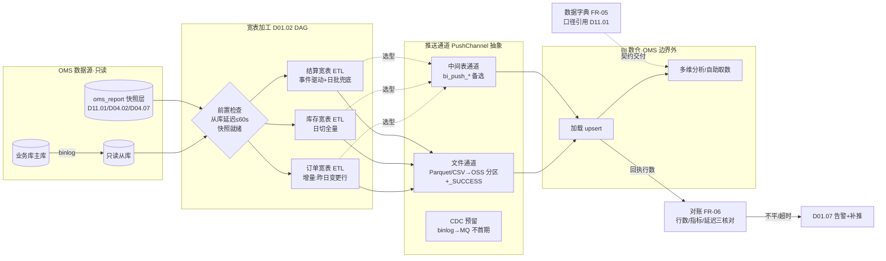
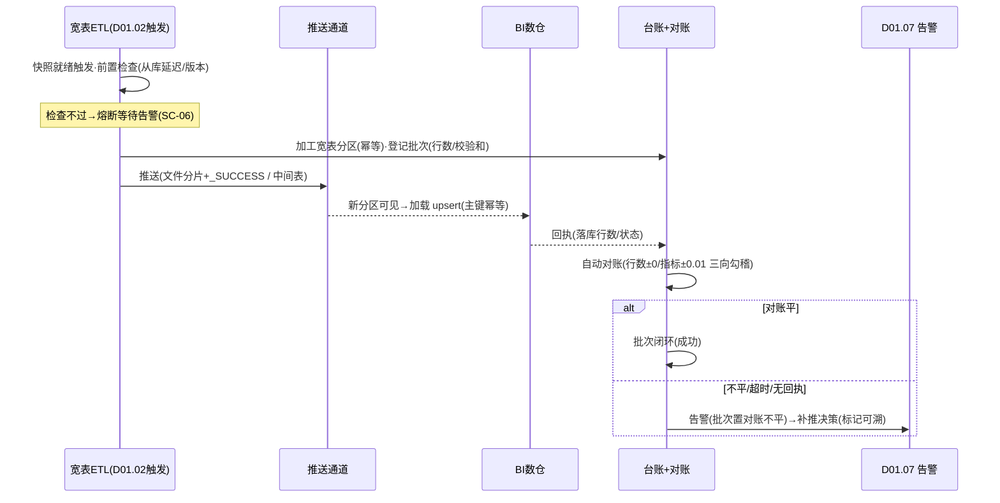

# SRS-D11.02 BI 数据供给模块 需求规格说明书

> 文档编号：SRS-D11.02 · 版本 V1.0 · 2026-10-24 · 编写：小凯 · 状态：待审阅（批次⑤）
> 所属域：D11 数据与报表域 · 分期：**P1（M3 后段）** · schema：**oms_report**（宽表与推送台账复用 D11 独立 schema）
> 上游依据：需求决策 **Q29 决策 A**（自助分析不在 OMS 内做，BI 数仓承接；OMS 供**宽表+数据订阅**）· SRS-D11.01（指标口径字典=唯一事实源、日终快照表、`report.snapshot.ready` 事件 IF-D11.01-06）· SRS-D03.01（订单双口径与行级分摊 §5.2、IF-D03.01-05 getDualAmount）· SRS-D04.02（五口径契约/日终库存快照）· SRS-D04.07（成本快照/出库结转）· SRS-D08.01（应收明细双口径）· SRS-D08.02（结算单/服务费轨迹）· 逆向文档 06（omeanalysts「裁剪保留」：宽表/订阅给 BI）
>
> **全局决策（本模块承载，红线）**：① **OMS 不做 BI 展示层**——只供数据（宽表+推送通道），多维分析/可视化/自助取数全部在 BI 数仓侧；② **BI 侧口径争议以 D11.01 指标口径字典为准**（宽表字段口径与字典一一对应，字典是唯一事实源）；③ 供给通道=**定时全量/增量推送（文件到 OSS 或中间表）为首期实现，CDC 订阅（binlog→MQ）为技术预留不首期实现**；④ 宽表加工只读从库与快照层，业务库零影响（继承 D11.01 只读红线）。

---

## 1. 模块概述

### 1.1 定位

BI 数据供给是 OMS 与公司 BI 数仓之间的**数据契约层**：把 OMS 各域业务数据加工为三张标准化宽表——**订单宽表**（一行一订单行：订单头+行+双口径分摊+履约时效+售后标记）、**库存宽表**（日切快照×五口径×全维度）、**结算宽表**（货主×周期：结算六要素+服务费+借调交易）——经定时全量/增量通道推送 BI 侧（文件到 OSS 或中间表），并交付配套**数据字典文档**（宽表字段业务含义，BI 团队自助取数的契约）与**数据质量保障机制**（行数对账/指标抽样核对/延迟监控）。

商派无对应模块（omeanalysts 是系统内报表，未对外供数）；本模块为凯淳「OMS 供数、BI 分析」分工决策（Q29）的落地设计，属**新栈原创**。

### 1.2 职责边界

**做**：三张宽表的模型设计与加工（ETL 任务，只读从库+快照层）；宽表版本管理（字段增删的版本化与向后兼容策略）；推送通道（全量/增量、文件到 OSS 或中间表双形态）；推送台账与批次管理；数据字典交付与维护（字段级业务含义/口径/来源，与 D11.01 字典联动）；数据质量保障（行数对账、关键指标抽样核对、推送延迟监控与告警）；CDC 订阅技术预留（binlog→MQ 通道占位设计）。

**不做**：BI 侧的存储/建模/可视化/自助分析（**BI 数仓团队职责**）；业务口径的定义（→ D11.01 字典与各业务域契约，本模块只引用）；实时数据供给（监控时效数据归 D11.03 Redis 链路，BI 侧要实时流走 CDC 预留通道后续启用）；金蝶供数（→ D08.06，通道与格式独立）；OpenAPI 对外数据服务（→ D02.07 P2 预留）。

### 1.3 与其他模块关系

| 模块 | 关系 |
|---|---|
| D11.01 固定报表 | 共享 oms_report 快照层（宽表加工源之一）；**指标口径字典=宽表字段口径唯一事实源**；订阅 `report.snapshot.ready` 事件触发增量推送 |
| D03.01 订单 | 订单宽表主源：orders/order_items 头行+双口径分摊（getDualAmount 快照字段落宽表，不重算） |
| D03.07/D09.02 履约 | 订单宽表时效字段：发货单/推仓/出库回传/发货确认时间戳 |
| D05 售后 | 订单宽表售后标记：售后申请/退款状态、退款金额（双口径）、良不良标记 |
| D04.02/D04.07 库存成本 | 库存宽表主源：日终库存快照（五口径）+成本快照（均价/货值） |
| D08.01/D08.02 财务 | 订单宽表收入字段（应收双口径）；结算宽表主源（结算单六要素+服务费轨迹+借调交易） |
| D04.05 借调 | 订单宽表 lend_flag 透传；结算宽表借调内部交易明细 |
| D10.01/D10.03 组织权限 | 宽表携带货主/店铺/品牌/仓四维字段（BI 侧权限体系映射基础）；**宽表推送不含买家明文**（PIPL：脱敏或不供） |
| D01.02 调度 | 宽表 ETL 与推送任务编排（DAG：快照就绪→宽表加工→推送→对账） |
| D01.07 通知 | 推送失败/对账不平/延迟告警 |
| D01.06 导出 | 文件形态推送复用其文件生成能力（CSV/Parquet） |

---

## 2. 业务场景

**SC-D11.02-01 订单宽表日增量推送（主流程）**
每日快照就绪后（`report.snapshot.ready`），ETL 加工前一日订单宽表增量（昨日有状态变化的订单行：新付款/发货/完成/退款）：一行一订单行约 60 字段。生成 Parquet 文件（按日分区 `order_wide/dt=2026-10-23/part-n.parquet`）上传 OSS，写推送台账（批次/行数/校验和）；BI 侧感知新分区加载入仓，推送后自动行数对账（OMS vs BI 回执），不平即告警。

**SC-D11.02-02 历史全量初始化**
BI 首次接入：全量推送近 3 年在线订单（对齐 D03.13 归档边界），按月分片（每片带分片号/总片数）逐片推送校验；完成后切增量（衔接日重叠推送 1 天防边界漏数，BI 按主键幂等去重）。

**SC-D11.02-03 库存宽表日切快照推送**
库存快照（D04.02）+成本快照（D04.07）就绪后加工库存宽表（日切×仓×SKU×货主：五口径+均价+货值+临期汇总+库龄档）推送 BI，供周转/库龄/货值分析——**OMS 不关心 BI 怎么用，只对字段口径负责**。

**SC-D11.02-04 口径争议仲裁**
BI 侧「9 月 GMV」与 OMS 销售月报差 2 万：按字典排查（M-S02 含 freight）发现 BI 加工漏计订单头运费。裁定以 D11.01 字典为准，BI 修正 SQL。**宽表只保口径透明（字典交付），不保 BI 侧使用正确**——边界清晰。

**SC-D11.02-05 结算宽表周期推送**
结算单归档事件（D08.02 `finance.settle.archived`）触发结算宽表增量推送（货主×结算单：六要素+净额双向+服务费轨迹汇总+借调明细+台账滚动）。红冲重算（D08.02 FR-07）：版本链字段（version/origin_settle_bn/红冲标记）追加式推送，BI 按「最新版本生效」消费，旧版本行不删除可回放。

**SC-D11.02-06 延迟监控与补推**
ETL 因从库延迟 >60s 熔断暂停，推送未按时产出：延迟监控发现「T+1 10:00 前未推送」→ 企微告警数据负责人；从库恢复后补推（批次标记 `补推`，衔接校验无漏无重）；BI 可查台账获知批次状态。

---

## 3. 功能需求

### FR-D11.02-01 订单宽表（dws_order_wide）

- FR-01a 粒度：**一行一订单行**（order_item_id 主键）；订单头字段冗余下行（宽表范式，BI 免 join）。
- FR-01b 字段清单（六组，字段级口径见数据字典 FR-05）：
  1. **维度键**：order_id/order_bn/platform_order_bn/order_item_id/平台/店铺/品牌/货主（行级 owner_id）/仓（发货仓，未发货为空）/租户；
  2. **订单头属性**：订单类型/createway/付款时间/下单时间/订单状态三套（audit/fulfill/pay+ship 快照值）/买家 ID（**脱敏哈希**，PIPL 不供明文）/收货省市（区域分析，不到区县以下）；
  3. **行明细**：bm_id/sm_id/商品名快照/数量/吊牌价/成交单价；
  4. **金额双口径**：list_amount/shop_discount/platform_subsidy/paid_amount（行级分摊后，D03.01 §5.2 快照）/freight（头级，标注不分摊）/gmv（=paid+platform，字典 M-S02）；
  5. **履约时效**：审单完成时间（自动/人工标记+审核员 ID）/发货单号/推仓时间/出库回传时间/发货确认时间/签收时间/六段时效秒数（预计算落列，口径同 D11.01 M-F 族）；
  6. **售后标记**：有无售后（申请中/已完成）/售后类型/退款状态/退款金额（双口径）/退货良不良标记/平台介入标记。
- FR-01c 增量语义：**按「昨日有变更的订单行」圈定**（状态变化/售后变化/时间戳回填均触发重推该行）；BI 侧按 order_item_id 主键 upsert 幂等消费；重推行携带全量最新字段（非差量字段）。
- FR-01d 借调/合单/拆单透传：lend_flag+lend_ledger_id（D04.05）；delivery_bn 列表（一单多发货单，JSON 数组）；母单标记（合单场景）。

### FR-D11.02-02 库存宽表（dws_stock_wide）

- FR-02a 粒度：**日切×仓×SKU（bm）×货主一行**（快照日全量切面）。
- FR-02b 字段：快照日/三元键/五口径余额（store/available/freeze/arrive_store/defective，D04.02 契约）/安全库存/unit_cost/货值（买断=均价×实际；代销=代管货值，owner_type 列区分）/库龄档（M-I03）/临期汇总（黄橙红三级数量与货值，D04.09）/滞销标记（D04.10）/近 7/30 天销量（快照冗余，周转分析免 join）/品牌/分类维度列。
- FR-02c 推送模式：每日全量切面（快照天然全量），按日分区追加；BI 侧留存历史切面做趋势。
- FR-02d 一致性锚点：宽表行数=当日库存快照行数（±0）；五口径合计与 D04.02 快照校验和一致。

### FR-D11.02-03 结算宽表（dws_settle_wide）

- FR-03a 粒度：**货主×结算周期×结算单版本一行**（红冲重算=多版本行追加，version/origin_settle_bn/红冲标记列，最新生效规则见 SC-05）。
- FR-03b 字段：货主/货主类型（买断/代销）/周期（period_start/end）/六要素金额（应收/冲减/扣费/服务费/借调交易/期初调整，D08.02 FR-03a 公式对应列）/净额与方向/双向呈现金额（应付侧/应收侧）/服务费明细（条款×模型×档位汇总，JSON）/借调交易明细汇总/台账滚动四列（期初/应结/已付/期末）/状态（已归档/已红冲）/确认时间。
- FR-03c 触发：`finance.settle.archived` / `finance.settle.redflushed` 事件驱动增量推送（事件到达→当批加工推送，T+0 时效）；兜底日批扫描（防事件丢失）。
- FR-03d 买断货主内部结算行同构推送（成本参考列=cost_memo，供 BI 毛利分析；与 D11.01 毛利报表同源）。

### FR-D11.02-04 供给通道

- FR-04a **文件通道（首期主通道）**：格式 Parquet（首选，列式+自带 schema）/CSV（兼容备选）；路径约定 `{oss_bucket}/oms_bi/{table}/dt={date}/part-{n}.{ext}`；每批次伴随 `_SUCCESS` 标记文件+批次元数据文件（行数/校验和/schema 版本/批次类型：全量/增量/补推）。
- FR-04b **中间表通道（备选形态）**：BI 侧直连 OMS 从库读 `oms_report.bi_push_*` 中间表（推送=写入中间表+台账标记）；适用于 BI 侧无 OSS 接入能力时的过渡形态；两通道同一套宽表模型与台账，按 BI 团队选型配置（**接口层抽象：PushChannel 接口，文件/中间表双实现**，与 D11.01 ReportDataSource 同款思想）。
- FR-04c 调度与依赖（DAG，D01.02）：快照就绪（`report.snapshot.ready`）→ 宽表 ETL（从库+快照层加工，落 oms_report 宽表分区）→ 推送 → 对账 → 台账闭环；ETL 前置检查从库复制延迟（>60s 熔断等待，SC-06）。
- FR-04d 全量/增量/补推三批次类型：全量（初始化/重建，分片+衔接日重叠 1 天）；增量（日批+事件批）；补推（人工触发，范围=日期区间×宽表，批次标记可溯）。
- FR-04e 幂等与重推：批次唯一键=（宽表×业务日期×批次类型×序号）；重复推送同批次 BI 侧可安全重载（文件覆盖同分区/中间表按批次号替换）；主键 upsert 语义在数据字典中向 BI 侧明示。
- FR-04f **CDC 订阅预留（技术预留不首期实现）**：设计占位——binlog（Canal/Flink CDC 类组件）→ MQ topic（`bi.cdc.{table}`）→ BI 侧订阅消费；宽表模型不变（CDC 只是通道替换）；预留项：topic 命名规范/事件格式（op_type+before/after）/位点管理约定；启用条件=BI 侧提出准实时需求且数据量评估通过（本 SRS 只登记设计，不排期）。

### FR-D11.02-05 数据字典交付

- FR-05a 交付物：《OMS BI 宽表数据字典》文档（随宽表版本发布）——每字段：字段名/类型/业务含义/**口径公式（引用 D11.01 字典编码）**/来源表/空值语义/枚举值域/示例值；每宽表：粒度/主键/增量语义/upsert 规则/分区约定。
- FR-05b 字典与 D11.01 指标字典联动：宽表口径字段必须引用字典编码（如 gmv → M-S02）；字典变更（新版本生效）→ 宽表字典文档同步更新+schema 版本号递增+变更通知 BI 团队（企微+邮件，提前 ≥5 个工作日）。
- FR-05c schema 版本管理：宽表元数据带 schema_version；**向后兼容规则**——只增列不改列（新增列追加在尾部，旧列语义/类型不变）；破坏性变更（删列/改类型/改口径）必须升主版本+新旧双轨并行 ≥1 个月+BI 侧确认切换后下线旧版。
- FR-05d 字典即契约：BI 团队自助取数以字典为准；字典未尽事项走「口径仲裁流程」（SC-04：争议→数据负责人召集→以 D11.01 字典为裁定基准→结论回写字典）。

### FR-D11.02-06 数据质量保障

- FR-06a **行数对账**：每批次推送后自动对账——OMS 侧（宽表分区行数）vs BI 侧（回执行数/落库 COUNT，经对账接口或 BI 侧回写对账表）；差异 ≠0 → 告警+批次置「对账不平」状态（台账可查）；连续 2 日不平升级数据负责人。
- FR-06b **关键指标抽样核对**：每日对账附加指标核对——订单宽表 ΣGMV/Σpaid_amount/行数 vs D11.01 销售快照同维度合计（±0.01/±0）；库存宽表五口径合计 vs D04.02 快照校验和；结算宽表净额合计 vs D08.02 台账。三向勾稽（宽表↔快照↔源库）任一不平即告警。
- FR-06c **延迟监控**：推送 SLA=快照就绪后 2 小时内完成（订单/库存宽表 T+1 10:00 红线）；超时告警（D01.07）；台账记录每批次计划/实际完成时间供月度延迟率统计。
- FR-06d 质量看板：推送批次成功率/对账通过率/延迟率/补推次数月度汇总（供数据团队运营）；批次明细可查（台账）。
- FR-06e 数据修复通道：BI 侧发现数据问题 → 工单（批次/分区/字段/样例）→ OMS 侧核实（源库→快照→宽表三级回放定位）→ 属 OMS 加工问题则补推修复批次；属源数据问题联动业务域修数后快照重跑（D11.01 FR-06d）级联宽表重推。

### FR-D11.02-07 边界与安全

- FR-07a **OMS 不做 BI 展示层**（红线）：不提供任何面向分析的可视化/拖拽/自助查询界面；OMS 侧报表（D11.01）是固定报表，与 BI 供数并行不互替。
- FR-07b PIPL：宽表不含买家姓名/手机/地址明文（买家 ID 脱敏哈希、地址只到省市）；推送文件 OSS 加密存储+访问 ACL（仅 BI 服务账号）；传输 TLS。
- FR-07c 数据权限映射：宽表携带四维字段（店铺/品牌/仓/货主），BI 侧权限体系自行映射（OMS 供数不裁剪——BI 数仓为内部受信系统，权限责任在 BI 侧；**品牌方门户数据不经 BI 通道**，门户只读 D11.01 报表）。
- FR-07d 推送台账全留痕（批次/操作人/时间/校验和），审计可查（D10.06）。

---

## 4. 业务流程

### 4.1 BI 供给链路



### 4.2 批次生命周期与对账闭环



---

## 5. 处理逻辑

### 5.1 订单宽表增量圈定算法

```
daily_increment(biz_date):
    圈定行 = order_items WHERE
        订单头.update_time ∈ [biz_date 00:00, biz_date+1 00:00)     # 任何状态变化
        OR 关联售后单/退款单昨日有状态变迁                              # 售后标记回填
        OR 昨日发生履约时间戳回填(出库回传/签收轨迹晚到)                 # 时效列更新
    每行输出全量最新字段(重推整行, 非差量) → BI 按 order_item_id upsert
    边界保护: 圈定窗口与前一窗口重叠 5 分钟(对齐 D02.03 重叠窗口思想), upsert 幂等吸收重复
    行数校验: 圈定行数 == 输出行数 == 台账行数(三级一致才推送)
```

### 5.2 全量-增量衔接

```
全量截止日 D: 推送 [归档边界, D] 全部订单行(按月分片)
增量起始: D-1 日起按日增量(重叠 1 天, 防时区/日切边界漏数)
BI 侧幂等: 主键 upsert, 重叠行自动收敛
全量重建(口径变更/schema 升主版本): 新 schema 版本双轨并行推送 ≥1 个月(FR-05c), BI 确认后旧轨停推
```

### 5.3 三向勾稽对账规则

```
向1(宽表↔快照): Σ宽表.gmv(按日×店铺) == rpt_sale_daily.gmv(同日同店)   ±0.01
向2(快照↔源库): rpt_sale_daily == D11.01 快照校验和(其 §5.2 已保障)      传递可信
向3(宽表↔BI):   台账行数 == BI 回执行数                                   ±0
结算宽表: Σ净额 == finance_settle_ledger 当期应结合计                      ±0.01
库存宽表: 五口径列合计 == D04.02 快照 checksum                             ±0
任一不平 → 批次置「对账不平」+告警; 定位路径: BI回执→宽表分区→快照→源库 四级回放
```

### 5.4 延迟熔断与补推

```
ETL 前置: 从库复制延迟 >60s → 熔断等待(每5分钟重查,最多2h) → 超限告警人工
推送 SLA: T+1 10:00(订单/库存) / 事件后 2 小时(结算)
补推: 批次类型=补推,范围=(宽表,日期区间),新批次号;文件覆盖同分区/中间表按批次替换
补推后强制该日期区间三向勾稽重跑
```

---

## 6. 数据字段（业务字段描述，schema：oms_report）

> 宽表字段全量清单见《数据字典》交付物（FR-05a），此处列核心结构与推送台账。

### 6.1 订单宽表（dws_order_wide，核心字段节选）

| 字段组 | 字段 | 业务含义/口径 |
|---|---|---|
| 主键 | order_item_id | 一行一订单行（upsert 键） |
| 维度 | order_bn / platform_order_bn / platform / shop_id / brand_id / owner_id / branch_id / tenant_id | 单据键+四维权限字段（FR-07c） |
| 头属性 | order_type / createway / pay_time / order_time / audit_status / fulfill_status / pay_status / ship_status / buyer_id_hash / receiver_province / receiver_city | 状态=快照值；买家 ID 脱敏哈希（PIPL） |
| 行明细 | bm_id / sm_id / goods_name / num / list_price / deal_price | 商品名快照（防档案变更影响历史） |
| 金额 | list_amount / shop_discount / platform_subsidy / paid_amount / freight / gmv | D03.01 分摊快照；gmv=M-S02；freight 头级不分摊标注 |
| 时效 | audit_done_time / audit_mode(auto/manual) / auditor_id / delivery_bns / push_time / outbound_time / ship_time / sign_time / dur_audit_sec / dur_push_sec / dur_outbound_sec / dur_ship_sec / dur_sign_sec | 时间戳+预计算时效秒（口径 M-F 族） |
| 售后 | has_aftersale / aftersale_type / refund_status / refund_amount_customer / refund_amount_platform / qc_good_flag / platform_intervened | 退款双口径；良不良标记（D05.02） |
| 特殊 | lend_flag / lend_ledger_id / merge_parent_flag / schema_version / etl_batch_id | 借调/合单透传；版本与批次溯源 |

### 6.2 库存宽表（dws_stock_wide）与结算宽表（dws_settle_wide）

| 字段 | 业务含义 |
|---|---|
| ——库存—— snapshot_date / branch_id / bm_id / owner_id | 粒度键（日切×三元） |
| store / available / freeze / arrive_store / defective | 五口径（D04.02 契约，available 派生值照录） |
| safe_store / unit_cost / stock_value / owner_type | 安全库存/均价/货值/货主类型（买断存货 vs 代销代管口径列） |
| age_bucket / near_expire_yellow / near_expire_orange / near_expire_red / slow_moving_flag | 库龄档/临期三级数量货值/滞销标记 |
| sale_qty_7d / sale_qty_30d / brand_id / category_id | 近 7/30 天销量冗余列/品牌分类维度 |
| ——结算—— owner_id / period / settle_bn / version / origin_settle_bn / redflush_flag | 粒度键+版本链（SC-05 最新生效规则） |
| amt_receivable / amt_refund / amt_platform_fee / amt_service_fee / amt_lend_trade / amt_init_adjust / amt_net / net_direction | 六要素+净额方向（D08.02 FR-03a 对应列） |
| fee_detail_json / lend_detail_json / ledger_init / ledger_payable / ledger_paid / ledger_final | 服务费轨迹汇总/借调明细/台账四列 |
| status / confirm_time / schema_version / etl_batch_id | 状态与溯源 |

### 6.3 推送台账（bi_push_batch）与对账记录（bi_recon_record）

| 字段 | 业务含义 |
|---|---|
| ——台账—— batch_id / table_name / biz_date / batch_type | 批次唯一键成分（全量/增量/补推/重建） |
| shard_no / shard_total / row_count / checksum / schema_version / channel / oss_path | 分片校验与版本通道溯源 |
| status / plan_time / start_time / finish_time / operator / trigger_source | 加工中/已推送/对账平/不平/失败（SLA 依据）；补推留痕与触发源 |
| ——对账—— batch_id / recon_type(row_count/metric/checksum) | 对账项类型 |
| oms_value / bi_value / diff / recon_status / recon_time / bi_receipt_time / alarm_id | 双侧值与差异（±0/±0.01 判定 §5.3）；回执时间与关联告警 |

---

## 7. 接口

### 7.1 内部接口（本模块提供）

| 编号 | 接口 | 消费方 | 说明 |
|---|---|---|---|
| IF-D11.02-01 | `WideTableService::build(table, bizDate, batchType)` | D01.02 DAG/人工补推 | 宽表 ETL 加工（幂等，批次唯一键） |
| IF-D11.02-02 | `PushChannel::push(batch)`（文件/中间表双实现） | ETL 后置 | 推送执行（_SUCCESS 标记/中间表写入） |
| IF-D11.02-03 | `BiPushLedger::query/receipt(batchId, biResult)` | BI 侧回写/运维界面 | 台账查询与 BI 回执登记（对账输入） |
| IF-D11.02-04 | `BiReconService::run(batchId?)` | 台账后置自动/人工 | 三向勾稽对账（§5.3），结果写对账记录 |
| IF-D11.02-05 | `BiDictService::getSchema(table, version)` / 字典文档发布 | BI 团队/数据负责人 | 宽表 schema 与数据字典（FR-05，含变更通知触发） |
| IF-D11.02-06 | 事件 `bi.push.completed` / `bi.push.failed` / `bi.recon.mismatch` | D01.07/数据负责人 | 推送与对账结果广播 |
| IF-D11.02-07 | 订阅 `report.snapshot.ready`（D11.01）/ `finance.settle.archived` / `finance.settle.redflushed`（D08.02） | — | 增量触发源（订单库存=快照就绪；结算=事件驱动） |

### 7.2 依赖接口（本模块消费）

| 编号 | 接口 | 提供方 | 说明 |
|---|---|---|---|
| IF-D11.02-D1 | 只读从库 + oms_report 快照层/宽表源表 | 基础设施/D11.01/D04.02/D04.07 | ETL 数据源（只读红线） |
| IF-D11.02-D2 | `ReportMetaService::getMetricDict` | D11.01（IF-D11.01-02） | 字段口径引用字典编码（FR-05b 联动） |
| IF-D11.02-D3 | 结算单/台账查询 | D08.02（IF-D08.02-05） | 结算宽表源 |
| IF-D11.02-D4 | 文件生成（Parquet/CSV）与 OSS 上传；DAG 调度/告警/审计 | D01.06/D01.02/D01.07/D10.06 | 文件通道实现与底座能力 |

### 7.3 外部接口

| 编号 | 接口 | 方向 | 说明 |
|---|---|---|---|
| EF-D11.02-01 | OSS 约定路径推送（Bucket/分区/_SUCCESS 约定） | 出 | BI 侧拉取；ACL 仅 BI 服务账号；TLS+加密存储 |
| EF-D11.02-02 | BI 对账回执接口（回执行数/加载状态回写台账） | 入 | BI 侧调用（IF-D11.02-03 receipt）；无回执超时告警 |
| EF-D11.02-03 | CDC 订阅通道（binlog→MQ，**预留不首期实现**） | 出 | FR-04f 设计占位：topic 规范/事件格式/位点约定 |

---

## 8. 非功能需求

| 项 | 要求 |
|---|---|
| 性能 | 订单宽表日增量 ETL（≈6 万行/日）≤30 分钟；全量初始化（近 3 年 ≈6600 万行）分片推送 ≤24 小时；推送 SLA：T+1 10:00 红线（订单/库存），事件后 2 小时（结算） |
| 只读红线 | ETL 只读从库+快照层，业务主库零查询；从库延迟 >60s 熔断保护（§5.4） |
| 幂等一致 | 批次唯一键幂等（重跑覆盖）；BI 侧主键 upsert 语义契约化；重叠窗口防漏、幂等防重；三向勾稽零容忍（行数 ±0/金额 ±0.01） |
| 兼容治理 | schema 只增不改（向后兼容）；破坏性变更双轨并行 ≥1 月；字典变更提前 ≥5 工作日通知 |
| 安全/PIPL | 宽表无买家明文（哈希+省市粒度）；OSS 加密+ACL；台账与补推全审计（D10.06） |
| 可观测 | 批次成功率/对账通过率/延迟率月度质量看板；批次明细台账可查（含补推历史） |
| 容量 | 宽表分区保留：订单 3 年在线（对齐归档边界）+历史全量在 BI 侧；oms_report 宽表分区推送后可清理本地副本（保留 90 天回溯窗口，台账长期） |

---

## 9. 验收标准

| 编号 | 验收条件 |
|---|---|
| AC-01 | SC-01 日增量推送：构造昨日新付款/发货/退款三类变更订单，宽表增量圈定完整（含售后标记回填行与时效晚到行）；文件落 OSS 约定分区+_SUCCESS+元数据（行数/校验和/schema 版本）；BI 回执后对账行数 ±0 |
| AC-02 | 订单宽表字段口径抽样：任取 100 行，gmv/paid_amount 与 D03.01 getDualAmount 分摊快照一致、六段时效秒数与时间戳差一致、售后标记与 D05 单据状态一致；买家 ID 为脱敏哈希且无明文敏感字段（PIPL 扫描零命中） |
| AC-03 | SC-02 全量初始化：近 3 年数据按月分片全量推送，分片号连续无缺；全量-增量衔接日重叠 1 天，BI 侧 upsert 后无重复无遗漏（行数勾稽） |
| AC-04 | 库存宽表：行数=D04.02 当日快照行数 ±0；五口径合计=快照校验和；代销货主行货值=代管口径且 owner_type 标注正确 |
| AC-05 | SC-05 结算宽表：结算单归档事件后 2 小时内推送；红冲重算场景版本链字段完整（V1/R/V2 三行追加，最新生效规则可执行）；净额合计与 D08.02 台账 ±0.01 |
| AC-06 | SC-04 口径仲裁演练：构造 BI 侧 GMV 少计运费差异，按字典（M-S02 含 freight）裁定 BI 修正；宽表字段「?」可溯源字典编码；字典变更通知提前 ≥5 工作日送达并留痕 |
| AC-07 | SC-06 延迟与补推：模拟从库延迟 >60s → ETL 熔断等待不产出脏批次；超 SLA（10:00）告警触发；补推批次标记可溯、覆盖推送后三向勾稽重跑通过 |
| AC-08 | schema 兼容：新增列（尾部追加）后旧版本 BI 加载不报错（向后兼容验证）；schema_version 递增且字典文档同步更新 |
| AC-09 | 对账不平处置：人为构造 BI 回执行数差 5 → 批次置「对账不平」+告警+台账可查；修复补推后状态闭环；连续 2 日不平升级数据负责人通知送达 |
| AC-10 | 中间表通道：切换到中间表形态（PushChannel 配置切换）后同批次数据可被 BI 直连读取，宽表模型/台账/对账逻辑零修改（通道抽象验证） |

---

## 变更记录

| 日期 | 版本 | 变更 | 原因 |
|---|---|---|---|
| 2026-10-24 | V1.0 | 首版 | — |

---

*参考实现溯源：商派无对应模块——omeanalysts 为系统内报表统计（逆向文档 01：15 表），未对外供数；逆向文档 06 差距分析表对 omeanalysts 的处置决策「自助分析不做，宽表/订阅给 BI」是本模块的直接需求来源。关键差异（本模块为新栈原创设计）：① 「OMS 供数、BI 分析」契约化分工（宽表+数据字典+对账三件套，商派报表与业务同库无供数边界）；② 宽表口径强制引用 D11.01 指标字典（唯一事实源延伸到 BI 侧，防商派式口径散落）；③ 三向勾稽对账（宽表↔快照↔源库）+BI 回执闭环（商派无数据质量体系）；④ PushChannel 通道抽象（文件/中间表双实现）+CDC binlog→MQ 技术预留（演进路径明确不首期实现）；⑤ PIPL 供数脱敏（买家哈希+地址省市粒度，商派无隐私设计）；⑥ schema 版本化与双轨并行兼容策略（BI 消费方保护）。*
