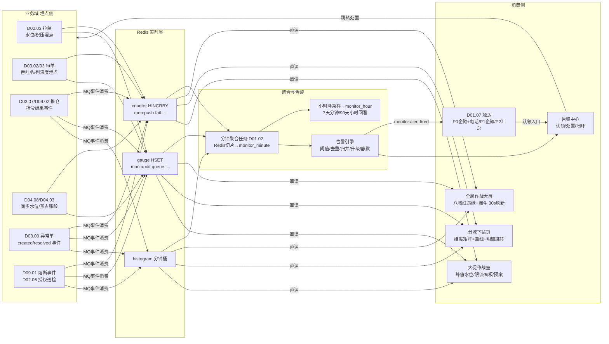
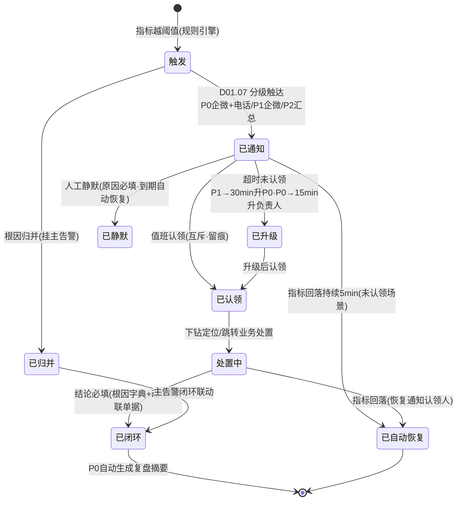
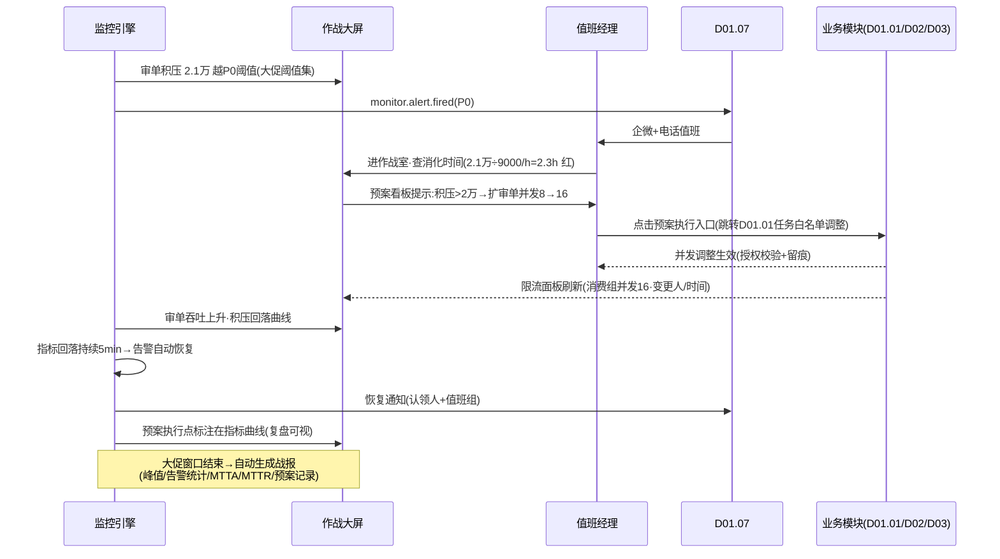

# SRS-D11.03 履约监控看板模块 需求规格说明书

> 文档编号：SRS-D11.03 · 版本 V1.0 · 2026-10-24 · 编写：小凯 · 状态：待审阅（批次⑤）
> 所属域：D11 数据与报表域 · 分期：**P1 · 排期 M2（随主链路上线，大促保障刚需——注意：看板虽 P1 但排期在 M2，早于 D11.01/D11.02）** · schema：**oms_report**（告警与认领记录）+ Redis（实时计数）
> 上游依据：SRS-00 §3 D11 清单（拉单水位/审单积压/推仓失败/同步延迟/异常单实时监控与告警）· 数据供给方契约：SRS-D02.03（FR-07 拉单水位/积压/延迟指标供数、pull_watermark 水位表）· SRS-D03.02（吞吐/通过率/TOP 慢插件/原因码分布四组指标上报本看板，其 §8 可观测）· SRS-D03.03（IF-D03.03-09 事件 `audit.task.assigned/overtime`、audit_performance）· SRS-D03.07/D09.02（IF-D09.02-05 指令通道结果事件族 `wms.outbound.pushed/push.failed/recall.succ/recall.failed`、回传延迟）· SRS-D04.08（IF-D04.08-04 `getSyncStatus` 库存同步水位）· SRS-D04.03（IF-D04.03-06 事件 `stock.freeze_expired`、预占账龄 FR-04a）· SRS-D03.09（IF-D03.09-08 事件 `order.exception.created/resolved`、FR-08a 异常看板供数）· SRS-D09.01（IF-D09.01-04 `WmsHealthService::circuitState` + 事件 `wms.circuit.opened/closed` 熔断广播、FR-05e 通道健康看板）· SRS-D09.05（取号成功率/号段余量/打印队列积压，其 §1.3 D11.03 行）· SRS-D02.06（FR-07a 授权状态总览/即将过期清单供数）· SRS-D01.07（通知与告警中心：企微/短信/电话通道、告警订阅）· 逆向文档 00/06（商派 `monitor` 作业流程监控 7 表：event_notify 预警通知/event_receiver 预警配置/event_template 事件模板/workwx_rule 企微通知规则；差距分析表处置=「作业流程监控思想保留，做成履约时效看板」）· 逆向文档 05（erpapi_caller 失败监控告警 monitor_event_notify 机制）
>
> **全局决策（本模块承载，红线）**：① **数据实现=Redis 实时计数（各域埋点 incr/gauge）+ 分钟级聚合，不走从库**——监控时效优先（秒级~分钟级可见），与 D11.01（T+1 从库/快照经营口径）链路完全分离；② 告警分级联动 D01.07：**P0=企微+电话（值班）/P1=企微即时/P2=汇总（小时/日报）**；③ 告警必须可**认领与闭环**（作战室场景：无人认领的告警=没有告警）；④ 大促模式为一等公民（峰值水位/限流开关/预案看板，SC-05）。

---

## 1. 模块概述

### 1.1 定位

履约监控看板是订单履约全链路的**实时作战指挥台**：以 Redis 实时计数为数据底座，聚合八大监控域指标——拉单水位（D02.03）、审单积压（D03.02/03）、推仓状态（D03.07/D09.02）、库存同步延迟（D04.08）、预占账龄（D04.03）、异常单堆积（D03.09）、WMS 通道健康（D09.01）、平台授权状态（D02.06）——呈现为「全局作战大屏（核心指标红黄绿）+ 分域下钻页」两层结构；指标越阈值触发分级告警（P0 企微+电话/P1 企微/P2 汇总，联动 D01.07），告警支持认领-处置-闭环全程留痕；大促期间切换作战室模式（峰值单量 vs 处理能力水位、限流开关状态、预案看板）。

商派对应机制：`monitor` 应用（作业流程监控 7 表：event_group 监控邮件组/event_notify 预警通知/event_receiver 预警配置/event_template 监控事件模板/workwx_rule 企微通知规则+关联门店）+ erpapi_caller 的 `monitor_event_notify('rpc_warning')` 失败告警。凯淳关键差异：**① 从「邮件规则通知」升级为 Redis 实时计数+作战大屏（商派 monitor 是定时扫描+邮件/企微规则通知，无实时看板）；② 告警认领闭环（商派通知发出即止，无处置跟踪）；③ 八大域指标统一建模（商派监控散落在 caller/各业务定时任务）；④ 大促作战模式（峰值水位/限流联动，商派无）。**

### 1.2 职责边界

**做**：监控指标模型与注册（指标编码/维度/类型 gauge·counter·histogram/阈值规则）；各域埋点接入规范（Redis incr/gauge 写入约定+事件消费兜底）；分钟级聚合任务（Redis→分钟粒度时序，落 oms_report 供回看）；全局作战大屏与分域下钻页；阈值告警引擎（分级 P0/P1/P2、去重、升级、静默期）；告警认领与闭环记录；大促模式（作战室布局/峰值水位/限流开关状态/预案清单）；监控数据回看（近 7 天分钟级、近 90 天小时级）。

**不做**：告警通知通道实现（→ D01.07，本模块只发告警事件与分级）；各业务域指标的**产生**（→ 各域埋点与事件，本模块消费聚合；指标口径以各域 SRS 为准）；T+1 经营报表（→ D11.01，链路与口径分离：看板=分钟级监控口径，报表=日终经营口径）；BI 供数（→ D11.02；监控时序数据不在宽表范围，BI 需要走小时级聚合表另行约定）；业务处置动作本身（如推仓重试、授权续期——看板提供跳转入口，处置在业务模块）；系统级基础设施监控（服务器/JVM/MySQL 复制延迟本身 → 公司统一监控平台，本模块只监控**业务语义指标**；从库延迟仅作为 ETL 熔断输入出现在 D11.02）。

### 1.3 与其他模块关系

| 模块 | 关系（供数契约） |
|---|---|
| D02.03 拉单 | 水位落后时长/缓冲积压量/拉单延迟/投递失败/死信量（其 FR-07a 供数口径）；水位表 pull_watermark 直读 |
| D02.06 授权 | 授权健康度（正常/<7 天/<24h/已过期，其 FR-04a）/过期店铺与影响面（在途订单量，其 FR-07a） |
| D03.02 审单引擎 | 吞吐（单/分钟）/自动通过率/TOP 慢插件/原因码分布（其 §8 四组指标上报） |
| D03.03 审单工作台 | 待审队列深度（分组/公共池）/人均持有量/超时单（事件 `audit.task.overtime`）/分派延迟 |
| D03.07+D09.02 推仓 | 推送失败量（`wms.outbound.push.failed`）/叫回中量（recall 未决）/回传延迟（推送成功→callback 超阈值量）/缓冲队列深度（熔断期，D09.01 FR-05c） |
| D04.08 库存同步 | 同步任务水位/回写延迟（getSyncStatus）/同步失败量/售罄回写及时性 |
| D04.03 预占 | 超期预占量（账龄 >24h/>48h/>72h 分级，其 FR-04a）/过期回收量（`stock.freeze_expired`） |
| D03.09 异常单 | 未闭环异常单按类型/时长堆积（其 FR-08a 看板供数）/超卖应急批次状态（`oversold.batch.created`）/缺货账龄分级 |
| D09.01 WMS 路由 | 各 WMS 熔断状态（`wms.circuit.opened/closed`）/可用性/缓冲积压（其 FR-05e 通道健康看板数据源） |
| D09.05 面单打印 | 取号成功率/耗时/号段余量水位/打印队列积压与龄期（其 §1.3 供数行） |
| D01.07 通知告警 | 告警发送通道（企微/短信/电话）/值班表/订阅路由——本模块发 `monitor.alert.fired` 事件由其执行触达 |
| D01.01/D01.02 | MQ 消费（事件兜底聚合）/调度（分钟聚合、小时降采样、日终归档任务） |
| D11.01 报表 | 边界：监控=T+0 分钟级（Redis），报表=T+1 日终（从库/快照）；履约时效指标口径共用 M-F 族定义（时间戳同源） |
| D10.03 权限 | 大屏按租户隔离（内部租户全量；品牌方门户**不进本看板**——监控为内部运营工具，门户只读 D11.01 报表） |

---

## 2. 业务场景

**SC-D11.03-01 日常值班巡检（大屏红黄绿）**
工作日上午 10:00，履约值班专员打开全局作战大屏：八大域核心指标卡按红黄绿状态排列——拉单水位（各平台最后拉单时间距现在的分钟数，绿 ≤5min/黄 ≤15min/红 >15min）、审单积压（待审队列深度 320 单，绿）、推仓失败（今日累计 2 单，绿）、库存同步延迟（绿）、预占账龄（>48h 有 3 单，黄）、异常单堆积（未闭环 45 单其中超期 6 单，黄）、WMS 通道（全部闭合，绿）、授权状态（1 店铺 <7 天，黄）。黄色项点击进入分域下钻页查明细（预占账龄 3 单跳转 D04.03 台账处理）。大屏 30 秒自动刷新（Redis 直读，秒级延迟内）。

**SC-D11.03-02 推仓失败突增告警（P1）**
通天晓 WMS 接口异常，14:02-14:07 五分钟内推仓失败事件 23 次（阈值：5 分钟 >10 次=P1）。告警引擎触发：去重合并为一条告警（同指标同窗口不重复发）→ `monitor.alert.fired(P1)` → D01.07 企微即时推履约支持组（含指标快照：失败量/涉及仓/错误码 TOP）。组员小王 14:09 在告警中心**认领**（状态=处置中，认领人与时间留痕）→ 下钻页查看失败报文分布定位仓编码映射问题 → 跳 D09.01 修复绑定 → 14:20 批量重推成功 → 告警**闭环**（填处置结论：根因+动作+恢复时间）。14:05 WMS 熔断打开事件（`wms.circuit.opened`）已同步在大屏标红并升级 P0（熔断=P0：影响整仓下发）。

**SC-D11.03-03 大促零点作战室**
双 11 零点：大屏切**大促作战模式**——布局变为「峰值单量 vs 处理能力水位」主视图：实时拉单速率（单/分钟，各平台分列）vs 审单吞吐（D03.02 单/分钟）vs 推仓速率 vs WMS 回传速率，四段流水线漏斗图；处理能力水位=当前积压/小时处理能力（如审单积压 12000 单÷处理能力 9000 单/h=1.3h 消化时间，黄）；限流开关状态面板（拉单限流/审单并发/推仓限速当前值与开关人）；预案清单（预设动作：扩审单并发→开自动审单降级→限流拉单，每项带执行入口与授权人）。00:40 审单积压突破 2 万（P0 阈值）：企微+电话值班经理，作战室按预案扩并发（D03.02 消费组扩容），积压 40 分钟内回落，告警自动恢复（恢复通知同通道）。

**SC-D11.03-04 平台授权过期应急**
大促前一天，授权监控发现抖音店铺 X access_token 剩余 <24h 且 refresh 失败 2 次：黄转红（P1 告警授权负责人）；大屏授权域卡片标红展示影响面（该店在途订单 3400 单/日拉单量）。负责人重新授权（跳 D02.06 一键授权 URL）→ 状态回正常 → 告警自动闭环（指标恢复即自动解除+通知认领人）。若过期：店铺状态=过期（D02.06 联动暂停拉单），大屏显示「拉单停摆店铺」红色置顶（大促期间授权过期=P0）。

**SC-D11.03-05 异常单堆积升级**
异常单监控：某类型（WMS_PUSH_FAILED）1 小时内新增 35 单（阈值：1h >20 突增告警，D03.09 FR-08c 同源规则）→ P1 告警；同时未闭环总量 180 单其中 >72h 超期 12 单 → 超期升级链（D03.09 §5.2：150% SLA 升级运营负责人）在看板标红置顶。运营负责人下钻：按类型×店铺×时长分布矩阵定位根因（某仓绑定批量失效）→ 处置后异常单批量闭环 → 指标回落告警自动恢复。

**SC-D11.03-06 告警风暴抑制（P2 汇总与静默）**
WMS 全故障期间：推仓失败/回传延迟/异常单突增/熔断四类告警同时爆发。告警引擎抑制策略：① 同根因归并（熔断打开期间的推仓失败类告警挂到熔断主告警下，不独立发送）；② P2 级转汇总（每小时一条汇总消息而非逐条）；③ 人工静默（值班经理对已知故障设静默期 2 小时，期间该指标只记不发；静默须填原因+到期自动恢复+留痕）。故障闭环后告警中心留存完整告警时间线（发生/归并/认领/处置/恢复）供复盘。

---

## 3. 功能需求

### FR-D11.03-01 监控指标模型与注册

- FR-01a 指标注册表（monitor_metric）：指标编码（如 `pull.watermark.lag`）/名称/所属域（八大域）/类型（gauge 瞬时值·counter 累计·histogram 分布）/维度（平台/店铺/仓/WMS/审核组/异常类型，维度组合注册时声明）/单位/数据源（Redis key 模式+事件来源）/**阈值规则集**（黄/红分级+P0/P1/P2 映射）/下钻链接（业务模块页面路由）/负责人组。
- FR-01b 八大域指标清单（口径以各域 SRS 为准，本模块只聚合展示）：

| 域 | 核心指标（编码前缀） | 供数方式 |
|---|---|---|
| 拉单水位 pull.* | 各平台×店铺最后拉单时间距今分钟数（水位落后）/缓冲积压量/拉单延迟 P95/投递失败量/死信量 | D02.03 埋点 gauge+水位表分钟扫描 |
| 审单积压 audit.* | 待审队列深度（组/公共池分列）/自动审单通过率（滚动 1h）/审单吞吐（单/分钟）/人均持有量/超时单数/TOP 慢插件 | D03.02/03 埋点+事件 `audit.task.overtime` |
| 推仓状态 push.* | 推送失败量（5min 滚动）/叫回中未决量/回传延迟量（推送→callback >N 小时）/熔断缓冲队列深度与最老龄期 | 事件 `wms.outbound.*` 消费计数 |
| 库存同步 sync.* | 回写延迟（变动→回写完成 P95）/同步任务失败量/待同步积压/售罄回写超时量 | D04.08 埋点+getSyncStatus 分钟轮询 |
| 预占账龄 freeze.* | 超期预占量（>24h/>48h/>72h 三档 gauge）/过期回收量（counter）/预占总量 | D04.03 账龄扫描任务分钟写入+事件 `stock.freeze_expired` |
| 异常单 exc.* | 未闭环总量（按类型/店铺/货主维度）/超期量（SLA 100%/150% 分列）/1h 新增突增量/超卖应急批次状态/缺货账龄分级 | 事件 `order.exception.created/resolved` 计数+D03.09 分钟扫描 |
| WMS 通道 wms.* | 各 WMS 熔断状态（opened/closed/half_open）/可用性（滚动 1h 成功率）/调用延迟 P95/缓冲积压 | 事件 `wms.circuit.*` +D09.01 健康快照分钟写入 |
| 平台授权 auth.* | 授权健康度分布（正常/<7 天/<24h/过期）/过期店铺影响面（在途订单量）/续期失败量 | D02.06 巡检任务写入+事件 |
| 面单打印（附属域） waybill.* | 取号成功率/取号延迟 P95/号段余量水位（账号级）/打印队列积压与龄期 | D09.05 台账埋点 |

- FR-01c 埋点接入规范（对各域的契约要求）：counter 用 `HINCRBY`（key 带日期分区，如 `mon:push.fail:{wms}:{yyyymmdd}`）；gauge 用 `HSET`（最新值+时间戳）；histogram 用分钟桶（`HINCRBY mon:xx.bucket:{minute}`）；埋点失败不阻断业务主流程（fire-and-forget+本地降级计数，**监控埋点永不影响交易**红线）；事件消费兜底（埋点遗漏时按事件流补算，双通道对账）。
- FR-01d 指标口径文档化：每指标注册时必填口径说明（计算公式+来源事件/表），看板「?」透出（对齐 D11.01 字典治理思想；监控口径与经营口径差异明示，如「通过率滚动 1h」vs 报表「按投审日」）。

### FR-D11.03-02 实时聚合与存储

- FR-02a Redis 实时层：当前值（gauge/counter）直读展示（大屏 30s 轮询或 WebSocket 推送）；key 规范 `mon:{域}.{指标}:{维度组合}:{时间分区}`；TTL 策略（原始分钟 key 7 天）。
- FR-02b 分钟级聚合任务（D01.02 调度）：每分钟把 Redis 指标切片落 `oms_report.monitor_minute`（时序表：指标×维度×分钟值）；小时任务降采样落 `monitor_hour`（avg/max/min/p95）；日终归档（分钟表保留 7 天在线，小时表 90 天，日表长期——回看能力边界）。
- FR-02c **不走从库红线**：看板全部查询走 Redis+时序表（oms_report），业务从库仅承接分钟扫描类兜底任务（低频、限流、语句超时 5s）；监控链路与报表链路（D11.01）资源隔离。
- FR-02d 回看能力：任指标近 7 天分钟级曲线/近 90 天小时级曲线；告警时间点在曲线上标注（复盘：告警前后指标形态）。

### FR-D11.03-03 全局作战大屏与分域下钻

- FR-03a 大屏布局：顶部=八域状态卡（红黄绿+核心数字+趋势箭头，30s 刷新）；中部=履约流水线漏斗（拉单→审单→推仓→出库→回传五段速率与段间积压，大促模式主视图复用）；底部=活跃告警滚动条（P0 置顶闪烁）+今日累计（单量/发货量/异常量）。
- FR-03b 红黄绿判定：按指标注册阈值规则集实时计算（黄=预警阈值，红=告警阈值）；域卡状态=域内指标最差色；色盲友好（色+图标双编码）。
- FR-03c 分域下钻页（八域各一）：域内全指标明细（维度矩阵：如异常单=类型×店铺×时长分布）+分钟级曲线+关联明细清单（TOP N 样例单据，跳转业务模块处置）+该域活跃告警与认领状态。
- FR-03d 大屏投放模式：全屏/轮播（多域自动切换，作战室电视墙）；只读免登录令牌（作战室大屏设备专用 token，限时限 IP，安全边界）。
- FR-03e 数据权限：内部租户按 D10.03 四维过滤（店铺组值班只看授权店铺域数据）；品牌方门户不进本看板（FR：门户无监控菜单，其诉求由 D11.01 报表承接）。

### FR-D11.03-04 阈值告警引擎

- FR-04a 告警规则：指标×阈值条件（静态阈值/环比突增/持续 N 分钟）×级别映射（P0/P1/P2）×生效时段（大促模式可切独立阈值集）；规则可配（负责人组维护），变更留痕即时生效。
- FR-04b 分级触达（联动 D01.07 契约）：**P0=企微即时+电话值班（升级链：5 分钟未认领再呼备份值班）/P1=企微即时（负责人组）/P2=汇总推送（每小时聚合一条+日报）**；告警内容=指标快照+维度定位+下钻链接+建议处置动作（指标注册时配置）。
- FR-04c 去重与归并：同指标同维度窗口内（默认 10 分钟）不重复发（更新原告警计数）；根因归并规则（熔断期间推仓失败类挂主告警，SC-06）；归并关系在告警详情可视（主告警-子告警树）。
- FR-04d 升级：P1 告警 30 分钟未认领自动升 P0（重呼值班）；P0 15 分钟未认领升级运营负责人；升级链可配。
- FR-04e 静默：人工静默（指标×维度×时长，须原因；到期自动恢复；静默期只记不发）；维护窗口静默（发布/演练预登记）。
- FR-04f 自动恢复：指标回落阈值内持续 N 分钟（默认 5）→ 告警自动置恢复+恢复通知同通道（认领人+订阅组）。

### FR-D11.03-05 告警认领与闭环

- FR-05a 告警中心：活跃告警队列（按级别/域/时长排序）+历史告警检索；每条告警状态机：`触发→已通知→已认领(认领人/时间)→处置中→已闭环(结论必填)/已自动恢复/已静默`。
- FR-05b 认领：单人认领（互斥，防多人重复处置）；转派（留痕）；认领即通知同组（状态可见）。
- FR-05c 闭环记录：处置结论结构化（根因分类字典：外部平台/WMS 故障/配置错误/数据问题/容量不足/其他+文字说明+动作记录）；关联单据（处置中跳转的业务操作引用）；闭环时长统计（MTTA 认领时长/MTTR 恢复时长，按域/级别/根因月度汇总——复盘与预案优化输入）。
- FR-05d 复盘输出：P0 告警闭环后自动生成复盘摘要（时间线：触发/通知/认领/处置/恢复+影响面指标），归档供大促复盘（联动 D03.09 超卖批次复盘思想）。

### FR-D11.03-06 大促模式

- FR-06a 模式开关：手动开启（运营负责人授权）+大促日历自动预约（日期窗口自动切入/退出）；模式切换全留痕并通知值班组。
- FR-06b 作战布局切换：大屏主视图=「峰值单量 vs 处理能力水位」——实时拉单速率/审单吞吐/推仓速率/回传速率四段流水线+段间积压+**消化时间**（积压÷小时处理能力，>1h 黄/>2h 红）；峰值对比列（当前 vs 今日峰值 vs 上次大促同期，历史大促时序数据回看支撑）。
- FR-06c 限流开关状态面板：拉单限流（D02.01/D02.03 限流配置当前值）/审单并发（D03.02 消费组并发数）/推仓限速（D09.02 下发速率）——**只读展示当前值+最近变更（谁/何时/何值）**；调整动作跳转业务模块执行（看板不直接改配置，防误操作红线），变更后面板即时刷新。
- FR-06d 预案看板：预案清单（每条：触发条件/动作/执行入口/授权人/状态）——如「审单积压 >2 万：扩消费组并发 8→16（入口 D01.01 任务白名单）」「拉单速率 >处理能力 150%：开启拉单限流」「WMS 熔断 >30 分钟：切备用仓预案（D09.01）」；预案执行留痕（谁/何时/执行项），执行后关联指标曲线标注（预案生效点）。
- FR-06e 大促阈值集：大促期间独立阈值（更敏感：如审单积压黄线 3000→1000）；模式退出自动切回日常阈值。
- FR-06f 战报：大促窗口结束后自动生成大促监控摘要（峰值指标/告警统计/MTTA/MTTR/预案执行记录），推运营负责人（复盘输入）。

---

## 4. 业务流程

### 4.1 监控数据流（业务埋点→Redis→看板/告警）



### 4.2 告警生命周期状态机



### 4.3 大促预案执行时序



---

## 5. 处理逻辑

### 5.1 指标计算与红黄绿判定

```
实时判定(大屏30s轮询/告警引擎每分钟):
  value = Redis 直读(counter=窗口累计 HINCRBY 和; gauge=最新值; histogram=分钟桶聚合P95)
  状态 = 红 if value ≥ 红阈值(持续 N 分钟, 防抖) 
       = 黄 if value ≥ 黄阈值
       = 绿 otherwise
  域卡状态 = 域内全指标最差色
滚动窗口指标(通过率/成功率): 分子分母各为窗口 counter, 比率=Σ分子/Σ分母(窗口=1h 滑动, 分钟步进)
消化时间(大促) = 当前积压量 / 近1h平均处理能力(单/h); >1h 黄, >2h 红
防抖: 越阈值须持续 N 分钟(默认2, 可配)才触发告警——瞬时毛刺不打扰
```

### 5.2 告警去重、归并与升级

```
去重键 = (指标编码, 维度组合, 告警级别); 窗口10min内同键 → 更新原告警(计数+1, 不重发)
归并规则表(可配): wms.circuit.opened 期间 → push.fail/recall/callback延迟 类告警挂主告警(子告警只记不发)
升级: P1 30min未认领→升P0(重呼); P0 15min未认领→升级运营负责人; 升级链随认领重置
静默: (指标,维度,时长,原因) 登记; 静默期告警只落库不触达; 到期自动恢复发送
自动恢复: 指标回落阈值内持续5min → 状态=已自动恢复 + 恢复通知同通道
```

### 5.3 埋点双通道与对账（防漏计）

```
主通道: 业务代码同步埋点(Redis incr/gauge, fire-and-forget, 失败本地内存计数降级)
兜底通道: 本模块消费业务事件流(order.exception.created 等)独立计数
对账: 分钟聚合时比对双通道计数, 差异>5% → 埋点质量告警(通知指标负责人修埋点)
     差异期间以事件通道为准(事件可靠投递由 D01.01 保障)
红线: 埋点异常绝不阻断业务主流程(try-catch 全包裹+超时1ms熔断)
```

### 5.4 时序存储与降采样

```
monitor_minute: (metric_code, dims_hash, minute_ts, value) — 在线7天, 按月分区
monitor_hour:   小时降采样(avg/max/min/p95) — 在线90天(小时任务D01.02)
monitor_daily:  日汇总 — 长期(大促同期对比数据源, SC-03 峰值对比列)
回看查询: ≤7天走分钟表, ≤90天走小时表, 更早走日表(查询路由自动)
告警标注: 告警触发/恢复时间点写关联表, 曲线叠加标注(FR-02d)
```

---

## 6. 数据字段（业务字段描述，schema：oms_report + Redis）

### 6.1 指标注册表（monitor_metric）

| 字段 | 业务含义 | 取值/校验 |
|---|---|---|
| metric_code / metric_name / domain | 编码（pull.watermark.lag 等）/名称/所属域 | 八域+附属域枚举 |
| metric_type / unit / dims | 类型（gauge/counter/histogram）/单位/维度声明 | 维度组合注册（FR-01a） |
| redis_key_pattern / event_source | Redis key 模式/事件来源 | 双通道声明（§5.3） |
| threshold_json | 阈值规则集 | 黄/红×持续分钟×P0/P1/P2 映射×大促独立阈值集 |
| caliber_note / drill_route / owner_group | 口径说明/下钻路由/负责人组 | 「?」透出（FR-01d） |
| status / tenant_id | 启停/租户 | |

### 6.2 告警记录（monitor_alert）与认领闭环（monitor_alert_action）

| 字段 | 业务含义 |
|---|---|
| alert_id / metric_code / dims_snapshot / level | 告警键+触发时维度值快照+级别（P0/P1/P2） |
| trigger_value / threshold_snapshot / trigger_time | 触发值与阈值快照（规则版本化，复盘依据） |
| status | 触发/已通知/已认领/处置中/已闭环/已自动恢复/已归并/已静默（§4.2） |
| parent_alert_id / merge_count | 主告警引用/去重归并计数 |
| claim_op / claim_time / escalate_level | 认领人/时间/升级级别（升级链留痕） |
| recover_time / recover_value | 恢复时间/恢复时值（自动恢复场景） |
| silence_reason / silence_until | 静默原因/到期时间 |
| ——闭环—— close_reason_code / close_memo / rel_bills | 根因字典（外部平台/WMS 故障/配置/数据/容量/其他）/说明/关联单据 |
| mtta_sec / mttr_sec / review_summary | 认领时长/恢复时长/P0 复盘摘要（FR-05c/d） |

### 6.3 时序表（monitor_minute / monitor_hour / monitor_daily）与大促会话（promo_session）

| 字段 | 业务含义 |
|---|---|
| ——时序—— metric_code / dims_hash / ts / value(avg,max,min,p95,count) | 粒度键+值列（§5.4 三级） |
| alert_mark | 该时间点告警标注（触发/恢复，曲线叠加） |
| ——大促会话—— session_id / promo_name / start_time / end_time | 大促窗口（日历预约或手动，FR-06a） |
| threshold_set_id / plan_exec_log | 大促阈值集引用/预案执行记录（谁/何时/何项/关联指标标注点） |
| peak_snapshot / war_report | 峰值指标快照（今日峰值/同期对比基线）/战报（FR-06f 自动生成） |
| limit_switch_snapshot | 限流面板快照（各开关当前值+变更历史引用，只读展示 FR-06c） |

---

## 7. 接口

### 7.1 内部接口（本模块提供）

| 编号 | 接口 | 消费方 | 说明 |
|---|---|---|---|
| IF-D11.03-01 | `MonitorService::getDashboard(tenant, scope)` / `getDomainDetail(domain, filters)` | 大屏/下钻页前端 | 八域状态卡+漏斗+明细（Redis 直读，30s 刷新） |
| IF-D11.03-02 | `MetricRegistry::register/update(metric)` | 负责人组/初始化 | 指标注册（阈值/口径/下钻路由，变更留痕） |
| IF-D11.03-03 | `AlertService::list/claim/transfer/close(alertId, 结论)` | 告警中心前端 | 认领闭环（互斥认领/结论必填，FR-05） |
| IF-D11.03-04 | `AlertService::silence(metric, dims, duration, reason)` | 值班经理 | 静默登记（到期自动恢复） |
| IF-D11.03-05 | 事件 `monitor.alert.fired` / `monitor.alert.recovered` / `monitor.alert.escalated` | D01.07（触达执行）/值班组 | 告警生命周期广播（分级触达契约：P0 企微+电话/P1 企微/P2 汇总） |
| IF-D11.03-06 | `PromoModeService::open/close/session()` / `getWarRoom()` | 运营负责人/大屏 | 大促模式切换与作战室数据（峰值水位/限流面板/预案） |
| IF-D11.03-07 | `MonitorQuery::getTimeline(metric, dims, range)` | 下钻页/复盘 | 时序回看（分钟/小时/日三级路由，§5.4） |

### 7.2 依赖接口（本模块消费）

| 编号 | 接口 | 提供方 | 说明 |
|---|---|---|---|
| IF-D11.03-D1 | 事件订阅：`wms.outbound.pushed/push.failed/callback/recall.*`（D09.02）/`wms.circuit.opened/closed`（D09.01 IF-04）/`order.exception.created/resolved`、`oversold.batch.created`（D03.09 IF-08）/`audit.task.overtime`（D03.03 IF-09）/`stock.freeze_expired`（D04.03 IF-06） | 各业务域 | 事件通道计数（兜底通道，§5.3） |
| IF-D11.03-D2 | `WmsHealthService::circuitState(wms_id)` | D09.01（IF-D09.01-04） | 熔断状态直读（大屏 wms 域卡） |
| IF-D11.03-D3 | `SellableService::getSyncStatus(shop, skus)` | D04.08（IF-D04.08-04） | 库存同步水位轮询（分钟级） |
| IF-D11.03-D4 | pull_watermark 水位表/授权健康度巡检数据（只读） | D02.03（§6.3）/D02.06（FR-04a/07a） | 拉单水位与授权域（分钟扫描，从库限流） |
| IF-D11.03-D5 | 各域 Redis 埋点写入（契约规范 FR-01c） | D02.03/D03.02/D03.03/D09.02/D09.05 等 | 主通道计数（key 规范统一注册） |
| IF-D11.03-D6 | 告警触达执行（企微/短信/电话+值班表+订阅路由） | D01.07 | `monitor.alert.fired` 消费方（分级触达） |
| IF-D11.03-D7 | 调度（分钟聚合/小时降采样/日归档）+MQ 消费框架 | D01.02/D01.01 | 聚合任务与事件消费 |

### 7.3 外部接口

| 编号 | 接口 | 方向 | 说明 |
|---|---|---|---|
| EF-D11.03-01 | 企微/电话触达（经 D01.07 通道） | 出 | P0 电话值班（升级链双呼）；大屏免登录 token 限时限 IP |
| EF-D11.03-02 | 大屏投放（作战室电视墙） | 出 | 轮播模式/只读令牌（FR-03d） |

---

## 8. 非功能需求

| 项 | 要求 |
|---|---|
| 时效 | 埋点→大屏可见 ≤1 分钟（Redis 直读路径 ≤30s）；告警触发→D01.07 触达 ≤1 分钟（P0 电话 ≤2 分钟）；事件消费延迟 ≤10s |
| 可用性 | 看板自身高可用：Redis 故障→降级读分钟时序表（标注降级模式）；告警引擎独立进程（看板挂了告警照常）；**监控失效本身也是告警**（心跳指标：聚合任务停摆 >3 分钟自告警，经 D01.02 任务监控双保险） |
| 红线 | 埋点永不阻断业务（§5.3 超时熔断）；监控链路不走业务从库主查询（FR-02c）；看板不改业务配置（限流面板只读+跳转执行，FR-06c） |
| 性能 | 大促峰值：埋点写入 ≤5000 次/秒（Redis 单点分片可扩）；大屏并发 50 客户端 30s 轮询 P95 ≤500ms；分钟聚合任务（≈200 指标×维度组合）≤30s/轮 |
| 数据权限 | 内部租户四维过滤；门户禁入（FR-03e）；大屏 token 安全（限时/限 IP/只读） |
| 留痕审计 | 告警全生命周期/认领/静默/预案执行/阈值变更全留痕（D10.06）；MTTA/MTTR 月度统计 |
| 容量 | monitor_minute 日增 ≈200 指标×平均 10 维度组合×1440 分钟 ≈288 万行/日——**预聚合落库（维度组合注册制控制基数）+7 天在线+分区清理**；Redis 内存 ≤2GB（key TTL 7 天） |

---

## 9. 验收标准

| 编号 | 验收条件 |
|---|---|
| AC-01 | SC-01 大屏红黄绿：构造八域指标越黄/红阈值样本，域卡状态=域内最差色且 30s 内刷新可见；色盲模式图标双编码正确；下钻页维度矩阵与明细清单一致 |
| AC-02 | 埋点双通道对账：人为使某域 Redis 埋点失败（降级本地计数），事件兜底通道计数补齐；双通道差异 >5% 触发埋点质量告警；埋点异常时业务主流程零阻断（交易压测验证红线） |
| AC-03 | SC-02 告警闭环：5 分钟推仓失败 23 次触发 P1（阈值 10）；10 分钟窗口内重复越阈不重发（归并计数）；认领互斥（双人同时认领仅一人成功）；闭环结论必填+根因字典+MTTA/MTTR 自动统计正确 |
| AC-04 | 升级链：P1 告警 30 分钟未认领自动升 P0 并电话值班；P0 15 分钟未认领升级运营负责人；升级留痕完整 |
| AC-05 | 根因归并：模拟 WMS 熔断打开，期间推仓失败/回传延迟告警挂主告警（子告警只记不发）；熔断恢复（`wms.circuit.closed`）后子告警随主告警闭环；归并树在告警详情可视 |
| AC-06 | 静默：设置 2 小时静默（原因必填）后该指标只落库不触达；到期自动恢复发送；静默期间大屏状态色照常计算（静默≠失明） |
| AC-07 | 自动恢复：指标回落阈值内持续 5 分钟自动置恢复+恢复通知同通道送达认领人；告警时间点在大屏曲线标注可回放 |
| AC-08 | SC-03 大促模式：日历预约自动切入作战布局；四段流水线速率+段间积压+消化时间计算正确（2.1 万÷9000/h=2.3h 红）；峰值对比列（今日峰值/上次大促同期，monitor_daily 数据源）正确；大促阈值集生效（积压黄线 3000→1000）、退出自动切回 |
| AC-09 | 限流面板只读：面板展示各限流开关当前值+最近变更（人/时间/值）；看板无修改入口，跳转业务模块调整后 ≤1 分钟面板刷新；预案执行留痕且执行点标注在指标曲线 |
| AC-10 | SC-04 授权监控：构造 token <24h 且续期失败，黄转红 P1 告警+影响面（在途订单量）展示；重新授权后状态回正常、告警自动闭环；大促期间店铺过期=P0 置顶 |
| AC-11 | 回看与降采样：任指标 7 天内分钟级曲线/90 天内小时级曲线查询正确（三级路由自动）；分钟表 7 天外分区自动清理；时序数据与告警标注叠加渲染 |
| AC-12 | 监控自监控：分钟聚合任务停摆 >3 分钟触发心跳告警（经 D01.02 双保险通道）；Redis 故障时大屏降级读时序表并标注「降级模式」 |
| AC-13 | 战报与复盘：P0 告警闭环自动生成复盘摘要（完整时间线+影响面）；大促窗口结束自动生成战报（峰值/告警统计/MTTA/MTTR/预案记录）推送运营负责人 |
| AC-14 | 数据权限：内部账号按授权店铺集过滤大屏数据；品牌方门户无监控菜单入口（直连 URL 拒绝）；大屏投放 token 超时/越 IP 访问被拒 |

---

## 变更记录

| 日期 | 版本 | 变更 | 原因 |
|---|---|---|---|
| 2026-10-24 | V1.0 | 首版 | — |

---

*参考实现溯源：商派 `monitor` 应用（作业流程监控 7 表：event_group 监控邮件组关联事件/event_group_template/event_notify 预警通知 15 列/event_receiver 预警配置/event_template 监控事件模板/workwx_rule 企微通知规则+workwx_rule_store 关联门店，逆向文档 01 §monitor）+ erpapi_caller 失败告警 `monitor_event_notify('rpc_warning')`（逆向文档 05 §调用入口层）+ 逆向文档 06 差距分析表处置决策「monitor 作业流程监控思想保留，做成履约时效看板」。关键差异：① **Redis 实时计数+分钟级聚合替代定时扫描+邮件规则通知**（商派 monitor 为事件模板+邮件组/企微规则的被动通知体系，无实时看板；凯淳监控时效优先不走从库）；② 八大域指标统一注册建模（商派监控散落于 caller/各业务定时任务，无指标字典——本模块注册表+口径文档化对齐 D11.01 治理思想）；③ 告警认领-处置-闭环+MTTA/MTTR 统计（商派通知发出即止无处置跟踪）；④ 告警风暴抑制产品化（去重/根因归并/升级链/静默/自动恢复五机制，商派仅 workwx_rule 简单规则）；⑤ **大促作战室模式**（峰值单量 vs 处理能力水位/消化时间/限流开关面板/预案看板/战报——商派无大促监控设计，凯淳大促保障刚需）；⑥ 埋点双通道对账与「监控永不阻断业务」红线（商派埋点与业务耦合无隔离约定）。*
