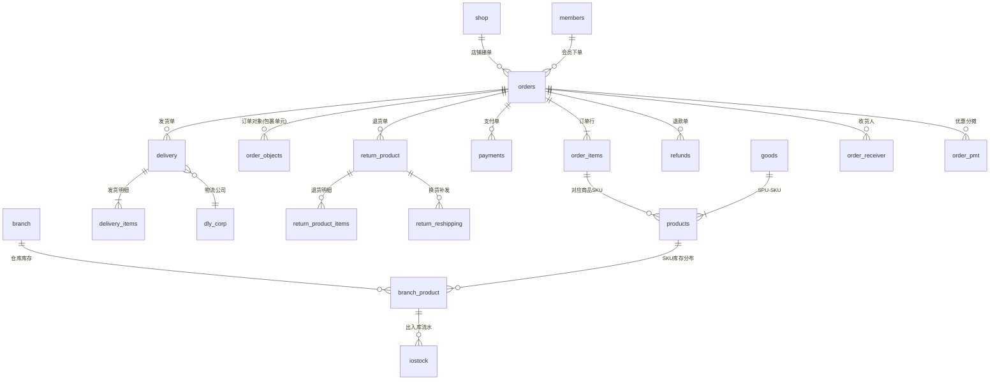

# 商派 ONEX OMS 逆向工程文档 · 01 数据库实体字典与 ER 关系

> 数据来源：对 53 个模块 `dbschema/` 目录的 711 个表定义文件做静态解析（脚本 `_research/tools/extract_schema.py`，产物 `_research/schema.json`）。
> 表命名规则：物理表名 = `<模块>_<表名>`（如 ome 模块 orders 表 → `ome_orders`）。
> 商派 schema DSL 同时携带 UI 元数据（label/width/in_list），本文档只保留工程相关字段。

---

## 1. 数据规模总览

| 维度 | 数值 |
|---|---|
| 总表数 | 711 |
| 含表定义的模块数 | 53 |
| 数据列总数 | 9,849 |
| 显式外键（`table:xxx@yyy` DSL） | 774 条 |
| 最大单表 | ome_orders（117 列） |

### 表数 TOP 15 模块

| 模块 | 表数 | 说明 |
|---|---|---|

| ome | 195 | 业务处理引擎 |
| console | 51 | 控制台 |
| purchase | 38 | 采购 |
| archive | 36 | 归档 |
| material | 32 | material manage物料管理 |
| dealer | 21 | 经销商管理 |
| financebase | 19 | 财务基础版 |
| finance | 18 | 财务 |
| goldentra | 18 | goldentra 对接（主档、每日金价、库存更新） |
| desktop | 16 | 提供一个带有权限和工作流的操作环境。 |
| wms | 16 | 仓储功能应用 |
| o2o | 15 | O2O业务管理 |
| omeanalysts | 15 | OME 报表统计功能 |
| invoice | 12 | 订单发票管理 |
| logisticsmanager | 12 | 物流单号、快递模板等与物流相关的管理 |

---

## 2. 核心域实体详解

> 订单域是系统心脏。以下按域展开核心表的全部列定义。其余 500+ 张表在 §3 提供全量索引（表名+注释），需要时再逐表展开。

### 2.0 全局实体关系总览

订单主链：`shop/members → orders → order_items/products → payments → delivery → (refunds/return_product)`；
库存主链：`branch(仓) × products(SKU) → branch_product(库存) → iostock(流水)`。

### 2.1 订单域（ome 模块）

#### `ome_orders` — 订单表,用于存储全渠道订单

| 列 | 类型 | 必填 | 主键 | 默认 | 说明 |
|---|---|---|---|---|---|
| order_id | int unsigned | ✓ | PK |  | 自增主键ID |
| order_bn | varchar(32) | ✓ |  |  | 订单号 |
| platform_order_bn | varchar(32) |  |  |  | 平台订单号 |
| archive | tinyint unsigned | ✓ |  | 0 | 归档状态,可选值:1(是),0(否) |
| member_id | table:members@ome |  |  |  | 会员ID,关联ome_members.member_id |
| confirm | tinybool | ✓ |  | N | 订单确认状态,可选值:Y(是),N(否) |
| process_status | array | ✓ |  | unconfirmed | 订单确认状态,可选值:unconfirmed(未确认),confirmed(已确认),splitting(部分拆分),splited(已拆分完),cancel(取消),remain… |
| splited_num | number |  |  |  | 拆单数 |
| status | array | ✓ |  | active | 订单状态,可选值:active(活动订单),dead(已作废),finish(已完成) |
| pay_status | array | ✓ |  | 0 | 付款状态,可选值:0(未支付),1(已支付),2(处理中),3(部分付款),4(部分退款),5(全额退款),6(退款申请中),7(退款中),8(支付中) |
| ship_status | array | ✓ |  | 0 | 发货状态,可选值:0(未发货),1(已发货),2(部分发货),3(部分退货),4(已退货) |
| is_not_combine | bigint(20) |  |  | 0 | 是否允许OMS审核,可选值：0(允许审核),大于0(不允许审核订单) |
| is_delivery | tinybool | ✓ |  | Y | 订单是否可发货,可选值:Y(是),N(否) |
| shipping | varchar(100) |  |  |  | 配送方式 |
| pay_bn | varchar(255) |  |  |  | 支付编号 |
| payment | varchar(100) |  |  |  | 支付方式 |
| weight | money |  |  |  | 订单重量,单位:g |
| tostr | longtext |  |  |  | 订单明细简写,JSON格式保存 |
| itemnum | number |  |  |  | 订单明细数量 |
| createtime | time |  |  |  | 下单时间 |
| download_time | time |  |  |  | 订单下载时间 |
| up_time | time |  |  |  | 订单回传时间 |
| last_modified | last_modify |  |  |  | 最后更新时间 |
| outer_lastmodify | time |  |  |  | 前端店铺最后更新时间 |
| shop_id | varchar(32) |  |  |  | 来源店铺 |
| shop_type | varchar(50) |  |  |  | 店铺类型 |
| ship_name | varchar(255) |  |  |  | 收货人 |
| ship_area | region |  |  |  | 收货地区 |
| ship_addr | text |  |  |  | 收货地址 |
| ship_zip | varchar(20) |  |  |  | 收货邮编 |
| ship_tel | varchar(200) |  |  |  | 收货人电话 |
| ship_email | varchar(150) |  |  |  | 收货人邮箱 |
| ship_time | varchar(50) |  |  |  | 要求到货时间 |
| ship_mobile | varchar(200) |  |  |  | 收货人手机 |
| consigner_name | varchar(50) |  |  |  | 发货人 |
| consigner_area | region |  |  |  | 发货人地区 |
| consigner_addr | varchar(100) |  |  |  | 发货人地址 |
| consigner_zip | varchar(20) |  |  |  | 发货人邮编 |
| consigner_email | varchar(150) |  |  |  | 发货人e-mail |
| consigner_mobile | varchar(50) |  |  |  | 发货人手机 |
| consigner_tel | varchar(30) |  |  |  | 发货人电话 |
| delivery_time | time |  |  |  | 发货时间 |
| cost_item | money | ✓ |  | 0 | 商品金额 |
| is_tax | bool | ✓ |  | false | 是否开发票 |
| cost_tax | money | ✓ |  | 0 | 税金 |
| tax_company | varchar(255) |  |  |  | 发票抬头 |
| cost_freight | money | ✓ |  | 0 | 配送费用 |
| is_protect | bool | ✓ |  | false | 保价状态,可选值:true(是),false(否) |
| cost_protect | money | ✓ |  | 0 | 保价费用 |
| is_cod | bool | ✓ |  | false | 货到付款 |
| refund_money | money | ✓ |  | 0 | 价保费用 |
| is_fail | bool | ✓ |  | false | 失败订单 |
| edit_status | bool | ✓ |  | false | 订单编辑状态,可选值:true(是),false(否) |
| cost_payment | money |  |  |  | 订单支付手续费 |
| currency | varchar(8) |  |  |  | 货币 |
| cur_rate | decimal(10,4) |  |  | 1.0000 | 货币汇率 |
| score_u | money | ✓ |  | 0 | 用户使用积分 |
| score_g | money | ✓ |  | 0 | 用户获得积分 |
| discount | money | ✓ |  | 0 | 订单折扣 |
| pmt_goods | money | ✓ |  | 0 | 订单商品优惠 |
| pmt_order | money | ✓ |  | 0 | 订单整单优惠 |
| total_amount | money |  |  | 0 | 订单总额 |
| final_amount | money | ✓ |  | 0 | 订单换算汇率后总额 |
| payed | money |  |  | 0 | 订单已支付金额 |
| api_version | varchar(10) |  |  | 1.0 | 接口版本号 |
| custom_mark | longtext |  |  |  | 客户备注 |
| mark_text | longtext |  |  |  | 商家备注 |
| disabled | bool | ✓ |  | false | 删除状态,可选值:true(是),false(否) |
| mark_type | varchar(3) |  |  |  | 订单备注图标 |
| tax_no | varchar(50) |  |  |  | 发票号 |
| dt_begin | time |  |  |  | 分派开始时间 |
| group_id | table:groups@ome |  |  |  | 确认组 |
| op_id | table:account@pam |  |  |  | 确认人 |
| dispatch_time | time |  |  |  | 分派时间 |
| order_limit_time | time |  |  |  | 订单失效时间 |
| abnormal | bool |  |  | false | 异常处理状态,可选值:true(是),false(否) |
| print_finish | bool | ✓ |  | false | 订单打印完成状态,可选值:true(是),false(否) |
| source | varchar(50) |  |  | matrix | 订单来源,可选值:matrix(矩阵),local(本地),import(导入),after(售后) |
| pause | bool |  |  | false | 订单暂停,可选值:true(是),false(否) |
| is_modify | bool |  |  | false | 订单是否修改过商品信息,可选值:true(是),false(否) |
| old_amount | money |  |  | 0 | 订单原金额 |
| settlement_amount | money |  |  | 0 | 结算金额 |
| actually_amount | money |  |  | 0 | 客户实付 |
| order_type | array |  |  | normal | 订单类型,可选值: normal(订单), sale(销售单), presale(预售单), vopczc(_only_pcs), platform(平台发货), offline(… |
| order_combine_idx | bigint(13) |  |  |  | 合并索引号 |
| order_combine_hash | char(32) |  |  |  | 合并识别号 |
| auto_status | bigint(20) |  |  | 0 | 状态标识位 |
| abnormal_status | bigint(20) |  |  | 0 | 异常状态标识位 |
| print_status | tinyint | ✓ |  | 0 | 打印状态 |
| logi_id | table:dly_corp@ome |  |  |  | 物流公司ID,关键ome_dly_corp.corp_id |
| logi_no | varchar(50) |  |  |  | 物流单号 |
| sync | array |  |  | none | 回写状态,可选值: none(未回写), run(运行中), fail(回写失败), succ(回写成功) |
| paytime | time |  |  |  | 付款时间 |
| modifytime | time |  |  |  | 最后修改时间 |
| is_auto | bool | ✓ |  | false | 是否自动处理,可选值:true(是),false(否) |
| self_delivery | bool | ✓ |  | true | 是否自发货,可选值:true(是),false(否) |
| order_source | varchar(50) |  |  | direct | 来源渠道 |
| relate_order_bn | varchar(32) |  |  |  | 关联订单号 |
| createway | array | ✓ |  | matrix | 订单生成类型,可选值:matrix(平台获取),local(手工新建),import(批量导入),after(售后自建),yjdf(云交易售后自建) |
| sync_fail_type | array |  |  | none | 回写失败类型,可选值:none(未知错误),shipped(前端已发货),unbind(店铺未绑定),params(参数错误),logistics(物流错误) |
| omnichannel | tinyint(1) |  |  | 2 | 全渠道订单,可选值:1(是),2(否) |
| is_service_order | bool |  |  | false | 是否服务订单,可选值:true(是),false(否) |
| service_price | money |  |  | 0 | 服务费用 |
| platform_service_fee | money |  |  | 0 | 平台服务费用 |
| order_bool_type | bigint(20) |  |  | 0 | 订单标识 |
| end_time | time |  |  |  | 买家确认收货时间 |
| org_id | number |  |  |  | 运营组织 |
| source_status | varchar(64) |  |  |  | 平台状态 |
| timing_confirm | time |  |  | 0 | 定时审单 |
| presale_status | array |  |  | 0 | 预售状态,可选值:0(非预售),1(全部预售),2(部分预售) |
| is_assign_store | bool |  |  | false | 是否指定仓发货 |
| step_trade_status | varchar(90) |  |  |  | 分阶段付款的订单状态 |
| bufa_reason | varchar(255) |  |  |  | 补发原因 |
| coupons_name | varchar(255) |  |  |  |  |
| refund_status | integer |  |  | 0 | 退款状态 |
| betc_id | int unsigned |  |  | 0 | 贸易公司ID |
| cos_id | int unsigned |  |  | 0 | 组织架构ID |
- 外键: `member_id` → `ome_members`; `group_id` → `ome_groups`; `op_id` → `pam_account`; `logi_id` → `ome_dly_corp`

#### `ome_order_items` — 订单行明细表,用于存储订单最小发货单位商品,与子单是一对多关系.比如捆绑商品就是一个子单对应多个订单行明细

| 列 | 类型 | 必填 | 主键 | 默认 | 说明 |
|---|---|---|---|---|---|
| item_id | int unsigned | ✓ | PK |  | 自增主键ID |
| order_id | table:orders@ome | ✓ |  | 0 | 订单ID,关联ome_orders.order_id |
| obj_id | table:order_objects@ome | ✓ |  | 0 | 订单子单ID,order_objects.obj_id |
| shop_goods_id | varchar(50) | ✓ |  | 0 | 平台商品ID |
| product_id | table:products@ome | ✓ |  | 0 | 基础物料ID,关联material_basic_material.bm_id |
| shop_product_id | varchar(50) | ✓ |  | 0 | 平台SKU ID |
| bn | varchar(40) |  |  |  | 基础物料编码 |
| name | varchar(200) |  |  |  | 基础物料名称 |
| cost | money |  |  |  | 订单行明细成本价 |
| price | money | ✓ |  | 0 | 订单行明细零售价 |
| pmt_price | money |  |  | 0 | 订单行明细优惠小计 |
| sale_price | money |  |  | 0 | 订单行明细销售小计,公式: amount-pmt_price |
| amount | money |  |  |  | 订单行明细零售小计,公式: price * nums |
| refund_money | money |  |  | 0 | 订单行明细退款金额 |
| weight | money |  |  |  | 订单行明细重量,单位:g |
| nums | number | ✓ |  | 1 | 订单行明细购买数量 |
| split_num | number | ✓ |  | 0 | 订单行明细拆分数量 |
| sendnum | number | ✓ |  | 0 | 订单行明细发货数量 |
| addon | longtext |  |  |  | 订单行明细附加信息,格式:unserialize |
| item_type | varchar(50) | ✓ |  | product | 订单行明细类型,可选值:product(商品),pkg(捆绑商品),gift(赠品),giftpackage(礼包),lkb(福袋),pko(多选一) |
| return_num | number |  |  | 0 | 订单行明细已退货数量 |
| divide_order_fee | money |  |  |  | 订单实付金额,公式: sale_price-part_mjz_discount |
| part_mjz_discount | money |  |  |  | 订单优惠分摊,采用子单part_mjz_discount按价格贡献比分摊 |
| platform_amount | money |  |  | 0 | 平台承担金额（不包含支付优惠） |
| settlement_amount | money |  |  | 0 | 结算金额 |
| actually_amount | money |  |  | 0 | 客户实付 |
| platform_pay_amount | money |  |  | 0 | 支付优惠金额 |
| protect_price | money |  |  |  | 价保费用 |
| is_wms_gift | bool |  |  | false | 是否WMS赠品 |
| luckybag_id | int unsigned | ✓ |  | 0 | 福袋组合ID |
| item_line_no | int(10) |  |  | 0 | 行号 |
| delete | bool |  |  | false | 删除状态,可选值:true(是),false(否) |
| score | number |  |  |  |  |
| sell_code | varchar(32) |  |  |  | 销售编码 |
| promotion_id | varchar(32) |  |  |  | 优惠编码 |
- 外键: `order_id` → `ome_orders`; `obj_id` → `ome_order_objects`; `product_id` → `ome_products`

#### `ome_order_objects` — 订单子单表,用于存储平台的订单购买行明细

| 列 | 类型 | 必填 | 主键 | 默认 | 说明 |
|---|---|---|---|---|---|
| obj_id | int unsigned | ✓ | PK |  | 自增主键ID |
| order_id | table:orders@ome | ✓ |  | 0 | 订单ID,关联ome_orders.order_id |
| obj_type | varchar(50) | ✓ |  |  | 订单对象类型,可选值:goods(商品),pkg(捆绑商品),gift(赠品),giftpackage(礼包),lkb(福袋),pko(多选一) |
| obj_alias | varchar(255) |  |  |  | 订单对象别名 |
| shop_goods_id | varchar(50) | ✓ |  | 0 | 平台商品ID |
| goods_id | int unsigned | ✓ |  | 0 | 销售物料ID,关联material_sales_material.sm_id |
| bn | varchar(40) |  |  |  | 销售物料编码 |
| name | varchar(200) |  |  |  | 平台商品名称 |
| price | money | ✓ |  | 0 | 子单零售价 |
| amount | money | ✓ |  | 0 | 子单零售小价, 公式: price * quantity |
| quantity | number | ✓ |  | 1 | 子单购买数量 |
| weight | money |  |  |  | 子单重量,单位:g |
| score | number |  |  |  | 子单积分 |
| pmt_price | money |  |  | 0 | 子单优惠小计 |
| sale_price | money |  |  | 0 | 子单销售价,公式:amount - pmt_price |
| oid | varchar(50) |  |  | 0 | 子订单号 |
| is_oversold | tinyint(1) |  |  | 0 | 是否超卖,0:否,1:是 |
| promotion_id | varchar(32) |  |  |  | 平台优惠ID |
| divide_order_fee | money |  |  |  | 子单实付,公式: sale_price-part_mjz_discount |
| part_mjz_discount | money |  |  |  | 子单优惠分摊,按价格贡献比分摊pmt_order |
| platform_amount | money |  |  | 0 | 平台承担金额（不包含支付优惠） |
| settlement_amount | money |  |  | 0 | 结算金额 |
| actually_amount | money |  |  | 0 | 客户实付 |
| platform_pay_amount | money |  |  | 0 | 支付优惠金额 |
| refund_money | money |  |  | 0 | 子单退款金额 |
| store_code | varchar(64) |  |  |  | 预选仓库编码 |
| is_wms_gift | bool |  |  | false | 是否WMS赠品 |
| estimate_con_time | int unsigned | ✓ |  | 0 | 预售发货时间 |
| ship_status | array |  |  | 0 | 子订单状态,0:未发货,1:已发货,2:部分发货,3:部分退货,4:已退货 |
| presale_status | array |  |  | 0 | 预售状态,0:非预售,1:预售 |
| author_id | varchar(30) |  |  |  | 活动主播ID |
| author_name | varchar(50) |  |  |  | 活动主播名 |
| is_sh_ship | bool |  |  | false | 是否屏蔽发货,false:否,true:是 |
| s_type | varchar(50) |  |  | zx | 销售类型 |
| pay_status | array |  |  | 0 | 子订单支付状态,0:未支付,1:已支付,2:处理中,3:部分付款,4:部分退款,5:全额退款,6:退款申请中,7:退款中,8:支付中 |
| object_bool_type | bigint(20) |  |  | 0 | 商品明细标识,用于存放子单各种标记 |
| promised_collect_time | time | ✓ |  | 0 | 承诺/最晚揽收时间 |
| promise_outbound_time | time | ✓ |  | 0 | 承诺/最晚出库时间 |
| biz_sd_type | int unsigned | ✓ |  | 0 | 建议仓类型 |
| biz_delivery_type | int unsigned | ✓ |  | 0 | 择配建议类型 |
| obj_line_no | int(10) |  |  | 0 | 行号 |
| delete | bool |  |  | false | 删除状态,可选值: false(否),true(是) |
| main_oid | varchar(512) |  |  |  | 赠品关联子单号 |
| sku_uuid | varchar(255) |  |  |  | 商品行唯一标识 |
| addon | longtext |  |  |  | 扩展字段 |
- 外键: `order_id` → `ome_orders`

#### `ome_order_receiver` — 订单收货人信息表

| 列 | 类型 | 必填 | 主键 | 默认 | 说明 |
|---|---|---|---|---|---|
| order_id | table:orders@ome | ✓ | PK | 0 | 订单号 |
| encrypt_source_data | text |  |  |  | 加密数据 |
| platform_country_id | varchar(30) |  |  |  | 平台国家ID |
| platform_province_id | varchar(30) |  |  |  | 平台省ID |
| platform_city_id | varchar(30) |  |  |  | 平台市ID |
| platform_district_id | varchar(30) |  |  |  | 平台地区ID |
| platform_town_id | varchar(30) |  |  |  | 平台镇ID |
| ship_province | varchar(30) |  |  |  | 省 |
| ship_city | varchar(30) |  |  |  | 市 |
| ship_district | varchar(30) |  |  |  | 区 |
| ship_town | varchar(30) |  |  |  | 乡镇 |
| ship_village | varchar(50) |  |  |  | 村 |
- 外键: `order_id` → `ome_orders`

#### `ome_order_extend` — 订单扩展表

| 列 | 类型 | 必填 | 主键 | 默认 | 说明 |
|---|---|---|---|---|---|
| order_id | table:orders@ome | ✓ | PK | 0 | 订单号 |
| receivable | money |  |  | 0 | 应收费用 |
| sellermemberid | varchar(255) |  |  |  | 卖家会员登录名 |
| extend_status | varchar(30) |  |  | 0 | 订单扩展状态(比如收货人信息发生变更) |
| bool_extendstatus | bigint(20) |  |  | 0 | 订单扩展是与否二进制状态 |
| presale_auto_paid | money |  |  | 0 | 预售补全尾款金额 |
| presale_pay_status | tinyint unsigned |  |  | 0 |  |
| store_dly_type | tinyint(1) |  |  | 0 | 门店发货模式 |
| store_bn | varchar(20) |  |  |  | 门店编码 |
| store_process_status | tinyint(1) |  |  | 0 | 门店处理状态 |
| orig_reship_id | int |  |  | 0 | 原始换货单号ID |
| push_time | time |  |  | 0 | 推单时间 |
| assign_express_code | varchar(20) |  |  |  | 指定快递编码 |
| platform_logi_no | varchar(255) |  |  |  | 平台运单号 |
| o2o_store_bn | varchar(20) |  |  |  | 履约门店编码 |
| o2o_store_name | varchar(20) |  |  |  | 履约门店名称 |
| router_num | number | ✓ |  | 0 |  |
| location | varchar(64) |  |  |  | 坐标 |
| store_info | text |  |  |  | 平台扩展信息 |
| cert_id | varchar(25) |  |  |  | 身份证信息 |
| cpup_service | varchar(200) |  |  | 0 | 物流升级服务 |
| cn_service | varchar(32) |  |  | 0 | 菜鸟服务类型 |
| promise_service | varchar(255) |  |  |  | 物流服务标签 |
| collect_time | time |  |  | 0 | 揽收时间 |
| es_time | int |  |  | 0 | 物运时间 |
| latest_delivery_time | time |  |  | 0 | 最晚发货时间 |
| extend_field | text |  |  | 0 | 扩展字段 |
| promised_collect_time | time |  |  | 0 | 承诺最晚揽收时间 |
| promised_sign_time | time |  |  | 0 | 承诺最晚送达时间 |
| plan_sign_time | time |  |  | 0 | 计划送达时间 |
| biz_delivery_code | varchar(255) |  |  |  | 建议快递名单 |
| white_delivery_cps | varchar(255) |  |  |  | 快递白名单 |
| black_delivery_cps | varchar(255) |  |  |  | 快递黑名单 |
| is_xsdbc | tinyint(1) |  |  | 0 | 是否闪购订单 |
- 外键: `order_id` → `ome_orders`

#### `ome_order_pmt` — 订单促销规则

| 列 | 类型 | 必填 | 主键 | 默认 | 说明 |
|---|---|---|---|---|---|
| id | int unsigned | ✓ | PK |  |  |
| order_id | table:orders@ome | ✓ |  |  |  |
| pmt_amount | money |  |  |  |  |
| pmt_memo | longtext |  |  |  |  |
| pmt_describe | longtext |  |  |  |  |
| coupon_id | varchar(32) |  |  |  | 优惠券ID |
- 外键: `order_id` → `ome_orders`

#### `ome_order_delivery` — 订单拆单店铺原子订单记录表

| 列 | 类型 | 必填 | 主键 | 默认 | 说明 |
|---|---|---|---|---|---|
| id | int(10) | ✓ | PK |  | 编号 |
| order_bn | varchar(32) | ✓ |  |  | 订单号 |
| bn | text |  |  |  | 商品编号 |
| oid | text |  |  |  | 子订单号 |
| quantity | varchar(255) |  |  |  | 购买数量 |
| dateline | time | ✓ |  | 0 | 生成日期 |

#### `ome_order_invoice` — 订单发票信息表

| 列 | 类型 | 必填 | 主键 | 默认 | 说明 |
|---|---|---|---|---|---|
| id | int unsigned |  | PK |  |  |
| order_id | int unsigned | ✓ |  |  |  |
| tax_title | varchar(255) |  |  |  |  |
| tax_no | varchar(255) |  |  |  |  |
| register_no | varchar(255) |  |  |  |  |
| invoice_kind | array |  |  | 0 |  |
| title_type | array |  |  | 0 |  |
| create_time | time |  |  |  |  |

#### `ome_order_settle` — 平台订单金额明细

| 列 | 类型 | 必填 | 主键 | 默认 | 说明 |
|---|---|---|---|---|---|
| id | int unsigned | ✓ | PK |  | ID |
| order_id | table:orders@ome | ✓ |  |  |  |
| type | varchar(200) |  |  |  | 金额类型 |
| material_bn | varchar(200) | ✓ |  |  | 物料编码 |
| oid | varchar(50) |  |  | 0 | 子订单号 |
| real_comission | money |  |  | 0.000 | 真实佣金 |
| estimated_comission | money |  |  | 0.000 | 预估佣金 |
| commission_rate | money |  |  | 0.000 | 佣金率 |
| extend | serialize |  |  |  |  |
- 外键: `order_id` → `ome_orders`

#### `ome_order_abnormal` — 订单异常表

| 列 | 类型 | 必填 | 主键 | 默认 | 说明 |
|---|---|---|---|---|---|
| aid | int unsigned | ✓ | PK |  |  |
| order_id | table:orders@ome | ✓ |  | 0 | 订单ID |
| abnormal_type | varchar(30) |  |  |  | 异常类型 |
| abnormal_msg | text |  |  |  | 异常信息 |
| at_time | TIMESTAMP |  |  | CURRENT_TIMESTAMP |  |
| up_time | TIMESTAMP |  |  | CURRENT_TIMESTAMP ON UPDATE CURRENT_TIMESTAMP | 更新时间 |
- 外键: `order_id` → `ome_orders`

#### `ome_order_batch` — 订单批次号计算

| 列 | 类型 | 必填 | 主键 | 默认 | 说明 |
|---|---|---|---|---|---|
| source_shop_id | table:shop@ome | ✓ | PK |  | 来源店铺ID |
| source_account | varchar(50) | ✓ | PK |  | 前台会员名 |
| ship_info_md5 | varchar(32) | ✓ | PK |  | 收货人地址+姓名—+手机号码的MD5 |
| order_date | varchar(8) |  |  |  | 当天日期 |
| ship_running_no | mediumint unsigned |  |  |  |  |
| increment | tinyint unsigned |  |  |  |  |
- 外键: `source_shop_id` → `ome_shop`

#### `ome_order_coupon` — 平台订单金额明细

| 列 | 类型 | 必填 | 主键 | 默认 | 说明 |
|---|---|---|---|---|---|
| id | int unsigned | ✓ | PK |  | ID |
| order_id | table:orders@ome | ✓ |  |  |  |
| type | varchar(50) |  |  |  | 金额类型 |
| type_name | varchar(50) |  |  |  | 优惠名称 |
| coupon_type | array |  |  | 0 | 优惠类型 |
| num | number |  |  |  | sku数量 |
| material_name | varchar(200) | ✓ |  |  | 基础物料名称 |
| material_bn | varchar(200) |  |  |  | 物料编码 |
| amount | money |  |  | 0.000 | 金额 |
| total_amount | money |  |  | 0.000 | 小计金额 |
| oid | varchar(50) |  |  |  | 子订单号 |
| pay_time | time |  |  |  | 付款时间 |
| create_time | time |  |  |  | 下单时间 |
| shop_type | varchar(50) |  |  |  | 店铺类型 |
| extend | serialize |  |  |  |  |
| source | array |  |  | local | 来源 |
- 外键: `order_id` → `ome_orders`

#### `ome_order_label` — 订单标记表

| 列 | 类型 | 必填 | 主键 | 默认 | 说明 |
|---|---|---|---|---|---|
| order_id | table:orders@ome | ✓ |  | 0 | 订单ID |
| label_id | int(10) | ✓ |  | 0 | 标记ID |
| label_name | varchar(30) |  |  |  | 标记名称 |
| label_desc | varchar(150) |  |  |  | 标记描述 |
| create_time | time |  |  |  | 创建时间 |
- 外键: `order_id` → `ome_orders`

#### `ome_order_platformsplit` — 订单平台拆分表

| 列 | 类型 | 必填 | 主键 | 默认 | 说明 |
|---|---|---|---|---|---|
| id | int unsigned | ✓ | PK |  |  |
| order_id | table:orders@ome | ✓ |  | 0 | 订单ID |
| obj_id | table:order_objects@ome | ✓ |  | 0 | 子单ID |
| split_oid | varchar(30) |  |  |  | 拆分子单号 |
| bn | varchar(40) |  |  |  | 销售物料编码 |
| num | number |  |  |  | 拆分数量 |
| create_time | time |  |  |  | 创建时间 |
- 外键: `order_id` → `ome_orders`; `obj_id` → `ome_order_objects`

#### `ome_order_retrial` — 复审订单表

| 列 | 类型 | 必填 | 主键 | 默认 | 说明 |
|---|---|---|---|---|---|
| id | int(10) | ✓ | PK |  | 编号 |
| order_id | int unsigned | ✓ |  | 0 | 订单ID |
| order_bn | varchar(32) |  |  |  | 订单号 |
| retrial_type | array | ✓ |  | normal | 审核类型 |
| status | array | ✓ |  | 0 | 审核状态 |
| op_id | table:account@pam |  |  | 0 | 操作员 |
| kefu_remarks | text |  |  |  | 客服修改备注 |
| remarks | text |  |  |  | 审核备注 |
| dateline | time | ✓ |  | 0 | 添加日期 |
| lastdate | time |  |  | 0 | 审核日期 |
- 外键: `op_id` → `pam_account`

#### `ome_order_preprocess` — 订单预处理记录表

| 列 | 类型 | 必填 | 主键 | 默认 | 说明 |
|---|---|---|---|---|---|
| preprocess_order_id | table:orders@ome | ✓ | PK |  |  |
| preprocess_type | array | ✓ |  | crm | 预处理类型 |
| preprocess_status | array | ✓ |  | 0 | 预处理状态 |
- 外键: `preprocess_order_id` → `ome_orders`

#### `ome_order_sync_status` — 订单同步状态表

| 列 | 类型 | 必填 | 主键 | 默认 | 说明 |
|---|---|---|---|---|---|
| order_id | table:orders@ome |  | PK |  |  |
| type | smallint |  |  | 0 | 同步类型 |
| sync_status | smallint |  |  | 0 | 0:未同步,1:同步失败,2:同步成功 |
- 外键: `order_id` → `ome_orders`

#### `ome_order_outstorage` — 出库失败表

| 列 | 类型 | 必填 | 主键 | 默认 | 说明 |
|---|---|---|---|---|---|
| order_id | table:orders@ome | ✓ | PK | 0 | 订单号 |
- 外键: `order_id` → `ome_orders`

### 2.2 发货/物流域（ome 模块）

#### `ome_delivery` — 发货单表,用于存储仓库发货信息,与订单是多对多关系

| 列 | 类型 | 必填 | 主键 | 默认 | 说明 |
|---|---|---|---|---|---|
| delivery_id | int unsigned | ✓ | PK |  | 自增主键ID |
| idx_split | bigint | ✓ |  | 0 | 订单明细整型索引 |
| skuNum | number | ✓ |  | 0 | 发货单SKU总数 |
| itemNum | number | ✓ |  | 0 | 发货单SKU行数 |
| bnsContent | text | ✓ |  |  | 发货商品明细 |
| delivery_bn | varchar(32) | ✓ |  |  | 发货单号 |
| delivery_group | table:order_type@omeauto |  |  |  | 发货单分组 |
| sms_group | table:order_type@omeauto |  |  |  | 短信发送分组 |
| member_id | table:members@ome |  |  |  | 会员ID,关系ome_members.member_id |
| is_protect | bool | ✓ |  | false | 保价状态,可选值:true(是),false(否) |
| cost_protect | money |  |  | 0 | 保价费用 |
| is_cod | bool | ✓ |  | false | 是否货到付款,可选值:true(是),false(否) |
| delivery | varchar(20) |  |  |  | 配送方式(货到付款、EMS...) |
| logi_id | table:dly_corp@ome |  |  |  | 物流公司ID |
| logi_name | varchar(100) |  |  |  | 物流公司名称 |
| logi_no | varchar(50) |  |  |  | 物流单号 |
| logi_number | number | ✓ |  | 1 | 物流包裹总数 |
| delivery_logi_number | number | ✓ |  | 0 | 已发货物流包裹数 |
| ship_name | varchar(255) |  |  |  | 收货人姓名 |
| ship_area | region |  |  |  | 收货人地区 |
| ship_province | varchar(50) |  |  |  | 收货人省份 |
| ship_city | varchar(50) |  |  |  | 收货人城市 |
| ship_district | varchar(50) |  |  |  | 收货人地区 |
| ship_town | varchar(50) |  |  |  | 收货人镇 |
| ship_village | varchar(50) |  |  |  | 收货人村 |
| ship_addr | text |  |  |  | 收货人地址 |
| ship_zip | varchar(20) |  |  |  | 收货人邮编 |
| ship_tel | varchar(200) |  |  |  | 收货人电话 |
| ship_mobile | varchar(200) |  |  |  | 收货人手机 |
| ship_email | varchar(150) |  |  |  | 收货人Email |
| create_time | time |  |  |  | 单据生成时间 |
| status | array | ✓ |  | ready | 发货状态,可选值:succ(已发货),failed(发货失败),cancel(已取消),progress(等待配货),timeout(超时),ready(待处理),stop(暂停)… |
| memo | longtext |  |  |  | 备注 |
| disabled | bool |  |  | false | 删除状态,可选值:true(是),false(否) |
| branch_id | table:branch@ome |  |  |  | 仓库ID,关联ome_branch.branch_id |
| stock_status | bool | ✓ |  | false | 配货单是否打印 |
| deliv_status | bool | ✓ |  | false | 商品清单是否打印 |
| expre_status | bool | ✓ |  | false | 快递单是否打印 |
| verify | bool | ✓ |  | false | 是否校验 |
| process | bool | ✓ |  | false | 是否发货 |
| net_weight | money |  |  |  | 商品重量 |
| weight | money |  |  |  | 包裹重量 |
| last_modified | last_modify |  |  |  | 最后更新时间 |
| delivery_time | time |  |  |  | 发货时间 |
| delivery_cost_expect | money |  |  | 0 | 预计物流费用(包裹重量计算的费用) |
| delivery_cost_actual | money |  |  |  | 实际物流费用(物流公司提供费用) |
| parent_id | bigint unsigned |  |  | 0 | 关联的父级发货单ID |
| bind_key | varchar(32) |  |  |  | 拼接店铺仓库收货地址会员到付的MD5字段 |
| type | array |  |  | normal | 发货单类型,可选值:normal(普通发货单),reject(拒绝退货的发货单),vopczc(唯品会仓中仓发货单) |
| is_bind | bool | ✓ |  | false | 是否发货单子单,可选值:true(是),false(否) |
| shop_id | table:shop@ome |  |  |  | 来源店铺 |
| order_createtime | time |  |  |  | 成单时间 |
| pause | bool | ✓ |  | false | 是否暂停,可选值:true(是),false(否) |
| ship_time | varchar(50) |  |  |  | 要求到货时间 |
| op_id | table:account@pam | ✓ |  |  | 操作员ID,关联pam_account.account_id |
| op_name | varchar(30) |  |  |  | 操作人姓名 |
| deli_cfg | varchar(20) | ✓ |  |  | 打印配置项 |
| print_status | tinyint(1) | ✓ |  | 0 | 打印状态 |
| sync | int unsigned |  |  | 0 | 同步状态 |
| sync_send_succ_times | tinyint |  |  | 0 | 同步推送成功次数 |
| sync_status | array | ✓ |  | 0 | WMS状态,可选值:0(无),1(发起中),2(推送失败),3(推送成功),4(取消失败),5(取消成功),6(不自动推送),9(查询失败),10(查询成功),11(通知发货失败)… |
| sync_code | varchar(32) |  |  |  | 同步WMS错误码 |
| sync_msg | text |  |  |  | 同步失败原因 |
| logi_status | array |  |  | 0 | 物流跟踪状态,可选值: 0(无),1(已揽收),2(在途中),3(已签收),4(退件/问题件),5(待取件),6(待派件) |
| embrace_time | time |  |  |  | 快件揽收时间 |
| sign_time | time |  |  |  | 客户签收时间 |
| problem_time | time |  |  |  | 问题件时间 |
| order_type | array |  |  | normal | 订单类型,可选值:normal(普通),presale(预售) |
| bool_status | int unsigned |  |  | 0 | 发货单二进制状态 |
| bool_type | int unsigned |  |  | 0 | 发货单标识 |
| platform_order_bn | varchar(32) |  |  |  | 平台订单号 |
| org_id | number |  |  |  | 运营组织,关联pam_operation_organization.organization_id |
| shop_type | varchar(50) |  |  |  | 店铺类型 |
| shipping_type | char(3) |  |  | 0 | 配送方式 |
| original_delivery_bn | varchar(30) |  |  | 0 | 外部发货单号 |
| is_wms_gift | bool |  |  | false | 是否WMS赠品 |
| wms_channel_id | varchar(30) |  |  |  | 渠道ID |
| cpup_service | varchar(200) |  |  | 0 | 物流升级服务 |
| promised_collect_time | time |  |  |  | 承诺最晚揽收时间 |
| promised_sign_time | time |  |  |  | 承诺最晚送达时间 |
| promise_outbound_time | time |  |  |  | 承诺最晚出库时间 |
| plan_sign_time | time |  |  |  | 承诺计划送达时间 |
| cpup_addon | serialize |  |  |  | 物流升级服务扩展 |
| wms_status | array |  |  | 10 | 仓库作业状态,可选值:0(无),5(异常),10(仓库接单),15(打印),20(拣货),25(复核),30(打包),40(确认出库) |
| promise_service | varchar(255) |  |  |  | 物流服务标签 |
| delivery_order_number | varchar(32) |  |  |  | 送货单号 |
| wms_msg | text |  |  |  | WMS操作内容 |
| is_sync | bool | ✓ |  | false |  |
| has_checked | intbool |  |  | 0 | 是否经过重复验证 |
| betc_id | int unsigned |  |  | 0 | 贸易公司ID |
| cos_id | int unsigned |  |  | 0 | 组织架构ID |
| logistics_status | varchar(30) |  |  | 0 | 仓库作业状态,可选值:0(无),100(已揽收),200(运输中),201(派送中),499(已签收) |
- 外键: `delivery_group` → `omeauto_order_type`; `sms_group` → `omeauto_order_type`; `member_id` → `ome_members`; `logi_id` → `ome_dly_corp`; `branch_id` → `ome_branch`; `shop_id` → `ome_shop`; `op_id` → `pam_account`

#### `ome_delivery_items` — 发货单商品明细,用于存储需要发货的基础物料

| 列 | 类型 | 必填 | 主键 | 默认 | 说明 |
|---|---|---|---|---|---|
| item_id | int unsigned | ✓ | PK |  | 自增主键ID |
| delivery_id | table:delivery@ome | ✓ |  | 0 | 发货单ID,关联ome_delivery.delivery_id |
| product_id | table:products@ome | ✓ |  | 0 | 基础物料ID,关联material_basic_material.bm_id |
| shop_product_id | varchar(50) |  |  |  | 平台SKU ID |
| bn | varchar(200) |  |  |  | 基础物料编码 |
| product_name | varchar(200) |  |  |  | 基础物料名称 |
| number | number | ✓ |  | 0 | 需发货数 |
| verify | bool | ✓ |  | false | 校验状态,可选值:true(是),false(否) |
| verify_num | number | ✓ |  | 0 | 校验数量 |
| purchase_price | money |  |  | 0 | 仓储采购价格 |
| is_wms_gift | bool |  |  | false | 是否WMS赠品 |
| oid | varchar(50) |  |  |  | WMS包裹号 |
- 外键: `delivery_id` → `ome_delivery`; `product_id` → `ome_products`

#### `ome_delivery_bill` — 物流包裹单表

| 列 | 类型 | 必填 | 主键 | 默认 | 说明 |
|---|---|---|---|---|---|
| log_id | int unsigned | ✓ | PK |  |  |
| delivery_id | int unsigned | ✓ |  |  | 发货单号 |
| order_bn | varchar(500) |  |  |  | 订单号 |
| shop_id | varchar(32) |  |  |  | 来源店铺 |
| shop_bn | varchar(20) |  |  |  | 店铺编码 |
| org_id | number |  |  |  | 运营组织 |
| delivery_bn | varchar(32) | ✓ |  |  | 发货单号 |
| bill_kind | array | ✓ |  | child | 主单：与发货单主运单对应；子单：多包裹/补打等子运单 |
| logi_code | varchar(20) |  |  |  | 物流编码 |
| logi_no | varchar(50) |  |  |  | 物流单号 |
| status | array | ✓ |  | 0 | 状态 |
| intercept_status | array | ✓ |  | none | 物流拦截流程状态，与 status 中拦截结果区分 |
| suggest_reshipping_id | number | ✓ |  | 0 | 包裹中心生成补发建议单后回写 return_reshipping.reshipping_id，0=未生成 |
| suggest_reshipping_bn | varchar(50) |  |  |  | 与 suggest_reshipping_id 同步回写，便于列表展示 |
| weight | money |  |  |  | 包裹重量 |
| delivery_cost_expect | money |  |  | 0 | 预计物流费用(包裹重量计算的费用) |
| delivery_cost_actual | money |  |  | 0 | 实际物流费用(物流公司提供费用) |
| create_time | time |  |  |  | 创建时间 |
| delivery_time | time |  |  | 0 | 发货时间 |
| order_id | varchar(500) |  |  |  | 多个订单时英文逗号分隔 |
| package_bn | varchar(50) |  |  |  | 京东订单号 |
| last_modified | last_modify |  |  |  | 最后更新时间 |
| sync_status | array |  |  | none | 同步状态 |
| push_kepler | array |  |  | none | 推送云交易 |
| exception_status | int |  |  | 0 | 异常状态 |
| exception_code | varchar(255) |  |  |  | 异常代码 |
| sub_exception_code | varchar(255) |  |  |  | 子异常代码 |
| exception_type | varchar(255) |  |  |  | 异常类型 |
| exception_create_time | time |  |  |  | 异常发生时间 |
| exception_over_time | time |  |  |  | 预警转实际异常时间 |
| exception_id | varchar(255) |  |  |  | 异常ID |
| detail_type | int |  |  | 0 | 详情类型 |
| courier_name | varchar(20) |  |  |  | 配送员姓名 |
| courier_phone | varchar(100) |  |  |  | 配送员联系方式 |
| phone_type | array |  |  |  | 电话类型 |
| privacy_num_validity_seconds | int |  |  |  | 隐私号过期时间 |

#### `ome_delivery_order` — 发货单和订单多对多关系表

| 列 | 类型 | 必填 | 主键 | 默认 | 说明 |
|---|---|---|---|---|---|
| order_id | table:orders@ome | ✓ | PK |  | 订单ID,关联ome_orders.order_id |
| delivery_id | table:delivery@ome | ✓ | PK |  | 发货单ID,关联ome_delivery.delivery_id |
- 外键: `order_id` → `ome_orders`; `delivery_id` → `ome_delivery`

#### `ome_delivery_package` — 发货包裹表

| 列 | 类型 | 必填 | 主键 | 默认 | 说明 |
|---|---|---|---|---|---|
| package_id | int unsigned | ✓ | PK |  |  |
| delivery_id | table:delivery@ome | ✓ |  |  | 发货单号 |
| order_id | varchar(500) |  |  |  | 多个订单时英文逗号分隔 |
| pay_status | array | ✓ |  | 0 | 付款状态,可选值:0(未支付),1(已支付),2(处理中),3(部分付款),4(部分退款),5(全额退款),6(退款申请中),7(退款中),8(支付中) |
| package_bn | varchar(50) |  |  |  | 京东子单号 |
| logi_bn | varchar(50) |  |  |  | 物流公司编码 |
| logi_no | varchar(50) |  |  |  | 物流单号 |
| product_id | table:products@ome | ✓ |  | 0 |  |
| bn | varchar(50) |  |  |  | 基础物料号 |
| order_item_id | varchar(500) |  |  |  | 订单明细ID(ome_order_items.item_id)，多条时英文逗号分隔 |
| outer_sku | varchar(50) |  |  |  | 外部sku |
| main_sku_id | varchar(50) |  |  |  | 关联主sku |
| status | varchar(30) |  |  |  | 包裹状态 |
| shipping_status | varchar(30) |  |  |  | 配送状态 |
| number | int |  |  |  | 数量 |
| create_time | time |  |  |  | WMS包裹创建时间 |
| delivery_time | time |  |  |  | 发货时间 |
| sign_time | time |  |  |  | 签收时间 |
| is_wms_gift | bool |  |  | false | 是否WMS赠品 |
| apply_num | number | ✓ |  | 0 | 申请退货数量 |
| return_num | number |  |  | 0 | 已退货数量 |
| push_kepler | array |  |  | none | 推送云交易 |
- 外键: `delivery_id` → `ome_delivery`; `product_id` → `ome_products`

#### `ome_delivery_return` — 发货单和售后服务关系表

| 列 | 类型 | 必填 | 主键 | 默认 | 说明 |
|---|---|---|---|---|---|
| return_id | table:return_product@ome | ✓ | PK |  |  |
| delivery_id | table:delivery@ome | ✓ | PK |  |  |
- 外键: `return_id` → `ome_return_product`; `delivery_id` → `ome_delivery`

#### `ome_delivery_log` — 发货单物流信息日志记录表

| 列 | 类型 | 必填 | 主键 | 默认 | 说明 |
|---|---|---|---|---|---|
| log_id | int unsigned | ✓ | PK |  |  |
| delivery_id | table:delivery@ome | ✓ |  |  | 配送流水号 |
| logi_id | table:dly_corp@ome |  |  |  | 物流公司ID |
| logi_name | varchar(100) |  |  |  | 物流公司名称 |
| logi_no | varchar(50) |  |  |  | 物流单号 |
| create_time | time |  |  |  | 单据生成时间 |
- 外键: `delivery_id` → `ome_delivery`; `logi_id` → `ome_dly_corp`

#### `ome_dly_corp` — 物流公司配送信息

| 列 | 类型 | 必填 | 主键 | 默认 | 说明 |
|---|---|---|---|---|---|
| corp_id | number | ✓ | PK |  |  |
| branch_id | number | ✓ |  | 0 |  |
| all_branch | bool | ✓ |  | true |  |
| corp_model | array | ✓ |  | normal | 物流模式 |
| type | varchar(20) |  |  |  | 物流公司编码 |
| name | varchar(200) |  |  |  | 物流公司名称 |
| disabled | bool | ✓ |  | false |  |
| website | varchar(200) |  |  |  |  |
| request_url | varchar(200) |  |  |  |  |
| daily_process | number |  |  | 100 |  |
| firstunit | number | ✓ |  | 0 |  |
| continueunit | number | ✓ |  | 0 |  |
| protect | bool | ✓ |  | false |  |
| protect_rate | decimal(6,3) |  |  |  |  |
| minprice | money |  |  |  |  |
| setting | array | ✓ |  | 1 | 地区费用类型 |
| firstprice | money |  |  |  |  |
| continueprice | money |  |  |  |  |
| dt_expressions | longtext |  |  |  |  |
| dt_useexp | bool | ✓ |  | false |  |
| area_fee_conf | longtext |  |  |  |  |
| is_cod | bool | ✓ |  | false |  |
| shop_id | table:shop@ome |  |  |  | 适用店铺 |
| channel_id | table:channel@logisticsmanager |  |  |  | 来源主键 |
| tmpl_type | array | ✓ |  | normal | 快递模板类型 |
| prt_tmpl_id | table:print_tmpl@wms |  |  | 0 |  |
| weight | number |  |  |  | 权重 |
| d_type | tinyint(1) |  |  | 1 | 线上/线下业务区分标记 |
| corp_type | number |  |  | 0 |  |
| crossborder_souce | table:shop@ome |  |  |  | 来源 |
| crossborder_res_id | varchar(200) |  |  |  | 跨境配送资源id |
| crossborder_region_id | int unsigned |  |  |  | 跨境发货地区域ID |
| contact_email | text |  |  |  | 联系人邮箱 |
| at_time | TIMESTAMP |  |  | CURRENT_TIMESTAMP | 创建时间 |
| up_time | TIMESTAMP |  |  | CURRENT_TIMESTAMP ON UPDATE CURRENT_TIMESTAMP | 更新时间 |
- 外键: `shop_id` → `ome_shop`; `channel_id` → `logisticsmanager_channel`; `prt_tmpl_id` → `wms_print_tmpl`; `crossborder_souce` → `ome_shop`

#### `ome_dly_items_pos` — 发货单明细中的货品的货位关系表

| 列 | 类型 | 必填 | 主键 | 默认 | 说明 |
|---|---|---|---|---|---|
| item_id | table:delivery_items@ome | ✓ | PK |  |  |
| pos_id | table:branch_pos@ome | ✓ | PK |  |  |
| num | number | ✓ |  | 0 |  |
- 外键: `item_id` → `ome_delivery_items`; `pos_id` → `ome_branch_pos`

#### `ome_shipment_log` — 前端回写日志

| 列 | 类型 | 必填 | 主键 | 默认 | 说明 |
|---|---|---|---|---|---|
| log_id | varchar(32) | ✓ | PK |  |  |
| shopId | varchar(32) | ✓ |  |  | 店铺编号 |
| ownerId | table:users@desktop |  |  |  | 操作人 |
| orderBn | varchar(64) | ✓ |  |  | 订单号 |
| deliveryCode | varchar(32) | ✓ |  |  | 快递单号 |
| deliveryCropCode | varchar(20) | ✓ |  |  |  |
| deliveryCropName | varchar(32) | ✓ |  |  | 快递公司名称 |
| oid_list | varchar(255) |  |  |  | 子单号 |
| receiveTime | time | ✓ |  |  | 指令接收时间 |
| updateTime | time | ✓ |  |  | 状态更新时间 |
| status | varchar(12) | ✓ |  |  | 更新结果 |
| message | long | ✓ |  |  | 调用信息 |
- 外键: `ownerId` → `desktop_users`

#### `ome_print_queue` — 打印批次主表结构

| 列 | 类型 | 必填 | 主键 | 默认 | 说明 |
|---|---|---|---|---|---|
| queue_id | number | ✓ | PK |  |  |
| md5 | varchar(32) | ✓ |  |  |  |
| crc | bigint | ✓ |  |  |  |
| opt_id | number | ✓ |  |  |  |
| opt_name | varchar(64) | ✓ |  |  | 执行打印的用户s |
| ident | varchar(64) | ✓ |  |  | 本次打印的批次号 |
| create_time | time | ✓ |  |  | 第一次打引时间 |
| dly_num | number | ✓ |  |  | 任务中发货单数量 |
| dly_bns | text | ✓ |  |  | 任务中发货单的编号集合 |
| dly_orders | text |  |  |  | 任务中订单号集合 |

### 2.3 售后域（ome 模块）

#### `ome_refunds` — 支付记录

| 列 | 类型 | 必填 | 主键 | 默认 | 说明 |
|---|---|---|---|---|---|
| refund_id | int unsigned | ✓ | PK |  |  |
| refund_bn | varchar(32) | ✓ |  |  | 退款单号 |
| order_id | table:orders@ome |  |  |  | 订单号 |
| account | varchar(50) |  |  |  | 退款账号 |
| bank | varchar(50) |  |  |  | 退款银行 |
| pay_account | varchar(50) |  |  |  | 收款账户 |
| currency | varchar(10) |  |  |  | 货币 |
| money | money | ✓ |  | 0 | 支付金额 |
| paycost | money |  |  |  | 支付网关费用 |
| cur_money | money | ✓ |  | 0 |  |
| pay_type | array | ✓ |  | online | 支付类型 |
| payment | number |  |  |  | 支付方式id |
| paymethod | varchar(100) |  |  |  | 支付方式 |
| op_id | table:account@pam |  |  |  | 操作员 |
| t_ready | time |  |  |  | 退款时间 |
| download_time | time |  |  |  | 单据下载时间 |
| t_sent | time |  |  |  | 发款时间 |
| t_received | time |  |  |  | 用户确认收款时间 |
| status | array | ✓ |  | ready | 支付状态 |
| memo | longtext |  |  |  |  |
| disabled | bool |  |  | false |  |
| trade_no | varchar(30) |  |  |  |  |
| shop_id | table:shop@ome |  |  |  | 来源店铺 |
| return_id | table:return_product@ome |  |  |  | 售后ID |
| refund_refer | array |  |  | 0 | 退款来源 |
| archive | tinyint unsigned | ✓ |  | 0 | 是否归档 |
| org_id | table:operation_organization@ome |  |  |  | 运营组织 |
- 外键: `order_id` → `ome_orders`; `op_id` → `pam_account`; `shop_id` → `ome_shop`; `return_id` → `ome_return_product`; `org_id` → `ome_operation_organization`

#### `ome_refund_apply` — 退款单申请

| 列 | 类型 | 必填 | 主键 | 默认 | 说明 |
|---|---|---|---|---|---|
| apply_id | int unsigned | ✓ | PK |  |  |
| refund_apply_bn | varchar(32) | ✓ |  |  | 退款申请单号 |
| order_id | table:orders@ome | ✓ |  |  | 订单号 |
| pay_type | array | ✓ |  | online | 支付类型 |
| account | varchar(50) |  |  |  | 退款帐号 |
| bank | varchar(50) |  |  |  | 退款银行 |
| pay_account | varchar(50) |  |  |  | 收款帐号 |
| money | money |  |  |  | 申请退款金额 |
| refunded | money |  |  |  | 已退款金额 |
| payment | table:payment_cfg@ome |  |  |  | 付款方式 |
| memo | text |  |  |  | 退款原因 |
| create_time | time |  |  |  | 申请时间 |
| last_modified | last_modify |  |  |  | 最后更新时间 |
| apply_op_id | table:account@pam |  |  |  | 申请操作员 |
| verify_op_id | table:account@pam |  |  |  |  |
| status | array |  |  | 0 | 退款状态 |
| disabled | bool | ✓ |  | false |  |
| shop_id | table:shop@ome |  |  |  | 来源店铺 |
| delivery_mode | varchar(32) |  |  |  | 可选值请参考ome_shop表的delivery_mode (self=>自发,jingxiao=>经销) |
| return_id | int(10) |  |  |  | 售后ID |
| reship_id | int(10) |  |  |  | 退换货ID |
| addon | longtext |  |  |  |  |
| refund_refer | array |  |  | 0 | 退款来源 |
| bcmoney | money |  |  | 0 | app::get |
| real_refund_amount | money |  |  |  | 买家实退 |
| cs_status | varchar(50) |  |  |  | 客服介入状态 |
| product_data | longtext |  |  |  | 售后申请商品 |
| source | varchar(50) |  |  | local | 来源 |
| source_status | varchar(255) |  |  |  | 平台状态 |
| shop_type | varchar(50) |  |  |  | 店铺类型 |
| mark_text | longtext |  |  |  | 商家备注 |
| problem_id | table:return_product_problem@ome |  |  |  | 问题类型ID |
| outer_lastmodify | time |  |  |  | 前端店铺最后更新时间 |
| archive | tinyint unsigned | ✓ |  | 0 |  |
| org_id | table:operation_organization@ome |  |  |  | 运营组织 |
| oid | varchar(255) |  |  | 0 | 子订单号 |
| bn | varchar(755) |  |  |  | 货号 |
| abnormal_status | bigint(20) |  |  | 0 | 异常状态标识位 |
| bool_type | bigint(20) |  |  | 0 | 单据种类 |
| flag | varchar(255) |  |  |  | 标识 |
| tag_type | array |  |  | 0 | 退款类型 |
| cost_freight | money |  |  | 0 | 运费 |
| platform_discount_return_amount | money |  |  | 0 | 平台优惠退回金额（元） |
| order_source | varchar(50) |  |  | direct | 来源渠道 |
| negotiate_sync_status | array |  |  | pending | 协商状态 |
| negotiate_sync_msg | varchar(500) |  |  |  | 协商同步消息 |
- 外键: `order_id` → `ome_orders`; `payment` → `ome_payment_cfg`; `apply_op_id` → `pam_account`; `verify_op_id` → `pam_account`; `shop_id` → `ome_shop`; `problem_id` → `ome_return_product_problem`; `org_id` → `ome_operation_organization`

#### `ome_refund_negotiate` — 售后协商申请表

| 列 | 类型 | 必填 | 主键 | 默认 | 说明 |
|---|---|---|---|---|---|
| id | int unsigned | ✓ | PK |  | 主键 |
| refund_type | array |  |  |  | 退款类型 |
| original_id | int unsigned |  |  |  | 来源ID |
| original_bn | varchar(32) |  |  |  | 来源编号 |
| order_id | varchar(32) |  |  |  | 订单ID |
| order_bn | varchar(32) |  |  |  | 订单编号 |
| shop_id | varchar(32) |  |  |  | 店铺ID |
| negotiate_type | array |  |  |  | 协商类型 |
| negotiate_sync_status | array |  |  | pending | 协商状态 |
| negotiate_sync_msg | varchar(500) |  |  |  | 协商同步消息 |
| negotiate_desc | text |  |  |  | 协商类型描述 |
| negotiate_text | text |  |  |  | 推荐话术 |
| negotiate_refund_fee | decimal(10,2) |  |  |  | 建议退款金额 |
| negotiate_reason_id | int |  |  |  | 建议原因ID |
| negotiate_reason_text | varchar(255) |  |  |  | 建议原因描述 |
| negotiate_address_id | int |  |  |  | 收货地址ID |
| negotiate_address_text | text |  |  |  | 收货地址 |
| refund_type_code | int |  |  | 0 | 退款类型代码 |
| refund_version | varchar(50) |  |  |  | 退款版本号 |
| at_time | timestamp |  |  | CURRENT_TIMESTAMP | 创建时间 |
| up_time | timestamp |  |  | CURRENT_TIMESTAMP ON UPDATE CURRENT_TIMESTAMP | 更新时间 |

#### `ome_refund_reason` — 退款原因

| 列 | 类型 | 必填 | 主键 | 默认 | 说明 |
|---|---|---|---|---|---|
| id | int unsigned | ✓ | PK |  |  |
| reason | varchar(255) |  |  |  | 退款原因 |
| create_time | time |  |  |  | 创建时间 |
| last_modify | last_modify |  |  |  | 修改时间 |

#### `ome_return_product` — 售后申请表

| 列 | 类型 | 必填 | 主键 | 默认 | 说明 |
|---|---|---|---|---|---|
| return_id | int unsigned | ✓ | PK |  | 售后ID |
| return_bn | varchar(32) | ✓ |  |  | 退货记录流水号 |
| order_id | table:orders@ome |  |  |  | 订单号 |
| platform_order_bn | varchar(32) |  |  |  | 平台订单号 |
| title | varchar(255) |  |  |  | 退货记录标题 |
| content | longtext |  |  |  | 申请售后原因 |
| attachment | text |  |  |  | 附件 |
| product_data | longtext |  |  |  |  |
| comment | longtext |  |  |  | 申请售后留言 |
| add_time | time |  |  |  | 申请时间 |
| disabled | bool | ✓ |  | false | 是否启用 |
| shop_id | table:shop@ome |  |  |  | 店铺 |
| delivery_mode | varchar(32) |  |  |  | 可选值请参考ome_shop表的delivery_mode (self=>自发,jingxiao=>经销) |
| member_id | table:members@ome |  |  |  |  |
| process_data | longtext |  |  |  | 存储售后商品信息和仓库收货信息等 |
| memo | longtext |  |  |  | 备注 |
| money | money |  |  |  | 最后合计金额 |
| op_id | table:account@pam |  |  |  | 操作员ID |
| refundmoney | money |  |  |  | 退款金额 |
| delivery_id | table:delivery@ome |  |  |  | 发货单号 |
| post_fee_bear_role | varchar(20) |  |  |  | 邮费承担方 |
| status | array | ✓ |  | 1 | 状态 |
| last_modified | last_modify |  |  |  | 最后更新时间 |
| tmoney | money |  |  |  | 退款的金额 |
| bmoney | money |  |  |  | 补差的金额 |
| problem_id | table:return_product_problem@ome |  |  |  | 售后原因 |
| recieved | bool | ✓ |  | false | 是否收货 |
| verify | bool | ✓ |  | false | 是否质检 |
| source | varchar(50) |  |  | local | 来源 |
| sub_source | number |  |  | 0 | 子来源(0、默认，1、订单，2、发货单，3、售后申请单) |
| shop_type | varchar(50) |  |  |  | 店铺类型 |
| outer_lastmodify | time |  |  |  | 前端店铺最后更新时间 |
| archive | tinyint unsigned | ✓ |  | 0 |  |
| is_fail | bool | ✓ |  | false | 失败售后单 |
| return_type | array |  |  | return | 售后类型 |
| org_id | table:operation_organization@ome |  |  |  | 运营组织 |
| kinds | array |  |  |  | 售后类型 |
| platform_status | varchar(30) |  |  |  | 平台售后状态 |
| is_modify | bool |  |  | false | 平台编辑 |
| apply_remark | longtext |  |  |  | 售后申请问题描述 |
| address_id | int unsigned |  |  | 0 | 平台退货地址ID |
| changebranch_id | number |  |  |  | 换货仓库ID |
| sync_status | array | ✓ |  | 0 | 同步状态 |
| sync_msg | varchar(200) |  |  |  | 同步失败原因 |
| real_refund_amount | money |  |  |  | 买家实退 |
| flag_type | bigint(20) |  |  | 0 | 标识 |
| jsrefund_flag | array |  |  | 0 | 极速退款 |
| refund_shipping_fee | money |  |  | 0 | 退运费金额 |
| betc_id | int unsigned |  |  | 0 | 贸易公司ID |
| cos_id | int unsigned |  |  | 0 | 组织架构ID |
| negotiate_sync_status | array |  |  | pending | 协商状态 |
| at_time | timestamp |  |  | CURRENT_TIMESTAMP | 创建时间 |
| up_time | timestamp |  |  | CURRENT_TIMESTAMP ON UPDATE CURRENT_TIMESTAMP | 更新时间 |
- 外键: `order_id` → `ome_orders`; `shop_id` → `ome_shop`; `member_id` → `ome_members`; `op_id` → `pam_account`; `delivery_id` → `ome_delivery`; `problem_id` → `ome_return_product_problem`; `org_id` → `ome_operation_organization`

#### `ome_return_product_items` — 售后申请单据明细

| 列 | 类型 | 必填 | 主键 | 默认 | 说明 |
|---|---|---|---|---|---|
| item_id | int unsigned | ✓ | PK |  | 明细ID |
| return_id | table:return_product@ome | ✓ |  |  | 售后ID |
| product_id | table:products@ome | ✓ |  |  | 货品ID |
| bn | varchar(200) |  |  |  | 货品bn |
| name | varchar(200) |  |  |  | 货品名称 |
| branch_id | number |  |  |  | 仓库ID |
| num | number |  |  |  | 数量 |
| price | money |  |  | 0 |  |
| amount | money |  |  | 0 | 小计 |
| disabled | bool | ✓ |  | false |  |
| order_item_id | int unsigned |  |  |  | 原订单id |
| oid | varchar(50) |  |  | 0 | 子订单号 |
| up_time | TIMESTAMP |  |  |  | 修改时间 |
| obj_type | varchar(50) |  |  | product | 货品类型 |
| shop_goods_bn | varchar(50) |  |  | 0 | 店铺货号 |
| quantity | number |  |  | 0 | 申请数量 |
| sku_uuid | varchar(255) |  |  |  | 商品行唯一标识 |
| is_del | bool |  |  | false | 删除状态,可选值:true(是),false(否) |
- 外键: `return_id` → `ome_return_product`; `product_id` → `ome_products`

#### `ome_return_process` — 收货服务中间表

| 列 | 类型 | 必填 | 主键 | 默认 | 说明 |
|---|---|---|---|---|---|
| por_id | int unsigned | ✓ | PK |  |  |
| reship_id | table:reship@ome |  |  |  |  |
| order_id | table:orders@ome |  |  |  |  |
| return_id | table:return_product@ome |  |  |  |  |
| member_id | table:members@ome |  |  |  |  |
| title | varchar(200) |  |  |  | 售后服务标题 |
| content | longtext |  |  |  |  |
| add_time | time |  |  |  | 售后处理时间 |
| shop_id | table:shop@ome |  |  |  |  |
| last_modified | last_modify |  |  |  |  |
| memo | longtext |  |  |  |  |
| branch_id | table:branch@ome |  |  |  | 仓库 |
| attachment | varchar(255) |  |  |  |  |
| comment | longtext |  |  |  |  |
| process_data | longtext |  |  |  |  |
| recieved | bool | ✓ |  | false |  |
| verify | bool | ✓ |  | false |  |
| wms_type | varchar(30) |  |  |  | WMS仓储类型 |
| service_bn | varchar(50) |  |  |  | 服务单号 |
| service_type | varchar(20) |  |  |  | 售后服务类型 |
| afsResultType | varchar(30) |  |  |  | 平台处理结果 |
| step_type | varchar(30) |  |  |  | 平台处理环节 |
| service_status | varchar(20) |  |  |  | 服务单状态 |
| package_bn | varchar(50) |  |  |  | 发货包裹号 |
| wms_order_code | varchar(50) |  |  |  | 售后申请单号 |
| logi_code | varchar(20) |  |  |  | 退回物流公司编码 |
| logi_no | varchar(50) |  |  |  | 退回物流单号 |
| new_package_bn | varchar(50) |  |  |  | 换新京东订单号 |
| wms_refund_id | varchar(30) |  |  |  | 退款唯一标识 |
| wms_refund_fee | money |  |  |  | WMS退款金额 |
| wms_refund_time | time |  |  |  | WMS退款时间 |
| remark | text |  |  |  | 备注 |
- 外键: `reship_id` → `ome_reship`; `order_id` → `ome_orders`; `return_id` → `ome_return_product`; `member_id` → `ome_members`; `shop_id` → `ome_shop`; `branch_id` → `ome_branch`

#### `ome_return_process_items` — 收货服务中间表明细

| 列 | 类型 | 必填 | 主键 | 默认 | 说明 |
|---|---|---|---|---|---|
| item_id | int unsigned | ✓ | PK |  |  |
| por_id | table:return_process@ome |  |  |  |  |
| order_id | table:orders@ome |  |  |  |  |
| reship_id | table:reship@ome |  |  |  |  |
| reship_item_id | table:reship_items@ome |  |  |  |  |
| return_id | table:return_product@ome |  |  |  |  |
| product_id | table:products@ome | ✓ |  |  |  |
| bn | varchar(200) | ✓ |  |  |  |
| name | varchar(200) |  |  |  |  |
| is_problem | bool | ✓ |  | false |  |
| problem_type | longtext |  |  |  |  |
| memo | text |  |  |  |  |
| op_id | table:account@pam |  |  |  |  |
| acttime | time |  |  |  |  |
| branch_id | table:branch@ome |  |  |  |  |
| need_money | money |  |  |  |  |
| other | money |  |  |  |  |
| store_type | array | ✓ |  | 0 |  |
| is_check | bool | ✓ |  | false |  |
| status | array | ✓ |  | 0 |  |
| problem_belong | longtext |  |  |  |  |
| num | number |  |  | 1 |  |
| wms_sku_bn | varchar(50) |  |  |  | 京东sku货号 |
- 外键: `por_id` → `ome_return_process`; `order_id` → `ome_orders`; `reship_id` → `ome_reship`; `reship_item_id` → `ome_reship_items`; `return_id` → `ome_return_product`; `product_id` → `ome_products`; `op_id` → `pam_account`; `branch_id` → `ome_branch`

#### `ome_return_reshipping` — 补寄申请单表，存储补寄申请单的基本信息

| 列 | 类型 | 必填 | 主键 | 默认 | 说明 |
|---|---|---|---|---|---|
| reshipping_id | bigint unsigned |  | PK |  | 补寄申请单主键ID，自增 |
| reshipping_bn | varchar(50) |  |  |  | 补寄申请单号（平台单号） |
| shop_id | table:shop@ome |  |  |  | 店铺ID |
| shop_type | varchar(50) |  |  |  | 店铺类型 |
| order_id | table:orders@ome |  |  |  | 关联订单ID |
| order_bn | varchar(50) |  |  |  | 关联订单号 |
| platform_order_bn | varchar(50) |  |  |  | 平台订单号 |
| buyer_address | text |  |  |  | 买家补寄地址 |
| buyer_province | varchar(100) |  |  |  | 买家补寄地址省 |
| buyer_city | varchar(100) |  |  |  | 买家补寄地址市 |
| buyer_district | varchar(100) |  |  |  | 买家补寄地址区 |
| buyer_town | varchar(100) |  |  |  | 买家补寄地址镇 |
| buyer_phone | varchar(50) |  |  |  | 买家联系方式 |
| buyer_name | varchar(100) |  |  |  | 买家姓名 |
| oaid | varchar(250) |  |  |  | 收件人ID（Open Addressee ID） |
| buyer_open_uid | varchar(100) |  |  |  | 买家openId |
| real_receiver_open_id | varchar(100) |  |  |  | 收件人加密openId |
| real_receiver_display_nick | varchar(100) |  |  |  | 收件人加密昵称 |
| source | varchar(50) |  |  | matrix | 数据来源（默认：matrix） |
| operation_contraint | varchar(45) |  |  |  | 操作场景 |
| status | tinyint unsigned |  |  | 0 | 补寄状态（0=补寄待处理，1=等待卖家发货，2=等待买家收货，3=补寄成功，4=卖家拒绝补寄，5=补寄关闭，6=转退款） |
| refund_phase | varchar(50) |  |  |  | 退款阶段（onsale=售中，aftersale=售后） |
| advance_status | varchar(50) |  |  |  | 先行垫付状态 |
| cs_status | varchar(30) |  |  |  | 小二托管状态 |
| time_out | time |  |  |  | 超时时间（时间戳） |
| refuse_reason | varchar(255) |  |  |  | 拒绝原因 |
| refuse_reason_id | varchar(50) |  |  |  | 拒绝原因ID |
| reason | varchar(255) |  |  |  | 补寄申请理由 |
| desc | text |  |  |  | 补寄理由说明 |
| outer_create_time | time |  |  |  | 外部创建时间（时间戳） |
| outer_modified_time | time |  |  |  | 外部修改时间（时间戳） |
| merchant_mark | text |  |  |  | 商家备注，创建补发订单时写入订单 mark_text |
| at_time | TIMESTAMP |  |  | CURRENT_TIMESTAMP | 创建时间 |
| up_time | TIMESTAMP |  |  | CURRENT_TIMESTAMP ON UPDATE CURRENT_TIMESTAMP | 更新时间 |
| reissue_order_id | table:orders@ome |  |  |  | 关联补发订单ID |
| reissue_order_bn | varchar(50) |  |  |  | 关联补发订单号 |
| logi_name | varchar(100) |  |  |  | 卖家发货物流公司名称 |
| logi_no | varchar(100) |  |  |  | 卖家发货快递单号 |
| logi_id | bigint unsigned |  |  |  | 物流公司ID |
| is_confirm_goods |  |  |  | 0 | 商品是否已确认（0=未确认，1=已确认）。当is_confirm_goods=1时，说明补寄订单已经创建成功且order_type=bufa |
| extend_field | text |  |  |  | 扩展字段 |
| sub_source | varchar(50) |  |  | matrix | 来源类型 |
| original_bn | varchar(255) |  |  |  | 关联单号 |
| original_id | int unsigned |  |  |  | 原始单据id |
- 外键: `shop_id` → `ome_shop`; `order_id` → `ome_orders`; `reissue_order_id` → `ome_orders`

#### `ome_reship` — 退换货单表

| 列 | 类型 | 必填 | 主键 | 默认 | 说明 |
|---|---|---|---|---|---|
| reship_id | int unsigned | ✓ | PK |  | 退换货ID |
| problem_id | table:return_product_problem@ome |  |  |  | 问题类型ID |
| reship_bn | varchar(64) | ✓ |  |  | 退换货单号 |
| order_id | table:orders@ome |  |  |  | 订单号 |
| platform_order_bn | varchar(32) |  |  |  | 平台订单号 |
| money | money | ✓ |  | 0 | 配送费用 |
| is_protect | bool | ✓ |  | false | 是否保价 |
| delivery | varchar(20) |  |  |  | 配送方式(货到付款、EMS...) |
| delivery_id | table:delivery@ome |  |  |  | 发货单号 |
| logi_id | varchar(50) |  |  |  | 物流公司ID |
| logi_name | varchar(100) |  |  |  | 物流公司名称 |
| logi_no | varchar(50) |  |  |  | 物流单号 |
| return_logi_name | varchar(100) |  |  |  | 退回物流公司名称 |
| return_logi_no | varchar(50) |  |  |  | 退回物流单号 |
| ship_name | varchar(255) |  |  |  | 收货人姓名 |
| ship_area | region |  |  |  | 收货人地区 |
| ship_addr | text |  |  |  | 收货人地址 |
| ship_zip | varchar(20) |  |  |  | 收货人邮编 |
| ship_tel | varchar(200) |  |  |  | 收货人电话 |
| ship_mobile | varchar(200) |  |  |  | 收货人手机 |
| ship_email | varchar(150) |  |  |  | 收货人Email |
| t_begin | time |  |  |  | 单据生成时间 |
| t_end | time |  |  |  | 单据结束时间 |
| op_id | table:account@pam |  |  |  | 操作者 |
| status | array | ✓ |  | ready | 状态 |
| is_check | array |  |  | 0 | 当前状态 |
| memo | longtext |  |  |  | 备注 |
| tmoney | money |  |  |  | 退款的金额 |
| bmoney | money |  |  |  | 折旧(其他费用) |
| had_refund | money |  |  |  | 已退金额 |
| totalmoney | money |  |  |  | 最后合计金额 |
| disabled | bool |  |  | false | 无效 |
| return_id | table:return_product@ome |  |  |  | 售后申请单号 |
| reason | longtext |  |  |  | 收货/质检原因 |
| return_type | array | ✓ |  | return | 退换货状态 |
| change_status | array |  |  | 0 | 换货订单状态 |
| shop_id | table:shop@ome |  |  |  | 来源店铺 |
| delivery_mode | varchar(32) |  |  |  | 可选值请参考ome_shop表的delivery_mode (self=>自发,jingxiao=>经销) |
| diff_order_bn | varchar(32) |  |  |  | app::get |
| diff_money | money |  |  | 0 | app::get |
| change_amount | money |  |  | 0 | app::get |
| cost_freight_money | money |  |  | 0 | app::get |
| need_sv | bool |  |  | true |  |
| branch_id | table:branch@ome |  |  |  | 仓库 |
| bcmoney | money |  |  | 0 | app::get |
| return_freight | money |  |  | 0 | app::get |
| source | varchar(50) |  |  | local | 来源 |
| sub_source | number |  |  | 0 | 子来源(0、默认，1、订单，2、发货单，3、售后申请单) |
| outer_lastmodify | time |  |  |  | 收货时间 |
| out_iso_bn | varchar(32) |  |  |  | 外部单号 |
| archive | tinyint unsigned | ✓ |  | 0 |  |
| check_time | time |  |  |  | 单据审核时间 |
| changebranch_id | number |  |  |  | 换货仓库ID |
| sync_status | array | ✓ |  | 1 | 同步状态 |
| sync_code | varchar(32) |  |  |  | 同步WMS错误码 |
| sync_msg | varchar(350) |  |  |  | 同步失败原因 |
| change_order_id | int unsigned |  |  | 0 | 换货订单ID |
| shop_type | varchar(50) |  |  |  | 店铺类型 |
| org_id | table:operation_organization@ome |  |  |  | 运营组织 |
| flag_type | bigint(20) |  |  | 0 | 标识 |
| platform_status | varchar(30) |  |  |  | 平台售后状态 |
| is_modify | bool |  |  | false | 平台编辑 |
| abnormal_status | bigint(20) |  |  | 0 | 异常状态标识位 |
| extend_info | text |  |  |  | 扩展信息 |
| refund_status |  |  |  |  | 退款状态 |
| jsrefund_flag | array |  |  | 0 | 极速退款 |
| refund_shipping_fee | money |  |  | 0 | 退运费金额 |
| is_gap | array |  |  |  | 短收 |
| betc_id | int unsigned |  |  | 0 | 贸易公司ID |
| cos_id | int unsigned |  |  | 0 | 组织架构ID |
| at_time | TIMESTAMP |  |  | CURRENT_TIMESTAMP | 创建时间 |
| up_time | TIMESTAMP |  |  | CURRENT_TIMESTAMP ON UPDATE CURRENT_TIMESTAMP | 更新时间 |
- 外键: `problem_id` → `ome_return_product_problem`; `order_id` → `ome_orders`; `delivery_id` → `ome_delivery`; `op_id` → `pam_account`; `return_id` → `ome_return_product`; `shop_id` → `ome_shop`; `branch_id` → `ome_branch`; `org_id` → `ome_operation_organization`

#### `ome_reship_items` — 退货申请明细

| 列 | 类型 | 必填 | 主键 | 默认 | 说明 |
|---|---|---|---|---|---|
| item_id | int unsigned | ✓ | PK |  | 明细ID |
| reship_id | table:reship@ome | ✓ |  |  | 退换货单号 |
| obj_id | int unsigned | ✓ |  | 0 |  |
| bn | varchar(200) | ✓ |  |  | 货品bn |
| product_name | varchar(200) |  |  |  | 货品名称 |
| product_id | int unsigned |  |  |  | 货品ID |
| num | number | ✓ |  | 1 | 数量 |
| price | money | ✓ |  | 0 |  |
| amount | money | ✓ |  | 0 | 小计 |
| branch_id | number |  |  |  | 仓库ID |
| op_id | table:account@pam |  |  |  |  |
| return_type | array | ✓ |  | return | 退换货类型 |
| defective_num | number | ✓ |  | 0 | 不良品 |
| normal_num | number | ✓ |  | 0 | 良品 |
| order_item_id | int unsigned |  |  |  | 原订单id |
| oid | varchar(50) |  |  | 0 | 子订单号 |
| changebranch_id | number |  |  |  | 换货仓库ID |
| up_time | TIMESTAMP |  |  |  | 修改时间 |
| obj_type | varchar(50) |  |  | product | 货品类型 |
| shop_goods_bn | varchar(50) |  |  | 0 | 店铺货号 |
| quantity | number |  |  | 0 | 申请数量 |
| sku_uuid | varchar(255) |  |  |  | 商品行唯一标识 |
| is_del | bool |  |  | false | 删除状态,可选值:true(是),false(否) |
| inventory_type | varchar(30) |  |  |  | WMS入库类型 |
| luckybag_id | int unsigned | ✓ |  | 0 | 福袋组合ID |
- 外键: `reship_id` → `ome_reship`; `op_id` → `pam_account`

#### `ome_return_payments` — 售后单与[退货]支付单(明细)对应表

| 列 | 类型 | 必填 | 主键 | 默认 | 说明 |
|---|---|---|---|---|---|
| payment_id | table:payments@ome | ✓ | PK |  | 支付单ID |
| return_id | table:return_product@ome | ✓ | PK |  | 售后ID |
- 外键: `payment_id` → `ome_payments`; `return_id` → `ome_return_product`

#### `ome_return_freight` — 退货寄回运费

| 列 | 类型 | 必填 | 主键 | 默认 | 说明 |
|---|---|---|---|---|---|
| return_id | int unsigned |  | PK |  | 售后ID |
| return_bn | varchar(32) |  |  |  | 退货记录流水号 |
| amount | money |  |  | 0 | 退货寄回运费 |
| apply_desc | varchar(1000) |  |  |  | 申请描述 |
| apply_images | text |  |  |  | 申请图片 |
| handling_advice |  |  |  | 1 | 处理意见 |
| reject_desc | varchar(1000) |  |  |  | 拒绝原因 |
| reject_images | varchar(255) |  |  |  | 拒绝图片 |

#### `ome_return_batch` — 批量操作表

| 列 | 类型 | 必填 | 主键 | 默认 | 说明 |
|---|---|---|---|---|---|
| batch_id | number | ✓ | PK |  |  |
| shop_id | table:shop@ome |  |  |  | 店铺 |
| batch_type | array |  |  | refuse | 批量类型 |
| memo | varchar(200) |  |  |  | 批量说明 |
| picurl | varchar(255) |  |  |  | 图片 |
| is_default | bool | ✓ |  | false | 是否默认 |
| imgext | varchar(10) |  |  |  |  |
- 外键: `shop_id` → `ome_shop`

### 2.4 商品域（ome 模块）

#### `ome_goods` — 商品表

| 列 | 类型 | 必填 | 主键 | 默认 | 说明 |
|---|---|---|---|---|---|
| goods_id | int unsigned | ✓ | PK |  | ID |
| bn | varchar(200) |  |  |  | 商品编号 |
| name | varchar(200) | ✓ |  |  | 商品名称 |
| cat_id | table:goods_cat@ome | ✓ |  | 0 | 分类 |
| type_id | table:goods_type@ome |  |  |  | 类型 |
| goods_type | array | ✓ |  | normal | 销售类型 |
| brand_id | table:brand@ome |  |  |  | 品牌 |
| brief | varchar(255) |  |  |  | 商品简介 |
| intro | longtext |  |  |  | 详细介绍 |
| barcode | varchar(32) |  |  |  | 条形码 |
| mktprice | money |  |  |  | 市场价 |
| cost | money |  |  | 0 | 成本价 |
| price | money |  |  | 0 | 销售价 |
| serial_number | bool | ✓ |  | false | 唯一码 |
| marketable | bool | ✓ |  | true | 上架 |
| weight | decimal(20,2) |  |  |  | 重量 |
| unit | varchar(20) |  |  |  | 单位 |
| score_setting | array |  |  | number |  |
| score | number |  |  |  | 积分 |
| spec_desc | serialize |  |  |  | 物品 |
| params | serialize |  |  |  |  |
| uptime | time |  |  |  | 上架时间 |
| downtime | time |  |  |  | 下架时间 |
| last_modify | last_modify |  |  |  | 更新时间 |
| disabled | bool | ✓ |  | false |  |
| p_order | number | ✓ |  | 30 | 排序 |
| d_order | number | ✓ |  | 30 | 排序 |
| p_1 | number |  |  |  |  |
| p_2 | number |  |  |  |  |
| p_3 | number |  |  |  |  |
| p_4 | number |  |  |  |  |
| p_5 | number |  |  |  |  |
| p_6 | number |  |  |  |  |
| p_7 | number |  |  |  |  |
| p_8 | number |  |  |  |  |
| p_9 | number |  |  |  |  |
| p_10 | number |  |  |  |  |
| p_11 | number |  |  |  |  |
| p_12 | number |  |  |  |  |
| p_13 | number |  |  |  |  |
| p_14 | number |  |  |  |  |
| p_15 | number |  |  |  |  |
| p_16 | number |  |  |  |  |
| p_17 | number |  |  |  |  |
| p_18 | number |  |  |  |  |
| p_19 | number |  |  |  |  |
| p_20 | number |  |  |  |  |
| p_21 | varchar(255) |  |  |  |  |
| p_22 | varchar(255) |  |  |  |  |
| p_23 | varchar(255) |  |  |  |  |
| p_24 | varchar(255) |  |  |  |  |
| p_25 | varchar(255) |  |  |  |  |
| p_26 | varchar(255) |  |  |  |  |
| p_27 | varchar(255) |  |  |  |  |
| p_28 | varchar(255) |  |  |  |  |
| taobao_num_iid | bigint(20) |  |  |  | 淘宝商品ID |
| picurl | varchar(255) |  |  |  | 商品预览图片 |
| visibility | array | ✓ |  | true | app::get |
- 外键: `cat_id` → `ome_goods_cat`; `type_id` → `ome_goods_type`; `brand_id` → `ome_brand`

#### `ome_products` — 货品表

| 列 | 类型 | 必填 | 主键 | 默认 | 说明 |
|---|---|---|---|---|---|
| product_id | int unsigned | ✓ | PK |  | 货品ID |
| goods_id | table:goods@ome | ✓ |  | 0 | 商品ID |
| title | varchar(255) |  |  |  |  |
| bn | varchar(30) |  |  |  | 基础物料编码 |
| name | varchar(200) | ✓ |  |  | 基础物料名称 |
| spec_info | longtext |  |  |  | 规格 |
| store | number |  |  | 0 | 库存（各仓库 的库存总和） |
| store_freeze | number |  |  | 0 | 冻结库存 |
| price | money |  |  | 0 | 销售价格 |
| cost | money |  |  | 0 | 成本价 |
| mktprice | money |  |  |  | 市场价 |
| weight | decimal(20,3) |  |  |  | 重量 |
| barcode | varchar(32) |  |  |  | 条形码 |
| unit | varchar(20) |  |  |  | 单位 |
| spec_desc | serialize |  |  |  | 规格值,序列化 |
| uptime | time |  |  |  | 录入日期 |
| last_modified | last_modify |  |  |  | 最后修改日期 |
| disabled | bool | ✓ |  | false |  |
| marketable | bool | ✓ |  | true | 上架 |
| sku_property | text |  |  |  |  |
| alert_store | number |  |  |  | 安全库存数 |
| limit_day | number |  |  |  |  |
| real_store_lastmodify | time |  |  |  | 实际库存最后更新时间 |
| max_store_lastmodify | time |  |  |  | 最大可下单库存最后更新时间 |
| taobao_sku_id | bigint(20) |  |  |  | 淘宝SKU ID |
| picurl | varchar(255) |  |  |  | 商品预览图片 |
| visibility | array | ✓ |  | true | app::get |
| type | array |  |  | normal | 基础物料类型 |
| brand_id | table:brand@ome |  |  | 0 | 商品品牌 |
- 外键: `goods_id` → `ome_goods`; `brand_id` → `ome_brand`

#### `ome_goods_cat` — 类别属性值有限表

| 列 | 类型 | 必填 | 主键 | 默认 | 说明 |
|---|---|---|---|---|---|
| cat_id | number | ✓ | PK |  | 分类ID |
| parent_id | number |  |  |  | 分类ID |
| cat_path | varchar(100) |  |  | , | 分类路径(从根至本结点的路径,逗号分隔,首部有逗号) |
| is_leaf | bool | ✓ |  | false | 是否叶子结点（true：是；false：否） |
| type_id | mediumint |  |  |  | 类型序号 |
| cat_name | varchar(100) | ✓ |  |  | 分类名称 |
| disabled | bool | ✓ |  | false | 是否屏蔽（true：是；false：否） |
| p_order | number |  |  |  | 排序 |
| goods_count | number |  |  |  | 商品数 |
| tabs | longtext |  |  |  |  |
| finder | longtext |  |  |  | 渐进式筛选容器 |
| addon | longtext |  |  |  |  |
| child_count | number | ✓ |  | 0 |  |

#### `ome_goods_type` — 商品类型表

| 列 | 类型 | 必填 | 主键 | 默认 | 说明 |
|---|---|---|---|---|---|
| type_id | number | ✓ | PK |  | 类型序号 |
| name | varchar(100) | ✓ |  |  | 类型名称 |
| alias | longtext |  |  |  | 类别别名 |
| is_physical | intbool | ✓ |  | 1 | 实体商品 |
| schema_id | varchar(30) | ✓ |  | custom |  |
| props | serialize |  |  |  |  |
| setting | serialize |  |  |  | 类型设置 |
| minfo | serialize |  |  |  |  |
| params | serialize |  |  |  |  |
| dly_func | intbool | ✓ |  | 0 |  |
| ret_func | intbool | ✓ |  | 0 |  |
| reship | array | ✓ |  | normal |  |
| disabled | bool |  |  | false |  |
| is_def | bool | ✓ |  | false | 类型标示 |
| lastmodify | time |  |  |  | 供应商最后更新时间 |
| addon | serialize |  |  |  |  |

#### `ome_brand` — 品牌表

| 列 | 类型 | 必填 | 主键 | 默认 | 说明 |
|---|---|---|---|---|---|
| brand_id | number | ✓ | PK |  | 品牌id |
| brand_code | varchar(50) |  |  |  | 品牌编码 |
| brand_name | varchar(50) | ✓ |  |  | 品牌名称 |
| brand_keywords | longtext |  |  |  | 品牌别名 |
| brand_url | varchar(255) |  |  |  | 品牌网址 |
| brand_desc | longtext |  |  |  | 品牌介绍 |
| brand_logo | varchar(255) |  |  |  | 品牌图片标识 |
| disabled | bool |  |  | false | 失效 |
| ordernum | number |  |  |  | 排序 |

#### `ome_specification` — 商店中商品规格

| 列 | 类型 | 必填 | 主键 | 默认 | 说明 |
|---|---|---|---|---|---|
| spec_id | number | ✓ | PK |  | 规格id |
| spec_name | varchar(50) | ✓ |  |  | 规格名称 |
| alias | varchar(255) |  |  |  | 规格别名 |
| spec_show_type | array | ✓ |  | flat | 显示方式 |
| spec_type | array | ✓ |  | text | 显示类型 |
| spec_memo | varchar(50) | ✓ |  |  | 规格备注 |
| p_order | number | ✓ |  | 0 |  |
| disabled | bool | ✓ |  | false |  |

#### `ome_spec_values` — 商店中商品规格值

| 列 | 类型 | 必填 | 主键 | 默认 | 说明 |
|---|---|---|---|---|---|
| spec_value_id | number | ✓ | PK |  |  |
| spec_id | table:specification@ome | ✓ |  | 0 |  |
| spec_value | varchar(100) | ✓ |  |  |  |
| alias | varchar(255) |  |  |  | 规格别名 |
| spec_image | varchar(11) | ✓ |  |  |  |
| p_order | number | ✓ |  | 50 |  |
- 外键: `spec_id` → `ome_specification`

#### `ome_goods_spec_index` — 商品规格索引表

| 列 | 类型 | 必填 | 主键 | 默认 | 说明 |
|---|---|---|---|---|---|
| type_id | table:goods_type@ome | ✓ |  | 0 |  |
| spec_id | table:specification@ome | ✓ |  | 0 |  |
| spec_value_id | table:spec_values@ome | ✓ | PK | 0 |  |
| goods_id | table:goods@ome | ✓ |  | 0 |  |
| product_id | table:products@ome | ✓ | PK | 0 |  |
- 外键: `type_id` → `ome_goods_type`; `spec_id` → `ome_specification`; `spec_value_id` → `ome_spec_values`; `goods_id` → `ome_goods`; `product_id` → `ome_products`

#### `ome_product_serial` — 商品唯一码表

| 列 | 类型 | 必填 | 主键 | 默认 | 说明 |
|---|---|---|---|---|---|
| item_id | int unsigned | ✓ | PK |  |  |
| branch_id | table:branch@ome | ✓ |  | 0 | 仓库 |
| product_id | table:products@ome | ✓ |  | 0 |  |
| bn | varchar(30) | ✓ |  |  | 基础物料编码 |
| serial_number | varchar(30) | ✓ |  |  | 唯一码 |
| status | array | ✓ |  | 0 | 状态 |
| expire_bn | varchar(200) |  |  |  | 物料保质期编码 |
| create_time | time |  |  |  | 创建时间 |
| update_time | time |  |  |  | 更新时间 |
- 外键: `branch_id` → `ome_branch`; `product_id` → `ome_products`

#### `ome_product_stock_artificial_freeze` — 人工库存预占表

| 列 | 类型 | 必填 | 主键 | 默认 | 说明 |
|---|---|---|---|---|---|
| psaf_id | int unsigned | ✓ | PK |  |  |
| branch_id | number |  |  |  | 仓库ID |
| product_id | int unsigned |  |  |  | 货品ID |
| freeze_num | number |  |  | 0 | 预占数量 |
| freeze_reason | longtext |  |  |  | 预占原因 |
| freeze_time | time |  |  |  | 预占时间 |
| op_id | table:account@pam | ✓ |  |  | 操作员 |
| status | array |  |  | 1 | 状态 |
| update_modified | time |  |  |  | 更新时间 |
| group_id | table:product_stock_artificial_freeze_group@ome |  |  |  | 组数据 |
| original_bn | varchar(50) |  |  |  | 原始单据 |
| original_type | varchar(20) |  |  |  | 原始单据类型 |
- 外键: `op_id` → `pam_account`; `group_id` → `ome_product_stock_artificial_freeze_group`

### 2.5 库存域（ome 模块）

#### `ome_branch` — 发货点

| 列 | 类型 | 必填 | 主键 | 默认 | 说明 |
|---|---|---|---|---|---|
| branch_id | number | ✓ | PK |  |  |
| wms_id | number |  |  |  |  |
| branch_bn | varchar(32) | ✓ |  |  | 仓库编号 |
| storage_code | varchar(32) | ✓ |  |  | 库内存放点编号 |
| warehouse_code | varchar(64) |  |  |  | WAREHOUSE CODE |
| name | varchar(200) | ✓ |  |  | 仓库名称 |
| parent_id | number |  |  | 0 | 关联主仓 |
| type | varchar(50) | ✓ |  | main | 仓库类型 |
| store_id | table:store@o2o |  |  | 0 |  |
| disabled | bool | ✓ |  | false |  |
| area | region |  |  |  | 收货地区 |
| address | varchar(200) |  |  |  | 联系人地址 |
| zip | varchar(20) |  |  |  | 联系人邮编 |
| phone | varchar(100) |  |  |  | 联系人电话 |
| uname | varchar(100) |  |  |  | 联系人姓名 |
| mobile | varchar(100) |  |  |  | 联系人手机 |
| email | text |  |  |  | 仓库邮箱 |
| sex | array |  |  | male | 性别 |
| memo | text |  |  |  | 备注 |
| stock_threshold | number |  |  | 1 |  |
| stock_safe_type | array |  |  | branch | 安全库存计算类型 |
| stock_safe_day | mediumint unsigned |  |  | 7 |  |
| stock_safe_time | mediumint unsigned |  |  | 0 |  |
| attr | array |  |  | true | 仓库属性 |
| online | array |  |  | true | 仓库类型 |
| weight | number |  |  | 0 | 权重 |
| defaulted | bool | ✓ |  | false |  |
| area_conf | longtext |  |  |  |  |
| is_deliv_branch | array |  |  | true | 发货属性 |
| bind_conf | longtext |  |  |  | 发货仓绑定配置 |
| owner | array |  |  | 1 | 仓库归属 |
| is_declare | bool |  |  | false | 跨境申报仓库 |
| b_type | tinyint(1) |  |  | 1 | 线上/线下业务区分标记 |
| b_status | tinyint(1) |  |  | 2 | 仓库是否启用 |
| logistics_limit_time | mediumint unsigned |  |  | 4 |  |
| start_work | char(4) |  |  | 0000 | 开始工作时间 |
| end_work | char(4) |  |  | 0000 | 结束工作时间 |
| ability | number |  |  |  | 接单能力 |
| cutoff_time | char(4) |  |  |  | 截单时间 |
| latest_delivery_time | char(4) |  |  |  | 最晚发货时间 |
| location | varchar(64) |  |  |  | 坐标 |
| latitude | varchar(100) |  |  |  | 纬度 |
| longitude | varchar(100) |  |  |  | 经度 |
| entity_branch_id | table:entity_branch_product@ome |  |  | 0 | 实体仓ID |
| platform | varchar(30) |  |  |  | 所属平台 |
| owner_code | varchar(100) |  |  |  | 货主编码 |
| is_ctrl_store | tinyint(1) |  |  | 1 | 管控库存(1=是，2=否) |
| is_negative_store | tinyint(1) |  |  | 2 | 允许负库存(1=是，2=否) |
- 外键: `store_id` → `o2o_store`; `entity_branch_id` → `ome_entity_branch_product`

#### `ome_branch_product` — 分店(仓库)和商品关联表

| 列 | 类型 | 必填 | 主键 | 默认 | 说明 |
|---|---|---|---|---|---|
| id | int | ✓ | PK |  |  |
| branch_id | table:branch@ome | ✓ |  |  |  |
| product_id | table:products@ome | ✓ |  |  |  |
| store | int NOT NULL |  |  | 0 | 库存 |
| store_freeze | int NOT NULL |  |  | 0 | 冻结库存 |
| last_modified | last_modify |  |  |  |  |
| arrive_store | number |  |  | 0 | 在途库存 |
| store_id | int |  |  | 0 |  |
| store_bn | varchar(20) |  |  |  | 门店编码 |
| safe_store | number |  |  | 0 |  |
| is_locked | intbool |  |  | 0 | 锁定安全库存 |
| unit_cost | decimal(20,3) | ✓ |  | 0.000 | 单位平均成本 |
| inventory_cost | decimal(20,3) |  |  | 0.000 | 库存成本 |
- 外键: `branch_id` → `ome_branch`; `product_id` → `ome_products`

#### `ome_branch_stock_queue` — 仓库存流水队列

| 列 | 类型 | 必填 | 主键 | 默认 | 说明 |
|---|---|---|---|---|---|
| id | bigint unsigned | ✓ | PK |  | ID |
| branch_id | int(10) | ✓ |  |  | 仓库编码 |
| product_id | int(10) | ✓ |  |  | 基础物料编码 |
| quantity | int(10) | ✓ |  | 0 | 库存数量 |
| status | array | ✓ |  | 0 | 处理状态 |
| iostock_bn | varchar(32) |  |  |  | 出入库单号 |
| at_time | TIMESTAMP |  |  | CURRENT_TIMESTAMP | 创建时间 |
| up_time | TIMESTAMP |  |  | CURRENT_TIMESTAMP ON UPDATE CURRENT_TIMESTAMP | 更新时间 |

#### `ome_branch_freeze_queue` — 仓冻结流水队列

| 列 | 类型 | 必填 | 主键 | 默认 | 说明 |
|---|---|---|---|---|---|
| id | bigint unsigned | ✓ | PK |  | ID |
| branch_id | int(10) | ✓ |  |  | 仓库编码 |
| product_id | int(10) | ✓ |  |  | 基础物料编码 |
| quantity | int(10) | ✓ |  | 0 | 冻结数量 |
| status | array | ✓ |  | 0 | 处理状态 |
| obj_type | tinyint(1) |  |  |  | 对象类型 |
| bill_type | tinyint(1) |  |  | 0 | 业务类型 |
| obj_id | int unsigned |  |  | 0 | 对象ID |
| obj_bn | varchar(255) |  |  |  | 对象单号 |
| obj_item_id | int unsigned |  |  | 0 | 对象明细ID |
| source | varchar(255) |  |  |  | 调用来源方法 |
| pid | varchar(20) |  |  | 0 | 当前执行脚本的进程ID |
| at_time | TIMESTAMP |  |  | CURRENT_TIMESTAMP | 创建时间 |
| up_time | TIMESTAMP |  |  | CURRENT_TIMESTAMP ON UPDATE CURRENT_TIMESTAMP | 更新时间 |

#### `ome_iostock` — 出入库单

| 列 | 类型 | 必填 | 主键 | 默认 | 说明 |
|---|---|---|---|---|---|
| iostock_id | bigint unsigned | ✓ | PK |  |  |
| iostock_bn | varchar(32) | ✓ |  |  | 出入库单号 |
| type_id | table:iostock_type@ome | ✓ |  |  | 出入库类型id |
| branch_id | table:branch@ome | ✓ |  |  | 仓库名称 |
| original_bn | varchar(255) |  |  |  | 原始单据号 |
| original_id | int unsigned |  |  |  | 原始单据id |
| original_item_id | int unsigned |  |  |  | 原始单明细id |
| shop_bn | varchar(20) |  |  |  | 店铺编码 |
| shop_name | varchar(255) |  |  |  | 店铺名称 |
| supplier_id | number |  |  |  | 供应商id |
| supplier_name | varchar(32) |  |  |  | 供应商名称 |
| bn | varchar(200) | ✓ |  |  | 基础物料编码 |
| iostock_price | money | ✓ |  | 0 | 出入库价格 |
| nums | number | ✓ |  |  | 出入库数量 |
| balance_nums | int NOT NULL | ✓ |  |  | 库存结余 |
| cost_tax | money |  |  |  | 税率 |
| oper | varchar(100) |  |  |  | 经手人 |
| create_time | time |  |  |  | 出入库时间 |
| operator | varchar(100) |  |  |  | 操作人员 |
| settle_method | varchar(32) |  |  |  | 结算方式 |
| settle_status | array |  |  |  | 结算状态 |
| settle_operator | varchar(30) |  |  |  | 结算人 |
| settle_time | time |  |  |  | 结算时间 |
| settle_num | number |  |  |  | 结算数量 |
| settlement_bn | varchar(32) |  |  |  | 结算单号 |
| settlement_money | money |  |  |  | 结算金额 |
| memo | text |  |  |  | 备注 |
| unit_cost | decimal(20,3) | ✓ |  | 0.000 | 单位成本 |
| inventory_cost | decimal(20,3) |  |  | 0.000 | 库存成本 |
| now_num | mediumint(8) |  |  | 0 | 结存数量 |
| now_unit_cost | decimal(20,3) |  |  | 0.000 | 结存单位成本 |
| now_inventory_cost | decimal(20,3) |  |  | 0.000 | 结存库存成本 |
| orig_type_id | number |  |  |  | 出入库类型id |
| entity_branch_detail | text |  |  |  | 总仓库存成本 |
| entity_unit_cost | decimal(20,3) |  |  | 0.000 | 总仓单位平均成本 |
| entity_inventory_unit_cost | decimal(20,3) |  |  | 0.000 | 总仓单位库存成本 |
| bill_type | varchar(50) |  |  |  | 业务类型 |
| business_bn | varchar(255) |  |  |  | 业务单号 |
| extrabranch_bn | varchar(32) |  |  |  | 外部仓库编号 |
- 外键: `type_id` → `ome_iostock_type`; `branch_id` → `ome_branch`

#### `ome_iostock_type` — 出入库类型

| 列 | 类型 | 必填 | 主键 | 默认 | 说明 |
|---|---|---|---|---|---|
| type_id | number | ✓ | PK |  |  |
| type_name | varchar(32) | ✓ |  |  | 类型名称 |

#### `ome_stock_change_log` — 库存变更日志

| 列 | 类型 | 必填 | 主键 | 默认 | 说明 |
|---|---|---|---|---|---|
| log_id | number | ✓ | PK |  |  |
| log_bn | varchar(12) | ✓ |  |  | 日志编号 |
| branch_id | table:branch@ome | ✓ |  |  | 仓库编号 |
| product_id | table:products@ome | ✓ |  |  | 商品ID |
| bn | varchar(32) | ✓ |  |  | 商品货号 |
| product_name | varchar(255) |  |  |  |  |
| create_time | time |  |  |  | 创建时间 |
| last_modified | last_modify |  |  |  | 最后更新时间 |
| store | number |  |  |  | 变更数量 |
| type | varchar(50) |  |  | sell | 变更类型 |
| memo | text |  |  |  |  |
- 外键: `branch_id` → `ome_branch`; `product_id` → `ome_products`

#### `ome_freeze_stock_log` — 冻结库存流水表

| 列 | 类型 | 必填 | 主键 | 默认 | 说明 |
|---|---|---|---|---|---|
| log_id | int unsigned |  | PK |  |  |
| log_type | varchar(30) |  |  |  | 日志类型 |
| mark_no | varchar(15) | ✓ |  |  |  |
| shop_id | table:shop@ome |  |  |  | 来源店铺 |
| shop_type | varchar(50) |  |  |  | 店铺类型 |
| order_bn | varchar(32) |  |  |  | 订单号 |
| delivery_bn | varchar(32) |  |  |  | 发货单号 |
| oper_id | varchar(100) |  |  | 0 | 操作员ID |
| oper_name | varchar(100) |  |  |  | 操作员 |
| oper_time | time |  |  |  | 操作时间 |
| trigger_object_type | varchar(255) |  |  |  | 触发对象类型 |
| trigger_action_type | varchar(100) |  |  |  | 触发动作类型 |
| branch_id | table:branch@ome |  |  |  |  |
| branch_name | varchar(200) |  |  |  | 仓库名 |
| product_id | table:products@ome | ✓ |  |  | 货品ID |
| goods_id | table:goods@ome |  |  | 0 | 商品ID |
| bn | varchar(30) |  |  |  | 货号 |
| stock_action_type | varchar(30) |  |  |  | 库存调整类型 |
| last_num | number |  |  | 0 | 原预占数 |
| change_num | number |  |  | 0 | 预占调整数 |
| current_num | number |  |  | 0 | 调整后预占数 |
- 外键: `shop_id` → `ome_shop`; `branch_id` → `ome_branch`; `product_id` → `ome_products`; `goods_id` → `ome_goods`

#### `ome_extrabranch` — 外部仓库设置

| 列 | 类型 | 必填 | 主键 | 默认 | 说明 |
|---|---|---|---|---|---|
| branch_id | number | ✓ | PK |  |  |
| branch_bn | varchar(32) |  |  |  | 仓库编号 |
| name | varchar(200) | ✓ |  |  | 仓库名 |
| address | varchar(200) |  |  |  | 地址 |
| zip | varchar(20) |  |  |  | 邮编 |
| email | varchar(50) |  |  |  | Email |
| phone | varchar(100) |  |  |  | 电话 |
| uname | varchar(100) |  |  |  | 联系人姓名 |
| mobile | varchar(100) |  |  |  | 手机 |
| memo | text |  |  |  |  |
| area | varchar(255) |  |  |  |  |

### 2.6 会员域（ome 模块）

#### `ome_members` — 会员表

| 列 | 类型 | 必填 | 主键 | 默认 | 说明 |
|---|---|---|---|---|---|
| member_id | int unsigned | ✓ | PK |  | ID |
| uname_md5 | varchar(32) |  |  |  | md5用户名 |
| uname | varchar(255) |  |  |  | 用户名 |
| name | varchar(255) |  |  |  | 姓名 |
| shop_id | varchar(32) |  |  |  | 来源店铺 |
| shop_type | varchar(50) |  |  | other | 所属平台 |
| buyer_open_uid | varchar(255) |  |  |  | 买家open_uid |
| area | region |  |  |  | 地区 |
| addr | text |  |  |  | 地址 |
| mobile | varchar(255) |  |  |  | 手机 |
| tel | varchar(255) |  |  |  | 固定电话 |
| email | varchar(255) |  |  |  | EMAIL |
| zip | varchar(20) |  |  |  | 邮编 |
| order_num | number |  |  | 0 | 订单数 |
| sex | array | ✓ |  | female | 性别 |
| addon | longtext |  |  |  |  |
| regtime | time |  |  |  | 注册时间 |
| disabled | bool |  |  | false |  |
| remark | text |  |  |  | 备注 |
| last_modified | last_modify |  |  |  | 最后更新时间 |
| source | varchar(30) |  |  | local | local:本地,sap:SAP,openapi:openapi |
| title | varchar(150) |  |  |  | 发票抬头 |
| ship_tax | varchar(255) |  |  |  | 客户税号 |

#### `ome_member_address` — 会员地址库

| 列 | 类型 | 必填 | 主键 | 默认 | 说明 |
|---|---|---|---|---|---|
| address_id | int unsigned | ✓ | PK |  | ID |
| member_id | table:members@ome | ✓ |  |  |  |
| ship_name | varchar(255) |  |  |  | 收货人 |
| ship_area | region |  |  |  | 收货地区 |
| ship_addr | text |  |  |  | 收货地址 |
| ship_mobile | varchar(200) |  |  |  | 收货人手机 |
| ship_tel | varchar(200) |  |  |  | 收货人电话 |
| ship_zip | varchar(20) |  |  |  | 收货邮编 |
| ship_email | varchar(150) |  |  |  | 收货邮箱 |
| is_default | tinyint(1) | ✓ |  | 0 |  |
| address_hash | bigint(13) |  |  |  | 合并识别号 |
- 外键: `member_id` → `ome_members`

#### `ome_shop_members` — 前端店铺会员和ome会员对应关系表

| 列 | 类型 | 必填 | 主键 | 默认 | 说明 |
|---|---|---|---|---|---|
| shop_id | table:shop@ome | ✓ | PK |  |  |
| shop_member_id | varchar(255) | ✓ | PK |  |  |
| member_id | table:members@ome | ✓ |  |  |  |
- 外键: `shop_id` → `ome_shop`; `member_id` → `ome_members`

#### `ome_groups` — 管理员组

| 列 | 类型 | 必填 | 主键 | 默认 | 说明 |
|---|---|---|---|---|---|
| group_id | number | ✓ | PK |  |  |
| name | varchar(100) | ✓ |  |  | 名称 |
| config | text |  |  |  |  |
| description | text |  |  |  |  |
| g_type | varchar(20) | ✓ |  | confirm | 所属版块 |
| org_id | table:operation_organization@ome |  |  |  | 运营组织 |
| disabled | bool | ✓ |  | false |  |
- 外键: `org_id` → `ome_operation_organization`

#### `ome_shop` — 店铺表

| 列 | 类型 | 必填 | 主键 | 默认 | 说明 |
|---|---|---|---|---|---|
| shop_id | varchar(32) | ✓ | PK |  |  |
| shop_bn | varchar(20) | ✓ |  |  | 店铺编码 |
| name | varchar(255) | ✓ |  |  | 店铺名称 |
| shop_type | varchar(50) |  |  |  | 店铺类型 |
| config | text |  |  |  |  |
| crop_config | serialize |  |  |  |  |
| last_download_time | time |  |  |  | 上次下载订单时间(终端) |
| last_upload_time | time |  |  |  | 上次上传订单时间(ome) |
| active | bool | ✓ |  | false | 激活 |
| disabled | bool | ✓ |  | false |  |
| last_store_sync_time | time |  |  |  | 上次库存同步时间 |
| area | varchar(255) |  |  |  |  |
| zip | varchar(20) |  |  |  |  |
| addr | varchar(255) |  |  |  |  |
| default_sender | varchar(255) |  |  |  |  |
| mobile | varchar(30) |  |  |  |  |
| tel | varchar(30) |  |  |  |  |
| filter_bn | bool | ✓ |  | false |  |
| bn_regular | varchar(255) |  |  |  |  |
| express_remark | text |  |  |  |  |
| delivery_template | varchar(255) |  |  |  |  |
| order_bland_template | varchar(255) |  |  |  |  |
| node_id | varchar(32) |  |  |  | 节点 |
| node_type | varchar(32) |  |  |  |  |
| api_version | char(6) |  |  |  |  |
| addon | serialize |  |  |  |  |
| sw_code | varchar(32) |  |  |  | 售达方编码 |
| alipay_authorize | array |  |  | false |  |
| business_type | array |  |  | zx | 订单类型 |
| business_category | varchar(15) |  |  | B2C | 业务分,可选值: B2C、B2B |
| tbbusiness_type | char(6) |  |  | other | 淘宝店铺类型 |
| s_type | tinyint(1) |  |  | 1 | 线上/线下业务区分标记 |
| s_status | tinyint(1) |  |  | 2 | 店铺是否启用 |
| org_id | table:operation_organization@ome |  |  |  | 运营组织 |
| delivery_mode |  |  |  | self | 发货模式 |
| aoxiang_signed | array |  |  | 0 | 翱象签约状态 |
| aoxiang_signed_time | time |  |  |  | 翱象签约时间business_category |
| matrix_url | varchar(255) |  |  |  | 可单独为某个店铺指定矩阵请求地址 |
| source | varchar(30) |  |  | local | local:本地,openapi:openapi |
| shop_type_alias | varchar(50) |  |  |  | 店铺类型别名 |
| bs_id | int(10) |  |  | 0 | 经销商ID |
| cos_id | varchar(255) |  |  | 0 | 组织架构ID |
| create_time | time |  |  | 0 | 创建时间 |
| is_common_shop | bool | ✓ |  | false | 是否常用店铺 |
- 外键: `org_id` → `ome_operation_organization`

### 2.7 支付域（ome 模块）

#### `ome_payments` — 支付记录

| 列 | 类型 | 必填 | 主键 | 默认 | 说明 |
|---|---|---|---|---|---|
| payment_id | int unsigned | ✓ | PK |  | 支付单ID |
| payment_bn | varchar(50) | ✓ |  |  | 支付单号 |
| order_id | table:orders@ome |  |  |  | 订单号 |
| account | varchar(50) |  |  |  | 收款账号 |
| bank | varchar(50) |  |  |  | 收款银行 |
| pay_account | varchar(50) |  |  |  | 支付账户 |
| currency | varchar(10) |  |  |  | 货币 |
| money | money | ✓ |  | 0 | 支付金额 |
| paycost | money |  |  |  | 支付网关费用 |
| cur_money | money | ✓ |  | 0 | 支付金额(RMB) |
| pay_type | array | ✓ |  | online | 支付类型 |
| payment | number |  |  |  | 支付方式id |
| paymethod | varchar(100) |  |  |  | 支付方式 |
| op_id | table:account@pam |  |  |  | 操作员 |
| op_name | varchar(30) |  |  |  |  |
| ip | ipaddr |  |  |  | 支付IP |
| t_begin | time |  |  |  | 支付开始时间 |
| t_end | time |  |  |  | 支付完成时间 |
| download_time | time |  |  |  | 单据下载时间 |
| status | array | ✓ |  | ready | 支付状态 |
| memo | longtext |  |  |  | 备注 |
| disabled | bool |  |  | false | 是否禁用 |
| trade_no | varchar(50) |  |  |  | 第三方交易单号 |
| shop_id | table:shop@ome |  |  |  | 来源店铺 |
| payment_refer | array |  |  | 0 | 支付来源 |
| archive | tinyint unsigned | ✓ |  | 0 | 是否归档 |
| org_id | table:operation_organization@ome |  |  |  | 运营组织 |
- 外键: `order_id` → `ome_orders`; `op_id` → `pam_account`; `shop_id` → `ome_shop`; `org_id` → `ome_operation_organization`

#### `ome_payment_cfg` — 支付单辅助表

| 列 | 类型 | 必填 | 主键 | 默认 | 说明 |
|---|---|---|---|---|---|
| id | number | ✓ | PK |  |  |
| custom_name | varchar(100) |  |  |  | 支付方式名 |
| pay_bn | varchar(255) |  |  |  | 支付编号 |
| des | longtext |  |  |  |  |
| pay_type | varchar(100) |  |  | online | 支付类型 |
| disabled | bool | ✓ |  | false |  |
| create_time | time |  |  |  | 新建时间 |
| last_modify | last_modify |  |  |  | 最后更新时间 |

#### `ome_payment_shop` — 支付方式和店铺关系表

| 列 | 类型 | 必填 | 主键 | 默认 | 说明 |
|---|---|---|---|---|---|
| pay_bn | varchar(255) |  |  |  | 支付编号 |
| shop_id | table:shop@ome |  |  |  | 绑定店铺 |
- 外键: `shop_id` → `ome_shop`

#### `ome_bank_account` — 银行账户信息

| 列 | 类型 | 必填 | 主键 | 默认 | 说明 |
|---|---|---|---|---|---|
| ba_id | smallint(6) | ✓ | PK |  | 主键 |
| bank | varchar(50) |  |  |  | 银行 |
| account | varchar(50) |  |  |  | 银行账户 |
| holder | varchar(50) |  |  |  | 持有者 |
| phone | varchar(50) |  |  |  | 联系电话 |

---

## 3. 其他重要业务域表清单

### 3.1 采购域（purchase，38 表）

| 表 | 注释 |
|---|---|
| purchase_appropriation | 库存调整单（调拨单） |
| purchase_appropriation_items | 库存调拨单明细 |
| purchase_branch_product_batch | 货品价格历史记录 |
| purchase_carrier | 承运商管理表 |
| purchase_credit_sheet | 赊账单 |
| purchase_eo | 入库单( entry_order ) |
| purchase_eo_items | 入库单明细 |
| purchase_inventory | 盘点表 |
| purchase_inventory_filter | 盘点筛选条件表 |
| purchase_inventory_items | 盘点明细表 |
| purchase_order | PO单 |
| purchase_order_sku_price | PO采购单供货价 |
| purchase_order_wait | 待寻仓订单 |
| purchase_order_wait_items | 待寻仓订单明细 |
| purchase_pick_bill_check_items | 拣货单明细检测表 |
| purchase_pick_bill_item_inventory | 拣货单明细的详单 |
| purchase_pick_bill_items | 拣货单明细 |
| purchase_pick_bills | 拣货单 |
| purchase_pick_order_items | JIT订单明细查询表 |
| purchase_pick_stockout | 拣货出库单关联表 |
| purchase_pick_stockout_bill_item_boxs | 出库单明细装箱信息 |
| purchase_pick_stockout_bill_items | 出库单明细 |
| purchase_pick_stockout_bills | 出库单 |
| purchase_po | 采购单 |
| purchase_po_items | 采购单明细 |
| purchase_po_items_props |  |
| purchase_po_props |  |
| purchase_purchase_payments | 付款单 |
| purchase_purchase_refunds | 退款单 |
| purchase_returned_purchase | 退货单 |
| purchase_returned_purchase_items | 退货单明细 |
| purchase_setting | 自动审核配置 |
| purchase_setting_shop | JIT配置关联店铺表 |
| purchase_statement | 结算单 |
| purchase_supplier | 供应商 |
| purchase_supplier_brand | 供应商提供的品牌 |
| purchase_supplier_goods | 供应商商品 |
| purchase_warehouse | 唯品会仓库表 |

### 3.2 经销商域（dealer，21 表）

| 表 | 注释 |
|---|---|
| dealer_batch_log | 批量日志表 |
| dealer_bbu | 销售团队表 |
| dealer_betc | 贸易公司表 |
| dealer_business | 经销商 |
| dealer_business_branch | 经销商仓库 |
| dealer_goods | 经销商货品 |
| dealer_goods_price | 经销基础物料价格管理 |
| dealer_platform_aftersale | aftersales |
| dealer_platform_aftersale_extend | aftersales |
| dealer_platform_aftersale_items | platform_aftersale_items |
| dealer_platform_aftersale_objects | platform_aftersale_objects |
| dealer_platform_order_extend | 平台订单信息表 |
| dealer_platform_order_items | 分销平台订单Item表 |
| dealer_platform_order_objects | 分销平台订单Object表 |
| dealer_platform_orders | 分销平台订单主表 |
| dealer_sales_basic_material | 销售物料与基础物料关联表 |
| dealer_sales_material | 销售商品表 |
| dealer_series | 产品线 |
| dealer_series_endorse | 产品线授权到店 |
| dealer_series_endorse_products | 产品授权到店 |
| dealer_series_products | 产品线绑物料 |

### 3.3 财务域（finance，18 表）

| 表 | 注释 |
|---|---|
| finance_analysis_bills | 交易费用表 |
| finance_analysis_book_bills | 运营费用表 |
| finance_ar |  |
| finance_ar_items | 销售应收单明细 |
| finance_bill | 销售收退款单 |
| finance_bill_confirm | 账单确认表 |
| finance_bill_fee_item | 费用项 |
| finance_bill_fee_type | 费用项类型 |
| finance_bill_op_logs | 流水操作日志表 |
| finance_bill_verification_relation | 核销关联表 |
| finance_channel_bills | 弃用 |
| finance_gaptype | 差异类型表 |
| finance_monthly_report | 月结账单 |
| finance_monthly_report_items | 月结账单明细 |
| finance_taskid | 交易任务号 |
| finance_tasklog | 对账支付宝接口请求日志表 |
| finance_verification |  |
| finance_verification_items | 核销日志明细 |

### 3.4 组织域（organization，3 表）

| 表 | 注释 |
|---|---|
| organization_cos_ops |  |
| organization_organization | 组织层级表 |
| organization_organization_ops | 门店组织架构管理员关联表 |

### 3.5 仓储WMS域（wms，16 表）

| 表 | 注释 |
|---|---|
| wms_abnormal_cause | 异常原因信息 |
| wms_batch_detail_log | 批量发货日志 |
| wms_batch_log | 批量日志 |
| wms_delivery | 自由仓库发货单 |
| wms_delivery_bill | 发货单多包裹表 |
| wms_delivery_bill_items | 发货包裹明细表 |
| wms_delivery_items | 发货单明细表 |
| wms_delivery_items_serial | 发货单货品唯一码表 |
| wms_delivery_items_storage_life | 发货单明细预占保质期信息 |
| wms_delivery_log | 发货单物流信息日志表 |
| wms_order_items | 订单货品明细表(弃用) |
| wms_order_objects | 订单商品对象表(弃用) |
| wms_pda_pick |  |
| wms_print_tag | 大头笔设置表 |
| wms_print_tmpl | 打印模板 |
| wms_product_serial | 仓库货品唯一码表 |

### 3.6 物料域（material，32 表）

| 表 | 注释 |
|---|---|
| material_basic_material | 基础物料表,用于存储SKU纬度的商品数据 |
| material_basic_material_cat | 基础物料分类 |
| material_basic_material_channel | 基础物料wms渠道映射表 |
| material_basic_material_combination_items | 基础物料组合类扩展表 |
| material_basic_material_conf | 基础物料配置表 |
| material_basic_material_conf_special | 基础物料特殊扫码配置表 |
| material_basic_material_ext | 基础物料扩展表,用于存储基础物料的额外属性信息 |
| material_basic_material_feature_group | 基础物料关联特性扩展表 |
| material_basic_material_props | 基础物料配置表 |
| material_basic_material_stock | 基础物料总库存表 |
| material_basic_material_stock_arrive | 在途流水表 |
| material_basic_material_stock_artificial_freeze | 人工库存预占表 |
| material_basic_material_stock_artificial_freeze_group | 人工库存预占组表 |
| material_basic_material_stock_freeze | 基础物料预占流水表 |
| material_basic_material_storage_life | 基础物料保质期明细数据 |
| material_basic_material_storage_life_bills | 基础物料保质期明细流水单据 |
| material_codebase | 基础物料与条码关联表 |
| material_customer_classify | 销售客户分类表 |
| material_fukubukuro_combine | 福袋组合表 |
| material_fukubukuro_combine_items | 福袋组合关联基础物料表 |
| material_fukubukuro_log | 订单分配福袋日志表 |
| material_luckybag_log | 福袋商品订单日志表 |
| material_luckybag_rule_reship_item | 售后换出福袋货品的规则关系表 |
| material_luckybag_rules | 福袋商品规则信息表 |
| material_pickone_rules | 多选一商品规则信息表 |
| material_sales_basic_material | 销售物料与基础物料关联表, 用于存储两者关系, 支持一对多 |
| material_sales_basic_material_props | 销售物料与基础物料关联配置表，支持键值对扩展（如调色号等），组合商品/普通商品/成品均需 |
| material_sales_material | 销售物料表,用于匹配销售平台订单商品编码 |
| material_sales_material_ext | 销售物料扩展表,用于存储销售物料的额外属性信息 |
| material_sales_material_fukubukuro | 销售物料与福袋组合关联表, 用于存储两者关系, 支持一对多 |
| material_sales_material_shop_freeze | 销售物料店铺冻结表 |
| material_seller |  |

---

## 4. 全量表索引（711 张）

> 折叠索引：每模块一行，表名+注释。物理表名 = 模块前缀 + 表名。

<b>archive</b>（归档）— 36 表

| 表 | 列数 | 注释 |
|---|---|---|
| aftersale | 60 | 售后单据 |
| aftersale_items | 36 | 售后单据明细 |
| bill_label | 10 | 归档单据标记表 |
| delivery | 40 | 归档发货单表 |
| delivery_bill | 3 | 归档发货单多包裹表 |
| delivery_items | 6 | 归档发货单明细表 |
| delivery_items_detail | 12 | 归档发货单明细关联订单表 |
| delivery_order | 2 | 归档发货单和订单多对多的关系表 |
| operation_log | 7 | 归档操作员操作记录表 |
| operation_log_copy | 10 | 归档操作员操作记录备份表 |
| order_coupon | 17 | 归档订单优惠券明细 |
| order_invoice | 9 | 归档订单发票记录 |
| order_items | 30 | 归档订单商品明细表 |
| order_luckybag | 14 | 归档订单福袋表 |
| order_objects | 24 | 归档订单商品对象表 |
| order_objects_check_items | 21 | 归档订单对象检测表 |
| order_objects_coupon | 14 | 归档平台订单汇总优惠金额 |
| order_objects_extend | 8 | 归档订单Objects扩展表 |
| order_pmt | 8 | 归档订单促销规则 |
| order_receiver | 13 | 归档订单收货人信息表 |
| order_selling_agent | 26 | 归档订单代销扩展结构 |
| order_service | 13 | 订单服务归档表 |
| orders | 71 | 归档订单主表 |
| refund_apply | 26 |  |
| reship | 37 | 退换货单表 |
| reship_items | 13 |  |
| return_product | 25 | 售后申请表 |
| return_product_items | 8 | 售后申请单据明细 |
| sales | 54 | 销售单归档表 |
| sales_delivery_order | 24 |  |
| sales_delivery_order_item | 41 |  |
| sales_items | 34 | 销售明细归档表 |
| sales_objects | 25 | 销售明细对象表 |
| wmsdelivery | 44 | 归档自有仓储发货单主表 |
| wmsdelivery_bill | 10 | 归档自有仓储发货单多包裹表 |
| wmsdelivery_items | 9 | 归档自有仓储发货单明细表 |

<b>base</b>（基本的MVC框架。带有队列，key-value存储接口。类smarty的模版系统）— 10 表

| 表 | 列数 | 注释 |
|---|---|---|
| app_content | 9 | app资源信息表 |
| apps | 14 | 系统应用表 |
| cache_expires | 4 | 缓存过期表 |
| files | 4 | storager文件存储信息 |
| kvstore | 6 | kvstore存储表 |
| network | 7 | 网络互联表 |
| queue | 13 | 对列表 |
| rpcnotify | 8 | 系统通知表 |
| rpcpoll | 12 | 通信链接池表 |
| task | 6 | 计划任务表 |

<b>brush</b>（特殊订单处理）— 6 表

| 表 | 列数 | 注释 |
|---|---|---|
| delivery | 38 |  |
| delivery_items | 9 |  |
| delivery_items_detail | 12 |  |
| delivery_order | 2 |  |
| farm | 18 | 刷单条件表 |
| farm_order | 2 | 刷单与订单对应表 |

<b>channel</b>（第三方应用）— 4 表

| 表 | 列数 | 注释 |
|---|---|---|
| adapter | 3 | 渠道适配器关系表 |
| channel | 33 | 渠道表 |
| logistics_examinreport | 8 | 体检记录表 |
| logistics_logs | 7 | 日志表 |

<b>console</b>（控制台）— 51 表

| 表 | 列数 | 注释 |
|---|---|---|
| adjust | 19 | 库存调整表 |
| adjust_items | 11 | 库存调整表明细 |
| cpfr | 17 | 配货单表 |
| cpfr_items | 11 | 配货单明细表 |
| delivery_extension | 2 | 京东仓储发货单外部带好对于扩展表 |
| difference | 22 | 盘点差异单 |
| difference_items | 11 | 盘点差异单明细 |
| difference_items_freeze | 8 | 盘点差异单明细冻结 |
| foreign_bn | 3 | 外部编号关联表 |
| foreign_sku | 11 | 外部sku关联表 |
| inventory | 9 | 盘点申请表 |
| inventory_apply | 15 | 盘点申请表 |
| inventory_apply_items | 11 | 盘点申请明细表 |
| inventory_items | 9 | 盘点申请表 |
| inventory_order_items | 20 | 唯品会成交的销售单明细表 |
| inventory_orders | 23 | 唯品会成交的销售单表 |
| material_package | 13 | 库存调整表 |
| material_package_items | 8 | 组装单表明细 |
| material_package_items_detail | 9 | 组装单表明细详情 |
| replenish_diff | 12 | 补货差异单据表 |
| replenish_suggest | 13 | 补货建议单据表 |
| replenish_suggest_items | 8 | 补货建议单据表 |
| replenish_task | 14 | 补货任务表 |
| stock_account | 37 | 商品出库统计表 |
| stock_account_items | 12 | 盘点申请表 |
| stockdump | 22 | 库存出入库单列表 |
| stockdump_items | 11 | 库存出入库单明细 |
| store_freeze_log | 12 | 出入库日志表 |
| useful_life | 10 |  |
| useful_life_log | 20 |  |
| vopbill | 23 | 唯品会账单 |
| vopbill_amount | 12 | 唯品会账单明细 |
| vopbill_detail | 15 | 唯品会费用项明细 |
| vopbill_discount | 14 | 唯品会账单满减明细 |
| vopbill_items | 14 | 唯品会账单明细 |
| vopreturn | 38 | 唯品会退货单 |
| vopreturn_items | 23 | 唯品会退货单明细 |
| wms_delivery | 20 | 第三方退货单 |
| wms_delivery_items | 7 | 第三方发货单明细 |
| wms_reship | 15 | 第三方退货单 |
| wms_reship_items | 9 | 第三方退货单明细 |
| wms_stock_change | 20 | 第三方库存异动单 |
| wms_stockin | 14 | 第三方入库单 |
| wms_stockin_items | 12 | 第三方入库单明细 |
| wms_stockout | 15 | 第三方出库单 |
| wms_stockout_items | 9 | 第三方出库单明细 |
| wms_storeprocess | 14 | 第三方加工单 |
| wms_storeprocess_materialitems | 11 | 第三方加工单物料 |
| wms_storeprocess_productitems | 11 | 第三方加工单商品 |
| wms_transferorder | 19 | 第三方转储单 |
| wms_transferorder_items | 8 | 第三方转储单明细 |

<b>crm</b>（CRM）— 4 表

| 表 | 列数 | 注释 |
|---|---|---|
| gift | 16 |  |
| gift_rule_base | 8 |  |
| gift_rule_logs | 13 |  |
| snapshot | 7 |  |

<b>dbeav</b>（使用Entity-Attribute-Value模型动态扩展数据列，并提供数据回收站机制）— 8 表

| 表 | 列数 | 注释 |
|---|---|---|
| meta_register | 6 |  |
| meta_value_datetime | 3 |  |
| meta_value_decimal | 3 |  |
| meta_value_int | 3 |  |
| meta_value_longtext | 3 |  |
| meta_value_text | 3 |  |
| meta_value_varchar | 3 |  |
| recycle | 5 | 回收站 |

<b>dchain</b>（外部erp添加、管理）— 6 表

| 表 | 列数 | 注释 |
|---|---|---|
| aoxiang_branch | 11 | 仓库映射表 |
| aoxiang_delivery | 10 | 发货单表 |
| aoxiang_logistics | 11 | 物流公司映射表 |
| aoxiang_product | 20 | 店铺商品映射表 |
| aoxiang_skus | 17 | 店铺SKU映射表 |
| foreign_sku | 17 | 外部erp商品映射关系 |

<b>dealer</b>（经销商管理）— 21 表

| 表 | 列数 | 注释 |
|---|---|---|
| batch_log | 11 | 批量日志表 |
| bbu | 8 | 销售团队表 |
| betc | 12 | 贸易公司表 |
| business | 19 | 经销商 |
| business_branch | 2 | 经销商仓库 |
| goods | 6 | 经销商货品 |
| goods_price | 9 | 经销基础物料价格管理 |
| platform_aftersale | 22 | aftersales |
| platform_aftersale_extend | 6 | aftersales |
| platform_aftersale_items | 24 | platform_aftersale_items |
| platform_aftersale_objects | 7 | platform_aftersale_objects |
| platform_order_extend | 5 | 平台订单信息表 |
| platform_order_items | 34 | 分销平台订单Item表 |
| platform_order_objects | 32 | 分销平台订单Object表 |
| platform_orders | 58 | 分销平台订单主表 |
| sales_basic_material | 7 | 销售物料与基础物料关联表 |
| sales_material | 10 | 销售商品表 |
| series | 13 | 产品线 |
| series_endorse | 7 | 产品线授权到店 |
| series_endorse_products | 12 | 产品授权到店 |
| series_products | 6 | 产品线绑物料 |

<b>desktop</b>（提供一个带有权限和工作流的操作环境。）— 16 表

| 表 | 列数 | 注释 |
|---|---|---|
| customcols | 11 | 自定义字段 |
| export_template | 4 | 新版导出模板存储表 |
| filter | 9 | 后台搜索过滤器表 |
| flow | 10 |  |
| hasrole | 2 | 后台权限角色和用户关联表 |
| interfacefield_mapper | 7 | 接口字段映射表 |
| menus | 15 | 后台菜单表 |
| pagecols_setting | 7 | 页面字段配置表 |
| recycle | 6 | 回收站 |
| role_flow | 2 | 角色和信息关联表 |
| roles | 4 | 管理员角色表 |
| tag | 10 | 列表标签表 |
| tag_rel | 4 | tag和对象关联表 |
| user_flow | 6 | 管理员和信息关联表 |
| user_logs | 10 | 管理员操作日志表 |
| users | 20 |  |

<b>eccommon</b>（eccommon电子商务通用功能应用）— 6 表

| 表 | 列数 | 注释 |
|---|---|---|
| analysis | 4 | 电商商务通用应用分析 |
| analysis_logs | 7 | 电商商务通用应用分析记录 |
| currency | 6 | 电商商务通用应用货币表 |
| platform_regions | 13 | 平台地区表 |
| regions | 12 | 电商商务通用应用区域表 |
| warehouse_address | 8 | 京标地址表 |

<b>ediws</b>（EDIWMS接口服务）— 7 表

| 表 | 列数 | 注释 |
|---|---|---|
| account_orders | 35 | 实销实结明细表 |
| account_settlement | 38 | 结算单表 |
| account_settlement_orders | 33 | 结算订单详细表 |
| refundinfo | 27 | 售后退货 |
| refundinfo_items | 15 | 售后退货详情 |
| reship | 13 | 主库退货单 |
| reship_items | 5 | 退货单明细 |

<b>erpapi</b>（封装对外API接口）— 2 表

| 表 | 列数 | 注释 |
|---|---|---|
| api_fail | 15 | 请求失败记录 |
| tmc_notify | 7 | tmc 消息通知 |

<b>finance</b>（财务）— 18 表

| 表 | 列数 | 注释 |
|---|---|---|
| analysis_bills | 25 | 交易费用表 |
| analysis_book_bills | 13 | 运营费用表 |
| ar | 38 |  |
| ar_items | 8 | 销售应收单明细 |
| bill | 34 | 销售收退款单 |
| bill_confirm | 19 | 账单确认表 |
| bill_fee_item | 12 | 费用项 |
| bill_fee_type | 10 | 费用项类型 |
| bill_op_logs | 7 | 流水操作日志表 |
| bill_verification_relation | 11 | 核销关联表 |
| channel_bills | 24 | 弃用 |
| gaptype | 6 | 差异类型表 |
| monthly_report | 17 | 月结账单 |
| monthly_report_items | 9 | 月结账单明细 |
| taskid | 7 | 交易任务号 |
| tasklog | 12 | 对账支付宝接口请求日志表 |
| verification | 7 |  |
| verification_items | 7 | 核销日志明细 |

<b>financebase</b>（财务基础版）— 19 表

| 表 | 列数 | 注释 |
|---|---|---|
| account_chart | 14 | 科目表 |
| bill | 25 | 流水快速表 |
| bill_base | 4 | 流水原始数据表 |
| bill_category_rules | 15 | 对账类目规则表 |
| bill_fee_type | 8 | 费用表 |
| bill_import | 13 | 导入记录表 |
| bill_import_jdbill | 17 | 京东钱包流水 |
| bill_import_jdwallet | 16 | 京东钱包导入记录表 |
| bill_import_jzt | 13 | 精准通账单明细 |
| bill_import_order | 15 | 按单号导入明细 |
| bill_import_sale | 13 | 按销售周期导入明细 |
| bill_import_sku | 23 | 商品sku明细 |
| bill_import_summary | 9 | 导入数据汇总 |
| bill_match_notify_log | 9 | 店铺收支明细匹配失败日报发送日志 |
| bill_verification_error | 10 | 核销误差表 |
| expenses_export_log | 5 | 导出日志表 |
| expenses_split | 31 | 费用拆分表 |
| gap | 7 | 差异表 |
| queue | 15 | 队列表 |

<b>flowctrl</b>（流程控制）— 2 表

| 表 | 列数 | 注释 |
|---|---|---|
| feature | 5 | 特性配置表 |
| feature_group | 4 | 特性类目配置表 |

<b>goldentra</b>（goldentra 对接（主档、每日金价、库存更新））— 18 表

| 表 | 列数 | 注释 |
|---|---|---|
| daily_goldprice | 14 | 每日金价表 |
| ecwarehouse | 11 | 门店/仓库是否电商仓配置 |
| invest_goldprice | 15 | SAP投资金价下发（基准价/加价） |
| mapping | 6 | Mapping主表 |
| mapping_item | 23 | Mapping明细 |
| material | 46 | 唯一码主档 |
| metadata | 7 | 数据字典头表 |
| metadata_item | 6 | 数据字典值表 |
| mold | 3 | 模号表 |
| pricetype_event | 18 | 价格类型变更库存迁移事件 |
| queue | 9 | 物料队列表 |
| sap_push_receipt | 26 | OMS→SAP SD004确认收货上传(字段对齐V1.4) |
| sap_push_sales | 57 | OMS→SAP销售/退货发货(SD003)+确认收货(SD004)同表 |
| sap_push_sales_item | 25 | OMS→SAP SD003行项目(字段对齐V1.4) |
| sap_push_voucher | 37 | OMS→SAP财务收款凭证上传(字段对齐V1.4) |
| stock | 19 | SAP库存快照 |
| stock_diff | 17 | SAP全量电商仓库存差异（唯一码） |
| zahlart | 10 | 店铺SAP支付方式编码配置(ZAHLART) |

<b>image</b>（图片存储系统）— 2 表

| 表 | 列数 | 注释 |
|---|---|---|
| image | 15 | 图片库表 |
| image_attach | 5 | 图片附件 |

<b>inventorydepth</b>（Inventory depth management 库存深度管理）— 11 表

| 表 | 列数 | 注释 |
|---|---|---|
| formula | 7 | 所有的公式信息，包括调整价格、调整库存等等.. |
| log | 10 | 库存深度日志 |
| operation_log | 8 | 手工发布库存回写日志表 |
| regulation | 12 | 所有的规则信息 |
| regulation_apply | 27 | 规则应用中心 |
| shop_items | 23 |  |
| shop_skus | 36 | 店铺货品明细 |
| shop_skustockset | 9 | 店铺货品库存设置 |
| stock_release | 13 |  |
| task | 9 | 活动任务信息 |
| task_skus | 7 | 活动任务货品信息 |

<b>invoice</b>（订单发票管理）— 12 表

| 表 | 列数 | 注释 |
|---|---|---|
| channel | 11 | 电子发票渠道来源表 |
| content | 2 | 发票内容表 |
| goods_items | 8 | 商品与服务税收分类编码 |
| order | 69 | 订单发票表 |
| order_electronic_items | 24 | 电子发票开票信息明细表 |
| order_front | 30 | 预发票表 |
| order_front_items | 14 |  |
| order_items | 24 |  |
| order_setting | 28 | 订单发票配置表 |
| order_taobao | 14 | 淘系原始开票信息 |
| order_taobao_items | 12 | 淘系原始开票明细信息 |
| setting_shopid_relation | 3 | 开票配置和店铺关系表 |

<b>logistics</b>（物流公司规则设置）— 8 表

| 表 | 列数 | 注释 |
|---|---|---|
| area | 6 | 区域 |
| area_router | 5 | 区域路由表 |
| branch_rule | 4 | 仓库规则 |
| region_rule | 5 | 区域规则 |
| rule | 8 | 规则 |
| rule_items | 6 | 规则明细 |
| rule_obj | 9 | 规则对象 |
| rule_shop | 4 | 优选规则与店铺关系表 |

<b>logisticsaccounts</b>（运费对账结算）— 4 表

| 表 | 列数 | 注释 |
|---|---|---|
| actual | 20 | 物流账单 |
| actual_object | 5 | 物流账单对象 |
| actual_task | 17 | 对账任务 |
| estimate | 28 | 对账审核 |

<b>logisticsmanager</b>（物流单号、快递模板等与物流相关的管理）— 12 表

| 表 | 列数 | 注释 |
|---|---|---|
| channel | 14 | 面单来源表 |
| channel_extend | 18 | 面单来源表 |
| cloudprint | 9 | 云打印终端表 |
| express_template | 18 | 面单模板表 |
| logistics_log | 11 | 请求面单号日志表 |
| sfcity_code | 5 | 顺丰城市代码表 |
| warehouse | 12 | 区域仓表 |
| warehouse_address | 8 | 京标地址表 |
| warehouse_shop | 6 | 区域店铺关系表 |
| waybill | 6 | 面单号表 |
| waybill_extend | 11 | 运单扩展表 |
| waybill_log | 7 | 请求面单号日志表 |

<b>machinecenter</b>（机器中心）— 4 表

| 表 | 列数 | 注释 |
|---|---|---|
| material_sn | 47 | sn表 |
| material_sn_delivery_op | 17 | 门店发货唯一码操作记录（每SN一行） |
| material_sn_flow | 45 | sn流水表 |
| material_sn_props | 6 | 机器中心SN扩展属性 |

<b>material</b>（material manage物料管理）— 32 表

| 表 | 列数 | 注释 |
|---|---|---|
| basic_material | 24 | 基础物料表,用于存储SKU纬度的商品数据 |
| basic_material_cat | 21 | 基础物料分类 |
| basic_material_channel | 13 | 基础物料wms渠道映射表 |
| basic_material_combination_items | 6 | 基础物料组合类扩展表 |
| basic_material_conf | 10 | 基础物料配置表 |
| basic_material_conf_special | 4 | 基础物料特殊扫码配置表 |
| basic_material_ext | 17 | 基础物料扩展表,用于存储基础物料的额外属性信息 |
| basic_material_feature_group | 2 | 基础物料关联特性扩展表 |
| basic_material_props | 6 | 基础物料配置表 |
| basic_material_stock | 8 | 基础物料总库存表 |
| basic_material_stock_arrive | 7 | 在途流水表 |
| basic_material_stock_artificial_freeze | 15 | 人工库存预占表 |
| basic_material_stock_artificial_freeze_group | 2 | 人工库存预占组表 |
| basic_material_stock_freeze | 17 | 基础物料预占流水表 |
| basic_material_storage_life | 20 | 基础物料保质期明细数据 |
| basic_material_storage_life_bills | 12 | 基础物料保质期明细流水单据 |
| codebase | 5 | 基础物料与条码关联表 |
| customer_classify | 6 | 销售客户分类表 |
| fukubukuro_combine | 11 | 福袋组合表 |
| fukubukuro_combine_items | 8 | 福袋组合关联基础物料表 |
| fukubukuro_log | 7 | 订单分配福袋日志表 |
| luckybag_log | 10 | 福袋商品订单日志表 |
| luckybag_rule_reship_item | 2 | 售后换出福袋货品的规则关系表 |
| luckybag_rules | 7 | 福袋商品规则信息表 |
| pickone_rules | 5 | 多选一商品规则信息表 |
| sales_basic_material | 5 | 销售物料与基础物料关联表, 用于存储两者关系, 支持一对多 |
| sales_basic_material_props | 7 | 销售物料与基础物料关联配置表，支持键值对扩展（如调色号等），组合商品/普通商品/成品均需 |
| sales_material | 17 | 销售物料表,用于匹配销售平台订单商品编码 |
| sales_material_ext | 9 | 销售物料扩展表,用于存储销售物料的额外属性信息 |
| sales_material_fukubukuro | 6 | 销售物料与福袋组合关联表, 用于存储两者关系, 支持一对多 |
| sales_material_shop_freeze | 3 | 销售物料店铺冻结表 |
| seller | 6 |  |

<b>monitor</b>（作业流程监控）— 7 表

| 表 | 列数 | 注释 |
|---|---|---|
| event_group | 7 | 监控邮件组关联事件信息 |
| event_group_template | 4 | 监控邮件组关联模板 |
| event_notify | 15 | 预警通知 |
| event_receiver | 7 | 预警配置 |
| event_template | 11 | 监控事件模板 |
| workwx_rule | 11 | 企微通知规则 |
| workwx_rule_store | 6 | 企微通知规则关联门店 |

<b>o2o</b>（O2O业务管理）— 15 表

| 表 | 列数 | 注释 |
|---|---|---|
| autostore_rule | 5 | 门店优选规则 |
| autostore_rule_area_items | 3 | 门店优选规则区域覆盖表 |
| branch_ops | 3 | 管理员门店仓库权限表 |
| branch_product | 6 | 门店供货关系表 |
| inventory | 10 | 门店盘点主表 |
| inventory_items | 14 | 门店盘点明细表 |
| product_store | 13 | 门店货品库存表 |
| refuse_reason | 3 | 门店拒单原因表 |
| server | 7 | webpos服务端信息表 |
| store | 31 | 组织架构门店属性表 |
| store_daliy | 12 | 门店每日汇总统计表 |
| store_props | 7 | 门店自定义表 |
| store_refuse_analysis | 14 | 门店拒单原因表 |
| store_regions | 6 | 门店关联地区数据表 |
| syncproduct | 6 | pos sku关联表 |

<b>ome</b>（业务处理引擎）— 195 表

| 表 | 列数 | 注释 |
|---|---|---|
| abnormal | 6 | 订单异常信息表 |
| abnormal_type | 3 | 订单异常类型 |
| analysis_productnsale | 13 | 不动销商品报表 |
| analysis_stocknsale | 15 | 呆滞库存统计报表 |
| api_fail | 2 | 请求失败记录 |
| api_log | 25 | api日志 |
| api_log_copy | 21 | api日志 |
| api_order_log | 15 | 前端店铺订单列表同步日志 |
| api_stock_log | 26 | 库存同步日志 |
| bank_account | 5 | 银行账户信息 |
| batch_detail_log | 5 | 批量发货日志 |
| batch_log | 11 | 批量日志 |
| bill_label | 10 | 单据标记表 |
| branch | 48 | 发货点 |
| branch_area | 2 | 发货点和地区对应关系表 |
| branch_corp | 3 | 仓库物流关系表 |
| branch_flow | 3 | 货物流转 |
| branch_freeze_queue | 14 | 仓冻结流水队列 |
| branch_groups | 2 | 仓库和管理员组关系表 |
| branch_ops | 2 | 仓库和管理员关联表 |
| branch_pos | 5 | 发货点仓库货位表 |
| branch_product | 13 | 分店(仓库)和商品关联表 |
| branch_product_extend | 8 | 库存销售模式表 |
| branch_product_pos | 8 | 仓库中货品所在货位关系表 |
| branch_props | 7 | 仓库自定义表 |
| branch_relation | 4 | 平台仓库编码配置表 |
| branch_stock_queue | 8 | 仓库存流水队列 |
| branch_type | 7 | 仓库类型表 |
| brand | 9 | 品牌表 |
| change_items | 8 | 换货明细 |
| channel | 28 | 应用绑定 |
| compensate_record | 21 |  |
| concurrent | 3 | 防止重复记录表 |
| delivery | 92 | 发货单表,用于存储仓库发货信息,与订单是多对多关系 |
| delivery_bill | 36 | 物流包裹单表 |
| delivery_items | 12 | 发货单商品明细,用于存储需要发货的基础物料 |
| delivery_items_detail | 22 | 发货单明细详情,用于存储以订单行明细纬度数量.如:合单发货会以订单行明细平铺 |
| delivery_items_serial | 7 | 发货单货品唯一码表 |
| delivery_items_storagelife | 8 | 发货单货品保质期批次表 |
| delivery_log | 6 | 发货单物流信息日志记录表 |
| delivery_object_freeze | 3 | 发货单销售物料的冻结数 |
| delivery_order | 2 | 发货单和订单多对多关系表 |
| delivery_package | 22 | 发货包裹表 |
| delivery_return | 2 | 发货单和售后服务关系表 |
| delivery_sync | 15 | 订单拆单发货单回写状态表 |
| dly_corp | 35 | 物流公司配送信息 |
| dly_corp_area | 2 | 物流公司能对应的地区id 关系表 |
| dly_corp_channel | 5 |  |
| dly_corp_items | 9 | 物流公司明细 |
| dly_items_pos | 3 | 发货单明细中的货品的货位关系表 |
| entity_branch_product | 10 | 实体仓商品关联表 |
| extrabranch | 11 | 外部仓库设置 |
| freeze_stock_log | 21 | 冻结库存流水表 |
| fxw_orders | 2 | 分销王主表 |
| gift_logs | 17 | 赠品发送日志表 |
| gift_rule | 19 | 赠品规则表 |
| gift_set_logs | 5 | 赠品设置日志表 |
| goods | 58 | 商品表 |
| goods_cat | 13 | 类别属性值有限表 |
| goods_spec_index | 5 | 商品规格索引表 |
| goods_type | 16 | 商品类型表 |
| goods_type_spec | 3 | 类型 规格索引表 |
| group_ops | 2 | 小组成员表 |
| groups | 7 | 管理员组 |
| iostock | 39 | 出入库单 |
| iostock_type | 2 | 出入库类型 |
| material_freeze_queue | 14 | 物料总冻结流水队列 |
| member_address | 11 | 会员地址库 |
| members | 23 | 会员表 |
| misc_task | 6 | 定时触发表 |
| operation_log | 10 | 操作员记录表 |
| operation_log_snapshoot | 6 | 操作员记录快照扩展表 |
| operation_ops | 2 |  |
| operation_organization | 5 |  |
| operations_order | 4 | 订单操作扩展表 |
| order_abnormal | 6 | 订单异常表 |
| order_batch | 6 | 订单批次号计算 |
| order_coupon | 16 | 平台订单金额明细 |
| order_delivery | 6 | 订单拆单店铺原子订单记录表 |
| order_extend | 34 | 订单扩展表 |
| order_groupon | 7 | 订单批量导入 |
| order_groupon_items | 2 | 团购订单批次和订单号的关联 |
| order_invoice | 8 | 订单发票信息表 |
| order_items | 35 | 订单行明细表,用于存储订单最小发货单位商品,与子单是一对多关系.比如捆绑商品就是一个子单对应多个订单行明细 |
| order_items_props | 7 |  |
| order_label | 5 | 订单标记表 |
| order_luckybag | 13 | 订单福袋表 |
| order_objects | 45 | 订单子单表,用于存储平台的订单购买行明细 |
| order_objects_check_items | 20 | 订单对象检测表 |
| order_objects_coupon | 13 | 平台订单汇总优惠金额 |
| order_objects_extend | 7 | 订单Objects扩展表 |
| order_objects_freeze | 10 | 订单子单冻结表,用于存储处理中的订单数据 |
| order_outstorage | 1 | 出库失败表 |
| order_platformsplit | 7 | 订单平台拆分表 |
| order_pmt | 6 | 订单促销规则 |
| order_preprocess | 3 | 订单预处理记录表 |
| order_props | 6 |  |
| order_receiver | 12 | 订单收货人信息表 |
| order_reservation | 26 | 订单预约信息表 |
| order_retrial | 10 | 复审订单表 |
| order_retrial_snapshot | 6 | 复审订单快照表 |
| order_retrial_store_freeze | 14 | 复审订单购买数量快照表 |
| order_selling_agent | 25 | 订单代销扩展结构 |
| order_service | 12 | 服务订单表 |
| order_settle | 9 | 平台订单金额明细 |
| order_sync_status | 3 | 订单同步状态表 |
| orders | 117 | 订单表,用于存储全渠道订单 |
| payment_cfg | 8 | 支付单辅助表 |
| payment_shop | 2 | 支付方式和店铺关系表 |
| payments | 27 | 支付记录 |
| platform_set | 8 |  |
| print_otmpl | 12 |  |
| print_queue | 10 | 打印批次主表结构 |
| print_queue_items | 3 | 打印批次表子表结构 |
| print_tag | 6 | 大头笔设置 |
| print_tmpl | 10 | 快递单模板 |
| print_tmpl_diy | 5 |  |
| product_serial | 9 | 商品唯一码表 |
| product_serial_history | 13 | 唯一码历史记录表 |
| product_serial_log | 8 | 唯一码商品日志表 |
| product_stock_artificial_freeze | 12 | 人工库存预占表 |
| product_stock_artificial_freeze_group | 2 | 人工库存预占组表 |
| product_storagelife_history | 11 | 保质期批次历史记录表 |
| products | 29 | 货品表 |
| refund_apply | 46 | 退款单申请 |
| refund_apply_luban | 12 | 抖音退款申请附加信息表 |
| refund_apply_pinduoduo | 12 | 退款申请拼多多附加信息表 |
| refund_apply_taobao | 20 | 退款申请淘宝附加信息表 |
| refund_apply_tmall | 25 | 退款申请天猫附加信息表 |
| refund_apply_youzan | 23 | 退款申请拼多多附加信息表 |
| refund_negotiate | 21 | 售后协商申请表 |
| refund_no_order | 6 | 支付记录 |
| refund_noreturn | 18 | 退款未退货报表 |
| refund_reason | 4 | 退款原因 |
| refunds | 27 | 支付记录 |
| reship | 72 | 退换货单表 |
| reship_items | 25 | 退货申请明细 |
| reship_items_serial | 6 | 退货单货品唯一码表 |
| reship_items_storagelife | 7 | 退货单货品保质期批次表 |
| reship_objects | 8 |  |
| reship_package | 14 | 退货包裹表 |
| reship_package_items | 9 | 退货包裹明细表 |
| reship_pda_return_info | 15 |  |
| return_address | 30 | 地址表 |
| return_apply_special | 9 | 退款单特殊相关 |
| return_batch | 7 | 批量操作表 |
| return_exchange_receiver | 10 | 换货地址表 |
| return_freight | 8 | 退货寄回运费 |
| return_payments | 2 | 售后单与[退货]支付单(明细)对应表 |
| return_process | 32 | 收货服务中间表 |
| return_process_items | 23 | 收货服务中间表明细 |
| return_product | 53 | 售后申请表 |
| return_product_360buy | 22 | 售后申请京东附加信息表 |
| return_product_bbc | 3 | 售后申请BBC附加表 |
| return_product_huawei | 13 | 抖音售后申请附加信息表 |
| return_product_items | 18 | 售后申请单据明细 |
| return_product_kaola | 4 | 售后申请考拉附加表 |
| return_product_luban | 16 | 抖音售后申请附加信息表 |
| return_product_pinduoduo | 18 | 售后申请拼多多附加信息表 |
| return_product_problem | 11 | 售后问题类型表 |
| return_product_problem_type | 5 | 质量问题类型 |
| return_product_taobao | 25 | 售后申请淘宝附加信息表 |
| return_product_tmall | 36 | 售后申请天猫附加信息表 |
| return_product_yihaodian | 10 | 售后申请一号店附加信息表 |
| return_product_youzan | 34 | 售后申请有赞附加信息表 |
| return_refund_apply | 2 | 售后服务和退款申请的对应关系表 |
| return_reshipping | 44 | 补寄申请单表，存储补寄申请单的基本信息 |
| return_reshipping_items | 16 | 补寄申请单商品表，存储补寄申请单的商品明细信息（可选，补寄申请单详情中暂无商品信息） |
| return_reshipping_items_detail | 14 | 补寄申请单商品明细表（实际补寄商品），存储实际补寄的商品信息（点击同意时确认的商品信息，可修改） |
| return_reshipping_messages | 8 | 补寄留言表，存储补寄申请单的留言信息（消费者留言和商家留言） |
| sales | 54 | 销售单表 |
| sales_items | 33 | 销售明细表 |
| sales_items_props | 6 |  |
| sales_objects | 24 | 销售明细对象表 |
| shipment_log | 12 | 前端回写日志 |
| shop | 44 | 店铺表 |
| shop_dly_corp | 3 | 前端店铺物流公司关联 |
| shop_groups | 2 | 管理员组与店铺绑定关系表 |
| shop_members | 3 | 前端店铺会员和ome会员对应关系表 |
| shop_onoffline | 3 | 网店和门店的关联表 |
| shop_props | 6 | 店铺自定义表 |
| snapshot | 7 | 赠品设置快照表 |
| spec_values | 6 | 商店中商品规格值 |
| specification | 8 | 商店中商品规格 |
| stock_change_log | 11 | 库存变更日志 |
| sync_task | 4 | 同步任务 |
| tbfx_order_items | 5 | 淘宝分销主表 |
| tbfx_order_objects | 6 | 淘宝分销主表 |
| tbfx_orders | 3 | 淘宝分销主表 |
| tbgift_goods | 5 | 淘宝赠品表 |
| tbgift_order_items | 5 | 淘宝订单赠品信息表 |
| tbgift_product | 4 | 捆绑商品 |
| tbjz_orders | 3 | 淘宝家装订单附加信息表 |
| tbjz_partner | 5 | 淘宝家装服务商信息表 |
| type_brand | 3 | 类型品牌关系表 |

<b>omeanalysts</b>（OME 报表统计功能）— 15 表

| 表 | 列数 | 注释 |
|---|---|---|
| branch_product_stock_detail | 35 | 商品库存日报表 |
| cat_sale_statis | 7 | 商品类目销售对比统计 |
| interval | 3 | 价格区间 |
| logistics_analysts | 9 | 仓储物流配送统计表 |
| ome_goodsamount | 11 | 商品表 |
| ome_goodsrma | 10 | 商品表 |
| ome_orderDiscounts | 18 | 订单优惠明细表 |
| ome_rmatype | 5 | 售后类型 |
| ome_salestatistics | 16 | 退货率统计 |
| ordersPrice | 5 | 客单价分布 |
| ordersTime | 27 | 下单时间分析 |
| products_sale | 8 | 产品销售排行榜 |
| relate | 4 | 报表分析关联表 |
| sale_products | 6 | 已销售产品 |
| zero_sale | 9 | 零销售产品分析 |

<b>omeauto</b>（自动规则）— 11 表

| 表 | 列数 | 注释 |
|---|---|---|
| autobind | 5 | 自动合并规则 |
| autobranch | 4 | 自动审单仓库规则 |
| autobranchget | 3 |  |
| autoconfirm | 6 | 自动确认规则 |
| autodispatch | 9 | 自动分配规则 |
| autohold | 3 |  |
| branchgroup | 5 |  |
| order_labelrule | 10 | 订单标记规则 |
| order_labels | 7 | 标签表 |
| order_split | 7 |  |
| order_type | 12 | 分组规则设置 |

<b>omecsv</b>（ome导入导出）— 1 表

| 表 | 列数 | 注释 |
|---|---|---|
| queue | 18 | 队列表 |

<b>omevirtualwms</b>（模拟仓储入库、出库、盘点商品库存和订单的发货、退货、换货）— 2 表

| 表 | 列数 | 注释 |
|---|---|---|
| callback | 8 | 任务记录表 |
| data_status | 7 | 数据状态 |

<b>openapi</b>（淘管数据接口）— 2 表

| 表 | 列数 | 注释 |
|---|---|---|
| export | 12 | 导出任务配置表 |
| setting | 7 | 开放数据接口配置表 |

<b>organization</b>（建立树形组织架构，通过配置关联帐号、终端（店铺）、仓储、物流。）— 3 表

| 表 | 列数 | 注释 |
|---|---|---|
| cos_ops | 2 |  |
| organization | 20 | 组织层级表 |
| organization_ops | 2 | 门店组织架构管理员关联表 |

<b>pam</b>（Pluggable Authentication Modules）— 3 表

| 表 | 列数 | 注释 |
|---|---|---|
| account | 9 | 授权用户表 |
| auth | 5 | 授权数据表 |
| log | 4 | 授权日志 |

<b>pos</b>（pos）— 7 表

| 表 | 列数 | 注释 |
|---|---|---|
| aftersale | 9 | 售后单申请原始数据 |
| iso | 12 | POS其他出入库单据 |
| iso_items | 21 | POS其他出入库明细 |
| orders | 21 | 订单表 |
| productprice | 15 | pos price关联表 |
| refund | 11 | 退款单申请 |
| syncproduct | 9 | pos sku关联表 |

<b>purchase</b>（采购）— 38 表

| 表 | 列数 | 注释 |
|---|---|---|
| appropriation | 5 | 库存调整单（调拨单） |
| appropriation_items | 10 | 库存调拨单明细 |
| branch_product_batch | 10 | 货品价格历史记录 |
| carrier | 12 | 承运商管理表 |
| credit_sheet | 18 | 赊账单 |
| eo | 11 | 入库单( entry_order ) |
| eo_items | 14 | 入库单明细 |
| inventory | 22 | 盘点表 |
| inventory_filter | 3 | 盘点筛选条件表 |
| inventory_items | 16 | 盘点明细表 |
| order | 19 | PO单 |
| order_sku_price | 7 | PO采购单供货价 |
| order_wait | 14 | 待寻仓订单 |
| order_wait_items | 11 | 待寻仓订单明细 |
| pick_bill_check_items | 19 | 拣货单明细检测表 |
| pick_bill_item_inventory | 21 | 拣货单明细的详单 |
| pick_bill_items | 15 | 拣货单明细 |
| pick_bills | 18 | 拣货单 |
| pick_order_items | 22 | JIT订单明细查询表 |
| pick_stockout | 2 | 拣货出库单关联表 |
| pick_stockout_bill_item_boxs | 8 | 出库单明细装箱信息 |
| pick_stockout_bill_items | 17 | 出库单明细 |
| pick_stockout_bills | 22 | 出库单 |
| po | 29 | 采购单 |
| po_items | 16 | 采购单明细 |
| po_items_props | 6 |  |
| po_props | 6 |  |
| purchase_payments | 23 | 付款单 |
| purchase_refunds | 18 | 退款单 |
| returned_purchase | 25 | 退货单 |
| returned_purchase_items | 11 | 退货单明细 |
| setting | 11 | 自动审核配置 |
| setting_shop | 3 | JIT配置关联店铺表 |
| statement | 16 | 结算单 |
| supplier | 17 | 供应商 |
| supplier_brand | 2 | 供应商提供的品牌 |
| supplier_goods | 3 | 供应商商品 |
| warehouse | 14 | 唯品会仓库表 |

<b>qimen</b>（qimen中间件应用）— 2 表

| 表 | 列数 | 注释 |
|---|---|---|
| iostock_items | 8 | 转仓单通知明细表 |
| iostock_notify | 15 | 转仓单通知表 |

<b>sales</b>（销售单）— 6 表

| 表 | 列数 | 注释 |
|---|---|---|
| aftersale | 59 | 售后单据 |
| aftersale_items | 35 | 售后单据明细 |
| aftersale_items_props | 6 |  |
| delivery_order | 24 |  |
| delivery_order_item | 43 |  |
| delivery_order_item_props | 6 |  |

<b>siso</b>（出入库流水控件）— 4 表

| 表 | 列数 | 注释 |
|---|---|---|
| iostock | 30 | 组织出入库 |
| iostock_type | 7 | 出入库类型 |
| sales | 32 | 销售单数据 |
| sales_items | 20 | 销售明细 |

<b>taoexlib</b>（淘管队列,导入导出）— 9 表

| 表 | 列数 | 注释 |
|---|---|---|
| export_history | 5 | 导出任务历史记录 |
| ietask | 16 | 导出任务列表 |
| log | 7 | 短信日志 |
| queue | 16 | 队列管理 |
| sms_bind | 6 | 发送设置 |
| sms_sample | 10 | 短信模板 |
| sms_sample_items | 15 | 短信模板明细表 |
| sms_sign | 3 | 短信验签表 |
| smslog | 9 | 短信日志 |

<b>taoguanallocate</b>（调拨单）— 2 表

| 表 | 列数 | 注释 |
|---|---|---|
| appropriation | 28 | 库存调整单（调拨单） |
| appropriation_items | 13 | 库存调拨单明细 |

<b>taoguaninventory</b>（盘点单）— 5 表

| 表 | 列数 | 注释 |
|---|---|---|
| encoded_state | 6 | 编码状态表 |
| inventory | 24 | 盘点表 |
| inventory_filter | 3 | 盘点筛选条件表 |
| inventory_items | 20 | 盘点明细表 |
| inventory_object | 13 | 盘点中间表 |

<b>taoguaniostockorder</b>（出入库单）— 6 表

| 表 | 列数 | 注释 |
|---|---|---|
| diff | 13 | 调拨入库差异表 |
| diff_items | 20 | 调拨入库差异明细表 |
| diff_items_detail | 17 | 差异单明细责任判定表 |
| iso | 56 | 出入库单信息表 |
| iso_items | 14 | 出入库单信息明细表 |
| iso_items_detail | 20 | 出入库单信息明细表(批次维度) |

<b>tbo2o</b>（阿里全渠道管理）— 8 表

| 表 | 列数 | 注释 |
|---|---|---|
| shop | 8 |  |
| shop_items | 18 |  |
| shop_product_ext | 16 |  |
| shop_products | 10 |  |
| shop_skus | 17 |  |
| store | 17 | 淘宝门店信息表 |
| store_cat | 7 | 淘宝门店类目表 |
| store_items | 9 |  |

<b>tgkpi</b>（拣货绩效统计）— 4 表

| 表 | 列数 | 注释 |
|---|---|---|
| check_log | 5 | 拣货检验日志表 |
| check_memo | 7 | 拣货绩效 |
| pick | 23 | 拣货绩效 |
| reason | 3 | 拣货校验原因表 |

<b>tgstockcost</b>（淘管库存成本计算）— 2 表

| 表 | 列数 | 注释 |
|---|---|---|
| fifo | 12 | 出入库成本流水表 |
| operation | 13 | 成本配置信息表 |

<b>ticket</b>（工单管理系统）— 4 表

| 表 | 列数 | 注释 |
|---|---|---|
| workflow_case | 30 | 审批流实例表 |
| workflow_node | 18 | 审批流节点表 |
| workflow_record | 14 | 审批流审批记录表 |
| workflow_template | 9 | 审批流模板表 |

<b>vop</b>（唯品会JIT相关业务）— 9 表

| 表 | 列数 | 注释 |
|---|---|---|
| bill | 26 | 唯品会账单 |
| po | 13 | 唯品会账单 |
| sku_stock | 14 | 唯品会购物车冻结表 |
| source_billgoods | 38 | 唯品会账单明细 |
| source_billgoods_ext | 4 | 唯品会账单明细 |
| source_detail | 18 | 唯品会费用项明细 |
| source_detail_ext | 4 | 唯品会费用项明细 |
| source_discount | 42 | 唯品会账单满减明细 |
| source_discount_ext | 4 | 唯品会账单满减明细 |

<b>wap</b>（O2O移动端门店自提管理）— 8 表

| 表 | 列数 | 注释 |
|---|---|---|
| authorize | 7 | 第三方免登信息表 |
| delivery | 64 | 移动端发货通知单表 |
| delivery_bill | 12 | 移动端发货通知单运单表 |
| delivery_code | 4 | 门店提货校验码关联表 |
| delivery_items | 13 | 移动端发货通知单明细表 |
| delivery_items_serial | 11 | WAP发货单货品唯一码表（备货扫描本地存储） |
| return | 26 | 门店H5移动端-退换货处理单据主表 |
| return_items | 8 | 门店H5移动端-退换货单据明细表 |

<b>warehouse</b>（控制台）— 3 表

| 表 | 列数 | 注释 |
|---|---|---|
| iso | 23 | 转仓单信息表 |
| iso_items | 14 | 转仓单明细信息 |
| iso_items_simple | 11 | 转仓单简易明细信息 |

<b>wms</b>（仓储功能应用）— 16 表

| 表 | 列数 | 注释 |
|---|---|---|
| abnormal_cause | 2 | 异常原因信息 |
| batch_detail_log | 5 | 批量发货日志 |
| batch_log | 9 | 批量日志 |
| delivery | 63 | 自由仓库发货单 |
| delivery_bill | 13 | 发货单多包裹表 |
| delivery_bill_items | 7 | 发货包裹明细表 |
| delivery_items | 14 | 发货单明细表 |
| delivery_items_serial | 8 | 发货单货品唯一码表 |
| delivery_items_storage_life | 10 | 发货单明细预占保质期信息 |
| delivery_log | 6 | 发货单物流信息日志表 |
| order_items | 10 | 订单货品明细表(弃用) |
| order_objects | 9 | 订单商品对象表(弃用) |
| pda_pick | 7 |  |
| print_tag | 6 | 大头笔设置表 |
| print_tmpl | 10 | 打印模板 |
| product_serial | 8 | 仓库货品唯一码表 |

<b>wmsmgr</b>（第三方仓储添加、绑定管理）— 5 表

| 表 | 列数 | 注释 |
|---|---|---|
| abnormal_code | 7 | WMS异常错误码 |
| branch_relation | 4 | 第三方仓储仓库关联关系表 |
| channel | 8 | 渠道管理列表 |
| express_relation | 4 | 物流公司关联表 |
| supplier_relation | 3 |  |

