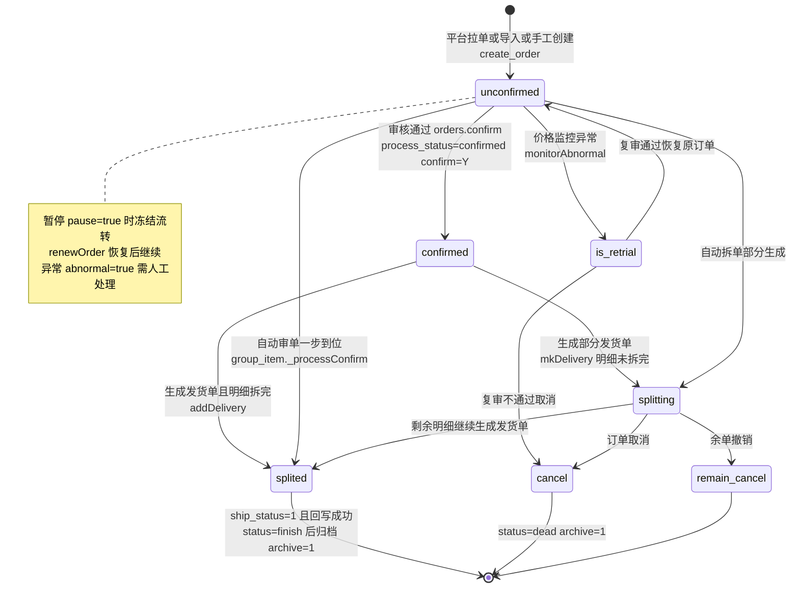
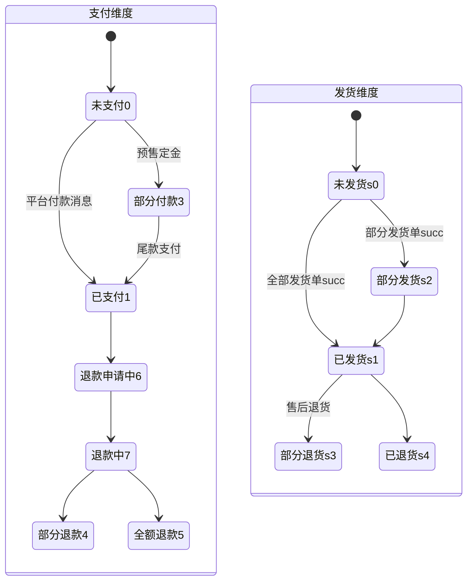
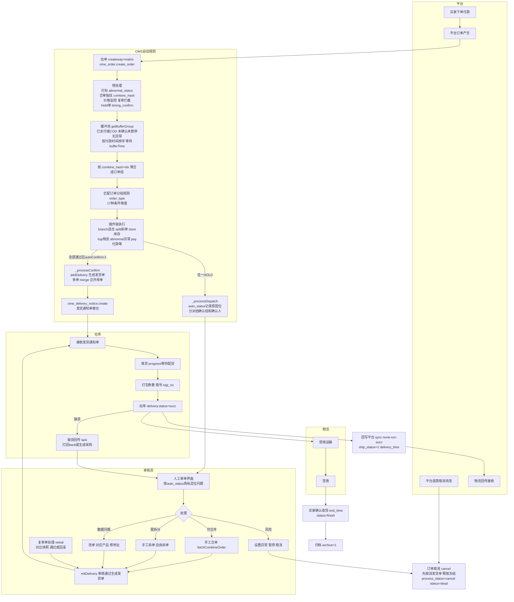

# A. 商派 ONEX OMS 订单全生命周期业务流程逆向分析

> 分析对象：ShopeX/OMS（商派 ONEX OMS），PHP 自研 MVC 框架（app/kernel/model/controller/dbschema 结构）。
> 代码基线：`_research/OMS-main`。本文所有方法名、状态枚举、表名均来自真实代码，标注了文件路径。
> 目的：为重写自研 OMS 提供业务模型参考，只借鉴流程与逻辑，不抄代码。

---

## 目录

1. [总体架构与模块划分](#1-总体架构与模块划分)
2. [订单状态机](#2-订单状态机)
3. [订单全生命周期主流程](#3-订单全生命周期主流程)
4. [拆单逻辑详解](#4-拆单逻辑详解)
5. [合单逻辑](#5-合单逻辑)
6. [自动审核规则引擎](#6-自动审核规则引擎)
7. [配货分仓与库存校验](#7-配货分仓与库存校验)
8. [异常处理：缺货、异常单、复审单、暂停单](#8-异常处理缺货异常单复审单暂停单)
9. [订单取消与归档](#9-订单取消与归档)
10. [关键数据表汇总](#10-关键数据表汇总)
11. [对重写自研 OMS 的启示](#11-对重写自研-oms-的启示)

---

## 1. 总体架构与模块划分

订单域代码分布在两个主要 app 中：

| App | 职责 | 关键目录 |
|---|---|---|
| `ome` | 订单主域：订单模型、发货单模型、异常、复审、缺货、平台单、导入导出 | `app/ome/model/`、`app/ome/lib/`、`app/ome/controller/admin/order/`、`app/ome/dbschema/` |
| `omeauto` | 自动规则引擎：自动审单、合单、拆单、分仓、分派、Hold 单 | `app/omeauto/lib/auto/`、`app/omeauto/lib/split/`、`app/omeauto/model/`、`app/omeauto/controller/` |

周边支撑模块（本文按需引用）：

- `material`：基础物料/销售物料与库存冻结（`material_basic_material_stock_freeze`）。
- `inventorydepth`：库存深度与平台库存回写（`inventorydepth_stock::storeNeedUpdateSku`）。
- `o2o` / `tbo2o` / `logisticsmanager`：门店仓、阿里全渠道、门店覆盖区域。
- `invoice`：发票。
- `wms` / `console_delivery` / `ome_delivery_notice`：推仓（发货通知单）与仓储对接。
- `taskmgr` / `base_queue`：异步任务队列（合单批处理、虚拟商品自动发货等）。
- `purchase`：缺货生成采购单。

核心设计特征（重写时值得注意）：

1. **订单三套状态并行**：`process_status`（确认/拆分流程）、`pay_status`（支付）、`ship_status`（发货），外加 `status`（active/dead/finish）总开关和一批布尔辅助位（`pause`、`abnormal`、`is_fail`、`confirm`、`is_delivery`、`is_not_combine`、`archive`）。
2. **规则引擎按"订单分组 → 审单规则 → 插件链"三层组织**：`sdb_omeauto_order_type`（订单分组条件）关联 `sdb_omeauto_autoconfirm`（审单配置），审核过程由 20 余个插件按固定顺序执行，插件用**位标记**（`auto_status`/`abnormal_status` 位运算）记录不通过原因。
3. **审单通过 = 生成发货单**：自动审核通过时直接调用 `delivery::addDelivery` 生成发货单并推仓，订单 `process_status` 变为 `splited`/`splitting`；不通过则**分派**给审核组/审核员人工处理，并把不通过原因写入 `auto_status` 位。
4. **拆单不产生新订单记录，而是产生多张发货单**：`orders.splited_num` 记录拆单次数，`order_items.split_num` 记录每行已拆数量；"部分拆分（splitting）/已拆分完（splited）"表达拆分进度。
5. **合单通过预计算的 `order_combine_hash` + `order_combine_idx` 分组**：拉单时即算好合并指纹，审单时按指纹聚合成"订单组"一起处理，多张发货单再 `merge` 成一张母发货单（`is_bind='true'` + `parent_id`）。

---

## 2. 订单状态机

### 2.1 四套状态字段（来自 `app/ome/dbschema/orders.php`）

#### 2.1.1 `process_status` 确认/流程状态

```php
'unconfirmed'   => '未确认',
'confirmed'     => '已确认',
'splitting'     => '部分拆分',
'splited'       => '已拆分完',
'cancel'        => '取消',
'remain_cancel' => '余单撤销',
'is_retrial'    => '复审订单',
'is_declare'    => '跨境申报订单',
```

默认值 `unconfirmed`。语义上它同时承担"审核进度"和"拆单进度"两重含义：
- `unconfirmed → confirmed`：审核通过（`orders::confirm()`，`app/ome/model/orders.php:2562`）。
- `confirmed/unconfirmed → splitting → splited`：生成发货单过程。`orders::mkDelivery()`（orders.php:2587）比较发货单明细总数与订单明细总数：拆完置 `splited`，未拆完置 `splitting`，同时 `splited_num` 自增。
- `is_retrial`：进入复审（价格监控异常等，见第 8 章）。
- `remain_cancel`：余单撤销（部分商品退款后剩余部分撤销）。
- `cancel`：订单取消。

#### 2.1.2 `status` 订单总状态

```php
'active' => '活动订单',
'dead'   => '已作废',
'finish' => '已完成',
```

- `dead`：取消时与 `process_status='cancel'` 一起写入（orders.php:2872-2874），同时 `archive=1` 归档。
- `finish`：订单完成（如补发流程 `app/ome/lib/reship.php:278` 中 `ship_status=1` + `status=finish` 同时写入）。

#### 2.1.3 `pay_status` 付款状态

```php
0 => '未支付', 1 => '已支付', 2 => '处理中', 3 => '部分付款',
4 => '部分退款', 5 => '全额退款', 6 => '退款申请中', 7 => '退款中', 8 => '支付中',
```

审单引擎把 `pay_status in ('1','4')` 视为"已支付可审核"（`omeauto_auto_combine::$_PAY_STATUS`）；`3`（部分付款）仅当预售场景（`step_trade_status='FRONT_PAID_FINAL_NOPAID'`，定金已付尾款未付）时放行。

#### 2.1.4 `ship_status` 发货状态

```php
0 => '未发货', 1 => '已发货', 2 => '部分发货', 3 => '部分退货', 4 => '已退货',
```

由发货单流转驱动：发货单 `status='succ'`（已发货）后回写订单 `ship_status`，并写 `delivery_time`（orders 表有 `delivery_time` 发货时间、`end_time` 买家确认收货时间字段）。

#### 2.1.5 其他重要状态位（同表）

| 字段 | 取值 | 含义 |
|---|---|---|
| `confirm` | Y/N | 订单确认标记（与 process_status 冗余，confirm() 同时写两者） |
| `pause` | true/false | 订单暂停（挂起，暂停期间不进自动审单缓冲池） |
| `abnormal` | true/false | 异常处理状态（有未完结异常记录） |
| `is_fail` | true/false | 失败订单（拉单失败/无效单，不参与流程） |
| `is_delivery` | Y/N | 是否可以发货（N 表示平台侧不允许发货，如 HOLD 单） |
| `is_not_combine` | 0/>0 | 是否允许 OMS 审核，大于 0 不允许（平台侧禁止） |
| `archive` | 0/1 | 归档状态（取消即归档；完成单由归档任务处理） |
| `auto_status` | bigint 位图 | 自动审单不通过原因位标记（见 6.4） |
| `abnormal_status` | bigint 位图 | 预处理异常位标记（如 `ome_preprocess_const::__HASGIFT_CODE` 淘宝赠品） |
| `sync` | none/run/fail/succ | 发货信息回写平台状态 |
| `sync_fail_type` | none/shipped/unbind/params/logistics | 回写失败类型：前端已发货/店铺未绑定/参数错误/物流错误 |
| `splited_num` | number | 拆单次数 |
| `timing_confirm` | time | 定时审单时间（预售/hold 单到点才进审单池） |
| `order_combine_hash` / `order_combine_idx` | char(32)/bigint | 合单指纹与分组索引（拉单时预计算） |
| `order_type` | normal/sale/presale/vopczc/platform/offline/gift/integral/exchange/brush/jitxsc/zerobuy/bufa/jisuxianhuo/pinpaizhifa | 订单类型 |
| `createway` | matrix/local/import/after/yjdf | 订单生成方式：平台获取/手工新建/批量导入/售后自建/云交易售后自建 |

#### 2.1.6 发货单状态（`app/ome/dbschema/delivery.php:327`）

```php
'succ'        => '已发货',
'failed'      => '发货失败',
'cancel'      => '已取消',
'progress'    => '等待配货',
'timeout'     => '超时',
'ready'       => '待处理',
'stop'        => '暂停',
'back'        => '打回',
'return_back' => '退回',
```

默认 `ready`。另有 `sync_status`（推仓同步状态，'2' 表示失败并写 `sync_msg`）、`is_bind`（是否合并母单）、`parent_id`（子单指向母单）、`pause`（发货单暂停）。

### 2.2 主状态流转图（Mermaid stateDiagram）



三套状态的并行关系（同一订单同时持有三个维度的状态）：



> 说明：货到付款（`is_cod='true'`）订单在 `pay_status=0` 时即可进入审单（缓冲池过滤条件显式放行 `(is_cod='true' and pay_status='0')`，`combine.php:617-619`）。

---

## 3. 订单全生命周期主流程

### 3.1 阶段一：平台拉单 / 导入 / 手工创建

**触发条件**：
- 平台拉单：`createway='matrix'`，由渠道对接模块（channel/erpapi/qimen 等）轮询或推送平台订单；
- 批量导入：`createway='import'`，`orders::prepared_import_csv / finish_import_csv`（orders.php:3396/3405）解析 CSV 模板（`io_title` 定义列：订单号/支付方式/下单时间/付款时间/配送方式/来源店铺/收货人等）；
- 手工新建：`createway='local'`，订单号由 `orders::gen_id('local')` 生成，规则为 `前缀 + date('YmdH') + '10' + 6位随机序号`，前缀 L=本地单、C=换货、B=补发（orders.php:2527-2552）；
- 售后自建：`createway='after'/'yjdf'`（补发单 `order_type='bufa'`、换货单 `order_type='exchange'`）。

**关键方法**：`ome_mdl_orders::create_order(&$sdf, &$msg)`（orders.php:2705）。创建主流程：

1. 触发服务扩展点 `ome.service.order.create.before`，各实现的 `before_create($sdf)` 可对数据做转换/合并（如平台定制字段）；
2. 调 `kernel::single('ome_order')->create_order($sdf, $msg)`（`app/ome/lib/order.php`）完成订单主体落库：写 `orders`、`order_objects`（对象层：商品/组合商品 pkg/多选一 pko/赠品）、`order_items`（明细行）、`order_extend`（扩展：cpup_service 物流升级、promise_service 等）、`order_pmt`（优惠）等；
3. `brush` 特殊订单、`bufa` 补发订单直接返回，不走后续；
4. **价格复审监控**：`ome_order_retrial::checkMonitorAbnormal($sdf)`（`app/ome/lib/order/retrial.php:34`）→ 命中则 `monitorAbnormal()` 直接把订单置为 `process_status='is_retrial'`、`abnormal='true'`、`pause='true'`，并插入复审单；
5. 保存发票信息（`ome_order_invoice::insertInvoice`，invoice app 已安装时）；
6. **订单预处理打标**：`ome_preprocess_label::process()` 计算 `abnormal_status` 位（如淘宝优惠赠品 `__HASGIFT_CODE`）；
7. **Hold 单**：`omeauto_auto_hold::process($order_id)` 按 hold 规则（`sdb_omeauto_autohold`，group_type='hold'，配置 hold 时长 hours）设置 `timing_confirm` 延迟审单；
8. 预约信息：`ome_order_reservation::createReservation`。

**涉及表**：`orders`、`order_objects`、`order_items`、`order_extend`、`order_pmt`、`order_receiver`、`bill_label`（订单标签）、`misc_task`（定时任务）。

拉单同时会预计算**合单指纹** `order_combine_hash`（收货人+手机+地区+地址等的 md5，见 `combine.php:741` `$consignee['hash'] = md5(join('-', $consignee))` 同源逻辑）与 `order_combine_idx`（同店同用户序号），供后续自动合单分组。

### 3.2 阶段二：自动审单入口（缓冲池 → 订单组）

**定时任务入口**：`ome_autotask_timer_sysordertaking::process`（`app/ome/lib/autotask/timer/sysordertaking.php`）：

1. 配置开关：`ome.order.is_auto_ordertaking`（自动获取订单）与 `ome.order.is_auto_combine`；
2. 用 cachecore 互斥锁 `ome_autotask_sysordertaking` 防并发；
3. 调 `omeauto_auto_combine::getBufferGroup()`（combine.php:502）从**缓冲池**捞单。

**缓冲池过滤条件**（`_getBufferFilter()`，combine.php:614-621）——这是"什么样的订单会进自动审单"的权威定义：

```php
'(op_id IS NULL AND group_id IS NULL          // 尚未分派给任何人/组
  AND ((is_cod=\'true\' and pay_status=\'0\')  // 货到付款未支付可审
       or pay_status in (\'1\')))'             // 或已支付
// 预售开启时额外放行 pay_status='3' AND step_trade_status='FRONT_PAID_FINAL_NOPAID'
'status' => 'active',        // 活动订单
'ship_status' => '0',        // 未发货
'confirm' => 'N',            // 未确认
'abnormal' => 'false',       // 无异常
'is_auto' => 'false',        // 未被标记自动处理完
'is_fail' => 'false',        // 非失败单
'pause' => 'false',          // 未暂停
'is_not_combine' => 0,       // 平台允许 OMS 审核
'order_type|in' => 普通订单类型集,
'timing_confirm|sthan' => time(),  // 定时审单时间已到
```

4. 按 `paytime ASC` 取前 5000 单，按 `order_combine_hash||order_combine_idx` 聚合成订单组（未开启自动合单时每组追加 `||order_id` 强制独立成组，combine.php:536-543）；
5. `_restrictCombineLimit()`：若配置了合并条数上限 `ome.combine.merge.limit`，超限的组被切分成多页分组；
6. `vaildBufferGroup()`（group/item.php:633）：组内必须至少有一单**付款时间（COD 用下单时间）早于缓冲时间** `time() - bufferTime*60`（配置 `bufferTime`，给合单留等待窗口），否则本轮跳过——这是"等一等看有没有可合并订单"的机制；
7. 每组 5 单一批写入 `batch_log`（log_type='ordertaking'），推 MQ（TG_COMBINE_QUEUE）或 taskmgr 异步执行；消费端执行 `omeauto_auto_combine::process($group)`。

**手工入口**：`app/ome/controller/admin/order/auto.php`（订单→自动审核页面，同样调 `getBufferGroup($filter)` 支持按店铺/订单类型/下单时间过滤）；人工审单在 `app/ome/controller/admin/order.php` 的审单界面（可勾选合并订单、指定仓库物流后调 `omeauto_auto_combine::mkDelivery`）。

### 3.3 阶段三：审单规则引擎执行（合单检查 + 插件链）

`omeauto_auto_combine::process($group)`（combine.php:86）：

1. `_instanceItemObject()`：把订单组装成 `omeauto_auto_group_item` 对象树——orders → objects（`is_sh_ship='false'` 过滤售后换货对象；预售 hold 时过滤 `estimate_con_time` 未到期对象并重写 `timing_confirm` + `misc_task`）→ items（`delete='false'` 且 `split_num < nums` 即还有未拆数量）；同时挂载 `order_extend`（cpup_service）、`bill_label`（订单标签）。无明细的订单被剔除。
   - 订单入选条件（combine.php:269）：`pay_status='1'` 或 COD 或 京东先用后付标签 或预售定金已付，且 `status` 非 finish/dead、`order_type` 属普通类型、`is_fail='false'`。
2. `_getAutoOrderFilter()`：加载所有启用的**订单分组规则**（SQL：`sdb_omeauto_order_type LEFT JOIN sdb_omeauto_autoconfirm`，按 weight DESC 排序），并处理规则的生效时间段 `confirmStartTime/confirmEndTime` 与排除时间段 `excludeStartTime/excludeEndTime`；末尾追加一个**缺省分组**兜底。虚拟商品拆单规则（split_type='virtualsku'）被强制提到最前。
3. 每个订单组匹配第一个 `vaild()` 通过的分组规则（分组条件维度见 `omeauto_auto_type::$TYPE_LIST`：address 地址、shop 店铺、money 金额、platform 平台、sku、cod 货到付款、skunum 商品种类数、itemnum 明细数、weight 重量、memo 备注、ordertype 订单类型、materialtype 物料类型、orderhost 达人、shopmode 店铺模式、customer 客户、orderlabel 订单标签、materialcat 物料分类，共 17 种）。
4. `omeauto_auto_group::process()`（group.php:162）对该分组下所有订单组依次执行**插件链**（顺序见 group.php:277-316）：

```
branch(选仓) → routernum(路由次数) → split(拆单) → checksplitgift(仅赠品检查)
→ store(库存校验) → logi(选物流) → reclogi(推荐物流/停运) → refundstatus(退款状态)
→ abnormal(数据异常) → pay(未付款) → arrived(物流到不到)
入口为 ordertaking/combine 时追加：
flag(备注留言) → oversold(超卖) → tbgift(淘宝赠品) → crm(CRM赠品) → tax(发票)
→ member(用户多地址) → ordermulti(多单可合) → shopcombine(同店可合并)
```

每个插件不通过时调用 `$group->setOrderStatus($order_id, 位标记)` 和 `$group->setStatus(__OPT_HOLD, 插件名, 原因)`。

5. 所有插件跑完后 `group_item::process($confirmRoles)`（group/item.php:704）分流：
   - **`vaild($config)` 通过**（状态为 `__OPT_ALLOW` 且审单配置 `autoConfirm='1'` 自动生成发货单）→ `_processConfirm()`：生成发货单（见 3.4）；
   - **不通过** → `_processDispatch()`：自动**分派**给人工审核（见 3.5）。

### 3.4 阶段四：审核通过 → 生成发货单 → 推仓

`group_item::_processConfirm()`（item.php:902）：

1. `fetchDeliveryFormat()`：把订单组内每个订单的 objects/items 摊平成发货单结构（branch_id、logi_id、consignee 收货人、delivery_items 按 product_id 聚合数量、order_items 明细映射、delivery_group 打印分组、sms_group 短信分组、wms_channel_id）。
2. 对每个订单调 `ome_mdl_delivery::addDelivery($order_id, $deliveryInfo, array(), $order_items, $split_status)`（delivery.php:2066）：
   - 生成 `delivery_bn`（`delivery::gen_id()`）、写 `delivery`、`delivery_items`、`delivery_items_detail`、`delivery_order`（发货单-订单关联，支持合并后一单多订单）；
   - 计算重量运费（`getDeliveryFreight(area_id, logi_id, weight)`）与保价费；
   - 库存操作：发货单占用（冻结转实扣由 WMS/出库环节处理）；
   - 返回 `split_status`：明细未拆完为 `splitting`。
3. 更新订单（item.php:952-974）：

```php
'process_status' => $split_status ?: 'splited',
'confirm' => 'Y', 'dispatch_time' => time(),
'op_id'/'group_id' => 系统用户（ome_func::get_system，group_id=16777215）
                     或自动分派规则命中的组/人,
'splited_num_upset_sql' => 'IF(splited_num IS NULL,1,splited_num+1)',
'auto_status' => '0',   // 清空不通过位标记
'logi_no' => 菜鸟智选物流返回的运单号（如有）,
```

4. 写操作日志 `order_confirm@ome`：`订单确认/部分确认,操作员:xx,审单规则:名称(ID),仓库规则:名称(ID)(发货单号:链接)`。
5. **合并发货单**：若本次生成多张发货单且允许合并（非当当/亚马逊物流、开启自动合单、仓库 `ome_branch::isCanMerge`、非分销一件代发）→ `delivery::merge($ids, ...)`（delivery.php:771）生成母发货单（`is_bind='true'`，子单挂 `parent_id`），并给母单和各订单打标签 `SOMS_COMBINE_ORDER`（`ome_bill_label::markBillLabel`）。
6. **推仓**：`ome_delivery_notice::create($delivery_id)` 把发货通知单推送 WMS（自有仓/第三方仓/门店仓）。前置 service 扩展点 `omeauto.service.group.item.confirm.after::afterCreateDelivery` 可返回 `forbid_notice_wms_create` 禁止推仓（此时写 `delivery.sync_status='2'` + `sync_msg`）。
7. **全链路消息**：`ome_event_trigger_shop_order::order_message_produce([$orderId], ['check','to_wms'])` 发出"审单完成/通知配货"事件。
8. 虚拟商品拆单（virtualsku）命中时 `setAutoDelivery`，向 `base_queue` 写 `ome_order.auto_delivery` 任务，自动完成发货（item.php:742-773）。

**涉及表**：`delivery`、`delivery_items`、`delivery_items_detail`、`delivery_order`、`orders`（状态回写）、`order_items`（`split_num`/`sendnum` 累加）、`bill_label`、`operation_log`、`delivery_sync`。

### 3.5 阶段五：审核不通过 → 自动分派人工审核

`group_item::_processDispatch()`（item.php:1140）：

1. 先 `updateOrderInfo($this->original_orders)` 把拆单插件改过的明细**还原**（分派给人工时按原始订单展示）；
2. `omeauto_auto_dispatch::getAutoDispatchUser($group)`（`lib/auto/dispatch.php:88`）：遍历**分派规则**（SQL：`sdb_omeauto_order_type LEFT JOIN sdb_omeauto_autodispatch ON ot.did=bt.oid`，weight DESC），第一个 `vaild()` 命中的规则返回 `op_id/group_id`；无命中则用 `defaulted='true'` 的缺省分派；
3. 仅对 `pay_status in (1,4,5)` 或 COD 或京东先用后付的订单执行分派，写入：

```php
'op_id' => 分派确认人, 'group_id' => 分派确认组,
'dispatch_time' => time(),
'confirm' => 'N'（未拆）或 'Y'（已有拆分明细 split_num>0 时 process_status='splitting'）,
'process_status' => 'unconfirmed' 或 'splitting',
'auto_status' => $this->orderStatus[$order_id],  // 插件不通过原因位图
```

4. 更新条件带 `process_status|noequal => 'splited'` 防并发覆盖已拆完订单；
5. 写日志 `order_dispatch@ome`：`订单自动审单未通过,审单规则:xx,仓库规则:xx,详情见[status log JSON]…自动分派给确认组:xx,确认人:xx`；
6. `ome_order_branch::preSelect($order_id)` 预选仓库（后台任务 `preselectbranch` 也会批量跑），为人工审单界面准备"建议仓库+各仓库存"数据（`orders::getItemBranchStore`，orders.php:2364）。

人工审核界面（`app/ome/controller/admin/order.php`）按 `auto_status` 位图渲染提示角标（`omeauto_auto_combine::fetchAlertMsg`，combine.php:630）：款/备注/物/货/仓/库/异/批/超/赠/C/票/路/到/拆/仅/停/退/疑 等单字旗标+颜色。审核员可：
- 单选/多选订单**手工合单**（`fetchCombineOrder` 列出可合并订单，combine.php:889）；
- 指定仓库/物流后**手工审核**生成发货单（走 `omeauto_auto_combine::mkDelivery`，combine.php:1138，内含全部合单/拆单校验）；
- 手工拆单（`app/ome/lib/order/split.php`，自由拆单 `split_model=2`）；
- 设置异常/暂停/取消。

### 3.6 阶段六：仓库作业与发货

1. **推仓后**：WMS 侧拣货、打包、出库；`delivery.status` 流转 `ready → progress（等待配货）→ succ（已发货）`；第三方仓回传出库消息更新 `delivery`（物流单号 `logi_no`、物流公司 `logi_id`、包裹 `delivery_package`、序列号 `delivery_items_serial`）。
2. **发货确认**：发货单 `succ` 时（`delivery.php:2189` 补差价单直接 `status='succ'` + `delivery_time=time()` 的特例可见字段写法）回写订单：`ship_status`（全部明细发完=1 已发货，部分=2 部分发货）、`delivery_time`、`orders.logi_no/logi_id`；`order_items.sendnum` 累加。
3. **自发货/无仓**：`self_delivery='true'` 的店铺订单可在 OMS 内直接发货（打印快递单 `print_finish`/`print_status`，`delivery::updateOrderPrintFinish`）。
4. **打回/退回**：仓库可将发货单 `back`（打回，回到审单）或 `return_back`（退回）；`delivery::rebackDelivery`（delivery.php:1354）+ `orders::rebackDeliveryByOrderId`（orders.php:1669）把订单恢复为可再审状态（`confirm='N'`、`process_status` 回退、释放发货单占用）。

### 3.7 阶段七：物流回传平台与完成归档

1. **回写平台**：发货后按 `sync` 状态机（none→run→succ/fail）调用平台 API 回传物流单号（`app/ome/controller/admin/consign.php` 有"回写未发起"列表：`createway='matrix', sync='none', ship_status='1'`）；失败写 `sync_fail_type`（shipped 前端已发货/unbind 店铺未绑定/params 参数错误/logistics 物流错误），orders.`up_time` 记录回传时间。
2. **买家确认收货**：平台消息回写 `end_time`（买家确认收货时间）。
3. **完成**：订单 `status='finish'`（如 reship.php:278-279 补发完成时 `ship_status=1,status=finish`）；财务侧对 COD/先用后付订单在 `pay_status=1 && ship_status=1` 时触发结算（`controller/admin/finance.php:363`）。
4. **归档**：`archive=1`（取消单在 cancel() 中即时归档；历史完成单由归档任务迁移，dbschema 有 `ind_archive` 索引）。归档后订单查询走历史库。

### 3.8 全生命周期泳道图（Mermaid flowchart）



---

## 4. 拆单逻辑详解

### 4.1 拆单在流程中的位置

拆单发生在**审单插件链的第 3 位**（`split`，在选仓之后、库存校验之前），由 `omeauto_auto_plugin_split::process`（`app/omeauto/lib/auto/plugin/split.php`）驱动：

1. **指定仓优先**：订单对象带 `store_code`（平台指定仓）时 `branch` 插件返回 `sys_appoint`，split 插件直接走 `branchappoint` 策略按指定仓拆（split.php:63-88）；指定仓不存在（code=='no branch'）时 HOLD，提示"无法拆单"。
2. **跳过条件**（split.php:94-150）：
   - 唯一候选仓且该仓**不管控库存**（`ome_branch::getBranchCtrlStore===false`）→ `setConfirmBranch(true)` 跳过拆单；
   - **门店仓**不跑拆单（`$group->isStoreBranch()`）；
   - 未启用自由拆单配置（`ome_order_split::get_delivery_seting()` 为空 → split_model=0）；
   - **货到付款**订单不拆；**门店自提**（shipping=='STORE_SELF_FETCH'）不拆；**猫超**订单（taobao+maochao）不拆；**震坤行**（zkh）不拆。
3. **规则来源**：审单配置 `confirmRoles['split_id']` → 查 `sdb_omeauto_order_split`（dbschema `order_split.php`：sid/name/describe/split_type/split_config(serialize)/createtime）得到 `split_type` 与 `split_config`；`split_config['confirm_source']` 记录手工/自动审单来源。
4. **路由分发**：`kernel::single('omeauto_split_router', $splitType)->splitOrder($group, $splitConfig)`（`lib/split/router.php`）按 `omeauto_split_{type}` 类名动态实例化策略；拆单失败 → 全组订单打 `_SPLIT_CODE` 位标记并 HOLD（提示旗标"拆"）。
5. 策略内部通过 `$group->setSplitOrderId()` 记录被拆订单、`updateOrderInfo($splitOrder)` 把**拆分后的一份明细**塞回订单组，本次审单只为这份明细生成发货单；`_splitDeliveryOne`（combine.php:1471）在手工审核路径上**递归**执行"拆一份→生成一张发货单→扣减 split_num→剩余继续"，直到明细耗尽。

拆单结果落库：每张发货单对应一次拆分；`order_items.split_num` 累加已拆数量；`orders.splited_num` 自增；明细拆完 `process_status='splited'`，否则 `'splitting'`。

### 4.2 全部拆单策略维度（`app/omeauto/lib/split/` 16 个文件）

后台可配置的类型注册于 `omeauto_mdl_order_split::$split_type`（`app/omeauto/model/order/split.php:19-32`）：

| # | split_type | 中文名（代码原文） | 触发场景一句话 | 备注 |
|---|---|---|---|---|
| 1 | `storemax` | 按库存就全拆 | 多仓候选时按各仓可用库存把明细尽可能拆到能发货的仓，一次拆到"库存满足的最大集合" | 708 行最复杂；支持第二层 `split_type_2`、第三层 `split_type_3` 级联拆分（三层不能同类型）；拆完 `setConfirmBranch(true)` 免二次库存校验 |
| 2 | `sku` | 单商品拆 | 一单一件式拆法：每次拆出一个商品行（可配 `split_goods=1` 任意商品 / `=2` 指定物料编码列表 `split_goods_product`；`split_goods_num` 指定每次拆的数量或 'all' 整行） | 支持批量审核拆单（batchConfirmSplitType） |
| 3 | `skuweight` | 按商品重量拆 | 单包重量超限（如快递重量上限）时按累计重量把明细分成多包 | split_config 配重量阈值 |
| 4 | `skuvolume` | 按商品体积拆 | 单包体积超限时按累计体积分包 | 同上，体积阈值 |
| 5 | `skucategory` | 按商品品类拆 | 不同品类（如食品与化工）不能同包时按物料分类分组拆单 | getSpecial 返回下层子拆单类型（storemax/sku/skucategory/skuweight/skuvolume）供级联 |
| 6 | `branchgroup` | 按仓库分组拆 | 明细已按仓库规则分到不同仓库分组时，按仓库分组各出一张发货单 | 与 `_processBranchGroupConfirm`（item.php:842）配合：按 `branch_product` 分配数量逐仓生成 |
| 7 | `branchappoint` | 按指定仓库拆 | 平台/翱象下发 `store_code` 指定仓（`biz_sd_type=2` 用第一个指定仓，`=1` 走 OMS 自选）时按指定仓拆 | 审单插件里 `sys_appoint` 分支专用 |
| 8 | `virtualsku` | 按虚拟商品拆，虚拟商品自动发货 | 订单含虚拟商品（充值卡/电子券）时把虚拟行拆出，独立发货单生成后经队列 `ome_order.auto_delivery` 自动完成发货 | 规则存在时被 `_getAutoOrderFilter` 强制置顶 |
| 9 | `oid` | 按京东子订单拆 | 京东平台一单多子单（oid）场景，按平台子订单号拆开各自发货 | 支持批量审核拆单；配合平台拆单表 `order_platformsplit` |
| 10 | `orderhost` | 按达人信息拆 | 抖音等直播电商订单按达人（orderhost）归属拆单结算 | 分组条件也有 orderhost 维度 |
| 11 | `customerclassify` | 按客户分类拆 | B2B/分销场景按客户分类（class_id）不同履约策略拆单 | preSaveSdf 强校验必选客户分类 |
| 12 | `skuchannel` | 按京东开普勒商品关联渠道ID拆 | 京东开普勒（VOP）商品按渠道 ID 拆单并自动发货 | 已在注册表中注释停用，代码保留（404 行） |
| 13 | `skustorecode` | 按订单SKU上指定仓拆 | 订单多个 SKU 带多个不同指定仓时按仓拆 | 代码注释自述"没有地方调用此Lib类"，属预留 |
| 14 | `goodstype` | 商品类型数量拆 | 按商品类型（goods_type 表）分组拆单 | 注册表中已注释停用，代码保留 |
| 15 | `router` | 出入口路由类 | 非策略：`omeauto_split_router` 按类型名分发到具体策略，提供 getSpecial/preSaveSdf/splitOrder/splitOrderFromSplit 四接口 | 架构件 |
| 16 | `abstract` | 拆单规则抽象类 | 非策略：定义策略必须实现的四个抽象方法 | 架构件 |

**可参与批量审核自动拆单的类型**（`$batchConfirmSplitType`）：storemax、sku、skuweight、skucategory、skuvolume、oid。

**级联拆分**：storemax/skucategory 的 `split_config` 支持 `split_type_2`、`split_type_3`，先按第一层拆，再对结果调 `splitOrderFromSplit` 逐层细拆（storemax.php:95-106），实现"先按仓、再按重量、再按品类"之类的组合策略。

### 4.3 平台拆单（京东子单）

`app/ome/controller/admin/order/platformsplit.php`（京东平台拆）：
- `do_confirm($order_id)`：读取 `order_objects` 与 `order_platformsplit`（obj_id → split_oid 映射），要求每个对象都有平台 `oid`；**有赠品或新增商品（oid 为空）不能拆子单**；`is_modify='true'`（改过商品）的订单不能拆。
- 对象类型显示：pkg=组合商品、pko=多选一商品、其余普通。
- 数据表：`sdb_ome_order_platformsplit`（order_id/obj_id/split_oid/obj_type）。

### 4.4 发货单层面的再拆合

- `delivery::splitDelivery($parent_id, $items)`（delivery.php:694）：已生成的母发货单可再按明细拆出子发货单；
- `delivery::merge($dly_ids, $delivery)`（delivery.php:771）：多张发货单合并为母单（`is_bind='true'`，子单 `parent_id` 指向母单，母单聚合 items/orders/detail，见 `insertParentItemByItems`/`insertParentOrderByItems`）。

---

## 5. 合单逻辑

### 5.1 自动合单（审单引擎内）

**开关与参数**（`app/ome` 配置项，代码见 combine.php）：

| 配置 | 含义 |
|---|---|
| `ome.combine.select` | ='1' 不自动合单（此时订单组按 order_id 强制独立，插件链去掉 member/ordermulti/ordersingle/shopcombine） |
| `ome.combine.merge.limit` | 合并订单条数上限，超限分组被切页（`_restrictCombineLimit`） |
| `ome.combine.member_id` | ='0' 时跨店可合（不要求同店铺） |
| `ome.combine.shop_id` | ='0' 时可跨店铺合并 |
| `ome.combine.memberidconf` | 无用户订单的过渡判定：1 按地址判同组，0 只取本单 |
| `ome.combine.addressconf` | 地址一致判定维度：ship_address=1 不比地址、mobile=1 不比手机（默认两者都比） |
| `bufferTime`（omeauto_config_setting） | 合单缓冲窗口（分钟）：付款后等 N 分钟，让同买家后续订单赶上同一班车 |

**合并指纹**：拉单时写入 `order_combine_hash`（收货人姓名+手机+地区+地址等拼接 md5）与 `order_combine_idx`；缓冲池捞单后按 `hash||idx` 分组（combine.php:536），同组订单一起进审单，通过后各自生成发货单再 `merge` 成一张母发货单，打标签 `SOMS_COMBINE_ORDER`。

**合并前提（同组必须一致）**：同 `is_cod`、同 `member_id`（开启时）、同 `shop_id`（开启时）、收货信息一致（hash 相同）、均处 `status='active'`、`process_status in (unconfirmed,confirmed,splitting)`、`ship_status in (0,2,3)`、`is_not_combine=0`、`order_bn != '0'`。

**按平台/业务排除合并**（`fetchCombineOrder`，combine.php:916-1030，直接引用代码注释）：

- `shopex_b2b` 分销单：无视跨店参数，按内置规则（有用户按 member_id+shop_id，无用户按地址或仅本单）；
- `dangdang` 且货到付款：不合并；
- `amazon` 且 `self_delivery='false'`（平台代发）：不合并；
- `aikucun` 爱库存：不可合并（mkDelivery 中 `aikucun/yangsc` 同样拒绝）;
- `taobao` + `order_source='tbdx'` 淘宝代销：走 B2B 逻辑；
- `taobao` 菜鸟服务单（isCnService）或猫超（maochao）、`order_type='vopczc'` 唯品会仓中仓：只取本单；
- `vop`：必须同 `order_combine_hash`；
- `360buy` 带集运标签 `SOMS_GNJY`：集运不能和非集运合单（限定同 hash）；
- `jd` 厂直/工小达标签（`isSomsGxd`）：未接合单，只取本单；
- 得物品牌直发（dewu + isDWBrand）：不能合单也不能拆单（mkDelivery 校验，combine.php:1211-1219）；
- `process_status='splitting'` 且 `ship_status='3'`（部分拆分+部分退货）：不允许合单；
- `betc_id && cos_id`（分销一件代发）：不允许合单；
- 手工合单开关 Off（`is_manual_merge`，系统设置→订单规则→支持手工合单）：人工界面不列可合并单；
- `360buy`/`pinduoduo` 矩阵单：京东/拼多多订单线上线下不能合并（跨 shop 或跨 createway 拒绝，combine.php:1190）；
- 物流类型为 `DANGDANG`/`AMAZON` 的发货单不合并；仓库 `ome_branch::isCanMerge=false` 不合并。

**shopcombine 插件**（`lib/auto/plugin/shopcombine.php`）：审单时对"疑可合并"的组做拦截——调 `getCombineShopMemberCount($data)` 用（收货人/手机/地区/地址/COD/店铺类型/店铺/会员 [+CPUP 物流升级服务与门店编码]）条件计数，若库中可合并订单数 > 当前组内订单数，说明还有落单的同买家订单未到齐，则 HOLD 等待（旗标"疑"，`疑与其它订单可合并`），下轮缓冲池再一起处理。系统自动审单（`is_sys_auto_combine`）与达到合并条数上限的组直接放行。

**pay 插件**：组内存在未付款订单（同买家）时 HOLD（旗标"款"，`有可合并的未支付订单`），避免已付单先发、未付单后到导致拆成两包。

### 5.2 手工合单

人工审单界面调 `fetchCombineOrder($order)` 列出候选（按上述同样规则过滤，另加 `ship_status in (0,2)` 的同用户订单，combine.php:1059），勾选后与当前单一起 `mkDelivery($orderIds, $consignee, $corpId, ...)`：校验收货信息密文（`ome_security_router::is_encrypt`，平台加密单必须走原密文）、地址非空、支付状态、平台状态（`source_status='TRADE_CLOSED'` 拒绝）、抖音风控（`WAIT_SELLER_SEND_GOODS` 未进入备货中拒绝）、HOLD 单（`is_delivery='N'` "订单审核中，暂不能发货"）、行级退款（object `pay_status='5'` 已退款不能审核）等，全部通过后逐单 addDelivery 再 merge。

---

## 6. 自动审核规则引擎

### 6.1 三层配置模型

```
sdb_omeauto_order_type（订单分组：条件 + 权重 + 用途）
   ├─ oid → sdb_omeauto_autoconfirm（审单规则：config 序列化）   group_type=order/confirm
   ├─ tid → sdb_omeauto_autobranch（仓库规则：bid 候选仓、is_default） group_type=branch
   ├─ did → sdb_omeauto_autodispatch（分派规则：op_id/group_id/defaulted）
   ├─ tid → sdb_omeauto_autohold（hold规则：hold 开关、hours 时长）   group_type=hold
   └─ delivery_group='true' → 发货单打印分组；group_type='sms' → 短信分组
```

- 分组条件（`config` 字段，JSON 数组）由 17 种类型插件构成（`omeauto_auto_type::$TYPE_LIST`）：address（收货地区）、shop（店铺）、money（金额区间）、platform（平台/店铺类型）、sku（含指定商品）、cod（货到付款）、skunum（SKU 种类数）、itemnum（明细件数）、weight（重量）、memo（有无备注留言）、ordertype（订单类型）、materialtype（物料类型）、orderhost（达人）、shopmode（店铺模式）、customer（客户/会员）、orderlabel（订单标签）、materialcat（物料分类）。
- 匹配顺序：`ORDER BY weight DESC, tid ASC`，首个 `vaild()` 全条件命中的分组生效；都不命中走**缺省分组**（`setDefault()`，读 `autoconfirm.defaulted='true'` 的规则；完全无规则时 `autoConfirm='0'` 不自动生成发货单，全部转人工）。
- 审单规则支持**生效时间段**（confirmStartTime/confirmEndTime）与**排除时间段**（excludeStartTime/excludeEndTime），如大促期间停自动审单（combine.php:194-212、group.php:398-416）。

### 6.2 审单规则 config 字段（`getDefaultRoles`，group.php:366-377 缺省值可见全貌）

| 键 | 缺省 | 含义 |
|---|---|---|
| `autoOrders` | '-1' | 关联的订单分组 tid 集合（保存时反写 `order_type.oid`，autoconfirm.php do_add） |
| `autoConfirm` | '0' | 是否自动生成发货单（'1' 时插件全过才自动通过） |
| `payStatus` | '1' | 付款状态要求 |
| `autoCod` | '0' | 货到付款是否自动审核 |
| `memo`/`mark` | '1' | 有商家备注/客户留言时是否拦截转人工（flag 插件用） |
| `morder` | '1' | 多单处理策略 |
| `allDlyCrop` | '1' | 是否允许全部物流公司 |
| `corp_id` | - | 指定物流公司（编辑界面回显 dly_corp） |
| `split_id` | - | 关联拆单规则 sid（split 插件用） |
| `confirmStartTime/confirmEndTime/excludeStartTime/excludeEndTime` | - | 时间窗口 |
| `source` | - | 手工/自动审单标识（传入拆单配置） |

### 6.3 examine 插件（自动审核相关检查）说明

`lib/auto/plugin/examine.php`（类注释"增加单订单标识"，状态码 `__EXAMINE_CODE=0x800`，标题"批量订单"，提示"单个有备注的订单，可以批量审单"，旗标"批"）：设计上用于**批量审单场景**——检查组内订单备注/留言（`_getCheckField` 按配置取 `custom_mark`/`mark_text` 字段），配合 `omeauto_auto_group_mark::isConfirm` 判断备注是否含"已确认"标记；有未确认备注则 HOLD。**当前版本 process() 主体已被注释停用**，功能并入 flag（备注留言）插件与人工批量审单流程。重写时可将其理解为："备注拦截规则 + 批量审单白名单（备注暗号）"机制。

### 6.4 插件全集与位标记（`lib/auto/const.php` + 各插件 getTitle/getAlertMsg）

| 插件 | 位码 | 标题 | 提示（代码原文） | 旗标 |
|---|---|---|---|---|
| pay | 0x01 | 有未付订单 | 有可合并的未支付订单 | 款 |
| flag | 0x02 | 有备注订单 | 备注/留言需人工确认 | - |
| logi | 0x04 | 无匹配物流 | 无法自动匹配物流公司 | 物 |
| product | 0x08 | 有未匹配产品 | 订单有产品未和商品库对应，需进行手工对应 | 货 |
| member | 0x10 | 订单多地址 | 同用户多收货地址 | - |
| logikeyword | 0x20 | 物流关键字 | 该发货地址中存有关注的物流关键字（乡村物流） | 村 |
| ordersingle | 0x40 | 单个订单 | 单订单检查 | - |
| ordermulti | 0x80 | 可合并订单 | 多单检查 | - |
| branch | 0x100 | 无匹配仓库 | 无法对应仓库 | 仓 |
| store | 0x200 | 库存不足 | 库存不足（并触发 `ome_order_store::lackNotify` 缺货通知） | 库 |
| abnormal | 0x400 | 异常订单 | 数据有异常的订单，如异常、暂停、平台取消 | 异 |
| examine | 0x800 | 批量订单 | 单个有备注的订单，可以批量审单 | 批 |
| oversold | 0x1000 | 超卖订单 | 当前订单是有货品超卖 | 超 |
| tbgift | 0x2000 | 淘宝订单有赠品 | 当前淘宝订单有优惠赠品 | 赠 |
| shopcombine | 0x4000 | 可合并订单 | 疑与其它订单可合并 | 疑 |
| crm | 0x8000 | CRM赠品出错订单 | CRM赠品出错 | C |
| tax | 0x10000 | 订单需要开发票 | 订单需要开发票 | 票 |
| routernum | 0x20000 | 路由次数检查 | 路由次数超过限制（order_extend.addRouterNum 累计审单失败次数） | 路 |
| arrived | 0x40000 | 物流到不到 | 物流公司不到 | 到 |
| split | 0x80000 | 拆单检查 | 无法拆单 | 拆 |
| checksplitgift | 0x200000 | 仅赠品不生成发货单 | 仅赠品不生成发货单（快手等平台拆赠品） | 仅 |
| reclogi | 0x400000 | 物流停运 | 常用快递停运，请使用建议快递 | 停 |
| refundstatus | 0x800000 | 存在退款 | 存在退款明细 | 退 |

不通过原因以**位或**累加进 `orders.auto_status`（`setOrderStatus`），人工界面用 `fetchAlertMsg($status, $order)` 按位解码渲染角标；审核通过时清零（`'auto_status'=>'0'`）。

### 6.5 abnormal 插件的数据校验清单（plugin/abnormal.php:50-118）

自动审单前的"硬校验"，任一命中即 HOLD：
- `order_combine_hash/idx` 为空（数据不全，hash 未生成）；
- `pause='true'` 订单暂停；`abnormal='true'` 订单异常；
- `ship_addr` 为空（缺少地址）；
- `source_status='TRADE_CLOSED'`（平台已经取消）；
- `is_delivery='N'`（平台不允许发货）；
- 收货人信息为密文（`ome_security_router::is_encrypt`，补发单除外）；
- `pay_status='3'` 部分支付（非预售）；
- **双地址**：收货地址正则检出第二个省份名（防"广东省深圳市…浙江省杭州市…"式异常地址）；
- 抖音（luban）矩阵单 `source_status='WAIT_SELLER_SEND_GOODS'`（平台订单未进入备货中，风控期）。

### 6.6 分派与 Hold

- **分派规则**（autodispatch）：与审单同一套分组条件，命中后把订单 `group_id/op_id` 指到确认组/确认人（`getAutoDispatchUser`），有 `defaulted='true'` 缺省分派兜底；手动分派走 `orders::dispatch()`（orders.php:2988，写日志"订单分派给X组的Y"/"订单撤销分派"，触发 `ome_dispatch_after` 服务扩展点，支持 `_ALL_` 按 filter 批量）。
- **Hold 单**（autohold + `omeauto_auto_hold::process`）：按分组规则给订单设 `timing_confirm=now+hours`，到点前不进缓冲池（`timing_confirm|sthan => time()`）；预售单按对象 `estimate_con_time`（平台传的预计发货时间）自动 hold，并写 `misc_task`（obj_type='timing_confirm_order'）定时唤醒（combine.php:293-296、_rewriteMiscTask）。

---

## 7. 配货分仓与库存校验

### 7.1 选仓（branch 插件，plugin/branch.php:88-190）

优先级从高到低：

1. **平台指定仓**：任一对象带 `store_code` → 返回 `['sys_appoint']`，交由 branchappoint 拆单策略解析（`ome_branch_type::getBranchIdByStoreCode`）；翱象订单按 `biz_sd_type` 决定用建议仓还是 OMS 自选；
2. **淘宝流转单**（CNAUTO 位标记）：读店铺级配置 `shop.cnauto.set.{shop_id}` 直接定仓；
3. **全渠道/门店仓**（`omnichannel=1` 且 o2o app 启用）：
   - 订单带指定门店（order_extend.store_bn）→ `o2o_store::getBranchIdByStoreBn`，校验接单量上限与本订单已拒单门店；同时按 `store_dly_type` 设置履约方式（1=o2o_pickup 门店自提，2=o2o_ship 门店配送）；
   - 否则按收货地区 area_id 匹配：优先**门店优选规则**（`o2o_autostore::matchStoreBranch`，配置 `o2o.autostore.type`），备选**门店覆盖区域**（logisticsmanager_warehouse.region_ids）；结果按 area_id 缓存；阿里全渠道店铺（tbo2o）订单做门店归属过滤；只保留 `b_status=1` 营业中的门店仓；
4. **唯一发货仓**：`sdb_ome_branch` 中 `is_deliv_branch='true' AND disabled='false'` 只有一个 → 直接用；
5. **仓库规则**（autobranch）：`order_type(group_type='branch') LEFT JOIN autobranch` 按 `is_default DESC, weight DESC` 匹配，返回候选仓数组（bid=-1 特殊值表示"所有参与 O2O 的门店"，动态展开为门店仓列表并做覆盖区域/接单量/拒单过滤）；同时 `filterRefusedBranchIds` 剔除本订单已拒单的门店（"本订单已拒单的门店不可再分配"）；
6. 无命中 → HOLD，旗标"仓"（无法对应仓库）。

### 7.2 库存校验（store 插件，plugin/store.php）

- 汇总订单组全部明细 `{product_id: 总数量}`（`getGroupStore`）；
- **指定仓已确认**（`getConfirmBranch()`，storemax 拆单已按库存拆过）→ 直接取首个候选仓返回，跳过校验；
- **门店仓**（`checkStoreBranchStore`）：逐门店过滤（已拒单/接单量已满跳过）→ 不管控库存的门店直接合格 → 管控库存的查 `sdb_ome_branch_product.store`，减去**仓库级冻结** `material_basic_material_stock_freeze::getO2oBranchFreeze(bm_id, bid)`，逐商品比较需求量；合格门店集合里 `o2o_store::pickBranchByLowestDispatch` 选**当日派单量最低**的门店（负载均衡）；
- **电商仓**（`checkElectricBranchStore`）：候选仓可扩展绑定仓（`branch::getDelivBranch` 的 bind_conf，多仓库存合并计算）；查 `sdb_ome_branch_product`，减冻结 `getBranchFreeze(product_id, branch_id)`（取绝对值防负冻结）；`material_basic_material::getNotCtrlStoreProducts` 白名单内的物料跳过库存校验；多个合格仓时由 `omeauto_branch_choose::getSelectBid(tid, group)` 按仓库规则的优选策略（如轮询/就近）定仓；
- 全部不合格 → `setBranchId('')`、打 `__STORE_CODE` 位、HOLD 旗标"库"；`setOrderStatus` 对 STORE_CODE 特殊处理：同步调 `ome_order_store::lackNotify($order, $branch_id)` 产生**缺货通知**（item.php:485-491）。

### 7.3 冻结体系

- 订单创建/审核过程对库存做**预占冻结**（订单级 `__ORDER` + 共享库存 `__SHARE_STORE` 维度，`material_basic_material_stock_freeze`）；
- 审单重跑前先 `deleteOrderBranchFreeze(order_ids)` 清理旧仓级冻结（branch 插件入口处，combine.php:1395 同）；
- 取消订单 `orders::unfreez($order_id)`（orders.php:1958）：删除仓级冻结 → 对未生成发货单的剩余数量（`nums - getDeliveryFreez`）批量解冻 `unfreezeBatch`；
- 复审流程有独立冻结快照：`order_retrial_store_freeze` 表 + `record_stock_freeze/up_stock_freeze/recover_stock_freeze/confirm_stock_freeze`（model/order/retrial.php:1236-1621）；
- 相关表：`order_objects_freeze`（订单对象冻结，模型为空壳继承 dbeav_model）、`delivery_object_freeze`（发货单对象冻结）、`freeze_stock_log`（冻结流水）、`branch_freeze_queue`/`material_freeze_queue`（冻结队列）、`product_stock_artificial_freeze`（人工冻结）。

### 7.4 物流选择（logi / reclogi / arrived / logikeyword 插件）

- `logi`：按仓库-物流绑定、地区可达、重量段费用自动选物流公司，选不出 HOLD 旗标"物"；审单规则可 `corp_id` 指定或 `allDlyCrop` 放开；
- `reclogi`：常用快递停运（节假日/疫情停发表）时 HOLD 并给出建议快递，旗标"停"；
- `arrived`：物流公司不覆盖收货地区（到不到表）HOLD，旗标"到"；
- `logikeyword`：地址含关注关键字（乡村件等）提示，旗标"村"；
- 菜鸟智选物流场景返回 `waybillCode` 运单号，直接写入订单 `logi_no` 与发货单（item.php:930、1080）。

---

## 8. 异常处理：缺货、异常单、复审单、暂停单

### 8.1 异常单（abnormal）

**两套异常存储并存**：
- 旧表 `sdb_ome_abnormal`（dbschema/abnormal.php："订单异常信息表"）：abnormal_id / order_id / abnormal_type_id（关联 `abnormal_type` 异常类型字典）/ abnormal_type_name / abnormal_memo（序列化多条备注：op_name/op_time/op_content）/ is_done；
- 新表 `sdb_ome_order_abnormal`（dbschema/order_abnormal.php，2024.12 新增"订单异常表"）：aid / order_id / abnormal_type（varchar30）/ abnormal_msg / at_time / up_time。

**设置/解除**：`orders::set_abnormal($data)`（orders.php:2148）：
- `is_done='false'`：订单 `abnormal='true'`，日志"设置订单异常(原因)"；同时可携带分派信息（group_id/op_id/dt_begin/dispatch_time）把异常单分派给专人；
- `is_done='true'`：解除异常 `abnormal='false'`，并按当前发货状态恢复流程位置——`ship_status=2`（部分发货）时按 `order_items::is_splited` 判断回 `splited` 或 `splitting`，`confirm='Y'`、`print_finish='false'` 重新可审；
- 异常类型字典 `abnormal_type`（type_id/type_name/disabled），价格复审固定用 `abnormal_type_id=9`（retrial.php:160）；
- 异常单列表：`orders::getlistAbnormal/countAbnormal/_abnormalFilter`（orders.php:4018-4333），异常状态位图 `abnormal_status` 由预处理打标（如淘宝赠品 `__HASGIFT_CODE`）。
- 自动审单对 `abnormal='true'` 订单一律 HOLD（abnormal 插件），必须人工解除后才能继续。

### 8.2 缺货单（lack）

**识别路径**：
1. 审单 store 插件库存不足 → HOLD 旗标"库" + `ome_order_store::lackNotify($order, $branch_id)` 写缺货通知；
2. oversold 插件检出**超卖**（平台拍下量 > 可用库存）→ 旗标"超"；
3. 仓库作业缺货 → 发货单 `back` 打回，订单回到待审。

**处理路径**（`app/ome/controller/admin/order/lack.php`，"缺货列表"，workground=order_center）：
- 按店铺（shop_id）/仓库（branch_id）过滤缺货明细；
- **生成采购单**：`createPurchase`（关闭 CSRF 校验的白名单动作）调 purchase app 按缺货量生成采购申请；
- 其他出口：等货（hold/暂停）、换仓（重审改仓）、退款（走售后）、强制发货（不管控库存物料）。

### 8.3 复审单（retrial）

**表**：`sdb_ome_order_retrial`（dbschema/order_retrial.php）：

```php
'retrial_type' => array('normal'=>'复审', 'audit'=>'价格复审'),
'status' => array(0=>'待复审', 1=>'复审通过', 2=>'复审未通过', 3=>'恢复原订单', 4=>'订单已取消'),
```

配套表：`order_retrial_snapshot`（订单快照）、`order_retrial_store_freeze`（复审库存冻结）。

**触发（自动，价格监控）**：订单创建时 `ome_order_retrial::checkMonitorAbnormal`（lib/order/retrial.php:34）：
- 配置：`ome.order.is_monitor`（是否开启价格监控）、`ome.order.cost_multiple`（成本价倍数 flag+value）、`ome.order.sales_multiple`（销售价倍数）、`ome.order.monitor.ordergoods`（=1 按商品行监控，否则按订单总额监控）；
- 逻辑：行模式比较 `divide_order_fee`（行实付）与 `成本cost×数量×倍数`（基础物料）或 `lowest_price×数量×倍数`（销售物料）；总额模式比较 `total_amount` 与全部物料成本合计×倍数；低于阈值即异常（"物料:xx异常，实付:xx,成本/最低价:xx,倍数:xx"）；
- 命中 → `monitorAbnormal($orderId,$msg)`：订单置 `process_status='is_retrial'` + `abnormal='true'` + `pause='true'`，写异常记录（type_id=9），插入复审单（retrial_type='audit'，status=0 待复审），日志"系统监控到订单销售价格有异常，自动进入价格复审"。

**处理（人工，`controller/admin/order/retrial.php` + `model/order/retrial.php`）**：
- `contrast_order($order_id, $retrial_id)`：对比当前订单与快照差异（改价/改商品后）；
- `add_retrial($old_order)`：客服改单等场景主动发起复审（改单前冻结现场）；
- 复审通过：`confirm_stock_freeze` 确认冻结、订单恢复原流程（status=3 恢复原订单 → process_status 回 unconfirmed/confirmed 继续审单）；
- 复审未通过：`rollback_order($retrial_id, $order_id)` 按快照回滚订单（status=2），或走取消（status=4）；
- **取消收口**：订单取消时 `orders::cancel()` 末尾调 `_finish_order_retrial_by_cancel` → `order_retrial::finish_by_order_cancel($order_id)` 自动结束仍待处理的复审流程；注释明确"复审收口属于订单取消后的附加处理，异常不能反向阻断订单取消、库存释放"（orders.php:2819-2837）；
- `update_abnormal($order_id)`：复审状态变化联动订单异常标记。

### 8.4 暂停/恢复（pause / renew）

**暂停 `orders::pauseOrder($order_id, $must_log, $log_msg)`**（orders.php:741）：
- 已暂停直接返回；
- **无发货单**：直接 `pause='true'`，日志"订单暂停"，并广播 `service.order::update_order_pause_status` 同步暂停状态到平台/下游；
- **有发货单**：跳过已发货（status='succ'）的单；对未发货单识别仓库类型（`ome_branch::isStoreBranch` 门店仓 / `getWmsIdById` 第三方仓储）→ 调 `ome_delivery_notice::cancel($params, true)` **取消推仓**；成功则发货单与关联合并单/关联订单一起 `pause='true'`；失败记录 `console_delivery::update_sync_status(delivery_id,'cancel_fail',msg)`（收订叫回失败日志）；仓库无仓储类型定义视为失败；
- 典型触发：平台"收订"（买家申请退款时平台要求暂停发货）、客服手工暂停、复审/异常联动暂停。

**恢复 `orders::renewOrder($order_id, $memo)`**（orders.php:1344）：镜像流程——无发货单直接 `pause='false'`（update 条件 `status|noequal='dead'` 防复活已取消单）；有发货单调 `ome_delivery_notice::renew` 重新推仓，成功后逐级恢复子发货单/关联订单，并广播恢复状态；任一失败返回 false 保持暂停。

### 8.5 失败单与打回

- `is_fail='true'` 失败订单：拉单解析失败/平台废单，独立列表（`controller/admin/order/fail.php`），不参与审单（缓冲池过滤 `is_fail='false'`）；
- 发货单 `back` 打回：`delivery::rebackDelivery` + `orders::rebackDeliveryByOrderId`（orders.php:1669）恢复订单明细可拆数量（split_num 回退）、`confirm='N'`、重新进审单池；`deleteRefundObject`（orders.php:1757）处理"发货单取消"时退款对象的删除；
- 取消发货单：`orders::cancel_delivery($order_id)`（orders.php:2029）先于订单取消执行，第三方仓需叫回成功才允许取消。

---

## 9. 订单取消与归档

`orders::cancel($order_id, $memo, $is_request=true, $mode='sync', $must_log=false)`（orders.php:2849）完整链路：

1. **先取消发货单** `cancel_delivery()`：逐张叫回（第三方仓 `ome_delivery_notice::cancel`）；部分成功部分失败时订单回置 `confirm='N'`、`process_status='splitting'` 并 `ome_order::resumeOrdStatus` 恢复现场，返回失败；
2. **平台侧取消**：`kernel::service('service.order')->update_order_status($order_id,'dead',$memo,$mode)`（sync 同步等结果 / async 异步先置成功）；
3. **落库**（带并发保护 `status|noequal='dead'`，影响行数为 0 说明已被取消，仅记日志"订单已经是取消状态!"并收口复审）：

```php
process_status='cancel'; status='dead'; archive=1; splited_num=0;
```

4. **释放冻结** `unfreez($order_id)`（基础物料冻结 + 销售物料店铺冻结）；
5. **库存回写**：下单 10 分钟内取消的（`createtime > time()-600`）触发 `inventorydepth_stock::storeNeedUpdateSku` 即时回写平台库存；
6. **发票冲红**：`invoice_order_front_router::operateTax(['source_status'=>'TRADE_CLOSED'])`（发票来源可经 `ome.service.invoice.analysis.prepose` 服务定制，默认 b2c）；
7. **预约单取消**：`ome_order_reservation::operateReservationOrder`；
8. **日志** `order_modify@ome`（含影响行数）；
9. **复审收口** `_finish_order_retrial_by_cancel`（异常捕获不阻断主流程）;
10. **事件广播** `ome.service.order.cancel.after::cancel_order_after($order_id)`。

归档：取消即 `archive=1`；完成单归档由后台任务批量处理（`ind_archive` 索引支撑归档库查询切换）。

---

## 10. 关键数据表汇总

### 10.1 订单主档（app/ome/dbschema）

| 表 | 作用 | 关键字段 |
|---|---|---|
| `orders` | 全渠道订单主表 | 见第 2 章；唯一索引 (order_bn, shop_id) |
| `order_objects` | 订单对象层（一个购买对象=商品/组合/赠品） | obj_type（goods/pkg组合/pko多选一/赠品）、goods_id、oid（平台子单号）、store_code（指定仓）、estimate_con_time（预售预计发货时间）、is_sh_ship（售后换货对象）、biz_sd_type（翱象建议仓类型）、pay_status（对象级退款状态） |
| `order_items` | 订单明细行（基础物料级） | product_id、nums（数量）、split_num（已拆数量）、sendnum（已发数量）、delete、cost/price/amount、item_type、item_id |
| `order_extend` | 订单扩展 | cpup_service（物流升级）、promise_service、store_dly_type/store_bn（门店履约）、presale_pay_status、platform_logi_no、router_num（审单路由次数） |
| `order_pmt` | 优惠明细 | - |
| `order_receiver` | 收货人（加密场景独立存储） | - |
| `order_platformsplit` | 平台拆子单映射 | order_id、obj_id、split_oid、obj_type |
| `bill_label` | 单据标签（订单/发货单通用） | bill_type、bill_id、label_id/label_code（SOMS_COMBINE_ORDER 合单、SOMS_GNJY 京东集运、工小达等） |
| `operation_log` | 操作日志 | rel_id + 类型（order_confirm@ome/order_dispatch@ome/order_modify@ome/order_split@ome/order_retrial@ome/delivery_modify@ome/delivery_back@ome） |
| `batch_log` | 批处理日志（审单批次） | log_type=ordertaking、log_text（分组参数序列化）、status |
| `misc_task` | 定时任务 | obj_type=timing_confirm_order（定时审单唤醒） |

### 10.2 发货域

| 表 | 作用 |
|---|---|
| `delivery` | 发货单主表：delivery_bn、status（9 态）、branch_id、logi_id/logi_no、is_bind（合并母单）、parent_id、pause、sync_status/sync_msg（推仓状态）、delivery_time、process、type（reject 补差价等）、wms_channel_id、platform_order_bn |
| `delivery_items` | 发货单明细（product_id、number、item_type、shop_product_id） |
| `delivery_items_detail` | 明细到订单行的映射（拆单溯源） |
| `delivery_order` | 发货单-订单多对多关联（合单场景一发货单多订单） |
| `delivery_package` | 包裹（多包裹发货） |
| `delivery_items_serial` | 序列号/SN 管理 |
| `delivery_log` / `delivery_sync` | 发货日志/回写记录 |
| `delivery_object_freeze` | 发货单对象冻结 |
| `delivery_return` | 发货退回 |
| `dly_corp` | 物流公司字典（type=DANGDANG/AMAZON 等特殊类型、protect 保价、weight） |

### 10.3 异常/复审/冻结

| 表 | 作用 |
|---|---|
| `abnormal` + `abnormal_type` | 旧版订单异常记录 + 异常类型字典 |
| `order_abnormal` | 新版订单异常表（2024，abnormal_type 字符串化） |
| `order_retrial` | 复审单（retrial_type normal/audit，status 0-4） |
| `order_retrial_snapshot` | 复审订单快照（对比/回滚依据） |
| `order_retrial_store_freeze` | 复审库存冻结 |
| `order_objects_freeze` | 订单对象冻结 |
| `freeze_stock_log` | 冻结流水 |
| `branch_freeze_queue` / `material_freeze_queue` | 仓/物料冻结队列 |
| `product_stock_artificial_freeze`(+group) | 人工冻结 |
| `branch_product`（sdb_ome_branch_product） | 仓库-物料库存（store 字段，审单库存校验数据源） |

### 10.4 规则引擎（app/omeauto/dbschema）

| 表 | 作用 |
|---|---|
| `order_type` | 订单分组规则（tid、oid→审单、did→分派、group_type=branch/hold/sms、config 条件、weight、delivery_group） |
| `autoconfirm` | 自动审单规则（oid、name、config 序列化、defaulted 缺省、disabled） |
| `autobranch` / `autobranchget` | 仓库规则（tid、bid、is_default）/取仓策略 |
| `autodispatch` | 分派规则（oid、op_id、group_id、defaulted） |
| `autohold` | Hold 规则（tid、hold、hours） |
| `order_split` | 拆单规则（sid、split_type、split_config 序列化） |
| `branchgroup` | 仓库分组 |
| `order_labels` / `order_labelrule` | 订单标签与自动打标规则 |
| `autobind` | 自动绑定（店铺-仓库映射） |

---

## 11. 对重写自研 OMS 的启示

1. **状态设计**：三套状态（流程/支付/发货）+ 总状态 + 辅助布尔位的组合被验证可行，但 `process_status` 混用"审核进度"与"拆单进度"（confirmed/splitting/splited）语义偏重，建议重写时把"拆单进度"独立为发货单派生视图，订单流程状态收敛为：待审核→已审核→执行中→完成/取消/复审。
2. **审核即路由**：ONEX 的"自动审单"本质是一次**履约路由决策**（选仓+拆单+选物流+合单+生成发货单一体完成），插件链顺序（仓→拆→库存→物流→校验类）是依赖驱动的，重写时可保留该顺序但把"决策"与"执行（生成发货单）"分离，便于重算与回放。
3. **位图标记**（auto_status/abnormal_status）：紧凑高效、可直接入库检索，但可读性差、位数有限；建议改为结构化"审核不通过原因"子表或 JSON 字段。
4. **合单指纹预计算**（combine_hash/idx + 缓冲时间窗）：用"付款后等 N 分钟"换合单率，是低成本高收益设计，值得照搬思路；平台黑名单式排除规则（十余种 shop_type 特判）提示我们合单规则应做成**可配置的策略链**而非硬编码。
5. **拆单策略注册表 + 级联拆分**（split_type_2/3）：策略模式 + 路由类的结构清晰；重写时建议策略输出统一为"明细分配方案"（纯函数），由引擎统一落库生成发货单，避免策略直接改内存订单组（现状 splitOrder 就地修改 group，调试困难）。
6. **复审/快照机制**：改单前快照 + 冻结库存 + 对比回滚，是处理"客服改单风险"与"价格异常"的成熟方案；取消时"复审收口不阻断主流程"的容错注释体现了正确的异常边界。
7. **暂停/恢复与推仓联动**：pause 不是简单布尔，而是"叫回 WMS 发货单"的分布式动作，需处理部分成功（console_delivery 记录 cancel_fail）；重写时应引入发货单级的**指令状态机**（推送/叫回/恢复/确认）而非订单级布尔。
8. **性能设施**：审单全程 `ome_api_log::record_start/add_message` 按插件/节点记录耗时，缓冲池单轮 5000 上限、5 单一组推 MQ、静态缓存规则集——大批量审单的工程手段可参考。

---

## 附：本文引用的关键代码位置索引

| 主题 | 文件:行 |
|---|---|
| 订单表状态枚举 | `app/ome/dbschema/orders.php:77-164, 743-918` |
| 订单创建 | `app/ome/model/orders.php:2705 create_order` |
| 订单确认 | `app/ome/model/orders.php:2562 confirm` |
| 拆分生成发货单/拆分进度 | `app/ome/model/orders.php:2587 mkDelivery` |
| 订单取消 | `app/ome/model/orders.php:2849 cancel`、`2828 _finish_order_retrial_by_cancel` |
| 暂停/恢复 | `app/ome/model/orders.php:741 pauseOrder`、`1344 renewOrder` |
| 解冻 | `app/ome/model/orders.php:1958 unfreez` |
| 分派 | `app/ome/model/orders.php:2988 dispatch` |
| 异常设置 | `app/ome/model/orders.php:2148 set_abnormal` |
| 订单号生成 | `app/ome/model/orders.php:2527 gen_id` |
| 审单引擎主体 | `app/omeauto/lib/auto/combine.php`（86 process、502 getBufferGroup、614 _getBufferFilter、889 fetchCombineOrder、1138 mkDelivery、1471 _splitDeliveryOne） |
| 分组规则与插件链 | `app/omeauto/lib/auto/group.php:162 process、277 getPluginNames` |
| 订单组处理 | `app/omeauto/lib/auto/group/item.php:704 process、902 _processConfirm、1140 _processDispatch、633 vaildBufferGroup` |
| 规则类型维度 | `app/omeauto/lib/auto/type.php:28 $TYPE_LIST` |
| 状态位常量 | `app/omeauto/lib/auto/const.php` |
| 自动分派 | `app/omeauto/lib/auto/dispatch.php:88 getAutoDispatchUser` |
| 审单定时入口 | `app/ome/lib/autotask/timer/sysordertaking.php:27` |
| 手工自动审单入口 | `app/ome/controller/admin/order/auto.php:44,465` |
| 拆单插件 | `app/omeauto/lib/auto/plugin/split.php:41` |
| 拆单路由/策略 | `app/omeauto/lib/split/router.php`、`lib/split/*.php` |
| 拆单类型注册 | `app/omeauto/model/order/split.php:19-34` |
| 选仓插件 | `app/omeauto/lib/auto/plugin/branch.php:88` |
| 库存插件 | `app/omeauto/lib/auto/plugin/store.php:42` |
| 数据异常插件 | `app/omeauto/lib/auto/plugin/abnormal.php:50` |
| 合单拦截插件 | `app/omeauto/lib/auto/plugin/shopcombine.php:41` |
| examine 插件（已停用主体） | `app/omeauto/lib/auto/plugin/examine.php:39` |
| 发货单模型 | `app/ome/model/delivery.php:771 merge、694 splitDelivery、2066 addDelivery、1354 rebackDelivery` |
| 发货单状态枚举 | `app/ome/dbschema/delivery.php:327-345` |
| 价格复审 | `app/ome/lib/order/retrial.php:34 checkMonitorAbnormal、140 monitorAbnormal` |
| 复审处理模型 | `app/ome/model/order/retrial.php:551 contrast_order、853 rollback_order、1714 finish_by_order_cancel` |
| 复审表结构 | `app/ome/dbschema/order_retrial.php:57-91` |
| 异常表结构 | `app/ome/dbschema/abnormal.php`、`app/ome/dbschema/order_abnormal.php` |
| 缺货列表 | `app/ome/controller/admin/order/lack.php` |
| 平台拆单 | `app/ome/controller/admin/order/platformsplit.php` |
| 平台单列表 | `app/ome/controller/admin/order/platform.php` |
| 审单规则配置 | `app/omeauto/controller/autoconfirm.php`、`app/omeauto/controller/order/split.php` |

（完）
