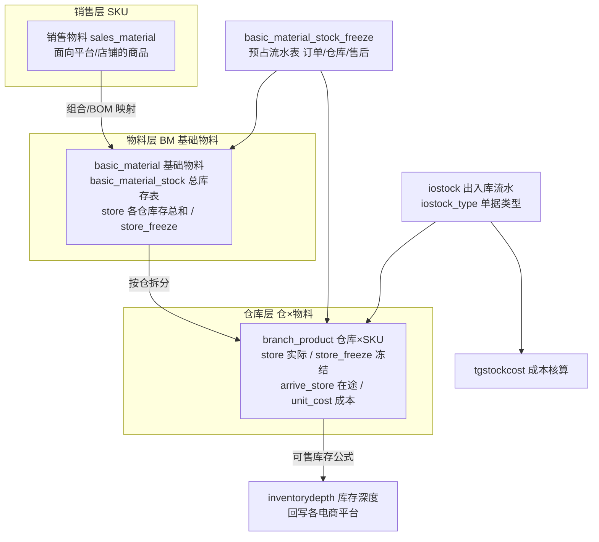
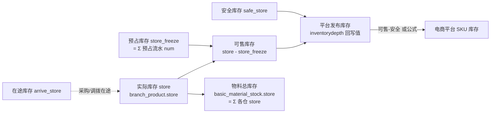
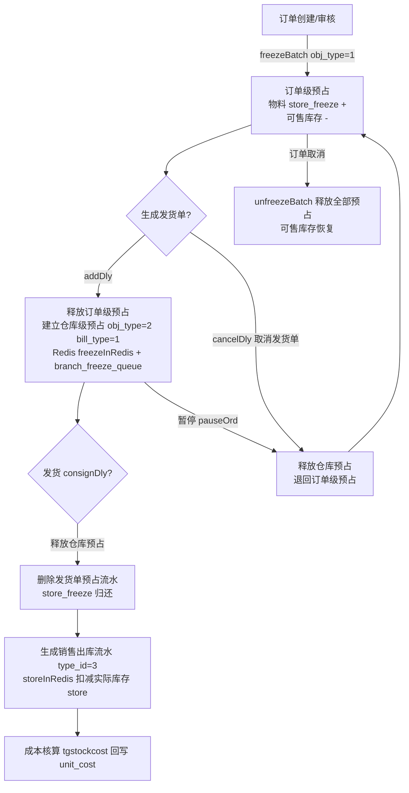
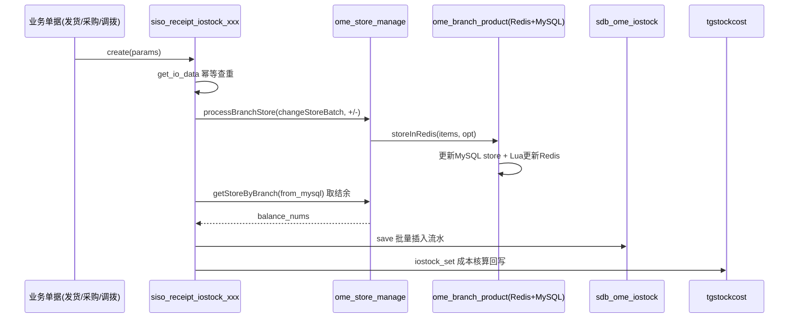
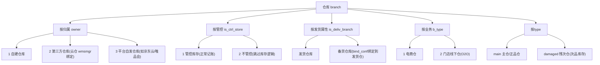
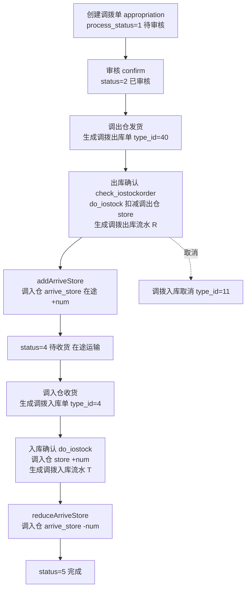
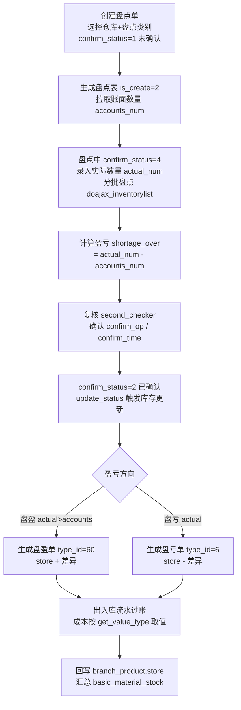
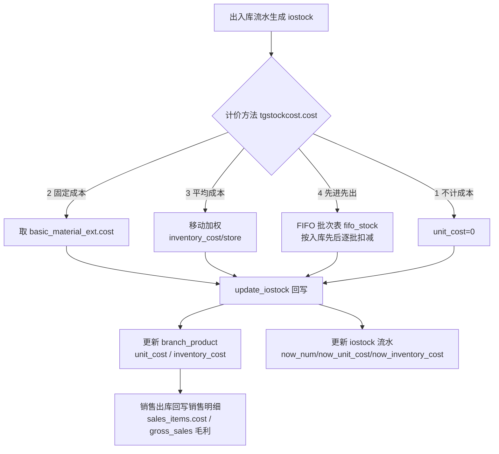
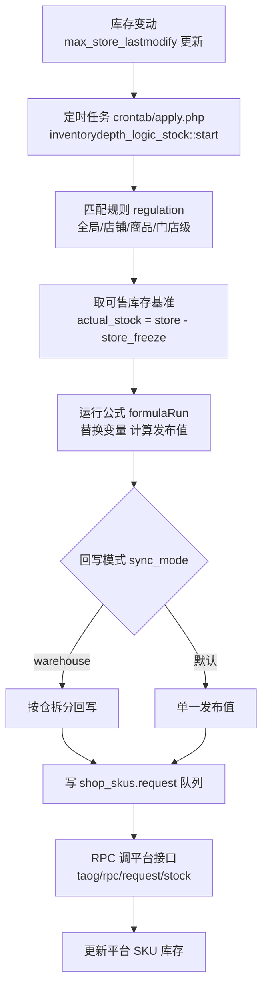
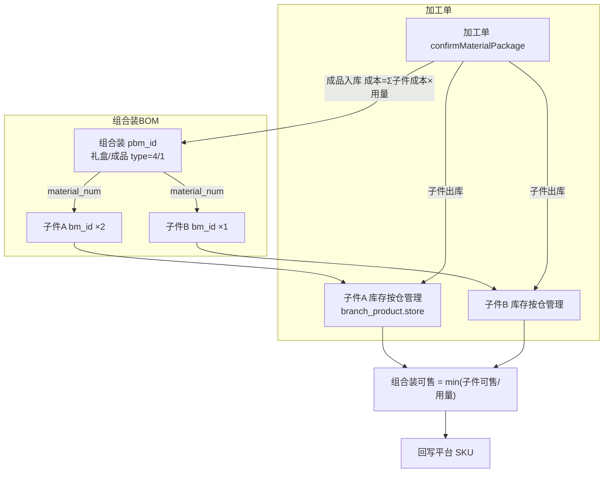

# 商派 ONEX OMS 逆向分析 · B 篇：库存管理 + 仓储(WMS)业务流程

> 说明：本文基于对 ShopeX/OMS（商派 ONEX，PHP 自研 MVC 框架，表前缀 `sdb_`）源码的逆向阅读整理，目的是提炼其**业务模型与流程逻辑**，供我司自研 OMS/WMS 时参考。所有字段名、表名、常量、算法均来自真实代码（schema `comment`/`label`、lib/model 注释），不抄代码实现。
>
> 涉及模块：`ome`（核心库存）、`material`（物料/预占）、`siso`+`iostock`（出入库流水）、`taoguanallocate`（调拨）、`taoguaninventory`（盘点）、`taoguaniostockorder`（出入库单）、`tgstockcost`（成本核算）、`inventorydepth`（库存深度/回写）、`wms`+`wmsmgr`+`omevirtualwms`（仓储执行）。

---

## 0. 全局速览：商派库存域的分层结构

商派库存管理最核心的设计是**三层库存主体 + 一张预占流水表 + 一套出入库流水 + Redis 高可用**：



三层主体：
1. **销售物料（SKU / `sales_material`）**：面向前端店铺/平台的售卖单元，可能是组合装。
2. **基础物料（BM / `basic_material`）**：最小库存管理单元（货号 `material_bn`），组合装通过 BOM 拆解为多个 BM。`material` 模块 app.xml 名为"物料管理"。
3. **仓库×物料（`branch_product`）**：真正记账的库存行，每个仓库每个 BM 一行。

预占（冻结）**不落 `branch_product.store_freeze` 主字段**（代码中相关旧方法已 `return false` 废弃），而是走独立的 `basic_material_stock_freeze` 预占流水表 + Redis Lua 原子操作，这是商派库存高并发的关键。

---

## 1. 库存口径模型（最重要）

### 1.1 仓库级库存字段（`sdb_ome_branch_product`）

来源 `app/ome/dbschema/branch_product.php`，表 comment：**"分店(仓库)和商品关联表"**。核心字段与 schema 原始注释：

| 字段 | 类型 | schema label/comment | 口径含义 |
|------|------|---------------------|---------|
| `branch_id` | table:branch@ome | 关联仓库 | 仓库维度 |
| `product_id` | table:products@ome | 关联基础物料 | BM 维度（唯一索引 `branch_id+product_id`） |
| `store` | int NOT NULL | **"库存"** | **实际库存**（账面在库总量，含被预占部分） |
| `store_freeze` | int NOT NULL | **"冻结库存"** | 仓库级冻结/预占数量（实际写入已迁移到 Redis + 预占流水表，DB 字段做镜像/兜底） |
| `arrive_store` | number | **"在途库存"** | 已出库未到货 / 采购在途 / 调拨在途 |
| `safe_store` | number | （安全库存） | 该仓该 SKU 的安全库存下限 |
| `is_locked` | intbool | **"锁定安全库存"** | 是否锁定安全库存（锁定后安全库存不可动用） |
| `unit_cost` | decimal(20,3) | **"单位平均成本"** | 移动加权后的单位成本 |
| `inventory_cost` | decimal(20,3) | **"库存成本"** | 该仓该 SKU 的库存总成本 |
| `store_id` / `store_bn` | int / varchar | "门店编码" | O2O 门店关联 |
| `last_modified` / `up_time` | | 更新时间 | 变更时间戳 |

> 注意：商派**没有独立的"次品/残次库存"字段**在 `branch_product` 上。次品通过**独立的残损仓（branch.type = `damaged`）+ 残损出入库单（type_id 5 残损出库 / 50 残损入库）**实现，即"次品 = 放到残次仓里的库存"，而不是同一行上的一个次品数字段。盘点代码 `app/wms/lib/inventory.php` 中可见：`$numField = $branch['type'] == 'damaged' ? 'defective_num' : 'normal_num';`——即按仓库类型区分正品/次品口径。

### 1.2 物料总库存字段（`sdb_material_basic_material_stock`）

来源 `app/material/dbschema/basic_material_stock.php`，表 comment：**"基础物料总库存表"**（各仓库汇总）：

| 字段 | schema comment | 含义 |
|------|---------------|------|
| `store` | **"库存（各仓库 的库存总和）"** | 全部仓 `branch_product.store` 之和 |
| `store_freeze` | "冻结库存" | 物料级冻结汇总 |
| `alert_store` | "安全库存数" | 物料级安全库存 |
| `real_store_lastmodify` | **"实际库存最后更新时间"** | 用于增量同步判断 |
| `max_store_lastmodify` | **"最大可下单库存最后更新时间"** | 可售库存变化时间戳（回写触发依据） |
| `inc_store_lastmodify` | **"库存最后添加时间（仅库存增加时更新）"** | 只在入库时更新，用于补货/上架判断 |

### 1.3 预占流水表（`sdb_material_basic_material_stock_freeze`）

来源 `app/material/dbschema/basic_material_stock_freeze.php`，表 comment：**"基础物料预占流水表"**。这是商派库存锁定机制的核心表，每一笔预占都是一条可追溯流水，字段 `num` = "冻结数"。关键分类字段（来自 `material_basic_material_stock_freeze` 类常量）：

**对象类型 `obj_type`：**
| 常量 | 值 | 含义 |
|------|----|------|
| `__ORDER` | 1 | 订单预占（商品级，不指定仓） |
| `__BRANCH` | 2 | 仓库预占（发货单级，指定仓） |
| `__AFTERSALE` | 3 | 售后预占（换出货品库存不足时冻到商品上） |
| （唯品会销售订单） | 15 | `__VOP_INVENTORY_ORDER` |

**配额 ID `bmsq_id`：**
| 常量 | 值 | 含义 |
|------|----|------|
| `__SHARE_STORE` | -1 | 非配额即共享库存 |
| `__STORE_CONFIRM` | -2 | 门店确认库存 |

**业务类型 `bill_type`（预占来源业务）：**
| 常量 | 值 | 业务 |
|------|----|------|
| `__OMS_ORDER` | 0 | OMS 订单业务（默认） |
| `__DELIVERY` | 1 | 发货业务 |
| `__RESHIP` | 2 | 售后业务 |
| `__RETURNED` | 3 | 采购退货业务 |
| `__STOCKOUT` | 4 | 调拨出库业务 |
| `__STOCKDUMP` | 5 | 库内转储业务 |
| `__VOPSTOCKOUT` | 6 | 唯品会出库业务 |
| `__ARTIFICIALFREEZE` | 7 | 人工库存预占业务 |
| `__ADJUSTOUT` | 8 | 库存调整单出库业务 |
| `__DIFFERENCEOUT` | 9 | 差异单出库业务 |
| `__MATERIALPACKAGEOUT` | 10 | 加工单出库业务 |
| `__VOPICKBILLS` | 11 | 唯品会拣货单 |
| `__RETURN` | 12 | 售后申请单 |
| `__ORDER_QUE` | 13 | 订单缺货 |
| `__ORDER_YOU` | 14 | 订单仓库预占（提前选仓） |
| `__DEALER_ORDER` | 2 | 经销商订单业务（一件代发） |

### 1.4 各库存口径的计算公式与触发场景

| 口径 | 公式 | 触发场景 |
|------|------|---------|
| **实际库存** | `branch_product.store` | 出入库流水过账时增减（`storeInRedis`） |
| **可用/可售库存** | `store - store_freeze`（`getAvailableStore`：`$branch[0]['store'] - $branch[0]['store_freeze']`） | 订单占用、发货选仓、平台回写 |
| **锁定(预占)库存** | `Σ basic_material_stock_freeze.num`（按 obj_type/branch_id 聚合，`getBranchFreeze`） | 订单审核预占、发货单预占、人工预占、提前选仓 |
| **在途库存** | `branch_product.arrive_store` | 采购下单/调拨出库时 `change_arrive_store(+)`，到货入库时 `(-)` |
| **次品库存** | 残次仓（`branch.type='damaged'`）中的 `store` | 残损入库单(type_id 50)入残次仓，残损出库单(5)出 |
| **安全库存** | `branch_product.safe_store`（物料级 `alert_store`） | `is_locked=true` 时锁定，可售计算时扣减 |
| **总库存** | `basic_material_stock.store = Σ 各仓 store` | 每次仓库库存变更后 `count_store` 汇总回写 |

**可售库存回写口径**（`inventorydepth_stock::get_benchmark`，库存深度模块定义的可回写基准）：
- `actual_stock` = 可售库存
- `branch_actual_stock` = 仓库可售
- `md_actual_stock` = 门店可售
- `shop_freeze` = 店铺预占
- `actual_safe_stock` = 可售库存 - 安全库存
- `branch_actual_safe_stock` = 仓库可售 - 安全库存

### 1.5 库存字段关系图



---

## 2. 库存扣减 / 锁定 / 释放流程

商派库存操作统一入口是 `ome_store_manage`（`app/ome/lib/store/manage.php`，注释"库存管理类"），它按**仓库类型**（电商仓 `branch` / 门店 `store`）加载处理器 `ome_store_manage_branch`，再按**事件节点 `node_type`** 分发到具体方法。事件节点表（`$__nodeTypes`）非常完整，是理解全流程的钥匙：

| node_type | 说明 |
|-----------|------|
| `addDly` | 新建发货单 |
| `cancelDly` | 取消发货单 |
| `consignDly` | 发货 |
| `pauseOrd` / `renewOrd` | 暂停订单 / 恢复订单 |
| `createChangeReturn` / `deleteChangeReturn` | 创建/取消换货申请单 |
| `checkChangeReship` / `refuseChangeReship` | 审核换货单 / 拒绝 |
| `confirmReshipReturn` / `confirmReshipChange` | 收货质检退入 / 换出 |
| `checkReturned` / `finishReturned` / `cancelReturned` | 审核/完成/取消采购退货 |
| `checkStockout` / `finishStockout` | 审核/完成调拨出库单 |
| `saveStockdump` / `finishStockdump` | 保存/完成库内转储单 |
| `artificialFreeze` / `artificialUnfreeze` | 人工库存预占 / 释放 |
| `changeStore` / `changeStoreBatch` | 更新库存 / 批量更新库存 |
| `changeArriveStore` / `deleteArriveStore` | 在途库存 / 在途释放 |
| `addAdjust` / `confirmAdjust` / `cancelAdjust` | 库存调整单 新建/确认/取消 |
| `addDifference` / `confirmDifference` / `cancelDifference` | 差异单 新建/确认/取消 |
| `confirmMaterialPackage` / `finishMaterialPackage` / `cancelMaterialPackage` | 加工单 确认/完成/取消 |

### 2.1 订单预占 → 发货单预占 → 发货扣减（正向主链路）

核心在 `ome_store_manage_branch`（`app/ome/lib/store/manage/branch.php`）：

**① 订单审核/创建时——订单级预占（obj_type=1，不指定仓）**
- 通过 `material_basic_material_stock_freeze::freezeBatch()` 写入一条 `obj_type=__ORDER(1)`、`bill_type=0`、`branch_id=0` 的预占流水，同时 `material_basic_material_stock::freezeBatch` 增加物料级冻结。
- 订单级预占只冻"商品"，不冻具体仓库，因此可售库存全局下降，但仓库 `store_freeze` 不变。

**② 新建发货单时（`addDly`）——预占从"订单级"转移到"仓库级"**
- 代码逻辑：先 `unfreezeBatch` 释放订单级预占（`obj_type=__ORDER`），再 `freezeBatch` 建立仓库级预占（`obj_type=__BRANCH(2)`、`bill_type=__DELIVERY(1)`、`branch_id=实际仓`）。
- 仓库级预占通过 `ome_branch_product::freezeInRedis($batchList, '+')` 落到 Redis + `branch_freeze_queue` 队列，异步回写 `branch_product.store_freeze`。
- 若仓允许负库存且是线下订单已发货（`negative_stock`），冻结可超过库存（Lua 脚本 `log_type=='negative_stock'` 时跳过充足性校验）。

**③ 发货时（`consignDly`）——释放仓库预占，实际库存随出入库流水扣减**
- `consignDly` 只做 `unfreezeBatch`（释放 `obj_type=__BRANCH`、`bill_type=__DELIVERY` 的仓库预占）+ `delDeliveryFreeze` 删除发货单预占流水。
- **实际库存 `store` 的扣减不在这里**，代码注释明确："电商仓发货，仓库货品实际库存扣减跟着出入库明细生成，所以不在这里处理"。即发货生成销售出库流水（type_id=3）时，由 `siso_receipt_iostock_sold` → `storeInRedis($items, '-')` 扣减 `store`。

**④ 取消发货单（`cancelDly`）——预占从"仓库级"退回"订单级"**
- 释放仓库级预占（`obj_type=__BRANCH`），重新建立订单级预占（`obj_type=__ORDER`, `branch_id=0`），并 `delDeliveryFreeze`。

**⑤ 订单取消/暂停（`pauseOrd`）——同上退回订单级；订单彻底取消则释放全部预占**

### 2.2 主链路流程图



### 2.3 Redis + Lua 原子扣减机制（高并发核心）

`ome_branch_product`（`app/ome/lib/branch/product.php`）继承 `ome_redis`，关键方法：
- `freezeInRedis($items, $opt, $source)`：冻结增减，Lua 脚本 `branch_store_freeze_incr.lua` / `branch_store_freeze_decr.lua`。
- `storeInRedis($items, $opt, $source)`：实际库存增减，Lua 脚本 `branch_store_incr.lua` / `branch_store_decr.lua`。

**Lua 脚本原子逻辑**（`branch_store_freeze_incr.lua`，注释"SKU仓库存缓存在REDIS，通过LUA脚本增加冻结实现原子性"）：
1. `HMGET sku_id store store_freeze` 读取缓存；缓存缺失返回 `100 MISSING_STOCK`（触发回源 MySQL）。
2. 充足性检查：`(store_quantity - abs(freeze_quantity)) < abs(quantity)` 且 `log_type != 'negative_stock'` → 返回 `200 INSUFFICIENT_STOCK`。
3. `HINCRBY sku_id store_freeze quantity` 原子增加冻结。
4. Redis key 格式：`{node_id}#stock:{branch_id}:{product_id}`。

**Redis 与 MySQL 的一致性策略：**
- 冻结：先更 Redis（成功 code=0），再写 `branch_freeze_queue` 队列，由后台任务读取队列回写 DB `store_freeze`（队列 status：0未处理/1处理中/2处理完成会删除/3处理失败）。
- 实际库存：`storeInRedis` 中**先更 MySQL**（`UPDATE ... store=IF(...)` 带 `AND store+quantity>=0` 乐观校验，`affect_row()!==1` 判定失败），再更 Redis；Redis 缺失(code=100)时用 `branch_store_set.lua` 从 MySQL 回填。
- **回滚**：业务 rollback 时 `rollbackRedisBranch()` → `freezeRollbackInRedis()` + `storeRollbackInRedis()`，用逆向操作符（`+`↔`-`）冲正 Redis，并 `delRedisBranchFlow` 删流水。静态变量 `$_redisFreezeRollbackList` / `$_redisStoreRollbackList` 记录待回滚请求。

> 值得借鉴：商派把"冻结"和"实际库存"用了**相反的落库顺序**——冻结以 Redis 为主、DB 走队列异步；实际库存以 MySQL 为主、Redis 做缓存回填。这是因为冻结是高频短生命周期操作（下单即冻、发货即转），实际库存是低频强一致操作（只在出入库过账时变）。

---

## 3. 出入库流水(iostock)机制

### 3.1 出入库单表（`sdb_ome_iostock`）

来源 `app/ome/dbschema/iostock.php`，表 comment：**"出入库单"**。这是**库存变动的唯一账本**，每笔库存增减都对应一条流水。关键字段：

| 字段 | comment/label | 作用 |
|------|--------------|------|
| `iostock_bn` | "出入库单号" | 流水号，前缀=类型码+日期（`get_iostock_bn`：如 `O20240101xxxxxx` 销售出库） |
| `type_id` | "出入库类型id" | 关联 `iostock_type` |
| `branch_id` | "仓库名称" | 变动仓库 |
| `original_bn`/`original_id`/`original_item_id` | "原始单据号/id/明细id" | 溯源到发货单/采购单/调拨单等 |
| `bn` | "基础物料编码" | 变动的 BM |
| `nums` | "出入库数量" | 变动数量 |
| `balance_nums` | **"库存结余"** | 本次变动后的仓库结存（`getStoreByBranch from_mysql`） |
| `iostock_price` | "出入库价格" | 单价 |
| `unit_cost`/`inventory_cost` | "单位成本"/"库存成本" | 本笔成本 |
| `now_num`/`now_unit_cost`/`now_inventory_cost` | "结存数量/结存单位成本/结存库存成本" | 移动加权后的结存 |
| `entity_unit_cost`/`entity_inventory_unit_cost` | "总仓单位平均成本/总仓单位库存成本" | 组合仓成本核算 |
| `bill_type`/`business_bn` | "业务类型/业务单号" | 如 `salenormal` |
| `settle_status` | 结算状态（0未结算/1已结算/2部分结算） | 采购结算 |
| `cost_tax` | "税率" | |

### 3.2 出入库单据类型（`iostock_type`）—— 完整清单

核心定义在 `siso_receipt_iostock_abstract::$_iostock_types`（`app/siso/lib/receipt/iostock/abstract.php`）。每个类型有 `code`（单号前缀字母）、`io`（1入库/0出库）、`class`（处理器类）：

| type_id | code | 名称 | io | 处理器 class |
|---------|------|------|----|--------------|
| 1 | I | 采购入库 | 入 | purchase |
| 10 | H | 采购退货 | 出 | purchaseReturn |
| 3 | O | 销售出库 | 出 | sold |
| 30 | M | 退货入库 | 入 | aftersaleReturn |
| 31 | C | 换货入库 | 入 | aftersaleChange |
| 32 | U | 拒收退货入库 | 入 | deliveryRefuse |
| 4 | T | 调拨入库 | 入 | allocationIn |
| 40 | R | 调拨出库 | 出 | allocationOut |
| 5 | B | 残损出库 | 出 | amagedOut |
| 50 | D | 残损入库 | 入 | amagedIn |
| 6 | L | 盘亏 | 出 | shortage |
| 60 | P | 盘盈 | 入 | overage |
| 7 | A | 直接出库 | 出 | directOut |
| 70 | E | 直接入库 | 入 | directIn |
| 100 | F | 赠品出库 | 出 | giftOut |
| 200 | G | 赠品入库 | 入 | giftIn |
| 300 | J | 样品出库 | 出 | sampleOut |
| 400 | K | 样品入库 | 入 | sampleIn |
| 500 | Q | 期初(盘点期初入库) | 入 | defaultstore |
| 9 | W | 转储出库 | 出 | stockdumpout |
| 600 | V | 转储入库 | 入 | stockdumpin |
| 8 | N | 调账入库 | 入 | adjustin |
| 80 | S | 调账出库 | 出 | adjustout |
| 11 | X | 调拨入库取消 | 入 | |
| 700 | Z | 分销出库 | 出 | |
| 800 | Y | 分销入库 | 入 | |
| 900 | VOP | 唯品会出库 | 出 | vopstockout |
| 1000 | DC | 转仓入库 | 入 | stockinwarehouse |

> `siso_iostock_type` 表（`app/siso/dbschema/iostock_type.php`）额外维护 `bill_type`/`bill_type_name` 映射，如 `(70,'直接入库','oms_reship_diff','差异退货入库')`、`(70,'直接入库','oms_headless','无头件入库')`——即同一出入库类型下再细分业务子类型。

### 3.3 流水生成与账实一致

每种类型对应 `siso/lib/receipt/iostock/` 下一个处理器（`purchase.php`/`sold.php`/`allocateout.php`/`overage.php`/`shortage.php` 等），统一继承 `abstract`。以销售出库 `sold.php`（`_typeId=3`, `_io_type=0`）为例：

1. `get_io_data()`：从发货单明细 `delivery_items_detail` 组装流水数据（要求发货单 `status='succ'` 已发货），并**幂等校验**——先查 `sdb_ome_iostock WHERE type_id=3 AND original_id=? AND original_bn=?`，已存在则不重复生成。
2. `create()`（父类）→ `convertSdf()`：
   - 按 `product_id` 排序（`uasort cmp_by_product_id`，防死锁）；
   - 生成 `iostock_bn`；
   - 入库调 `change_store_batch('+')` + `processBranchStore('changeStoreBatch','+')`；出库调 `('-')`；
   - 每笔后 `getStoreByBranch(from_mysql=true)` 取 `balance_nums`（库存结余）写入流水。
3. `save()`：`ome_func::get_insert_sql` 批量插入 `sdb_ome_iostock`。
4. `_io_cost=true` 时调 `iostock_cost` 服务 → `tgstockcost` 成本核算。

**账实一致保证手段：**
- **幂等**：按 `type_id + original_id + original_bn` 查重，避免重复过账。
- **结余快照**：每条流水记 `balance_nums`，可反推任意时点库存，对账用。
- **乐观锁**：`storeInRedis` 扣减带 `AND store+quantity>=0`，`affect_row` 校验，防止超卖成负（除非 `negative_stock`）。
- **排序防死锁**：批量操作前按 `product_id`/`bm_id` 升序（`ksort`/`uasort`）。
- **防并发表**：`ome_concurrent`（FIFO 成本核算中 `is_pass($concurrentid,'IostockFiFo')` 抢占式锁）。
- **队列兜底**：冻结走 `branch_freeze_queue`、库存走 `branch_stock_queue`，异步补偿回写 DB。

### 3.4 出入库流水过账时序



---

## 4. 多仓库管理

### 4.1 仓库模型（`sdb_ome_branch`）

来源 `app/ome/dbschema/branch.php`，表 comment：**"发货点"**。关键字段体现商派对仓库的多维分类：

| 字段 | 取值/label | 含义 |
|------|-----------|------|
| `branch_bn` | "仓库编号"（唯一索引） | 仓库编码 |
| `type` | "仓库类型"，默认 `main` | `main` 主仓 / `damaged` 残次(售后)仓 等 |
| `owner` | **"仓库归属"** | **1 自建仓库 / 2 第三方仓库 / 3 平台自发仓库** |
| `attr` | "仓库属性" | true 线上 / false 线下 |
| `online` | "仓库类型" | true 电子商务仓 / false 传统业务仓 |
| `b_type` | "线上/线下业务区分标记" | 1 电商仓 / 2 门店线下仓 |
| `b_status` | "仓库是否启用" | |
| `is_deliv_branch` | "发货属性" | true 发货仓库 / false 备货仓库 |
| `bind_conf` | "发货仓绑定配置"（序列化） | 发货仓可绑定的备货仓 |
| `parent_id` | "关联主仓" | 分仓→主仓层级 |
| `wms_id` | 关联 WMS 渠道 | 第三方云仓绑定 |
| `entity_branch_id` | "实体仓ID" | 虚拟仓→实体仓映射（组合仓成本核算用） |
| `is_ctrl_store` | **"是否管控库存"** | 1 是 / 2 否（不管控则跳过所有库存逻辑） |
| `is_negative_store` | **"允许负库存"** | 1 是 / 2 否 |
| `stock_safe_type` | "安全库存计算类型" | supplier 供应商补货水平 / branch 仓库设置 |
| `stock_safe_day`/`stock_safe_time` | 安全库存天数/时间 | |
| `weight` | "权重" | 选仓排序 |
| `cutoff_time`/`latest_delivery_time` | "截单时间/最晚发货时间" | 时效控制 |
| `ability` | "接单能力" | 分单容量 |
| `start_work`/`end_work` | 工作时间 | |
| `platform`/`owner_code` | "所属平台/货主编码" | 第三方仓/云仓货主 |
| `store_id` | table:store@o2o | O2O 门店关联 |

### 4.2 仓库分类维度总结



### 4.3 虚拟仓 vs 实体仓 vs 第三方云仓

| 类型 | 实现 | 特征 |
|------|------|------|
| **实体仓/自建仓** | `branch.owner=1`，`wms_id` 指向 `selfwms` 适配器 | 商派自有 WMS 执行拣货发货，库存完全自管 |
| **虚拟仓/模拟仓** | `omevirtualwms` 模块（app.xml："模拟仓储物流——模拟仓储入库、出库、盘点商品库存和订单的发货、退货、换货"） | 无真实 WMS 对接时，用模拟仓走完出入库/发货/退换货流程，`data_status` 表记录单据模拟状态 |
| **第三方云仓** | `wmsmgr` 模块（app.xml："第三方仓储添加、绑定管理"），`branch.owner=2`，`wms_id` 指向第三方渠道 | 通过 `branch_relation` 表（"第三方仓储仓库关联关系表"）把系统仓 `sys_branch_bn` 映射到 WMS 仓 `wms_branch_bn`，库存以第三方回传为准 |
| **平台自发仓** | `branch.owner=3` | 如京东云交易、唯品会，平台自行发货，`getProductSum` 统计可售时会**排除**平台自发仓（`branch_id|noequal = 平台仓`） |
| **组合仓(总仓)** | `entity_branch_id` 关联实体仓，成本核算 `branch_cost=2 组合仓库成本计算` | 多个逻辑仓聚合为一个总仓做成本核算，`iostock.entity_unit_cost` 记总仓成本 |

**第三方云仓绑定关系**（`wmsmgr_branch_relation`）：`wms_id` + `sys_branch_bn`（系统仓编号）+ `wms_branch_bn`（WMS 仓编号）+ `negative`（权重）。渠道表 `wmsmgr_channel`：`channel_id`/`channel_name`/`node_type`（渠道类型，默认 `yjdf` 一件代发）。

### 4.4 仓库权限

`ome_mdl_branch::_filter` + `getBranchByUser`：非超管只能操作 `branch_ops` 关联的仓库；门店仓还支持通过 `organization` 应用继承组织权限（`getInheritedBranchIds`）。

---

## 5. 调拨流程（taoguanallocate）

### 5.1 调拨单模型（`sdb_taoguanallocate_appropriation`）

来源 `app/taoguanallocate/dbschema/appropriation.php`，表 comment：**"库存调整单（调拨单）"**。

**业务类型 `bill_type`：**
| 值 | 含义 |
|----|------|
| `transfer` | 调拨 |
| `replenishment` | 补货 |
| `returndefective` | 残次品退仓 |
| `returnnormal` | 正品退仓 |
| `flattransfer` | 平调 |
| `o2otransfer` | 门店调拨 |
| `o2oprepayed` | 门店预订单 |

**处理状态 `process_status`（状态机）：**
`0 新建 → 1 待审核 → 2 已审核 → 3 待发货 → 4 待收货 → 5 完成`；旁路 `6 取消 / 7 拒绝`。

**类型 `type`：** 0 调拨单 / 1 理货单。
其他字段：`from_branch_id` 调出仓库、`to_branch_id` 调入仓库、`from_physics_id`/`to_physics_id` 调出/调入门店、`corp_id`/`logi_code`/`logi_no` 物流、`source_from`（pc/pad/pos 发起端）、`extrabranch_bn` 转储入库仓编码。

### 5.2 两种调拨模式

`taoguanallocate_appropriation::to_savestore`（`app/taoguanallocate/lib/appropriation.php`）：
- **直接调拨（`appropriation_type=1`）**：`do_iostock()` 一步生成调拨出库(40)+调拨入库(4)流水，库存即时转移。
- **出入库调拨（`appropriation_type=2`）**：`do_out_iostockorder()` 先生成**调拨出库单**，出库确认后再 `do_in_iostockorder()` 生成**调拨入库单**——出库到入库之间存在时间差，用**在途库存**衔接。

### 5.3 调拨完整流程（含在途）



关键代码点（`taoguaniostockorder/lib/iostockorder.php`）：
- `confirm_iostockorder` case `'40'`（调拨出库）：`do_iostock($iso_id, 0)` 后调 `appropriation->do_in_iostockorder()` 自动生成入库单。
- `check_iostockorder`：`type==40` 时 `addArriveStore($appropriation_id)`（调入仓在途+），`type==4` 时 `reduceArriveStore`（调入仓在途-）。
- `addArriveStore` 直接 SQL：调入仓无库存行则 `INSERT branch_product(arrive_store=num)`，有则 `UPDATE arrive_store=arrive_store+num`。
- 成本：调拨入库成本 `unit_cost = iostock_price`（取调拨出库时的成本价），保证调拨前后成本结转一致（见 §7）。

---

## 6. 盘点流程（taoguaninventory）

### 6.1 盘点单模型（`sdb_taoguaninventory_inventory`）

来源 `app/taoguaninventory/dbschema/inventory.php`，表 comment：**"盘点表"**。

**盘点类别 `inventory_type`：** 1 自定义 / 2 全盘 / 3 部分盘点 / 4 期初。
**确认状态 `confirm_status`：** 1 未确认 / 2 已确认 / 3 作废 / 4 盘点中。
**辅助状态：** `import_status`（0正在导入/1失败/2成功）、`update_status`（0待更新/1失败/2成功，即库存回写状态）、`is_create`（1未生成/2已生成盘点表）。
**人员字段：** `inventory_checker` 盘点人、`second_checker` 复核人、`finance_dept` 财务负责人、`warehousing_dept` 仓库负责人、`confirm_op` 盘点确认人。
**其他：** `branch_id`/`branch_name` 盘点仓库、`difference` 差异金额、`pos` 是否按货位盘点、`inventory_overview` 盘点概况。

### 6.2 盘点明细（`sdb_taoguaninventory_inventory_items`）

| 字段 | label | 含义 |
|------|-------|------|
| `accounts_num` | **"帐面数量"** | 系统账面库存（`branch_product.store`） |
| `actual_num` | **"实际数量"** | 实盘数量 |
| `shortage_over` | **"盈亏记录"** | 盈亏差异（actual - accounts） |
| `price` | "单价" | 用于计算差异金额 |
| `pos_id`/`pos_name` | 货位 | 按货位盘点 |
| `availability` | "有效性" | |

保质期物料（`use_expire=1`）账面数量需 `get_accounts_num` 按批次重算；残次仓（`branch.type='damaged'`）盘 `defective_num`，正品仓盘 `normal_num`。

### 6.3 盘点流程



盘点盈亏的成本取值由 `tgstockcost.get_value_type` 决定（见 §7）：盘盈/期初入库时 `get_unit_cost`，若为 0 且非"不计成本"则取 `get_product_cost`（商品固定成本）。`console/lib/adjust.php` 注释："盘盈和盘亏分别生成调整单"。

---

## 7. 库存成本核算（tgstockcost）

### 7.1 支持的计价方法

来源 `tgstockcost_system_setting::$_tgstockcost_cost`（`app/tgstockcost/lib/system/setting.php`）：

| 值 | 方法 |
|----|------|
| 1 | **不计成本** |
| 2 | **固定成本法**（取商品固定成本 `basic_material_ext.cost`） |
| 3 | **平均成本法**（移动加权平均，取 `branch_product.unit_cost`） |
| 4 | **先进先出法 FIFO** |

配套设置：
- `get_value_type`（盘点/调账成本取值）：1 取固定成本 / 2 取单位平均成本 / 3 取最近一次出入库成本 / 4 取 0。
- `return_cost`（退货成本）：1 取销售出库成本 / 2 取单位平均成本。
- `branch_cost`（仓库成本口径）：**1 单仓库成本计算 / 2 组合仓库成本计算**（总仓口径，用 `entity_unit_cost`）。

### 7.2 成本核算主逻辑（`tgstockcost_taog_instance::iostock_set`）

**入库（io=1）单位成本取值规则：**
| 出入库类型 | 单位成本来源 |
|-----------|-------------|
| 残损入库(50) | 复用 `orig_type_id` 原始类型；组合仓取 `iostock_price` |
| 采购入库(1)/直接入库(70)/赠品入库(200)/样品入库(400) | 调账类取 `get_unit_cost`；加工单(workorder)取 `getMaUnitCost`（BOM 子件成本×用量累加）；否则取 `iostock_price`（采购价） |
| 退货入库(30)/换货入库(31)/拒收退货入库(32) | 默认 `get_sale_unit_cost`（取原销售出库成本）；为 0 则取商品成本 |
| 盘盈(60)/期初(500) | `get_unit_cost`；为 0 取 `get_product_cost` |
| 调拨入库(4) | `iostock_price`（调拨出库成本价结转） |
| 其他 | `get_unit_cost` |

**出库（io=0）单位成本：**
- 销售出库(3)：固定成本法取 `get_product_cost`；平均成本法取 `get_product_unit_cost`；FIFO 取 `fifo_stock` 批次成本。
- 盘亏(6)：`get_unit_cost`，为 0 取商品成本。
- 采购退货(10)：`iostock_price`。
- 其他（残损/调拨/赠品/直接/样品出库）：`get_unit_cost`；FIFO 取批次成本。

### 7.3 移动加权平均的回写（`update_iostock`）

每次出入库后更新 `branch_product` 与流水：
- **入库**：`inventory_cost = inventory_cost + 本笔成本`；`unit_cost = ROUND(inventory_cost/store, 3)`（库存总成本÷库存量=新单位成本，即移动加权）。
- **出库**：`inventory_cost = inventory_cost - 本笔成本`；若 `store` 出完（=0）则 `inventory_cost=0`（解决小数除不尽的尾差）；`now_unit_cost = ROUND(now_inventory_cost/now_num, 3)`。
- 流水回写字段：`unit_cost`/`inventory_cost`/`now_unit_cost`/`now_inventory_cost`/`now_num`。
- 组合仓（`branch_cost=2`）额外调 `ome_entity_branch_product::setBranchCountCostPrice` 算总仓成本，写 `entity_unit_cost`/`entity_inventory_unit_cost`/`entity_branch_detail`。

### 7.4 先进先出（FIFO）实现

`sdb_tgstockcost_fifo` 表（comment **"出入库成本流水表"**），字段：`in_num` 入库数量、`out_num` 已出库数量、`current_num` 当前在库数量、`current_unit_cost` 当前单位成本、`current_inventory_cost` 当前库存成本、`is_sart` 是否期初。

- **入库**（`insert_fifo`）：每笔入库新增一条 FIFO 批次记录（`current_num=in_num=nums`）。
- **出库**（`fifo_stock`）：`WHILE nums>0` 循环取最早批次（`ORDER BY id ASC`）：
  - 批次 `current_num >= 出库量`：扣减该批次（用完则 `DELETE`），成本 += `current_unit_cost × 出库量`；
  - 批次不足：跨批次累加成本，删除该批次，继续下一批；
  - 用 `ome_concurrent` 防并发表（`is_pass($concurrentid,'IostockFiFo')`）抢占批次，失败重试 3 次。
  - 最终 `unit_cost = ROUND(总成本/总出库量, 3)`（加权后的 FIFO 出库单价）。

### 7.5 成本核算流程



销售出库后 `set_sales_iostock_cost` 把成本回写到 `sales_items`（`cost`/`cost_amount`/`gross_sales=sales_amount-cost_amount`/`gross_sales_rate` 毛利率），实现订单级毛利核算。

---

## 8. 库存深度管理（inventorydepth）

### 8.1 解决的问题

`inventorydepth` 模块（app.xml："库存深度管理 Inventory depth management"，淘管开发）解决**"系统可售库存 → 各电商平台发布库存"的回写规则与深度控制**问题。核心痛点：
- 一个 BM 可能映射多个店铺/平台的多个 SKU，需要按规则分配可售库存；
- 平台展示库存 ≠ 系统真实可售（要预留安全库存、按比例/公式发布、防超卖）；
- 需要增量/全量、按仓/按店等多种回写模式。

### 8.2 核心概念

| 概念 | 表/字段 | 说明 |
|------|--------|------|
| **规则 regulation** | `inventorydepth_regulation` | 规则类型 `condition`：frame 商品上下架 / stock 库存更新；级别 `type`：0 全局级 / 1 店铺级 / 2 商品级 / 3 门店级 |
| **公式 formula** | `inventorydepth_formula` | `style`：fund 价格调整 / stock 库存调整；`content` 序列化公式 |
| **活动任务 task** | `inventorydepth_task` | 限时活动（`start_time`/`end_time`），活动期间特殊库存策略 |
| **店铺 SKU 映射** | `inventorydepth_shop_skus` | `shop_sku_id` 平台SKU ID / `shop_iid` 平台商品ID / `request` 是否回写库存 / `mapping` 是否已映射 |
| **店铺库存设置** | `inventorydepth_shop_skustockset` | 每店铺每 SKU 的回写参数 |
| **库存释放** | `inventorydepth_stock_release` | 释放记录 |

### 8.3 回写公式机制（`inventorydepth_stock::formulaRun`）

支持用**变量公式**计算发布库存，变量来自 `get_benchmark()`：`{可售库存}`、`{仓库可售}`、`{门店可售}`、`{店铺预占}`、`{可售库存-安全库存}` 等。例如公式 `{可售库存} - {安全库存}` 会被替换为实际数值后计算。

**回写模式 `sync_mode`：**
- `warehouse`：按仓库级回写（返回以 `branch_bn` 为下标的多维数组）；
- 默认：按公式计算单一发布值。

**安全：** 公式过滤 SQL 敏感词（select/update/drop/delete/insert/alter），`cal()` 方法用白名单正则 `^[0-9+\-*\/\.\s\(\)]+$` 校验后才 `eval`。

**触发依据 `getStockTriggerBasis`：** `actual_stock`（可售库存变化触发）或 `store`（回写库存变化触发），配置 `stock.sync.trigger_basis`。

### 8.4 库存深度回写流程



支持平台（`inventorydepth_sync_set::$support`）：淘宝/天猫、抖音(luban)、拼多多、京东(360buy)、唯品会(vop)、美团电商、官网。增量回写仅淘宝/天猫支持（`mode_support`，配置 `stock.sync.mode=increment`）。

---

## 9. 库存同步（回写各电商平台）

商派库存回写不是单一 `sync_task`，而是 **inventorydepth 模块的队列 + RPC 机制**（见 §8）。补充关键点：

1. **触发源**：库存变动更新 `basic_material_stock.max_store_lastmodify`（"最大可下单库存最后更新时间"），作为增量同步的时间戳依据。订单占用后 `storeNeedUpdateSku($order_id,$shop_id)` 用 `cachecore` 打标记（`inventorydepth_stock-{shop_id}-{bn}`，600秒），标记需回写的 SKU。
2. **队列消费**：`inventorydepth_queue`（按系统身份 taog/ecck 路由到 `inventorydepth_{identity}_queue`）异步处理回写任务。
3. **RPC 下发**：`inventorydepth_taog_rpc_request_stock` 调用各平台 API 更新 SKU 库存。
4. **店铺预占隔离**：`shop_freeze_stock`（`freez_num` 字段）记录店铺级预占，`getProductSum` 统计可售时把店铺预占也计入 `store_freeze`，并**排除平台自发仓**（owner=3）的库存，避免重复下发。
5. **幂等/防重**：`getUnRequestBn` 过滤掉未映射或已请求的 SKU；`request` 字段标记回写状态。

> 借鉴要点：库存回写应做成**独立异步子系统**（规则引擎 + 公式 + 队列 + 平台适配器），与核心库存记账解耦。核心库存只管"真实可售"，回写层管"平台展示多少"，两者通过时间戳/标记触发。

---

## 10. 物料 / 组合装(BOM)（material）

### 10.1 物料分类

`material` 模块（app.xml："物料管理"）。基础物料 `basic_material.type`（"物料属性"）：
| 值 | 类型 |
|----|------|
| 1 | 成品 |
| 2 | 半成品 |
| 3 | 普通 |
| 4 | 礼盒 |
| 5 | 虚拟 |

### 10.2 组合装 BOM 结构

**`sdb_material_basic_material_combination_items`**（comment **"基础物料组合类扩展表"**）——组合装 BOM 明细：
| 字段 | 含义 |
|------|------|
| `pbm_id` | 父项（组合装 BM ID） |
| `bm_id` | 子件（组成 BM ID） |
| `material_bn`/`material_name` | 子件编码/名称 |
| `material_num` | **子件用量**（默认 1，即 BOM 数量） |

即：一个组合装（`pbm_id`）由 N 个子件（`bm_id` × `material_num`）构成。组合装本身不单独记库存，**库存按子件 BM 分别管理**，组合装可售量 = min(各子件可售 / 用量)。

### 10.3 组合装成本（BOM 成本卷积）

`tgstockcost::getMaUnitCost`（加工单 workorder 入库时）：
```
组合装单位成本 = Σ (子件 get_unit_cost(bm_id) × material_num)
```
即按 BOM 逐层卷积子件成本，得到组合装/加工品的入库成本。

### 10.4 加工单（组合装生产）

`ome_store_manage` 事件节点 `confirmMaterialPackage`/`finishMaterialPackage`/`cancelMaterialPackage`（加工单 确认/完成/取消），对应预占 `bill_type=__MATERIALPACKAGEOUT(10)` 加工单出库业务。加工单完成时：子件出库（扣库存）+ 组合装/成品入库（按 BOM 成本卷积计价）。

### 10.5 其他物料相关表

| 表 | 作用 |
|----|------|
| `basic_material_stock_arrive` | 在途库存流水（`addRecord(obj_type,obj_id,branch_id,bm_id,num,operator)`） |
| `basic_material_stock_artificial_freeze` | 人工库存预占（指定仓发货等场景，`freeze_reason`/`original_type`） |
| `basic_material_stock_artificial_freeze_group` | 人工预占分组（如"指定仓发货"组） |
| `basic_material_storage_life` / `_bills` | 保质期管理（批次/效期，`use_expire` 物料按批次盘账面） |
| `basic_material_ext` | 物料扩展（含 `cost` 固定成本） |
| `basic_material_conf` | 物料配置（`use_expire` 是否保质期物料等） |
| `sales_material` / `sales_basic_material` | 销售物料（SKU）与基础物料映射 |
| `fukubukuro_combine` / `_items` | 福袋组合 |
| `luckybag_rules` | 福袋规则 |

### 10.6 组合装库存与成本流程



---

## 11. 关键数据表清单（库存域）

### 11.1 核心库存表

| 表名 | comment | 作用 |
|------|---------|------|
| `sdb_ome_branch` | 发货点 | 仓库主数据（归属/类型/管控/负库存/时效） |
| `sdb_ome_branch_product` | 分店(仓库)和商品关联表 | **仓库×SKU 库存行**（store/store_freeze/arrive_store/safe_store/unit_cost/inventory_cost） |
| `sdb_material_basic_material` | 基础物料 | BM 主数据（material_bn/type 物料属性） |
| `sdb_material_basic_material_stock` | 基础物料总库存表 | 物料级汇总库存（store=各仓总和/alert_store/三个 lastmodify 时间戳） |
| `sdb_material_basic_material_stock_freeze` | 基础物料预占流水表 | **预占核心表**（obj_type/bill_type/bmsq_id/num/branch_id） |
| `sdb_material_basic_material_stock_arrive` | （在途流水） | 在途库存增减记录 |
| `sdb_material_basic_material_stock_artificial_freeze` | （人工预占） | 人工库存预占（指定仓发货） |
| `sdb_material_basic_material_combination_items` | 基础物料组合类扩展表 | **组合装 BOM**（pbm_id/bm_id/material_num） |
| `sdb_material_basic_material_ext` | （物料扩展） | 含固定成本 cost |
| `sdb_material_basic_material_storage_life` | （保质期） | 批次/效期管理 |

### 11.2 出入库流水表

| 表名 | comment | 作用 |
|------|---------|------|
| `sdb_ome_iostock` | 出入库单 | **库存变动唯一账本**（type_id/nums/balance_nums 结余/成本字段） |
| `sdb_ome_iostock_type` | 出入库类型 | 类型字典 |
| `sdb_siso_iostock_type` | 出入库类型 | 类型×业务子类型映射（bill_type） |
| `sdb_ome_stock_change_log` | 库存变更日志 | 库存变更审计日志（log_bn/store 变更数量/type/memo） |
| `sdb_ome_freeze_stock_log` | 冻结库存流水表 | 冻结变更审计（last_num 原预占/change_num 调整/current_num 调整后） |
| `sdb_ome_branch_stock_queue` | 仓库存流水队列 | 库存异步回写队列（status 0-3） |
| `sdb_ome_branch_freeze_queue` | 仓冻结流水队列 | 冻结异步回写队列（obj_type/bill_type/pid 进程锁） |

### 11.3 仓储/调拨/盘点/成本表

| 表名 | comment | 作用 |
|------|---------|------|
| `sdb_taoguanallocate_appropriation` | 库存调整单（调拨单） | 调拨单主表（bill_type/process_status 状态机） |
| `sdb_taoguanallocate_appropriation_items` | （调拨明细） | 调拨单明细 |
| `sdb_taoguaninventory_inventory` | 盘点表 | 盘点单主表（inventory_type/confirm_status） |
| `sdb_taoguaninventory_inventory_items` | （盘点明细） | 盘点明细（accounts_num 帐面/actual_num 实际/shortage_over 盈亏） |
| `sdb_taoguaniostockorder_iso` / `_iso_items` | （出入库单） | 出入库单据（采购/调拨/直接出入库等业务单） |
| `sdb_taoguaniostockorder_diff` / `_diff_items` | （差异单） | 差异单（收货差异） |
| `sdb_tgstockcost_fifo` | 出入库成本流水表 | FIFO 批次成本（in_num/out_num/current_num/current_unit_cost） |
| `sdb_tgstockcost_operation` | （成本操作日志） | 成本法切换日志 |
| `sdb_wms_delivery` / `_delivery_items` | （WMS 发货单） | WMS 拣货/校验/发货执行（process_status 位运算） |
| `sdb_wms_product_serial` | （序列号） | 序列号管理（SN 级库存） |
| `sdb_wmsmgr_branch_relation` | 第三方仓储仓库关联关系表 | 系统仓↔WMS仓映射 |
| `sdb_wmsmgr_channel` | （云仓渠道） | 第三方仓渠道（node_type） |
| `sdb_omevirtualwms_data_status` | （模拟仓状态） | 模拟仓单据状态 |

### 11.4 库存深度/回写表

| 表名 | comment | 作用 |
|------|---------|------|
| `sdb_inventorydepth_regulation` | 所有的规则信息 | 回写规则（全局/店铺/商品/门店级） |
| `sdb_inventorydepth_formula` | 所有的公式信息 | 库存/价格调整公式 |
| `sdb_inventorydepth_task` | 活动任务信息 | 限时活动库存策略 |
| `sdb_inventorydepth_shop_skus` | （店铺SKU映射） | 平台 SKU 映射与回写标记（request/mapping） |
| `sdb_inventorydepth_shop_skustockset` | （店铺库存设置） | 每店每 SKU 回写参数 |
| `sdb_inventorydepth_stock_release` | （库存释放） | 释放记录 |

---

## 12. 对我司自研 OMS/WMS 的借鉴要点

1. **三层库存主体分离**：销售物料(SKU) / 基础物料(BM) / 仓库×物料。组合装通过 BOM 拆解到 BM，库存只记在 BM×仓 层，避免组合装库存重复记账。
2. **预占独立成流水表**：不要把冻结只做成 `branch_product` 的一个字段，而应建 `stock_freeze` 预占流水表（obj_type 订单/仓库/售后 + bill_type 业务来源 + num），每笔预占可追溯、可部分释放、可对账。订单级预占（不指定仓）→ 发货单级预占（指定仓）→ 发货扣减实际库存，三段式转移。
3. **冻结与实际库存用不同一致性策略**：冻结高频短命，走 Redis Lua 原子操作 + 异步队列回写 DB；实际库存低频强一致，走 MySQL 乐观锁（`AND store+q>=0` + affect_row 校验）+ Redis 缓存回填。
4. **出入库流水是唯一账本**：所有库存变动必须过 `iostock` 流水，记 `balance_nums` 结余快照，幂等键 `type_id+original_id+original_bn`。单据类型用 `type_id`（含 code 前缀 + io 方向 + 处理器类）统一编排。
5. **次品用独立残次仓**而非同行次品字段，正品/次品物理隔离，盘点/出入库口径按仓类型切换。
6. **调拨用在途库存衔接**：出库确认 → 调入仓 `arrive_store+` → 入库确认 → `arrive_store-`，在途期间库存归属清晰。
7. **成本核算可配置多算法**：不计/固定/移动加权/FIFO 四选一，FIFO 用批次表逐批扣减 + 防并发锁；移动加权用 `inventory_cost/store` 实时回算，出库清空时归零消尾差；组合装成本按 BOM 卷积。
8. **库存回写做成独立异步子系统**：规则引擎（多级 regulation）+ 公式（变量替换 + 白名单校验）+ 队列 + 平台适配器，与核心记账解耦，用时间戳/标记触发增量同步。
9. **仓库多维分类**：归属（自建/第三方/平台自发）、管控（是否记账）、发货属性（发货仓/备货仓）、业务（电商仓/门店仓）、类型（主仓/残次仓），每个维度影响不同的库存/分单/成本逻辑。
10. **事件节点驱动的库存处理器**：用 `node_type`（addDly/consignDly/cancelDly/checkStockout...）统一编排所有库存事件，按仓库类型多态分发，便于扩展新业务节点。

---

*（本草稿覆盖 11 个子域：库存口径模型、库存扣减锁定流程、出入库流水机制、多仓库管理、调拨流程、盘点流程、库存成本核算、库存深度管理、库存同步、物料组合装BOM、关键数据表清单。所有字段/表名/常量/算法均引自真实源码 schema 与 lib/model 注释。）*
