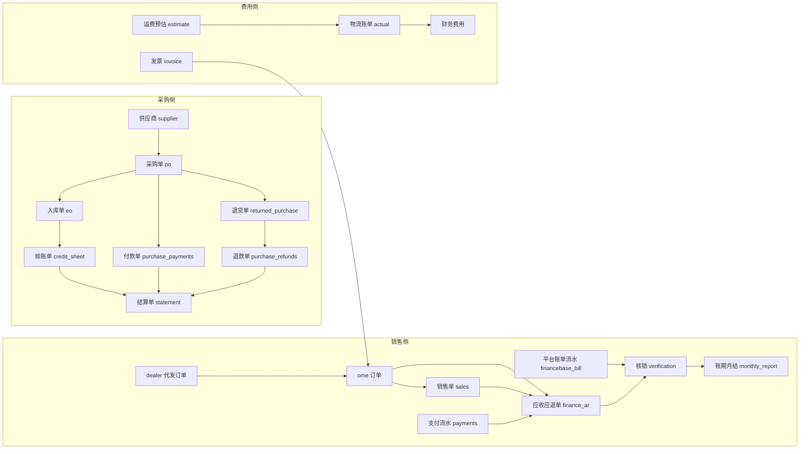
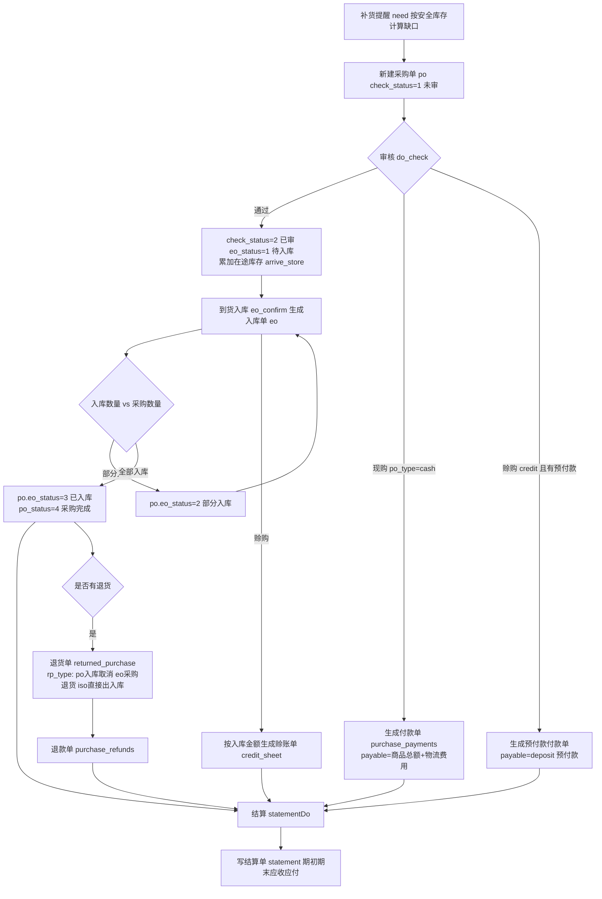
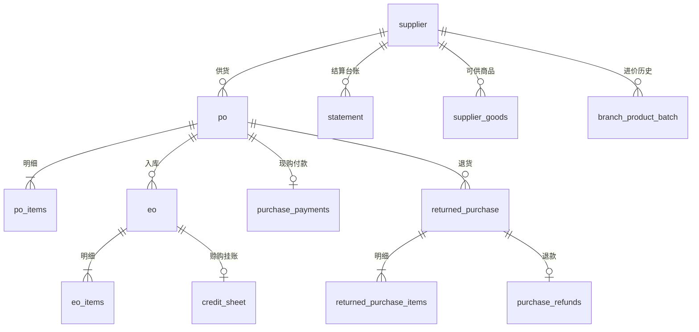
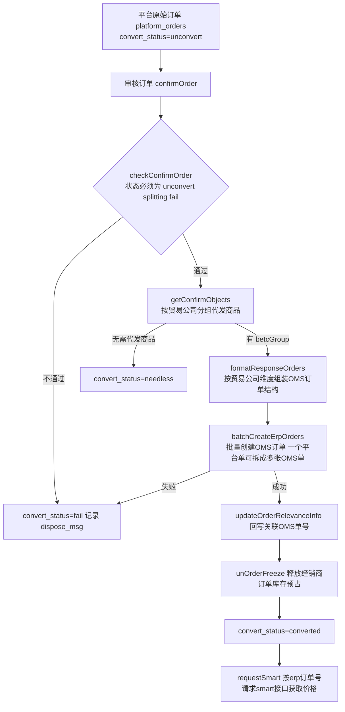
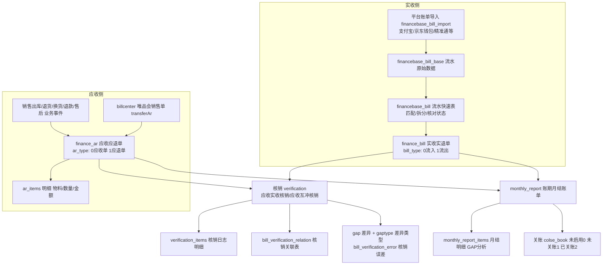
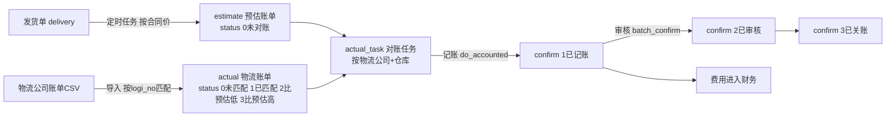
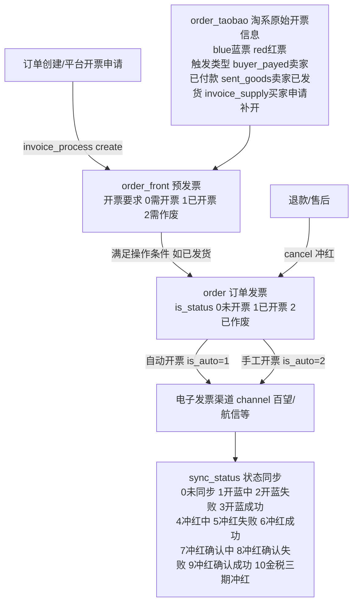
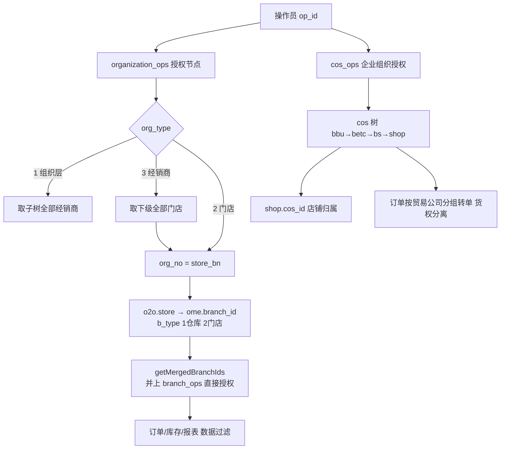

# C. 商派 ONEX OMS 采购/经销 + 财务结算业务流程逆向分析

> 分析对象：ShopeX/OMS（商派 ONEX OMS），PHP 自研 MVC 框架（app/model/controller/dbschema/lib 结构）。
> 代码基线：`_research/OMS-main`。本文所有表名、字段、状态枚举、方法名均来自真实代码，标注了文件路径。
> 目的：为重写自研 OMS 提供业务模型参考，只借鉴流程与逻辑，不抄代码。
> 姊妹篇：`A-订单生命周期.md`（订单域）、`B-库存与仓储.md`（仓储域）。

---

## 目录

1. [模块地图与总体关系](#1-模块地图与总体关系)
2. [采购全流程](#2-采购全流程)
3. [采购数据模型：38 张表分组](#3-采购数据模型38-张表分组)
4. [经销商管理模型 dealer](#4-经销商管理模型-dealer)
5. [B2B 销售单流程：sales 与 ome 的关系](#5-b2b-销售单流程sales-与-ome-的关系)
6. [财务结算体系：finance / financebase](#6-财务结算体系finance--financebase)
7. [订单结算与第三方支付流水](#7-订单结算与第三方支付流水)
8. [运费对账 logisticsaccounts](#8-运费对账-logisticsaccounts)
9. [发票管理 invoice](#9-发票管理-invoice)
10. [组织架构与多货主隔离 organization](#10-组织架构与多货主隔离-organization)
11. [关键数据表清单](#11-关键数据表清单)
12. [对重写自研 OMS 的启示](#12-对重写自研-oms-的启示)

---

## 1. 模块地图与总体关系

采购/经销 + 财务结算涉及以下 app（模块）：

| App | 中文职责 | 表数 | 关键目录 |
|---|---|---|---|
| `purchase` | 采购域：供应商、采购单、入库单、退货单、付款/退款/赊账单、结算单、盘点、调拨、唯品 JIT 拣货 | 38 | `app/purchase/model/`、`app/purchase/controller/admin/` |
| `dealer` | 经销/代发域：品牌 BU、贸易公司、经销商、产品线、代发店铺授权、平台原始订单转单 | 21 | `app/dealer/lib/platform/orders.php`、`app/dealer/model/` |
| `sales` | 销售单据报表：销售单、发货销售单、售后单（数据表实体大多落在 `ome`） | 6 | `app/sales/model/`、`app/sales/controller/admin/` |
| `finance` | 财务应收核销域：应收应退单 AR、实收实退单、核销、账期月结 | 18 | `app/finance/lib/ar.php`、`app/finance/lib/verification.php` |
| `financebase` | 财务基础域：平台账单流水导入、收支分类、会计科目、费用拆分、GAP 差异 | 19 | `app/financebase/lib/`、`app/financebase/model/bill/` |
| `invoice` | 发票域：预发票、订单发票、电子发票渠道、淘系开票信息 | 12 | `app/invoice/lib/order.php`、`app/invoice/lib/process.php` |
| `logisticsaccounts` | 运费对账：预估账单 vs 物流公司实际账单 | 4 | `app/logisticsaccounts/lib/`、`app/logisticsaccounts/model/` |
| `organization` | 组织架构：企业组织树 cos、门店组织树 organization、权限继承 | 4 | `app/organization/lib/cos.php`、`app/organization/lib/organization/permission.php` |
| `ome`（周边） | 订单主域，含 `order_settle`（平台佣金明细）、`payments`（支付流水）、`bank_account`、`sales`（销售单） | - | `app/ome/dbschema/` |
| `billcenter`（周边） | 唯品会结算账单中心，销售单转 AR 的入口 | 4 | `app/billcenter/lib/sales.php` |

模块间资金/单据流向总览：



设计要点：

- **应付侧（采购）自成闭环**：purchase 模块内部有自己的一套结算模型（付款单/赊账单/退款单/结算单 statement），不依赖 finance 模块。
- **应收侧（销售）由 finance + financebase 承担**：AR（应收应退单）由业务单据转生成，与平台账单流水（financebase bill）核销，按账期月结。
- **费用侧独立**：运费对账（logisticsaccounts）按物流公司维度独立对账记账。

---

## 2. 采购全流程

### 2.1 流程总览

采购全链路为：补货提醒（采购需求）→ 采购单 → 审核 → 到货入库 → （退货）→ 对账结算 → 付款。代码中**没有独立的"采购申请单"实体**，采购需求由"补货提醒"功能基于安全库存计算直接生成（`purchase_mdl_purchase_need` 继承自 `purchase_mdl_po`，复用 po 表查询，`app/purchase/model/purchase/need.php`）：

```php
// app/purchase/model/purchase/need.php:59
//计算需要补货商品的数量
$v['need'] = $v['safe_store'] + $v['store_freeze'] - $v['store'] - $v['arrive_store'];
```

即：补货需求 = 安全库存 + 冻结库存 - 现有库存 - 在途库存（在途由采购单审核时累加，见 2.3）。



### 2.2 采购单 po 的状态机（`app/purchase/dbschema/po.php`）

一张采购单上有 **5 组状态字段**，各管一段生命周期：

| 字段 | label | 枚举（来自 schema） | 说明 |
|---|---|---|---|
| `check_status` | 审核状态 | `1 未审 / 2 已审` | 审核后累加在途库存并生成付款单 |
| `eo_status` | 入库状态 | `0 N/A / 1 待入库 / 2 部分入库 / 3 已入库 / 4 未入库` | 由入库单回写 |
| `po_status` | 采购状态 | `1 已新建 / 2 采购终止 / 3 采购退货 / 4 采购完成` | 全部入库且原状态为已新建时自动置 4 |
| `statement` | 结算状态 | `1 未结算 / 2 部分结算 / 3 已结算` | 付款/赊账结算时回写 |
| `defective_status` | 残损确认 | `0 无需确认 / 1 未确认 / 2 已确认` | 入库残损流程 |
| `sync_status` | WMS同步状态 | `1 未同步 / 2 推送失败 / 3 推送成功` | 对接 WMS 的采购单同步 |

其他关键字段：`po_type`（`cash 现购 / credit 赊购`，label"付款单/赊购单"）、`po_species`（`1 正常采购单 / 2 采购补货单`）、`deposit`/`deposit_balance`（预付款原款/余额）、`product_cost` 商品总额、`delivery_cost` 物流费用、`accos_po_id/accos_po_bn`（关联采购单，用于补货单关联原单）、`out_iso_bn` 外部采购单编号、`emergency` 是否紧急。

明细表 `po_items`（采购单明细）：`num` 采购数量、`in_num` 已入库数量、`out_num` 已退货出库数量、`price`、`purchasing_price` 采购进价、`defective_num` 不良品、`sn` 唯一码、`status` 采购详情状态（`1 待入库 / 2 部分入库 / 3 完成入库`）。

### 2.3 审核环节（`app/purchase/controller/admin/purchase.php:205 do_check`）

审核做四件事：

1. **累加在途库存**：`updateBranchProductArriveStore(branch_id, product_id, num, '+')` —— 逐明细把采购数量加到仓库商品的"在途库存 arrive_store"上（`app/purchase/model/po.php:220`）。
2. **按付款类型生成付款单**（purchase_payments）：
   - 现购 `cash`：`payable = product_cost + delivery_cost`（应付=商品总额+物流费用），整单立付款单；
   - 赊购 `credit` 且 `deposit > 0`：生成一张 `payable = deposit` 的预付款付款单。
3. **更新状态**：`check_status=2`、`eo_status=1`、记录 `check_time`、`check_operator`。
4. 菜单上"待审核"（`admin_purchase act=checklist`）与"待入库"（`act=eoList`）是两个独立工作队列（`app/purchase/desktop.xml`）。

反审核 `uncheck` 存在但 `do_uncheck` 为空实现（未完成的功能）。

### 2.4 到货入库（`app/purchase/model/eo.php:25 save_eo`）

入库注释原文："将采购单入库。采购单入库会分配货位，生成供应商商品采购价历史记录，更新库存"。步骤：

1. 按录入的实收数量 `entry_num` 生成入库单 `eo` + 明细 `eo_items`，同时调用托管出入库服务 `taoguaniostockorder.iostockorder->save_iostockorder`（`type_id = ome_iostock::PURCH_STORAGE` 采购入库）真正加库存、分配货位。
2. **扣减在途库存**：`updateBranchProductArriveStore(branch_id, product_id, in_num, '-')`。
3. 更新 `po_items.in_num`（SQL 累加）并按 `num` vs `in_num+out_num` 重算明细状态（1 待入库 / 2 部分入库 / 3 完成入库）。
4. 回写采购单：汇总所有明细，`total_num > total_in_num+total_out_num` 则 `eo_status=2` 部分入库，否则 `eo_status=3` 已入库，且若 `po_status==1` 则置 `po_status=4` 采购完成（`eo.php:152-160`）。
5. 写**供应商商品采购价历史** `branch_product_batch`（表注释"货品价格历史记录"）：记录 supplier_id、product_id、purchase_price、in_num、branch_id、eo_id/eo_bn、purchase_time —— 这是移动成本/最近进价的数据来源。
6. 自动建立供应商-商品关联 `supplier_goods`。
7. 写操作日志 `operation_log('purchase_storage@purchase')`。

入库单 `eo` 的状态：`1 已入库 / 2 部分退货 / 3 已退货`（`app/purchase/dbschema/eo.php`）。

**赊购入库自动生成赊账单**（`app/purchase/lib/po/eo/import.php:104`）：

```php
/*生成赊购单start*/
if($eoSdf['po_type'] == 'credit'){
    $credit_data = array(
       'cs_bn'=>$csObj->gen_id(),
       'payable'=>$amount+$delivery_cost,  // 应付 = 本次入库金额 + 物流费用
       'eo_id'=>$eo_id, ...
```

即**赊购模式下应付按"入库单"逐张挂账**（credit_sheet.eo_id 关联 eo），而现购模式应付在审核时按"采购单"整单挂账（purchase_payments.po_id 关联 po）。这是采购财务模型的核心分叉。

### 2.5 采购退货（`app/purchase/dbschema/returned_purchase.php`）

退货单关键字段与枚举：

- `rp_type` 退货单类型：`po 入库取消单 / eo 采购退货单 / iso 直接出入库` —— 分别对应"入库前取消"、"入库后退供给供应商"、"不经采购单的直接出库"三种业务。
- `po_type` 采购方式：`cash 现款 / credit 赊账`。
- `status` 退货状态：`1 已新建 / 2 退货完成 / 3 出库拒绝 / 4 部分退货 / 5 取消出库`。
- `check_status`：`1 未审 / 2 已审`。
- 明细 `returned_purchase_items`：出库数量、采购进价。
- 同样有 `sync_status` WMS 同步状态。

退货完成后生成**退款单 purchase_refunds**（`rp_type: po 入库取消 / eo 采购退货 / iso 直接出库`；`statement_status: 1 未结算 / 2 已结算 / 3 拒绝结算`），退款结算时把应收（供应商欠我方）写入结算单（`app/purchase/model/purchase/refunds.php:50 statementDo`，注释"差额 = 应收 - 结算金额，此处的差额为负数"）。

### 2.6 采购对账与付款

三类资金单据 + 一张结算台账：

| 单据 | 表 | 触发 | 方向 |
|---|---|---|---|
| 付款单 | `purchase_payments` | 审核现购单 / 赊购预付款 / 赊购尾款结算 | 应付供应商 |
| 赊账单 | `credit_sheet` | 赊购单每次入库 | 应付供应商（按入库挂账） |
| 退款单 | `purchase_refunds` | 采购退货完成 | 应收供应商 |
| 结算单 | `statement` | 上述单据结算动作时写入 | 供应商维度台账 |

三者 `statement_status` 枚举一致：`1 未结算 / 2 已结算 / 3 拒绝结算 / 4 部分结算`（refunds 无 4）。

**结算逻辑**（`app/purchase/model/credit/sheet.php:42 statementDo`，赊购单结算）：

```php
//if预付款>=结算金额  抵扣，然后将剩余金额返回给供应商
    $difference = $payable - $paid - $deposit_balance;  #差额 = 应付 - 总结算金额 - 预付
//else 预付款<结算金额，抵扣全部预付款，即供应商预付款清0
```

即结算时自动用采购单上的**预付款余额 deposit_balance 抵扣**，支持部分结算（`statement_status=4`），并回写采购单 `statement` 字段（注释原文："更新采购单的结算状态：if采购单的入库状态为部分入库，则每次结算时更新采购单的结算状态为部分结算…"，`credit/sheet.php:127-134`）。

**结算单 statement**（`app/purchase/dbschema/statement.php`，表注释"结算单"）是供应商对账台账，`object_type` 业务类型：`1 赊购入库 / 2 现款结算 / 3 采购退货`，每张资金单据结算后写一行，字段为标准的期初期末结构：

- 应付方向：`initial_pay` 期初应付、`pay_add` 本期增加应付、`paid` 本期已付、`final_pay` 期末应付
- 应收方向：`initial_receive` 期初应收、`receive_add` 本期增加应收、`received` 本期已收、`final_receive` 期末应收
- `difference` 差额（采购退货时差额为负，汇总时 `object_type==3` 做减法，见 `app/purchase/model/statement.php:135-141`）

对账报表"采购结算统计表"（`statement.php:193 GetClearingTables`）按供应商+日期区间汇总以上八列，即传统的**供应商对账单**格式。

### 2.7 盘点与调拨（附属流程）

- 盘点：`inventory`（盘点表，含盘点人/复核人/财务负责人/仓库负责人、差异金额、确认状态、库存更新标志）+ `inventory_items`（帐面数量 vs 实际数量、盈亏记录）+ `inventory_filter`（盘点筛选条件）。
- 调拨：`appropriation`（库存调整单，type：`0 调拔单 / 1 理货单`）+ `appropriation_items`。

---

## 3. 采购数据模型：38 张表分组

`app/purchase/dbschema/` 共 38 张表（前缀 `sdb_purchase_`），可分为 6 组：

### 3.1 核心采购链路（主表+明细）

| 表 | 注释 | 角色 |
|---|---|---|
| `po` | 采购单 | 主表，5 组状态 |
| `po_items` | 采购单明细 | 明细，num/in_num/out_num 驱动状态 |
| `po_props` / `po_items_props` | - | 单据/明细扩展属性（键值对，K-V 扩展表模式） |
| `eo` | 入库单 entry_order | 主表 |
| `eo_items` | 入库单明细 | 含 采购数量/入库数量/退货数量/不良品数量/是否新品 |
| `returned_purchase` | 退货单 | 主表 |
| `returned_purchase_items` | 退货单明细 | - |

### 3.2 财务结算链路

| 表 | 注释 |
|---|---|
| `purchase_payments` | 付款单（现款/预付款，po_type: cash/credit） |
| `credit_sheet` | 赊账单（按入库单挂账） |
| `purchase_refunds` | 退款单（采购退货应收） |
| `statement` | 结算单（供应商期初期末应收应付台账） |
| `branch_product_batch` | 货品价格历史记录（采购价批次，成本追溯） |

### 3.3 主数据

| 表 | 注释 |
|---|---|
| `supplier` | 供应商（含 到货天数、银行账号、开户银行、采购员、信用等级 credit_lv） |
| `supplier_brand` | 供应商提供的品牌 |
| `supplier_goods` | 供应商商品（入库时自动建立关联） |
| `warehouse` | 唯品会仓库表（仓库编号/类型/常态合作编码） |
| `carrier` | 承运商管理表（承运商编号/名称/tms端承运商ID/平台状态/禁用状态） |

### 3.4 库存作业

| 表 | 注释 |
|---|---|
| `inventory` / `inventory_items` / `inventory_filter` | 盘点表 / 盘点明细表 / 盘点筛选条件表 |
| `appropriation` / `appropriation_items` | 库存调整单（调拨单）/ 明细 |

### 3.5 唯品会 JIT/JITX 专线（该客户定制链路，约 12 张表）

| 表 | 注释 |
|---|---|
| `order` | PO单（唯品档期维度：档期号 schedule_id、合作模式编码 co_mode、海淘档期交易模式、虚拟总库存、销售数量、未拣货数量） |
| `order_sku_price` | PO采购单供货价（条码、含税结算价、不含税结算价、原价） |
| `order_wait` / `order_wait_items` | 待寻仓订单 / 明细（JITX 按地址寻仓选供应商） |
| `pick_bills` | 拣货单（拉取订单状态、po单编号、发货状态、审核状态 1待审核 2已审核 3取消） |
| `pick_bill_items` | 拣货单明细（供货价含税/不含税、首选仓库、防伪码管控） |
| `pick_bill_item_inventory` | 拣货单明细的详单（订单维度：库存占用订单号、合作模式 dvd/jit/jit_4a、hold标记、自动抢货标识） |
| `pick_bill_check_items` | 拣货单明细检测表（质检：会员反馈途径、问题描述、图片/视频信息、一二三级分类） |
| `pick_stockout` | 拣货出库单关联表 |
| `pick_stockout_bills` | 出库单（单据状态、审核状态、出库状态、承运商、运单号、是否航空禁运、接收状态、唯品会Api接口失败状态） |
| `pick_stockout_bill_items` | 出库单明细（申请数量/应出库数量/实际出库数量） |
| `pick_stockout_bill_item_boxs` | 出库单明细装箱信息（箱号、数量、出库状态） |
| `pick_order_items` | JIT订单明细查询表（处理状态、上架数、发货开始考核时间） |
| `setting` / `setting_shop` | 自动审核配置（同入库仓合并、每日审核时间点、承运商、配送方式）/ JIT配置关联店铺表 |

> 启示：JIT 链路 = "供应商 PO（档期）→ 平台订单拉动拣货 → 拣货单 → 出库单（装箱）→ 送货入唯品仓"。它是**以销定采/先销后采**模式，与常规"先采购入库再销售"方向相反，重写成通用 OMS 时可作为独立的"平台寄售/JIT 业务包"设计。

### 3.6 关系图（核心链路）



---

## 4. 经销商管理模型 dealer

`app/dealer/` 实际是**品牌方代发（一件代发/分销）域**，21 张表。菜单结构（`app/dealer/desktop.xml`）分为：组织设置（公司业务组织/业务贸易公司/经销商）、代发产品线、代发业务设置、代发订单管理。

### 4.1 三级组织实体

| 实体 | 表 | 关键字段 | 对应 cos_type |
|---|---|---|---|
| 品牌 BU（销售团队） | `bbu` | 品牌BU编码 bbu_code、名称、状态、组织架构ID | `bbu` |
| 贸易公司 | `betc` | 贸易公司名称/编码、所属品牌BU、组织架构ID、联系人、公司状态 | `betc` |
| 经销商 | `business`（模型 `bs`） | 经销商编号 bs_bn、名称、状态 enum(active,close)、betc_id 贸易公司ID集合（"1,2,3"）、cos_id 组织架构ID集合、经销商客户编码 customer_code、销售办公室编码 salesoffice_code、产品组编码 division_code、销售组织 salesgroup_code、订单处理费公式 deal_cost | `bs` |

三者保存/导入时都会调用 `kernel::single('organization_cos')->saveCos()` 同步写入企业组织树（如 `app/dealer/model/betc.php:256-263`），即 **dealer 实体与 organization.cos 树是双写关系**（详见第 10 章）。

经销商相关辅助表：

- `business_branch` 经销商仓库（经销商ID + 仓库ID 多对多）。
- `goods` 经销商货品（经销商ID、货品ID、成本价）；`goods_price` 经销基础物料价格管理（经销商编码、基础物料编码、采购价、价格单位、**生效时间/过期时间** —— 价格带有效期版本化）。
- **无信用等级/账期字段**：dealer 域没有经销商信用额度、账期天数的建模（对比 purchase.supplier 有 credit_lv 信用等级）。代发业务是先款后货/平台代收模式，所以未建账期。

### 4.2 产品线与授权（价格体系的载体）

- `series` 产品线（编码/名称/分类/状态/产品数/**所属贸易公司**/组织架构ID）。
- `series_products` 产品线绑物料（产品线ID + 物料ID）。
- `series_endorse` 产品线授权到店（产品线ID + 经销商ID + 店铺ID，注释"一个经销店铺只能选一个经销商"，含店铺维度产品数）。
- `series_endorse_products` 产品授权到店（细化到 SKU：发货方式、可售状态、**开始/结束时间**，注释"自发改成代发需要设置时间范围，代发变更自发设置开始时间"）。

授权模型 = **产品线（贸易公司货权）→ 授权到经销商的店铺 → 细化到 SKU 级代发/自发切换（带时间窗）**。

### 4.3 销售物料体系

- `sales_material` 销售商品表（销售商品编码/名称/类型 `1普通 2组合`、是否绑定基础商品、所属店铺、组织架构ID）。
- `sales_basic_material` 销售物料与基础物料关联表（sm_id + bm_id + 数量 + **促销类基础物料价格贡献占比** —— 组合品拆分金额用）。

即"销售物料（前端卖什么）→ 基础物料（仓库发什么）"两层物料模型，组合品按价格贡献占比分摊。

### 4.4 代发订单流程（核心）

表：`platform_orders` 分销平台订单主表、`platform_order_items`、`platform_order_objects`、`platform_order_extend`；售后：`platform_aftersale`（+items/objects/extend）。

`platform_orders.convert_status` 转单状态枚举（`app/dealer/dbschema/platform_orders.php:85-92`）：

```
'unconvert' => '未转单', 'converted' => '已转单', 'needless' => '无需转单',
'splitting' => '部分转单', 'fail' => '转单失败'
```

转单主流程（`app/dealer/lib/platform/orders.php:463 confirmOrder`）：



要点：

1. **按贸易公司分组拆单**：一张平台订单里的商品可能属于不同贸易公司（货权主体），转单时按 betc 分组生成多张 OMS 订单 —— 这是货权分离在订单层的落地。
2. 订单行明细类型：`product商品/pkg捆绑商品/gift赠品/giftpackage礼包/lkb福袋/pko多选一`；子订单状态：`0未发货 1已发货 2部分发货 3部分退货 4已退货`（`platform_order_items`）。
3. 明细上带 `贸易公司ID`、`处理状态`、`OMS订单ID`，实现平台行 → OMS 行的映射。
4. 金额模型：子单零售价、成本价、优惠分摊（"按价格贡献比分摊pmt_order"）、分摊之后的实付金额、退款金额 —— 为后续与经销商结算保留行级金额。
5. 逆向链路：`platform_aftersale` 平台原始售后单 → 代发退货单 `reship`（菜单"代发退货单"）。
6. 发货回传：`dealer/lib/platform/orders.php` 有 `updateDlyOrders`、`cancelOrderDelivery`、`update_dealer_order_pay_status` 等与平台状态同步的方法；`app/dealer/controller/admin/consign.php` 提供代销发货确认、批量同步、批量修改物流等操作。

> 定位说明：这套 dealer 是"品牌方视角的分销代发"（我方是供货方，经销商店铺卖货，我方代发货），**不是**"我方作为经销商向上游订货"的 B2B 采购分销。若重写 OMS 需要"经销订货+账期+信用额度"，此模块只能参考组织与授权模型，资金部分需自建（可参考 purchase 域的 statement 台账模式镜像为应收）。

---

## 5. B2B 销售单流程：sales 与 ome 的关系

`app/sales/` 的定位是**销售单据报表层**，不是独立单据引擎：

- `sales_mdl_sales` 构造函数 `parent::__construct(app::get('ome'))`，`table_name()` 返回 `sales`（`app/sales/model/sales.php:31-40`）—— **实体表在 ome 域**（`sdb_ome_sales`），sales 模块只是它的 finder/导出视图（导出名"销售单"）。
- 同样 `sales_mdl_delivery`（基础物料销售发货明细）也挂 ome 的 `delivery` 相关表；`dealer_mdl_sales`、`dealer_mdl_shop` 分别继承 `sales_mdl_sales`、`ome_mdl_shop` 复用同一套单据。

菜单（`app/sales/desktop.xml`，工作组"单据报表/销售单据"）：销售单、售后单、发货销售单、发货销售明细单。

### 5.1 ome.sales 销售单模型（`app/ome/dbschema/sales.php`）

销售单是**订单出库后的销售账务快照**，字段涵盖：

- 单据关联：销售单号、订单号 order_bn、出入库单号、发货单号。
- 金额：商品金额、配送费用、销售金额、优惠金额（订单折扣）、附加费、预存费、预收物流费用、预估物流费用、服务费用、平台服务费用、成本金额、退款金额。
- 状态与审计：支付状态、订单审核人、订单审核时间（注释"订单审核并生成发货单时间"）、下单时间、付款时间、发货时间、是否开发票、是否归档、操作员、导购。
- 隔离字段：店铺名称、店铺类型、仓库名称、`org_id` 运营组织、`cos_id`。

订单类型枚举（`app/ome/dbschema/orders.php:743`，销售单来源订单）：`normal订单 / sale销售单 / presale预售订单 / vopczc唯品会仓中仓订单 / platform平台发货 / offline线下订单 / gift礼品卡订单 / integral积分订单 / exchange换货订单 / brush特殊订单 / jitxsc唯品会省仓 / zerobuy0元购 / bufa补发订单 / jisuxianhuo急速现货 / pinpaizhifa品牌直发`。

注意 `order_type = 'sale'（销售单）`：**B2B 批发/手工销售单与平台订单共用 ome.orders 主表**，通过 order_type 区分，走同一条"审核→生成发货单→出库→生成销售单 sales"的管道。`offline 线下订单` 同理。这是"一套订单引擎多业务形态"的设计。

### 5.2 发货销售单（`app/sales/dbschema/delivery_order.php` + item）

sales 模块自有的 6 张表（前缀 `sdb_sales_`）是**发货/售后维度的结算明细宽表**：

- `delivery_order` 发货单头（发货单号、来源店铺、店铺类型、会员用户名、发货时间、销售时间、`org_id` 运营组织、物流公司/单号、收货人信息、仓库、退款金额、addon 扩展字段）。
- `delivery_order_item` 发货明细（基础物料/销售物料编码、原价、销售数量、基础物料优惠价、销售价、平摊优惠金额、销售额），并带一组**结算口径字段**（注释原文）：

```
'结算金额',   //客户实付 + 平台支付总额
'客户实付',   // 已支付金额 减去平台支付优惠，加平台支付总额
'平台承担金额（不包含支付优惠）'
'支付优惠金额'
'平台支付总额' //平台优惠 + 平台支付优惠
```

- `aftersale` 售后单据（售后类型 `return退货/change换货/refund退款`；收货状态 `0待收货/1已收货`；触发节点 `1 OMS退款 / 3 平台退款`；审核/质检/退款三段时间与操作人；换货订单号、补差价订单标记）+ `aftersale_items`（良品/不良品数量、申请退款金额/已退款金额、成本价格/成本金额，同样带结算口径字段）+ 两张 props 扩展表。

这组表的本质：**把订单/发货/售后事件按"结算口径"（客户实付 vs 平台承担）行级固化**，作为财务 AR 生成和平台对账的数据底座。第 6 章的 finance_ar 正是消费这类数据。

---

## 6. 财务结算体系：finance / financebase

### 6.1 总体模型：AR-Bill 核销 + 账期月结

财务域采用经典的"**应收单（AR）× 实收流水（Bill）→ 核销（Verification）→ 账期月结（Monthly Report）**"模型：



### 6.2 应收应退单 finance_ar（`app/finance/dbschema/ar.php`）

单据头字段：`ar_bn` 单据编号、`order_bn` 业务订单号（+ `crc32_order_bn` 用于快速搜索）、`relate_order_bn` 关联订单号（换货场景）、`channel_id/channel_name` 渠道（店铺）、`member` 客户/会员（交易对方）、`serial_number` 业务流水号、`unique_id` 唯一标识（幂等）。

金额字段：`money` 应收金额、`confirm_money` 已核销金额、`unconfirm_money` 未核销金额、`actually_money` 客户实付、`platform_amount` 平台承担金额。

状态字段（注释均引自 schema）：

| 字段 | 枚举 |
|---|---|
| `ar_type` 单据类型 | `0 应收单 / 1 应退单`（lib 里 `get_name_by_ar_type`） |
| `type` 业务类型 | `0销售出库 1销售退货 2销售换货 3销售退款 4售后退货 5售后换货 7售后仅退款 8JIT出库 9JIT退供 10京东自营销售出库 11京东自营销售退货 12直赔单 99其他`（`app/finance/lib/ar.php:301-318`） |
| `status` 核销状态 | `未核销(0)、部分核销(1)、已核销(2)` |
| `verification_status` | `等待核销(0)、正常核销(1)、差异核销(2)、强制核销(3)` |
| `charge_status` 记账状态 | `未记账(0)、已记账(1)` |
| `monthly_status` 是否关账 | `未关账(0)，已关账(1)`；`monthly_id` 所属账期、`premonthly_id` 往期账期 |
| `is_check` 自动核销检查状态 | `未检查(0)、检查中(1)、已检查(2)` |
| `verification_flag` | 应收对冲标识；`auto_flag` 自动核销标识 `人工核销(0) 自动核销(1)` |
| `gap_type` | 差异类型 |

时间字段区分：`trade_time` 账单日期、`delivery_time` 发货时间、`create_time` 进入系统日期、`verification_time` 核销时间、`charge_time` 记账日期。

明细 `ar_items`（销售应收单明细）：销售物料编码/名称、数量、金额、客户实付、平台承担金额。

**AR 生成入口示例**（`app/billcenter/lib/sales.php:28 transferAr`，唯品会销售单转 AR）：

```php
$sdf['trade_time']      = $sale['sale_time']; //销售时间
$sdf['type']            = ...get_sales_type($sale['bill_type']); //业务类型
$sdf['order_bn']        = $sale['order_bn']; //业务单据bn
$sdf['relate_order_bn'] = $sale['bill_bn']; //关联订单bn，专指售后换货
$sdf['channel_id']      = $sale['shop_id']; //渠道ID
$sdf['sale_money']      = $sale['settlement_amount']; //商品成交金额
$sdf['actually_money']  = $sale['settlement_amount']; //客户实付
$sdf['charge_status']   = 1; //默认已记账
$res = kernel::single("finance_ar")->do_save($sdf);
```

配合 `billcenter_sales.in_ar` 状态（`0未进/1处理中/2已进`）做转单幂等控制。`finance_ar->do_save`（`app/finance/lib/ar.php:50`）负责主表+明细事务保存，`verify_data` 做防重（"该单据已存在"按 unique_id 判重）。

### 6.3 实收实退单 finance_bill 与核销

`finance_bill`（`app/finance/dbschema/bill.php`，表注释"销售收退款单"）与 AR 结构镜像：`bill_bn`、`order_bn`、`member`、`fee_item` 费用项、`fee_type` 业务类型、`money` 费用金额（注释"金额,区分正负号"）、`bill_type`（注释"资金流向 0流入，1流出"）、`serial_number` 凭据号、核销/记账/关账状态同 AR。后台菜单名"**实收实退单**"（`app/finance/controller/settlement.php:20 $name = "实收实退单"`）。

核销引擎（`app/finance/lib/verification.php`）：

- `do_save` 保存核销日志（verification + verification_items），核销类型 `0 应收互冲核销 / 1 应收实收核销`。
- `doManVerificate` 人工核销、`doAutoVerificate` 自动核销、`doAutoArVerificate` "应收应退自动核销（针对未签收直接退款的情况）"、`checkVerificate` 核销前检查（含"确认强制核销：当前实收实退是否最终确认强制核销？"交互、核销误差值判断）。
- `do_cancel` 撤销核销。
- 每次核销写操作日志（`finance_func::addOpLog(bill_bn, op_name, '正常核销|差异核销|强制核销', '核销')`）。

核销留痕三张表：

- `verification` 核销主表（核销流水号、核销日期、核销人、核销类型、核销金额、核销摘要）。
- `verification_items` 核销日志明细（单据编号、单据号类型 `实收单据(0) 应收单据(1)`、核销金额、账单完成时间）。
- `bill_verification_relation` 核销关联表（流水单据号 ↔ 单据号 ↔ 订单号 ↔ 业务流水号 ↔ 售后订单关联号、核销金额、核销日期、自动核销标识、核销状态）。

差异管理：`finance_gaptype` 差异类型表（状态 1有效/0无效）、`financebase_gap` 差异表（差异类型 + **贷会计科目ID + 借会计科目ID** —— 差异直接映射会计分录借贷科目）、`financebase_bill_verification_error` 核销误差表。

### 6.4 平台账单流水 financebase（对账数据底座）

`financebase` 负责把**外部平台/支付渠道账单**导入并标准化：

| 表 | 注释 | 说明 |
|---|---|---|
| `bill_base` | 流水原始数据表 | 店铺ID + 单据唯一值 + **原始数据**（原文保留） |
| `bill` | 流水快速表 | 标准化后的流水：业务流水号、商户订单号、财务流水号、订单号、账单时间、对方名称、金额、业务类型、具体类别、平台类型、所属店铺；状态字段：**匹配状态**（注释"true为失败，false为成功"）、**与菜鸟的对账**、对账失败原因、**拆分状态/拆分时间/拆分失败原因**、**核对状态**（注释"1-已核对AR，2-需核对AR，3-无需核对AR"） |
| `bill_import` | 导入记录表 | 批量导入批次 |
| `bill_import_jdbill` / `bill_import_jdwallet` | 京东钱包流水 / 京东钱包导入记录表 | 京东渠道 |
| `bill_import_jzt` | 精准通账单明细 | 京东广告费 |
| `bill_import_order` | 按单号导入明细 | - |
| `bill_import_sale` | 按销售周期导入明细 | - |
| `bill_import_sku` | 商品sku明细 | - |
| `bill_import_summary` | 导入数据汇总 | 含支出总额 |
| `bill_category_rules` | 对账类目规则表 | 收支分类规则 |
| `bill_fee_type` | 费用表 | 费用项设置 |
| `account_chart` | 科目表 | 会计科目编码/名称、记账码、客户、成本中心、税率、税率会计科目、**应用场景**（注释"platform_amount、actually_amount、refundplatform_amount、refundactually_amount每种只能有一条"）、原因代码 |
| `expenses_split` | 费用拆分表 | 一笔平台流水拆到多订单/多费用项 |
| `gap` | 差异表 | 差异类型 → 借/贷会计科目 |
| `queue` | 队列表 | 异步任务队列 |
| `bill_match_notify_log` | 店铺收支明细匹配失败日报发送日志 | 配套定时任务"每天检查近30个账单日，存在匹配失败时发送1封日报邮件"（`app/financebase/lib/bill/match/notify.php:3`） |
| `expenses_export_log` | 导出日志表 | - |

对账配置菜单（`app/financebase/desktop.xml`）：收支分类设置、费用项设置、会计科目设置、差异类型设置、核销规则设置、匹配失败通知；账单导入菜单：店铺收支明细、支付宝实付明细（`cainiao`）等。

### 6.5 账期月结（`app/finance/dbschema/monthly_report*.php` + `app/finance/lib/monthly/`）

- `monthly_report` 月结账单：按**店铺 × 月份**建账期（账期名称、起始/结束时间），汇总列：实收金额、实退金额、应收金额、应退金额、客户实付、平台承担金额（注释"不包含支付优惠"）、客户应退、平台补贴退、已核销数量、未核销数量；关账状态枚举 `未启用(0) 未关账(1) 已关账(2)`，含关账时间。
- `monthly_report_items` 月结账单明细：订单维度一行，列结构即对账报表：销售日期、销退日期、平台收入日期、平台支出日期、销售应收、销售应退、售后仅退款、销退合计、平台收入、平台支出、收支合计、国补应收合计、国补实收合计、**GAP**（差异类型、销售GAP=销售应收-平台收入、退款GAP=销售应退-平台支出）、核销状态（1未核销/2已核销）、核销备注。
- 关账逻辑（`app/finance/lib/monthly/colsebook.php`）：`colse_book(monthly_id, status=2)` 关账；`update_ar_status` / `update_bill_status` 把账期内 AR/Bill 的 `monthly_status` 置已关账；关账前校验（`get_monthly_book_status`）上月/下月账期状态、自动核销完成状态（`get_auto_flag_status`）。记账动作也受账期约束：`do_charge` 中"单据所属账期已月结，批量记账失败!"（`app/finance/lib/ar.php:415`）。
- 菜单：账期设置、账期列表（monthend）、核销列表（monthend_verification）、往期单据（monthend_uncharge）。

> 月结明细的 GAP 列（销售应收 - 平台收入）就是电商财务对账的核心差异分析口径，重写时建议直接照搬这套列结构。

### 6.6 其他 finance 表

- `bill_confirm` 账单确认表（交易凭据号、费用项、费用对象/编码、单据类型/状态、金额、余额、收支类型 `in 收入`、账单日期、交易对方，注释"数据唯一性(支付宝取交易号md5)"）。
- `analysis_bills` 交易费用表 / `analysis_book_bills` 运营费用表：老一代按支付宝流水的分析账单（含支付宝账户、交易号、流水类型 `1 收入`、状态 `0 未支付`）。
- `taskid` 交易任务号 / `tasklog` 对账支付宝接口请求日志表：支付宝对账单下载任务留痕。
- `bill_op_logs` 流水操作日志表；`bill_fee_type`/`bill_fee_item` 费用项类型/费用项；`channel_bills` 已注释"弃用"。

---

## 7. 订单结算与第三方支付流水

### 7.1 order_settle 平台佣金明细（`app/ome/dbschema/order_settle.php`）

表注释"平台订单金额明细"，字段：

- `order_id`（table:orders@ome）、`oid` 子订单号、`material_bn` 物料编码；
- `type` 金额类型（varchar，注释示例"佣金：commission"）；
- `real_comission` 真实佣金、`estimated_comission` 预估佣金、`commission_rate` 佣金率；
- `extend`（serialize，平台原始返回）。

写入时机：**订单下载时**由 `erpapi_shop_response_plugins_order_settle->convert()` 调平台接口 `product_itemsOrderGet` 按子订单抓取佣金（`app/erpapi/lib/shop/response/plugins/order/settle.php:29`），更新时按 `order_id+oid+material_bn` 去重增量。用途：预估佣金进利润测算，真实佣金供财务核算平台扣点。

### 7.2 payments 支付记录（`app/ome/dbschema/payments.php`）

表注释"支付记录"，是 OMS 侧的**支付单/收款流水**：

- 关联：支付单号、订单号、来源店铺、支付来源；
- 账户：收款账号、收款银行、支付账户、货币、支付金额、支付金额RMB、支付网关费用；
- 方式：支付类型、支付方式id（payment_cfg）、支付方式；
- 状态枚举 `status`：`succ支付成功 / failed支付失败 / cancel未支付 / error处理异常 / invalid非法参数 / progress处理中 / timeout超时 / ready准备中`（默认 ready）；
- 审计：操作员、支付IP、支付开始/完成时间、单据下载时间、第三方交易单号、是否归档、运营组织。

与财务的关系：payments 是**业务侧收款登记**（尤其线下/银行转账/货到付款），平台线上支付则以 financebase 导入的平台账单流水为准；两者都通过 finance_bill（实收实退单）进入核销体系，与 finance_ar 按 order_bn / relate_order_bn / member 三个维度匹配（`app/finance/model/ar.php:137 get_ar_by_bill_id`，注释"通过实收账单id获取单号相同，或关联单号等于单号，或交易对方（member）相同的应收单据"）。

### 7.3 bank_account（`app/ome/dbschema/bank_account.php`）

银行账户信息表：开户银行、银行账号、开户人（持有者）、银行预留电话。供付款/收款登记时选择账户；purchase 域付款单/赊账单/退款单上也有 `bank_no` 银行账号字段（结算时打款用）。

---

## 8. 运费对账 logisticsaccounts

4 张表实现"**预估账单 vs 物流公司账单**"的双向对账：

| 表 | 注释 | 角色 |
|---|---|---|
| `estimate` | 对账审核（实为预估账单） | 发货后按合同价预估运费 |
| `actual` | 物流账单 | 导入的物流公司实际账单 |
| `actual_task` | 对账任务 | 一次对账批次（按物流公司+仓库） |
| `actual_object` | 物流账单对象 | 账单关联的业务对象（是否异常、备注） |

### 8.1 预估账单生成（`app/logisticsaccounts/lib/estimate.php:91 crontab_delivery`）

定时任务按天扫描发货单（delivery），取发货时间、物流单号、发货单号、订单号、收货地区、出库称重，按物流合同价计算 `delivery_cost_expect` 预估运费，写入 `estimate`。`estimate.status` 状态机：

```
0 未对账 → 1 待记账 → 2 已记账 → 3 已审核 → 4 已关账
```

### 8.2 实际账单导入与匹配（`app/logisticsaccounts/lib/actual/import.php`）

物流公司账单 CSV 导入（模板列：实际运费/账单金额 `delivery_cost_actual`、记账金额 `actual_amount`），按 **`logi_no` 物流单号** 匹配 estimate：

```php
$estimate = $estimateObj->dump(array('logi_no'=>$v['logi_no']),
    'eid,ship_name,status,delivery_cost_expect,delivery_time,delivery_bn,order_bn,weight');
...
if($estimate){ #匹配到更新预估单状态当物流账单首次查询存在
```

匹配结果写入 `actual.status`（对账结果）：

```
0 未匹配 / 1 已匹配 / 2 比预估低 / 3 比预估高 / 4 已记账
```

自动对账 `logisticsaccounts_actual->auto($data,$task_id)`（`app/logisticsaccounts/lib/actual.php:23`）批量把 actual 与 estimate 配对，比对 `delivery_cost_actual` vs `delivery_cost_expect` 与重量（`logi_weight` 物流称重 vs `weight` 出库称重），并汇总回写 `actual_task`。

### 8.3 对账任务与记账审核（`actual_task`）

- 任务维度：任务名称、物流公司、仓库、创建人；金额汇总：账单总金额、预估总金额、实际记账总金额、已记账、总数。
- `记账状态`：`1 已记账 / 2 已审核 / 3 已关账`；`actual.confirm` 记账状态：`0 未记账 / 1 已记账 / 2 已审核 / 3 已关账`。
- 记账规则（`app/logisticsaccounts/controller/admin/actual.php:223` 注释原文）："当实际记账=预估记账，无需进行运算；当实际记账 不=预估记账，公式如下…"（差额调整进费用）。
- 菜单（desktop.xml"物流对账"）：物流账单（estimate）、对账任务（actual_task flt:accounted）、对账审核（flt:confirm）。
- 记账后的运费进入财务费用口径（finance_bill 的费用项体系）。



---

## 9. 发票管理 invoice

12 张表，围绕"**预发票（开票需求）→ 订单发票（正式发票）→ 电子发票渠道对接**"三层：

| 表 | 注释 | 角色 |
|---|---|---|
| `order_front` | 预发票表 | 订单/售后产生的开票需求池 |
| `order_front_items` | - | 预发票明细 |
| `order` | 订单发票表 | 正式发票主表 |
| `order_items` | - | 发票明细（含合票原发票id/明细ID） |
| `order_electronic_items` | 电子发票开票信息明细表 | 电子发票行 |
| `order_taobao` / `order_taobao_items` | 淘系原始开票信息/明细 | 平台侧开票申请原文 |
| `channel` | 电子发票渠道来源表 | 开票服务商渠道（节点、节点类型、金税系统版本、启用状态） |
| `content` | 发票内容表 | 开票内容字典 |
| `goods_items` | - | 商品与服务税收分类编码 |
| `order_setting` | 订单发票配置表 | 开票方信息（名称/税号/开户行/账号/电话/地址）、开票人/收款人/复核人、税率、含税标志、优惠政策、零税率标识、税控盘信息（设备类型 0税控服务 1税控盘）、开票服务商APPKEY、**电子发票操作条件**（`1已发货 2已付款 3已完成` 触发开票）、开票渠道 |
| `setting_shopid_relation` | 开票配置和店铺关系表 | 配置 ↔ 店铺多对多 |

### 9.1 开票流程



关键逻辑（`app/invoice/lib/order.php`、`app/invoice/lib/process.php`）：

- `process->create()`（注释"#电子发票,没有开票信息设置的，不创建"）：订单创建/修改时按店铺的 order_setting 决定开票方式；京东订单特殊处理——"京东的订单，优惠方案，是当支付金额来使用，相当于少付钱，因此开票金额需要从总额中减去优惠"（`order.php:235`）。
- `getInvoiceMoney` 获取平台最新开票金额；`updateOrderInvoiceProcess` 处理部分退款——"开票金额减去退掉的数量乘单价"（`order.php:405`）。
- `process->cancel()` 冲红分支：注释"未开票 并且同步状态是 0(未同步) 和 2(开蓝失败)"→ 直接改金额/作废；"已开票 并且同步状态是 3(开蓝成功) 4(开红票中) 和 5(冲红失败)"→ 走冲红，合票场景"合并开票冲红原票"。
- 合票：`showMergeInvoiceItems` / `updateMergeInvoiceItems`，`order_items` 上保留"合票原发票id/合票原发票明细ID"，多单合开一张票后可追溯拆回。
- 运费开票：`getAddItemsData` 中"运费开票分类编码处理"——运费作为独立发票行，校验"开票金额不能小于运费"。
- 发票与订单/结算的关联：`order.order_id/order_bn`（业务单号）、`发货单号`、`批次号`；预发票带 `来源id/业务单号/来源/来源店铺/店铺类型/org_id 运营组织`。发票金额口径与 sales 结算口径字段（客户实付/平台承担）一致，保证"开票金额=客户实付"。

---

## 10. 组织架构与多货主隔离 organization

### 10.1 两棵组织树

organization 模块有 **4 张表、两棵独立的树**：

**树 1：企业组织树 `cos`**（表注释"企业组织架构表"，`app/organization/dbschema/cos.php`）—— 服务经销/代发业务：

| 字段 | 说明 |
|---|---|
| `cos_code` | 企业组织编码（唯一索引） |
| `cos_type` | `bbu 销售团队 / betc 贸易公司 / bs 经销商 / shop 经销店铺` |
| `parent_id` / `cos_path` | 父ID / 路径（形如 `,1,5,12,`，saveCos 时"补全路径"：`$cosData['cos_path'] = $parent_info['cos_path'] . $cosData['cos_id'] . ','`） |
| `is_leaf` / `child_count` | 是否叶子节点 / 子节点数（保存时回算父节点） |
| `out_bind_id` | 绑定集团外部公司组织ID（text，**多值绑定**：经销商可隶属多个贸易公司，`upBetcOutBindId` 用 `findinset` 查询维护） |

初始化数据（`app/organization/initial/organization.cos.sql`）给出两个根节点：`HQ 总部`、`DC 经销公司`，即默认树形为：

```
HQ 总部
 └─ bbu 销售团队（品牌BU）
     └─ betc 贸易公司（货权主体）
         └─ bs 经销商
             └─ shop 经销店铺
DC 经销公司（另一根）
```

**树 2：门店组织树 `organization`**（表注释"组织层级表"）—— 服务 O2O/门店业务：

| 字段 | 说明 |
|---|---|
| `org_no` / `org_name` | 组织编码（唯一）/名称 |
| `org_type` | 组织类型：`1 组织层 / 2 门店 / 3 经销商`（语义来自 `permission.php` 的 switch 分支） |
| `org_level_num` / `parent_id` / `parent_no` | 层级 / 上级组织 |
| `child_nos` / `child_names` | **冗余的下级组织编码/名称集合**（text） |
| `org_parents_structure` | 组织架构结构（路径冗余） |
| `haschild` / `status` / `del_mark` | 是否存在下级 / 状态 / 软删除（配 recently_enabled_time、first_enable_time 等启停审计时间） |

### 10.2 组织与账户/店铺/仓库/物流的关联方式

关联采用**双轨制**：

1. **cos_id 外键直挂**（企业组织树 → 业务实体）：
   - `ome.shop.cos_id`（varchar(255)，label"组织架构ID"，带索引 `ind_cos_id`）—— 店铺归属经销店铺节点；shop 上同时有 `经销商ID` 字段。
   - `dealer.business.cos_id`（"组织架构ID集合，示例：1,2,3"）、`dealer.bbu/betc` 各有"组织架构ID"、`dealer.sales_material.cos_id`、`dealer.series.cos_id`。
   - `ome.orders.org_id`、`ome.sales.org_id`、`sales.delivery_order.org_id`、`ome.payments`（运营组织）、`invoice.order_front`（运营组织）—— 单据级"运营组织"冗余字段，用于报表按组织过滤。
2. **编码约定关联**（门店组织树 → 门店/仓库）：`organization.org_type=2（门店）` 节点的 `org_no` 即 `o2o.store.store_bn`；经销商节点 `org_no` 带 `BS_` 前缀对应 `dealer.business.bs_bn`（`permission.php:427` 注释"需要去掉BS_前缀来匹配bs_bn字段"）。仓库 branch 通过 `branch.store_id` 挂到门店。

### 10.3 权限继承（`app/organization/lib/organization/permission.php`，类注释"组织架构权限继承服务类 实现权限继承、展开、合并等核心逻辑"）

- 授权关系两张：`cos_ops`（企业组织管理员：cos_id ↔ 操作员）、`organization_ops`（门店组织架构管理员关联表：org_id ↔ op_id）。
- **展开**：`expandUserBranchIds(op_id, type)` —— 用户被授权某组织节点后：org_type=3（经销商）→ 找其下所有门店子节点 → 逐门店换取 branch_id；org_type=2（门店）→ 直接换 branch_id；type 区分 `online 仓库(b_type=1) / offline 门店(b_type=2)`。**无任何组织授权时返回全部门店仓**（超管语义）。
- **合并**：`getMergedBranchIds` = 直接门店权限（`ome.branch_ops` 表）∪ 组织继承权限。
- **自动继承**：`autoInheritPermissionForNewStore(dealerOrgId, newStoreOrgId)` —— "当新门店添加到经销商时，自动继承权限"：把经销商节点下所有管理员自动加上新门店授权，并 `syncBranchOpsFromOrganization` 同步回写 branch_ops 表保持一致性。
- **反查**：`getDealerIdsByOperator(op_id)` —— 用户被授权组织层(1)→ 取其下所有经销商(3)；被授权门店(2)→ 取其父经销商；最终 org_no 去 `BS_` 前缀匹配 bs_bn 得到经销商业务ID列表。



### 10.4 对"多品牌代运营、货权分离"场景的支撑评估

**它做对的事：**

1. **组织树与业务实体分离**：cos 树是纯组织结构（含类型语义），业务表用 cos_id（支持多值集合）挂载，组织调整不动业务数据。
2. **货权主体显式建模**：贸易公司 betc 是货权单元；dealer 订单转单时**按贸易公司分组拆成多张 OMS 订单**（第 4.4 节），从订单源头实现了"一票多货主"的拆分，后续发货、结算、发票都能按货主归集。
3. **权限继承闭环**：授权到组织节点 → 展开到门店/仓库 → 与直接授权合并 → 新店自动继承，覆盖了代运营公司"按品牌/客户团队授权"的典型需求。
4. **单据冗余 org_id**：订单、销售单、支付单、预发票都带"运营组织"字段，报表与数据隔离不依赖实时树遍历。

**它的短板（重写时要避开）：**

1. **两棵树并存且语义重叠**（cos vs organization），dealer/门店两套体系靠编码前缀（BS_）和约定互认，脆弱且难维护 —— 重写应统一为一棵带类型枚举的组织树。
2. **cos_id 用逗号分隔字符串存集合**（"组织架构ID集合，示例：1,2,3"，靠 FIND_IN_SET 查询），无法建外键与索引，规模大后是性能与一致性隐患 —— 应改为关系表。
3. **数据隔离不彻底**：cos_id/org_id 只是"字段级归属"，没有行级安全或租户级 schema 隔离；跨组织查询靠应用层过滤（filter），漏一处即数据越权。代运营场景若客户间强隔离，需要把组织维度上升为**租户/货主维度**并在全表强制携带。
4. **仓库 branch 不直接挂 cos 树**，而是经 o2o.store 中转，物流/仓库资源无法按货主直接授权（只有门店仓 b_type=2 走组织继承，普通仓靠 branch_ops 手工授权）。
5. 财务域（finance_ar/bill）只有 channel_id（店铺）维度，**没有货主/组织维度的应收分账** —— 多货主共用店铺时结算会混在一起，重写时 AR 必须带 owner_id。

---

## 11. 关键数据表清单

### 11.1 purchase（38 张，前缀 sdb_purchase_）

见第 3 章分组表格：核心链路 7 张（po、po_items、po_props、po_items_props、eo、eo_items + 退货 2 张）、财务 5 张（purchase_payments、credit_sheet、purchase_refunds、statement、branch_product_batch）、主数据 5 张（supplier、supplier_brand、supplier_goods、warehouse、carrier）、库存作业 5 张（inventory×3、appropriation×2）、唯品 JIT 专线 14 张（order、order_sku_price、order_wait×2、pick_bills、pick_bill_items、pick_bill_item_inventory、pick_bill_check_items、pick_stockout、pick_stockout_bills、pick_stockout_bill_items、pick_stockout_bill_item_boxs、pick_order_items、setting、setting_shop）、退货明细 returned_purchase / returned_purchase_items。

### 11.2 dealer（21 张，前缀 sdb_dealer_）

| 分组 | 表 |
|---|---|
| 组织 | bbu 销售团队、betc 贸易公司、business 经销商、business_branch 经销商仓库 |
| 商品与价格 | goods 经销商货品、goods_price 经销基础物料价格、sales_material 销售商品、sales_basic_material 销售物料与基础物料关联 |
| 产品线授权 | series 产品线、series_products 产品线绑物料、series_endorse 产品线授权到店、series_endorse_products 产品授权到店 |
| 订单 | platform_orders 分销平台订单主表、platform_order_items、platform_order_objects、platform_order_extend |
| 售后 | platform_aftersale、platform_aftersale_items、platform_aftersale_objects、platform_aftersale_extend |
| 日志 | batch_log 批量日志表 |

### 11.3 sales（6 张，前缀 sdb_sales_）

delivery_order 发货单（结算口径宽表）、delivery_order_item（+ props）、aftersale 售后单据、aftersale_items（+ props）。销售单主实体在 `ome.sales`。

### 11.4 finance（18 张，前缀 sdb_finance_）

| 分组 | 表 |
|---|---|
| 应收 | ar 应收应退单、ar_items 明细 |
| 实收 | bill 实收实退单、bill_confirm 账单确认、bill_fee_type 费用项类型、bill_fee_item 费用项 |
| 核销 | verification 核销日志、verification_items 明细、bill_verification_relation 核销关联、gaptype 差异类型 |
| 账期 | monthly_report 月结账单、monthly_report_items 月结明细 |
| 分析/遗留 | analysis_bills 交易费用、analysis_book_bills 运营费用、channel_bills（弃用）、taskid 交易任务号、tasklog 支付宝接口日志、bill_op_logs 流水操作日志 |

### 11.5 financebase（19 张，前缀 sdb_financebase_）

bill_base 流水原始数据、bill 流水快速表、bill_import（+ jdbill/jdwallet/jzt/order/sale/sku/summary）账单导入族 8 张、bill_category_rules 对账类目规则、bill_fee_type 费用表、account_chart 会计科目、expenses_split 费用拆分、expenses_export_log 导出日志、gap 差异（借贷科目）、bill_verification_error 核销误差、bill_match_notify_log 匹配失败日报日志、queue 队列。

### 11.6 invoice（12 张）/ logisticsaccounts（4 张）/ organization（4 张）

见第 8、9、10 章表格。

### 11.7 ome 结算相关

order_settle 平台订单金额明细（佣金）、payments 支付记录、bank_account 银行账户信息；另 orders/sales/delivery/reship/return_product 均带 cos_id 或 org_id 组织字段。billcenter：sales/sales_items/aftersales/aftersales_items（唯品结算账单，in_ar 转AR状态）。

---

## 12. 对重写自研 OMS 的启示

结合"电商代运营 + 经销业务"目标场景：

1. **采购域可直接借鉴的模型**
   - "采购单 5 状态分离"（审核/入库/采购/结算/残损各一个字段）比单一大状态机更易扩展，值得保留；但建议把 WMS 同步状态独立到集成层。
   - **现购按单挂账、赊购按入库挂账**的分叉（payments vs credit_sheet）符合财务实务（票到付款 vs 货到挂账），重写时抽象为"应付单生成策略"。
   - statement 的"期初/本期增加/本期已付/期末 + 差额"供应商台账结构，就是标准的应付对账单，可镜像复制一份做经销商应收台账。
   - 在途库存由"审核 +、入库 -"驱动，简单可靠；补货提醒公式（安全库存+冻结-现货-在途）可直接沿用。
2. **经销域**：dealer 的"BU→贸易公司→经销商→店铺"组织 + "产品线授权到店（SKU 级、带时间窗、自发/代发切换）"授权模型非常契合多品牌代运营；但**缺账期/信用额度**，需自建（可参考 supplier.credit_lv + statement 台账组合出"经销商信用账户"）。转单按货权主体（贸易公司）分组拆单是货权分离的关键机制，必须保留。
3. **财务域**：AR/Bill/核销/账期四件套 + "客户实付 vs 平台承担"双口径金额字段是整个体系最有价值的沉淀；月结明细的 GAP 列结构（销售应收-平台收入、销售应退-平台支出）可直接作为对账报表需求。核销要保留"正常/差异/强制"三档 + 误差表 + 差异映射借贷科目（gap 表）的设计，这是审计可解释性的基础。
4. **运费对账**：预估/实际双账单 + 按物流单号匹配 + 对账任务批次（记账→审核→关账）的流程完整清晰，重写时补充"合同价版本化"即可（当前 estimate 生成逻辑依赖 delivery 实现类）。
5. **发票**：预发票（需求池）与正式发票分离、合票保留原票映射、冲红状态机细化到 10 个同步状态，说明电子发票对接的复杂度主要在渠道异步状态，重写时把渠道适配层独立。
6. **组织架构**：统一为一棵组织树（类型：集团/品牌/货主公司/经销商/店铺/仓），业务表用单值 owner_id + 关系表替代逗号集合；权限模型保留"节点授权 → 展开到仓库/店铺 → 与直接授权合并 → 新增子节点自动继承"四步；财务单据（AR/Bill/结算）必须携带货主维度，这是原系统的最大缺口。

---

*本文基于 OMS-main 代码静态阅读，未运行动态验证；基于 OMS-main 代码静态阅读，未运行动态验证；引用行号以当前代码快照为准。*
