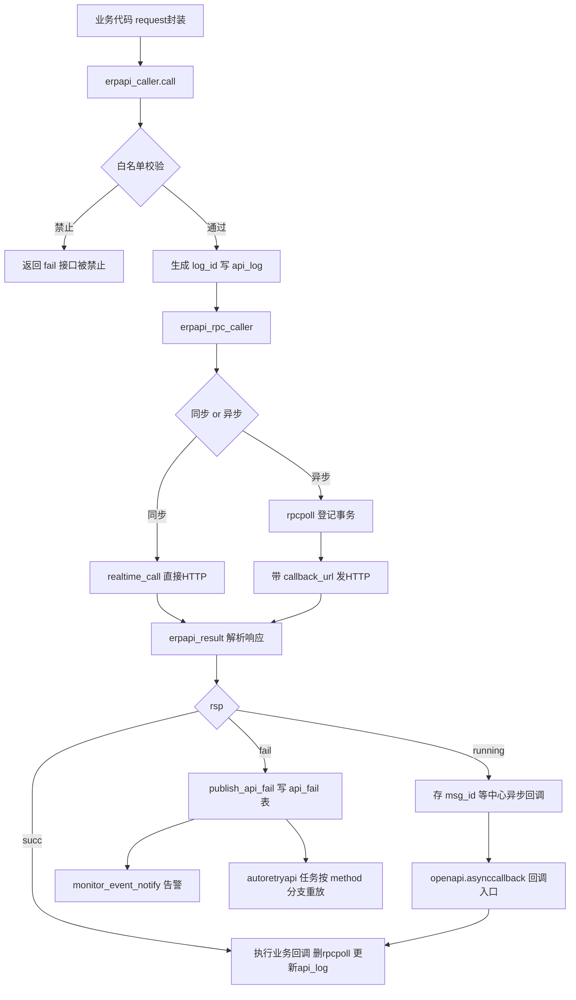
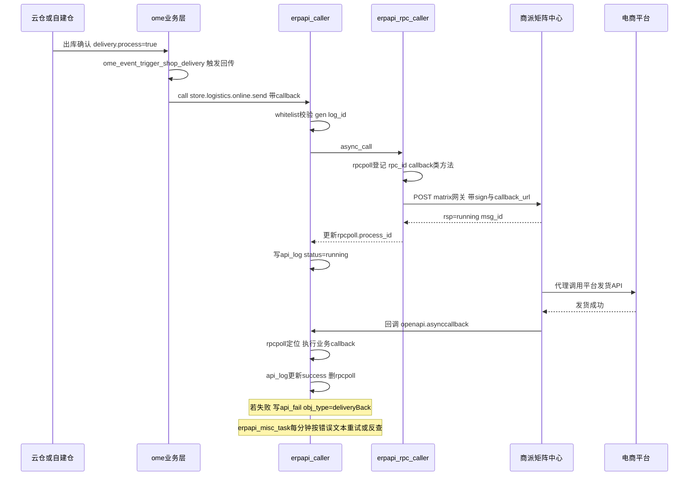
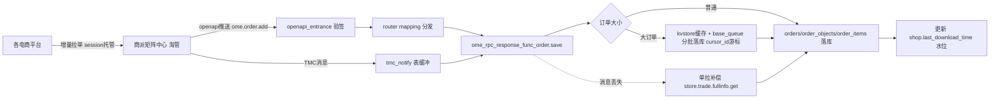
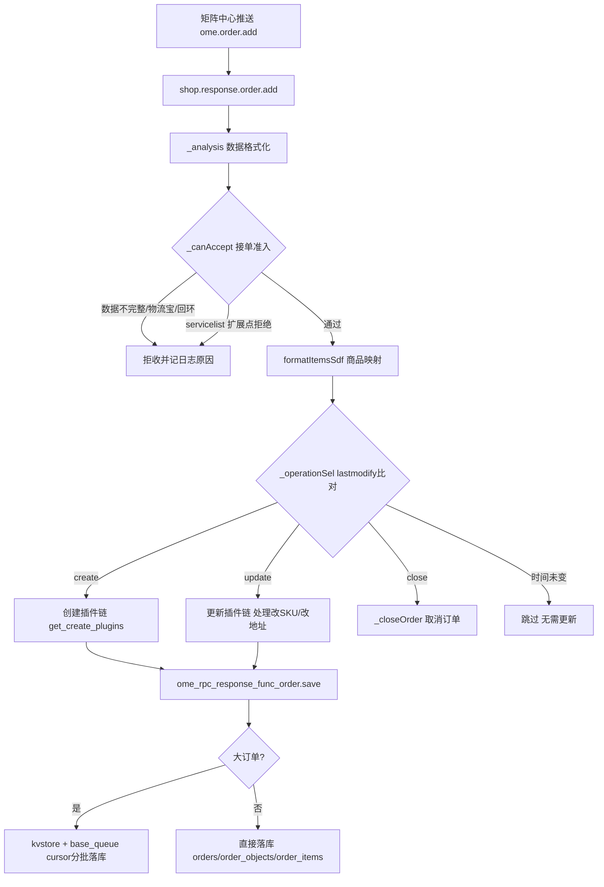
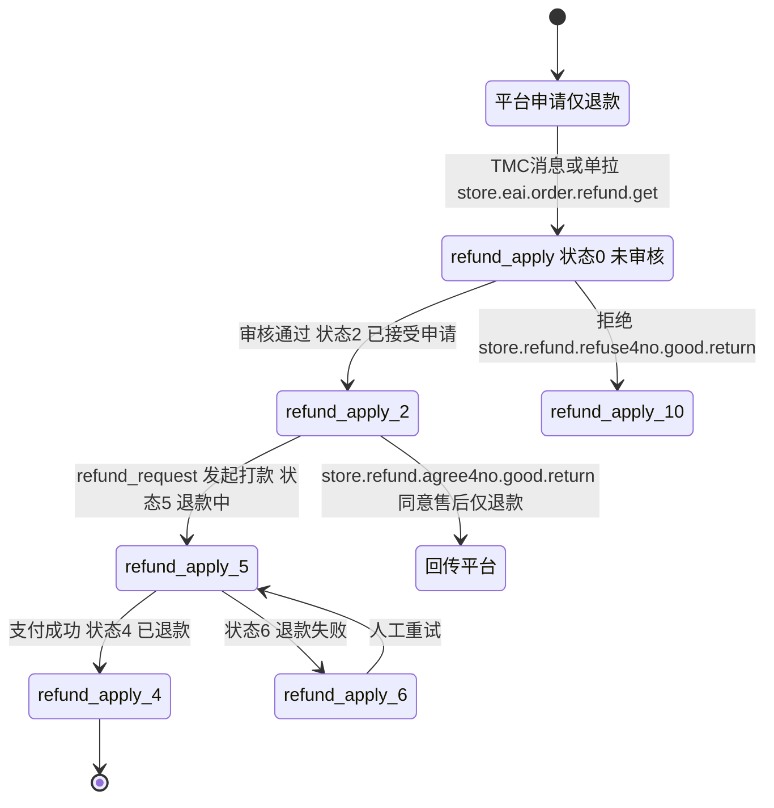
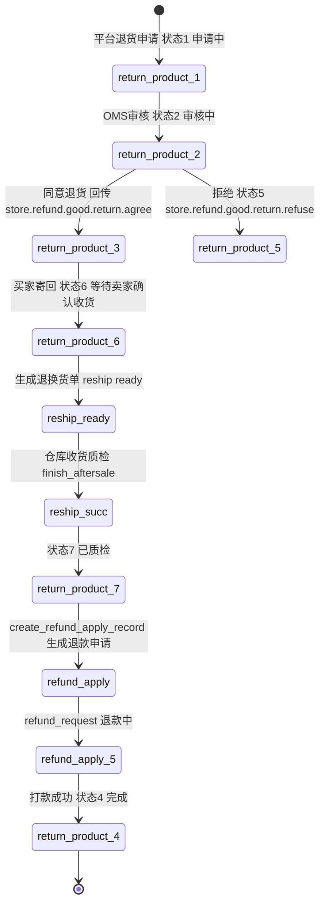
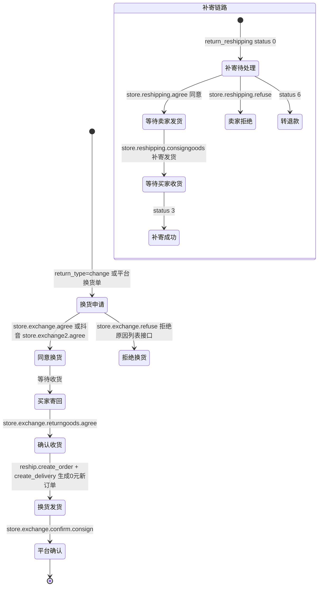
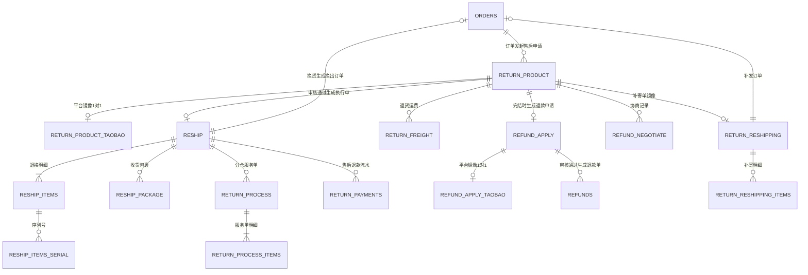

# D. 商派 ONEX OMS 逆向分析：平台对接 + 售后退换 + 技术架构机制

> 分析对象：`_research/OMS-main`（商派 ShopeX ONEX OMS，PHP 自研 MVC 框架 ECOS）
> 目的：为自研 OMS 重写提供业务模型与架构机制参考（只借鉴设计，不抄代码）
> 所有接口名、表名、类名、状态枚举均来自真实代码，标注了文件路径。

---

## 目录

1. [平台对接架构（erpapi）](#1-平台对接架构erpapi)
2. [平台覆盖清单](#2-平台覆盖清单)
3. [拉单与回传流程](#3-拉单与回传流程)
4. [店铺授权模型](#4-店铺授权模型)
5. [奇门/qimen 与云仓对接](#5-奇门qimen-与云仓对接)
6. [售后三链路](#6-售后三链路)
7. [技术架构机制总结](#7-技术架构机制总结)
8. [打印/电子面单体系](#8-打印电子面单体系)
9. [关键数据表清单](#9-关键数据表清单)
10. [重写建议总览](#10-重写建议总览)
11. [附录 A：真实代码索引](#附录-a本篇涉及的真实代码索引速查)

---

## 1. 平台对接架构（erpapi）

### 1.1 模块总览

`app/erpapi/` 是整个 OMS 最大的模块（1411 个文件），职责是：**把所有外部系统（电商平台、WMS、物流、发票、短信、支付）的 API 调用统一到一个框架里**。它不直接实现各平台的签名协议，而是把请求发给"商派矩阵中心"（matrix，即淘管数据中心），由矩阵中心代理对接各平台开放 API。这是商派 SaaS 化 OMS 的核心商业模式：

> `app/ome/lib/auth/config.php:26`：
> "商派矩阵是商派提供的统一对接平台，快速对接主流电商平台（淘宝、天猫、京东、拼多多、抖音、快手等）。自动处理订单同步、库存同步、发货回传等核心功能，安全稳定，**无需自研接口**。首次使用赠送 500 条订单流量……1 万订单/300 元/年……"

目录结构：

```
app/erpapi/
├── dbschema/           # api_fail(请求失败记录)、tmc_notify(TMC消息通知)
├── lib/
│   ├── caller.php      # erpapi_caller：API 调用总入口（白名单/日志/重试/监控）
│   ├── config.php      # erpapi_config 抽象类：URL/应用级参数/签名/白名单/报文格式化
│   ├── result.php      # erpapi_result：响应解析（rsp/msg_id/data/res/err_msg）
│   ├── errcode.php     # erpapi_errcode：平台错误码 → 重试策略映射
│   ├── exception.php
│   ├── apiname.php     # 682 行、500+ 个 API 方法名常量（store.xxx / taobao.qimen.xxx）
│   ├── channel/        # 通道抽象：shop/wms/bind/account/dealer/dchain/ediws/
│   │                   #   hchsafe/hqepay/idaas/invoice/ipay/logistics/noauth/
│   │                   #   qimen/smart/sms/store/system/tbo2o/ticket/tmcgroup/
│   │                   #   unionpay/yilianyun/exrecommend/front/dealer
│   ├── router/         # mapping.php(方法名映射)/request.php/response.php
│   ├── format/         # abstract.php / json.php / xml.php 报文格式编解码
│   ├── log/elk.php     # ELK 日志上报
│   ├── rpc/            # caller.php 仅是 kernel::require_ego() 入口，
│   │                   #   真正实现 erpapi_rpc_caller 在 app/base/lib/ego/ego.php
│   ├── bind/           # 节点绑定（授权）
│   ├── account/        # 平台账号
│   ├── autotask/task/  # retryapi.php(失败重试) / sync.php
│   ├── shop/           # 平台店铺通道
│   │   ├── config.php  # erpapi_shop_config：应用级参数组装
│   │   ├── whitelist.php # 每个平台可用的 API 白名单
│   │   ├── request/    # 按业务域分的请求封装：order/delivery/aftersale/logistics/
│   │   │               #   product/invoice/finance/reshipping/bookingrefund/...
│   │   ├── response/   # 按业务域分的响应解析：order/refund/aftersalev2/exchange/...
│   │   └── matrix/     # 77 个平台适配目录（见第 2 节）
│   ├── wms/            # WMS 通道：matrix(奇门/京东/顺丰/百世..)/openapi/prism/ftp/
│   │                   #   mixture/selfwms
│   ├── qimen/ dchain/ tbo2o/ ediws/ smart/ store/ dealer/ ...
├── model/api/fail.php  # erpapi_mdl_api_fail：失败重试调度
└── services.xml        # openapi.asynccallback => erpapi_rpc_service（异步回调服务）
```

### 1.2 分层设计

erpapi 是清晰的五层结构，每层职责单一：

| 层 | 类/文件 | 职责 |
|---|---|---|
| **调用入口层** | `erpapi_caller`（lib/caller.php） | 白名单校验、写 api_log、失败入 api_fail、监控告警、可选推 MQ |
| **通道层（Channel）** | `erpapi_channel_abstract` 及 25+ 个子类 | 决定"请求谁"：adapter（matrix/openapi/prism）、platform（平台标识）、ver（API 版本）；从 shop/wms 表加载渠道配置 |
| **配置层（Config）** | `erpapi_config` 抽象类及子类 | 决定"怎么请求"：get_url（网关地址）、get_query_params（应用级参数）、gen_sign（签名）、format（报文格式化）、whitelist（平台 API 白名单） |
| **RPC 传输层** | `erpapi_rpc_caller`（app/base/lib/ego/ego.php:2457，2849 行大文件） | 同步 realtime_call / 异步 async_call、HTTP 传输、rpcpoll 事务登记、回调分发 |
| **结果层（Result）** | `erpapi_result`（lib/result.php）+ `erpapi_format_json/xml` | 响应解码、状态提取（rsp=succ/fail/running、msg_id、err_msg、res 错误码） |

业务侧再叠加两层封装（不在 erpapi 内、由 erpapi 提供底座）：

- `lib/shop/request/{order,delivery,aftersale,...}.php`：**按业务域封装请求**，如 `erpapi_shop_request_order::get_order_detial($order_bn)` 组装参数、生成中文任务标题（"店铺(xxx)获取前端店铺 xxx 的订单详情"）、调用 `$this->__caller->call(...)`。request 抽象基类（request/abstract.php）的 `init()` 注入 channel/config/result 三件套并内置 `succ()/error()` 标准返回与 `uniqid()` 幂等键；
- `lib/shop/matrix/{platform}/request/*.php`：**按平台覆写差异化逻辑**，类继承链为
  `erpapi_shop_matrix_taobao_request_order extends erpapi_shop_request_order extends erpapi_shop_request_abstract`。
  平台目录只做"差异覆写"（如淘宝全链路状态映射），通用逻辑全部在父类。

**通道（channel）全家族**——erpapi 把"外部系统"抽象为 25+ 个通道，每个通道 = channel 类（寻址）+ config 类（协议）+ request/response 目录（业务封装）：

| 通道 | 对接对象 |
|---|---|
| shop | 77 个电商平台店铺（核心通道） |
| wms | 云仓/第三方 WMS（matrix/qimen/bms/jd/sf、openapi、prism、ftp、mixture、selfwms） |
| bind | 矩阵节点绑定（授权，MATRIX_RELATION_URL/api.php） |
| account | 平台账号体系 |
| qimen | 奇门（阿里 O2O/门店/库存） |
| dchain | 阿里供应链（翱象） |
| tbo2o | 阿里全渠道 |
| dealer | 分销/经销商体系 |
| ediws | EDI WMS 文件交换 |
| logistics | 物流平台（华强宝订阅、轨迹） |
| invoice | 电子发票（bindConfig 内置 jinshui 金税/百望/银联多供应商） |
| ipay / hqepay / unionpay | 支付（跨境支付/快递鸟代付/银联） |
| sms | 短信平台（erp.sms.* 接口族） |
| hchsafe | 风控安全（淘宝/京东登录日志、订单日志、SQL 日志上报、二次验证 ych） |
| idaas | 阿里云 IDaaS 组织/账号（aliyun.idaas.*） |
| store | 门店 |
| smart | 智能服务（智选物流等） |
| system / front / noauth | 系统消息 / 前端透传 / 免鉴权接口（物流服务可达性 service.areas.all.get） |
| ticket | 工单 |
| tmcgroup | TMC 消息订阅分组管理 |
| yilianyun | 易连云打印 |
| exrecommend | 外部推荐 |

### 1.3 API 调用生命周期

`erpapi_caller::call()`（lib/caller.php:84）签名：

```php
call($method, $params, $callback=array(), $title='', $time_out=10,
     $primary_bn='', $write_log=true, $gateway='', $logData=[])
```

- `$callback` 非空 ⇒ 异步调用（`$realtime = false`），响应通过 `openapi.asynccallback` 回调；
- `$callback` 为空 ⇒ 同步实时调用；
- `$primary_bn` 是业务单号（订单号/发货单号），贯穿日志与失败重试。

完整生命周期（真实代码路径）：

1. **白名单校验**：`$this->__config->whitelist($method)`，不在平台白名单直接返回 `['rsp'=>'fail','err_msg'=>'接口被禁止']`（caller.php:87）。
2. **生成日志 ID**：`app::get('ome')->model('api_log')->gen_id()`，并把 `log_id/obj_bn/request_title` 注入回调参数。
3. **RPC 调用**：`erpapi_rpc_caller` 链式配置 timeout/realtime/config/result/gateway/callback 后 `call()`：
   - 同步走 `realtime_call()`（ego.php:2617）：组装应用级参数 → `gen_sign` 签名 → `get_url` → `format` → `base_httpclient->post()` → `erpapi_result::set_response()` 解析。
   - 异步走 `async_call()`（ego.php:2697）：先 `begin_transaction()` 在 **rpcpoll 表**登记（id=microtime+rand、method、params 序列化、callback 类:方法、callback_params 序列化），再带上 `callback_url = openapi_url('openapi.asynccallback','async_result_handler',['id'=>$rpc_id])` 发请求；
     - 响应 `running` ⇒ 把矩阵中心返回的 `msg_id` 存入 rpcpoll.process_id，等中心异步回调；
     - 响应 `succ` ⇒ 删除 rpcpoll 记录，**立即本地执行回调** `kernel::single($callback_class)->$callback_method($format_response, $callback_params)`；
     - 超时 ⇒ rpcpoll 记 process-id，返回 `res='e00090'`（可重试错误码）。
4. **失败重试登记**：异步调用失败时 `$failApiModel->publish_api_fail($method, $callback['params'], $result)` 写入 **api_fail 表**（caller.php:137-140）。
5. **写 api_log**：状态映射 running/success/fail；响应超过 2MB 不存储（`'数据太大，不存储返回结果'`）；记录 spendtime 耗时、url、msg_id、original_bn。**如果当前在数据库事务中，用 `register_shutdown_function` 延迟到事务外写日志**（caller.php:174-179）——避免日志把事务撑大/回滚丢日志。
6. **失败监控告警**：`kernel::single('monitor_event_notify')->addNotify('rpc_warning', [...])`（caller.php:187）。
7. **异步回调闭环**：矩阵中心回调 `openapi.asynccallback` → `erpapi_rpc_service::async_result_handler` → 按 rpc_id 找 rpcpoll → 执行业务回调 → `erpapi_caller::callback()` 更新 api_log 状态（caller.php:205-227）。
8. **可选 MQ 削峰**：`caller_into_mq()`（caller.php:305）在 `SAAS_API_MQ=true` 时把请求推到 RabbitMQ（TG_API_EXCHANGE / TG_API_QUEUE，routingKey `tg.sys.api.{nodeId}`），由 taskmgr 的 Swoole 进程消费后再回调 `openapi.autotask/service`（task_type=autoretryapi），带 `taskmgr_sign` 签名防伪造。



### 1.4 签名机制

两级签名体系（都基于证书 certificate + 节点 shopnode）：

```php
// erpapi_config::gen_sign (lib/config.php:94)
if (!base_shopnode::token('ome'))
    $sign = base_certificate::gen_sign($params);   // 未绑定节点用证书签
else
    $sign = base_shopnode::gen_sign($params, 'ome'); // 已绑定用节点 token 签
```

签名串组装 `erpapi_config::assemble()`（config.php:133）：参数 `ksort` 按字符串排序 → 递归拼接 `key.value`（数组递归展开、bool 转 0/1、null 跳过）→ 末尾追加 token → md5。`licence_sign`（caller.php:288）同理但只拼 value。

值得注意的开放平台侧签名修复：`app/openapi/lib/sign.php` 的 `openapi_sign::normalizeValue()` —— "JSON 字符串参数统一规范化，避免中文与 \uXXXX 验签不一致"，即对 JSON 参数 decode 后用 `JSON_UNESCAPED_UNICODE|JSON_UNESCAPED_SLASHES` 重新 encode 再参与签名。**这是对接中最容易踩的坑，重写时必须内建**。

### 1.5 路由与报文格式

**网关路由**：`erpapi_config::get_url()`（config.php:51）返回 `MATRIX_URL`（`http://{matrix}/proxy/matrix`，安装时写入 `config/defined_ext.php` 和 `sdb_base_network.node_url`），同步调用追加 `sync` 后缀；渠道级可用 `channel['matrix_url']` 覆盖（多矩阵/全内网部署，见 ome/task.php post_install 的 matrix_type=2 全内网模式）。绑定关系走 `MATRIX_RELATION_URL`（/proxy/bind）。

**应用级参数**（`erpapi_shop_config::get_query_params`，lib/shop/config.php:52）：

```
app_id=ecos.ome, method, date, format=json,
certi_id(证书ID), v(矩阵API版本), from_node_id(本节点), to_node_id(店铺节点),
node_type(平台类型), to_api_v(前端店铺API版本), from_api_v
```

特殊处理：拼多多要求设备指纹请求头 `X-PDD-PageCode` / `X-PDD-Pati`（从 Cookie 透传，config.php:70-79）——平台风控对抗的痕迹。

**报文格式**：`lib/format/{json,xml}.php` 实现 `data_decode`，`erpapi_result::set_response($response,$format)` 统一解码后暴露 `get_status/get_msg_id/get_data/get_err_msg/get_result`。响应协议固定为 `{rsp: succ|fail|running, res: 错误码, msg_id, data, err_msg}`。

**方法名映射**：`lib/router/mapping.php` 维护 `ome.* → shop.*` 的入站方法映射（矩阵中心推给 OMS 的消息，如 `ome.order.add → shop.order.add`、`ome.refund.add → shop.refund.add`、`matrix_message.refund_created.notify → shop.tmcnotify.refund`），由 `erpapi_rpc_service` 分发到 `lib/shop/response/*` 处理类。

### 1.6 错误码与重试策略

`lib/errcode.php` 把"平台/中心错误码"映射为重试策略：

```php
private $shop = array(
    'G40012' => array('primary_bn'=>'delivery_bn','obj_type'=>'JDDELIVERY','retry'=>1),
);
private $wms = array(
    'e00090'   => array('retry'=>1),          // 请求超时
    'ERP00090' => array('retry'=>1),          // 响应解码失败
    'W30012'   => array('primary_bn'=>'delivery_bn','obj_type'=>'deliveryship','retry'=>1),
);
```

`retry=1` 的错误码才进 api_fail 自动重试通道，业务性错误（如"订单已关闭"）不盲目重试——**错误码分级是可重试/不可重试的分水岭，重写时应做成配置化错误码字典**。

### 1.7 api_fail 失败重试表

`app/erpapi/dbschema/api_fail.php`（表注释"请求失败记录"）：

| 字段 | 说明 |
|---|---|
| obj_bn / obj_type / sub_obj_bn | 业务单号 / 单据类型 / 子单号 |
| method | 失败的 API 方法名 |
| retry_params / params | 重试参数（longtext） |
| err_msg / err_code | 失败原因 / 错误代码 |
| fail_times | 失败次数 |
| status | running 进行中 / succ 成功 / fail 失败 |
| msg_id | 中心消息 id |

重试执行器 `erpapi_autotask_task_retryapi::process()`（lib/autotask/task/retryapi.php:27）按 `method` 分支**重放业务动作而非简单重发报文**，且先校验单据当前状态：

- `WMS_INORDER_CREATE`：采购单（check_status=2, eo_status=1）→ `console_event_trigger_purchase::create`；或淘管出入库单 iso → `console_event_trigger_otherstockin::create`
- `WMS_OUTORDER_CREATE`：采购退货单 / iso 出库
- `WMS_SALEORDER_CREATE`（推仓发货单）：delivery 状态若已 succ/cancel/back 则**直接删除 api_fail 记录**；ready/progress 且未暂停则 `ome_delivery_notice::create` 重推
- `WMS_RETURNORDER_CREATE`（退货入库）：reship is_check=1 → `ome_receipt_reship::reship_create` 重推 WMS

另外 `erpapi_mdl_api_fail::$objTypeProperty`（model/api/fail.php:20）定义了一批"**主动查询对账**"型重试（不是重发，而是反查平台/WMS 状态后修正本地）：

| obj_type | 说明 | 反查方法 |
|---|---|---|
| search_delivery | 查询发货单状态 | ome_delivery_notice:searchDelivery |
| search_reship | 退货单查询 | wms_trigger_reship:reshipSearch |
| search_inpurchase | 查询采购单状态 | console_event_trigger_purchase:searchPurchase |
| search_iso | 查询直接出入库单 | console_event_trigger_iso:search |
| deliveryBack | 物流信息回传平台 | ome_event_trigger_shop_delivery:delivery_confirm_send_fromsub |
| upload_invoice | 电子发票上传 | invoice_event_trigger_einvoice:upload |

> **设计要点**：重试 = "重放（replay 业务事件）+ 反查对账（search 平台真实状态）" 双通道，比裸重发 HTTP 报文健壮得多。

### 1.8 日志体系

- **api_log 表**（`app/ome/dbschema/api_log.php`，注释"api日志"）：log_id、task_name（中文任务名）、status、worker（api 方法名）、params 原始参数、transfer 回调信息、response 响应、api_type（request）、original_bn 业务单号、msg_id、重试次数、spendtime 耗时、url。模型 `app/ome/model/api/log.php` 提供 `write_log/update_log/is_repeat/set_repeat`（幂等去重）与 `retry/start_api_retry`（**从日志发起人工重试**）。
- **大表治理**：api_log 按月分区，`app/ome/dbevent/log_partition_event.ev` 是一个 MySQL EVENT（"EVERY 1 DAY ... CALL ome_log_add_partition(); CALL ome_log_remove_partition();"）——用数据库事件自动滚动分区、淘汰旧分区。
- **ELK**：`lib/log/elk.php` `erpapi_log_elk::write_log` 把 spendtime/method/status/msg_id/domain/node_id 等结构化上报。
- **2MB 截断**：响应过大不入库，防止日志表爆炸。

### 1.9 apiname.php：统一方法名字典

`lib/apiname.php`（682 行）用 PHP 常量定义了 500+ 个 API 方法名，是全系统的"接口字典"。命名有清晰的方法论：

| 前缀 | 语义 | 例子 |
|---|---|---|
| `store.*` | 经矩阵中心中转到平台/服务商的透传方法 | store.trade.fullinfo.get（单拉订单）、store.logistics.online.send（线上发货） |
| `taobao.qimen.*` | 奇门标准方法（O2O/门店/库存） | taobao.qimen.store.create、taobao.qimen.storeinventory.itemupdate |
| `taobao.scitem.*` | 菜鸟后端货品 | taobao.scitem.add / scitem.map.add |
| `erp.sms.*` | 短信服务 | erp.sms.api.sms-tpl.sendByTmpl |
| `aliyun.idaas.*` | 阿里云 IDaaS | aliyun.idaas.account.create |
| `store.wms.*` | WMS 单据协议 | store.wms.saleorder.create/cancel/get |
| `store.wlb.wms.*` | 菜鸟 BMS 单据反查 | store.wlb.wms.stockin.bill.get |
| `open.express.*` | 平台原生透传（快手面单） | open.express.ebill.get |

每个常量都带中文行尾注释（业务语义），并有两个特殊"透传通道"：`TAOBAO_COMMON_TOP_SEND='store.common.top.send'`（淘宝透传接口）与 `JD_COMMON_TOP_SEND='store.commons.send'`（京东透传接口）——**平台新接口未封装成专用方法前，业务代码可先用透传通道直接发平台原生 API**，这是应对平台接口快速迭代的逃生门设计，重写时值得保留。

按业务域看，字典覆盖：WMS 单据（发货/退换/转储/出入库/加工/盘点）、电子面单（菜鸟/顺丰/京东/申通/韵达/EMS/品骏/抖音/快手/小红书/视频号/快递鸟/易连云）、电子发票（金税/百望/银联金税，开蓝/冲红/红冲申请单/心跳检查）、店铺订单（拉单/拆单/状态更新/备注/地址修改/唯一码）、售后（退款/退货/换货/补寄/协商/赔付/客服介入）、物流（智选物流/轨迹/包裹异常/达不达）、账单（支付宝/京东钱包/抖音/唯品会）、库存（更新/查询/区域仓/门店）、安全风控、IDaaS、得物出价、翱象供应链、京东工小达/LVMI/VMI、隐私号（700 虚拟号 GROUP_UPDATE）等 20+ 域。

### 1.10 端到端时序：一次异步发货回传

以"发货单出库后回传平台物流单号"为例，串起本篇所有机制：



要点：OMS 与平台之间隔着矩阵中心，一次回传是**两跳异步**（OMS→中心 running，中心→平台→回调 OMS）；rpcpoll 表是"在途请求"的事实登记，回调丢失时可凭 process_id/msg_id 人工对账；api_log 全链路留痕（请求参数、响应、耗时、msg_id）。直连模式下重写只需把"矩阵中心"角色换掉，时序结构不变。

---

## 2. 平台覆盖清单

### 2.1 平台适配目录（lib/shop/matrix/，77 个）

360buy(京东POP老标识)、aikucun(爱库存)、alibaba(1688)、alibaba4ascp(阿里ASCP供应链)、amazon、b2b、beibei(贝贝)、ccb(建设银行)、cmb(招商银行)、congminggou(聪明狗)、dangdang(当当)、dewu(得物)、eyee(亿邮)、feiniu(飞牛)、gegejia(格格家)、gome(国美)、gs、haoshiqi(好食期)、huawei(华为)、hupu(虎扑/识货)、icbc(工商银行)、jd(京东自营)、juanpi(卷皮)、kaola(考拉)、kaola4zy(考拉自营)、kuaishou(快手)、luban(鲁班/抖音电商服务市场)、meilishuo(美丽说)、meituan4bulkpurchasing(美团快驴)、meituan4medicine(美团医药)、meituan4sg(美团闪购)、mengdian(萌店)、mgj(蘑菇街)、mia(蜜芽)、mingrong(名荣)、mls(美丽说)、mogujie(蘑菇街)、paipai(拍拍)、pinduoduo(拼多多)、pos、qqbuy(QQ网购)、renrendian(人人店)、shopex(自有商城系)、shunguang(顺逛)、suning(苏宁)、suning4zy(苏宁自营)、taobao、tmall、vjia(维家)、vop(唯品会JIT)、wdwd(微店网)、website(独立站/D1M小程序)、weidian(微店)、weimeng(微盟)、weimob/weimobr/weimobv(微盟系)、weixinshop(微信小店)、wx(微信)、wxshipin(微信视频号)、xhs/xiaohongshu(小红书)、xiaodian(小电)、xiaomi(小米)、yangsc(洋码头SC)、yihaodian(1号店)、yintai(银泰)、yitiao(一条)、youzan(有赞)、yunji/yunji4fx/yunji4pop(云集)、yunmall、yutang(渔堂)、zhe800(折800)、zkh(震坤行)。

`erpapi_channel_shop::$shop_mapping`（lib/channel/shop.php:29）还做 node_type → 矩阵平台标识 的归一化：`shopex_b2b→shopex_fxw、ecos.b2c→shopex_ecstore、bbc→shopex_bbc、qq_buy→qqbuy、pekon→pos_pekon` 等；**`taobao` 且 `tbbusiness_type=='B'` 自动识别为 `tmall`**（channel/shop.php:108）。

抖音没有独立 matrix 目录，其能力通过 apiname 常量走矩阵中心中转（如 `STORE_WAYBILL_GET`"抖音电子面单获取"、`SHOP_ORDER_SETTLE_GET='store.trade.settle.get'`"获取抖音订单明细"、`SHOP_UPLOAD_ORDER_RECORD`"抖音订单链路监控"、`SHOP_AFTERSALE_EXCHANGE_AGREE='store.exchange2.agree'`"[抖音]同意换货"），`luban` 目录即抖音电商（鲁班）服务市场对接。

### 2.2 平台 × 业务能力矩阵（依据 whitelist.php + apiname.php + request/response 目录归纳）

| 平台 | 拉单 | 发货回传 | 退款/售后 | 库存同步 | 电子面单 | 备注 |
|---|:-:|:-:|:-:|:-:|:-:|---|
| 淘宝/天猫 | ✅ | ✅ 线上/线下/虚拟 | ✅ 含换货(store.exchange.*)、补寄(store.reshipping.*)、协商(store.refund.negotiation.*) | ✅ store.items.quantity.list.update | ✅ 菜鸟 store.cn.waybill.ii.get | 全链路消息 SHOP_TMC_MESSAGE_PRODUCE；奇门店仓 |
| 京东 POP/自营 | ✅ | ✅ | ✅ 含 ASC 售后审核(store.asc.audit.reason.get)、JDALPHA 面单 | ✅ | ✅ store.etms.waybillcode.get | NPS Token、大头笔、京配判断 |
| 拼多多 | ✅ | ✅ | ✅ refund_apply_pinduoduo/return_product_pinduoduo 镜像表 | ✅ | ✅ | 需设备指纹头 X-PDD-PageCode |
| 抖音(经矩阵/luban) | ✅ | ✅ | ✅ 换货 exchange2、审核意见同步 SHOP_AFTERSALE_RETURN_REMARK | ✅ 区域库存时效 SHOP_SKU_SET_SELL_TYPE | ✅ store.waybill.i.get | 账单 store.download.shop.account.item |
| 快手 | ✅ | ✅ | ✅ 代客填退货单号 store.rp.returngoods.refill | ✅ sku 明细 store.item.sku.list | ✅ open.express.ebill.get / store.express.ebill.* | |
| 小红书 | ✅ | ✅ | ✅ | ✅ | ✅ store.waybill.stdtemplates.get | xhs/xiaohongshu 双目录 |
| 微信视频号 | ✅ | ✅ | ✅ | ✅ | ✅ store.waybill.i.pre.get 预取号 | wxshipin |
| 唯品会 JIT/JITX | ✅(vop 模块定时下载) | ✅ store.jitx.delivery.result.feedback | ✅ | ✅ store.get.inventoryoccupiedorders | ✅ store.jitx.waybill.search | 独立 app/vop 模块 |
| 有赞 | ✅ | ✅ | ✅ refund_apply_youzan 镜像 | ✅ | - | |
| 考拉/考拉自营 | ✅ | ✅ | ✅ return_product_kaola 镜像、store.refund.agree | ✅ | - | |
| 苏宁/苏宁自营 | ✅ | ✅ | ✅ | ✅ | - | |
| 1号店 | ✅ | ✅ | ✅ return_product_yihaodian 镜像 | ✅ | - | |
| 华为 | ✅ | ✅ | ✅ return_product_huawei 镜像 | ✅ | - | |
| 得物 | ✅ 出价制 | ✅ 品牌直发 store.order.brand.deliver.* | ✅ 退货审核/质检/签收 | ✅ 实时库存 store.bidding.*.realtime.inventory | ✅ 虚拟运单号 | 出价(bidding)模式特殊 |
| 美团(闪购/医药/快驴) | ✅ | ✅ 拣货确认 store.trade.pickup.confirm | ✅ | ✅ | - | 小时达 |
| 当当 | ✅ | ✅ | ✅ | ✅ store.books.quantity.list.update | - | |
| 1688/阿里分销 | ✅ store.fenxiao.trade.fullinfo.get | ✅ store.fenxiao.jz.logistics.offline.send | ✅ | ✅ store.fenxiao.items.quantity.list.update | - | 淘分销 |
| 银泰/国美/贝贝/蜜芽/卷皮/蘑菇街/美丽说/微盟/微店/有赞/云集/洋码头/一条/小米/虎扑... | ✅ | ✅ | 部分 | 部分 | - | 长尾平台按白名单裁剪 |
| ShopEx 自有系(b2c/b2b/ecstore/ecshopx/bbc/dzg/fy/pos/website/D1M) | ✅ | ✅ | ✅ store.trade.refund.add 等 | ✅ | - | 自有商城，走同一矩阵协议 |
| 银行系(icbc/ccb/cmb) | ✅ | ✅ | - | - | - | 积分商城类 |
| 震坤行 zkh / 供应商 | 采购发货单 | store.order.delivery.confirm | - | - | - | B2B 采购协同 |

> 白名单机制：`erpapi_shop_whitelist`（lib/shop/whitelist.php）为每个 node_type 定义允许的 API 集合，再合并 `$public_api` 平台共有接口；**经销模式店铺（delivery_mode=jingxiao）只允许单拉订单接口 SHOP_TRADE_FULLINFO_RPC**（lib/shop/config.php:35-39）。平台能力裁剪用白名单而不是代码分支，是干净的扩展方式。

---

## 3. 拉单与回传流程

### 3.1 总体模式：推为主、拉为辅

商派 OMS 的订单获取**不是自己轮询平台 API**，而是"矩阵中心（淘管）推送 + OMS 被动接收 + 单拉补偿"：

1. **增量推送**：矩阵中心持有各平台 session，按平台增量（modified 时间窗）拉单，通过 openapi 入口推给 OMS（`ome.order.add → shop.order.add`，router/mapping.php）。落地表 `tmc_notify`（tmc_key 存储索引/tid 订单号/oid 子单号/sdf 消息内容）做消息缓冲与幂等。
2. **OMS 接收保存**：`app/ome/lib/rpc/response/func/order.php` `ome_rpc_response_func_order::save(&$sdf)` —— "订单保存"入口：校验 sdf、按 node_id 过滤店铺、处理特殊店铺硬编码规则、shopex_b2c 老体系 item_type goods→product 兼容、写 api_log（"订单创建接口[订单：xxx]"）。
3. **大订单分队列落库**：`app/ome/lib/order/rpc/response/queue/order.php` `ome_order_rpc_response_queue_order::add(&$cursor_id,$params)` —— 订单主体先存 kvstore（key=`order-{order_bn}-{shop_id}`），order_objects 明细分批（cursor_id 游标，limit 50/批）追加保存，全部完成后清理 kvstore 并解除订单 disabled 标记。这是 base 伪队列（sdb_base_queue）+ kvstore 的流式落库方案，防止超大订单一次事务撑爆。
4. **单拉补偿**：`SHOP_TRADE_FULLINFO_RPC='store.trade.fullinfo.get'`（"单拉订单接口"）按 tid 主动拉全量订单详情，用于消息丢失/失败重试/经销店铺；`SHOP_GET_TRADES_SOLD_RPC='store.trades.sold.get'` 按时间段批量拉。
5. **同步水位**：shop 表的 `last_download_time`（"上次下载订单时间(终端)"）记录每店增量水位；`order_sync_status` 表（"订单同步状态表"，0 未同步/1 同步失败/2 同步成功）与 `sync_task` 表（params/action/retry，"同步任务"）跟踪单据级同步结果；`delivery_sync` 表跟踪发货回传同步。



### 3.2 订单推送的接收管线（erpapi 侧）

矩阵中心推单落到 OMS 后，先进入 `lib/shop/response/order.php`（`erpapi_shop_response_order`）的标准管线，再进入 ome 侧保存。管线七步（response/order.php:97 `add($sdf)`）：

1. **apilog 预置**：`title='创建订单[xxx]'`、original_bn=order_bn —— 每条推送有独立日志；
2. **`_analysis()`**：sdf 数据格式化（平台字段 → OMS 标准订单结构，含支付/物流/优惠明细解析，460 行大方法）；
3. **`_canAccept()` 接单准入**（response/order.php:707）：
   - 数据完整性：order_bn / order_objects 为空 ⇒ "接收数据不完整"；
   - 配置开关：`ome.delivery.wuliubao=false` 且订单 is_force_wlb=true ⇒ "物流宝发货订单不接收"；
   - 来源过滤：`order_from=='omeapiplugin'` ⇒ 不接收（防回环）；
   - **服务扩展点拦截**：遍历 `kernel::servicelist('erpapi.service.order.canaccept')`，任何注册模块的 `canAccept($this)` 返回 `['succ'=>false,'msg'=>...]` 即拒单——**接单规则做成可插拔服务而非硬编码**（被注释掉的"未支付订单不接收"就是曾经的硬编码，现已下放给扩展点）；
4. **`formatItemsSdf()`**：订单明细格式化（商品映射：平台 sku → OMS 货品，映射失败进 order_fail）；
5. **`_operationSel()` 幂等路由**（response/order.php:178）：比对推送的 `lastmodify` 与本地已有订单的修改时间，决定 `create / update / close / 跳过`（"更新时间没变，无需更新"）——**用平台 modified 时间戳做乐观幂等**；
6. **`_createOrder()` / `_updateOrder()` / `_closeOrder()`**：
   - 创建走组件化插件链 `get_convert_components()/get_create_plugins()`（转换组件 + 创建插件，各插件可改写订单，如赠品、预售、组合装拆解）；
   - 更新走 `get_update_components()/get_update_plugins()`，处理**买家修改 SKU**（order_bool_type/change_sku/old_sku 字段回传）、地址修改等；无结构变化时记 "订单无结构变化，无需更新"；
   - 取消订单 title 变为 "取消订单[xxx]"；
7. **并发防重**：`concurrentKey($sdf)` 生成并发锁 key（同一订单的并发推送串行化，配合 `ome_mdl_concurrent`）。

ome 侧的 `ome_rpc_response_func_order::save` 与队列分批落库（3.1 节）在此管线之后执行；两层 api_log（erpapi 层 + ome 层）分别记录"推送接收"与"订单创建"。



### 3.3 订单状态回写平台（全链路）

淘宝适配层维护 OMS 内部状态 → 平台全链路事件映射（lib/shop/matrix/taobao/request/order.php:26）：

| OMS 节点 | 平台事件 key | 平台展示 |
|---|---|---|
| build（收单） | QIMEN_ERP_TRANSFER | 已转单 |
| check（审单） | QIMEN_ERP_CHECK | 已客审 |
| to_wms（推仓） | QIMEN_CP_NOTIFY | 已通知配货 |
| dispatch（出库） | QIMEN_CP_OUT | 已出库 |

通过 `SHOP_TMC_MESSAGE_PRODUCE='store.tmc.message.produce'`（"淘宝全链路接口"）上报；抖音对应 `SHOP_UPLOAD_ORDER_RECORD='store.upload.order.record'`（"抖音订单链路监控接口"）；加急发货用 `SHOP_LOGISTICS_ORDER_REPORT`。

### 3.4 发货回传

发货确认后的回传链路（`app/ome/lib/event/trigger/shop/delivery.php` `ome_event_trigger_shop_delivery`）：

- 触发条件：delivery.process=true（已发货），或按配置 `ome.delivery.back_node` 提前到 check（校验后回写，要求 verify=true）/ print（打印后回写，要求 expre_status=true）；
- **读写分离兼容**：`$deliveryModel->db->force_master(true)` 强制读主库——注释明说"发货后立刻回写：兼容 PolarDB 代理读写分离"，从库延迟会导致查不到刚写的 process=true；每种跳过原因记录 `_getDeliverySkipReason`（process_not_true/order_data_empty/back_node_check_verify_false...），可重试的原因投递 misc_task 延时重试（`_scheduleDeliveryConfirmRetry`）；
- 汇总发货单关联订单（delivery_order）、成功运单（shipment_log status=succ），调用平台发货接口：
  - `SHOP_LOGISTICS_ONLINE_SEND='store.logistics.online.send'` 线上物流
  - `SHOP_LOGISTICS_OFFLINE_SEND='store.logistics.offline.send'` 线下物流
  - `SHOP_LOGISTICS_DUMMY_SEND='store.logistics.dummy.send'` 虚拟发货
  - 天猫国际 `SHOP_WLB_THREEPL_OFFLINE_SEND`、家装 `SHOP_WLB_ORDER_JZWITHINS_CONSIGN`、商家配送 `SHOP_LOGISTICS_SELLER_SEND`（小时达，配套签收核销 writeoff、修改运单号 resend）
- 失败 ⇒ api_fail（obj_type=deliveryBack），定时任务反查/重发。

### 3.5 库存回传

- 直销：`SHOP_UPDATE_ITEMS_QUANTITY_LIST_RPC='store.items.quantity.list.update'`；分销：`store.fenxiao.items.quantity.list.update`；
- 定时器 `inventorydepth`（app/ome/lib/autotask/timer/inventorydepth.php，taskmgr 每 5 分钟 domainqueue 触发）做**库存深度回写**：`sync_shop_skus` 先下载平台在售商品缓存，再按策略计算可售数推送；
- 得物等特殊平台走实时库存查询接口（store.bidding.*.realtime.inventory）。

### 3.6 重试补偿闭环总结

**自动重试调度器**：`erpapi_misc_task`（lib/misc/task.php，注册为 erpapi 的 autotask 服务，由 misctask 定时器每 30 秒触发框架级 minute/hour 分档）：

- **minute()** 每分钟档：
  - 扫描 api_fail 中 `obj_type=deliveryBack`（物流回传）近 5 天、fail_times<15、距上次修改>300 秒的记录，用 **err_msg REGEXP 匹配"可重试错误关键词字典"**（timeout/qimen inernal error/e00090/HTTP Error 502/HTTP Error 403/再试/超时/重试/urlopen error/拆单失败/系统内部错误/QUERY_REFUND_ERROR 等 20+ 个）且排除不可重试词（"请修改后重试"）——**按错误文本语义分级重试**，每轮最多 50 条，按 `last_modify DESC, fail_times ASC` 排序（新失败优先、少失败优先）；
  - bookingrefund_back（订单退款回传）同规则每轮 30 条；
  - 仓储单据反查族（search_delivery/search_inpurchase/search_outpurchase_return/search_in*/search_out* 共 11 类）距上次>1800 秒即反查对账，每轮 100 条；
  - `console_delivery::retryRequestWmsDelivery()` 重推 WMS 失败发货单；
- **hour()** 每小时档：upload_invoice（电子发票上传）按小时重试（"待签收等场景间隔更合理"），fail_times<50，特定错误（"订单无开票记录"）直接删除记录；
- 退避策略：靠 `last_modify|sthan time()-300`（5 分钟冷却）+ fail_times 上限（15/50 次）实现简单指数外的**固定间隔 + 次数封顶**退避。

```
实时失败 → api_fail(status=fail)
        → erpapi_misc_task minute/hour 扫描（错误文本 REGEXP 分级 + 冷却窗口 + 次数封顶）
        → api_fail::retry → erpapi_autotask_task_retryapi::process 按 method 重放业务事件
        → 成功: status=succ / 单据已终态: 删除记录
        → 反查型(search_*): 查平台真实状态修正本地，防止"重发导致重复"
        → 人工通道: api_fail finder 列表发起 / api_log::retry 从日志重放（is_repeat 幂等）
        → 告警: monitor_event_notify rpc_warning → sendnotify 定时任务 → 企业微信(taskmgr notify/workwx)
```

---

## 4. 店铺授权模型

### 4.1 shop 表（app/ome/dbschema/shop.php）

核心字段（label 摘自 schema）：

| 字段 | 说明 |
|---|---|
| shop_id (pkey, varchar32) / shop_bn | 店铺 ID / 店铺编码 |
| name / shop_type | 店铺名称 / 店铺类型（= node_type，如 taobao/jd/pinduoduo） |
| **config (text)** | **序列化配置：appkey/secret/session 等授权凭证** |
| crop_config (serialize) | 裁剪配置 |
| node_id | 矩阵节点 ID（与中心通信的寻址键） |
| last_download_time | 上次下载订单时间(终端) —— 拉单水位 |
| last_upload_time | 上次上传订单时间(ome) |
| last_store_sync_time | 上次库存同步时间 |
| active / disabled | 激活 / 禁用 |
| order_type / business_type | 订单类型 / 业务分类（zx 直销、fx 分销） |
| tbbusiness_type | 淘宝店铺类型（B ⇒ 按天猫处理） |
| onoffline | 线上/线下业务区分标记 |
| delivery_mode | 发货模式（self 自发 / jingxiao 经销） |
| aoxiang 签约状态/时间 | 阿里翱象签约 |
| matrix_url | 矩阵请求地址（可指向不同矩阵，支持全内网） |
| dealer_id / org_id | 经销商 ID / 运营组织（多组织隔离） |
| area/zip/addr/default_sender/mobile/tel | 发货地址信息 |
| filter_bn / bn_regular | 订单号过滤规则 |

凭证安全：`ome_mdl_shop::aes_encode/aes_decode`（model/shop.php:205）对敏感配置做 AES 加解密后才落库/出库。

### 4.2 授权（绑定）流程

两种接入模式（app/ome/lib/auth/config.php）：

1. **商派矩阵对接**（主流）：OMS 作为矩阵的一个"节点"（node），店铺授权在矩阵中心侧完成（用户到平台 OAuth 授权给商派应用），OMS 与中心之间用**证书体系**互信：
   - `base_certificate::certi_id()/token()`：本 OMS 实例证书；
   - `base_shopnode::node_id('ome')/active('ome')/gen_sign()`：节点注册与签名（安装时 post_install 自动 `base_shopnode::active('ome')`）；
   - 绑定：`erpapi_bind_request_bind::bind()`（lib/bind/request/bind.php）向 `MATRIX_RELATION_URL/api.php` 提交 `app=app.applyNodeBind, node_id, from_certi_id, api_url(回调地址), node_type, to_node, shop_name` + `certi_ac` 签名；成功后写 kvstore 'binding' 缓存防重复绑定；"绑定关系已存在,不需要重复绑定"也视为成功。
   - **平台 session 不落 OMS 本地**——由矩阵中心托管，OMS 只持有节点级凭证。这是 SaaS 代理模式的授权隔离设计。
2. **直连模式**：auth/config.php 同时列出各平台开放平台入口（淘宝 open.taobao.com、京东 open.jd.com、抖音 op.jinritemai.com、拼多多、快手、小红书、美团、唯品会 vop.vip.com），商家自建应用直连时 appkey/session 存 shop.config（AES 加密）。

### 4.3 多店铺隔离

- 数据层：几乎所有业务表带 `shop_id` 列并建索引（orders/delivery/refund_apply/return_product/api_fail.obj 关联等），平台镜像表用 `shop_id+return_id` 复合主键；
- 权限层：shop 关联 `org_id` 运营组织 + dealer_id 经销商，后台按组织过滤店铺列表（ome_finder_shop）；
- 调用层：每次 API 调用由 `erpapi_channel_shop::init($node_id,$shop_id)` 加载店铺快照（static 缓存 + crc32 key），`to_node_id` 寻址，天然按店隔离；
- TMC 订阅分组：`lib/tmcgroup/`（`EINVOICE_ADD_TMC_GROUP='store.tmc.group.add'` 等）按店铺管理消息订阅分组。

### 4.4 操作员 SSO（account 通道）

除了店铺授权，erpapi 还有 `lib/account/` 通道处理**后台操作员的企业身份联邦**：`erpapi_account_config::$requestType = ['token'=>'oauth','userinfo'=>'resource','permission'=>'resource','syncpermission'=>'normal']`，`request/user.php` 的 `claimDefinition()` 按 OIDC 提供方（`pam.passport.oidc.info` 配置的 oidctype）切换 claim 映射——`ciam`（阿里云 IDaaS CIAM：post_logout_redirect_uri/phone_number/name/sub）、`okta`（preferred_username/name/sub/email）。配合 `lib/idaas/` 的 aliyun.idaas.* 接口族（组织/账号 CRUD、登录、验证码）实现"OMS 后台账号托管到企业 IDaaS"。

> 重写启示：平台授权（店铺 session，机器身份）与操作员登录（OIDC，人的身份）在商派是两套完全独立的通道，这个边界值得保留。

---

## 5. 奇门/qimen 与云仓对接

商派代码里"奇门"出现在两个完全不同的场景，注意区分：

### 5.1 出向：erpapi WMS 奇门通道（OMS → 第三方 WMS）

`lib/wms/matrix/qimen/` 是把 OMS 单据以**奇门仓储协议**（taobao.qimen.* 规范）经矩阵推给第三方云仓的适配层：

- request：branch(仓库)/delivery(发货单)/goods(货品)/logistics(物流公司)/reship(退货单)/stockdump(盘点)/stockin(入库)/stockout(出库)/supplier(供应商)
- response：delivery/inventory/reship/stock/stockdump/stockin/stockout/transferorder
- 对应 apiname 常量：`WMS_SALEORDER_CREATE='store.wms.saleorder.create'`（推发货单）、`WMS_SALEORDER_CANCEL`、`WMS_RETURNORDER_CREATE='store.wms.returnorder.create'`（推退换单）、`WMS_INORDER_CREATE/WMS_OUTORDER_CREATE`（出入库）、`WMS_TRANSFERORDER_CREATE`（转储）、`WMS_STOCK_QUERY`（库存查询）、`WMS_ITEM_ADD/UPDATE`（物料）、`WMS_WAREHOUSE_LIST_GET`、`WMS_LOGISTICS_COMPANIES_GET` 等——**一套标准单据协议覆盖销售出库/退货入库/采购出入库/转储/盘点全场景**。
- WMS 通道族：`lib/wms/` 下除 matrix/qimen 外还有 matrix/{360buy,arvato,bim,bms(菜鸟BMS),fineex,flux,ilc,jd,kejie,sf,suning,yjdf,yph}、openapi/{publicwms,cnss,sku360}、prism、ftp、mixture、selfwms——即"奇门系、京东云仓系、菜鸟 BMS 系、FTP 文件交换系、自建 WMS 系"多协议并存，`erpapi_wms_config` 统一抽象。
- 菜鸟 BMS 专有接口：`WMS_BMS_ORDER_CREATE`、`store.wlb.wms.stockin.bill.get`（入库收货）、`stockout.bill.get`（出库发货）、`return.bill.get`（销退收货）、`inventory.profitloss.get`（盘点）、`bill.query`（已完成单据对账）——**按单据类型反查对账**的设计。
- 奇门订单流转事件（QIMEN_CP_NOTIFY/QIMEN_CP_OUT，见 3.2）也属于这套体系：云仓作业节点回传驱动 OMS 状态。

### 5.2 入向：app/qimen 中间件（外部系统 → OMS）

`app/qimen`（app.xml："qimen中间件应用"）是 OMS 暴露的奇门服务端：

- `lib/rpc/service.php` `qimen_rpc_service::process()`：处理 `onex.oms.custom.iostock.add`（接收转仓单通知 → `qimen_iostock_iostock::add` 创建入库单 + write_log"接收转仓单通知"）和 `onex.oms.custom.openapi.sync`（base64 解包 q 参数后转发 `openapi_entrance::service`，即**奇门通道复用 openapi 全套验签分发**）。
- 当前开源版本该入口被硬编码禁用（直接返回 `sub_code=403 '禁止请求此接口!'`，原逻辑整体注释保留）——逆向时以注释代码为准理解设计。
- `lib/iostock/iostock.php`：转仓/出入库单接收实现。

### 5.3 阿里全渠道（app/tbo2o）与翱象（dchain）

- `app/tbo2o`（"阿里全渠道管理"）：lib/{cat,common,event,finder,rpc,shop,store}，配合 apiname 的 `QIMEN_STORE_CREATE/UPDATE/DELETE/QUERY`（门店维护）、`QIMEN_ITEMSTORE_BANDING`（商品-门店绑定）、`QIMEN_STOREINVENTORY_ITEMINITIAL/ITEMUPDATE/ITEMQUERY/ITEMADJUST`（门店/电商仓库存全量、增量、查询、占用调整）、`OMNIORDER_ALLOCATEDINFO_SYNC`（ISV 同步派单结果到星盘）、`QIMEN_OMNIORDER_ACCPETED/STORE_REFUSE/STORE_CONSIGNED`（店掌柜接单/拒单/发货）、`SCITEM_ADD/UPDATE/QUERY/MAP_ADD/MAP_DELETE`（后端货品与商品映射）——完整的"线上下单、门店发货"O2O 库存路由体系。
- `lib/dchain/`（供应链）+ 翱象接口组 `SHOP_AOXIANG_*`：仓库对接、物流对接、销售物料/组合货品异步批量对接、货品关系映射、实仓库存同步（store.aoxiang.physics.inventory.batch.upload）、**仓作业信息同步（alibaba.dchain.isv.wms.orderprocess.report）**、黑白名单快递决策。taskmgr 定时任务 syncaoxiang/mappingaoxiang/aoxiangdelivery/aoxiangsync 驱动同步。

### 5.4 其他对接模块盘点

| 模块 | app.xml 描述 | 内容与机制 |
|---|---|---|
| **app/openapi** | 开放数据接口（淘管数据接口） | OMS 自己的开放 API 服务端：`lib/entrance.php` `openapi_entrance::service()` 标准五步管线——检查系统级参数(e000001) → `openapi_sign` 验签(e000002 签名验证失败) → `openapi_conf::getMethods()` 检查接口是否存在(e000003) → `openapi_privilege::checkAccess(flag,class,method)` 权限(e000004) → `openapi_statistics` 监控统计 → 实例化接口对象执行。lib/{sign,privilege,statistics,errorcode,format,finder} 齐全。矩阵中心推单、异步回调（openapi.asynccallback）、taskmgr 回调（openapi.autotask/service）全部经此入口 |
| **app/taoexlib** | "淘管基础库：淘管队列,导入导出" | 淘管（矩阵中心）同源的基础库：`lib/queue.php` Redis 三级队列（NORMAL/REALTIME/TIMING，TG_QUEUE_HOST/PORT 配置）、ietask（导入导出任务）、httpsqs、storager、sms、delivery；批量导入导出（订单/商品 CSV）与大数据异步化都靠它 |
| **app/vop** | "唯品会JIT相关业务" | 独立业务模块：lib/{purchase(order/pick),pick/stockout,vreturn/diff,aftersales,bill,operation,autotask,finder}。taskmgr 定时任务 vopurchase（采购单下载）/vopick（拣货单下载）/vopickinventory（实时销售订单）/vopbill（账单）/vopreturn（退货单）/jit_vreturn_diff（退供差异单）驱动；API 走 `SHOP_COMMONS_VOP_JIT='store.commons.jit.send'`（唯品会 JIT 通用接口）、`SHOP_VOP_DOWNLOAD='store.jit.download'`、`SHOP_JITX_WAREHOUSES_GET` 等。**JIT 模式 = 平台下采购单 → OMS 转拣货/发货 → 结果反馈**，是"平台代销"型对接的样板 |
| **app/tbo2o** | "阿里全渠道管理" | lib/{cat,common,event,finder,rpc,shop,store,view}，配合 QIMEN_STORE_*/QIMEN_STOREINVENTORY_*/QIMEN_OMNIORDER_*/SCITEM_* 接口族实现门店建档、商品-门店绑定、门店库存四操作（初始化/增量/查询/占用调整）、星盘派单结果同步、店掌柜接单/拒单/发货（见 5.3） |
| **app/ediws** | "EDIWMS接口服务" | EDI 文件交换型 WMS 对接：taskmgr 任务 ediws_accountorders（实销实结明细）/ediws_accountsettlement（结算单）/ediws_shppackage（退供）/ediws_reship（主库退货单）/ediws_refundinfo（退货）/ediws_fixaccountorders（补拉）——**代销/联营场景的"实销实结"对账体系**，与 API 型对接互补 |
| **app/channel** | "第三方应用" | dbschema/{channel,adapter,logistics_logs,logistics_examinreport}：第三方 ISV 应用接入渠道（channel 表含 last_download_time 水位）、adapter 适配器注册、物流日志与体检报告——把"外部应用调用 OMS"渠道化 |
| **app/dchain** | 供应链 | 翱象（阿里 dchain）对接的本地业务侧（erpapi 侧为 lib/dchain/ + SHOP_AOXIANG_* 接口族），定时任务 syncaoxiang/mappingaoxiang/aoxiangdelivery/aoxiangsync |
| **app/o2o / app/pos** | 门店/POS | autowapdly（wap 统计发货单）、o2o_syncproduct（批量同步商品到 O2O）等 taskmgr 任务挂载点 |

### 5.5 WMS 多协议通道对比（lib/wms/）

| 通道 | 协议形态 | 适用 |
|---|---|---|
| matrix/qimen | 奇门标准（store.wms.* 经矩阵中转） | 主流第三方云仓（万里牛/旺店通/富勒 flux/科捷 kejie/百世 bim 等均在此族） |
| matrix/bms | 菜鸟 BMS（store.bms.order.create + store.wlb.wms.*.bill.get 单据反查） | 菜鸟仓 |
| matrix/jd、yjdf | 京东云仓 / 京东一件代发（store.wms.saleorder.push 提前发货、order.status.update 确认收货、售后 returnorder.apply.query 等） | 京东体系仓 |
| matrix/sf | 顺丰仓 | |
| openapi/{publicwms,cnss,sku360} | 直连 WMS 开放接口（各带独立 config.php） | 有自有 openapi 的 WMS |
| prism | 商派 prism 协议 | 商派系 WMS |
| ftp / mixture | FTP 文件交换 / 混合 | 传统 WMS、批处理对账 |
| selfwms | 自建仓（OMS 内置 WMS 模块 wms/wmsmgr 直接作业） | 自有仓 |

`erpapi_wms_config` 与 channel/wms.php 统一寻址，仓库（branch）绑定 WMS 类型后单据自动路由到对应通道——**仓库维度的多 WMS 路由**是 OMS-WMS 解耦的关键设计。

---

## 6. 售后三链路

### 6.1 领域模型总览

售后域围绕 5 组表展开（均在 app/ome/dbschema/）：

| 表 | 角色 |
|---|---|
| **return_product**（+10 张平台镜像表） | 售后申请单（平台售后单的本地映射，退货/换货/退款申请的统一入口） |
| **refund_apply**（+5 张平台镜像表） | 退款申请单（钱要不要退、退多少的审批单） |
| **refunds** | 退款单（实际打款单据，money/account/bank/pay_type/status） |
| **reship**（+reship_items/reship_objects/reship_package/reship_items_serial） | 退换货执行单（收货、质检、退库/换货出库的仓内作业单据） |
| **return_process / return_reshipping / return_payments / return_freight / return_exchange_receiver / refund_negotiate** | 平台售后服务单镜像 / 平台补寄单 / 售后退款流水 / 退货运费 / 换货收件人 / 协商记录 |

关键枚举（真实 schema）：

**return_product.status**（dbschema/return_product.php:174）：
`1 申请中 → 2 审核中 → 3 接受申请 → 6 买家已经退货等待卖家确认收货 → 7 已质检 → 4 完成`；分支：`5 拒绝`、`9 已拒绝退款`、`10 卖家拒绝退款`、`8 补差价`。
辅助标志：`is_receive 是否收货`、`is_check 是否质检`、`platform_status 平台售后状态`（原样保留平台状态串）、`is_fail 失败售后单`、`source/sub_source`（子来源注释："0 默认，1 订单，2 发货单，3 售后申请单"）。

**return_product.return_type**：`return 退货 / change 换货 / refund 退款 / jdchange 京东换货`；
**return_product.kinds**：`money 售后返现 / refund 售后退款 / reship 售后退货 / change 售后换货`。

**refund_apply.status**（dbschema/refund_apply.php:148）：
`0 未审核 → 1 审核中 → 2 已接受申请 → 5 退款中 → 4 已退款`；分支：`3 已拒绝 / 6 退款失败 / 10 卖家拒绝退款`。另有 `cs_status 客服介入状态`、`abnormal_status 异常状态标识位`、协商状态/协商同步消息字段、`bool_type 单据种类`、补偿费用、买家实退、平台优惠退回金额、运费等。

**reship.status**（dbschema/reship.php:245）：
`ready 准备发货 → progress 运送中 → succ 成功到达`；异常：`failed 发货失败 / cancel 已取消 / timeout 超时 / stop 暂停 / back 打回`。`is_check` 审核状态（1/11 待审）。

**return_reshipping.status**（平台补寄单，dbschema/return_reshipping.php:186）：
`0 补寄待处理 → 1 等待卖家发货 → 2 等待买家收货 → 3 补寄成功`；分支：`4 卖家拒绝补寄 / 5 补寄关闭 / 6 转退款`；`refund_phase`：onsale 售中 / aftersale 售后。

**return_process**（平台售后服务单，如京东 ASC）：服务单号、售后服务类型、平台处理结果、平台处理环节、服务单状态、发货包裹号、退回物流公司编码/单号、换新京东订单号、退款唯一标识、WMS 退款金额/时间。

### 6.2 链路一：仅退款（未发货/不退货）



代码要点：

- 入口：平台退款消息（`SHOP_REFUND_NOTIFY_GET='store.tmc.refundcreated.get'`、映射 `matrix_message.refund_created.notify → shop.tmcnotify.refund`）或单拉 `SHOP_GET_TRADE_REFUND_RPC='store.eai.order.refund.get'`（天猫 `store.eai.order.refund.i.get`）；
- `ome_mdl_refunds::refund_request($sdf)`（model/refunds.php:62）：先广播 `kernel::servicelist('service.refund')` 服务点（各支付网关实现 refund_request）→ 订单 `pay_status='7'`（退款中）→ `refund_apply.status='5'`（退款中）；支持归档订单（is_archive=1 走 `archive_interface_orders`）；
- 打款完成 → refund_apply.status=4，refunds 表落实际退款流水（pay_type online/offline/deposit，status succ/failed/progress/timeout...）；
- 平台侧同意/拒绝：`SHOP_AGREE_AFTERSALE_REFUND='store.refund.agree4no.good.return'`、`SHOP_REFUSE_AFTERSALE_REFUND`；考拉另有 `store.refund.agree`；
- 未发货仅退款要**拦截发货**：`SHOP_REFUND_INTERCEPT='store.rp.refund.intercept'`（退款发起拦截）、淘宝 AG `STORE_AG_SENDGOODS_CANCEL='store.ag.sendgoods.cancel'`（AG 未发货仅退款取消发货）；
- 协商：`refund_negotiate` 表 + `SHOP_REFUND_NEGOTIATION_CREATE/GET/CANAPPLY_GET`、`SHOP_REFUND_NEGOTIATERETURN(_RENDER)`。

### 6.3 链路二：退货退款



代码要点：

- **reship 是仓内执行单**：`ome_mdl_reship::create_treship($adata,&$msg)`（model/reship.php:242）从售后申请（return_id）或发货单（delivery_id）创建退换货单，处理货到付款（is_cod_order）、退货仓库（branch_id）、平台订单号回填、操作日志；`save_product_items` 保存退货明细（含序列号 reship_items_serial、保质期 reship_items_storagelife）；
- **收货质检完结**：`finish_aftersale($reship_id)`（reship.php:1502）——并发保护（status 已 succ 直接返回；条件更新 `status|noequal=>succ`）→ reship.status=succ → 联动 console.wms_reship 状态 2→3（"退货单完成"操作日志）→ `request_reship_creat_api` 回传平台（"满足条件 退换货单创建 API 执行"）→ `do_order_items_return` 订单明细退货处理（回补库存）→ 计算实退金额 `money = tmoney + diff_money + bcmoney - bmoney - had_refund` → `create_refund_apply_record($refund_apply_bn,$reshipinfo,$money,$is_archive)` 生成退款申请单 → 走仅退款的打款链路；货到付款订单不生成退款申请单且不走阿里 AG 自动退款（`shop.aliag.config.{shop_id}` 配置）；
- **质检差异**：`return_product_problem` / `return_product_problem_type`（问题件登记）、状态 8"补差价"、`diff_money`；
- **退货运费**：return_freight（邮费承担方 + 运费金额）；退款流水 return_payments；
- **WMS 联动**：退货入库推云仓 `WMS_RETURNORDER_CREATE='store.wms.returnorder.create'`，取消 `WMS_RETURNORDER_CANCEL`，售后原因列表 `WMS_RETURNORDER_REASON_LIST`，是否允许售后 `WMS_RETURNORDER_APPLY_QUERY`，回填退回物流 `WMS_RETURNORDER_UPDATE_LOGISTICS`，寄件地址 `WMS_RETURNORDER_ADDRESS`；失败进 api_fail（search_reship 反查）；
- **平台侧操作接口族**（apiname.php）：确认退货 `SHOP_CHECK_REFUND_GOOD='store.refund.good.return.check'`、签收 `SHOP_RETURN_GOOD_SIGN='store.order.brand.deliver.seller.confirm'`、质检 `SHOP_RETURN_GOOD_CHECK`、确认收货 `SHOP_RETURN_GOOD_CONFIRM='store.return.good.confirm'`、退款凭证 `SHOP_GET_REFUND_MESSAGE/SHOP_ADD_REFUND_MESSAGE`、天猫拒绝退款 `store.tmall.refund.i.refuse`、退款状态查询 `SHOP_REFUND_STATUS_GET`、售后单详情 `SHOP_TRADE_REFUND_GET`、赔付单 `SHOP_COMPENSATE_REFUND_GET='store.special.refunds.receive.get'`；
- **自动完结任务**：taskmgr `confirmreship`（"售后退货单"，`ome_autotask_task_confirmreship`，5 线程）自动确认超时未处理的退货；`lanjiereshipapprove`（拦截件售后审批定时器）、`retryreshipcancel`（重试取消）。

### 6.4 链路三：换货 / 补发（补寄）

换货 = 退货入库 + 换货出库（新发货单），补寄 = 纯补发出库：



代码要点：

- `ome_mdl_reship::create_order($reshipinfo)`（reship.php:1033）+ `create_delivery($adata)`（reship.php:991）：换货生成**关联新订单与新发货单**（reship 表有对应关联字段），复用正向履约链路（推仓/打单/发货）；换货收件人存 `return_exchange_receiver`；
- 天猫换货接口族：`SHOP_AGREE_CHANGE_I_GOOD_TMALL='store.exchange.agree'`、`SHOP_REFUSE_CHANGE_I_GOOD_TMALL`、`SHOP_EXCHANGE_CONSIGNGOODS='store.exchange.consigngoods'`（卖家发货）、`SHOP_EXCHANGE_CONFIRMCONSIGN`（卖家确认收货&&发货）、`SHOP_EXCHANGE_MESSAGE_ADD/GET`（换货留言）、`SHOP_EXCHANGE_RETURNGOODS_AGREE/REFUSE`、`SHOP_EXCHANGE_REFUSEREASON_GET`、`SHOP_EXCHANGE_GET`；
- 补寄（淘宝 reshipping 域）：`SHOP_RESHIPPING_GET/MESSAGES_GET/MESSAGE_ADD/AGREE/REFUSE/CONSIGNGOODS/REFUSEREASON_GET`（store.reshipping.*），本地镜像 `return_reshipping`（+items/items_detail/messages 子表），关联补发订单 ID/号、物流公司、快递单号、先行垫付状态、小二托管状态、超时时间；erpapi 侧 `lib/shop/request/reshipping.php`、`lib/shop/response/reshipping.php`；
- 得物品牌直发换/退货走独立接口组（store.order.brand.deliver.audit.return 退货审核 / deliver.check.return 质检 / deliver.seller.confirm 签收）；
- 京东换货：return_type=jdchange + return_process（换新京东订单号字段）跟踪平台服务单；
- 换货出库回传后通过 `SHOP_EXCHANGE_CONSIGNGOODS` 同步平台，补寄发货用 `STORE_WAYBILL_RESHIPPING_GET='store.waybill.reshipping.get'` 获取平台运单号（平台管控面单）。

### 6.5 售后消息的接收与类型转换

**平台售后单进入 OMS 的通道**（与订单推送同构）：

- 消息映射：`matrix_message.refund_created.notify → shop.tmcnotify.refund`（router/mapping.php）、`ome.refund.add → shop.refund.add`、`ome.aftersale.add → shop.aftersale.add`、`ome.aftersalev2.add → shop.aftersalev2.add`（售后 2.0 消息）、`ome.exchange.add → shop.exchange.add`、`ome.aftersale.status_update → shop.aftersale.statusUpdate`、`ome.aftersale.logistics_update → shop.aftersale.logisticsUpdate`（买家回填退货物流）；
- 响应处理类：`lib/shop/response/{refund,aftersalev2,exchange,reshipping,bookingrefund,compensate,reissue}.php`——aftersalev2 的 `add($params)`/`statusUpdate($params)` 先 `_formatAddParams/_formatStatusUpdateParams` 做平台字段→本地字段映射，再调 ome 侧 `ome_return::add($sdf,$shop_id,&$msg,&$logTitle,&$logInfo)`（app/ome/lib/return.php:76）落 return_product + 平台镜像表；
- 单拉补偿：`SHOP_GET_TRADE_REFUND_RPC='store.eai.order.refund.get'`（天猫 `.i.get`）、`SHOP_TRADE_REFUND_GET='store.trade.refund.get'`（售后单详情）、`SHOP_REFUND_STATUS_GET`（状态查询）、`SHOP_REFUND_LIST_SEARCH='store.refund.list.search'`（列表搜索对账）、赔付单 `SHOP_COMPENSATE_REFUND_GET`、预约退款 `SHOP_RDC_ORDERMSG_UPDATE='store.rdc.orderMsg.update'`。

**换转退 / 退转换**（app/ome/lib/return.php，平台侧买家改申请类型时的本地联动）：

- `processReturn($sdf)`（"换转退"，return.php:327）：释放换货冻结（`console_reship::releaseChangeFreeze`）→ 若已生成换出订单（change_order_id>0 或 change_status=1）则**取消换出订单**（`orders::cancel(id,'线上取消换货',false,'async')`，失败则 `pauseOrder` 暂停 + 打 ToChangeOrderLabel 标签；已支付则 `ome_reship_luban::refundOrder` 退款）；未生成则直接删除 `return_type='change'` 的换货明细 → reship.return_type 改 'return'、totalmoney 改为 refund_fee → return_product 同步改类型并记 `flag_type=__EDIT_RETURN_CODE`、写操作日志；
- `processChange($sdf)`（"退转换"，return.php:397）：return_product.return_type 改 'change'、status 重置 '1'（申请中）、flag_type=__EDIT_CHANGE_CODE；若 reship 未处于质检终态（is_check 不在 7/11）且平台状态为 3/6，则 `return_product::tosave` 同步状态并记录"变更类型"日志；
- `changeToRefund($data)`：换货转退款（按 order_bn+oid 定位）；`cancelChangeOrder/pauseChangeOrder`：换出订单取消/暂停（暂停时强制 `is_delivery='N'`，"换出订单:暂停并更新为:不可以发货状态"）。

> 设计启示：平台售后类型是可变的（买家可以随时把"换货"改成"退款"），OMS 必须以**幂等的状态收敛**应对：释放冻结 → 取消下游单据 → 改类型 → 记 flag，每步可重入。重写时建议把"售后类型变更"建模为显式领域事件（ChangeToReturn/ReturnToChange），带补偿动作清单。

**售后服务单（return_process）与仓收货联动**（app/ome/model/return/process.php:199 `save_return_process`）：

- 云仓（如京东一件代发 yjdf）收货后回传服务单：按 `reship_id + service_bn` 幂等更新 `service_status='finish'`、平台售后结果 afsResultType、平台处理环节 step_type；
- 新建时按 **reship_items 的 branch_id 分仓拆单**（多仓退货各生成一条 return_process），从 return_product 冗余 title/content/add_time/shop_id/attachment/comment，落 return_process_items 明细（product_id/bn/num/por_id）；`recieved='true', verify='false'`（已收货未质检）；
- `changestatus($por_id,$return_id,$type,$status)` / `changeverify(...)`：收货、质检状态推进；`cancel_process($refuse_memo)`："拒绝发货后，将 reship_id 对应的 return_process、return_process_items 表中的（记录）删除"。

### 6.6 平台售后镜像表的设计模式

**每个平台一张镜像表**：refund_apply_{taobao,tmall,pinduoduo,youzan,luban}、return_product_{taobao,tmall,360buy,kaola,pinduoduo,huawei,yihaodian,bbc,youzan,luban}。

以 return_product_taobao 为例：复合主键 `(shop_id, return_id)`，return_id 外键指向主表 return_product，其余全是淘宝特有字段（reship_addr/zip/name/phone/mobile 买家退货地址等）；refund_apply_taobao 则有留言凭证、拒绝退款原因留言、客服介入状态、退款先行垫付、分账给第三方平台的钱、分账给卖家的钱、货物状态、买家是否需要退货、退款版本号、退款对应的订单交易状态等淘系专有概念。

**为什么这么设计（逆向推断 + 代码佐证）**：

1. **主表保持平台无关**：return_product/refund_apply 只放所有平台都有的字段（单号/订单/金额/状态/店铺/类型），OMS 内部流程（审核、质检、打款）只依赖主表，业务代码零平台分支；
2. **平台字段保真存储**：各平台售后字段差异极大（淘宝的"退款版本号/分账"、京东的"服务单/换新订单号"、拼多多的凭证体系），塞进主表会造成上百个稀疏列；镜像表按平台垂直扩展，加平台 = 加一张表，不动主表；
3. **对账与回放**：镜像表存的是平台原始状态（platform_status 原样保留），出问题时可以和平台侧数据逐字段对账；`前端店铺最后更新时间` 字段支持增量比对；
4. **复合主键 shop_id+return_id**：同一 return_id 理论上可在多店场景下安全扩展（虽然实际 1:1）。

**代价**（重写时要权衡）：跨平台统一查询需要 join 或放弃平台字段；15 张镜像表的 schema 演进同步成本高；商派没有做"扩展字段 JSON 列"的折中——现代重写可用 `主表 + platform_extra JSON 列（带生成列索引）` 或 `主表 + EAV`（商派本身有 dbeav 框架，见 7.5）替代。

### 6.7 单据字段级设计备忘（重写建模参考）

**refunds（退款单/打款单据）**：退款单号 refund_bn（`gen_id()` 规则 = `date("YmdH") + '14' + 6位序列`，前缀 14 标识退款单类型——**单号内嵌单据类型码**是商派全局惯例）、订单号 order_id、退款账号 account、退款银行 bank、收款账户 pay_account、货币 currency、支付金额 money、支付网关费用 paycost、支付类型 pay_type（online 在线/offline 线下/deposit 预存款）、支付方式 payment（关联 sdb_ome_payment_cfg 自定义支付方式）、操作员 op_id、退款时间 t_ready、发款时间 t_sent、用户确认收款时间 t_received、支付状态 status（succ/failed/cancel/error/invalid/progress/timeout/ready）、来源店铺 shop_id、售后 ID return_id、退款来源、是否归档 archive。

**reship_items（退换货明细）**：小计、仓库 ID branch_id、**退换货类型 return_type、不良品/良品数量分列**（质检结果直接建模在明细行上）、子订单号 oid、**换货仓库 ID**（换货可异仓发出）、货品类型、店铺货号、申请数量 vs 实收数量、商品行唯一标识、**WMS 入库类型**（云仓收货口径）、福袋组合 ID（组合装拆解回溯）。配套 reship_items_serial（序列号/唯一码回收）、reship_items_storagelife（保质期批次）、reship_package/reship_package_items（**按包裹维度收货**——多包裹分批退回）、reship_pda_return_info（PDA 扫码收货）。

**质检与问题件**：return_product_problem（问题件登记）+ return_product_problem_type（问题类型字典），质检差异驱动"补差价"状态（return_product.status=8）与 diff_money 字段；换货场景 `change_order_id/change_status` 记录换出订单，`__jsRefundAuto`（reship.php:2629）处理京东自动退款联动。

**金额公式**（finish_aftersale 实退计算）：
`实退 money = tmoney(应退) + diff_money(质检差价) + bcmoney(补差金额) - bmoney(已补) - had_refund(历史已退)`
——把"多次部分退款 + 质检扣减"收敛为一个幂等公式，重写时直接采用。

### 6.8 三单据关系总览（ER 视角）



三链路在单据层的分工一句话总结：**return_product 管"申请与审批"（平台语义），reship 管"货的进出"（仓库语义），refund_apply/refunds 管"钱的审批与支付"（财务语义）**；三者通过 return_id/reship_id/apply_id 串联，任何一条链路都是三张单据的不同组合：

- 仅退款 = refund_apply → refunds（无 reship）；
- 退货退款 = return_product → reship（收货质检）→ refund_apply → refunds；
- 换货 = return_product(type=change) → reship（收旧货）→ 新 orders + delivery（发新货，无退款单）；
- 补寄 = return_reshipping → 新 orders + delivery（平台补寄单驱动）。

---

## 7. 技术架构机制总结

### 7.0 框架底座：ECOS 约定式 MVC

理解所有机制前先明确框架约定（app/base/kernel.php + autoload.php）：

- **类名即路径的自动加载**：`omsAutoloader` 按类名前缀路由——`{app}_ctl_{path}` → `app/{app}/controller/{path}.php`、`{app}_mdl_{name}` → `app/{app}/model/{name}.php`、`{app}_{lib}_{path}` → `app/{app}/lib/{path}.php`；还支持 `trait` 前缀与 `CUSTOM_CORE_DIR` 定制目录覆盖（客户化代码不改内核）；
- **app 模块化**：`app::get('ome')->model('orders')/lib()/getConf()/define()`，每个 app 由 app.xml（元数据/版本/依赖）+ services.xml（服务注册）+ dbschema（表定义，安装时自动建表）+ desktop.xml（后台菜单/权限 workground）构成；`ome_task::post_install/post_update`（app/ome/task.php）提供安装钩子与**版本化升级脚本链**（`version_compare($dbver,'1.0.x','<')` 逐个执行 script/update/*.php）；
- **kernel::single($class,$arg)**（kernel.php:379）：按"类名+参数序列化 md5"双键的单例池，类名第一段自动解析为所属 app 注入构造函数——`kernel::single('ome_branch')` 即 ome 模块的 branch lib 单例；`kernel::database()` 返回 `base_db_connections`（可被 DATABASE_OBJECT 常量替换，读写分离/代理在此层接入）；
- **模型基类**：`base_db_model` → `dbeav_model`（EAV 扩展 + modifier 列修饰 + 操作日志 + 回收站），dbschema PHP 数组定义表（列类型支持 `table:orders@ome` 外键语义、枚举 type=array、serialize/json 列类型）。

这套"约定优于配置"的底座支撑了后面所有机制：模块自治（app.xml/services.xml/dbschema 三件套）、扩展点（servicelist）、定制隔离（CUSTOM_CORE_DIR）。

### 7.1 队列体系：base 伪队列 → taskmgr Swoole 秒级队列

**第一代（base 伪队列，仍在用做流式落库）**：`sdb_base_queue` 表（dbschema/queue.php）：queue_id、queue_title、status（running/hibernate/paused/failure）、worker（处理类）、cursor_id（执行游标）、total/remaining（队列长度/剩余）、task_name（永久任务名）、params（serialize）、errmsg。`base_mdl_queue::flush()` 的老 HTTP 自触发入口已被 `return true` 屏蔽（"屏蔽原来的入口"），`save()` 重写为**落库后立即 push 到 taskmgr MQ**：

```php
// base/model/queue.php:53 —— "重写伪队列数据保存的方法，任务走taskmgr机制"
$push_params = ['data'=>['queue_id'=>..,'task_type'=>'queue'], 
                'url'=>kernel::openapi_url('openapi.autotask','service')];
kernel::single('taskmgr_interface_connecter')->push($push_params);
```

**第二代（taskmgr，Swoole 秒级队列/调度中心）**：独立 app（app/taskmgr），CLI 入口 `sw.php`（swcommand：list/queue/task 命令，swconsole 输出）。

核心进程模型 `taskmgr_swprocess_manage::run()`（lib/swprocess/manage.php）：

- 单实例保护：pid 文件 `/var/run/swoole-taskmgr.pid` + `Process::kill($pid,0)` 探活；
- `Swoole\Process\Manager` 统一编排两类进程池：
  - **消费池**：`taskmgr_whitelist::get_all_task_list()` 中每个任务 `addBatch(threadNum)` 启动 N 个 worker 进程，进程名 `taskmgr-{taskName}`，worker 阻塞消费 MQ（`taskmgr_swtask_worker::run` → connecter->consume(doTask)）；
  - **定时池**：`init_list()` 中每个 domainqueue 任务 1 个进程，`Swoole\Timer::tick(1000)` **每秒**执行 `taskmgr_swtask_timer::run`：用**6 位 crontab（秒级）**`parsecrontab::parse(rule)` 解析出本分钟应触发的秒集合，`in_array(date('s'),$second)` 命中则向 MQ 发布任务消息（url=DOMAIN/index.php/openapi/autotask/service，data 带 mdkey=md5(DOMAIN) 与 taskmgr_sign 签名）；SIGTERM 时清理 Timer 并 `Swoole\Event::exit()`（注释："协程内不能 Process::exit 会 deadlock"）；
- **消费即 HTTP 回调 PHP-FPM**：`taskmgr_swtask_worker::doTask` 收到消息后 `curl` 回调 PHP 的 openapi.autotask/service 接口执行实际业务（`taskmgr_swtask_worker::curl`），记录 task/url/spend/code/request/response 结构化日志，然后 `requeue`（按响应决定是否重入队）+ `ack`（注释："nack 不起作用，信息请求处理完后判断结果以后，再判断是否要重新进队列"）；
- 失败告警：`notify/workwx.php` 企业微信通知；`shutdownPoolOnce` 防多 worker 同时失败重复 kill；
- 日志清理进程：`cleanupLogs($pm)`。

**任务白名单**（lib/whitelist.php，可被 lib/whitelist/*.php 插件式扩展）分三类：

- `task_list()` 业务消费任务（threadNum/retry/timeout）：autochk 自动验货、autodly 自动发货、autorder 审单队列、pre_select_branch 提前选仓、autoretryapi API 重试、ordertaking 接单、confirmreship 售后退货单、confirminventory 盘点确认、dailyinventory、syncaoxiang/mappingaoxiang/aoxiangdelivery 翱象同步、inventorydepthproduct 商品库存回写；
- `timer_list()` 定时任务（单线程）：misctask（分/时/天/周/月系统任务）、inventorydepth 库存回写、cleandata 清理数据、hour、cancelorder 自动取消过期未付订单、sale 销售/退货率统计、stockcost OMS 库存快照、wms_sync_inv WMS 库存快照、logistestimate 物流预估账单、queue 系统任务队列、vopurchase/vopick/vopickinventory/vopbill/vopreturn/jit_vreturn_diff 唯品会系列、financebasejob、sysordertaking 定时审单、delaymisc 延时审单、sendnotify 报警、invoice_makeoutinvoice 开票 / invoice_redapply_sync 红冲同步、ediws_accountorders/accountsettlement/shppackage/reship/refundinfo EDI 系列、sync_branch_freeze_decr/sync_sku_freeze_decr 冻结后置更新、check_freeze_store 冻结对账、platform_timeliness 平台时效检查、retry_delivery_cancel_to_wms 等；
- `init_list()` domainqueue 秒级 crontab：misctask `*/30 * * * * *`（每 30 秒）、inventorydepth `0 */5 * * * *`（每 5 分钟）、cancelorder `0 */10 * * * *`（每 10 分钟）、cleandata `0 0 1 * * *`（每天凌晨 1 点）、hour `0 0 * * * *`（每小时）。

**连接器抽象**：`lib/connecter/{interface,abstract,rabbitmq,redis}.php`——MQ 驱动可换（RabbitMQ/Redis）；队列命名约定 `{QUEUE_PREFIX=ERP}_TASK_{TASKNAME大写}_QUEUE`（connecter/redis.php:46），驱动选择由常量 `__CONNECTER_MODE` 决定（`taskmgr_swprocess_queue::getDriver` 反射实例化 `taskmgr_connecter_{mode}`）；Redis 连接器支持 TLS（pconnect + stream context）、PASSWD 认证、DB 选择——是生产化打磨过的细节。`lib/cache/{memcache,memcached,redis,filesystem}`；`lib/storage/{local,ftp,sftp,aliyunoss}`（任务附件/文件交换）；`lib/rpc/{entrance,sign}`（taskmgr_sign 防伪）。

**回调层的错误码语义修正**（lib/shop/request/abstract.php:100-125）：request 抽象基类的 `callback()` 统一处理异步回调结果——

- 失败且 msg_code 命中 errcode 字典 ⇒ `publish_api_fail` 进重试；
- **成功或 `res=='W90010'`（"因成功时需要删除失败列表里记录"）⇒ 也调 `publish_api_fail`**——同一入口既登记失败也注销失败（成功后清理 api_fail 中同单号记录，防止旧失败记录被重复重试）；
- 失败告警 `monitor_event_notify::addNotify('rpc_warning')`，但**排除库存批量更新接口**（store.items.quantity.list.update 高频失败会告警风暴，硬编码降噪）。

**第三代旁路**：`base_queue_mq`（app/base/lib/queue/mq.php，AMQP 封装）与 `base_queue_rdkafka`（rdkafka.php）供业务代码直接 publish（如 erpapi caller_into_mq、TMC 消息）；`taoexlib_queue`（app/taoexlib/lib/queue.php，Redis 实现）分 `NORMAL/REALTIME/TIMING` 三级队列——淘管系导入导出与批量任务用。

> **重写建议对照**见 7.7 汇总表。

### 7.2 定时任务体系（三代并存）

1. **框架级 autotask**（app/base/lib/misc/autotask.php）：`base_misc_autotask::trigger()` 遍历 `kernel::servicelist('autotask')` 所有注册了 `<service id="autotask">` 的模块任务类，按 `minute(60s)/hour/day/week/month` 五档间隔执行对应方法，执行时间记录在 `sdb_base_task` 表（task 主键 + 5 个时间列），用 `replace` 更新。**模块只要在自己 services.xml 注册 autotask 服务并实现 minute()/hour() 方法即可挂载定时逻辑**——去中心化的 cron。触发源是 misctask domainqueue（30 秒一次）经 openapi.autotask/service 调起。
2. **taskmgr timer_list**：重型/需要独立进程与超时控制的任务（见 7.1）。
3. **MySQL EVENT**：ome_log_partition_event.ev 每天滚动 api_log 分区——数据库自治的运维任务。

### 7.3 dbevent / 事件钩子

- `app/ome/dbevent/` 目录存放 **数据库事件**（.ev 文件 = MySQL EVENT DDL），当前只有 log_partition_event.ev；框架按目录约定在部署时执行 DDL；
- 业务联动实际主要靠两层：
  - **service 广播**：`kernel::servicelist('service.refund')` 等命名服务点，任何模块在 services.xml 注册同名 service 即可挂入退款流程（refunds.php:65）；
  - **event trigger 类**：`app/ome/lib/event/trigger/{shop/delivery,logistics,reshipping,supplier,exrecommend,...}.php`，如 `ome_event_trigger_shop_delivery` 由发货动作显式调用，内部再按配置（back_node）决定回传时机、失败投 misc_task 延时重试——**"事件触发器 + 延时重试队列"代替了隐式 DB 触发器**，可测试、可观测；
  - dbeav_model 基类自带操作日志（operation_log write_log）与回收站（recycle）钩子。

### 7.4 services.xml 服务注册（跨模块解耦）

ECOS 框架的 IoC：每个 app 的 services.xml 声明 `<service id="xxx"><class>yyy</class></service>`；运行时 `kernel::servicelist($srv_name)` 从 kvstore('service') 缓存取同 id 的**所有**注册类，返回可迭代的 service 集合（kernel.php servicelist：kvstore → 未命中回源 base_kvstore_mysql → 回填缓存）。两种用法：

- **单例服务**：`kernel::single('ome_branch')`（按类名约定单例）；
- **多播扩展点**：同一 id 多模块注册 ⇒ 遍历调用，如 `desktop_finder.ome_mdl_orders`（后台列表渲染器按模型挂载）、`autotask`（定时任务挂载）、`service.refund`（退款网关）、`extend_filter_erpapi_mdl_api_fail`（finder 过滤器扩展）。

app.xml 声明模块元数据与依赖，`app::get('ome')->model('orders')` 按 app 定位模型——**模块间只通过 service id 与 app/model 名耦合，不 require 对方文件**。

### 7.5 dbeav：EAV 元数据扩展

`app/dbeav`：meta_register（元数据注册）+ meta_value_{int,varchar,text,longtext,decimal,datetime}（分类型值表）+ recycle（回收站）。`dbeav_model` 是全系统模型基类（refund_apply/reship/api_fail 都继承它），提供：动态扩展字段（不改表加列）、`modifier_*` 列修饰器（列表页渲染钩子，如 modifier_obj_type 把枚举转中文）、`_filter` 查询过滤器约定、操作日志 getLogType/exportLogType/importLogType、回收站 pre_recycle/pre_delete/pre_restore。**平台镜像表 + EAV 扩展字段是商派应对"字段爆炸"的两件套**。

### 7.6 Lua 规则脚本（Redis 原子库存）

`app/ome/lua/` 11 个脚本，两族：`branch_store_*`（仓库×SKU 库存）与 `material_store_*`（物料库存），各含 get/set/incr/decr/freeze_incr/freeze_decr。

脚本头注释（branch_store_incr.lua）："SKU 仓库存缓存在 REDIS，通过 LUA 脚本增加库存实现原子性"。模式：

1. KEYS = `stock:#仓库ID#:#物料ID#` 列表，ARGV = 对应数量；
2. 先 `check`：`HMGET sku_id store store_freeze`，**Redis 无缓存返回 `{100,'MISSING_STOCK_IN_REDIS',sku_id}`**；
3. 再批量 `HINCRBY` 更新；失败返回 `{300,'FAIL_STOCK_IN_REDIS',key}`。

调用侧 `app/material/lib/basic/material/stock.php:520-660`：

- `file_get_contents(app_dir.'/lua/material_store_freeze_incr.lua')` → `parent::$stockRedis->eval($lua,$args,count($fItems))`；
- **code=100（Redis miss）自动降级走 MySQL** `store_freeze=IFNULL(store_freeze,0)+N` 行级原子更新，并把 DB 现值 `material_store_set.lua` 回写 Redis；
- 走 Redis 成功时写 `material_freeze_queue` 冻结流水表（"如果走队列并没有更新数据库生成冻结流水，方便后台任务读取并更新"），由 taskmgr `sync_branch_freeze_decr/sync_sku_freeze_decr` 定时把 Redis 增量**异步刷回 DB**，`check_freeze_store` 定时对账 ome_branch_product vs basic_material_stock_freeze；
- Redis 流水 hash（getFlowHash/_setRedisFlow）记录每笔 obj_type#bill_type#obj_id#opt#time。

这就是商派库存的"**Redis 原子扣减 + 流水队列 + 异步落库 + 定时对账**"高并发方案（细节与 B 篇库存文档互补）。

### 7.7 机制对照表：商派怎么做 vs 重写建议

| 机制 | 商派怎么做 | 重写建议 |
|---|---|---|
| 队列 | 三代并存：DB 伪队列(sdb_base_queue+cursor 游标)→ taskmgr Swoole 进程池消费 RabbitMQ/Redis → HTTP 回调 PHP-FPM 执行业务 | 直接用成熟 MQ（RocketMQ/Kafka/Redis Stream）+ 常驻消费者（Go/PHP Swoole 均可），**消费者直连业务代码而非 HTTP 回调自身**（少一跳、少一层签名）；保留"游标分批"思想处理大单据；消息表 + 幂等键（is_repeat/set_repeat 值得抄） |
| 定时任务 | autotask 服务广播（分/时/天/周/月）+ taskmgr 秒级 crontab + MySQL EVENT 三代 | 统一到一个调度器（xxl-job/自研 crontab 服务），任务=可注册 handler；保留"模块自声明定时任务"的插件化注册思想；分区维护类 DBA 任务保留 DB EVENT 或改运维脚本 |
| 事件钩子 | servicelist 多播 + event trigger 类显式调用 + misc_task 延时重试 | 领域事件总线（进程内同步事件 + MQ 异步事件双通道）；发货回传这类"最终一致"动作全部事件化并自带重试/反查（商派 deliveryBack 反查对账模式强烈建议保留） |
| 服务注册 | services.xml → kvstore 缓存 → servicelist 迭代器 | 现代语言用 DI 容器 + 接口标签（tagged services）即可；关键是保留**扩展点 id 命名约定**（finder.{model}、autotask、service.{domain}） |
| 平台适配 | 矩阵中心代理（SaaS）+ 77 个平台目录差异覆写 + 白名单裁剪 | 自研必须直连各平台 open API：抽象 `PlatformAdapter` 接口（拉单/发货/售后/库存/面单 5 组能力）+ 每平台实现 + **能力白名单/开关配置化**（照抄 whitelist 思想）+ 平台字段镜像表或 JSON 扩展列 |
| API 调用框架 | caller(日志/白名单/告警) + channel(寻址) + config(签名/参数) + rpc caller(同步/异步/rpcpoll) + result(解析) 五层 | 保留五层职责划分；异步回调改为 MQ 应答或协程同步等待；rpcpoll 在途表 + 超时扫描重发必须保留（分布式调用兜底）；错误码→重试策略字典配置化 |
| Lua/Redis 库存 | Redis HINCRBY + Lua 原子检查、miss 降级 DB、流水队列异步落库、定时对账 | 模式整体可借鉴；建议库存服务独立微服务化，Redis+Lua 做扣减前置，DB 事实源 + binlog 对账替代人工定时对账 |
| 日志治理 | api_log 按月分区 + MySQL EVENT 滚动 + 2MB 截断 + ELK 上报 | 调用日志入 ES/ClickHouse，DB 只留近 7 天热数据；截断与幂等键保留 |

---

## 8. 打印/电子面单体系

### 8.1 打印队列与模板

| 表/类 | 说明 |
|---|---|
| **print_queue**（dbschema，"打印批次主表结构"） | 打印者、批次号、创建时间（"第一次打引时间"）、发货单数、发货单编号集合、订单编号集合 —— 一次打印任务一条批次记录 |
| print_queue_items | 批次内单据明细 |
| **print_tmpl**（"快递单模板"） | 模板名称、是否启用、宽度、高度、打印偏移(左/右)mm、文件 ID —— 物理面单纸规格建模 |
| print_otmpl | 发货单/备货单/拣货单等单据模板（ome/model/print/otmpl.php，安装时 insert_otmpl_default 注入默认模板，type 分类，bodyFilter 过滤变量） |
| print_tmpl_diy | 自定义模板（get(app,defaultPath) 取内置模板文件做初始化底稿） |
| print_tag | 打印标记（单据是否已打印，配合订单状态 print_stock/print_deliv/print_expre 节点） |
| lib/print/controltmpl.php | 打印控件模板（客户端打印控件协议） |

打印流程：后台选中发货单 → 生成 print_queue 批次 → 按店铺/物流匹配 print_tmpl（电子面单）或 print_otmpl（针式单据）→ 渲染数据 → 推送本地打印控件；打印完成回写 expre_status 等标志（back_node=print 模式下触发发货回传，见 3.3）。

### 8.2 电子面单（apiname.php 常量族）

**取号接口按平台/快递分组**：

- 菜鸟系：`STORE_CAINIAO_WAYBILL_I_GET='store.cn.waybill.ii.get'`、取消 `store.cn.waybill.ii.cancel`、检索 `store.cn.waybill.ii.search`、标准模板 `store.cn.stdtemplates.get`、用户模板 `store.cn.mystdtemplates.get`、自定义区 `store.cn.customares.get`、大头笔 `store.wlb.waybill.i.distributeinfo`、云栈 `store.wlb.waybill.i.get/print/cancel`；
- 平台面单（平台管控单号）：抖音 `store.waybill.i.get`（+订购地址 store.waybill.i.search、模板 store.waybill.template.get、打印数据 store.waybill.printdata）、快手 `open.express.ebill.get`/`store.express.ebill.get/cancel`、小红书 `store.waybill.stdtemplates.get`、微信视频号 `store.waybill.i.pre.get`（**预取号**）+`store.waybill.mystdtemplates.get`、唯品会 JITX `store.jitx.get.delivery.info`/`store.jitx.waybill.search`、得物 `store.dispatch.number.by.orderno`（虚拟运单号）；
- 直连快递：顺丰 `store.sf.orderservice`（+检索 ordersearchservice、token store.sfapi.gettoken、子母件 store.waybill.sub.i.get）、韵达 `store.yd.orderservice`、申通 `store.waybill.mailno.get`（+大头笔 store.waybill.data.add）、EMS `store.waybillprintdata.get`（+回传 store.print.data.create）、京东 `store.etms.waybillcode.get`（+回传 waybill.send、京配判断 range.check、包裹数 package.update）、品骏 `store.pj.waybill.ii.get/cancel`、快递鸟 `store.waybill.search`；
- 云打印硬件：易连云 `YLY_*`（/oauth/oauth、/expressprint/index 面单生成并打印、/pictureprint/index 打印面单图片）；
- 智能发货：菜鸟智选物流 `STORE_CN_SMARTDELIVERY_*`（推荐物流 i.get、订购检测 is.subscribe、仓维度策略 query/update/delete、合作物流 cp.query、报价 priceoffer.query）；物流轨迹 `store.logistics.trace.get`（银联）、快递鸟 `store.logistics.trace.detail.get`、包裹异常 `store.logistics.package.exception.query/config.query`；
- 面单取消/重打：`STORE_WAYBILL_CANCEL='store.waybill.cancel'`、修改配送 `store.logistics.consign.resend`。

**设计特点**：电子面单取号被抽象为与平台解耦的 `store.*` 方法族经矩阵统一代理，OMS 侧只面对"取号/取消/模板/打印数据"四个动作；平台管控面单（抖/快/红书/视频号）与快递直连面单（顺丰/京东/EMS）共存，按店铺类型路由。发票打印（唯品会三单 `SHOP_PRINT_THIRD_BILL='store.print.invoice'`）也纳入同一体系。

---

## 9. 关键数据表清单

### 9.1 对接域

| 表 | 模块 | 用途 |
|---|---|---|
| sdb_ome_shop | ome | 店铺主档：node_type/config(AES凭证)/node_id/水位时间/delivery_mode/org_id |
| sdb_ome_shop_props | ome | 店铺扩展键值（键名/值/创建/更新时间） |
| sdb_ome_shop_groups / shop_members / shop_onoffline / shop_dly_corp | ome | 店铺分组/成员/线上线下/店铺物流公司 |
| sdb_ome_api_log | ome | API 调用日志（按月分区，EVENT 滚动） |
| sdb_ome_api_log_copy | ome | 日志归档副本 |
| sdb_erpapi_api_fail | erpapi | 请求失败记录（method/obj_bn/obj_type/retry_params/fail_times/status） |
| sdb_erpapi_tmc_notify | erpapi | TMC 消息通知缓冲（tmc_key/tid/oid/sdf） |
| sdb_base_rpcpoll | base | 异步 RPC 在途登记（id/calltime/method/params/callback/callback_params/fail_times/process_id） |
| sdb_base_rpcnotify | base | RPC 通知 |
| sdb_base_network | base | 节点网络（node_url/node_api，矩阵地址） |
| sdb_base_queue | base | 伪队列（worker/cursor_id/total/remaining/status/params） |
| sdb_base_task | base | 计划任务表（task + minute/hour/day/week/month 时间戳） |
| sdb_base_kvstore | base | KV 存储（binding 缓存/service 注册缓存/订单暂存等） |
| sdb_ome_sync_task | ome | 同步任务（params/action/retry） |
| sdb_ome_order_sync_status | ome | 订单同步状态（0 未同步/1 失败/2 成功） |
| sdb_ome_delivery_sync | ome | 发货同步状态 |
| sdb_channel_channel | channel | 第三方应用渠道（含 last_download_time） |

### 9.2 售后域

| 表 | 用途 |
|---|---|
| sdb_ome_return_product（+_taobao/_tmall/_360buy/_kaola/_pinduoduo/_huawei/_yihaodian/_bbc/_youzan/_luban） | 售后申请单主表 + 10 张平台镜像 |
| sdb_ome_return_product_items / _problem / _problem_type | 售后商品明细 / 问题件 / 问题类型 |
| sdb_ome_refund_apply（+_taobao/_tmall/_pinduoduo/_youzan/_luban） | 退款申请单 + 5 张平台镜像 |
| sdb_ome_refunds | 退款单（打款单据） |
| sdb_ome_refund_negotiate / refund_no_order / refund_noreturn / refund_reason / return_refund_apply / return_apply_special | 协商 / 无单退款 / 不退货退款 / 退款原因 / 退货退款关联 / 特殊申请 |
| sdb_ome_reship / reship_items / reship_items_serial / reship_items_storagelife / reship_objects / reship_package / reship_package_items / reship_pda_return_info | 退换货执行单及明细/序列号/保质期/包裹/PDA 收货 |
| sdb_ome_return_process / return_process_items | 平台售后服务单（京东 ASC 等）及明细 |
| sdb_ome_return_reshipping / _items / _items_detail / _messages | 平台补寄单及明细/留言 |
| sdb_ome_return_payments / return_freight / return_exchange_receiver / return_address / return_batch | 售后退款流水 / 退货运费 / 换货收件人 / 退货地址库 / 退货批次 |
| sdb_ome_delivery_return | 发货单-退货关联 |

### 9.3 打印与任务域

| 表 | 用途 |
|---|---|
| sdb_ome_print_queue / print_queue_items | 打印批次主表/明细 |
| sdb_ome_print_tmpl / print_otmpl / print_tmpl_diy / print_tag | 快递单模板/单据模板/自定义模板/打印标记 |
| sdb_ome_misc_task | 延时任务（发货回传重试等，misc_task 定时器驱动） |
| sdb_ome_material_freeze_queue | 库存冻结流水队列（Redis→DB 异步落库） |
| sdb_dbeav_meta_register / meta_value_* / recycle | EAV 元数据注册/分类型值表/回收站 |

---

## 10. 重写建议总览（针对本篇范围）

1. **对接层照抄"五层 + 白名单 + 错误码字典 + api_log/api_fail 双表"**，但把矩阵中心替换为自研 gateway 服务（session 托管、限流、平台 SDK 池），OMS 与 gateway 之间用 MQ + 同步 RPC 双通道；
2. **拉单以"平台消息(TMC/推送) + 定时增量 + 单拉补偿"三保险**为标准架构，水位（last_download_time）+ 幂等键（is_repeat）+ 消息缓冲表（tmc_notify）三件套缺一不可；
3. **发货回传做成事件驱动 + back_node 可配置**（发货/打印/校验三个回传时机是真实业务需求），失败走"重放 + 反查对账"双通道；注意主从延迟要 force master；
4. **售后统一申请单（return_product）+ 执行单（reship）+ 退款单（refund_apply→refunds）三段式**是被验证的模型：申请归申请、仓内作业归作业、钱归钱；平台差异用镜像表或 JSON 扩展列吸收；换货 = 退货链路 + 0 元新订单复用正向履约，不要单独造换货履约；
5. **队列/调度收敛为一代**：MQ + 常驻 worker + 统一秒级调度器；保留 taskmgr 的"任务白名单声明（threadNum/timeout/retry/rule）"配置化思想与企业微信告警；
6. **库存 Redis+Lua 原子扣减 + 流水异步落库 + 定时对账**整体借鉴，miss 自动降级 DB 的兜底必须有；
7. **服务注册/扩展点**用 DI 标签实现，保留 `finder.{model}`、`autotask`、`service.{domain}` 的扩展点命名法，让"加平台 = 加目录 + 加白名单 + 加镜像表"成为纯增量操作。

---

## 附录 A：本篇涉及的真实代码索引（速查）

| 主题 | 文件路径 |
|---|---|
| API 调用总入口 | app/erpapi/lib/caller.php（erpapi_caller::call/callback/center_call/caller_into_mq） |
| RPC 传输层 | app/base/lib/ego/ego.php:2457（erpapi_rpc_caller，realtime_call/async_call/begin_transaction） |
| 配置抽象/签名 | app/erpapi/lib/config.php（get_url/get_query_params/gen_sign/assemble/whitelist） |
| 平台应用级参数 | app/erpapi/lib/shop/config.php（拼多多设备指纹头） |
| 方法名字典 | app/erpapi/lib/apiname.php（500+ 常量） |
| 平台白名单 | app/erpapi/lib/shop/whitelist.php（每平台 API 集合 + public_api） |
| 错误码字典 | app/erpapi/lib/errcode.php |
| 失败重试表/模型 | app/erpapi/dbschema/api_fail.php、app/erpapi/model/api/fail.php |
| 自动重试调度 | app/erpapi/lib/misc/task.php（minute/hour，REGEXP 错误分级） |
| 重试执行器 | app/erpapi/lib/autotask/task/retryapi.php |
| 通道抽象/店铺通道 | app/erpapi/lib/channel/abstract.php、channel/shop.php（node_type→platform 映射） |
| 绑定（授权） | app/erpapi/lib/bind/request/bind.php（app.applyNodeBind） |
| 订单推送接收 | app/erpapi/lib/shop/response/order.php（add/_canAccept/_operationSel/插件链） |
| 订单落库/分批 | app/ome/lib/rpc/response/func/order.php、app/ome/lib/order/rpc/response/queue/order.php |
| 消息映射 | app/erpapi/lib/router/mapping.php |
| 店铺表/模型 | app/ome/dbschema/shop.php、app/ome/model/shop.php（aes_encode/decode） |
| openapi 入口/签名 | app/openapi/lib/entrance.php、app/openapi/lib/sign.php |
| 奇门服务端 | app/qimen/lib/rpc/service.php（onex.oms.custom.*） |
| 发货回传触发器 | app/ome/lib/event/trigger/shop/delivery.php（force_master/back_node/skip reason） |
| 售后主模型 | app/ome/model/reship.php（create_treship/finish_aftersale/create_order） |
| 售后申请 | app/ome/model/return_product.php、app/ome/model/refund/apply.php、app/ome/model/refunds.php（refund_request） |
| 换退转换 | app/ome/lib/return.php（processReturn/processChange/changeToRefund） |
| 售后服务单 | app/ome/model/return/process.php（save_return_process 分仓拆单） |
| Swoole 任务调度 | app/taskmgr/lib/swprocess/manage.php、swtask/{worker,timer,parsecrontab}.php、whitelist.php |
| MQ 连接器 | app/taskmgr/lib/connecter/{rabbitmq,redis}.php、swprocess/queue.php |
| 框架伪队列 | app/base/model/queue.php、app/base/dbschema/queue.php |
| 框架定时任务 | app/base/lib/misc/autotask.php（minute/hour/day/week/month）、app/base/dbschema/task.php |
| DB 事件 | app/ome/dbevent/log_partition_event.ev（api_log 分区滚动） |
| 服务注册 | 各 app services.xml、app/base/kernel.php::servicelist/single |
| EAV | app/dbeav/（meta_register + meta_value_*） |
| Lua 库存脚本 | app/ome/lua/*.lua（11 个）、app/material/lib/basic/material/stock.php（eval/降级/流水） |
| 打印 | app/ome/dbschema/print_{queue,tmpl,otmpl,tmpl_diy,tag}.php、app/ome/lib/print/ |
| 淘管队列 | app/taoexlib/lib/queue.php（NORMAL/REALTIME/TIMING 三级 Redis 队列） |

---

*完 —— 基于 OMS-main 真实代码逆向，引用文件路径均可回溯验证。*
